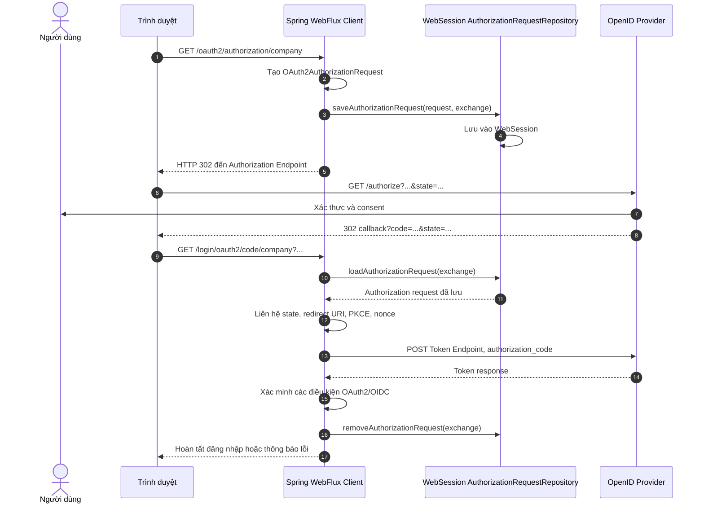
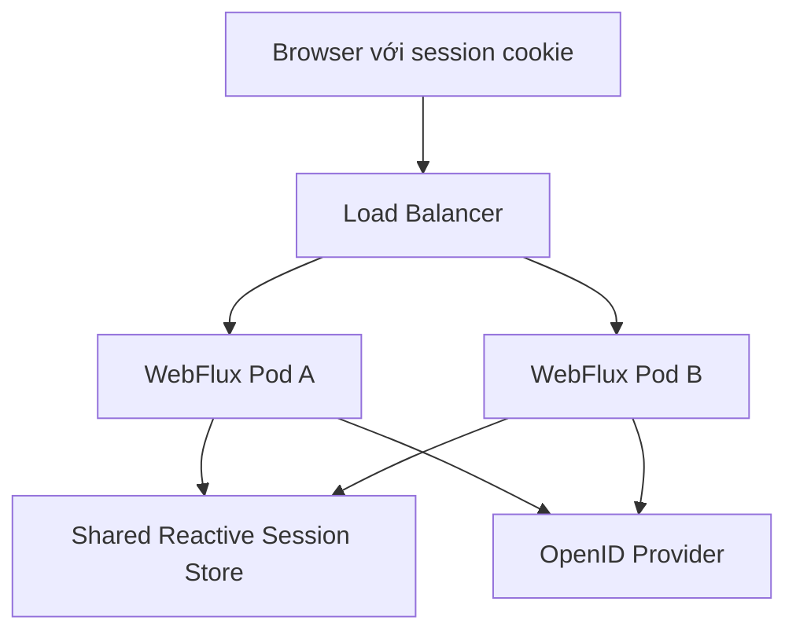

# 20.6. `WebSessionOAuth2ServerAuthorizationRequestRepository`

Trong **Spring Security OAuth 2.0/OIDC Client** chạy trên **Reactive stack (Spring WebFlux)**, một lần đăng nhập OAuth2/OIDC không hoàn tất trong một HTTP request duy nhất. Ứng dụng bắt đầu bằng cách chuyển hướng trình duyệt tới Authorization Server/OpenID Provider, sau đó nhận callback chứa `code` và `state`. Giữa hai request HTTP này, ứng dụng phải **ghi nhớ authorization request đã khởi tạo** để đối chiếu callback và hoàn tất giao thức an toàn.

Thành phần đảm nhiệm việc lưu và khôi phục dữ liệu đó theo **WebSession** mặc định là **`WebSessionOAuth2ServerAuthorizationRequestRepository`**. Nó triển khai hợp đồng reactive `ServerAuthorizationRequestRepository<OAuth2AuthorizationRequest>`, cung cấp ba thao tác **lưu, tải và loại bỏ** authorization request qua `Mono` và `ServerWebExchange`.

Mục tiêu của bài học là hiểu chính xác repository lưu gì, được gọi khi nào, khác gì với Servlet `HttpSessionOAuth2AuthorizationRequestRepository`, vì sao nó cần liên kết với `state`, PKCE và OIDC `nonce`, cũng như các vấn đề thực tế: cookie session bị mất, callback ở instance khác, người dùng mở nhiều tab, session timeout, lưu trữ Redis và bảo mật.

> **Nguyên tắc:** Repository không phải nơi giữ access token sau đăng nhập; nó giữ **dữ liệu authorization request tạm thời** để hoàn tất đúng một OAuth2/OIDC authorization flow. Không có dữ liệu này, Client khó xác minh callback có thuộc yêu cầu mà nó thực sự đã khởi tạo hay không.

## 1. Vị trí của repository trong Reactive OAuth2 Login

Trong **Authorization Code Flow**, người dùng thực hiện:

1. Truy cập một trang cần xác thực trong WebFlux.
2. Spring Security tạo `OAuth2AuthorizationRequest` theo `ClientRegistration`: Client ID, Authorization Endpoint, redirect URI, scope, `state`, và các tham số bổ sung như `nonce` hoặc PKCE khi sử dụng.
3. Spring **lưu yêu cầu này** vào kho `ServerAuthorizationRequestRepository` gắn với ngữ cảnh trình duyệt.
4. Trình duyệt được chuyển tới Authorization Server.
5. Người dùng xác thực, cấp consent nếu cần.
6. Authorization Server chuyển trình duyệt về callback với authorization `code` và `state`, hoặc với tham số `error` khi thất bại.
7. Spring **tải lại** authorization request đã lưu và liên hệ nó với callback; `state` và các kiểm tra giao thức liên quan phải khớp.
8. Spring dùng authorization code, redirect URI, PKCE verifier khi áp dụng để gọi Token Endpoint.
9. Với OIDC, Spring xác minh ID Token, issuer, audience, thời gian và `nonce` theo ngữ cảnh.
10. Authorization request tạm thời được **loại bỏ** theo flow, tránh sử dụng lại ngoài ý muốn.



Sơ đồ là **mô hình luồng logic**, không phải cam kết chính xác thứ tự từng lời gọi nội bộ của mọi phiên bản Spring Security; một implementation có thể loại bỏ request ngay trong giai đoạn xử lý callback trước khi trao đổi token. Điểm quan trọng là trạng thái đã lưu phải được sử dụng trong xác minh và **không tồn tại vô thời hạn**.

### 1.1. Vì sao phải lưu authorization request?

Callback thông thường chỉ mang những giá trị như:

```http
GET /login/oauth2/code/company?code=EXAMPLE_CODE&state=EXAMPLE_STATE HTTP/1.1
Host: app.example.test
Cookie: SESSION=EXAMPLE_SESSION_COOKIE
```

Từ callback này, ứng dụng chưa thể tin ngay rằng:

- `code` thuộc một yêu cầu đăng nhập do chính ứng dụng vừa khởi tạo.
- `state` là giá trị ứng dụng từng tạo.
- Callback được gửi cho đúng ClientRegistration/redirect URI.
- PKCE `code_verifier` của yêu cầu gốc vẫn còn.
- OIDC `nonce` khớp với ID Token được trả về sau token exchange.

**OAuth2AuthorizationRequest đã lưu** giúp Spring tái tạo những dữ liệu mà callback tự nó không chứa. Đây là một cơ chế quan trọng chống lẫn yêu cầu đăng nhập, login CSRF và các lỗi ghép sai OAuth2 flow.

### 1.2. Repository này có xác thực người dùng không?

Không. Nó **không xác minh mật khẩu**, không phát hành token, không tự giải mã ID Token và không thay Resource Server. Nó chỉ quản lý **bản ghi yêu cầu authorization**. Các bước xác minh `state`, code, PKCE, issuer, signature và OIDC nonce thuộc toàn bộ pipeline OAuth2/OIDC Login của Spring Security.

## 2. Phân biệt các loại trạng thái trong Spring Security Reactive

Một ứng dụng OAuth2/OIDC Login có nhiều loại dữ liệu “state”. Chúng không thay thế nhau:

| Thành phần | Dữ liệu đại diện | Tồn tại lúc nào? |
|---|---|---|
| `OAuth2AuthorizationRequest` | Request dự kiến gửi đến Authorization Endpoint; gồm `state`, scope, redirect URI, PKCE/nonce tùy flow | Từ lúc bắt đầu authorization tới callback |
| `WebSessionOAuth2ServerAuthorizationRequestRepository` | Nơi lưu yêu cầu trên trong `WebSession` | Xuyên hai HTTP requests của browser |
| `SecurityContext` | `Authentication` đã xác minh, principal và authorities | Sau login, theo chính sách security context |
| `ServerSecurityContextRepository` | Cách lưu/khôi phục `SecurityContext` | Phục vụ phiên xác thực |
| `OAuth2AuthorizedClient` | ClientRegistration + principal + access token và có thể refresh token | Sau khi token được cấp |
| `ServerOAuth2AuthorizedClientRepository` hoặc service phù hợp | Lưu authorized client/tokens trong ngữ cảnh reactive | Dùng cho các API calls sau login |
| `WebSession` | Bộ nhớ trạng thái session WebFlux, có thể chứa nhiều thuộc tính | Theo session lifecycle |

Một sơ đồ dễ nhớ:

```text
Trước callback:
  WebSession
    └── saved OAuth2AuthorizationRequest
          ├── state
          ├── clientId
          ├── redirectUri
          ├── scopes
          ├── PKCE code_verifier? (theo flow)
          └── OIDC nonce? (theo flow)

Sau login:
  SecurityContext -> Authentication/OidcUser
  AuthorizedClient -> access token / refresh token?
```

**Không dùng authorization request repository để lưu access token lâu dài.** Ngược lại, đừng lấy authorized client repository để thay thế nơi lưu `state` của authorization request nếu chưa có một implementation thực sự đáp ứng hợp đồng.

### 2.1. `state` trong URL khác với `WebSession`

OAuth2 `state` là **một giá trị ngẫu nhiên ràng buộc authorization response với request gốc**. `WebSession` là cơ chế lưu trạng thái phía server theo phiên trình duyệt. Chúng bổ sung cho nhau:

```text
Browser session A
  -> Spring tạo state = s-A
  -> Lưu OAuth2AuthorizationRequest(state=s-A) trong WebSession A
  -> Callback state=s-A và cùng WebSession A
  -> Có thể đối chiếu đúng yêu cầu

Browser session B
  -> Không có request của A
  -> Không được lấy request của session A chỉ nhờ biết state=s-A
```

Không coi `state` là cookie phiên, không lưu toàn bộ session trong `state` và không sử dụng account ID/email có thể đoán làm `state`.

## 3. Class `WebSessionOAuth2ServerAuthorizationRequestRepository`

Tên class đầy đủ:

```java
org.springframework.security.oauth2.client.web.server
    .WebSessionOAuth2ServerAuthorizationRequestRepository
```

Trong Java source, import được viết trên **một dòng**:

```java
import org.springframework.security.oauth2.client.web.server.WebSessionOAuth2ServerAuthorizationRequestRepository;
```

Class này implement interface:

```java
ServerAuthorizationRequestRepository<OAuth2AuthorizationRequest>
```

với type parameter là một `OAuth2AuthorizationRequest` thuộc Spring Security OAuth2 Core.

### 3.1. Vì sao có tiền tố `WebSession`?

Trong Spring WebFlux, `WebSession` là abstraction cho session trong môi trường reactive. Nó khác với `HttpSession` của Servlet API.

- **Servlet:** `HttpServletRequest#getSession()`, `HttpSession`, request-scoped thread context.
- **Reactive:** `ServerWebExchange#getSession()` trả về `Mono<WebSession>`; thao tác session được đưa vào reactive chain.

`WebSessionOAuth2ServerAuthorizationRequestRepository` dùng session của WebFlux để lưu yêu cầu mà không bắt ứng dụng phải có một Servlet `HttpSession`.

### 3.2. Interface cung cấp ba thao tác

Chữ ký cốt lõi của `ServerAuthorizationRequestRepository<T>`:

```java
Mono<T> loadAuthorizationRequest(ServerWebExchange exchange);

Mono<Void> saveAuthorizationRequest(
    T authorizationRequest,
    ServerWebExchange exchange
);

Mono<T> removeAuthorizationRequest(ServerWebExchange exchange);
```

Với class này, `T` là `OAuth2AuthorizationRequest`.

| Method | Mục đích | Giá trị reactive |
|---|---|---|
| `saveAuthorizationRequest` | Lưu request khi bắt đầu redirect | `Mono<Void>` |
| `loadAuthorizationRequest` | Truy xuất request khi xử lý callback | `Mono<OAuth2AuthorizationRequest>`, có thể rỗng |
| `removeAuthorizationRequest` | Lấy/loại bỏ request đã lưu theo hợp đồng | `Mono<OAuth2AuthorizationRequest>`, có thể rỗng |

Đây là contract logic, không phải yêu cầu bạn phải tự gọi các method này trong controller. Với OAuth2 Login mặc định, Spring Security gọi chúng ở thời điểm phù hợp.

### 3.3. `Mono.empty()` có ý nghĩa gì?

Nếu không tìm thấy authorization request hợp lệ trong session, `loadAuthorizationRequest(...)` có thể trả một `Mono` hoàn tất mà không phát ra giá trị. Điều đó khác với trả một object có `state=null`.

Tương tự, `removeAuthorizationRequest(...)` có thể rỗng khi request không còn tồn tại hoặc không khớp điều kiện implementation. Khi viết custom repository, hãy tuân theo hợp đồng reactive thay vì trả `null` cho chính `Mono`.

### 3.4. Không dùng `block()` bên trong method repository

Ví dụ **không nên**:

```java
// KHÔNG NÊN làm trong WebFlux request handling:
WebSession session = exchange.getSession().block();
```

Trong Reactor/WebFlux, chặn event-loop thread có thể gây lỗi hoặc suy giảm hiệu năng. Hãy sử dụng `flatMap`, `map`, `doOnNext`, `then` và các operator phù hợp.

## 4. Vòng đời `save → load → remove`

### 4.1. `saveAuthorizationRequest` khi khởi tạo authorization

Giả sử Spring tạo request:

```text
authorizationUri = https://login.example.test/oauth2/authorize
clientId         = webflux-client
redirectUri      = https://app.example.test/login/oauth2/code/company
state            = R4nd0m-Example-State
scopes           = [openid, profile, email]
additional       = nonce / code_challenge? / ... (theo flow)
attributes       = PKCE verifier / nonce original? / ... (theo flow)
```

Repository được gọi để lưu bản ghi, gắn với WebSession của browser hiện tại. Sau đó Spring trả HTTP redirect tới Authorization Server.

Dữ liệu cần có **trước khi redirect** vì request tiếp theo sẽ đến từ một hệ thống khác qua browser; Spring không thể giữ state chỉ trong local variable của request đầu tiên.

### 4.2. `loadAuthorizationRequest` khi nhận callback

Callback:

```http
GET /login/oauth2/code/company?code=EXAMPLE_CODE&state=R4nd0m-Example-State HTTP/1.1
Host: app.example.test
Cookie: SESSION=EXAMPLE_SESSION
```

Spring cần lấy request đã lưu theo session/trạng thái liên quan. Nếu request được khôi phục, các thành phần OAuth2 Login mới có đủ dữ kiện để:

- Ràng buộc `state` của callback với authorization flow khởi tạo.
- Đối chiếu ClientRegistration và redirect URI.
- Lấy PKCE `code_verifier` khi flow có sử dụng.
- Tiếp tục trao đổi code và xác minh OIDC ID Token/nonce khi áp dụng.

**Không có yêu cầu lưu trước đó thì không được chỉ dựa trên một `code` và `state` do browser gửi mà coi login hợp lệ.**

### 4.3. `removeAuthorizationRequest` sau khi request được tiêu thụ

Khi callback được xử lý, trạng thái authorization request tạm thời cần được dọn dẹp theo contract:

```text
Authorization request khởi tạo
  -> lưu vào WebSession
  -> callback liên kết/tiêu thụ
  -> loại request khỏi kho
```

Dọn state giúp giảm nguy cơ lưu yêu cầu cũ, tránh nhầm với lần đăng nhập tiếp theo và hạn chế dữ liệu nhạy cảm tồn tại không cần thiết trong session.

Không tự thiết kế “mỗi authorization request chỉ được hoàn tất một lần” bằng `remove` đơn thuần nếu implementation tùy biến lưu ở Redis và có nhiều instance; với yêu cầu chống replay nghiêm ngặt cần thao tác tiêu thụ **nguyên tử** hoặc cùng logic đảm bảo đúng transaction.

### 4.4. Load không nhất thiết đồng nghĩa xóa

Đừng viết custom repository chỉ có `loadAuthorizationRequest` rồi mặc định việc đọc sẽ xóa. API có **method remove riêng** để làm rõ yêu cầu. Các thành phần Spring Security gọi load/remove theo flow được định nghĩa cho version đang dùng; hãy tôn trọng lifecycle thay vì tự xóa trong một hook bất kỳ rồi khiến callback không tìm được request.

## 5. `OAuth2AuthorizationRequest` chứa gì?

Một `OAuth2AuthorizationRequest` là object mô tả yêu cầu Authorization Endpoint. Một số thuộc tính thường thấy:

| Thuộc tính | Ví dụ | Ý nghĩa |
|---|---|---|
| `authorizationUri` | `https://login.example.test/oauth2/authorize` | Endpoint cấp quyền |
| `authorizationGrantType` | `authorization_code` | Grant flow đang dùng |
| `clientId` | `webflux-client` | Client đã đăng ký |
| `redirectUri` | `https://app.example.test/login/oauth2/code/company` | Callback phải phù hợp đăng ký |
| `scopes` | `openid, profile, email` | Phạm vi quyền yêu cầu |
| `state` | Chuỗi ngẫu nhiên khó đoán | Ràng buộc response với request |
| `additionalParameters` | `nonce`, `prompt`, `code_challenge`... tùy flow | Tham số gửi tới Authorization Endpoint |
| `attributes` | PKCE `code_verifier`, nonce ban đầu hoặc metadata nội bộ theo flow | Dữ liệu Client cần giữ phía server |

Không giả định chính xác mọi provider, version hay cấu hình sẽ dùng cùng một tập attributes. Cách quan trọng là **không làm mất attributes cần thiết** khi lưu hoặc tùy biến request.

### 5.1. Những giá trị nhạy cảm trong object

Authorization request có thể chứa `code_verifier` của PKCE và dữ liệu nonce/state liên quan, dù access token và refresh token chưa xuất hiện.

Vì thế:

- Không ghi `authorizationRequest.toString()` vào log toàn bộ.
- Không gửi object serialized cho frontend hoặc đưa vào URL.
- Bảo vệ session store, backup và log truy vết.
- Khi thiết kế kho phân tán, áp dụng kiểm soát truy cập và retention phù hợp.
- Khi dọn state, tránh để dữ liệu chưa tiêu thụ tồn tại vô hạn.

### 5.2. PKCE challenge và verifier khác nhau

Trong PKCE:

```text
Client tạo code_verifier ngẫu nhiên
    -> tính code_challenge từ verifier
    -> gửi code_challenge trên Authorization Request URL
    -> giữ code_verifier phía Client
    -> gửi code_verifier tới Token Endpoint khi đổi code
```

Nếu repository hoặc custom authorization resolver làm mất `code_verifier`, Token Endpoint có thể trả `invalid_grant` dù browser callback có `code` hợp lệ. Đó là lý do authorization request không thể thay bằng một map chỉ có `state` nếu flow cần PKCE.

### 5.3. OIDC nonce không thay cho state

Trong OIDC, `nonce` giúp ràng buộc ID Token với authentication request. `state` ràng buộc authorization response/callback với Client request.

| Giá trị | Nơi thường xuất hiện | Mục tiêu |
|---|---|---|
| `state` | Authorization request và callback response | Bảo vệ tính liên kết của flow, chống login CSRF |
| `nonce` | Authorization request; ID Token chứa claim nonce theo flow | Chống replay/token substitution trong OIDC |
| `code_challenge` | Authorization request | Cam kết với PKCE verifier |
| `code_verifier` | Token request, phía Client cần giữ trước đó | Chứng minh Client biết PKCE secret |
| `authorization code` | Callback, sau đó Token Endpoint | Một mã ngắn hạn để đổi token |

Không lấy một giá trị để thay tất cả. Spring Security có các bước riêng xử lý chúng; custom repository cần lưu đủ dữ liệu để các bước đó hoạt động.

## 6. Cấu hình Spring Boot WebFlux và OIDC Login

### 6.1. Dependencies

Ví dụ Spring Boot WebFlux:

```xml
<dependencies>
    <dependency>
        <groupId>org.springframework.boot</groupId>
        <artifactId>spring-boot-starter-webflux</artifactId>
    </dependency>
    <dependency>
        <groupId>org.springframework.boot</groupId>
        <artifactId>spring-boot-starter-oauth2-client</artifactId>
    </dependency>
</dependencies>
```

Đây là ví dụ cho nhánh Spring Boot 3.x; dự án nên sử dụng BOM/dependency version đúng với Spring Boot/Spring Security đang dùng.

Trong ứng dụng Reactive, `SecurityWebFilterChain` và `ServerHttpSecurity` được dùng thay cho Servlet `SecurityFilterChain` / `HttpSecurity`. Không sao chép Servlet configuration rồi kỳ vọng filter WebFlux tự hoạt động.

### 6.2. `application.yml`

```yaml
spring:
  security:
    oauth2:
      client:
        registration:
          company:
            provider: company-op
            client-id: ${OIDC_CLIENT_ID}
            client-secret: ${OIDC_CLIENT_SECRET}
            authorization-grant-type: authorization_code
            client-authentication-method: client_secret_basic
            redirect-uri: "{baseUrl}/login/oauth2/code/{registrationId}"
            scope:
              - openid
              - profile
              - email
        provider:
          company-op:
            issuer-uri: https://login.example.test/realms/company
```

Lưu ý:

- `openid` yêu cầu flow OIDC.
- `issuer-uri` cho phép Spring dựa trên OIDC metadata discovery để tìm các endpoint/JWKS phù hợp.
- `redirect-uri` phải khớp callback đã đăng ký tại OP.
- `client-id`/`client-secret` cần được lấy từ cấu hình bí mật, không hard-code giá trị thật.
- URL `example.test` chỉ là placeholder, không phải endpoint công khai có thể sử dụng.
- PKCE có thể được áp dụng theo loại Client và khả năng của Spring Security; không tùy ý tắt khi flow yêu cầu.

### 6.3. WebFlux security cơ bản

```java
import org.springframework.context.annotation.Bean;
import org.springframework.context.annotation.Configuration;
import org.springframework.security.config.Customizer;
import org.springframework.security.config.web.server.ServerHttpSecurity;
import org.springframework.security.web.server.SecurityWebFilterChain;

@Configuration
public class ReactiveSecurityConfig {

    @Bean
    SecurityWebFilterChain securityWebFilterChain(ServerHttpSecurity http) {
        http
            .authorizeExchange(exchanges -> exchanges
                .pathMatchers("/", "/error").permitAll()
                .anyExchange().authenticated()
            )
            .oauth2Login(Customizer.withDefaults());

        return http.build();
    }
}
```

Khi Spring Security Reactive OAuth2 Login được kích hoạt và không có custom repository, framework dùng cơ chế lưu authorization request phù hợp WebSession theo cấu hình mặc định/version.

Ở đây bạn **không cần tự lưu `state` vào WebSession** trong controller. Framework có sẵn repository và các WebFilters xử lý authorization flow.

## 7. Cấu hình `WebSessionOAuth2ServerAuthorizationRequestRepository` tường minh

Khi muốn kiểm soát repository được sử dụng hoặc chuẩn bị cho một custom wrapper, có thể khai báo một bean:

```java
import org.springframework.context.annotation.Bean;
import org.springframework.context.annotation.Configuration;
import org.springframework.security.oauth2.client.web.server.ServerAuthorizationRequestRepository;
import org.springframework.security.oauth2.client.web.server.WebSessionOAuth2ServerAuthorizationRequestRepository;
import org.springframework.security.oauth2.core.endpoint.OAuth2AuthorizationRequest;

@Configuration
public class AuthorizationRequestRepositoryConfig {

    @Bean
    ServerAuthorizationRequestRepository<OAuth2AuthorizationRequest>
    authorizationRequestRepository() {
        return new WebSessionOAuth2ServerAuthorizationRequestRepository();
    }
}
```

Sau đó gắn vào Reactive `oauth2Login` theo cấu hình hỗ trợ của phiên bản Spring Security:

```java
import org.springframework.context.annotation.Bean;
import org.springframework.security.config.web.server.ServerHttpSecurity;
import org.springframework.security.oauth2.client.web.server.ServerAuthorizationRequestRepository;
import org.springframework.security.oauth2.core.endpoint.OAuth2AuthorizationRequest;
import org.springframework.security.web.server.SecurityWebFilterChain;

@Bean
SecurityWebFilterChain securityWebFilterChain(
        ServerHttpSecurity http,
        ServerAuthorizationRequestRepository<OAuth2AuthorizationRequest>
                authorizationRequests) {

    http
        .authorizeExchange(exchanges -> exchanges
            .pathMatchers("/", "/error").permitAll()
            .anyExchange().authenticated()
        )
        .oauth2Login(oauth2 -> oauth2
            .authorizationRequestRepository(authorizationRequests)
        );

    return http.build();
}
```

Trong một dự án, chỉ khai báo **một** `SecurityWebFilterChain` áp dụng cho cùng đường dẫn, hoặc quản lý thứ tự/filter chain matching rõ ràng. Các đoạn cấu hình trước đó là **phương án thay thế nhau**, không phải yêu cầu dán tất cả vào cùng một class.

### 7.1. Vì sao cấu hình tường minh nếu mặc định đã dùng WebSession?

Có thể hữu ích khi:

- Muốn bọc repository để ghi telemetry an toàn.
- Muốn tích hợp chính sách session hoặc cách dọn trạng thái cụ thể.
- Muốn thay bằng implementation hỗ trợ nhiều authorization requests đồng thời trong cùng session, nếu nhu cầu và version yêu cầu.
- Muốn kiểm thử interface `ServerAuthorizationRequestRepository` trong isolation.
- Muốn làm rõ repository của `oauth2Login` khi ứng dụng có nhiều reactive security chains.

Nếu không có yêu cầu cụ thể, dùng **mặc định của Spring Security** thường ít rủi ro hơn. Tự thay repository là can thiệp vào dữ liệu bảo mật của OAuth2 flow.

### 7.2. Repository là một thành phần của login pipeline

Dù bạn khai báo repository dưới dạng `@Bean`, nó chỉ được sử dụng khi phần cấu hình tương ứng lấy bean ấy hoặc bạn **gắn nó vào đúng OAuth2 Login spec**. Không nên mặc định mọi bean tự định nghĩa sẽ tự động thay toàn bộ repository nội bộ trong mọi Spring Security version.

Nếu customization không có hiệu lực, kiểm tra rằng đúng `SecurityWebFilterChain` xử lý request `/oauth2/authorization/...` và callback `/login/oauth2/code/...`.

## 8. Ví dụ: Wrapper logging an toàn, không làm thay logic lưu

Cần đo xem authorization request đã được lưu/tải/xóa chưa? Một cách ít rủi ro là **delegate** toàn bộ công việc cho `WebSessionOAuth2ServerAuthorizationRequestRepository` và chỉ ghi các sự kiện đã lọc.

```java
import org.slf4j.Logger;
import org.slf4j.LoggerFactory;
import org.springframework.security.oauth2.client.web.server.ServerAuthorizationRequestRepository;
import org.springframework.security.oauth2.client.web.server.WebSessionOAuth2ServerAuthorizationRequestRepository;
import org.springframework.security.oauth2.core.endpoint.OAuth2AuthorizationRequest;
import org.springframework.web.server.ServerWebExchange;
import reactor.core.publisher.Mono;

public final class ObservedAuthorizationRequestRepository
        implements ServerAuthorizationRequestRepository<OAuth2AuthorizationRequest> {

    private static final Logger log =
        LoggerFactory.getLogger(ObservedAuthorizationRequestRepository.class);

    private final ServerAuthorizationRequestRepository<OAuth2AuthorizationRequest>
            delegate = new WebSessionOAuth2ServerAuthorizationRequestRepository();

    @Override
    public Mono<Void> saveAuthorizationRequest(
            OAuth2AuthorizationRequest request,
            ServerWebExchange exchange) {

        return delegate.saveAuthorizationRequest(request, exchange)
            .doOnSuccess(ignored ->
                log.debug("oauth2_authorization_request event=saved")
            );
    }

    @Override
    public Mono<OAuth2AuthorizationRequest> loadAuthorizationRequest(
            ServerWebExchange exchange) {

        return delegate.loadAuthorizationRequest(exchange)
            .doOnNext(request ->
                log.debug("oauth2_authorization_request event=loaded")
            )
            .switchIfEmpty(Mono.defer(() -> {
                log.debug("oauth2_authorization_request event=not_found");
                return Mono.empty();
            }));
    }

    @Override
    public Mono<OAuth2AuthorizationRequest> removeAuthorizationRequest(
            ServerWebExchange exchange) {

        return delegate.removeAuthorizationRequest(exchange)
            .doOnNext(request ->
                log.debug("oauth2_authorization_request event=removed")
            );
    }
}
```

Ví dụ trên thể hiện nguyên tắc **delegate đúng contract**, không giả lập HTTP session hoặc đọc body callback. Khi dùng trong ứng dụng thật, việc log `debug` cần phù hợp môi trường và tránh tạo quá nhiều sự kiện.

### 8.1. Vì sao không in `request` hoặc `state`?

Không nên:

```java
// KHÔNG NÊN:
log.info("OAuth2 request: {}", request);
log.info("state={}", request.getState());
log.info("attributes={}", request.getAttributes());
```

Vì `OAuth2AuthorizationRequest` và attributes có thể chứa dữ liệu phục vụ bảo vệ flow, gồm PKCE verifier. Ngay cả `state` không phải access token, nó vẫn là giá trị nhạy cảm trong việc liên hệ request và callback.

Nên ghi metadata như:

```text
event=oauth2_authorization_request_saved
registrationCategory=enterprise-oidc
exchangeCorrelationId=random-internal-id
result=success
```

Không dùng raw session ID, state, nonce, code hoặc token làm correlation ID. Nếu cần đối chiếu một flow, dùng ID ngẫu nhiên độc lập và quản lý quyền truy cập log.

### 8.2. Không tự subscribe trong repository

Đoạn sau là **sai**:

```java
// KHÔNG NÊN trong implementation reactive:
delegate.saveAuthorizationRequest(request, exchange).subscribe();
return Mono.empty();
```

Việc gọi `subscribe()` thủ công có thể làm mất sequencing, exception propagation và context; response redirect có thể được gửi trước khi session state được lưu. Với WebFlux, hãy **trả đúng Mono của thao tác lưu** để filter framework điều phối.

### 8.3. Không chặn event loop bằng persistence đồng bộ

Nếu bạn thay repository bằng database/Redis trực tiếp:

- Ưu tiên reactive API phù hợp.
- Không gọi JDBC/blocking Redis client trên Netty event-loop.
- Nếu buộc dùng blocking client, cần điều phối thread model cẩn thận theo thiết kế WebFlux.
- Không biến authorization callback thành một chuỗi retry persistence vô hạn.
- Bảo vệ state và TTL dù lưu ở đâu.

## 9. `WebSession` được giữ qua redirect như thế nào?

WebFlux session có một identifier mà browser thường gửi lại qua cookie theo cấu hình session resolver. Khi Client lưu authorization request vào `WebSession` và gửi 302 tới OP, browser cần giữ khả năng liên hệ với **cùng phiên** lúc quay lại callback.

Khái niệm:

```text
Request 1:
GET /oauth2/authorization/company
    -> Server tạo/tìm WebSession S1
    -> Lưu OAuth2AuthorizationRequest trong S1
    -> Response đặt session cookie khi cần
    -> 302 đến OP

Browser sang OP:
    -> Có thể đã đi qua nhiều lần redirect

Request 2:
GET /login/oauth2/code/company?code=...&state=...
Cookie: <cookie liên kết WebSession S1>
    -> Server tìm lại S1
    -> Load OAuth2AuthorizationRequest đã lưu
    -> Tiếp tục xác thực
```

Nếu browser **không gửi cookie liên kết với phiên cũ**, Spring không thể tìm đúng authorization request dù callback `state` nhìn có vẻ hợp lệ.

### 9.1. `WebSession` khác `HttpSession` ở đâu?

| Khía cạnh | WebFlux `WebSession` | Servlet `HttpSession` |
|---|---|---|
| API truy cập | `ServerWebExchange#getSession()` trả `Mono<WebSession>` | `HttpServletRequest#getSession()` trả trực tiếp |
| Security stack | `SecurityWebFilterChain` / `ServerHttpSecurity` | `SecurityFilterChain` / `HttpSecurity` |
| Repository authorization request | `WebSessionOAuth2ServerAuthorizationRequestRepository` | `HttpSessionOAuth2AuthorizationRequestRepository` |
| I/O model | Reactive `Mono`/`Flux` | Servlet request API |
| SecurityContext repository | Reactive interfaces | Servlet interfaces |
| Session store | Theo `WebSessionManager`/Spring Session Reactive integration | Theo Servlet container/Spring Session integration |

**Không import nhầm** class Servlet sang WebFlux hoặc gắn `HttpSessionOAuth2AuthorizationRequestRepository` vào Reactive `oauth2Login`. Hai class phục vụ cùng một nhu cầu nhưng thuộc các hợp đồng và framework khác nhau.

### 9.2. WebSession không đồng nghĩa toàn bộ login session

WebSession có thể được Spring Security sử dụng cả trước và sau login, nhưng **authorization request** chỉ cần tồn tại tạm thời đến callback. Sau login, `SecurityContext` có vòng đời riêng; repository authorization request không cần giữ mọi yêu cầu cũ trong session mãi.

## 10. Cookie, `SameSite`, `Secure` và callback

Cookie liên kết WebSession là mắt xích quan trọng của login redirect. Các thuộc tính cookie cần được cấu hình theo môi trường:

| Thuộc tính | Vai trò | Điều cần cân nhắc |
|---|---|---|
| `Secure` | Chỉ gửi cookie trên HTTPS | Bắt buộc trong triển khai web production có TLS |
| `HttpOnly` | Hạn chế JavaScript đọc cookie | Nên bật cho session cookie |
| `SameSite=Lax` | Giảm gửi cookie trong một số cross-site requests | Thường phù hợp với callback top-level GET redirect |
| `SameSite=Strict` | Giới hạn cross-site cookie mạnh hơn | Có thể làm mất session cookie khi callback từ OP |
| `SameSite=None` | Cho phép cross-site cookie theo quy định trình duyệt | Phải kèm `Secure`; tăng yêu cầu kiểm soát CSRF và riêng tư |
| `Path` | Giới hạn path cookie được gửi | Phải bao phủ authorization initiation/callback tương ứng |
| `Domain` | Phạm vi host/subdomain cookie | Tránh cấu hình quá rộng, đặc biệt multi-tenant |
| Session expiration | Thời gian sống của WebSession | Phải đủ cho người dùng hoàn tất login/consent |

### 10.1. Redirect GET và `response_mode=form_post`

OIDC Authorization Code Flow mặc định thường nhận callback bằng **GET** với `code`/`state`. Nếu OP sử dụng `response_mode=form_post`, callback có thể là một **cross-site POST** từ trang của OP.

Trình duyệt có thể không gửi cookie `SameSite=Lax` theo quy tắc tương ứng cho POST cross-site. Điều đó khiến Spring không tìm được session authorization request. Tuy nhiên, **không nên chỉ đổi SameSite=None để sửa mọi lỗi** mà không xem CSRF, loại response mode, browser support và chính sách session.

Khi cần `form_post`, cần:

1. Xác định WebFlux/OIDC Client phiên bản đang dùng có hỗ trợ response mode đó như mong đợi không.
2. Cấu hình session cookie đúng với luồng browser thực tế.
3. Bảo vệ HTTPS, `Secure`, `HttpOnly` và CSRF ở các endpoint cần thiết.
4. Kiểm thử callback trên các trình duyệt mục tiêu.
5. Không giảm bảo vệ `state` hoặc nonce để “làm flow chạy được”.

### 10.2. Cookie bị trình duyệt chặn

Một số nguyên nhân:

- Người dùng chặn cookie, đang dùng chế độ riêng tư có chính sách nghiêm ngặt.
- Cookie bị sai Domain/Path.
- App khởi tạo trên `app.example.test` nhưng callback dùng host `www.example.test` ngoài phạm vi cookie.
- Callback từ IdP là cross-site POST với SameSite không phù hợp.
- Reverse proxy thay scheme/host làm browser coi cookie khác ngữ cảnh.
- Session đã hết hạn do người dùng mất nhiều thời gian trên màn hình consent.
- Một security appliance/intermediate proxy loại `Set-Cookie` hoặc `Cookie`.

Trong chẩn đoán, có thể quan sát **cookie có mặt hay không** qua dev tools/HTTP trace đã che dữ liệu, nhưng không đưa session cookie thật vào ticket hoặc log.

## 11. Reverse proxy, TLS termination và Redirect URI

Nhiều WebFlux app chạy sau load balancer:

```text
Browser
  -> https://app.example.test
  -> Reverse proxy / Load balancer
  -> http://internal-webflux:8080
```

Client registration có:

```yaml
redirect-uri: "{baseUrl}/login/oauth2/code/{registrationId}"
```

Nếu Spring nhận sai thông tin về `scheme`, `host` và `port` vì proxy headers không được cấu hình đúng, nó có thể tạo redirect URI nội bộ như `http://internal-webflux:8080/login/oauth2/code/company`. Authorization Server từ chối URI hoặc callback đi sai host, làm session cookie không khớp.

### 11.1. Hướng xử lý

- Đăng ký Redirect URI công khai đúng tại OP.
- Cấu hình reverse proxy gửi `Forwarded` hoặc `X-Forwarded-*` theo chuẩn và giới hạn tin cậy.
- Cấu hình Spring Boot xử lý forwarded headers theo hạ tầng đang sử dụng.
- Không tin `X-Forwarded-Host` từ mọi client Internet; chỉ tin proxy đã được kiểm soát.
- Đảm bảo callback dùng cùng origin và cookie session phù hợp.
- Dùng HTTPS cho browser-facing flow và Token Endpoint.

### 11.2. Phân biệt hai lỗi thường gặp

| Lỗi | Biểu hiện | Hướng điều tra |
|---|---|---|
| `redirect_uri_mismatch` tại OP | Login không bắt đầu/không cấp code | URI public/registration, proxy scheme/host |
| `authorization_request_not_found` hoặc `invalid_state` tại callback | OP đã chuyển về nhưng Client mất yêu cầu ban đầu | Cookie/WebSession, multi-node store, timeout, đồng thời nhiều flow |

Không sửa lỗi cookie bằng cách bỏ `state` check; cũng không sửa redirect URI bằng cách dùng `*` wildcard không được provider/chuẩn cho phép.

## 12. WebSession trên nhiều instance

Một WebFlux app production có thể có 3 pods:

```text
                 Load Balancer
                 /     |     \
             Pod A    Pod B   Pod C
               \       |      /
                  Session Store?
```

### 12.1. Khi lưu session cục bộ

Giả sử:

```text
Request khởi tạo login -> Pod A
WebSession S1 nằm trong memory Pod A
Trình duyệt sang OP rồi callback -> Pod B
Pod B không biết S1
=> Không tìm thấy OAuth2AuthorizationRequest đã lưu
```

Lỗi có thể xuất hiện ngẫu nhiên tùy pod nhận callback. Trong dev chạy một instance thì không thấy lỗi, nhưng sau khi scale lên nhiều pods, login chập chờn.

### 12.2. Hai lựa chọn thường gặp

**A. Session affinity (sticky sessions):**

- Load balancer cố chuyển cùng session về cùng pod.
- Dễ khởi đầu nhưng yếu khi pod restart, autoscale, failover.
- Không giải quyết mọi vấn đề dữ liệu session, nhất là khi node biến mất.

**B. Shared session store (ví dụ Spring Session + Redis):**

- Các pods truy cập cùng session state phù hợp.
- Callback có thể đến pod khác và vẫn đọc đúng WebSession khi cấu hình thành công.
- Cần bảo vệ Redis, thiết kế TTL, serializer, phiên bản object và availability.
- Không tự động đảm bảo các custom session attributes đều dễ serialize hoặc backward-compatible sau deploy.

Một kiến trúc:



### 12.3. Spring Session và Redis

Với Spring Boot WebFlux và cơ chế session phù hợp, có thể dùng dependency Spring Session Data Redis:

```kotlin
dependencies {
    implementation("org.springframework.boot:spring-boot-starter-webflux")
    implementation("org.springframework.boot:spring-boot-starter-oauth2-client")
    implementation("org.springframework.session:spring-session-data-redis")
}
```

Đồng thời cần Redis connection/host/credentials/TLS và cấu hình Spring Session Reactive tương thích với **phiên bản Boot/Spring Session** đang dùng. Ví dụ:

```yaml
spring:
  data:
    redis:
      host: redis.internal.example.test
      port: 6379
```

YAML này chỉ là **ví dụ cấu hình kết nối**, chưa đủ cho môi trường production: cần xác thực Redis, TLS, namespace/session timeout, serialization và monitoring. Không dùng kết nối Redis plaintext không bảo vệ giữa các vùng mạng tin cậy thấp.

### 12.4. Vấn đề serialization của authorization request

Nếu custom repository lưu object `OAuth2AuthorizationRequest` trong shared session store, lưu ý:

- Cơ chế serialization được chọn có hỗ trợ các loại object/attributes không?
- Class definition/serialization có thay đổi giữa các phiên bản Spring Security không?
- Khi blue-green deployment nhiều version cùng hoạt động, session cũ có giải mã được không?
- Token/code verifier có bị lộ qua serialized payload hoặc log serializer không?
- TTL của session đủ cho authorization flow nhưng không quá dài?
- Có dữ liệu không serializable do custom resolver thêm vào attributes không?

Không tự serialize request bằng `toString()` rồi parse lại; sẽ dễ mất dữ liệu cần cho PKCE và nonce. Nếu buộc dùng custom DTO, cần versioning và giữ đầy đủ nội dung cần thiết theo contract.

## 13. Mở nhiều tab và nhiều authorization requests đồng thời

Một người dùng có thể:

1. Mở tab A và bắt đầu login với provider X.
2. Chưa hoàn tất, mở tab B và bắt đầu login với provider Y.
3. Quay lại tab A để hoàn tất.
4. Nhận lỗi `state` không hợp lệ hoặc không tìm thấy authorization request.

Lý do có thể là repository mặc định chỉ giữ **một request đang chờ** theo thuộc tính session ở phiên bản/triển khai cụ thể; lần khởi tạo mới có thể thay nội dung cũ. Cũng có những yếu tố khác như session rotation, thay host/cookie hoặc callback sai state.

Không suy luận rằng mọi phiên bản mặc định luôn hỗ trợ **nhiều** authorization flows song song chỉ vì `state` là chuỗi duy nhất. Hãy kiểm tra hành vi của `WebSessionOAuth2ServerAuthorizationRequestRepository` trong Spring Security version đang dùng.

### 13.1. Mô hình lưu một request

```text
WebSession S1:
  savedAuthorizationRequest = request(state=A)

Tab A khởi tạo -> save A

Tab B khởi tạo -> save B
WebSession S1:
  savedAuthorizationRequest = request(state=B)

Tab A callback state=A
  -> request trong session là state=B
  -> callback không khớp; login A không thể hoàn tất
```

Đây là kịch bản minh họa loại lỗi **ghi đè trạng thái đang chờ**. Việc repository có lưu một entry hay map nhiều entry phải được xác nhận với implementation thực tế; thiết kế test multi-tab giúp phát hiện behavior không mong muốn.

### 13.2. Khi nào cần custom repository lưu theo `state`?

Nếu sản phẩm bắt buộc hỗ trợ nhiều OAuth2/OIDC logins cùng lúc trong cùng WebSession, có thể thiết kế kho:

```text
session:
  pendingAuthorizationRequests:
    state-A -> OAuth2AuthorizationRequest A
    state-B -> OAuth2AuthorizationRequest B
```

Các yêu cầu bảo mật:

- Map luôn nằm trong **WebSession tương ứng**, không lưu state toàn cục rồi cho ai có state lấy được.
- `state` phải là giá trị đủ entropy do framework tạo, không do browser đặt tùy ý.
- Có **TTL** và giới hạn số pending requests/session để chống memory abuse.
- Callback chỉ đọc/tiêu thụ request có `state` khớp, không fallback sang entry gần nhất.
- Loại bỏ entry **đúng state** sau khi callback được xử lý.
- Nếu nhiều pods, thao tác tiêu thụ nên có cơ chế atomicity/race handling phù hợp storage.
- Không ghi PKCE verifier hoặc nonce ra cookie/URL.
- Khi flow thất bại hoặc hết hạn, dọn entry cũ.

Đây là thiết kế mở rộng, không phải lý do để viết lại repository mặc định nếu ứng dụng không có nhu cầu multi-tab thực sự.

### 13.3. Không bỏ qua state mismatch

Sai:

```java
// Ý tưởng nguy hiểm, không phải API Spring Security thực tế:
// Nếu callback state không tìm thấy thì chọn request cuối cùng trong session.
pendingRequests.values().stream().findFirst();
```

Làm vậy vô hiệu hóa ràng buộc giữa authorization response và request. Nếu state không khớp, phải xử lý lỗi hợp lệ (bắt đầu flow mới hoặc thông báo rõ), không gán callback cho request khác.

## 14. Nguy cơ bảo mật và mô hình đe dọa

### 14.1. Login CSRF và authorization response injection

Nếu Client không kiểm tra request đã lưu và `state`, kẻ tấn công có thể cố khiến browser nạn nhân hoàn tất một flow OAuth2 mà nạn nhân không chủ động bắt đầu, hoặc ghép callback không đúng ngữ cảnh.

Repository giúp Client giữ bằng chứng về authorization request ban đầu; nhưng chống login CSRF còn phụ thuộc toàn bộ flow, việc tạo `state` ngẫu nhiên, kiểm tra callback và session binding.

**Không dùng** custom implementation trả luôn một request giả/fixed state để “giảm lỗi session”:

```java
// THIẾT KẾ KHÔNG AN TOÀN:
// loadAuthorizationRequest() luôn trả request có state="fixed"
```

`state` cần gắn với request khởi tạo và không được đoán trước.

### 14.2. PKCE downgrade và mất `code_verifier`

Nếu custom resolver hoặc repository loại bỏ attributes cần cho PKCE, Token Endpoint có thể từ chối exchange với `invalid_grant` hoặc ứng dụng có thể gặp lỗi bảo vệ flow.

Không sửa bằng cách tắt PKCE trên public client. Cần lưu/khôi phục nguyên vẹn metadata authorization request và kiểm tra tương thích provider.

### 14.3. OIDC nonce mismatch

Một flow OIDC có `nonce` có thể lưu dữ liệu nonce ban đầu phía Client để so sánh claim nonce của ID Token. Nếu session bị mất hoặc request bị ghi đè, quá trình xác minh nonce có thể thất bại.

Không đặt `nonce` cố định, không bỏ qua nonce validation, và không dùng `state` thay nonce khi framework yêu cầu cơ chế riêng.

### 14.4. Rò rỉ WebSession và request attributes

Session attributes có thể chứa thông tin phục vụ OAuth2 flow. Do đó:

- Chỉ cấp quyền truy cập session store cho các dịch vụ cần thiết.
- Bảo vệ Redis/backup bằng quyền, network policies, encryption và retention thích hợp.
- Không log session object nguyên vẹn.
- Không phát hiện lỗi bằng cách copy token/code/verifier vào ticket.
- Đặt TTL hợp lý và cơ chế loại bỏ request đã xử lý.
- Xem xét session fixation protection và cách Spring Security quản lý phiên sau đăng nhập.

### 14.5. Đừng tin callback chỉ vì có cookie

Một cookie hợp lệ chứng minh trình duyệt gửi session tương ứng, nhưng OAuth2 callback vẫn phải được kiểm tra `state`, code, redirect URI, issuer và các điều kiện OIDC. Cookie không làm code tự hợp lệ.

Ngược lại, `state` đúng mà session đã hết hạn không đủ để bỏ qua việc khôi phục authorization request.

## 15. Khi nào callback không tìm được authorization request?

Một số lỗi có thể xuất hiện dưới các message khác nhau theo version:

```text
authorization_request_not_found
authorization_request_not_found / not found
invalid_state
OAuth2AuthenticationException
Unable to resolve the authorization request
OAuth2 Login failed
```

Đây là **nhóm triệu chứng minh họa**, không phải danh sách chuỗi exception được đảm bảo cố định. Cách hiểu phụ thuộc nơi lỗi được phát hiện.

| Triệu chứng | Nguyên nhân có thể | Cách kiểm tra |
|---|---|---|
| Callback có `code` nhưng thiếu saved request | Cookie session không về, session mất/hết hạn | Kiểm tra request/cookie, TTL, session store |
| Chỉ lỗi ở production nhiều pods | Session chỉ nằm trong memory một pod | Shared session store hoặc affinity/failover |
| Lỗi khi mở 2 tab login | Pending request bị ghi đè hoặc callback state không khớp | Kiểm thử concurrent flows trên cùng WebSession |
| Lỗi sau consent kéo dài | WebSession timeout | Xem session TTL, session expiration và UX |
| Lỗi sau proxy deploy | Host/path/cookie/redirect URI thay đổi | Kiểm tra public URI, forwarded headers, cookie scope |
| `invalid_grant` ở Token Endpoint | PKCE verifier/code/redirect URI không đúng | Xem request lưu ban đầu, code one-time, callback |
| OIDC nonce mismatch | Nonce ban đầu bị mất/thay đổi | Xem flow OIDC và saved request attributes |
| Chỉ lỗi trình duyệt cụ thể | SameSite/third-party cookie policy | Xem cookie behavior và response mode |
| Callback trả 404 | Security chain/matcher/callback path sai | Xem `/login/oauth2/code/{registrationId}` và routing |
| UserInfo API lỗi sau login | Access token/scope/provider lỗi | Không đổ ngay lỗi cho authorization request repository |

### 15.1. Thứ tự chẩn đoán hữu ích

1. **Xác định request bắt đầu login có đi qua đúng `SecurityWebFilterChain` không.**
2. **Kiểm tra browser đã nhận cookie liên kết WebSession hay chưa.**
3. **Kiểm tra redirect đến đúng Authorization Endpoint và callback URI không.**
4. **Đảm bảo callback quay về cùng origin/cookie scope hoặc session store thích hợp.**
5. **Đối chiếu trạng thái session giữa hai request mà không log session ID thô.**
6. **Kiểm tra session TTL, restart, load balancer, autoscale và Redis availability.**
7. **Kiểm tra có nhiều authorization flows đồng thời trên một WebSession không.**
8. **Kiểm tra custom repository/resolver có lưu đủ `state`, PKCE verifier và nonce không.**
9. **Nếu saved request có nhưng Token Endpoint lỗi, phân loại `invalid_grant`, Client authentication, redirect URI và code.**
10. **Nếu callback/token thành công nhưng login vẫn lỗi, kiểm tra OIDC ID Token/nonce/UserInfo theo chính sách.**

Không tăng session TTL lên vô hạn hoặc tắt state validation chỉ để mất một mã lỗi.

## 16. OAuth2 Login và OAuth2 Client trong Reactive stack

Một ứng dụng WebFlux có thể có cả:

- **`oauth2Login`:** đăng nhập người dùng bằng OP, tạo `Authentication`.
- **`oauth2Client`:** quản lý authorized client để gọi downstream API.

Ví dụ:

```java
@Bean
SecurityWebFilterChain securityWebFilterChain(ServerHttpSecurity http) {
    http
        .authorizeExchange(exchanges -> exchanges
            .anyExchange().authenticated()
        )
        .oauth2Login(org.springframework.security.config.Customizer.withDefaults())
        .oauth2Client(org.springframework.security.config.Customizer.withDefaults());

    return http.build();
}
```

Điểm cần nhớ:

```text
OAuth2AuthorizationRequest repository:
  giúp bắt đầu và hoàn tất authorization flow

OAuth2AuthorizedClientRepository / Service:
  giúp lấy/lưu access token và refresh token sau khi được cấp

SecurityContext repository:
  giúp lưu authentication trong ứng dụng
```

Không thay repository trước login bằng repository lưu token sau login.

### 16.1. `ServerOAuth2AuthorizedClientExchangeFilterFunction` khác repository này

Khi WebFlux app dùng `WebClient` gọi API bằng OAuth2, `ServerOAuth2AuthorizedClientExchangeFilterFunction` có thể chọn/tái cấp authorized client và gắn access token.

Nó **không phải** `WebSessionOAuth2ServerAuthorizationRequestRepository`:

- Authorization request repo dùng cho `state`/flow trước callback.
- WebClient OAuth2 filter dùng access token đã có hoặc được manager cấp để gọi API.
- Các thành phần có thể cùng tồn tại trong một ứng dụng, nhưng làm nhiệm vụ khác nhau.

### 16.2. Với ứng dụng chỉ là Resource Server

Một WebFlux API nhận Bearer JWT từ bên ngoài có thể dùng `oauth2ResourceServer().jwt()` mà không cần `oauth2Login` hoặc authorization request repository. Resource Server xác minh access token, không tự điều hướng browser qua Authorization Endpoint.

Không thêm `WebSessionOAuth2ServerAuthorizationRequestRepository` vào mọi API dùng JWT nếu nó không đóng vai trò OAuth2/OIDC Login Client.

## 17. WebFlux không có nghĩa mọi thứ đều không giữ trạng thái

Một hiểu lầm thường gặp:

> “Reactive là stateless, nên không cần lưu authorization request.”

Reactive nói về mô hình xử lý request/asynchronous I/O, không quy định bắt buộc ứng dụng không có session. OAuth2 Authorization Code Flow dựa vào một **yêu cầu khởi tạo và một callback xảy ra sau đó**; cần một nơi tin cậy lưu tương quan hai bước.

Có thể chọn cách lưu khác ngoài WebSession, nhưng phải bảo đảm các ràng buộc:

- Không làm lộ state, nonce hoặc PKCE verifier.
- Liên kết callback với đúng flow/browser.
- Có TTL và one-time consumption.
- Có chống replay và chống concurrency hazards.
- Tương thích Reactive `Mono`/`ServerWebExchange` contract.
- Giữ OAuth2/OIDC validation mặc định của Spring Security.

### 17.1. `NoOpServerSecurityContextRepository` có thay đổi điều này không?

Nếu ứng dụng tùy biến lưu SecurityContext để không giữ phiên đăng nhập lâu dài, điều đó **không tự thay** yêu cầu lưu authorization request giữa redirect và callback. Hai repository có nhiệm vụ khác nhau.

Không suy ra rằng cấu hình security context stateless có nghĩa `state` tự được bảo vệ. Nếu muốn hoàn toàn stateless ở tầng authorization request, cần một cơ chế custom an toàn, có kiểm soát replay/PKCE/nonce và cookie/browser binding; đây là bài toán thiết kế chuyên sâu.

### 17.2. Không lưu authorization request trong một biến static

Sai:

```java
// KHÔNG AN TOÀN và không tương thích nhiều user:
static OAuth2AuthorizationRequest lastRequest;
```

Một biến static cho toàn ứng dụng có thể khiến các phiên người dùng ghi đè request của nhau, gây login CSRF, mất state, sai principal và lỗi không tái lập khi scale out.

## 18. Kiểm thử repository bằng Reactive APIs

### 18.1. Kiểm thử hợp đồng save/load/remove

Một đơn vị test có thể dùng Spring MockWeb Server exchange và Reactor Test `StepVerifier`. Ví dụ minh họa theo API phổ biến:

```java
import org.junit.jupiter.api.Test;
import org.springframework.mock.http.server.reactive.MockServerHttpRequest;
import org.springframework.mock.web.server.MockServerWebExchange;
import org.springframework.security.oauth2.client.web.server.WebSessionOAuth2ServerAuthorizationRequestRepository;
import org.springframework.security.oauth2.core.endpoint.OAuth2AuthorizationRequest;
import reactor.test.StepVerifier;

import static org.assertj.core.api.Assertions.assertThat;

class WebSessionAuthorizationRequestRepositoryTest {

    @Test
    void saveThenLoadThenRemove() {
        var repository =
            new WebSessionOAuth2ServerAuthorizationRequestRepository();

        var exchange = MockServerWebExchange.from(
            MockServerHttpRequest.get("/login/oauth2/code/company")
                .queryParam("state", "test-state-123")
        );

        var request = OAuth2AuthorizationRequest.authorizationCode()
            .authorizationUri("https://id.example.test/oauth2/authorize")
            .clientId("webflux-client")
            .redirectUri("https://app.example.test/login/oauth2/code/company")
            .state("test-state-123")
            .build();

        StepVerifier.create(
            repository.saveAuthorizationRequest(request, exchange)
        ).verifyComplete();

        StepVerifier.create(
            repository.loadAuthorizationRequest(exchange)
        ).assertNext(saved ->
            assertThat(saved.getState()).isEqualTo("test-state-123")
        ).verifyComplete();

        StepVerifier.create(
            repository.removeAuthorizationRequest(exchange)
        ).assertNext(removed ->
            assertThat(removed.getState()).isEqualTo("test-state-123")
        ).verifyComplete();
    }
}
```

Các chi tiết kiểm tra một callback exchange trong cùng mock session có thể cần điều chỉnh theo Spring Security version, đặc biệt nếu repository lọc request theo `state`/query parameter. Code là **minh họa kiểm thử hợp đồng**, không có tuyên bố đã chạy test. Với production code, không dùng `state="test-state-123"` cố định; framework phải sinh state đủ entropy.

Nếu muốn xác nhận `remove` thực sự xóa entry, có thể thêm bước:

```java
StepVerifier.create(repository.loadAuthorizationRequest(exchange))
    .verifyComplete();
```

### 18.2. Test integration với `WebTestClient`

Một test end-to-end hữu ích hơn để xác nhận WebSession/cookie:

1. Gọi `GET /oauth2/authorization/company`.
2. Xác nhận response chuyển hướng tới Authorization Endpoint.
3. Giữ cookie session được trả về cho cùng test client.
4. Giả lập callback có `state` phù hợp với authorization request gốc.
5. Đảm bảo Spring không bỏ qua kiểm tra `state`.
6. Xác minh khi cookie bị mất hoặc `state` sai, authentication thất bại.
7. Với OIDC, stub Token Endpoint/JWKS và các claim liên quan đủ để đi hết flow.
8. Xác minh sau callback authorization request không còn được chấp nhận lại.

Một suite WebTestClient có thể sử dụng mock Authorization Server thay vì gọi IdP thật. Đừng đưa client secret hoặc refresh token thật vào test fixture.

### 18.3. Các test nên có

| Trường hợp | Kỳ vọng |
|---|---|
| Save rồi callback cùng session/state | Có thể load request đúng |
| Callback không có session cũ | Không tìm được request, không đăng nhập |
| Callback state khác | Không chấp nhận như flow hợp lệ |
| Callback replay sau khi request đã tiêu thụ | Không thể dùng lại yêu cầu cũ |
| Hai authorization flows trong cùng session | Behavior phải rõ và được test theo yêu cầu sản phẩm |
| PKCE verifier bị mất | Token exchange không nên thành công theo flow PKCE bắt buộc |
| OIDC nonce sai | ID Token validation phải thất bại |
| Session hết hạn trước callback | Flow bị từ chối an toàn và có hướng bắt đầu lại |
| Callback tới instance khác với shared store | Có thể tìm lại đúng request nếu store/config tương thích |
| Provider trả error/denied consent | Thông báo lỗi an toàn và dọn trạng thái phù hợp |

Đây là **các kịch bản gợi ý** cho bước test, không phải Content QA của bài học.

## 19. Tùy biến repository khi thật sự cần

Nếu `WebSessionOAuth2ServerAuthorizationRequestRepository` mặc định không đáp ứng nhu cầu cụ thể, có thể triển khai:

```java
public final class CustomAuthorizationRequestRepository
        implements ServerAuthorizationRequestRepository<OAuth2AuthorizationRequest> {

    @Override
    public Mono<Void> saveAuthorizationRequest(
            OAuth2AuthorizationRequest request,
            ServerWebExchange exchange) {
        // Lưu request theo session và khóa an toàn; trả Mono<Void>.
        throw new UnsupportedOperationException("Illustrative contract");
    }

    @Override
    public Mono<OAuth2AuthorizationRequest> loadAuthorizationRequest(
            ServerWebExchange exchange) {
        // Tìm đúng request theo session + callback state.
        throw new UnsupportedOperationException("Illustrative contract");
    }

    @Override
    public Mono<OAuth2AuthorizationRequest> removeAuthorizationRequest(
            ServerWebExchange exchange) {
        // Tiêu thụ request an toàn, chống replay/race.
        throw new UnsupportedOperationException("Illustrative contract");
    }
}
```

Đoạn code chỉ thể hiện **method signatures**, cố ý không là implementation có thể dùng vì cơ chế lưu state là vấn đề nhạy cảm bảo mật. Không sao chép lớp này vào ứng dụng rồi để các method ném exception.

### 19.1. Những phương án custom khả thi

- Wrapper quan sát sự kiện dùng delegate mặc định (ưu tiên nếu chỉ cần telemetry).
- Session map theo state có TTL/giới hạn số entry và atomic removal.
- Shared reactive store theo session và state khi cần scale-out đặc biệt.
- Integration theo quy định nội bộ về session partitioning hoặc mã hóa dữ liệu nhạy cảm.
- Custom behavior tương thích với nhiều OP/client registrations, nếu thật sự có yêu cầu.

### 19.2. Những phương án không nên dùng

- Ghi request vào biến static toàn hệ thống.
- Dùng email, user ID hoặc timestamp dễ đoán làm `state`.
- Lưu `code_verifier`/nonce vào query string không được bảo vệ.
- Trả request gần nhất trong session nếu callback state không khớp.
- Lưu OAuth2AuthorizationRequest vào local filesystem không có TTL/ownership.
- Chỉ lưu `state` mà bỏ mất redirect URI, PKCE attributes và metadata flow.
- Thực hiện `block()` hoặc `subscribe()` thủ công không theo pipeline.
- Tắt state/nonce validation để giấu lỗi cấu hình.

## 20. So sánh tổng quát với Servlet

| Chủ đề | Reactive WebFlux | Servlet Spring MVC |
|---|---|---|
| Security configuration | `SecurityWebFilterChain` | `SecurityFilterChain` |
| HTTP security DSL | `ServerHttpSecurity` | `HttpSecurity` |
| Request context | `ServerWebExchange` | `HttpServletRequest` |
| Session API | `WebSession` + `Mono` | `HttpSession` |
| Authorization request repo interface | `ServerAuthorizationRequestRepository<OAuth2AuthorizationRequest>` | `AuthorizationRequestRepository<OAuth2AuthorizationRequest>` |
| Default session-based implementation | `WebSessionOAuth2ServerAuthorizationRequestRepository` | `HttpSessionOAuth2AuthorizationRequestRepository` |
| Reactive HTTP client OAuth2 integration | `ServerOAuth2AuthorizedClientExchangeFilterFunction` | `ServletOAuth2AuthorizedClientExchangeFilterFunction` |
| Authorized client repository | `ServerOAuth2AuthorizedClientRepository` | `OAuth2AuthorizedClientRepository` |
| Authentication principal | Reactive security context | Thread/Servlet security context |

Tên class tương tự nhưng **không thể hoán đổi** giữa hai stack. Ví dụ đọc về `HttpSessionOAuth2AuthorizationRequestRepository` có thể giúp hiểu khái niệm, nhưng cấu hình và API cụ thể của Reactive phải dùng `WebSession...`.

## 21. Các tình huống minh họa

### Tình huống A: Login một lần thành công trên máy dev, lỗi ngẫu nhiên khi lên Kubernetes

Ứng dụng có ba pods, mỗi pod giữ session trong memory. Authorization initiation vào pod A, callback vào pod C.

**Giải thích:** pod C không có authorization request đã lưu. Cần shared WebSession store hoặc cơ chế routing phù hợp; kiểm tra sticky session, Redis, failover và serialization.

### Tình huống B: Login thất bại sau khi đổi domain

Người dùng bắt đầu trên `app.example.test` nhưng callback quay về `login.app.example.test`. Browser không gửi session cookie do Domain/Path scope.

**Giải thích:** phải sửa public redirect URI, cookie scope và proxy config. Không bỏ kiểm tra state.

### Tình huống C: Lỗi sau khi người dùng chờ consent quá lâu

WebSession TTL là 10 phút; user chờ 20 phút trên IdP trước khi bấm chấp thuận.

**Giải thích:** session hoặc saved request có thể đã hết hạn. Thông báo flow đã hết hạn và cho bắt đầu lại. Không giữ yêu cầu cũ vô hạn chỉ để tránh UX lỗi.

### Tình huống D: Bị lỗi khi mở nhiều tab

Tab A và tab B cùng khởi tạo hai OAuth2 flows trong một WebSession, rồi tab A callback sau tab B.

**Giải thích:** có thể do pending authorization request bị ghi đè; cần kiểm tra hành vi version và test multi-flow. Chỉ custom map theo state nếu sản phẩm thực sự cần, vẫn bảo vệ session binding và one-time removal.

### Tình huống E: PKCE báo `invalid_grant`

Browser có callback code/state, nhưng Token Endpoint từ chối vì code verifier không đúng.

**Giải thích:** kiểm tra resolver/repository có làm mất `code_verifier` hay tạo authorization request mới khi callback không. Không tự tắt PKCE hoặc dùng verifier cố định.

### Tình huống F: Cookie SameSite Strict

Bắt đầu login tại trang app, callback từ provider về app là một cross-site navigation, nhưng cookie session không được gửi theo policy Strict.

**Giải thích:** xem SameSite/callback response mode và browser behavior. Lax thường phù hợp hơn cho top-level GET callback; chính sách phải phù hợp bảo mật và môi trường.

### Tình huống G: Truy cập API bearer không dùng OAuth2 Login

Một WebFlux Resource Server chỉ xác minh JWT từ header và không có browser redirect.

**Giải thích:** không cần `WebSessionOAuth2ServerAuthorizationRequestRepository`, vì không có authorization request cần được lưu giữa initiation và callback.

### Tình huống H: Nghi ngờ repository gây lỗi UserInfo

OIDC code exchange đã thành công, ID Token hợp lệ nhưng UserInfo Endpoint trả 403.

**Giải thích:** vấn đề có thể là access token/scope/audience hoặc chính sách provider, không trực tiếp là missing saved authorization request. Khoanh vùng theo giai đoạn flow.

## 22. Bài thực hành

### Bài 1: Chọn đúng repository

Một dự án dùng `SecurityWebFilterChain` và `ServerHttpSecurity`. Developer muốn lưu OAuth2 authorization request trong session nhưng chọn `HttpSessionOAuth2AuthorizationRequestRepository`.

**Gợi ý đáp án:** phải dùng Reactive `WebSessionOAuth2ServerAuthorizationRequestRepository` hoặc implementation `ServerAuthorizationRequestRepository` tương đương. Servlet repository không đáp ứng đúng hợp đồng Reactive.

### Bài 2: State và session

Browser callback có `state=abc`, nhưng `WebSession` hiện tại không chứa authorization request nào.

**Gợi ý đáp án:** không chấp nhận callback chỉ vì có state. Cần khôi phục request đã khởi tạo; nếu mất, từ chối an toàn và bắt đầu flow mới sau khi xác định nguyên nhân.

### Bài 3: Phân biệt authorization request và authorized client

Ứng dụng có `OAuth2AuthorizedClient` lưu access token trong database nhưng callback login mới không có saved `OAuth2AuthorizationRequest`.

**Gợi ý đáp án:** hai repository khác nhiệm vụ. Token đã lưu từ phiên trước không chứng minh callback hiện tại thuộc một authorization request hợp lệ.

### Bài 4: Reactive method

Hoàn thiện thao tác lưu trong custom repository mà không dùng `block()`.

**Gợi ý:**

```java
return exchange.getSession()
    .doOnNext(session ->
        session.getAttributes().put("my.authorization.request", request)
    )
    .then();
```

Đây chỉ là **đoạn minh họa thao tác WebSession**, không phải custom repository hoàn chỉnh: key, type, state validation, removal, TTL và concurrency cần được thiết kế an toàn.

### Bài 5: Scale-out

Ba pods WebFlux dùng local in-memory session. Người dùng báo login thất bại khoảng một phần ba số lần.

**Gợi ý đáp án:** xem load balancer/session affinity và khả năng callback đến pod không giữ WebSession. Shared session store có thể cần để bảo đảm flow qua nhiều pods.

### Bài 6: Callback POST

Provider sử dụng `response_mode=form_post`. Một số trình duyệt không gửi cookie session tới callback.

**Gợi ý đáp án:** kiểm tra hỗ trợ response mode, SameSite và Secure cookie, CSRF, browser policy; không vô hiệu hóa state verification.

### Bài 7: Multi-tab

Tab B bắt đầu login khi Tab A chưa callback, làm pending request của A bị mất trong session.

**Gợi ý đáp án:** kiểm tra khả năng lưu nhiều request của repository/version. Nếu cần, thiết kế map theo state trong session, với TTL, giới hạn số entry và one-time consumption.

### Bài 8: Logging

Developer muốn log toàn bộ `OAuth2AuthorizationRequest` để debug.

**Gợi ý đáp án:** không nên vì có thể chứa state, PKCE verifier hoặc nonce. Ghi event saved/loaded/removed, registration category và một correlation ID độc lập thay vì nội dung request.

### Bài 9: Statelesness

Ứng dụng WebFlux muốn không lưu SecurityContext qua session, nên xóa toàn bộ repository authorization request.

**Gợi ý đáp án:** không đúng. SecurityContext repository và authorization request repository có mục đích khác nhau; nếu loại bỏ WebSession, phải cung cấp cơ chế thay thế an toàn để giữ tương quan authorization/callback.

### Bài 10: Lỗi ngay sau callback

Callback có code, state đúng theo URL, nhưng server báo không tìm thấy saved request. Bạn sẽ kiểm tra ba yếu tố đầu tiên gì?

**Gợi ý đáp án:** session cookie có quay lại không, session store giữa các pods/TTL có giữ đúng session không, và có flow/tab khác ghi đè pending authorization request không. Sau đó mới điều tra callback path, proxy và custom repository.

## 23. Checklist triển khai

- [ ] Đang dùng **Spring WebFlux / ServerHttpSecurity**, không import nhầm Servlet repository.
- [ ] `oauth2Login` đã được cấu hình với đúng `ClientRegistration`, issuer và callback.
- [ ] Authorization request repository giữ nguyên `OAuth2AuthorizationRequest` và metadata cần thiết.
- [ ] `state` được sinh có entropy phù hợp và không bỏ qua callback correlation.
- [ ] PKCE `code_verifier` được lưu/khôi phục đúng khi flow cần PKCE.
- [ ] OIDC nonce được bảo vệ và xác minh khi áp dụng.
- [ ] WebSession cookie được gửi lại ở callback, có `Secure`/`HttpOnly` và SameSite phù hợp.
- [ ] Redirect URI public/host/path và forwarded headers được cấu hình đúng qua proxy.
- [ ] Session timeout đủ cho thời gian login thông thường, nhưng không vô hạn.
- [ ] Khi scale-out, session store có thể được chia sẻ/failover đúng theo kiến trúc.
- [ ] Nếu dùng Redis, đã bảo vệ TLS/auth/ACL, TTL và serialization.
- [ ] Behavior nhiều tab/callback đồng thời được kiểm thử theo nhu cầu sản phẩm.
- [ ] Custom repository không có `block()` hoặc `subscribe()` tùy tiện.
- [ ] Request được loại bỏ/tiêu thụ an toàn sau khi hoàn tất flow.
- [ ] Không ghi raw `state`, nonce, PKCE verifier, authorization code hoặc session cookie vào log.
- [ ] Đã phân biệt lỗi missing authorization request với Token Endpoint `invalid_grant` hay UserInfo API errors.
- [ ] Không dùng repository này như kho lưu access/refresh token hoặc authentication lâu dài.

## 24. Tài liệu tham khảo

1. [Spring Security API — WebSessionOAuth2ServerAuthorizationRequestRepository](https://docs.spring.io/spring-security/reference/api/java/org/springframework/security/oauth2/client/web/server/WebSessionOAuth2ServerAuthorizationRequestRepository.html): class repository dựa trên WebSession.
2. [Spring Security API — ServerAuthorizationRequestRepository](https://docs.spring.io/spring-security/reference/api/java/org/springframework/security/oauth2/client/web/server/ServerAuthorizationRequestRepository.html): hợp đồng reactive `save`, `load` và `remove`.
3. [Spring Security API — OAuth2AuthorizationRequest](https://docs.spring.io/spring-security/reference/api/java/org/springframework/security/oauth2/core/endpoint/OAuth2AuthorizationRequest.html): fields, attributes và additional parameters.
4. [Spring Security Reference — Reactive OAuth2 Login](https://docs.spring.io/spring-security/reference/reactive/oauth2/login/index.html): đăng nhập OAuth2/OIDC trong WebFlux.
5. [Spring Security Reference — Reactive OAuth2 Client](https://docs.spring.io/spring-security/reference/reactive/oauth2/client/index.html): quản lý ClientRegistration, authorized clients và reactive OAuth2 Client.
6. [Spring Security API — ServerHttpSecurity.OAuth2LoginSpec](https://docs.spring.io/spring-security/reference/api/java/org/springframework/security/config/web/server/ServerHttpSecurity.OAuth2LoginSpec.html): cấu hình reactive `oauth2Login`.
7. [Spring Framework Reference — Web Sessions](https://docs.spring.io/spring-framework/reference/web/webflux-websession.html): cơ chế WebSession của WebFlux.
8. [Spring Session Reference](https://docs.spring.io/spring-session/reference/): shared session storage, Redis và tích hợp Spring Session.
9. [RFC 6749 — OAuth 2.0](https://www.rfc-editor.org/rfc/rfc6749): Authorization Code Flow, `state` và Token Endpoint.
10. [RFC 7636 — Proof Key for Code Exchange](https://www.rfc-editor.org/rfc/rfc7636): `code_verifier` và `code_challenge`.
11. [OpenID Connect Core 1.0](https://openid.net/specs/openid-connect-core-1_0.html): ID Token, `nonce` và OIDC authorization flow.
12. [RFC 9700 — OAuth 2.0 Security Best Current Practice](https://www.rfc-editor.org/rfc/rfc9700): bảo mật authorization responses, state và PKCE.

## 25. Tổng kết

**`WebSessionOAuth2ServerAuthorizationRequestRepository` là repository chuẩn theo WebSession cho authorization request trong Reactive OAuth2/OIDC Login.** Nó không phát token, không xác thực user và không giữ access token sau login; nó **lưu yêu cầu ban đầu để có thể khôi phục khi browser trở về callback**.

Ba method cần ghi nhớ là **`saveAuthorizationRequest`**, **`loadAuthorizationRequest`** và **`removeAuthorizationRequest`**, đều hoạt động với `ServerWebExchange` và `Mono`. Trạng thái đã lưu giúp Spring liên hệ callback với `state`, giữ dữ liệu cần cho PKCE và OIDC nonce, đồng thời dọn yêu cầu cũ sau khi sử dụng.

Trong production, độ tin cậy của flow phụ thuộc lớn vào **WebSession cookie, thời gian sống session, reverse proxy/callback URL và khả năng chia sẻ session giữa các pods**. Nếu tự custom repository, phải giữ nguyên các ràng buộc session, state, TTL, chống replay và không làm mất metadata quan trọng. Khi hiểu rõ vòng đời này, bạn sẽ chẩn đoán được vì sao login Reactive thất bại ở callback dù Authorization Server đã cấp code và tránh những workaround nguy hiểm như bỏ kiểm tra state hoặc ghi token nhạy cảm vào URL/log.
