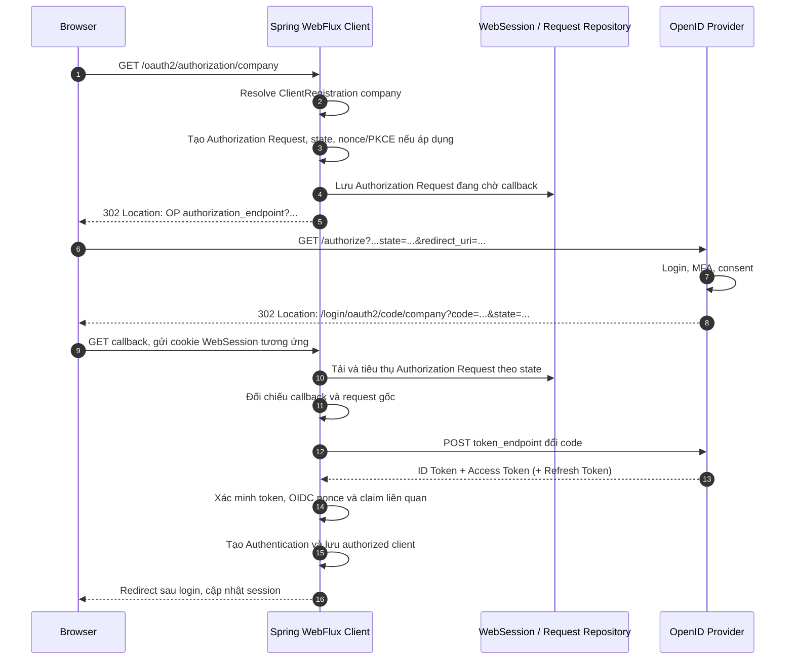
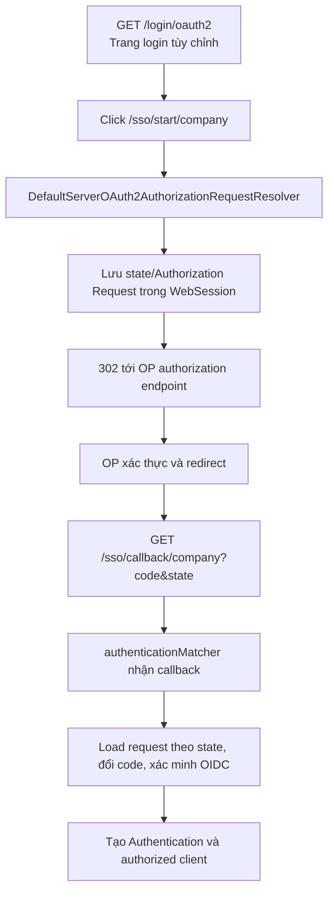
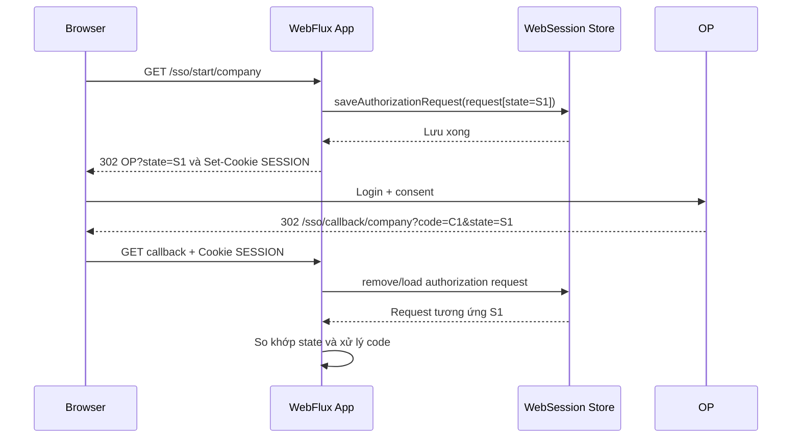

# 20.7. Cấu hình endpoint khởi động đăng nhập và callback trên WebFlux

Trong **Spring Security OAuth 2.0 / OpenID Connect (OIDC) Client** sử dụng **Spring WebFlux**, quá trình đăng nhập bằng Authorization Code Flow có hai endpoint quan trọng ở **phía ứng dụng client**:

1. **Endpoint khởi động đăng nhập** (*authorization-request initiation endpoint*): người dùng truy cập để ứng dụng tạo Authorization Request và chuyển hướng trình duyệt tới Authorization Server/OpenID Provider.
2. **Endpoint callback** (*redirection endpoint / authorization-response endpoint*): Authorization Server chuyển trình duyệt quay về ứng dụng cùng `code`, `state` hoặc tham số lỗi, để Spring Security hoàn tất xác thực.

Mặc định trên WebFlux, hai đường dẫn có dạng:

```text
GET /oauth2/authorization/{registrationId}
GET /login/oauth2/code/{registrationId}?code=...&state=...
```

Ví dụ với registration `company`:

```text
Bắt đầu: https://app.example.org/oauth2/authorization/company
Callback: https://app.example.org/login/oauth2/code/company
```

Trong thực tế, ứng dụng thường cần thay đổi các đường dẫn này cho phù hợp cấu trúc URL, reverse proxy, gateway hoặc yêu cầu của tổ chức. Việc tùy chỉnh tưởng chừng chỉ đổi một chuỗi nhưng liên quan trực tiếp đến **client registration, đường dẫn được WebFilter chặn, URI mà Authorization Server cho phép redirect, state/WebSession, cookie, bảo vệ callback và ngữ cảnh Reactive**.

Bài học này giải thích từ mặc định đến tùy chỉnh hai endpoint trên **WebFlux**, bao gồm ví dụ Spring Boot/Java, sơ đồ HTTP, xử lý login page riêng, cấu hình sau proxy, khác biệt với Servlet và cách chẩn đoán các lỗi callback thường gặp.

> **Nguyên tắc quan trọng:** **đổi endpoint bắt đầu đăng nhập** và **đổi callback** là hai việc riêng. Đặc biệt, khi đổi callback, phải đồng bộ **`authenticationMatcher` tại WebFlux**, **`ClientRegistration.redirectUri`**, và **redirect URI đã đăng ký tại Authorization Server**.

## 1. Xác định đúng vai trò của mỗi endpoint

Trong OAuth 2.0/OIDC, có các endpoint của nhiều phía khác nhau. Các tên giống nhau dễ gây nhầm lẫn:

| Endpoint | Thuộc phía nào? | Vai trò |
|---|---|---|
| `/oauth2/authorization/{registrationId}` | **Ứng dụng WebFlux Client** | Bắt đầu flow, tạo authorization request rồi 302 đến Authorization Server. |
| `authorization_endpoint` | **Authorization Server / OpenID Provider** | Nhận request xin authorization của user qua trình duyệt. |
| `token_endpoint` | **Authorization Server** | Backend client đổi authorization code lấy token. |
| `/login/oauth2/code/{registrationId}` | **Ứng dụng WebFlux Client** | Nhận authorization response/callback qua trình duyệt. |
| `userinfo_endpoint` | **OpenID Provider** | Cung cấp claim hồ sơ với Access Token phù hợp. |
| `jwks_uri` | **OpenID Provider** | Công bố public keys để xác minh token ký theo metadata. |

Vì vậy, endpoint:

```text
/oauth2/authorization/company
```

**không phải** `authorization_endpoint` của OP. Nó là đường dẫn **nội bộ ứng dụng** để Spring Security bắt đầu chuyển hướng người dùng ra OP.

Tương tự:

```text
/login/oauth2/code/company
```

**không phải** token endpoint. Callback nhận **authorization code qua trình duyệt**, rồi Spring Security backend mới gọi token endpoint để đổi code thành token.

### 1.1. Ý nghĩa của `registrationId`

`registrationId` là khóa mà Spring Security dùng để tìm `ClientRegistration`:

```yaml
spring:
  security:
    oauth2:
      client:
        registration:
          company:
            # registrationId = company
            client-id: ${OIDC_CLIENT_ID}
            client-secret: ${OIDC_CLIENT_SECRET}
            authorization-grant-type: authorization_code
            scope: [openid, profile]
```

Ở đây, `company` là **tên do ứng dụng đặt**, không nhất thiết bằng `client_id` bên OP. Nếu URL là:

```text
/oauth2/authorization/company
```

Spring Security tìm registration `company`. Nếu người dùng truy cập `/oauth2/authorization/unknown` mà không có registration tương ứng, framework không thể tạo Authorization Request theo cấu hình ấy.

Không xem `registrationId` là quyền mà caller được tùy chọn tự do trong hệ thống có nhiều provider/tenant. Khi có registration nhạy cảm, cần kiểm soát ai được bắt đầu flow nào và mapping provider/tenant ra sao.

## 2. Luồng Authorization Code + OIDC trên WebFlux

Một lượt đăng nhập gồm các thao tác:



Một callback hợp lệ chỉ là **đầu vào của quá trình xác thực**, chưa phải bằng chứng đã đăng nhập. Spring Security cần xác nhận request gốc, `state` và các điều kiện của Authorization Code/OIDC.

### 2.1. Trình duyệt nhìn thấy những redirect nào?

Ví dụ response khởi động:

```http
GET /oauth2/authorization/company HTTP/1.1
Host: app.example.org
Cookie: SESSION=<browser-session-id>
```

Ứng dụng WebFlux trả:

```http
HTTP/1.1 302 Found
Location: https://id.example.org/realms/company/protocol/openid-connect/auth?response_type=code&client_id=orders-web&scope=openid%20profile&state=<random-state>&redirect_uri=https%3A%2F%2Fapp.example.org%2Flogin%2Foauth2%2Fcode%2Fcompany
Set-Cookie: SESSION=<session-id>; Path=/; Secure; HttpOnly
```

Response thực tế có thể khác (ví dụ có `nonce`, PKCE parameters và nhiều headers). Ví dụ chỉ minh họa cấu trúc request; không nên sao chép giá trị `state` minh họa thành một hằng số.

Sau xác thực, OP trả browser về:

```http
HTTP/1.1 302 Found
Location: https://app.example.org/login/oauth2/code/company?code=<one-time-code>&state=<same-state>
```

Browser gọi URL callback. Spring Security **không cần controller tự viết** để nhận callback nếu WebFlux security filter đã được cấu hình xử lý đường dẫn đó.

### 2.2. Khi Authorization Server từ chối

Không phải callback nào cũng có `code`. Người dùng có thể hủy consent hoặc OP phát sinh lỗi:

```text
/login/oauth2/code/company?error=access_denied&state=<state>
```

Ứng dụng vẫn cần xử lý authorization response phù hợp và thông báo lỗi an toàn. Không tự hiểu rằng thiếu `code` thì phải thử lại login vô hạn, và không đưa nguyên chuỗi `error_description` chưa được kiểm soát vào HTML.

## 3. Tại sao WebFlux dùng cơ chế khác Servlet?

Một dự án Spring MVC/Servlet thường dùng:

- `HttpSecurity` và `SecurityFilterChain`;
- `HttpServletRequest`/`HttpSession`;
- `ClientRegistrationRepository`;
- `OAuth2AuthorizationRequestRedirectFilter` và `OAuth2LoginAuthenticationFilter`.

Trong Spring WebFlux/Reactive cần phân biệt:

- **`ServerHttpSecurity`** và **`SecurityWebFilterChain`**;
- **`ServerWebExchange`** và **`WebSession`**;
- **`ReactiveClientRegistrationRepository`**;
- **`OAuth2AuthorizationRequestRedirectWebFilter`**;
- **`OAuth2LoginAuthenticationWebFilter`**;
- các `ServerOAuth2AuthorizationRequestResolver` và `ServerAuthorizationRequestRepository` mang API reactive.

| Vai trò | Servlet/MVC | WebFlux/Reactive |
|---|---|---|
| Security configuration | `HttpSecurity` | `ServerHttpSecurity` |
| Security chain | `SecurityFilterChain` | `SecurityWebFilterChain` |
| Request context | `HttpServletRequest` | `ServerWebExchange` |
| Phiên | `HttpSession` | `WebSession` |
| Client registration | `ClientRegistrationRepository` | `ReactiveClientRegistrationRepository` |
| Authorization request resolver | `OAuth2AuthorizationRequestResolver` | `ServerOAuth2AuthorizationRequestResolver` |
| Authorization request storage | `AuthorizationRequestRepository` | `ServerAuthorizationRequestRepository` |
| Callback handling | Servlet filter | Reactive WebFilter |

Đặc biệt, **không dùng API Servlet để tùy chỉnh endpoint WebFlux**. Các method trông giống nhau nhưng interface và lớp triển khai khác nhau.

## 4. Thiết lập Spring Boot WebFlux + OAuth2 Client

### 4.1. Dependency

Gradle minh họa:

```gradle
dependencies {
    implementation("org.springframework.boot:spring-boot-starter-webflux")
    implementation("org.springframework.boot:spring-boot-starter-security")
    implementation("org.springframework.boot:spring-boot-starter-oauth2-client")
}
```

Ví dụ Maven:

```xml
<dependencies>
    <dependency>
        <groupId>org.springframework.boot</groupId>
        <artifactId>spring-boot-starter-webflux</artifactId>
    </dependency>
    <dependency>
        <groupId>org.springframework.boot</groupId>
        <artifactId>spring-boot-starter-security</artifactId>
    </dependency>
    <dependency>
        <groupId>org.springframework.boot</groupId>
        <artifactId>spring-boot-starter-oauth2-client</artifactId>
    </dependency>
</dependencies>
```

Khi dùng Spring Boot, dependency OAuth2 Client cung cấp các thành phần cần thiết để tạo reactive client registration và xử lý đăng nhập.

**Lưu ý:** khi ứng dụng chứa cả `spring-boot-starter-web` và `spring-boot-starter-webflux`, Spring Boot có thể ưu tiên loại ứng dụng Servlet theo cấu hình mặc định. Nếu bài toán là **WebFlux server**, cần bảo đảm application type và security stack đang chạy thực sự là Reactive. Không suy ra ứng dụng đã thành WebFlux chỉ vì có `WebClient`.

### 4.2. Khai báo client registration

Ví dụ `application.yml`:

```yaml
spring:
  security:
    oauth2:
      client:
        registration:
          company:
            provider: company-oidc
            client-id: ${OIDC_CLIENT_ID}
            client-secret: ${OIDC_CLIENT_SECRET}
            client-authentication-method: client_secret_basic
            authorization-grant-type: authorization_code
            redirect-uri: "{baseUrl}/login/oauth2/code/{registrationId}"
            scope:
              - openid
              - profile
              - email
        provider:
          company-oidc:
            issuer-uri: https://id.example.org/realms/company
```

Những điểm quan trọng:

- `registration.company` tạo registration ID là `company`.
- `redirect-uri` mô tả callback **được gửi trong Authorization Request**.
- `{baseUrl}` dựa trên base URL mà ứng dụng nhận biết từ request/proxy theo cấu hình, thường chứa scheme, host, port và base path khi áp dụng.
- `{registrationId}` được thay bằng `company`.
- `scope: openid` cho biết đây là OIDC login; Spring Security dùng các thành phần xử lý OIDC khi áp dụng.
- `issuer-uri` dùng metadata discovery nếu OP hỗ trợ; các endpoint và khóa ký liên quan đến issuer đã cấu hình.

Với public URL:

```text
https://app.example.org
```

callback kỳ vọng:

```text
https://app.example.org/login/oauth2/code/company
```

OP phải có redirect URI phù hợp trong danh sách URI được phép của client `orders-web`. Không dùng wildcard redirect URI rộng để «sửa nhanh» lỗi mismatch.

### 4.3. Cấu hình `SecurityWebFilterChain` mặc định

```java
import org.springframework.context.annotation.Bean;
import org.springframework.context.annotation.Configuration;
import org.springframework.security.config.Customizer;
import org.springframework.security.config.annotation.web.reactive.EnableWebFluxSecurity;
import org.springframework.security.config.web.server.ServerHttpSecurity;
import org.springframework.security.web.server.SecurityWebFilterChain;

@Configuration
@EnableWebFluxSecurity
public class ReactiveSecurityConfiguration {

    @Bean
    SecurityWebFilterChain securityWebFilterChain(ServerHttpSecurity http) {
        return http
            .authorizeExchange(exchanges -> exchanges
                .pathMatchers("/", "/public/**", "/assets/**").permitAll()
                .anyExchange().authenticated()
            )
            .oauth2Login(Customizer.withDefaults())
            .build();
    }
}
```

Cấu hình này sử dụng các endpoint mặc định nếu có `ReactiveClientRegistrationRepository` phù hợp:

```text
GET /oauth2/authorization/company
GET /login/oauth2/code/company?code=...&state=...
```

Không cần viết controller ở hai đường dẫn đó để Spring Security xử lý. Việc bổ sung controller trùng đường dẫn có thể gây nhầm lẫn routing hoặc che giấu ý đồ bảo mật.

## 5. Endpoint khởi động đăng nhập mặc định

Khi user truy cập:

```text
GET /oauth2/authorization/company
```

Spring Security dùng resolver dựa trên `ReactiveClientRegistrationRepository` để tìm registration `company` và tạo `OAuth2AuthorizationRequest`.

Một Authorization Request thường cần:

- `client_id`;
- `response_type=code`;
- `scope`;
- `redirect_uri`;
- `state` ngẫu nhiên để liên kết flow với request gốc;
- tham số OIDC như `nonce` khi áp dụng;
- PKCE `code_challenge` và `code_challenge_method` khi cấu hình/yêu cầu.

Framework lưu request đang chờ callback rồi trả redirect về authorization endpoint của OP.

### 5.1. Filter nào đảm nhiệm bước này?

Ở WebFlux, **`OAuth2AuthorizationRequestRedirectWebFilter`** tham gia khởi động Authorization Code Flow. Nó dùng **`ServerOAuth2AuthorizationRequestResolver`**, thường là `DefaultServerOAuth2AuthorizationRequestResolver`.

Tóm lược:

```text
Browser GET /oauth2/authorization/company
  |
  v
OAuth2AuthorizationRequestRedirectWebFilter
  |
  v
DefaultServerOAuth2AuthorizationRequestResolver
  |
  +-> ReactiveClientRegistrationRepository.findByRegistrationId("company")
  |
  v
OAuth2AuthorizationRequest
  |
  v
ServerAuthorizationRequestRepository.saveAuthorizationRequest(...)
  |
  v
HTTP 302 tới OP authorization endpoint
```

### 5.2. Đường dẫn này không phải một API tạo JWT

Đường dẫn bắt đầu login chủ yếu **redirect browser**, không trả Access Token/ID Token cho JavaScript. Nếu ứng dụng có một frontend SPA, không nên biến nó thành endpoint trả raw client secret, raw token hoặc authorization code.

Việc đăng nhập phải được hoàn tất theo Authorization Code/OIDC, với điều kiện state và token validation của Spring Security.

### 5.3. Nhiều registration

Nếu cấu hình thêm:

```text
company
partner
```

thì thường có các link:

```text
/oauth2/authorization/company
/oauth2/authorization/partner
```

Mỗi registration có thể dùng issuer, `client_id`, scope và callback riêng. Nếu ứng dụng phân tenant/provider, phải bảo đảm chọn đúng registration theo chính sách. Tên registration trong URL chỉ là **chìa khóa lookup**, không phải một security policy đầy đủ.

## 6. Endpoint callback mặc định

Sau khi user hoàn tất xác thực tại OP, browser được redirect tới:

```text
GET /login/oauth2/code/company?code=<authorization-code>&state=<state>
```

Spring Security WebFlux xử lý authorization response thông qua luồng authentication WebFilter, với **`OAuth2LoginAuthenticationWebFilter`** và các thành phần authentication/reactive tương ứng.

Các bước trọng yếu:

1. Kiểm tra request khớp **callback matcher**.
2. Đọc authorization response (có thể chứa `code` hoặc lỗi).
3. Tải authorization request đã lưu từ `WebSession`/repository.
4. Đối chiếu `state` và liên kết response với request đã khởi động.
5. Dùng authorization code để gọi **token endpoint phía server**.
6. Kiểm tra token response và OIDC ID Token theo cấu hình.
7. Xử lý UserInfo khi có điều kiện và cấu hình phù hợp.
8. Lưu `Authentication` và `OAuth2AuthorizedClient`.
9. Chuyển hướng người dùng tới trang sau đăng nhập hoặc báo lỗi có kiểm soát.

**Callback không phải nơi ứng dụng tự tin tham số `code`/`state`.** Một authorization code chưa được đổi và xác minh chưa chứng minh danh tính, còn state là một phần của việc ràng buộc request/response.

### 6.1. Không viết callback controller để tự đổi code nếu dùng `oauth2Login()`

Tránh mẫu:

```java
// Không phải cách tích hợp được khuyến nghị khi đã dùng oauth2Login:
@GetMapping("/login/oauth2/code/company")
public Mono<String> callback(@RequestParam String code) {
    // Tự gửi code, tự xây principal, bỏ qua state/nonce...
    return Mono.just("logged in");
}
```

Việc tự xử lý callback ở controller dễ bỏ sót **state, PKCE verifier, OIDC nonce, ID Token verification, session correlation** và các kiểm soát framework.

Nếu đã chọn `oauth2Login()`, hãy để WebFilter xử lý endpoint callback bằng matcher và cấu hình đúng.

### 6.2. `redirect-uri` có phải đường dẫn callback được lắng nghe?

Không hoàn toàn. Cần phân biệt:

- **`ClientRegistration.redirectUri`**: URI được gửi tới OP trong Authorization Request; OP chuyển browser về đây nếu hợp lệ.
- **`oauth2Login().authenticationMatcher(...)`**: matcher mà Spring Security WebFlux dùng để **nhận và xử lý callback**.

Với đường mặc định, hai giá trị phù hợp nhau. Khi đổi callback, phải đổi **cả hai phía** và đăng ký URI đó ở OP. Chỉ thay YAML hoặc chỉ thay matcher đều có thể khiến flow thất bại.

## 7. Trang đăng nhập mặc định và link khởi động

Khi một trang được bảo vệ và user chưa xác thực, WebFlux Security có thể hiển thị **trang login mặc định** với link tới các OAuth2 providers đã cấu hình.

Thành phần `LoginPageGeneratingWebFilter` có thể tạo trang này. Để các client được liệt kê trong trang mặc định, `ReactiveClientRegistrationRepository` cần đồng thời có khả năng **duyệt danh sách registrations**, chẳng hạn `InMemoryReactiveClientRegistrationRepository`.

Một link mặc định:

```html
<a href="/oauth2/authorization/company">
  Đăng nhập bằng tài khoản công ty
</a>
```

Bấm link này mới khởi động authorization flow.

### 7.1. Không nhầm login page với authorization initiation

`/login` hoặc `/login/oauth2` có thể là **trang giao diện** với các nút đăng nhập. Nhưng `/oauth2/authorization/company` là endpoint **bắt đầu redirect**.

Ví dụ:

```text
GET /login/oauth2
  -> trả HTML với nút "Đăng nhập công ty"

Click nút
  -> GET /oauth2/authorization/company
  -> Spring Security redirect tới OP
```

Đây là hai URL khác nhau và có thể thay đổi độc lập.

### 7.2. Không phải mọi repository đều tự tạo link trang mặc định

Nếu tự triển khai `ReactiveClientRegistrationRepository` nhưng không hỗ trợ liệt kê registrations, login page mặc định có thể không xuất hiện các link mong đợi. Trong trường hợp này, có thể cung cấp trang login riêng với link tới registration đã được xác định.

Điều đó không có nghĩa OAuth2 initiation filter không hoạt động; có thể chỉ là **cơ chế dựng trang login mặc định không liệt kê được clients**.

## 8. Cấu hình trang login riêng trên WebFlux

Giả sử sản phẩm muốn đường UI:

```text
/login/oauth2
```

với nút «Đăng nhập công ty» và «Đăng nhập đối tác».

Có thể cấu hình một authentication entry point redirect tới login page riêng:

```java
import org.springframework.context.annotation.Bean;
import org.springframework.context.annotation.Configuration;
import org.springframework.security.config.annotation.web.reactive.EnableWebFluxSecurity;
import org.springframework.security.config.web.server.ServerHttpSecurity;
import org.springframework.security.web.server.SecurityWebFilterChain;
import org.springframework.security.web.server.authentication.RedirectServerAuthenticationEntryPoint;

@Configuration
@EnableWebFluxSecurity
public class CustomLoginPageSecurityConfiguration {

    @Bean
    SecurityWebFilterChain securityWebFilterChain(ServerHttpSecurity http) {
        return http
            .authorizeExchange(exchanges -> exchanges
                .pathMatchers(
                    "/", "/login/oauth2", "/assets/**"
                ).permitAll()
                .anyExchange().authenticated()
            )
            .exceptionHandling(exceptions -> exceptions
                .authenticationEntryPoint(
                    new RedirectServerAuthenticationEntryPoint("/login/oauth2")
                )
            )
            .oauth2Login(oauth2 -> { })
            .build();
    }
}
```

Cách này vẫn giữ **authorization initiation mặc định** `/oauth2/authorization/{registrationId}`. Không cần thay resolver nếu chỉ đổi **trang giao diện login**.

### 8.1. Ví dụ trang login tự tạo

Có thể cung cấp một Controller render template HTML:

```java
import org.springframework.stereotype.Controller;
import org.springframework.web.bind.annotation.GetMapping;

@Controller
public class LoginPageController {

    @GetMapping("/login/oauth2")
    public String loginPage() {
        return "oauth2-login"; // Tên view trong template engine
    }
}
```

Ví dụ template HTML:

```html
<!doctype html>
<html lang="vi">
<head>
  <meta charset="utf-8">
  <title>Đăng nhập</title>
</head>
<body>
  <h1>Đăng nhập vào hệ thống</h1>
  <a href="/oauth2/authorization/company">
    Đăng nhập bằng tài khoản công ty
  </a>
  <a href="/oauth2/authorization/partner">
    Đăng nhập bằng tài khoản đối tác
  </a>
</body>
</html>
```

Mẫu này giả định ứng dụng đã cấu hình template engine phù hợp (ví dụ Thymeleaf) và có hai registrations `company`/`partner` tương ứng. Nếu chỉ có `company`, chỉ hiển thị link đó.

### 8.2. Tránh vòng lặp redirect tới trang login

Nếu `/login/oauth2` bị bảo vệ bằng `authenticated()`, browser chưa đăng nhập bị redirect tới chính trang ấy lặp đi lặp lại.

Vì vậy, **login page phải được cho phép truy cập khi chưa xác thực**, cùng các assets cần thiết. Không nên tạo một route bị khóa mà chính nó là authentication entry point.

### 8.3. `loginPage(...)` trong phiên bản mới

Một số phiên bản Spring Security WebFlux cung cấp API `oauth2Login(oauth2 -> oauth2.loginPage("/login/oauth2"))`. Ví dụ dùng entry point ở trên giúp minh họa trực tiếp cách redirect và không phụ thuộc vào việc project có hỗ trợ convenience API theo phiên bản hay không.

Dù chọn cách nào, cần có controller/view thực sự phục vụ trang tùy chỉnh; chỉ cấu hình một URL chưa tự tạo HTML của trang login.

## 9. Đổi endpoint khởi động đăng nhập

Giả sử yêu cầu của gateway là sử dụng:

```text
GET /sso/start/{registrationId}
```

thay vì:

```text
GET /oauth2/authorization/{registrationId}
```

Trong WebFlux, extension point quan trọng là:

```java
oauth2Login(oauth2 -> oauth2
    .authorizationRequestResolver(customResolver)
)
```

Resolver quyết định **request nào tạo Authorization Request** và tìm registration nào. Với đường dẫn mới, sử dụng `DefaultServerOAuth2AuthorizationRequestResolver` cùng `ServerWebExchangeMatcher`.

### 9.1. Ví dụ resolver với matcher mới

```java
import org.springframework.context.annotation.Bean;
import org.springframework.context.annotation.Configuration;
import org.springframework.security.config.annotation.web.reactive.EnableWebFluxSecurity;
import org.springframework.security.config.web.server.ServerHttpSecurity;
import org.springframework.security.oauth2.client.registration.ReactiveClientRegistrationRepository;
import org.springframework.security.oauth2.client.web.server.DefaultServerOAuth2AuthorizationRequestResolver;
import org.springframework.security.oauth2.client.web.server.ServerOAuth2AuthorizationRequestResolver;
import org.springframework.security.web.server.SecurityWebFilterChain;
import org.springframework.security.web.server.util.matcher.PathPatternParserServerWebExchangeMatcher;
import org.springframework.security.web.server.util.matcher.ServerWebExchangeMatcher;

@Configuration
@EnableWebFluxSecurity
public class CustomStartEndpointSecurityConfiguration {

    @Bean
    SecurityWebFilterChain securityWebFilterChain(
            ServerHttpSecurity http,
            ReactiveClientRegistrationRepository registrations) {

        ServerWebExchangeMatcher startMatcher =
            new PathPatternParserServerWebExchangeMatcher(
                "/sso/start/{registrationId}"
            );

        ServerOAuth2AuthorizationRequestResolver resolver =
            new DefaultServerOAuth2AuthorizationRequestResolver(
                registrations,
                startMatcher
            );

        return http
            .authorizeExchange(exchanges -> exchanges
                .pathMatchers("/", "/login/oauth2", "/assets/**").permitAll()
                .anyExchange().authenticated()
            )
            .oauth2Login(oauth2 -> oauth2
                .authorizationRequestResolver(resolver)
            )
            .build();
    }
}
```

Trong cấu hình này:

- `GET /sso/start/company` khởi động login.
- Matcher trích `registrationId=company`.
- Resolver tìm `ClientRegistration` `company` trong `ReactiveClientRegistrationRepository`.
- Spring Security tạo Authorization Request và redirect tới OP.
- **Callback vẫn giữ mặc định** `/login/oauth2/code/company` nếu không tùy chỉnh tiếp.

**Lưu ý:** đây là một cấu hình minh họa độc lập; không đăng ký nhiều Bean `SecurityWebFilterChain` trùng matcher chỉ vì các ví dụ trong bài có nhiều class. Trong ứng dụng thật, ghép phần resolver vào chain đang dùng.

### 9.2. Sửa link login page cho khớp

Khi đã đổi start matcher, link trong trang login riêng phải là:

```html
<a href="/sso/start/company">
  Đăng nhập bằng tài khoản công ty
</a>
```

Nếu trang vẫn trỏ `/oauth2/authorization/company`, endpoint cũ không nhất thiết còn được xử lý bởi resolver tùy chỉnh, khiến browser nhận 404 hoặc redirect sai.

**Đổi start endpoint không yêu cầu đổi `redirect-uri`**, vì URI callback là một endpoint khác.

### 9.3. Vì sao không tự dựng Authorization Request trong controller?

Không nên viết:

```java
// Sai về nguyên tắc nếu bỏ qua authorization request repository:
@GetMapping("/sso/start/company")
public Mono<Void> start(ServerWebExchange exchange) {
    // Tự nối client_id, state, nonce thành URL
    // rồi gửi 302 sang OP mà không lưu request đúng cách...
    return Mono.empty();
}
```

Một link redirect được ghép thủ công có thể bỏ qua state/session correlation, OIDC nonce, PKCE hoặc các chính sách của client registration.

Resolver của Spring Security giữ giao thức trong framework. Nếu chỉ muốn **alias URL** để bắt đầu login, có thể dùng một redirect nội bộ đến endpoint mặc định, nhưng phải bảo đảm URL đích cố định và không tạo open redirect.

## 10. Đổi endpoint callback trên WebFlux

Giả sử gateway yêu cầu callback:

```text
https://app.example.org/login/oauth2/callback/company
```

thay cho:

```text
https://app.example.org/login/oauth2/code/company
```

Để Spring Security WebFlux xử lý authorization response tại đường mới, cấu hình **`oauth2Login().authenticationMatcher(...)`**.

### 10.1. Cấu hình matcher callback

```java
import org.springframework.context.annotation.Bean;
import org.springframework.context.annotation.Configuration;
import org.springframework.security.config.annotation.web.reactive.EnableWebFluxSecurity;
import org.springframework.security.config.web.server.ServerHttpSecurity;
import org.springframework.security.web.server.SecurityWebFilterChain;
import org.springframework.security.web.server.util.matcher.PathPatternParserServerWebExchangeMatcher;

@Configuration
@EnableWebFluxSecurity
public class CustomCallbackSecurityConfiguration {

    @Bean
    SecurityWebFilterChain securityWebFilterChain(ServerHttpSecurity http) {
        return http
            .authorizeExchange(exchanges -> exchanges
                .pathMatchers("/", "/public/**").permitAll()
                .anyExchange().authenticated()
            )
            .oauth2Login(oauth2 -> oauth2
                .authenticationMatcher(
                    new PathPatternParserServerWebExchangeMatcher(
                        "/login/oauth2/callback/{registrationId}"
                    )
                )
            )
            .build();
    }
}
```

Bây giờ Spring Security nhận callback tại:

```text
GET /login/oauth2/callback/company?code=...&state=...
```

Nhưng **chỉ đổi matcher chưa đủ**.

### 10.2. Đổi `ClientRegistration.redirectUri`

Cập nhật YAML:

```yaml
spring:
  security:
    oauth2:
      client:
        registration:
          company:
            provider: company-oidc
            client-id: ${OIDC_CLIENT_ID}
            client-secret: ${OIDC_CLIENT_SECRET}
            authorization-grant-type: authorization_code
            redirect-uri: "{baseUrl}/login/oauth2/callback/{registrationId}"
            scope: [openid, profile, email]
        provider:
          company-oidc:
            issuer-uri: https://id.example.org/realms/company
```

Với public base URL `https://app.example.org`, URI gửi tới OP sẽ là:

```text
https://app.example.org/login/oauth2/callback/company
```

### 10.3. Đăng ký URI mới tại Authorization Server

Trong phần cấu hình OAuth2 Client của OP, phải cho phép callback chính xác:

```text
https://app.example.org/login/oauth2/callback/company
```

Nếu OP vẫn chỉ cho phép:

```text
https://app.example.org/login/oauth2/code/company
```

thì Authorization Server có thể trả `invalid_redirect_uri` hoặc `redirect_uri_mismatch` khi bắt đầu authorization.

Bảng ba nơi cần khớp:

| Vị trí | Giá trị |
|---|---|
| Spring Security `authenticationMatcher` | `/login/oauth2/callback/{registrationId}` |
| Spring Boot `redirect-uri` | `{baseUrl}/login/oauth2/callback/{registrationId}` |
| Allowed redirect URI ở OP | `https://app.example.org/login/oauth2/callback/company` |

Đây là ba thành phần có **vai trò khác nhau**; cấu hình cả ba chính xác giúp flow đi từ OP quay lại đúng WebFilter.

### 10.4. Không cần controller callback

Khi matcher được cấu hình, **OAuth2 Login Authentication WebFilter** xử lý callback. Không viết `@GetMapping("/login/oauth2/callback/company")` để tự đổi code.

Nếu một controller trùng callback vẫn tồn tại nhưng request không bị security filter nhận, điều đó có thể che giấu lỗi matcher thay vì sửa đúng flow.

## 11. Đổi đồng thời cả start endpoint và callback

Một yêu cầu thực tế:

```text
Trang login UI: /login/oauth2
Start endpoint: /sso/start/{registrationId}
Callback:      /sso/callback/{registrationId}
```

Ví dụ cấu hình **hợp nhất**:

```java
import org.springframework.context.annotation.Bean;
import org.springframework.context.annotation.Configuration;
import org.springframework.security.config.annotation.web.reactive.EnableWebFluxSecurity;
import org.springframework.security.config.web.server.ServerHttpSecurity;
import org.springframework.security.oauth2.client.registration.ReactiveClientRegistrationRepository;
import org.springframework.security.oauth2.client.web.server.DefaultServerOAuth2AuthorizationRequestResolver;
import org.springframework.security.oauth2.client.web.server.ServerOAuth2AuthorizationRequestResolver;
import org.springframework.security.web.server.SecurityWebFilterChain;
import org.springframework.security.web.server.authentication.RedirectServerAuthenticationEntryPoint;
import org.springframework.security.web.server.util.matcher.PathPatternParserServerWebExchangeMatcher;
import org.springframework.security.web.server.util.matcher.ServerWebExchangeMatcher;

@Configuration
@EnableWebFluxSecurity
public class CompanyReactiveLoginSecurityConfiguration {

    @Bean
    SecurityWebFilterChain securityWebFilterChain(
            ServerHttpSecurity http,
            ReactiveClientRegistrationRepository registrations) {

        ServerWebExchangeMatcher authorizationRequestMatcher =
            new PathPatternParserServerWebExchangeMatcher(
                "/sso/start/{registrationId}"
            );

        ServerOAuth2AuthorizationRequestResolver resolver =
            new DefaultServerOAuth2AuthorizationRequestResolver(
                registrations,
                authorizationRequestMatcher
            );

        return http
            .authorizeExchange(exchanges -> exchanges
                .pathMatchers("/", "/login/oauth2", "/assets/**").permitAll()
                .anyExchange().authenticated()
            )
            .exceptionHandling(exceptions -> exceptions
                .authenticationEntryPoint(
                    new RedirectServerAuthenticationEntryPoint("/login/oauth2")
                )
            )
            .oauth2Login(oauth2 -> oauth2
                .authorizationRequestResolver(resolver)
                .authenticationMatcher(
                    new PathPatternParserServerWebExchangeMatcher(
                        "/sso/callback/{registrationId}"
                    )
                )
            )
            .build();
    }
}
```

YAML tương ứng:

```yaml
spring:
  security:
    oauth2:
      client:
        registration:
          company:
            provider: company-oidc
            client-id: ${OIDC_CLIENT_ID}
            client-secret: ${OIDC_CLIENT_SECRET}
            client-authentication-method: client_secret_basic
            authorization-grant-type: authorization_code
            redirect-uri: "{baseUrl}/sso/callback/{registrationId}"
            scope: [openid, profile, email]
        provider:
          company-oidc:
            issuer-uri: https://id.example.org/realms/company
```

HTML trang login:

```html
<a href="/sso/start/company">Đăng nhập qua OIDC</a>
```

URI cần cấu hình tại OP:

```text
https://app.example.org/sso/callback/company
```

Sơ đồ:



Các ví dụ Java ở các mục trước **không phải những cấu hình cần đăng ký đồng thời**. Chọn mẫu phù hợp và duy trì **một SecurityWebFilterChain thống nhất** cho các đường dẫn này.

## 12. Custom resolver cần giữ yêu cầu bảo mật

`DefaultServerOAuth2AuthorizationRequestResolver` có thể được tùy biến để thêm một số tham số authorization cần thiết cho OP. Nhưng mọi thay đổi phải giữ các kiểm soát giao thức.

Ví dụ một provider yêu cầu tham số `prompt=login`:

```java
import org.springframework.security.oauth2.client.web.server.DefaultServerOAuth2AuthorizationRequestResolver;
import org.springframework.security.oauth2.client.registration.ReactiveClientRegistrationRepository;

DefaultServerOAuth2AuthorizationRequestResolver resolver =
    new DefaultServerOAuth2AuthorizationRequestResolver(registrations);

resolver.setAuthorizationRequestCustomizer(builder ->
    builder.additionalParameters(parameters ->
        parameters.put("prompt", "login")
    )
);
```

Đây là ví dụ tùy biến `OAuth2AuthorizationRequest.Builder` bằng extension point của reactive resolver trong các phiên bản hỗ trợ API đó. Phải kiểm tra yêu cầu của provider trước khi gửi tham số tùy chỉnh.

### 12.1. Không thay `state` bằng giá trị cố định

`state` giúp liên kết callback với authorization request đã bắt đầu trong browser context.

Sai:

```text
state=company
state=123456
state=<một hằng số dùng cho tất cả users>
```

Một state dự đoán được hoặc dùng lại rộng rãi làm suy yếu bảo vệ chống login CSRF/callback injection. Hãy để Spring Security tạo và quản lý giá trị phù hợp thay vì tự thay bằng chuỗi do client gửi.

### 12.2. Không lấy redirect URI từ query tùy ý

Tránh:

```text
GET /sso/start/company?redirect_uri=https://attacker.example/callback
```

và dùng trực tiếp tham số ấy làm `redirect_uri` trong authorization request. Đây là cách làm có thể dẫn tới **redirect URI injection**, phá ranh giới đăng ký callback và tạo rủi ro rò authorization code.

Nếu ứng dụng cần redirect người dùng về trang nội bộ sau login, hãy sử dụng cơ chế **saved request / success handler / allowlist local path** phù hợp, không đưa arbitrary external URL vào OAuth2 `redirect_uri`.

### 12.3. Không vô hiệu hóa PKCE/nonce khi đổi endpoint

Đổi đường dẫn khởi động hoặc callback không làm thay đổi mục đích của:

- **`state`**: ràng buộc authorization response với request bắt đầu.
- **`nonce`** trong OIDC: liên kết ID Token với yêu cầu authentication tương ứng khi áp dụng.
- **PKCE**: bảo vệ authorization code trong các flow yêu cầu, dựa trên `code_verifier`/`code_challenge`.

Tùy client type/registration và phiên bản Spring Security, PKCE có thể được dùng theo mặc định hoặc qua cấu hình. Đừng bỏ các tham số này khi viết custom resolver chỉ vì muốn thêm một field riêng của OP.

## 13. `WebSession` và lưu Authorization Request

Giữa hai HTTP requests sau có một khoảng thời gian:

```text
1) GET /oauth2/authorization/company
2) GET /login/oauth2/code/company?code=...&state=...
```

Ứng dụng phải nhớ **request gốc** để đối chiếu callback. Trong WebFlux, abstraction là:

```java
ServerAuthorizationRequestRepository<OAuth2AuthorizationRequest>
```

Implementation thường dùng:

```java
WebSessionOAuth2ServerAuthorizationRequestRepository
```

Nó lưu `OAuth2AuthorizationRequest` trong **`WebSession`**. Callback chỉ có `code` và `state` từ URL; việc khôi phục authorization request dựa trên state và session context mới giúp xác định callback đúng với flow đã khởi động.

### 13.1. Cơ chế lưu trữ



Nếu browser không gửi lại cookie đúng session hoặc session đã mất, callback có thể không tìm được authorization request và bị từ chối.

### 13.2. Tùy chỉnh repository trong `oauth2Login()`

WebFlux hỗ trợ extension point:

```java
.oauth2Login(oauth2 -> oauth2
    .authorizationRequestRepository(repository)
)
```

Trong đó `repository` có kiểu:

```java
ServerAuthorizationRequestRepository<OAuth2AuthorizationRequest>
```

Ví dụ Bean minh họa:

```java
import org.springframework.context.annotation.Bean;
import org.springframework.context.annotation.Configuration;
import org.springframework.security.oauth2.client.web.server.WebSessionOAuth2ServerAuthorizationRequestRepository;
import org.springframework.security.oauth2.client.web.server.ServerAuthorizationRequestRepository;
import org.springframework.security.oauth2.core.endpoint.OAuth2AuthorizationRequest;

@Configuration
public class AuthorizationRequestStorageConfiguration {

    @Bean
    ServerAuthorizationRequestRepository<OAuth2AuthorizationRequest>
            authorizationRequestRepository() {

        return new WebSessionOAuth2ServerAuthorizationRequestRepository();
    }
}
```

Nếu dùng Bean này cho `oauth2Login()`, cần gắn nó vào cấu hình SecurityWebFilterChain thực tế. Không bắt buộc tạo Bean nếu behavior mặc định đã đủ.

### 13.3. Phân biệt authorization request và authorized client

| Dữ liệu | Lưu vào đâu? | Khi nào cần? |
|---|---|---|
| `OAuth2AuthorizationRequest` đang chờ callback | `ServerAuthorizationRequestRepository`, thường WebSession | Từ lúc bắt đầu login tới lúc nhận callback. |
| `OAuth2AuthorizedClient` | `ServerOAuth2AuthorizedClientRepository` hoặc `ReactiveOAuth2AuthorizedClientService` | Sau khi nhận Access Token và hoàn tất authorization. |
| `Authentication` / `SecurityContext` | `ServerSecurityContextRepository`/WebSession hoặc cơ chế tương ứng | Để request sau biết user đã đăng nhập. |

Ba loại dữ liệu này **không hoán đổi cho nhau**. Lưu Access Token trong database không giúp callback tìm lại `state` nếu authorization request trong session đã mất.

## 14. Session cookie, SameSite và callback từ OP

Sau khi user được chuyển sang OP, callback là một request **từ trình duyệt quay về ứng dụng**. Browser có thể quyết định gửi hay không gửi session cookie dựa trên các thuộc tính:

- `Secure`;
- `HttpOnly`;
- `SameSite`;
- `Domain`;
- `Path`;
- chính sách cookie của trình duyệt;
- nguồn điều hướng top-level và phương thức HTTP.

### 14.1. SameSite Lax và callback GET

Với callback là **top-level cross-site navigation qua GET**, cookie `SameSite=Lax` thường phù hợp để browser gửi session cookie về app. Nhưng hành vi chi tiết phụ thuộc browser, domain/site context và cách cookie được phát hành.

Nếu cookie `SameSite=Strict`, browser có thể không gửi cookie trong một số redirect cross-site, khiến WebSession không được khôi phục.

### 14.2. Form-post callback là tình huống khác

Nếu provider dùng `response_mode=form_post`, callback có thể là HTTP POST từ một site khác. Điều này ảnh hưởng:

- SameSite cookie policy;
- CSRF handling của ứng dụng;
- matcher và authentication converter đọc authorization response;
- khả năng hỗ trợ response mode của Spring Security và provider.

Không tự bật `form_post` chỉ bằng việc thêm `response_mode` trong request mà không thiết kế toàn bộ xử lý callback. Các ví dụ mặc định trong bài sử dụng **Authorization Code + callback GET**.

### 14.3. Cookie `Secure` và HTTPS

Trong production nên dùng HTTPS và session cookie `Secure`, `HttpOnly`. Không tắt các thuộc tính an toàn để «sửa» callback khi chạy qua reverse proxy; hãy cấu hình public scheme, proxy headers và cookie đúng.

Nếu app nằm dưới path `/app` nhưng cookie `Path` chỉ áp dụng cho route khác, browser có thể không gửi cookie ở callback. Hãy kiểm tra full request URL và Set-Cookie metadata mà không công bố session ID.

### 14.4. Session mất giữa hai request

Những nguyên nhân phổ biến:

- Browser chặn cookie.
- Cookie Domain/Path/SameSite không phù hợp.
- Session timeout trong thời gian user xác thực tại OP.
- App restart hoặc load balancer đưa callback tới node không có session.
- Người dùng mở callback trên browser/device khác.
- Session bị xoay hoặc invalidation không tương thích với request gốc.

Không bỏ qua state validation để «chữa» lỗi session. Phải khôi phục đúng request/browser binding.

## 15. Reverse proxy, load balancer và `{baseUrl}`

Trong production, frontend có thể là:

```text
https://portal.example.org
```

nhưng WebFlux backend thực tế nhận request nội bộ tại:

```text
http://orders-web:8080
```

Nếu framework xây `redirect_uri` bằng scheme/host nội bộ, Authorization Server có thể nhận:

```text
http://orders-web:8080/login/oauth2/code/company
```

trong khi chỉ cho phép:

```text
https://portal.example.org/login/oauth2/code/company
```

Khi đó flow thất bại dù code OAuth2/OIDC đúng.

### 15.1. Cấu hình forward headers phù hợp

Spring Boot có property:

```yaml
server:
  forward-headers-strategy: framework
```

Trong môi trường WebFlux phù hợp, cấu hình này giúp framework nhận diện scheme/host/port từ thông tin forwarded headers đã được hạ tầng xử lý tin cậy, từ đó xây external base URL phù hợp.

Proxy có thể gửi một số headers:

```http
Forwarded: proto=https;host=portal.example.org
```

hoặc các headers `X-Forwarded-*` tùy hạ tầng.

**Cảnh báo trust boundary:** không tin `Forwarded`/`X-Forwarded-Host` do client Internet tự gửi. Proxy biên phải **loại bỏ/ghi đè** headers không tin cậy trước khi chuyển vào backend. Nếu không, kẻ tấn công có thể ảnh hưởng host/scheme được dùng để tạo URL, gây host-header poisoning hoặc redirect sai.

### 15.2. Khớp redirect URI theo public URL

Giả sử đăng ký:

```yaml
redirect-uri: "{baseUrl}/sso/callback/{registrationId}"
```

và public host là `https://portal.example.org`. URI thực tế cần gửi tới OP:

```text
https://portal.example.org/sso/callback/company
```

Không nên đăng ký wildcard mọi host hoặc mọi path chỉ vì môi trường có nhiều deployment. Hãy tách chính xác redirect URIs của dev/staging/prod và áp dụng chính sách client riêng khi cần.

### 15.3. Reverse proxy rewrite path

Một gateway có thể expose:

```text
Public: /identity/sso/callback/company
Internal: /sso/callback/company
```

Khi đó cần xét cả hai mặt:

1. Path mà browser/OP sử dụng **công khai** để redirect.
2. Path mà Spring Security matcher thực sự thấy sau rewrite.

Nếu gateway strip tiền tố `/identity`, matcher trong app có thể vẫn là `/sso/callback/{registrationId}`, nhưng `redirect-uri` OP thấy cần chứa public path `/identity/sso/callback/company`. Việc tính `{baseUrl}`/forwarded prefix cần được kiểm tra theo triển khai proxy cụ thể.

Đừng đổi một mình matcher thành public path nếu gateway đã strip prefix; khi ấy WebFilter có thể không bao giờ thấy URL ấy.

### 15.4. Không xây URI từ input tùy ý

Một cách ít lỗi hơn trong môi trường phức tạp có thể là cấu hình redirect URI công khai cố định cho từng registration, phù hợp với OP. Nếu dùng dynamic `{baseUrl}`, bảo đảm external scheme/host/port/context path xuất phát từ proxy tin cậy.

Không nhận `redirect_uri` từ query string của user rồi chuyển nguyên tới OP.

## 16. Nhiều instance và WebSession phân tán

Giả sử ứng dụng có hai node:

```text
Browser -> Load Balancer -> WebFlux Node A
                          -> WebFlux Node B
```

Authorization Request bắt đầu tại node A và được lưu trong session store local A. Callback có thể tới node B; nếu B không có state/request gốc, login thất bại.

Các phương án thường dùng:

- Dùng **distributed WebSession store** được Spring Session hỗ trợ.
- Dùng sticky sessions khi phù hợp như một giải pháp hạ tầng, hiểu rõ hạn chế khi node chết.
- Đảm bảo tất cả node cùng dùng client registration/provider configuration.
- Kiểm soát session serialization và token/cookie encryption chính xác.
- Đồng bộ clocks ở cluster và bảo vệ connection tới session store.

**Đừng nhầm** kho `ReactiveOAuth2AuthorizedClientService` với kho `ServerAuthorizationRequestRepository`. Một database lưu Access Token sau login không thay thế session/state repository trong giai đoạn callback.

### 16.1. Nhiều tab đăng nhập đồng thời

User có thể mở hai tab:

```text
Tab A: /sso/start/company -> state=A
Tab B: /sso/start/company -> state=B
```

Sau đó callback của Tab A tới sau Tab B. Khả năng giữ nhiều authorization requests cùng lúc tùy implementation repository/phiên bản và cấu hình.

Không mặc định bất kỳ repository nào cũng hỗ trợ vô hạn concurrent login flows. Nếu cần multi-tab reliability cao, phải chọn repository có semantics rõ ràng cho nhiều pending requests và giữ nguyên kiểm tra `state`, expiry, one-time consumption.

### 16.2. Callback bị refresh hoặc replay

Authorization code thường chỉ dùng **một lần**. Nếu user F5 tại callback hoặc gửi lại URL chứa cùng `code`, token endpoint có thể trả `invalid_grant` do code đã được đổi.

Ứng dụng không nên cố đổi lại authorization code; cần redirect sau login thành công sang route thông thường và xử lý thất bại có kiểm soát. Không log full callback URL chứa `code`/`state`.

## 17. Khác biệt giữa custom callback matcher và authorization matcher

Hai matcher có tác dụng ở **hai thời điểm khác nhau**:

| Thành phần | Chạy tại request nào? | Output chính |
|---|---|---|
| `ServerOAuth2AuthorizationRequestResolver` với matcher `/sso/start/{registrationId}` | Bắt đầu đăng nhập | `OAuth2AuthorizationRequest` và redirect tới OP. |
| `oauth2Login().authenticationMatcher(...)` với `/sso/callback/{registrationId}` | Callback từ OP | Chuyển authorization response vào quá trình authentication. |

Nếu chỉ thay resolver:

```java
.oauth2Login(oauth2 -> oauth2
    .authorizationRequestResolver(customResolver)
)
```

thì callback vẫn theo matcher mặc định nếu chưa thay.

Nếu chỉ thay callback matcher:

```java
.oauth2Login(oauth2 -> oauth2
    .authenticationMatcher(customCallbackMatcher)
)
```

thì start endpoint vẫn thường là `/oauth2/authorization/{registrationId}`.

Cấu hình cả hai cùng lúc chỉ cần khi sản phẩm thực sự đổi **cả hai URL**.

## 18. Khi có nhiều `SecurityWebFilterChain`

WebFlux có thể cấu hình nhiều security chains cho nhiều nhóm routes, ví dụ:

```text
/api/**        -> Resource Server JWT
/web/**        -> Session + oauth2Login
/actuator/**   -> Management security
```

Nếu chain có `oauth2Login()` chỉ match `/web/**` nhưng start endpoint là `/oauth2/authorization/company` và callback là `/login/oauth2/code/company`, **hai endpoint mặc định có thể nằm ngoài matcher của chain login**.

Khi đó:

- start URL không được OAuth2 authorization WebFilter của chain đó xử lý;
- callback không được login authentication filter tiếp nhận;
- browser có thể nhận 404, 401/403 hoặc rơi vào chain khác.

Phải bảo đảm chain chứa `oauth2Login()` **có phạm vi matcher bao gồm cả start và callback routes**, hoặc đổi đường dẫn start/callback vào phạm vi chain theo thiết kế.

### 18.1. Không vô tình bỏ qua security filter cho callback

Một endpoint callback có thể cần được public trong nghĩa **chưa authenticated** khi OP redirect về; nhưng nó **vẫn phải đi qua Spring Security WebFilterChain** để framework thực hiện state và token validation.

Khái niệm `permitAll` khác với **bypass toàn bộ Spring Security**. Tránh cấu hình bỏ qua callback khỏi security filters bằng các cơ chế path exclusion không phù hợp.

### 18.2. Cho phép start route không có nghĩa bỏ state

Endpoint bắt đầu login cần truy cập trước khi user đã login, vì vậy thường phải cho phép anonymous truy cập. Nhưng authorization request vẫn phải sinh `state` và lưu request trong session repository; `permitAll` không có nghĩa có thể bỏ các kiểm soát OAuth2.

## 19. SecurityContext và điều hướng sau login

Sau callback thành công, Spring Security tạo `Authentication` và lưu SecurityContext thông qua cơ chế reactive security context repository phù hợp.

Ứng dụng có thể muốn:

```text
Login success -> /dashboard
Login failure -> /login/oauth2?error
```

Các extension point trên WebFlux gồm:

- `authenticationSuccessHandler(...)`;
- `authenticationFailureHandler(...)`;
- `securityContextRepository(...)` theo phiên bản/cấu hình.

Ví dụ success handler redirect tới trang cố định:

```java
import org.springframework.security.web.server.authentication.RedirectServerAuthenticationSuccessHandler;

.oauth2Login(oauth2 -> oauth2
    .authenticationSuccessHandler(
        new RedirectServerAuthenticationSuccessHandler("/dashboard")
    )
)
```

Đây là **fragment đặt trong cấu hình `ServerHttpSecurity`**, không phải một đoạn top-level Java class độc lập. Có thể cấu hình failure handler tương tự theo API phiên bản đang dùng.

### 19.1. Không dùng `redirect_uri` để chỉ định trang sau login

`redirect_uri` là endpoint **nhận authorization response từ OP**, không phải trang dashboard mà người dùng muốn xem.

Đúng:

```text
OP -> /sso/callback/company -> Spring Security kiểm tra code/state
   -> authentication success handler -> /dashboard
```

Sai về thiết kế:

```text
redirect_uri=https://app.example.org/dashboard
```

nếu `/dashboard` không được cấu hình làm callback matcher và không xử lý authorization response. Không chuyển callback trực tiếp tới view chỉ vì muốn bỏ một redirect.

### 19.2. Bảo vệ redirect sau login

Nếu success handler cho phép `returnTo`/`continue`, phải kiểm tra giá trị thuộc **allowlist local paths** hoặc chính sách destination an toàn. Không chuyển browser đến URL ngoài tùy ý sau login; đó là nguy cơ **open redirect** và có thể hỗ trợ phishing.

Không đưa authorization code/ID Token/Access Token vào query string của dashboard.

## 20. Cách đọc principal sau khi callback thành công

Sau login, ứng dụng WebFlux có thể đọc principal OIDC theo API reactive.

Ví dụ controller:

```java
import java.util.Map;
import org.springframework.security.core.annotation.AuthenticationPrincipal;
import org.springframework.security.oauth2.core.oidc.user.OidcUser;
import org.springframework.web.bind.annotation.GetMapping;
import org.springframework.web.bind.annotation.RestController;
import reactor.core.publisher.Mono;

@RestController
public class CurrentUserController {

    @GetMapping("/me")
    public Mono<Map<String, Object>> me(
            @AuthenticationPrincipal OidcUser user) {

        return Mono.just(Map.of(
            "subject", user.getSubject(),
            "displayName", user.getFullName() == null
                ? user.getSubject()
                : user.getFullName()
        ));
    }
}
```

Ví dụ này giả định `/me` yêu cầu authentication và registration được dùng có scope `openid`, khiến principal là `OidcUser` theo flow OIDC. Trong hệ thống nhiều loại authentication, cần xử lý principal types phù hợp thay vì ép mọi user thành OIDC.

**Không trả ID Token, Access Token, Refresh Token hoặc full claims không cần thiết qua `/me`**. Chỉ trả dữ liệu phù hợp với quyền của user.

### 20.1. Reactive context không phải Servlet ThreadLocal

Trong WebFlux, authentication thường được truyền qua **Reactor Context**, không phụ thuộc `SecurityContextHolder` theo cùng cách như MVC/Servlet.

Không viết callback bất đồng bộ tự đọc `HttpServletRequest` hoặc `HttpSession` trong một reactive WebFlux application. Khi cần identity trong chain reactive, sử dụng các API được hỗ trợ như `ReactiveSecurityContextHolder` hoặc argument resolution của WebFlux controller.

### 20.2. OAuth2 login và OAuth2 client API là hai nhiệm vụ

- `oauth2Login()`: nhận callback, xác thực user, tạo session/principal.
- `oauth2Client()`: hỗ trợ các chức năng client khi ứng dụng cần gọi API protected resource.

Một ứng dụng chỉ cần login có thể bắt đầu với `oauth2Login()`. Nếu dùng `WebClient` gọi API thay mặt user, có thể cấu hình thêm `oauth2Client()` và `ReactiveOAuth2AuthorizedClientManager` phù hợp.

Đừng dùng filter Servlet `ServletOAuth2AuthorizedClientExchangeFilterFunction` trong ứng dụng WebFlux reactive; đó là filter dành cho WebClient chạy **trên Servlet stack**.

## 21. Callback GET, POST và các phương thức HTTP

Mẫu thông dụng của Authorization Code Flow là OP **302 browser về callback GET** với query parameters `code`/`state`.

Tuy nhiên, một số provider hoặc cấu hình dùng authorization response mode khác (chẳng hạn form_post) có thể gửi callback bằng POST.

Khi thay callback path hoặc phương thức:

- Xác định OP hỗ trợ response mode nào.
- Xác định `authenticationMatcher` có khớp HTTP method không.
- Xác định `ServerAuthenticationConverter` có đọc được response đó không.
- Kiểm tra ảnh hưởng tới WebSession cookie SameSite và CSRF handling.
- Không chỉ đổi matcher sang POST rồi giả định toàn bộ flow sẽ tự hoạt động.
- Không tắt CSRF globally để làm callback chạy khi chưa đánh giá threat model.

Bài học ưu tiên callback **GET** theo đường mặc định/tùy chỉnh path; các response mode khác cần thiết kế bổ sung.

## 22. Lỗi `redirect_uri_mismatch`: phân tích chi tiết

Giả sử OP báo:

```text
redirect_uri_mismatch
```

Các nguyên nhân thường gặp:

| Nguyên nhân | Ví dụ |
|---|---|
| Sai scheme | Đăng ký `https://...` nhưng request gửi `http://...`. |
| Sai host | OP cho phép `app.example.org` nhưng request gửi `localhost` hoặc host nội bộ. |
| Sai port | OP cho phép 443 nhưng request dùng 8080. |
| Sai path | Đăng ký `/login/oauth2/code/company` nhưng request dùng `/sso/callback/company`. |
| Sai registrationId | Callback template mở rộng `company2` trong khi OP cho phép `company`. |
| Sai proxy prefix | Public path có `/portal` nhưng `redirect-uri` không có. |
| Sai cấu hình môi trường | Staging dùng URL production hoặc ngược lại. |
| URI động chưa được kiểm soát | `{baseUrl}` bị tính từ forwarded host không đúng. |

Hướng xử lý:

1. Xác định URL khởi động đăng nhập thực sự.
2. Xem **giá trị `redirect_uri` được gửi trong authorization request** (ở môi trường debug được bảo vệ, không log full URL có state/nonce).
3. So sánh chính xác scheme/host/port/path với allowed redirect URI tại OP.
4. Kiểm tra `redirect-uri` trong ClientRegistration.
5. Kiểm tra forwarded headers và path rewrite của proxy.
6. Kiểm tra callback matcher của Spring Security có nhận chính URI đó sau khi đi qua gateway hay không.

Không sửa bằng wildcard redirect URI thiếu kiểm soát vì có thể tạo rủi ro code interception hoặc redirect trái phép.

## 23. Lỗi mất `state` hoặc không tìm thấy authorization request

Một lỗi phổ biến:

```text
Authorization Request not found
Invalid state parameter
OAuth2 authorization request not found
```

Ý nghĩa thường là Spring Security **không thể đối chiếu callback với request trước đó**.

Các nhóm nguyên nhân:

- Callback dùng browser khác hoặc session cookie không gửi lại.
- Cookie `SameSite`, `Secure`, `Path` hoặc `Domain` không phù hợp.
- Session đã hết hạn/không được chia sẻ giữa nhiều node.
- User làm mới callback hoặc dùng lại authorization response.
- Một tab/flow khác tác động tới pending authorization request.
- Custom repository không lưu, tải hoặc xóa đúng request theo state.
- Mismatch đường dẫn khiến request xử lý bởi filter hoặc chain không phù hợp.
- Proxy rewrite gây cookie path hoặc session routing sai.

Cách xử lý an toàn:

- Giữ kiểm tra state.
- Điều tra WebSession/Session cookie và load-balancer.
- Đảm bảo callback dùng đúng security chain và repository.
- Nếu cần multi-tab support, thiết kế repository phù hợp.
- Tránh log raw state, code, ID Token hoặc session ID.

**Không** sửa bằng cách tắt state validation hoặc chấp nhận callback không có authorization request gốc.

## 24. Callback không được WebFilter xử lý

Một số triệu chứng:

| Triệu chứng | Nguyên nhân đáng xem |
|---|---|
| Callback trả **404** | Path không khớp matcher, security chain không xử lý route hoặc request rơi tới controller routing. |
| Callback trả **401/403** | Chain bảo vệ request nhưng OAuth2 authentication filter không nhận callback; thứ tự/securityMatcher không phù hợp. |
| Browser trở lại **trang login** | Authentication chưa được lưu, callback lỗi hoặc session/cookie mất. |
| OP báo redirect URI không hợp lệ | URI gửi tới OP khác allowed redirect URIs. |
| Token endpoint trả `invalid_grant` | Code hết hạn, đã dùng, redirect_uri/PKCE mismatch hoặc vấn đề provider. |
| Token endpoint trả `invalid_client` | `client_id`/secret/client authentication method sai. |
| ID Token validation thất bại | Issuer/audience/nonce/time/signature hoặc provider metadata không phù hợp. |
| Login thành công nhưng `/me` anonymous | SecurityContext/WebSession không được lưu/khôi phục ở request sau. |
| Start URL trả 404 | Custom resolver matcher không khớp link login, hoặc route nằm ngoài chain. |

Đặc biệt, nếu đổi:

```text
/start/company
```

nhưng custom resolver vẫn match:

```text
/sso/start/{registrationId}
```

thì việc sửa `redirect-uri` sẽ không tác động đến **lỗi start endpoint**. Hai thành phần phải được chẩn đoán độc lập.

## 25. Security filter chain và callback public

Một số developer lo rằng callback phải `permitAll` nên muốn vô hiệu hóa security hoàn toàn cho route. Cần phân biệt:

- **Cho phép truy cập trước login:** OP redirect về callback khi browser chưa có `Authentication` của ứng dụng.
- **Bỏ qua security chain:** không cho Spring Security WebFilters cơ hội xử lý state, code, session và authentication.

Callback cần **được đi qua chain có `oauth2Login()`**, không bị bypass.

Ví dụ cấu hình matcher cho một WebFlux web app:

```java
return http
    .authorizeExchange(exchanges -> exchanges
        .pathMatchers(
            "/", "/login/oauth2",
            "/sso/start/**",
            "/sso/callback/**",
            "/assets/**"
        ).permitAll()
        .anyExchange().authenticated()
    )
    .oauth2Login(oauth2 -> oauth2
        .authorizationRequestResolver(resolver)
        .authenticationMatcher(
            new PathPatternParserServerWebExchangeMatcher(
                "/sso/callback/{registrationId}"
            )
        )
    )
    .build();
```

Đây là fragment trong method cấu hình; `permitAll` cho các paths liên quan không vô hiệu hóa OAuth2 Login WebFilter của chain. Trong thực tế, authorization rules và filter matchers phải được phối hợp phù hợp với kiến trúc security chain.

## 26. Quan sát lỗi mà không lộ bí mật

Để chẩn đoán auth flow, có thể ghi:

- Registration ID và provider alias/issuer đã cấu hình.
- Stage: start endpoint, redirect built, callback received, state correlation success/failure, token exchange success/failure.
- Tên security chain/matcher được áp dụng.
- HTTP status và OAuth2 error code đã làm sạch.
- Có session cookie hay không (Boolean), không ghi giá trị cookie.
- Public scheme/host/path đã normalize theo cấu hình, không ghi toàn bộ query có code/state.
- Correlation ID nội bộ và thời gian callback.
- Instance ID khi chạy cluster.

Không ghi:

- Raw authorization code.
- Raw `state`, `nonce`, PKCE `code_verifier`.
- ID Token/Access Token/Refresh Token.
- Client secret, private key, mTLS credentials.
- Full callback URL có query string nhạy cảm.
- Full HTTP cookie `SESSION`.
- UserInfo JSON/PII không cần thiết.

Nếu bật wiretap/debug HTTP traffic, cần có quy tắc redaction trước khi xuất log/trace. Token/code và session cookie là credential có giá trị bảo mật; đừng lấy dữ liệu thật để làm ví dụ trong ticket công khai.

## 27. Tình huống cấu hình theo môi trường

### 27.1. Local development

```text
App base URL:
  http://localhost:8080

Start:
  http://localhost:8080/oauth2/authorization/company

Callback:
  http://localhost:8080/login/oauth2/code/company
```

Nếu OP cho phép redirect localhost trong môi trường dev, đăng ký URI phù hợp. Không dùng HTTP và secret giả định cho production; staging/prod nên dùng HTTPS và chính sách client riêng.

### 27.2. Staging sau gateway

```text
Public URL:
  https://staging.example.org

Internal upstream:
  http://webflux-app:8080

Start:
  https://staging.example.org/sso/start/company

Callback:
  https://staging.example.org/sso/callback/company
```

Cần:

- Proxy giữ/truyền scheme/host/path đúng qua forwarded headers tin cậy.
- Authorization Request phát `redirect_uri` bằng public URL.
- Matcher thực tế khớp path mà app nhận.
- OP đăng ký callback staging, không phải prod.
- WebSession cookie Secure/SameSite/Path phù hợp.

### 27.3. Production nhiều replica

```text
https://app.example.org
   -> Load Balancer
       -> WebFlux A
       -> WebFlux B
       -> Shared WebSession Store
```

Ngoài việc khớp callback, cần:

- Shared WebSession hoặc sticky routing được thiết kế rõ.
- Client registration và trust metadata đồng nhất.
- Session TTL phù hợp thời gian đăng nhập/MFA.
- Bảo mật store, CSRF state và cookie.
- Logging không lộ callback parameters.
- Chính sách rate limiting tại start endpoint để giảm abuse/login spam.

## 28. Một số hiểu nhầm cần tránh

### 28.1. «Đổi redirect-uri là Spring tự nghe callback mới»

Không. `redirect-uri` là giá trị gửi OP. Với callback tùy chỉnh trên WebFlux, còn phải đổi **`authenticationMatcher`**.

### 28.2. «Đổi start endpoint phải sửa URI callback»

Không nhất thiết. Start endpoint và callback độc lập; chỉ cần custom resolver và cập nhật link nếu giữ callback cũ.

### 28.3. «Callback cần controller @GetMapping»

Không trong cấu hình `oauth2Login()` chuẩn. Spring Security WebFilter xử lý callback.

### 28.4. «WebFlux giống Servlet, chỉ đổi tên method»

Không. WebFlux dùng reactive repositories, `ServerWebExchange` và `WebSession`; các interface Servlet không thay thế được trực tiếp.

### 28.5. «Permitting callback là bỏ bảo mật»

`permitAll` trong authorization rules không đồng nghĩa bỏ OAuth2 filters. Phải bảo đảm callback vẫn đi qua chain.

### 28.6. «Có code là user đã đăng nhập»

Authorization code là dữ liệu cần được đổi và xác minh; chưa phải authentication. State, token validation, nonce, issuer/audience vẫn quan trọng.

### 28.7. «Cùng client-id thì registrationId trong URL tùy ý»

`registrationId` trích từ URL phải map tới `ClientRegistration` tương ứng. Không phải giá trị bất kỳ.

### 28.8. «Login lỗi vì state thì chỉ cần tắt cookie SameSite»

Không. Cookie policy cần phù hợp HTTPS/method/site; lỗi còn có thể do session store, proxy và matcher. Tắt bảo vệ bừa bãi có thể gây rủi ro.

### 28.9. «Muốn user về dashboard thì đổi redirect_uri thành dashboard»

Sai nếu dashboard không phải callback matcher. Dùng success handler/saved request sau khi authentication hoàn tất.

### 28.10. «Đổi start path là đổi endpoint của OP»

Không. Start path thuộc ứng dụng WebFlux; `authorization_endpoint` của OP vẫn là endpoint metadata/provider.

## 29. Mô hình tham chiếu để lựa chọn cấu hình

```text
                      Browser
                         |
                         | GET /login/oauth2
                         v
                Custom Login Page
                         |
                         | Click /sso/start/company
                         v
            Spring Security WebFlux Filter Chain
                         |
             +-----------+-----------+
             |                       |
             v                       v
  Authorization Request       Reactive Client Registration
  Resolver/Matcher            Repository
             |                       |
             +-----------+-----------+
                         |
                         v
       WebSession Authorization Request Repository
            (state, nonce/PKCE correlation)
                         |
                         v
          Authorization Endpoint tại OpenID Provider
                         |
          Login/MFA/Consent + Authorization Code
                         |
                         v
       GET /sso/callback/company?code=...&state=...
                         |
                         v
     oauth2Login.authenticationMatcher(...) nhận callback
                         |
              state + session correlation
                         |
                         v
          Backend POST Token Endpoint
                         |
                         v
             OIDC ID Token Validation
                         |
                         v
            SecurityContext + Authorized Client
                         |
                         v
           Success Handler -> /dashboard
```

Một thiết kế tốt giữ các trách nhiệm riêng:

- **Trang login**: hiển thị lựa chọn provider.
- **Start resolver**: sinh Authorization Request, chọn registration và redirect.
- **Authorization request repository**: lưu request/state giữa hai lần browser ghé ứng dụng.
- **Callback matcher**: chọn request chứa authorization response.
- **Authentication manager/service**: đổi code và xác minh OIDC.
- **SecurityContext**: duy trì user đã xác thực.
- **Success/failure handlers**: điều hướng và phản hồi UX.
- **Proxy/session infrastructure**: bảo đảm browser quay về đúng public URL cùng phiên hợp lệ.

## 30. Trình tự triển khai thực tế

Khi dự án cần tùy chỉnh endpoint WebFlux:

1. **Xác định app có thực sự chạy WebFlux server** hay chỉ dùng WebClient trong Servlet.
2. **Đăng ký client tại OP** với issuer, client ID, credential và Redirect URI công khai phù hợp.
3. **Khai báo `ClientRegistration`** trong Boot hoặc `ReactiveClientRegistrationRepository`.
4. **Bật `ServerHttpSecurity.oauth2Login()`** trong `SecurityWebFilterChain` áp dụng cho start và callback.
5. **Chọn start path**: giữ mặc định hoặc cung cấp `ServerOAuth2AuthorizationRequestResolver` tùy chỉnh.
6. **Chọn callback path**: giữ mặc định hoặc đổi `authenticationMatcher`.
7. **Đồng bộ `redirect-uri`** với callback path và danh sách allowed redirect URI ở OP.
8. **Tạo login page** nếu cần; link phải trỏ đúng start path.
9. **Giữ state/WebSession** qua redirect cross-site; xem SameSite, Secure, Domain/Path.
10. **Kiểm tra reverse proxy**: forwarded host/proto/prefix từ nguồn tin cậy và URI thực tế phát tới OP.
11. **Chuẩn bị cluster/session sharing** nếu có nhiều replica.
12. **Xử lý lỗi** theo từng giai đoạn: start, redirect mismatch, state, callback, token, OIDC validation.
13. **Không đưa credential vào log** và không dùng arbitrary redirect destinations.
14. **Điều hướng sau login** bằng success handler/saved request, không lẫn với OAuth2 callback URI.

Đây là các bước triển khai về mặt kiến trúc; việc kiểm thử tự động và Content QA của tài liệu thuộc giai đoạn riêng của quy trình module.

## 31. Tài liệu tham khảo

- [Spring Security Reference — Reactive OAuth2 Login](https://docs.spring.io/spring-security/reference/reactive/oauth2/login/index.html)
- [Spring Security Reference — Reactive OAuth2 Login Advanced Configuration](https://docs.spring.io/spring-security/reference/reactive/oauth2/login/advanced.html)
- [Spring Security Reference — Reactive OAuth2 Login Core](https://docs.spring.io/spring-security/reference/reactive/oauth2/login/core.html)
- [Spring Security Reference — Reactive OAuth2 Client](https://docs.spring.io/spring-security/reference/reactive/oauth2/)
- [Spring Security API — ServerHttpSecurity.OAuth2LoginSpec](https://docs.spring.io/spring-security/site/docs/current/api/org/springframework/security/config/web/server/ServerHttpSecurity.OAuth2LoginSpec.html)
- [Spring Security API — DefaultServerOAuth2AuthorizationRequestResolver](https://docs.spring.io/spring-security/reference/api/java/org/springframework/security/oauth2/client/web/server/DefaultServerOAuth2AuthorizationRequestResolver.html)
- [Spring Security API — WebSessionOAuth2ServerAuthorizationRequestRepository](https://docs.spring.io/spring-security/reference/api/java/org/springframework/security/oauth2/client/web/server/WebSessionOAuth2ServerAuthorizationRequestRepository.html)
- [Spring Security API — OAuth2LoginAuthenticationWebFilter](https://docs.spring.io/spring-security/reference/api/java/org/springframework/security/oauth2/client/web/server/authentication/OAuth2LoginAuthenticationWebFilter.html)
- [Spring Framework Reference — Web Sessions](https://docs.spring.io/spring-framework/reference/web/webflux/session-management.html)
- [Spring Framework Reference — Forwarded Headers](https://docs.spring.io/spring-framework/reference/web/webflux/filters.html#webflux-forwarded-headers)
- [OAuth 2.0 RFC 6749 — Authorization Code Grant](https://www.rfc-editor.org/rfc/rfc6749#section-4.1)
- [OAuth 2.0 RFC 7636 — PKCE](https://www.rfc-editor.org/rfc/rfc7636)
- [OAuth 2.0 RFC 9700 — Security Best Current Practice](https://www.rfc-editor.org/rfc/rfc9700)
- [OpenID Connect Core 1.0](https://openid.net/specs/openid-connect-core-1_0.html)

**Kết luận:** Trên Spring WebFlux, endpoint mặc định **`/oauth2/authorization/{registrationId}`** dùng để khởi động OIDC login, còn **`/login/oauth2/code/{registrationId}`** là callback nhận authorization response. Đổi start endpoint bằng **`ServerOAuth2AuthorizationRequestResolver`** và matcher phù hợp; đổi callback bằng **`oauth2Login().authenticationMatcher(...)`**, đồng thời cập nhật **`ClientRegistration.redirectUri`** và URI đăng ký ở OP. Giữ request/state trong **WebSession**, xử lý callback qua WebFilter thay vì controller tự viết, và bảo đảm public URL/proxy/cookie/session nhất quán. Khi phân biệt rõ các trách nhiệm ấy, ứng dụng có thể tùy chỉnh URL theo kiến trúc thực tế mà vẫn bảo toàn bảo mật của Authorization Code/OIDC flow.

