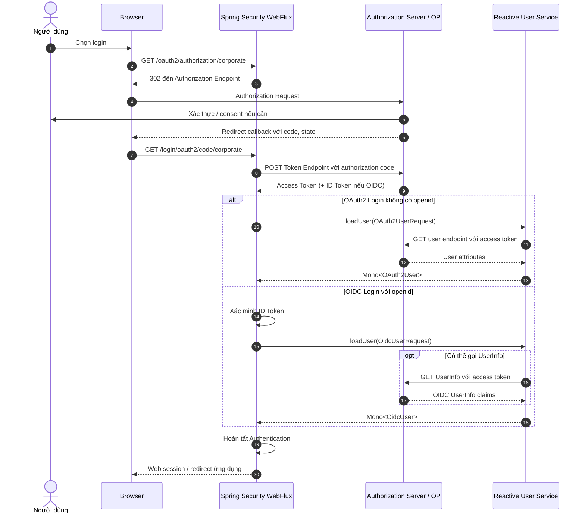

# 20.8. ReactiveOAuth2UserService và OidcReactiveOAuth2UserService

> **Module:** Spring Security OAuth 2.0 OIDC Client  
> **Chương:** 20. Đăng nhập Reactive  
> **Trọng tâm:** Hai nhánh lấy thông tin người dùng trong Spring Security WebFlux: `ReactiveOAuth2UserService<OAuth2UserRequest, OAuth2User>` dành cho OAuth 2.0 Login và `OidcReactiveOAuth2UserService` dành cho OpenID Connect 1.0 Login; cách tùy biến UserInfo, principal, authorities và luồng bất đồng bộ bằng Reactor.

Trong Spring MVC, ta thường gặp `DefaultOAuth2UserService`, `OidcUserService` và các API dựa trên Servlet. Với **Spring WebFlux**, đăng nhập OAuth 2.0/OIDC được tổ chức theo luồng **reactive**: truy vấn UserInfo có thể sử dụng `WebClient`, kết quả trả về `Mono`, và việc thiết lập principal được nối vào quá trình xác thực không chặn event loop.

Hai tên dễ nhầm lẫn:

- `ReactiveOAuth2UserService<R, U>` là **giao diện** tổng quát cho thao tác lấy và dựng người dùng reactive.
- `DefaultReactiveOAuth2UserService` là implementation mặc định cho **OAuth 2.0 Login không phải OIDC**, thường lấy attributes qua UserInfo/user endpoint bằng access token.
- `OidcReactiveOAuth2UserService` là implementation cho **OIDC Login**; nó xây dựng `OidcUser` từ ID Token đã được xác minh và có thể bổ sung dữ liệu qua UserInfo Endpoint.

Cả hai được dùng **sau các bước authorization code, token exchange thích hợp**, không thay thế việc xác minh ID Token hoặc tự biến một access token thành danh tính người dùng.

Bài học làm rõ cách chọn service, nơi tùy biến, quy tắc bảo mật và cách kết hợp dữ liệu từ một hệ thống phân quyền nội bộ mà vẫn bảo toàn tính reactive.

---

## 1. Mục tiêu học tập

Hoàn thành bài học, bạn có thể:

1. Xác định vị trí `ReactiveOAuth2UserService` trong luồng đăng nhập WebFlux.
2. Phân biệt `DefaultReactiveOAuth2UserService` và `OidcReactiveOAuth2UserService` theo protocol, request và principal được trả về.
3. Hiểu kiểu tổng quát `ReactiveOAuth2UserService<R extends OAuth2UserRequest, U extends OAuth2User>` và method `Mono<U> loadUser(R request)`.
4. Giải thích vai trò của `OAuth2UserRequest`, `OidcUserRequest`, `OAuth2User`, `OidcUser`, ID Token và UserInfo.
5. Biết khi nào scope `openid` đưa đăng nhập sang nhánh OIDC.
6. Tùy chỉnh reactive OAuth2 user service để ánh xạ attributes và authorities.
7. Tùy chỉnh OIDC user service thông qua delegate, `setOauth2UserService(...)` hoặc điểm mở rộng phù hợp phiên bản.
8. Viết code dùng `Mono.map`, `flatMap` và `WebClient` thay vì `block()` trong pipeline đăng nhập.
9. Bảo vệ ràng buộc giữa `sub` của ID Token và UserInfo, issuer và audience.
10. Không nhầm claims, scopes và authorities khi xây chính sách phân quyền.
11. Tránh các lỗi như thiếu tên principal, HTTP 401 tại UserInfo, timeout, mapper làm mất authorities hoặc service tùy chỉnh không được wiring.
12. Tạo kế hoạch kiểm thử unit, WebFlux security và integration với OpenID Provider thử nghiệm.

## 2. WebFlux OAuth2 Login khác Servlet OAuth2 Login ở đâu?

Spring Security có hai kiểu runtime web chính:

| Khía cạnh | Servlet / Spring MVC | Reactive / Spring WebFlux |
|---|---|---|
| Filter chain | `SecurityFilterChain` | `SecurityWebFilterChain` |
| Cấu hình bảo mật | `HttpSecurity` | `ServerHttpSecurity` |
| OAuth2 login DSL | `http.oauth2Login(...)` | `http.oauth2Login(...)` trên ServerHttpSecurity |
| Lấy user OAuth2 mặc định | `DefaultOAuth2UserService` | `DefaultReactiveOAuth2UserService` |
| Lấy OIDC user | `OidcUserService` | `OidcReactiveOAuth2UserService` |
| Hợp đồng user service | `OAuth2UserService<R,U>` | `ReactiveOAuth2UserService<R,U>` |
| Giá trị trả từ loadUser | `U` đồng bộ | `Mono<U>` |
| HTTP client thường dùng | Servlet/RestClient tùy phiên bản | `WebClient` |
| Security context | Chủ yếu qua Servlet/request mechanisms | Reactor Context và reactive security infrastructure |
| Client registration repository | `ClientRegistrationRepository` | `ReactiveClientRegistrationRepository` |

**Từ “reactive” không chỉ có nghĩa đổi tên class.** Nó quyết định loại đối tượng trả về, thời điểm subscribe, cách gọi HTTP bất đồng bộ, xử lý lỗi và việc không được khóa thread event loop.

Không sao chép nguyên một `OAuth2UserService<...>` Servlet rồi dùng như `ReactiveOAuth2UserService<...>`; hai interface có hợp đồng khác nhau.

### 2.1. Reactive không phải là không có session

WebFlux OAuth2 Login vẫn có thể sử dụng web session, cookie và `SecurityContext` cho browser login. Phần reactive đề cập cách tổ chức request pipeline, không biến ứng dụng thành stateless Resource Server.

Nếu ứng dụng dùng bearer JWT để bảo vệ API và **không có đăng nhập browser**, nó thường sử dụng `oauth2ResourceServer()`; đó là luồng khác với `oauth2Login()` và không mặc nhiên gọi hai user services trong bài này.

## 3. Luồng đăng nhập tổng quan

Một OIDC/OAuth2 Login trong WebFlux thường bắt đầu tại:

```text
GET /oauth2/authorization/{registrationId}
```

Sau khi user xác thực tại Authorization Server/OpenID Provider, browser được đưa về callback:

```text
GET /login/oauth2/code/{registrationId}?code=...&state=...
```

Trong chuỗi xử lý:

1. Spring Security tra `ClientRegistration` từ `ReactiveClientRegistrationRepository`.
2. Tạo authorization request và chuyển browser đến nhà cung cấp.
3. Nhận authorization code ở callback và đối chiếu ngữ cảnh giao dịch.
4. Đổi code lấy access token, và với OIDC có thể nhận ID Token.
5. Chọn cách tạo principal theo protocol đã được cấu hình.
6. Dùng reactive user service tương ứng khi cần lấy/ánh xạ thông tin người dùng.
7. Hoàn tất Authentication và lưu security context theo chiến lược web session/repository.
8. Requests tiếp theo được áp quy tắc authorization.

Sơ đồ minh họa:



Sơ đồ thể hiện logic cốt lõi, không cố mô tả mọi filter/manager trong từng phiên bản Spring Security. Điều đáng chú ý là **service có thể phát HTTP call riêng tới UserInfo**, nhưng ID Token verification thuộc luồng OIDC authentication, không nên được bỏ qua để “lấy user nhanh hơn”.

## 4. ReactiveOAuth2UserService: interface dùng chung

Interface được khai báo tại:

```java
org.springframework.security.oauth2.client.userinfo.ReactiveOAuth2UserService
```

Hợp đồng cốt lõi:

```java
@FunctionalInterface
public interface ReactiveOAuth2UserService<
        R extends OAuth2UserRequest,
        U extends OAuth2User> {

    Mono<U> loadUser(R userRequest) throws OAuth2AuthenticationException;
}
```

Ý nghĩa các phần:

| Thành phần | Giải thích |
|---|---|
| `R extends OAuth2UserRequest` | Kiểu request chứa thông tin đăng ký Client và access token |
| `U extends OAuth2User` | Kiểu principal mong muốn |
| `loadUser(R)` | Lấy/ánh xạ thông tin người dùng theo contract provider |
| `Mono<U>` | Kết quả bất đồng bộ, tối đa một principal hoặc lỗi |
| `OAuth2AuthenticationException` | Loại lỗi có thể phát sinh trong quá trình authentication |

Trong reactive pipeline, việc gọi `loadUser(...)` thông thường trả về một `Mono`. Không tự gọi `subscribe()` để kích hoạt một side effect mà không trả tín hiệu kết quả cho Spring Security.

### 4.1. Hai kiểu chuyên biệt quan trọng

**OAuth 2.0 Login thông thường:**

```java
ReactiveOAuth2UserService<OAuth2UserRequest, OAuth2User>
```

**OpenID Connect Login:**

```java
ReactiveOAuth2UserService<OidcUserRequest, OidcUser>
```

`OidcUserRequest` mở rộng ngữ cảnh request và có ID Token. `OidcUser` mở rộng thông tin principal và truy xuất được OIDC claims/ID Token/UserInfo.

Đừng ép:

```java
ReactiveOAuth2UserService<OAuth2UserRequest, OAuth2User> service =
    new OidcReactiveOAuth2UserService(); // Không tương thích generic type.
```

vì kiểu request/principal của OIDC không giống nhánh OAuth2 thông thường.

## 5. DefaultReactiveOAuth2UserService làm gì?

`DefaultReactiveOAuth2UserService` nằm trong package:

```java
org.springframework.security.oauth2.client.userinfo.DefaultReactiveOAuth2UserService
```

Nó triển khai:

```java
ReactiveOAuth2UserService<OAuth2UserRequest, OAuth2User>
```

và hỗ trợ OAuth2 providers có **UserInfo/user endpoint** trả về attributes. Sau khi OAuth2 Authorization Code Flow cấp access token, service dùng token để lấy dữ liệu người dùng và dựng `OAuth2User`.

Ví dụ provider có endpoint:

```http
GET /api/user HTTP/1.1
Host: provider.example.test
Authorization: Bearer <redacted-access-token>
Accept: application/json
```

Response minh họa:

```json
{
  "id": 8342,
  "login": "demo-user",
  "name": "Example Person",
  "avatar_url": "https://cdn.example.test/avatars/8342.png"
}
```

Ở đây `id` hoặc `login` có thể là thuộc tính định danh mà registration khai báo, tùy hợp đồng provider. OAuth 2.0 không chuẩn hóa mọi tên field của UserInfo response giống như OIDC.

### 5.1. Vai trò của userNameAttributeName

Để dựng `DefaultOAuth2User`, Spring Security cần biết thuộc tính nào dùng làm tên principal.

Ví dụ non-OIDC provider trả `id`:

```yaml
spring:
  security:
    oauth2:
      client:
        registration:
          code-host:
            provider: code-host
            client-id: ${CODE_HOST_CLIENT_ID}
            client-secret: ${CODE_HOST_CLIENT_SECRET}
            authorization-grant-type: authorization_code
            scope: [read:user]
        provider:
          code-host:
            authorization-uri: https://provider.example.test/oauth/authorize
            token-uri: https://provider.example.test/oauth/token
            user-info-uri: https://provider.example.test/api/user
            user-name-attribute: id
```

Những URLs chỉ là **provider giả định cho lab**. Token Endpoint, scopes, authentication method và redirect URI phải theo đăng ký của provider thật.

Nếu service không tìm thấy thuộc tính name như đã đăng ký, quá trình dựng principal có thể thất bại. Không sửa bằng cách lấy bừa một field không ổn định, hoặc cho người dùng tự khai báo ID.

### 5.2. Cơ chế HTTP reactive

`DefaultReactiveOAuth2UserService` có thể dùng `WebClient` khi gọi UserInfo endpoint. Nó cung cấp các điểm mở rộng như:

- `setWebClient(WebClient)`: tùy chỉnh HTTP client phục vụ request UserInfo, ví dụ timeout/network connector/filter đã được kiểm soát.
- `setAttributesConverter(...)`: điều chỉnh cấu trúc attributes trả về trước khi dựng principal, ở các phiên bản API hỗ trợ.

Dù có thể cấu hình HTTP client, Client vẫn phải giữ Bearer token và request semantics theo contract, chỉ gửi access token tới **UserInfo endpoint của provider tin cậy**.

## 6. OidcReactiveOAuth2UserService làm gì?

`OidcReactiveOAuth2UserService` nằm trong package:

```java
org.springframework.security.oauth2.client.oidc.userinfo.OidcReactiveOAuth2UserService
```

Nó triển khai:

```java
ReactiveOAuth2UserService<OidcUserRequest, OidcUser>
```

Trong OpenID Connect, ID Token là phần trọng tâm xác thực người dùng. `OidcReactiveOAuth2UserService` dùng ngữ cảnh OIDC đã xử lý để dựng `OidcUser` và **có thể** truy xuất thông tin bổ sung từ UserInfo Endpoint.

### 6.1. ID Token khác UserInfo

| Thành phần | Nguồn | Vai trò |
|---|---|---|
| `OidcIdToken` | Token Endpoint/OP, được xác minh theo OIDC | Khẳng định danh tính; claims như `iss`, `sub`, `aud`, `exp` |
| `OidcUserInfo` | UserInfo Endpoint, dùng access token | Bổ sung claims về người dùng theo scopes/policy |
| `OidcUser` | Principal trong Spring Security | Kết hợp ID Token, UserInfo khi có và authorities |
| `OAuth2AccessToken` | Token Endpoint | Truy cập Resource Server/UserInfo |
| `OidcUserRequest` | Spring Security OIDC login pipeline | Mang access token, client registration và ID Token |

Một ID Token hợp lệ **không bắt buộc phải có tất cả thuộc tính hồ sơ** như `email`, `name` hay `picture`. OP có thể trả chúng từ UserInfo khi được phép; trường hợp UserInfo không có hoặc không cần truy vấn vẫn có thể dựng OIDC principal từ ID Token hợp lệ theo luồng/framework.

### 6.2. UserInfo có luôn được gọi không?

Không. Việc gọi UserInfo phụ thuộc:

- Provider có công bố UserInfo Endpoint hay không.
- Authorization grant/registration có phù hợp không.
- Chính sách mặc định và các điều kiện của phiên bản Spring Security.
- Có cấu hình `setRetrieveUserInfo(...)` ở phiên bản hỗ trợ không.
- Access token và phạm vi claims được cấp.

Đừng khẳng định cứ thấy `scope=openid` là có HTTP GET UserInfo. OIDC login có thể hoàn tất từ ID Token hợp lệ; UserInfo là phần bổ sung trong điều kiện thích hợp.

### 6.3. Kiểm tra sub là ranh giới bắt buộc

Theo OIDC Core, khi Client gọi UserInfo, claim `sub` ở response **phải khớp** claim `sub` của ID Token. Nếu không khớp, kết quả không được dùng để thiết lập/điều chỉnh danh tính.

Ví dụ:

```json
// ID Token payload đã được xác minh
{
  "iss": "https://login.example.test/realms/company",
  "sub": "user-734",
  "aud": "portal-web"
}
```

```json
// UserInfo response
{
  "sub": "user-999",
  "email": "someone@example.test"
}
```

Đây là dữ liệu **không cùng subject**. Không được chấp nhận thông tin từ UserInfo như thể thuộc `user-734`; không “sửa” bằng cách lấy email rồi bỏ qua khác biệt `sub`.

### 6.4. OIDC UserService không thay ID Token validation

Chữ ký ID Token, issuer, audience/client ID, expiry, nonce và các điều kiện OIDC cần được xác minh bởi thành phần chuyên trách trong authentication pipeline, chẳng hạn reactive ID token decoder của Spring Security.

Một `OidcReactiveOAuth2UserService` tùy chỉnh không được thay đường kiểm tra đó bằng:

```java
// PHẢN VÍ DỤ — không bao giờ dùng raw payload để coi là user hợp lệ.
String subject = decodeWithoutSignatureVerification(idToken).get("sub");
return Mono.just(buildUserFrom(subject));
```

Service user chỉ nên dựng principal từ **kết quả và dữ liệu phù hợp với luồng xác thực đã được kiểm chứng**.

## 7. Khi nào dùng service nào?

Quyết định trọng tâm dựa trên **hợp đồng protocol**, không dựa vào tên nhà cung cấp.

| Loại đăng nhập | Tín hiệu điển hình | User service | Principal |
|---|---|---|---|
| OAuth 2.0 Login thông thường | Registration không yêu cầu scope `openid` | `DefaultReactiveOAuth2UserService` hoặc một `ReactiveOAuth2UserService<OAuth2UserRequest, OAuth2User>` | `OAuth2User` |
| OpenID Connect 1.0 Login | Registration có scope `openid` và OP hỗ trợ OIDC | `OidcReactiveOAuth2UserService` hoặc `ReactiveOAuth2UserService<OidcUserRequest, OidcUser>` | `OidcUser` |
| OAuth 2.0 Resource Server JWT | API nhận Bearer JWT | Reactive JWT authentication/decoder | Thường `JwtAuthenticationToken`; không dùng hai service này |
| Client Credentials service-to-service | Backend tự xin machine token | AuthorizedClientManager / grant provider | Không phải OIDC end-user principal |
| Form login | Username/password theo cấu hình | Reactive authentication manager/user details | Không phải hai service OAuth2 trong bài |

Với những providers có cả OAuth 2.0 và OIDC, cùng tên thương mại có thể có nhiều registrations, một registration có `openid` và một registration không. Đừng dùng logic `if (providerName.equals("google"))` để quyết định class user service.

## 8. Cấu hình WebFlux OAuth2/OIDC Login tối thiểu

Dự án dùng các Spring Boot starters phù hợp:

```xml
<dependencies>
    <dependency>
        <groupId>org.springframework.boot</groupId>
        <artifactId>spring-boot-starter-webflux</artifactId>
    </dependency>
    <dependency>
        <groupId>org.springframework.boot</groupId>
        <artifactId>spring-boot-starter-security</artifactId>
    </dependency>
    <dependency>
        <groupId>org.springframework.boot</groupId>
        <artifactId>spring-boot-starter-oauth2-client</artifactId>
    </dependency>
</dependencies>
```

Ví dụ `application.yml` với một OIDC Client:

```yaml
server:
  port: 8080

spring:
  security:
    oauth2:
      client:
        registration:
          corporate:
            provider: corporate-op
            client-id: portal-web
            client-secret: ${CORPORATE_OIDC_CLIENT_SECRET}
            authorization-grant-type: authorization_code
            redirect-uri: "{baseUrl}/login/oauth2/code/{registrationId}"
            scope:
              - openid
              - profile
              - email
        provider:
          corporate-op:
            issuer-uri: https://login.example.test/realms/company
```

Ví dụ sử dụng issuer giả định. Trong môi trường thực, issuer phải trùng metadata của OP và redirect URI phải được đăng ký chính xác; credentials cần lấy từ secret manager/environment.

### 8.1. SecurityWebFilterChain

```java
package example.webflux;

import org.springframework.context.annotation.Bean;
import org.springframework.context.annotation.Configuration;
import org.springframework.security.config.annotation.web.reactive.EnableWebFluxSecurity;
import org.springframework.security.config.web.server.ServerHttpSecurity;
import org.springframework.security.web.server.SecurityWebFilterChain;

@Configuration
@EnableWebFluxSecurity
public class ReactiveSecurityConfig {

    @Bean
    SecurityWebFilterChain springSecurityFilterChain(ServerHttpSecurity http) {
        return http
            .authorizeExchange(exchanges -> exchanges
                .pathMatchers("/", "/error").permitAll()
                .anyExchange().authenticated()
            )
            .oauth2Login(oauth2 -> {})
            .build();
    }
}
```

Với registration `corporate`, người dùng bắt đầu:

```text
http://localhost:8080/oauth2/authorization/corporate
```

Với scope `openid`, Spring Security sử dụng các thành phần OIDC tương ứng. Không cần tự xây user service nếu behavior mặc định đã đáp ứng yêu cầu.

### 8.2. Không dùng cấu hình Servlet trong WebFlux

Ví dụ sai ngữ cảnh:

```java
// Servlet APIs - không phải cấu hình WebFlux:
HttpSecurity http;
SecurityFilterChain chain;
DefaultOAuth2UserService userService;
OidcUserService oidcUserService;
```

Để cấu hình Reactive Login, dùng `ServerHttpSecurity`, `SecurityWebFilterChain` và `ReactiveOAuth2UserService` đúng kiểu. Việc dự án có dependency cả MVC và WebFlux có thể dẫn đến lựa chọn web application type khác kỳ vọng; cần xác định runtime Boot đang khởi tạo.

## 9. Đăng ký custom ReactiveOAuth2UserService dưới dạng bean

Một cách tùy biến trực tiếp cho non-OIDC OAuth2 Login là khai báo:

```java
import org.springframework.context.annotation.Bean;
import org.springframework.context.annotation.Configuration;
import org.springframework.security.oauth2.client.userinfo.DefaultReactiveOAuth2UserService;
import org.springframework.security.oauth2.client.userinfo.OAuth2UserRequest;
import org.springframework.security.oauth2.client.userinfo.ReactiveOAuth2UserService;
import org.springframework.security.oauth2.core.user.OAuth2User;

@Configuration
class OAuth2UserServiceConfig {

    @Bean
    ReactiveOAuth2UserService<OAuth2UserRequest, OAuth2User>
            oauth2UserService() {

        DefaultReactiveOAuth2UserService delegate =
            new DefaultReactiveOAuth2UserService();

        return request -> delegate.loadUser(request)
            .doOnNext(user -> {
                // Chỉ quan sát metadata không nhạy cảm.
                // Không ghi toàn bộ attributes hoặc access token.
            });
    }
}
```

Ví dụ dùng cơ chế **delegate**, giữ logic HTTP/UserInfo gốc. Spring Security WebFlux có thể phát hiện bean `ReactiveOAuth2UserService<OAuth2UserRequest,OAuth2User>` theo cấu hình mặc định tương ứng. Nếu ứng dụng tự cấu hình authentication manager/converter, cần bảo đảm custom service được wiring vào đường đó.

Đoạn ví dụ trên chưa thay đổi principal; mục tiêu là cho thấy `Mono<OAuth2User>` được trả lại Spring Security. Nó không gọi `subscribe()`.

### 9.1. Vì sao không tự gọi subscribe()?

Tránh:

```java
// PHẢN VÍ DỤ:
return request -> {
    delegate.loadUser(request).subscribe(user -> audit(user));
    return Mono.empty();
};
```

Code này tách work khỏi authentication pipeline, trả `Mono.empty()` cho framework và tạo side effect có lifetime không kiểm soát. Đúng hơn, dùng `map`, `flatMap`, `doOnNext` trong pipeline **được return**.

### 9.2. Nơi phù hợp để thay đổi attributes

Nếu cần sửa định dạng profile từ UserInfo, có hai hướng:

1. Dùng `DefaultReactiveOAuth2UserService.setAttributesConverter(...)` trong những phiên bản Spring Security hỗ trợ.
2. Dùng một wrapper `ReactiveOAuth2UserService` tự tạo lại `OAuth2User` từ attributes đã chuẩn hóa, bảo toàn principal ID và authorities.

Một số APIs xuất hiện ở các mốc version khác nhau; khi nâng Spring Security, hãy đọc API của phiên bản trong dự án, không sao chép cách gọi method từ tài liệu version khác.

## 10. Ví dụ chuẩn hóa attributes cho OAuth2User

Giả sử một OAuth2 provider không OIDC trả profile:

```json
{
  "user": {
    "id": "acct-583",
    "display_name": "Example User"
  },
  "plan": "team"
}
```

Nhưng Spring Security cần thuộc tính định danh nằm ở top-level. Một lựa chọn cho Spring Security 6.3+ là `setAttributesConverter(...)`:

```java
import java.util.LinkedHashMap;
import java.util.Map;

import org.springframework.context.annotation.Bean;
import org.springframework.security.oauth2.client.userinfo.DefaultReactiveOAuth2UserService;
import org.springframework.security.oauth2.client.userinfo.OAuth2UserRequest;
import org.springframework.security.oauth2.client.userinfo.ReactiveOAuth2UserService;
import org.springframework.security.oauth2.core.user.OAuth2User;

@Bean
ReactiveOAuth2UserService<OAuth2UserRequest, OAuth2User>
        oauth2UserService() {

    DefaultReactiveOAuth2UserService service =
        new DefaultReactiveOAuth2UserService();

    service.setAttributesConverter(request -> attributes -> {
        Map<String, Object> result = new LinkedHashMap<>(attributes);

        Object rawUser = attributes.get("user");
        if (rawUser instanceof Map<?, ?> nested) {
            Object id = nested.get("id");
            if (id != null) {
                result.put("account_id", id.toString());
            }
        }

        return result;
    });

    return service;
}
```

Trong cấu hình ClientRegistration, cần đặt `user-name-attribute: account_id` **nếu** API thật của provider cung cấp dữ liệu nested như ví dụ và converter tạo field đó đúng cách. Nếu `user`/`id` thiếu, hãy xử lý như dữ liệu thiếu theo policy; đừng tạo ID ngẫu nhiên khiến một user có nhiều danh tính qua các lần login.

**Không dùng dữ liệu profile tùy ý do browser gửi** thay cho response của UserInfo endpoint đã được truy cập bằng access token đúng Client registration.

### 10.1. Attributes converter không phải authorization policy

Chuẩn hóa field `account_id` giúp nhận diện user trong phạm vi provider, nhưng không tự cấp `ROLE_ADMIN` hay quyết định user thuộc tenant nào.

Nếu ứng dụng cần role nội bộ, phải có source of truth và policy riêng; có thể làm điều đó qua một reactive service sau khi lấy principal.

## 11. Đăng ký OidcReactiveOAuth2UserService làm bean

Đối với OIDC Login, bean có kiểu tổng quát khác:

```java
import org.springframework.context.annotation.Bean;
import org.springframework.context.annotation.Configuration;
import org.springframework.security.oauth2.client.oidc.userinfo.OidcReactiveOAuth2UserService;
import org.springframework.security.oauth2.client.userinfo.ReactiveOAuth2UserService;
import org.springframework.security.oauth2.client.oidc.userinfo.OidcUserRequest;
import org.springframework.security.oauth2.core.oidc.user.OidcUser;

@Configuration
class OidcUserServiceConfig {

    @Bean
    ReactiveOAuth2UserService<OidcUserRequest, OidcUser> oidcUserService() {
        OidcReactiveOAuth2UserService delegate =
            new OidcReactiveOAuth2UserService();

        return request -> delegate.loadUser(request)
            .doOnNext(user -> {
                // Tại đây user là OidcUser trong flow đã được xác minh.
                // Không log ID token, access token hoặc toàn bộ claims.
            });
    }
}
```

Trong tài liệu WebFlux, cách cung cấp bean `ReactiveOAuth2UserService<OidcUserRequest,OidcUser>` là một điểm tùy chỉnh được hỗ trợ để Spring Security sử dụng trong `oauth2Login()`.

### 11.1. Vai trò của OidcUserRequest

`OidcUserRequest` cung cấp:

- `ClientRegistration` liên quan;
- `OAuth2AccessToken` được cấp;
- `OidcIdToken` đã đi qua giai đoạn xử lý OIDC;
- thông tin cần thiết cho việc dựng `OidcUser`.

Trong custom OIDC service:

```java
String registrationId = request.getClientRegistration().getRegistrationId();
String subject = request.getIdToken().getSubject();
String issuer = request.getIdToken().getIssuer().toString();
```

Đừng log `request.getAccessToken().getTokenValue()` hoặc gửi token sang một dịch vụ không được tin cậy để “kiểm tra user”.

### 11.2. Trả Mono<OidcUser>, không trả OAuth2User thường

Hợp đồng bean OIDC yêu cầu `Mono<OidcUser>`. Nếu bạn chỉ trả `DefaultOAuth2User`, thông tin ID Token/claim OIDC bị mất và kiểu dữ liệu không phù hợp.

Khi cần thay authorities, dựng `DefaultOidcUser` với ID token, UserInfo và danh sách authorities thích hợp; **không thay principal bằng một OAuth2User thiếu OIDC context**.

## 12. Tùy biến OIDC bằng delegate: giữ xác minh, bổ sung quyền

Một yêu cầu thường gặp: OP xác thực user, ứng dụng tra vai trò nội bộ từ một dịch vụ riêng. Ta muốn:

- giữ các authorities mặc định của OIDC;
- dựa trên cặp `(issuer, subject)` để tìm identity nội bộ;
- thêm `ROLE_REPORT_VIEWER` nếu dữ liệu quyền đáng tin xác nhận;
- không gọi cơ sở dữ liệu blocking trực tiếp trên event loop.

### 12.1. Contract cho service quyền reactive

Ví dụ một interface ứng dụng:

```java
package example.security;

import java.util.Set;
import reactor.core.publisher.Mono;

public interface ReactiveRoleLookup {

    // Kết quả là app roles đã được xác minh/ánh xạ từ hệ thống nội bộ.
    Mono<Set<String>> findRoles(String issuer, String subject);
}
```

Implementation có thể dùng R2DBC repository hoặc `WebClient` tới API nội bộ có xác thực machine-to-machine phù hợp. Nó không nhận raw ID token từ browser và không suy quyền từ email chưa được kiểm tra.

### 12.2. Custom OIDC user service dùng flatMap

```java
package example.security;

import java.util.HashSet;
import java.util.Set;

import org.springframework.context.annotation.Bean;
import org.springframework.context.annotation.Configuration;
import org.springframework.security.core.GrantedAuthority;
import org.springframework.security.core.authority.SimpleGrantedAuthority;
import org.springframework.security.oauth2.client.oidc.userinfo.OidcReactiveOAuth2UserService;
import org.springframework.security.oauth2.client.oidc.userinfo.OidcUserRequest;
import org.springframework.security.oauth2.client.userinfo.ReactiveOAuth2UserService;
import org.springframework.security.oauth2.core.oidc.user.DefaultOidcUser;
import org.springframework.security.oauth2.core.oidc.user.OidcUser;

@Configuration
class OidcRoleMappingConfig {

    @Bean
    ReactiveOAuth2UserService<OidcUserRequest, OidcUser> oidcUserService(
            ReactiveRoleLookup roles) {

        OidcReactiveOAuth2UserService delegate =
            new OidcReactiveOAuth2UserService();

        return request -> delegate.loadUser(request)
            .flatMap(oidc -> roles.findRoles(
                    oidc.getIdToken().getIssuer().toString(),
                    oidc.getSubject()
                )
                .defaultIfEmpty(Set.of())
                .map(appRoles -> {
                    Set<GrantedAuthority> authorities =
                        new HashSet<>(oidc.getAuthorities());

                    if (appRoles.contains("REPORT_VIEWER")) {
                        authorities.add(new SimpleGrantedAuthority(
                            "ROLE_REPORT_VIEWER"
                        ));
                    }

                    return (OidcUser) new DefaultOidcUser(
                        authorities,
                        oidc.getIdToken(),
                        oidc.getUserInfo()
                    );
                })
            );
    }
}
```

**Vì sao dùng `flatMap`?** Vì `roles.findRoles(...)` là lời gọi bất đồng bộ trả `Mono<Set<String>>`. Dùng `map` bên ngoài mà bên trong lại trả Mono sẽ tạo `Mono<Mono<...>>` không phù hợp hoặc dễ dẫn đến nested publisher bị bỏ quên.

### 12.3. Tại sao giữ authorities gốc?

`oidc.getAuthorities()` có thể gồm `OIDC_USER`/`OidcUserAuthority` và `SCOPE_...`. Nếu bạn thay toàn bộ bằng chỉ một authority mới, có thể làm mất thông tin scope hoặc đánh dấu principal gốc, dẫn tới các chính sách bảo mật thay đổi ngoài ý muốn.

Nếu thiết kế thực sự muốn thay toàn bộ authorities, phải ghi rõ policy và kiểm thử. Ví dụ trên chọn **bổ sung** một app role đã xác minh, không tự gán role quản trị cho mọi OIDC user.

### 12.4. Tại sao không cấp ROLE_ADMIN chỉ vì claim groups?

Một claim từ OP có thể đáng tin ở mức danh tính nhưng không nhất thiết mang nghĩa quyền quản trị ứng dụng. Trước khi ánh xạ `groups`/`roles` từ ID Token/UserInfo thành `ROLE_ADMIN`, cần xác định issuer, tenant, cách cấp claim, quy tắc membership, thời điểm cập nhật và chính sách nguồn dữ liệu.

Custom user service là **điểm mở rộng kỹ thuật**, không tự động tạo cơ sở tin cậy cho bất kỳ claim tùy ý nào.

### 12.5. Lỗi role service phải xử lý thế nào?

Nếu `ReactiveRoleLookup` lỗi hoặc timeout, pipeline trả `onError` và login có thể thất bại. Đối với hệ thống cần role nội bộ để cho phép đăng nhập, đây có thể là chính sách fail-closed hợp lý.

Nếu policy cho phép login với quyền tối thiểu khi role lookup thất bại, có thể dùng fallback `Set.of()` có kiểm soát; **không fallback sang quyền cao** hoặc im lặng đánh dấu user được cấp mọi chức năng.

## 13. Tùy biến OAuth2User bằng delegate và authorities

Với provider OAuth2 không OIDC, vẫn có thể triển khai reactive mapping.

```java
import java.util.HashSet;
import java.util.Set;

import org.springframework.context.annotation.Bean;
import org.springframework.security.core.GrantedAuthority;
import org.springframework.security.core.authority.SimpleGrantedAuthority;
import org.springframework.security.oauth2.client.userinfo.DefaultReactiveOAuth2UserService;
import org.springframework.security.oauth2.client.userinfo.OAuth2UserRequest;
import org.springframework.security.oauth2.client.userinfo.ReactiveOAuth2UserService;
import org.springframework.security.oauth2.core.user.DefaultOAuth2User;
import org.springframework.security.oauth2.core.user.OAuth2User;

@Bean
ReactiveOAuth2UserService<OAuth2UserRequest, OAuth2User> oauth2UserService() {

    DefaultReactiveOAuth2UserService delegate =
        new DefaultReactiveOAuth2UserService();

    return request -> delegate.loadUser(request)
        .map(user -> {
            Set<GrantedAuthority> granted =
                new HashSet<>(user.getAuthorities());

            // Chỉ khi đây là provider nội bộ đã được cấu hình đáng tin
            // và account_status là thuộc tính đã được provider xác nhận.
            if ("corporate-oauth".equals(
                    request.getClientRegistration().getRegistrationId())
                && "active".equals(user.getAttribute("account_status"))) {
                granted.add(new SimpleGrantedAuthority("ROLE_MEMBER"));
            }

            String nameAttribute = request.getClientRegistration()
                .getProviderDetails()
                .getUserInfoEndpoint()
                .getUserNameAttributeName();

            return new DefaultOAuth2User(
                granted,
                user.getAttributes(),
                nameAttribute
            );
        });
}
```

Điều kiện chạy đúng:

- Registration `corporate-oauth` có user endpoint được cấu hình.
- Provider thực trả tên field `account_status` với semantics đáng tin.
- `user-name-attribute` có mặt trong attributes (ví dụ `id`).
- Client ID, secret, endpoints và scopes phù hợp với provider.

Không dùng snippet này để chứng minh provider bên ngoài tự có claim `account_status`. Đây là ví dụ về nơi **mapping** có thể diễn ra khi contract tồn tại.

## 14. setOauth2UserService: tùy biến HTTP UserInfo của OIDC

`OidcReactiveOAuth2UserService` có điểm mở rộng:

```java
setOauth2UserService(
    ReactiveOAuth2UserService<OAuth2UserRequest, OAuth2User>
)
```

Nó cho phép OIDC service sử dụng một reactive OAuth2 user service đã được cấu hình riêng khi truy xuất UserInfo.

Ví dụ:

```java
import org.springframework.context.annotation.Bean;
import org.springframework.security.oauth2.client.oidc.userinfo.OidcReactiveOAuth2UserService;
import org.springframework.security.oauth2.client.oidc.userinfo.OidcUserRequest;
import org.springframework.security.oauth2.client.userinfo.DefaultReactiveOAuth2UserService;
import org.springframework.security.oauth2.client.userinfo.ReactiveOAuth2UserService;
import org.springframework.security.oauth2.core.oidc.user.OidcUser;

@Bean
ReactiveOAuth2UserService<OidcUserRequest, OidcUser> oidcUserService() {

    DefaultReactiveOAuth2UserService userInfoClient =
        new DefaultReactiveOAuth2UserService();

    // Có thể tùy chỉnh WebClient của userInfoClient
    // theo HTTP contract, timeouts và security của provider.

    OidcReactiveOAuth2UserService oidcService =
        new OidcReactiveOAuth2UserService();

    oidcService.setOauth2UserService(userInfoClient);

    return oidcService;
}
```

Đây là cấu hình dựa vào delegate, tránh tự viết HTTP Bearer request và OIDC UserInfo mapping từ đầu.

### 14.1. setWebClient trong DefaultReactiveOAuth2UserService

Nếu cần HTTP client riêng:

```java
import org.springframework.web.reactive.function.client.WebClient;
import org.springframework.security.oauth2.client.userinfo.DefaultReactiveOAuth2UserService;

DefaultReactiveOAuth2UserService service =
    new DefaultReactiveOAuth2UserService();

WebClient userInfoWebClient = WebClient.builder()
    // Cấu hình connector, timeout, proxy theo môi trường.
    .build();

service.setWebClient(userInfoWebClient);
```

Tùy chỉnh phải giữ đảm bảo:

- Chỉ gọi endpoint từ `ClientRegistration` đã được tin cậy.
- Bearer access token không bị log hoặc gửi sang hostname không liên quan.
- Request timeout có giới hạn phù hợp.
- Không thêm filter vô tình in `Authorization` header.
- Không chuyển lỗi 401/403 thành profile giả rồi đánh dấu login thành công.

### 14.2. Chuyển đổi claims UserInfo không thay ID token

OIDC service có cơ chế chuyển đổi type của claims trong `OidcUserInfo` theo API của từng phiên bản, ví dụ `setClaimTypeConverterFactory(...)`. Đây là bước mapping dữ liệu UserInfo, **không** phải quyền sửa `iss`, `sub`, `aud` hoặc kết quả xác minh chữ ký ID Token.

## 15. setRetrieveUserInfo: quyết định có gọi UserInfo hay không

Các phiên bản Spring Security hỗ trợ `OidcReactiveOAuth2UserService.setRetrieveUserInfo(...)` để tùy biến điều kiện gọi UserInfo Endpoint:

```java
// Chữ ký API ở mức khái niệm:
void setRetrieveUserInfo(Predicate<OidcUserRequest> retrieveUserInfo);
```

Điểm mở rộng này có thể hữu ích nếu provider có UserInfo endpoint nhưng ứng dụng chủ ý chỉ lấy claims từ ID Token trong một số tình huống, hoặc cần đánh giá điều kiện cụ thể.

Tuy nhiên:

1. Không buộc gọi UserInfo nếu provider không công bố endpoint.
2. Không gọi UserInfo bằng access token không có quyền tương ứng.
3. Không bỏ qua kiểm tra `sub` khi có response UserInfo.
4. Không dùng tùy chỉnh `retrieveUserInfo` để bỏ ID Token validation.
5. Không giả định behavior mặc định giống hệt giữa mọi Spring Security version.

Trong tài liệu một số phiên bản, điều kiện mặc định gồm sự tồn tại của UserInfo Endpoint và Authorization Code grant, cùng những điều kiện scope thích hợp. Hãy đọc API đúng version đang sử dụng nếu cần thay đổi.

## 16. setOidcUserMapper / setOidcUserConverter theo phiên bản

Ở một số phiên bản Spring Security 6.x, `OidcReactiveOAuth2UserService` cung cấp:

```java
setOidcUserMapper(
    BiFunction<OidcUserRequest, OidcUserInfo, Mono<OidcUser>>
)
```

API này hỗ trợ xây `OidcUser` riêng từ request và UserInfo. Ở nhánh Spring Security mới hơn, API có thể dùng `setOidcUserConverter(...)` với kiểu `OidcUserSource`.

**Không trộn hai snippet giữa các versions.** Nếu cần tùy chỉnh sâu cách dựng `OidcUser`, kiểm tra class/method mà dependency trong dự án thực sự cung cấp.

Khi chỉ cần bổ sung quyền hoặc mapping đơn giản, cách **delegate.loadUser(request).map/flatMap(...)** thường dễ hiểu và ít phụ thuộc API version hơn.

### 16.1. Không tạo lại OidcUser thiếu dữ liệu bắt buộc

Khi tự dựng `DefaultOidcUser`, cần bảo toàn:

- ID Token đã được xác minh;
- UserInfo nếu có;
- authorities theo policy;
- cách xác định principal name phù hợp;
- các ràng buộc OIDC (đặc biệt issuer/subject và UserInfo sub binding).

Không xây principal từ `Map<String,Object>` tùy ý mà không có OIDC context.

## 17. map, flatMap, onErrorResume trong user service

Đây là phần cốt lõi của lập trình reactive.

### 17.1. map: biến đổi dữ liệu đồng bộ, nhanh

```java
return delegate.loadUser(request)
    .map(user -> {
        // Chuyển đổi in-memory, không blocking I/O.
        return user;
    });
```

Dùng `map` khi phép biến đổi không cần gọi mạng/DB bất đồng bộ.

### 17.2. flatMap: ghép công việc reactive

```java
return delegate.loadUser(request)
    .flatMap(user ->
        reactiveRoleStore.findRoles(user.getName())
            .map(roles -> rebuildUser(user, roles))
    );
```

Phần `rebuildUser(...)` là method ứng dụng minh họa. Quan trọng là `flatMap` ghép `Mono` của role lookup vào `Mono` đang xử lý authentication.

### 17.3. onErrorResume: chính sách lỗi cần chủ ý

```java
return delegate.loadUser(request)
    .onErrorResume(error -> {
        // Chỉ fallback khi policy cho phép.
        // Không biến lỗi ID Token/UserInfo thành quyền ADMIN.
        return Mono.error(error);
    });
```

Không nên dùng:

```java
// PHẢN VÍ DỤ: nuốt toàn bộ lỗi authentication rồi tạo admin.
return delegate.loadUser(request)
    .onErrorReturn(untrustedAdminUser);
```

Một lỗi UserInfo 401, invalid subject hoặc network failure cần được xử lý theo policy rõ ràng. Nếu UserInfo là nguồn cần thiết để xác thực/ủy quyền, nguyên tắc an toàn thường là **fail closed**.

### 17.4. Mono.empty() thường không phải đăng nhập thành công

Một `ReactiveOAuth2UserService` trả `Mono.empty()` không cung cấp principal để hoàn tất authentication. Không dùng empty như “user không có role nhưng vẫn đăng nhập được” trừ khi bạn đã xác định hợp đồng cho nhánh xử lý đó; thông thường nên trả principal với authorities thích hợp hoặc báo lỗi rõ ràng.

## 18. Không block event loop

Một anti-pattern phổ biến:

```java
// KHÔNG NÊN làm trong reactive authentication pipeline:
return delegate.loadUser(request)
    .map(user -> {
        var roles = blockingJdbcRepository.findRolesByUserId(user.getName());
        return rebuildUser(user, roles);
    });
```

Nếu `findRolesByUserId(...)` là lời gọi JDBC blocking, nó có thể giữ thread Reactor Netty event loop, gây tăng latency và giảm throughput trên nhiều kết nối.

Các hướng phù hợp:

- Dùng R2DBC/repository reactive.
- Dùng `WebClient` tới API nội bộ.
- Nếu bắt buộc tích hợp thư viện blocking, cô lập bằng `Mono.fromCallable(...).subscribeOn(Schedulers.boundedElastic())` với giới hạn và quan sát phù hợp.
- Không gọi `block()` hoặc `blockOptional()` trong user service.

Ví dụ kỹ thuật cô lập legacy blocking code:

```java
import reactor.core.publisher.Mono;
import reactor.core.scheduler.Schedulers;

Mono<Set<String>> roles = Mono.fromCallable(
        () -> blockingRoleRepository.loadRolesFor(subject)
    )
    .subscribeOn(Schedulers.boundedElastic());
```

Đoạn này là ví dụ cho trường hợp không thể thay nguồn dữ liệu blocking ngay; cần đánh giá thread pool, timeout, cancellation, circuit breaker và tải thực tế. Giải pháp ưu tiên vẫn là non-blocking end-to-end.

## 19. UserInfo Endpoint và bảo vệ access token

`ReactiveOAuth2UserService` thường sử dụng access token để gọi UserInfo/user endpoint được cấu hình. Đây là một bearer credential.

### 19.1. Những điều phải giữ

- Token chỉ được gửi tới endpoint của provider tin cậy.
- Dùng HTTPS ở production.
- Không đưa `accessToken.getTokenValue()` vào URL hoặc log.
- Không lấy UserInfo URI từ input không tin cậy của browser.
- Kiểm tra redirect HTTP do WebClient thực hiện; tránh để bearer token bị chuyển tiếp sang host khác khi follow redirect.
- Hạn chế scope và lifetime token theo mục đích.
- Có timeout và retry policy hữu hạn cho API UserInfo.
- Phân biệt lỗi UserInfo với lỗi Token Endpoint và lỗi callback.

### 19.2. UserInfo không phải nơi cấp quyền

UserInfo trả claims về người dùng. Việc claim `department=finance` hoặc `email=...` xuất hiện không tự động cho phép chức năng quản trị của ứng dụng.

Nếu application muốn cấp authorities từ claims, cần xác định:

1. Provider/issuer nào được tin cậy cho claim đó.
2. Claim được gắn với subject đúng hay không.
3. Giá trị claim được cập nhật và thu hồi thế nào.
4. Dịch vụ nội bộ có phải nguồn quyền chính thức không.
5. Cần kiểm tra phân quyền theo thời điểm request hay chỉ lúc login.

### 19.3. UserInfo có thể trả dữ liệu khác ID Token

Không tự coi mọi claim từ UserInfo là dữ liệu ghi đè an toàn cho ID Token. Theo OIDC, claim `sub` ở UserInfo phải khớp ID Token; cách hợp nhất các claims còn lại cần theo contract OP và policy ứng dụng.

## 20. Principal name và danh tính OIDC bền vững

Với OAuth2 providers không OIDC, ứng dụng cần một thuộc tính name được provider đảm bảo tồn tại và ổn định. Với OIDC, định danh bền vững thường dựa trên:

```text
(issuer, subject)
```

Ví dụ:

```text
issuer  = https://login.example.test/realms/company
subject = account-583
```

Một user có thể thay đổi `email` hoặc `preferred_username` nhưng cặp issuer/subject vẫn là khóa định danh thích hợp trong phạm vi chính sách OP.

### 20.1. Vì sao không dùng email làm identity key mặc định?

Email có thể:

- Không hiện diện trong ID Token/UserInfo;
- Chưa được xác minh;
- Thay đổi theo thời gian;
- Được cấp lại cho người khác;
- Trùng giữa nhiều providers/tenants.

Dùng email làm đầu vào hỗ trợ UI có thể phù hợp, nhưng liên kết tài khoản bảo mật cần policy xác minh và chống account linking nhầm.

### 20.2. getName() không phải registration ID

Trong WebFlux sau OAuth2/OIDC Login, `OAuth2AuthenticationToken` chứa registration ID của Client đã dùng. `OAuth2User.getName()` hoặc `OidcUser.getName()` là tên principal, không phải registration ID.

Nếu cần xác định source login, đọc từ Authentication đã được framework tạo, không suy ra chỉ từ issuer hoặc username.

## 21. Authorities mapping: chọn đúng mức mở rộng

Spring Security có thể ánh xạ authorities qua `GrantedAuthoritiesMapper` hoặc delegation-based reactive user service.

| Nhu cầu | Cách phù hợp |
|---|---|
| Đổi `SCOPE_x` thành authority nội bộ theo quy tắc đơn giản | `GrantedAuthoritiesMapper` hoặc mapping rõ ràng |
| Bổ sung role bằng dữ liệu từ internal API reactive | `ReactiveOAuth2UserService` wrapper + `flatMap` |
| Chuẩn hóa attributes nested từ OAuth2 UserInfo | `DefaultReactiveOAuth2UserService.setAttributesConverter` khi version hỗ trợ |
| Tùy chỉnh HTTP client tới UserInfo | `setWebClient` trên default reactive OAuth2 user service |
| Tùy chỉnh OIDC UserInfo loading | `OidcReactiveOAuth2UserService.setOauth2UserService` |
| Chọn có gọi OIDC UserInfo hay không | `setRetrieveUserInfo` khi version hỗ trợ |
| Dựng lại OidcUser theo policy chuyên biệt | Delegate wrapper hoặc mapper/converter theo version |
| Kiểm tra role mỗi request, hỗ trợ thu hồi lập tức | Authorization layer/business policy; không chỉ mapping lúc login |

Một `GrantedAuthoritiesMapper` không phù hợp để thực hiện I/O reactive dài hơi vì hợp đồng của nó xử lý authorities một cách đồng bộ. Nếu cần gọi service ngoài, dùng reactive user service hoặc một authorization component reactive được thiết kế riêng.

### 21.1. Map ROLE_ và SCOPE_ rõ nghĩa

Spring Security thường phân biệt:

- `ROLE_ADMIN`: authority theo role prefix;
- `SCOPE_reports.read`: authority theo granted OAuth2 scope;
- `OIDC_USER`/`OAUTH2_USER`: dấu hiệu/mapping của user login.

`hasRole("ADMIN")` thông thường kiểm tra `ROLE_ADMIN`, không tự hiểu `reports.read` hay `OIDC_USER` là admin.

Khi tạo `new SimpleGrantedAuthority("ROLE_MEMBER")`, hãy chỉ làm khi nguồn policy thật sự cho phép.

## 22. Controller WebFlux: đọc principal sau login

Ví dụ một REST endpoint trả thông tin tối thiểu từ principal mà không công khai token:

```java
package example.webflux;

import java.util.Map;

import org.springframework.security.core.annotation.AuthenticationPrincipal;
import org.springframework.security.oauth2.core.oidc.user.OidcUser;
import org.springframework.web.bind.annotation.GetMapping;
import org.springframework.web.bind.annotation.RestController;

@RestController
class OidcProfileController {

    @GetMapping("/me")
    Map<String, String> currentUser(
            @AuthenticationPrincipal OidcUser user) {

        return Map.of(
            "subject", user.getSubject(),
            "issuer", user.getIdToken().getIssuer().toString()
        );
    }
}
```

Endpoint này dành cho đường WebFlux được bảo vệ bằng OIDC Login và giả định principal thuộc `OidcUser`. Với ứng dụng còn hỗ trợ OAuth2 Login thường, form login hay bearer JWT, nên nhận `Authentication` chung hoặc kiểm tra kiểu trước khi truy cập OIDC-only methods.

**Không trả nguyên `OidcUser` hoặc ID Token về frontend** chỉ để debug: có thể làm lộ dữ liệu cá nhân hoặc credentials không cần thiết.

### 22.1. Dùng ReactiveSecurityContextHolder khi ở service

Nếu một service cần current Authentication trong reactive pipeline:

```java
import reactor.core.publisher.Mono;
import org.springframework.security.core.Authentication;
import org.springframework.security.core.context.ReactiveSecurityContextHolder;

Mono<Authentication> current =
    ReactiveSecurityContextHolder.getContext()
        .map(context -> context.getAuthentication());
```

Đây là Reactor Context, không phải Servlet ThreadLocal. Không dựa vào `SecurityContextHolder.getContext()` trong mọi thread reactive như thể nó có session của request hiện hành.

Tuy nhiên, riêng `ReactiveOAuth2UserService.loadUser(request)` đã nhận `OAuth2UserRequest` chứa ngữ cảnh cần thiết; không cần tự tìm principal hiện tại trong security context trước khi principal mới được tạo.

## 23. Khi UserInfo bị lỗi HTTP

Một số lỗi phổ biến:

| Dấu hiệu | Khả năng | Hướng xử lý |
|---|---|---|
| 401 từ UserInfo | Access token không được endpoint chấp nhận, sai audience/scope hoặc revoked | Kiểm tra token/endpoint/AS policy |
| 403 từ UserInfo | Thiếu quyền cho UserInfo hoặc endpoint policy | Kiểm tra scopes/grant/provider |
| 404 UserInfo | URI bị cấu hình sai hoặc endpoint không tồn tại | Kiểm tra metadata `user-info-uri`/issuer discovery |
| Decode JSON lỗi | Provider trả payload khác contract | Kiểm tra content type/response schema trong lab |
| Missing user-name attribute | `user-name-attribute` sai hoặc response nested | Cấu hình đúng name attribute/attributes converter |
| Mono timeout | Network/OP chậm hoặc custom WebClient thiếu timeout | Tối ưu network, timeout, retry có giới hạn |
| OIDC `sub` mismatch | UserInfo không thuộc subject trong ID Token | Từ chối, không ghép claim từ user khác |
| OIDC signature/issuer/audience invalid | Lỗi ID Token verification trước/dọc authentication | Không bỏ validator; kiểm tra OP metadata và ClientRegistration |
| Role lookup nội bộ lỗi | Service phân quyền không khả dụng | Fail closed hoặc fallback quyền tối thiểu theo policy |
| Custom service bean không có tác dụng | Sai generic type hoặc custom authentication wiring | Kiểm tra bean type và WebFlux security configuration |
| ClassCastException | Ép `OAuth2User` thành `OidcUser` không đúng flow | Phân biệt scope `openid` và loại principal |
| Application báo blocking | Sử dụng JDBC/block() trên event loop | Dùng R2DBC/WebClient hoặc boundedElastic khi cần |

### 23.1. Đừng sửa HTTP 401 bằng việc bỏ Bearer auth

UserInfo thường là một protected resource. Nếu endpoint cần token và trả 401, đừng bỏ header hoặc dùng token của Client khác để “thử cho qua”.

### 23.2. Đừng nuốt lỗi rồi tạo user mặc định

Đây là phản ví dụ:

```java
// KHÔNG AN TOÀN:
return delegate.loadUser(request)
    .onErrorReturn(new DefaultOAuth2User(
        Set.of(new SimpleGrantedAuthority("ROLE_ADMIN")),
        Map.of("id", "fallback"),
        "id"
    ));
```

Một lỗi OP/UserInfo không chứng minh có user admin. Những lỗi cần thiết cho xác thực phải được báo về authentication failure handler và phản hồi UX phù hợp.

## 24. Tương tác với reactive OAuth2 Client và authorized clients

OAuth2 Login và OAuth2 Client liên quan nhưng không đồng nhất:

- `ReactiveClientRegistrationRepository` chứa Client registrations.
- `ServerOAuth2AuthorizedClientRepository` lưu/đọc authorized client trong ngữ cảnh web exchange.
- `ReactiveOAuth2AuthorizedClientService` lưu/đọc authorized clients trong reactive application theo principal.
- `ReactiveOAuth2AuthorizedClientManager` quản lý việc authorize/reauthorize, access token/refresh token khi cần.
- `ReactiveOAuth2UserService` dựng user principal trong **login pipeline**.

Không sử dụng `ReactiveOAuth2UserService` để thực hiện refresh token grant. Refresh là nhiệm vụ của OAuth2 Client manager/provider, không phải thao tác `loadUser`.

### 24.1. UserInfo access token không phải ID Token

Trong OIDC, ID Token dùng để xác thực danh tính với Client; access token dùng để gọi UserInfo hoặc Resource Server. Không đưa ID Token vào `Authorization: Bearer` của UserInfo endpoint thay cho access token trừ khi provider có một hợp đồng riêng được đánh giá an toàn (không phải OIDC UserInfo chuẩn).

### 24.2. Khi nào UserInfo được gọi lần nữa?

Việc gọi `loadUser` trong login pipeline không có nghĩa cứ mỗi request HTTP WebFlux lại gọi UserInfo. Sau login, principal thường được lưu/khôi phục qua security context/session theo cấu hình.

Nếu muốn profile/authorities luôn mới theo thời gian, cần thiết kế refresh hoặc revalidation riêng. Chờ access token refresh **không tự đồng bộ** UserInfo hoặc thay principal/authorities trong security context.

## 25. Kiểm thử unit cho service reactive

Mục tiêu là kiểm tra các publisher và mapping mà không cần OP thật.

### 25.1. Bài kiểm thử delegation

Một wrapper nên:

1. Gọi delegate với đúng `OAuth2UserRequest` hoặc `OidcUserRequest`.
2. Trả về `Mono<OAuth2User>` hoặc `Mono<OidcUser>` tương ứng.
3. Giữ attributes/claims cần thiết.
4. Bổ sung authorities theo policy.
5. Phát lỗi khi delegate/role lookup lỗi theo policy.
6. Không gọi `block()` trong implementation.

Một test có thể dùng Reactor Test `StepVerifier`:

```java
import reactor.test.StepVerifier;

// testRequest là fixture OidcUserRequest hợp lệ của bài test;
// service là ReactiveOAuth2UserService<OidcUserRequest, OidcUser>.

StepVerifier.create(service.loadUser(testRequest))
    .assertNext(user -> {
        assert user.getSubject().equals("test-subject");
    })
    .verifyComplete();
```

Đoạn này minh họa phong cách kiểm thử; class test thật cần setup fixture và assertions của JUnit/AssertJ thích hợp. Không gọi OP thật trong unit test chỉ để xác minh `map/flatMap`.

### 25.2. Kiểm tra lỗi UserInfo

Tạo stub:

```java
ReactiveOAuth2UserService<OAuth2UserRequest, OAuth2User> failing =
    request -> Mono.error(
        new IllegalStateException("UserInfo unavailable in test")
    );
```

Sau đó xác minh pipeline wrapper không bất ngờ chuyển lỗi thành principal có quyền cao. Khi kiểm thử integration, dùng exception types và response behaviors thực tế của Spring Security.

### 25.3. Kiểm tra vai trò policy

Với role lookup trả `Set.of("REPORT_VIEWER")`, principal nên có `ROLE_REPORT_VIEWER`. Với role lookup trả tập rỗng, principal **không** nên có role đó. Với role lookup thất bại, behavior phải theo chính sách được xác định trước.

## 26. WebTestClient và mock login

Spring Security Test hỗ trợ WebFlux security test với `WebTestClient` và những configurers có thể mô phỏng OAuth2/OIDC Login.

Ví dụ ý tưởng:

```java
import static org.springframework.security.test.web.reactive.server
    .SecurityMockServerConfigurers.mockOidcLogin;

// Đây là cách viết minh họa; trong file Java thật,
// import cần là một dòng liên tục.

webTestClient.mutateWith(mockOidcLogin())
    .get()
    .uri("/me")
    .exchange()
    .expectStatus().isOk();
```

Import đúng trong code thực:

```java
import static org.springframework.security.test.web.reactive.server.SecurityMockServerConfigurers.mockOidcLogin;
```

Mô phỏng login như trên giúp kiểm tra authorization rules/controller, **không chứng minh** `OidcReactiveOAuth2UserService` thực sự đã gọi UserInfo hoặc ID Token đã được verify qua OP.

### 26.1. Phải có integration test cho UserInfo pipeline

Để kiểm thử user service:

- Sử dụng MockWebServer/WireMock hoặc một OP test đã được phép dùng.
- Trả response UserInfo có `sub` hợp lệ.
- Xác minh access token chỉ được gửi tới endpoint dự kiến.
- Thử lỗi 401, JSON sai format, timeout và UserInfo sub mismatch.
- Thử login OIDC với ID Token hợp lệ và không hợp lệ bằng test OP.
- Kiểm tra custom mapping authorities không làm mất các quyền/claims nền tảng.
- Dùng dữ liệu test, không ghi raw token vào logs.

Một unit test có mock `OidcUser` đã tồn tại **không thay thế** kiểm thử OIDC verification thật.

## 27. Thực hành A — OAuth2 Login không có openid

**Mục tiêu:** làm việc với `DefaultReactiveOAuth2UserService`.

**Chuẩn bị:** provider OAuth2 test hỗ trợ Authorization Code và user endpoint nhưng không dùng OIDC, WebFlux app có registration ID `code-host`, scopes phù hợp.

**Các bước:**

1. Cấu hình `spring-boot-starter-webflux`, Spring Security OAuth2 Client và `SecurityWebFilterChain`.
2. Đặt `user-info-uri` và `user-name-attribute` đúng hợp đồng provider.
3. Tạo bean `ReactiveOAuth2UserService<OAuth2UserRequest,OAuth2User>` bằng delegate `DefaultReactiveOAuth2UserService`.
4. Bắt đầu `/oauth2/authorization/code-host`.
5. Hoàn tất authorization code login trên test provider.
6. Kiểm tra principal là `OAuth2User` và có các attributes đúng.
7. Đổi `user-name-attribute` thành tên không tồn tại trong môi trường test để quan sát lỗi.
8. Khôi phục cấu hình đúng.

**Kết quả mong đợi:** service reactive dùng access token để tải user attributes, tạo `Mono<OAuth2User>`. Thiếu name attribute đúng sẽ gây lỗi dựng principal.

## 28. Thực hành B — OIDC Login với openid

**Mục tiêu:** làm việc với `OidcReactiveOAuth2UserService`.

**Chuẩn bị:** OP test hỗ trợ OIDC discovery, Authorization Code, ID Token và UserInfo khi phù hợp.

**Các bước:**

1. Cấu hình `issuer-uri` và `scope: [openid, profile]`.
2. Tạo bean `ReactiveOAuth2UserService<OidcUserRequest,OidcUser>` dùng `OidcReactiveOAuth2UserService`.
3. Hoàn tất OIDC Login bằng `/oauth2/authorization/corporate`.
4. Trên endpoint `/me`, chỉ trả `issuer` và `subject` đã xác minh.
5. Quan sát UserInfo có được gọi theo cấu hình và điều kiện không.
6. Tắt UserInfo ở OP test trong tình huống phù hợp; phân biệt ID Token đã xác minh với claims hồ sơ bổ sung.
7. Thử UserInfo trả `sub` sai trong test OP; quan sát đăng nhập bị từ chối.

**Kết quả mong đợi:** principal là `OidcUser`, có ID Token context, không phụ thuộc việc UserInfo phải luôn trả `email` hay `name`.

## 29. Thực hành C — Mapping ROLE_REPORT_VIEWER bằng reactive lookup

**Mục tiêu:** thực hiện I/O reactive để bổ sung authorities mà không block.

**Các bước:**

1. Dùng `ReactiveRoleLookup` trả `Mono<Set<String>>`.
2. Với user test A, trả `REPORT_VIEWER`; với user B, trả tập rỗng.
3. Bọc `OidcReactiveOAuth2UserService` như ở mục 12.
4. Kiểm tra A có `ROLE_REPORT_VIEWER`, B không có.
5. Thử role lookup lỗi; xác nhận behavior fail-closed hoặc fallback tối thiểu đúng policy.
6. Thử thêm một call chặn thread trong phiên bản lab, nhận diện anti-pattern rồi chuyển sang reactive.
7. Bảo đảm token/claims nhạy cảm không bị log.

**Kết quả mong đợi:** `flatMap` đưa role lookup vào authentication pipeline; quyền được bổ sung từ nguồn được kiểm soát, không tự tin mọi group claim.

## 30. Thực hành D — Tùy chỉnh UserInfo HTTP client

**Mục tiêu:** thay đổi HTTP behavior của `DefaultReactiveOAuth2UserService` một cách có kiểm soát.

**Các bước:**

1. Tạo `WebClient` đã cấu hình timeout và mock server endpoint trong lab.
2. Gắn bằng `setWebClient(...)`.
3. Xác minh UserInfo request có authentication cần thiết, không đưa token vào query string.
4. Tạo response trả `200` cùng user attributes.
5. Thử response `401` và `500`; quan sát error propagation trong reactive pipeline.
6. Thử timeout; bảo đảm không `block()` event loop.
7. Nếu OIDC, gắn service này vào `OidcReactiveOAuth2UserService.setOauth2UserService(...)`.

**Kết quả mong đợi:** custom WebClient điều chỉnh transport, **không** làm giảm cơ chế bảo mật UserInfo hoặc ID Token validation.

## 31. Thực hành E — Hai providers dùng hai generic types

**Mục tiêu:** phân biệt rõ service OAuth2 và service OIDC.

**Các bước:**

1. Tạo registration `code-host` không có `openid`.
2. Tạo registration `corporate` có `openid`.
3. Đăng ký hai beans:
   - `ReactiveOAuth2UserService<OAuth2UserRequest, OAuth2User>`;
   - `ReactiveOAuth2UserService<OidcUserRequest, OidcUser>`.
4. Bắt đầu login từng registration trong phiên riêng.
5. Kiểm tra non-OIDC dùng UserInfo attributes và OIDC có `OidcUser`.
6. Thử ép kiểu sai trong bài test để thấy lý do cần kiểm tra instance.
7. Xác nhận không có logic chọn service chỉ dựa vào thương hiệu provider.

**Kết quả mong đợi:** WebFlux chọn đường xử lý theo protocol/registration, không dựa vào tên công ty cung cấp OP.

## 32. Các hiểu lầm cần tránh

| Hiểu lầm | Cách hiểu đúng |
|---|---|
| “ReactiveOAuth2UserService và OidcReactiveOAuth2UserService là cùng một class.” | Một bên là interface chung, bên kia là implementation chuyên biệt OIDC. |
| “DefaultReactiveOAuth2UserService luôn xử lý mọi OIDC Login.” | OIDC có service chuyên biệt dùng ID Token và có thể delegate UserInfo loading. |
| “User service là nơi xác minh chữ ký ID Token.” | ID Token verification thuộc OIDC authentication pipeline/decoder. |
| “Scope openid nghĩa chắc chắn gọi UserInfo.” | Việc gọi UserInfo còn theo metadata, flow và điều kiện implementation. |
| “OAuth2User và OidcUser thay thế được mọi nơi.” | OidcUser có ID Token/UserInfo semantics riêng. |
| “Mono nghĩa có thể gọi block() để lấy user ngay.” | Blocking trong WebFlux gây rủi ro event-loop starvation; phải compose publisher. |
| “subscribe() trong loadUser giúp chạy nhanh hơn.” | Nó tách work khỏi authentication pipeline và dễ tạo race/side effects. |
| “Có ID Token là không cần kiểm tra sub của UserInfo.” | Khi gọi UserInfo, sub phải khớp ID Token. |
| “UserInfo email là ID duy nhất của user.” | Nên dùng issuer + subject cho OIDC; email có thể đổi/chưa xác minh. |
| “Có SCOPE_read thì có ROLE_ADMIN.” | Scope và role nghiệp vụ khác nhau; cần policy mapping rõ ràng. |
| “DefaultOidcUser được dựng lại có thể bỏ ID Token.” | Không; phải giữ OIDC context đã được xác minh. |
| “Custom WebClient có thể gửi access token tới bất kỳ URL nào.” | Chỉ gọi trusted UserInfo endpoint; tránh SSRF/token leakage. |
| “Bean Servlet OAuth2UserService đủ cho WebFlux.” | Cần reactive interface đúng generic types. |
| “Login thành công thì roles tự cập nhật mỗi request.” | Mapping lúc login không tự revalidate permissions; cần policy runtime khi cần. |
| “Mock OIDC login đã kiểm tra UserInfo HTTP.” | Mock Authentication test không thay integration test protocol. |

## 33. Câu hỏi tự kiểm tra

**Câu 1.** Method chính của `ReactiveOAuth2UserService<R,U>` trả về kiểu gì?

*Gợi ý:* `Mono<U>`.

**Câu 2.** Khi nào dùng `ReactiveOAuth2UserService<OidcUserRequest,OidcUser>`?

*Gợi ý:* OpenID Connect Login có ID Token.

**Câu 3.** Vì sao không thể dùng `DefaultOAuth2UserService` Servlet làm drop-in cho reactive interface?

*Gợi ý:* khác hợp đồng synchronous/reactive và request pipeline.

**Câu 4.** `DefaultReactiveOAuth2UserService` lấy dữ liệu người dùng bằng credential nào?

*Gợi ý:* access token đã được cấp cho Client, dùng ở UserInfo endpoint được đăng ký.

**Câu 5.** Vì sao OIDC không bắt buộc luôn gọi UserInfo?

*Gợi ý:* ID Token là nền tảng xác thực, còn UserInfo là nguồn claims bổ sung trong các điều kiện cụ thể.

**Câu 6.** Nếu `sub` của UserInfo khác `sub` trong ID Token, phải làm gì?

*Gợi ý:* từ chối, không ghép dữ liệu của hai subject.

**Câu 7.** Muốn bổ sung role từ R2DBC repository, dùng `map` hay `flatMap`?

*Gợi ý:* dùng `flatMap` để nối `Mono` của external lookup.

**Câu 8.** Vì sao không nên gọi `block()` trong user service?

*Gợi ý:* có thể chặn event loop và giảm throughput, gây timeout.

**Câu 9.** Khi custom OIDC user service, vì sao giữ `oidc.getAuthorities()` trong `DefaultOidcUser` mới?

*Gợi ý:* tránh vô ý làm mất authorities/role/scope mặc định.

**Câu 10.** `setOauth2UserService(...)` trên OidcReactiveOAuth2UserService có chức năng gì?

*Gợi ý:* cung cấp delegate dùng khi truy vấn UserInfo endpoint.

**Câu 11.** Nếu user attribute ID nằm ở `user.id` thay vì top-level, có thể dùng điểm mở rộng nào?

*Gợi ý:* `setAttributesConverter(...)` ở version hỗ trợ.

**Câu 12.** Nếu một API login trả `JwtAuthenticationToken`, có chắc ReactiveOAuth2UserService vừa được gọi không?

*Gợi ý:* không; đó có thể là Resource Server bearer authentication, không phải OAuth2 Login.

## 34. Tài liệu tham khảo

- [Spring Security Reference — OAuth2 WebFlux](https://docs.spring.io/spring-security/reference/reactive/oauth2/index.html): tổng quan OAuth2 Client và reactive login.
- [Spring Security Reference — Reactive OAuth2 Login](https://docs.spring.io/spring-security/reference/reactive/oauth2/login/index.html): flow login reactive và cấu hình Client.
- [Spring Security Reference — Advanced Reactive OAuth2 Login](https://docs.spring.io/spring-security/reference/reactive/oauth2/login/advanced.html): UserInfo, reactive user service, authority mapping và OIDC.
- [Spring Security API — ReactiveOAuth2UserService](https://docs.spring.io/spring-security/reference/api/java/org/springframework/security/oauth2/client/userinfo/ReactiveOAuth2UserService.html): interface `Mono<U> loadUser(R)`.
- [Spring Security API — DefaultReactiveOAuth2UserService](https://docs.spring.io/spring-security/reference/api/java/org/springframework/security/oauth2/client/userinfo/DefaultReactiveOAuth2UserService.html): mặc định cho OAuth2 providers, `setWebClient` và `setAttributesConverter`.
- [Spring Security API — OidcReactiveOAuth2UserService](https://docs.spring.io/spring-security/reference/api/java/org/springframework/security/oauth2/client/oidc/userinfo/OidcReactiveOAuth2UserService.html): OIDC user service, các extension points tùy version.
- [Spring Security API — OAuth2UserRequest](https://docs.spring.io/spring-security/reference/api/java/org/springframework/security/oauth2/client/userinfo/OAuth2UserRequest.html): request context cho OAuth2 user service.
- [Spring Security API — OidcUserRequest](https://docs.spring.io/spring-security/reference/api/java/org/springframework/security/oauth2/client/oidc/userinfo/OidcUserRequest.html): request context của OIDC user service.
- [Spring Security API — OidcUser](https://docs.spring.io/spring-security/reference/api/java/org/springframework/security/oauth2/core/oidc/user/OidcUser.html): OIDC principal, ID Token và UserInfo.
- [Spring Security API — DefaultOidcUser](https://docs.spring.io/spring-security/reference/api/java/org/springframework/security/oauth2/core/oidc/user/DefaultOidcUser.html): principal implementation và authorities.
- [Spring Security Reference — WebFlux Security](https://docs.spring.io/spring-security/reference/reactive/configuration/webflux.html): `ServerHttpSecurity` và `SecurityWebFilterChain`.
- [Spring Security Reference — Testing WebFlux](https://docs.spring.io/spring-security/reference/reactive/test/web/setup.html): WebTestClient và testing reactive security.
- [OpenID Connect Core 1.0](https://openid.net/specs/openid-connect-core-1_0.html): ID Token, UserInfo và kiểm tra subject.
- [RFC 6749 — OAuth 2.0](https://www.rfc-editor.org/rfc/rfc6749): Authorization Code, Token Endpoint, access tokens.
- [Project Reactor Reference Guide](https://projectreactor.io/docs/core/release/reference/): semantics của `Mono`, `map`, `flatMap`, threading và scheduler.

**Ghi nhớ:** `ReactiveOAuth2UserService` là hợp đồng reactive dựng principal sau OAuth2/OIDC Login. `DefaultReactiveOAuth2UserService` phục vụ non-OIDC OAuth2 UserInfo; `OidcReactiveOAuth2UserService` phục vụ OIDC với ID Token và có thể truy vấn UserInfo. Hãy dùng delegate khi tùy biến, **không bypass ID Token validation**, giữ ràng buộc UserInfo `sub`, bảo toàn authorities và compose I/O bằng `Mono/flatMap` thay vì blocking. Chọn đúng generic type và bean WebFlux để Spring Security tạo principal đáng tin cậy trước khi áp dụng phân quyền.
