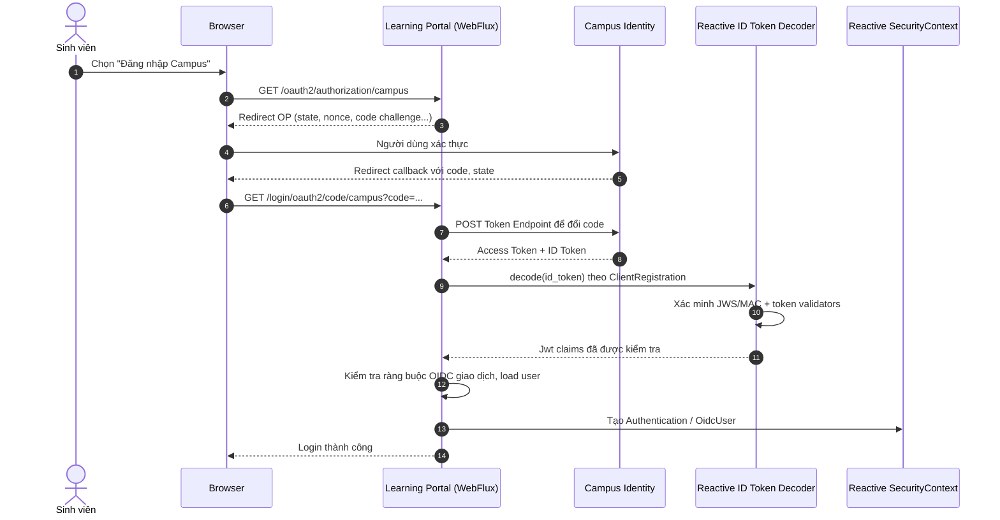
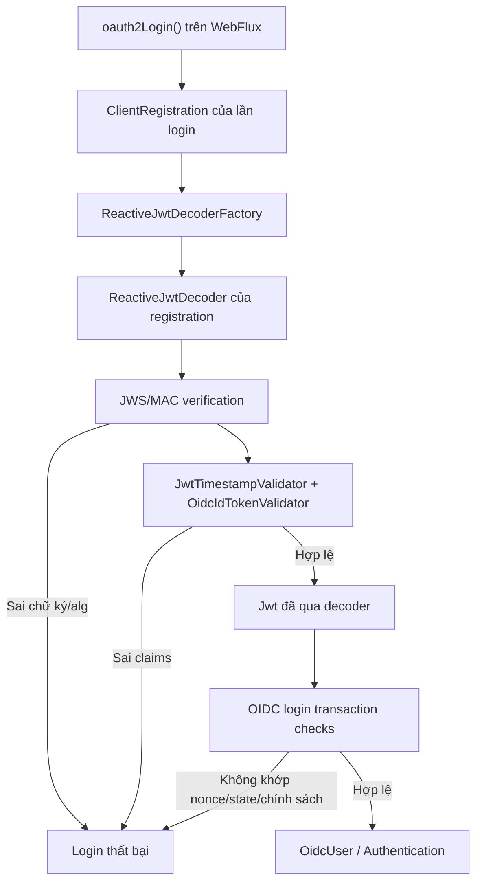

# 20.9. Kiểm tra ID Token bằng thành phần decoder Reactive

## Mục tiêu bài học

Sau khi hoàn thành bài học, bạn có thể:

- Giải thích **ID Token** được phát hành để làm gì trong OpenID Connect (OIDC), và tại sao một ứng dụng **Spring WebFlux OAuth2 Login** phải kiểm tra token này trước khi tạo phiên người dùng.
- Phân biệt **`ReactiveJwtDecoder`**, **`ReactiveJwtDecoderFactory<ClientRegistration>`**, **`ReactiveOidcIdTokenDecoderFactory`**, **`OidcIdTokenValidator`** và thành phần kiểm tra ràng buộc giao dịch đăng nhập.
- Hiểu quy trình kiểm tra **JWS signature/MAC**, thuật toán `alg`, khóa tin cậy, `iss`, `aud`, `exp`, `iat`, `sub`, `azp` và `nonce`.
- Cấu hình Spring Boot với `spring.security.oauth2.client.registration` và `provider.issuer-uri` để dùng OIDC Login trên WebFlux.
- Tùy biến **JWS algorithm resolver** cho một hoặc nhiều OIDC ClientRegistration mà không tin trực tiếp thuật toán tự khai trong token.
- Thêm **custom claim validator** vào decoder factory và giữ nguyên các kiểm tra mặc định về thời gian, issuer và audience.
- Phân biệt decoder ID Token của OIDC Client với decoder Access Token của **Reactive Resource Server**.
- Thiết kế kiểm thử với `WebTestClient`, `SecurityMockServerConfigurers.mockOidcLogin()` và các test riêng cho validation thực tế.
- Nhận diện lỗi issuer/audience, JWKS, clock skew, sai `kid`, sai algorithm, nonce mismatch và lỗi cấu hình Reactive/Servlet.

## 1. Bối cảnh: WebFlux OIDC Login nhận ID Token

Giả sử một ứng dụng Spring Boot WebFlux tên **Learning Portal** cho phép sinh viên đăng nhập bằng **Campus Identity**. Campus Identity đóng vai **OpenID Provider (OP)**, còn Learning Portal là **OIDC Client/Relying Party (RP)**.

Luồng đăng nhập Authorization Code + OIDC:



**Điểm then chốt:** ID Token là kết quả mà OP ký để thông báo về việc xác thực **End-User cho đúng Relying Party**. Payload ID Token chưa được kiểm tra là **dữ liệu không đáng tin**. Ứng dụng chỉ nên tạo principal sau khi toàn bộ bước validation cần thiết của flow thành công.

Một ID Token minh họa có dạng **JWT/JWS**:

```text
base64url(header).base64url(payload).base64url(signature)
```

Header:

```json
{
  "alg": "RS256",
  "typ": "JWT",
  "kid": "campus-rsa-key-2026"
}
```

Payload:

```json
{
  "iss": "https://login.example.org/realms/campus",
  "sub": "student-7e04",
  "aud": "learning-portal-web",
  "exp": 1893457200,
  "iat": 1893456900,
  "nonce": "example-request-nonce",
  "auth_time": 1893456800
}
```

Các giá trị đều giả định; đây không phải token có thể dùng thực tế.

Đối với Learning Portal:

```text
expected issuer = https://login.example.org/realms/campus
expected audience/client_id = learning-portal-web
```

Ứng dụng cần biết các giá trị kỳ vọng đó từ **registration/provider đáng tin cậy**, không chọn issuer/Client ID tùy ý theo payload mà người gửi đưa vào.

> **Không bao giờ** tự tách chuỗi JWT, Base64URL-decode rồi dùng `sub` hoặc `email` để coi người dùng đã đăng nhập. Giải mã nội dung chỉ là đọc JSON; nó không chứng minh chữ ký, issuer, audience hay nonce.

## 2. Vai trò của ID Token trong Reactive OAuth2 Login

Trong OIDC, RP yêu cầu scope `openid`; OP phát hành ID Token có các claim mô tả sự kiện xác thực người dùng.

So sánh:

| Thành phần | Bên nhận chính | Mục đích |
| --- | --- | --- |
| **ID Token** | OIDC Client/Relying Party | Xác thực End-User và cung cấp các claim OIDC |
| **Access Token** | Resource Server/API | Cho phép truy cập tài nguyên trong phạm vi được cấp |
| **Refresh Token** | OAuth2 Client tại Token Endpoint | Xin Access Token mới theo chính sách AS |
| **Authorization Code** | OAuth2 Client | Đổi code lấy token trong Authorization Code Flow |
| **Session cookie** | Browser ↔ Learning Portal | Duy trì phiên web theo cấu hình ứng dụng |

Ví dụ:

```text
ID Token aud     = learning-portal-web
Access Token aud = course-api
```

Hai audience khác nhau vì mục đích khác nhau. Không lấy cấu hình kiểm tra audience dành cho **Course API Access Token** để thay thế quy tắc kiểm tra **ID Token của Learning Portal**.

### 2.1. Khi nào Spring Security dùng thành phần OIDC?

Một registration có:

```yaml
scope:
  - openid
  - profile
  - email
```

sẽ kích hoạt xử lý OIDC trong OAuth2 Login khi provider và flow phù hợp. Nếu registration **không có `openid`**, Spring Security có thể dùng OAuth2 Login user service thông thường thay vì OIDC-specific processing.

Vì thế một lỗi “không tìm thấy OIDC ID Token” đôi khi xuất phát từ việc cấu hình sai scope/grant, không phải từ decoder.

### 2.2. Không nhầm với Resource Server JWT

Một ứng dụng có thể vừa nhận token API, vừa cho phép browser đăng nhập:

```text
OIDC Client Login:
    ServerHttpSecurity.oauth2Login()
    ID Token decoder gắn với ClientRegistration

Reactive Resource Server:
    ServerHttpSecurity.oauth2ResourceServer().jwt()
    JWT decoder xác minh Access Token ở inbound Bearer request
```

Cả hai đều sử dụng thuật ngữ `ReactiveJwtDecoder`, nhưng **đường tạo decoder, audience/validator và vai trò token khác nhau**.

## 3. Sơ đồ các lớp cần nhận biết

Những thành phần quan trọng trong Spring Security Reactive OIDC Client:

| Thành phần | Nhiệm vụ | Ghi chú |
| --- | --- | --- |
| `ReactiveClientRegistrationRepository` | Lưu/truy xuất cấu hình registration | Có thể là `InMemoryReactiveClientRegistrationRepository` |
| `ClientRegistration` | Client ID, provider metadata, scopes, grant, endpoints | Là context cho decoder factory |
| `ReactiveJwtDecoderFactory<ClientRegistration>` | Tạo `ReactiveJwtDecoder` theo registration | Extension point phù hợp OIDC Login |
| **`ReactiveOidcIdTokenDecoderFactory`** | Factory decoder cho OIDC ID Token | Mặc định chọn RS256, có JWS resolver và validator factory |
| `ReactiveJwtDecoder` | Nhận encoded token, trả `Mono<Jwt>` sau decode/verify/validate | Không đồng nghĩa hoàn thành mọi bước giao dịch login |
| `OidcIdTokenValidator` | Validator các claim ID Token theo `ClientRegistration` | Gắn issuer/client ID mong đợi với token |
| `JwtTimestampValidator` | Kiểm tra các claim thời gian JWT | Giúp loại token không còn hiệu lực |
| `OidcReactiveOAuth2UserService` | Tải/xử lý OIDC user sau phần xác thực cần thiết | Có thể dùng UserInfo |
| `SecurityWebFilterChain` | Bảo vệ WebFlux HTTP request | Khai báo với `ServerHttpSecurity` |
| `ReactiveSecurityContextHolder` | Truy cập SecurityContext trong Reactor context | Không dùng như ThreadLocal Servlet |

### 3.1. Vị trí của decoder factory



Sơ đồ trên dùng để hiểu **trách nhiệm phân lớp**; thứ tự chính xác của các validation internals và các bước bổ sung phụ thuộc phiên bản/framework. Quan trọng là **không tạo OidcUser khi một kiểm tra bắt buộc đã thất bại**.

### 3.2. Vì sao cần factory thay vì một decoder dùng chung?

Một ứng dụng WebFlux có thể đăng nhập qua:

```text
campus:
    issuer = https://login.example.org/realms/campus
    clientId = learning-portal-web

partner:
    issuer = https://accounts.partner.example.net
    clientId = partner-portal-web
```

Mỗi registration có thể có:

- Issuer khác.
- JWKS URI và public keys khác.
- Client ID và audience mong đợi khác.
- Thuật toán ID Token signing được đăng ký khác.
- Chính sách validation bổ sung khác.

`ReactiveOidcIdTokenDecoderFactory` tạo decoder theo **ClientRegistration của giao dịch**; không cần một cấu hình decoder duy nhất chấp nhận mọi issuer/tập khóa trên internet.

## 4. Reactive OIDC ID Token decoder factory là gì?

Tên lớp:

```java
org.springframework.security.oauth2.client.oidc.authentication
    .ReactiveOidcIdTokenDecoderFactory
```

Trong Java import phải để một dòng:

```java
import org.springframework.security.oauth2.client.oidc.authentication.ReactiveOidcIdTokenDecoderFactory;
```

Lớp này triển khai:

```java
ReactiveJwtDecoderFactory<ClientRegistration>
```

Về mặt khái niệm:

```java
ReactiveJwtDecoder decoder =
    factory.createDecoder(clientRegistration);
```

Sau đó:

```java
Mono<Jwt> result = decoder.decode(rawIdToken);
```

`createDecoder(...)` trả decoder gắn với registration. `decode(...)` dùng **reactive API** (`Mono<Jwt>`) để xác minh encoded token, gồm các check/validators được cấu hình.

### 4.1. Các method cấu hình quan trọng

```java
ReactiveOidcIdTokenDecoderFactory factory =
    new ReactiveOidcIdTokenDecoderFactory();

factory.setJwsAlgorithmResolver(...);
factory.setJwtValidatorFactory(...);
factory.setClaimTypeConverterFactory(...);
```

Ý nghĩa:

| Method | Vai trò |
| --- | --- |
| `createDecoder(ClientRegistration)` | Tạo reactive decoder theo cấu hình OP/client |
| `setJwsAlgorithmResolver(...)` | Quyết định JWS algorithm **mong đợi** cho từng registration |
| `setJwtValidatorFactory(...)` | Chỉ định `OAuth2TokenValidator<Jwt>` theo registration |
| `setClaimTypeConverterFactory(...)` | Kiểm soát chuyển đổi kiểu các ID Token claim khi cần |

**Lưu ý bảo mật:** Nếu thay validator mặc định, bạn phải chủ động giữ các validator bắt buộc (thời gian và OIDC claims). Chỉ kiểm tra custom `department` mà bỏ issuer/audience là một lỗi nghiêm trọng.

### 4.2. `ReactiveJwtDecoder` không tự suy ra client phù hợp

Thứ tự tin cậy đúng:

```text
Giao dịch OAuth2 Login
   -> chọn đúng ClientRegistration
      -> chọn issuer, client ID, JWS policy và key source
         -> tạo/nhận decoder tương ứng
            -> decode ID Token
```

Sai:

```text
Đọc iss của JWT chưa xác thực
   -> tin issuer bất kỳ
      -> lấy JWKS tùy ý do JWT nói
         -> chấp nhận token nếu chữ ký khớp
```

Issuer do attacker điều khiển có thể phát hành JWT và JWKS của chính họ. Chữ ký hợp lệ với một khóa **không có nghĩa khóa đó thuộc OP mà ứng dụng được phép tin**.

## 5. Cấu hình Spring Boot WebFlux OIDC Login cơ bản

### 5.1. Maven dependencies

Ví dụ Spring Boot application dùng WebFlux và OAuth2 Client:

```xml
<dependencies>
    <dependency>
        <groupId>org.springframework.boot</groupId>
        <artifactId>spring-boot-starter-webflux</artifactId>
    </dependency>

    <dependency>
        <groupId>org.springframework.boot</groupId>
        <artifactId>spring-boot-starter-oauth2-client</artifactId>
    </dependency>

    <dependency>
        <groupId>org.springframework.boot</groupId>
        <artifactId>spring-boot-starter-security</artifactId>
    </dependency>
</dependencies>
```

Tùy dependency graph và phiên bản Spring Boot, Security starter có thể đã được kéo vào từ OAuth2 Client starter; không cần thêm trùng nếu build đã có đủ.

**Không** thêm `spring-boot-starter-web` chỉ để giải quyết vấn đề reactive decoder. Với WebFlux, hãy dùng đúng runtime reactive và API `ServerHttpSecurity`.

### 5.2. `application.yml`

Ví dụ:

```yaml
spring:
  security:
    oauth2:
      client:
        registration:
          campus:
            provider: campus
            client-id: ${CAMPUS_CLIENT_ID}
            client-secret: ${CAMPUS_CLIENT_SECRET}
            client-authentication-method: client_secret_basic
            authorization-grant-type: authorization_code
            redirect-uri: "{baseUrl}/login/oauth2/code/{registrationId}"
            scope:
              - openid
              - profile
              - email

        provider:
          campus:
            issuer-uri: https://login.example.org/realms/campus
```

Giả định môi trường:

```text
CAMPUS_CLIENT_ID = learning-portal-web
```

Giá trị tin cậy:

```text
Registration ID    = campus
OAuth Client ID    = learning-portal-web
Expected issuer    = https://login.example.org/realms/campus
```

`registrationId` là khóa cấu hình của Spring; ID Token `aud` phải chứa **Client ID**, không phải chữ `campus`.

### 5.3. `SecurityWebFilterChain`

```java
@Configuration
@EnableWebFluxSecurity
class WebFluxSecurityConfiguration {

    @Bean
    SecurityWebFilterChain securityWebFilterChain(
            ServerHttpSecurity http) {

        http
            .authorizeExchange(exchanges -> exchanges
                .pathMatchers("/", "/error", "/assets/**")
                    .permitAll()
                .anyExchange()
                    .authenticated()
            )
            .oauth2Login(Customizer.withDefaults());

        return http.build();
    }
}
```

Imports tiêu biểu:

```java
import org.springframework.context.annotation.Bean;
import org.springframework.context.annotation.Configuration;
import org.springframework.security.config.Customizer;
import org.springframework.security.config.annotation.web.reactive.EnableWebFluxSecurity;
import org.springframework.security.config.web.server.ServerHttpSecurity;
import org.springframework.security.web.server.SecurityWebFilterChain;
```

Trong project dùng Spring Boot đủ auto-configuration, `@EnableWebFluxSecurity` không phải lúc nào cũng cần khai báo; ví dụ cho thấy rõ application sử dụng **Reactive SecurityWebFilterChain**.

Điểm quan trọng:

```text
WebFlux:
    SecurityWebFilterChain + ServerHttpSecurity

Servlet:
    SecurityFilterChain + HttpSecurity
```

**Không** copy bean `OidcIdTokenDecoderFactory` (Servlet) vào WebFlux; ở đây phải dùng **`ReactiveOidcIdTokenDecoderFactory`** và giao diện `ReactiveJwtDecoderFactory<ClientRegistration>`.

### 5.4. Đường đăng nhập thường gặp

Khi Spring Security dùng cấu hình mặc định:

```text
Start login:
GET /oauth2/authorization/campus

Callback:
GET /login/oauth2/code/campus
```

Trong thực tế callback phải khớp redirect URI đã đăng ký với OP. Đến bước nhận ID Token, các thành phần reactive OIDC login sử dụng registration tương ứng để xác thực token.

## 6. Cơ chế xác minh chữ ký JWS

Một ID Token thường là JWS được ký:

```text
HEADER.PAYLOAD.SIGNATURE
```

Ví dụ header:

```json
{
  "alg": "RS256",
  "kid": "campus-rsa-01"
}
```

Để xác minh, decoder cần:

1. **Chọn algorithm cho phép** theo cấu hình client/provider.
2. **Lấy khóa tin cậy** tương ứng với OP đã được đăng ký.
3. **Dùng khóa và thuật toán** để xác minh chữ ký/MAC.
4. **Kiểm tra claims** theo các validators và giao dịch login.
5. **Từ chối** nếu bất kỳ yêu cầu bắt buộc nào sai.

### 6.1. `alg` không phải lời yêu cầu tin cậy từ JWT

Header JWT có thể nói:

```json
{
  "alg": "none"
}
```

hoặc:

```json
{
  "alg": "HS256"
}
```

Kẻ tấn công có thể chỉnh header của JWT tự tạo. Decoder phải tuân theo **algorithm allowlist/expected algorithm đã được cấu hình**, không tự chấp nhận bất kỳ thuật toán nào do token yêu cầu.

Không có quy tắc bảo mật nào cho phép “nếu chữ ký khó xác minh thì tắt signature check và tin payload”.

### 6.2. RS256 và JWKS công khai của OP

Khi ID Token dùng chữ ký bất đối xứng như `RS256`:

```text
OP ký bằng private key
Client xác minh bằng public key OP công bố
```

OP thường công bố JWKS URI trong OIDC Discovery:

```json
{
  "issuer": "https://login.example.org/realms/campus",
  "jwks_uri": "https://login.example.org/realms/campus/protocol/openid-connect/certs"
}
```

`kid` trong JWT giúp xác định public key phù hợp **trong tập khóa của issuer đã tin cậy**; nó không phải URL để tải khóa tùy ý.

### 6.3. HS256 và client secret

Một OP có thể được đăng ký để phát hành ID Token với HMAC, ví dụ `HS256`. Khi đó phía Client dùng shared secret phù hợp để kiểm tra MAC.

Đây là cơ chế có đặc tính khác `RS256`:

| Thuộc tính | `RS256` | `HS256` |
| --- | --- | --- |
| Loại khóa | Bất đối xứng RSA | Đối xứng HMAC |
| Ai ký? | OP giữ private key | Bên có shared secret phù hợp |
| Client xác minh bằng | Public key từ nguồn tin cậy | Client secret/shared key |
| Cần bảo vệ tại Client | Trust relationship/public key cache | **Client secret** rất nhạy cảm |
| Tình huống cấu hình | OP dùng JWKS với RSA signature | OP và Client đã đăng ký dùng MAC |

Không bật `HS256` chỉ vì token trả header `HS256`. Chỉ sử dụng nếu **OIDC client registration và chính sách OP thực sự cho phép thuật toán này**, đồng thời bảo đảm độ mạnh của secret và việc quản lý key.

### 6.4. Key rotation

OP có thể thay khóa ký:

```text
Ngày 1: kid = campus-rsa-01
Ngày 2: kid = campus-rsa-02
```

Một JWKS có thể công bố cả khóa cũ và khóa mới trong giai đoạn chuyển tiếp. Decoder cần sử dụng JWKS của issuer tin cậy, caching/refresh thích hợp và từ chối chữ ký không thể xác minh.

Nếu gặp lỗi `kid` không tồn tại, đừng tự tải JWK từ một URL có trong JWT header mà không có chính sách cho phép. Kiểm tra `jwks_uri` trong provider metadata, refresh/cache JWKS và kế hoạch key rotation của OP.

## 7. Tùy biến thuật toán JWS cho Reactive ID Token Decoder

Trong mặc định phổ biến, `ReactiveOidcIdTokenDecoderFactory` chọn **`RS256`**. Nếu OP đã đăng ký phương thức ký khác, ta có thể cấu hình `setJwsAlgorithmResolver`.

Ví dụ OP và Client đã thỏa thuận **`HS256`**:

```java
@Configuration
class ReactiveOidcDecoderConfiguration {

    @Bean
    ReactiveJwtDecoderFactory<ClientRegistration> idTokenDecoderFactory() {

        ReactiveOidcIdTokenDecoderFactory factory =
            new ReactiveOidcIdTokenDecoderFactory();

        factory.setJwsAlgorithmResolver(
            clientRegistration -> MacAlgorithm.HS256
        );

        return factory;
    }
}
```

Import minh họa:

```java
import org.springframework.context.annotation.Bean;
import org.springframework.context.annotation.Configuration;
import org.springframework.security.oauth2.client.registration.ClientRegistration;
import org.springframework.security.oauth2.client.oidc.authentication.ReactiveOidcIdTokenDecoderFactory;
import org.springframework.security.oauth2.jwt.ReactiveJwtDecoderFactory;
import org.springframework.security.oauth2.jose.jws.MacAlgorithm;
```

**Cảnh báo:** Bean trên áp `HS256` cho **mọi** ClientRegistration dùng factory. Chỉ phù hợp nếu tất cả các OIDC providers được cấu hình thật sự có chính sách như vậy. Với môi trường nhiều providers, chọn thuật toán **theo registration**.

### 7.1. Chọn thuật toán khác nhau theo registration

Giả sử:

```text
campus:
    issuer = https://login.example.org/realms/campus
    idTokenJwsAlg = RS256

partner:
    issuer = https://accounts.partner.example.net
    idTokenJwsAlg = HS256
```

Có thể cấu hình:

```java
@Bean
ReactiveJwtDecoderFactory<ClientRegistration> idTokenDecoderFactory() {

    ReactiveOidcIdTokenDecoderFactory factory =
        new ReactiveOidcIdTokenDecoderFactory();

    factory.setJwsAlgorithmResolver(registration -> {
        if ("partner".equals(registration.getRegistrationId())) {
            return MacAlgorithm.HS256;
        }

        return SignatureAlgorithm.RS256;
    });

    return factory;
}
```

Import bổ sung:

```java
import org.springframework.security.oauth2.jose.jws.SignatureAlgorithm;
```

Tư duy:

```text
ClientRegistration được chọn cho OIDC flow
    -> policy JWS algorithm của registration đó
    -> factory tạo decoder tương ứng
```

Thực tế tốt hơn một `if` tùy ý là dùng **allowlist cấu hình từ registration inventory đã được quản trị**; khi thêm provider mới, phải xem OP có hỗ trợ signing algorithm, secret, JWKS và chính sách bảo mật tương ứng hay không.

### 7.2. Không trả về algorithm lấy trực tiếp từ ID Token header

Sai về mô hình:

```java
factory.setJwsAlgorithmResolver(registration ->
    algorithmParsedFromUntrustedJwtHeader
);
```

Nhà phát hành token không được tự mở rộng tập thuật toán mà RP chấp nhận chỉ bằng cách gửi JWT header khác. Thuật toán kỳ vọng phải xuất phát từ **client registration/policy tin cậy**.

### 7.3. Khác nhau giữa JWS algorithm và client authentication method

Ví dụ cấu hình:

```yaml
client-authentication-method: client_secret_basic
```

không đồng nghĩa ID Token phải dùng HS256. Hai khái niệm khác:

- **Client authentication method**: cách Learning Portal xác thực với **Token Endpoint**, ví dụ HTTP Basic.
- **ID Token JWS algorithm**: cách OP **ký ID Token** để Relying Party xác minh, ví dụ RS256.

Một client có thể dùng `client_secret_basic` tại Token Endpoint và nhận **ID Token RS256**; đó là trường hợp bình thường.

## 8. Xác minh claim sau giải mã chữ ký

Chữ ký hợp lệ là **điều kiện cần**, nhưng không phải điều kiện đủ. Một token có thể được ký bởi OP đáng tin nhưng lại dành cho **client khác**, hết hạn hoặc không khớp với giao dịch.

Các claim quan trọng:

| Claim | Ý nghĩa | Chính sách kiểm tra |
| --- | --- | --- |
| `iss` | Issuer Identifier của OP | Phải khớp đúng issuer tin cậy của registration |
| `sub` | Subject Identifier của End-User | Phải hợp lệ và được xử lý trong miền issuer đó |
| `aud` | Audience của ID Token | Phải chứa **Client ID** của RP |
| `azp` | Authorized Party | Xem xét khi nhiều audience; khi có mặt, phải phù hợp chính sách client |
| `exp` | Thời gian hết hạn | Token không còn được chấp nhận sau khi hết hạn theo clock skew cho phép |
| `iat` | Thời điểm phát hành | Kiểm tra theo OIDC/JWT và chính sách thời gian |
| `nonce` | Giá trị ràng buộc authentication request với ID Token | So với nonce đã gửi trong giao dịch, khi áp dụng |
| `auth_time` | Thời điểm End-User được OP xác thực | Quan trọng với `max_age` hoặc yêu cầu xác thực mới |
| `acr`, `amr` | Authentication context/method | Kiểm tra khi hệ thống yêu cầu mức bảo đảm xác thực |
| `at_hash` | Hash kiểm tra access token trong một số loại response | Kiểm tra theo flow/đặc tả áp dụng |
| `c_hash` | Hash authorization code trong một số loại response | Kiểm tra theo flow/đặc tả áp dụng |

### 8.1. Issuer `iss` phải khớp chính xác

Ví dụ:

```text
Expected:
https://login.example.org/realms/campus

Actual:
https://login.example.org/realms/partners
```

**Từ chối**, dù hostname giống nhau. Hai realm/tenant có thể cùng domain nhưng là các issuer khác nhau.

Không dùng:

```java
actualIssuer.startsWith("https://login.example.org")
```

để thay exact matching. Không tự loại bỏ slash hoặc bỏ path để “chữa” issuer mismatch.

### 8.2. Audience `aud` phải chứa Client ID

Giả sử:

```text
registrationId = campus
clientId = learning-portal-web
```

ID Token:

```json
{
  "aud": "learning-portal-web"
}
```

đạt điều kiện audience.

ID Token:

```json
{
  "aud": ["learning-portal-web", "secondary-audience"]
}
```

có thể đạt điều kiện audience nếu các điều kiện khác, trong đó có `azp`, phù hợp.

ID Token:

```json
{
  "aud": "teacher-console-web"
}
```

**Từ chối** đối với Learning Portal. Đừng nhầm `aud` với registration ID `"campus"` hoặc API audience `"course-api"`.

### 8.3. `azp` khi có nhiều audience

Ví dụ:

```json
{
  "aud": ["learning-portal-web", "secondary-audience"],
  "azp": "learning-portal-web"
}
```

OIDC Core quy định:

1. `aud` **MUST** chứa Client ID của Relying Party.
2. Khi có nhiều audience, client **SHOULD** xác minh `azp` hiện diện.
3. Khi `azp` có mặt, client **SHOULD** xác minh nó bằng Client ID của mình.

Không nên bỏ qua `azp` sai chỉ vì `aud` đã chứa Client ID. Chính sách nghiêm ngặt có thể yêu cầu `azp` đúng trong trường hợp đa audience.

### 8.4. Thời hạn `exp` và thời điểm `iat`

Ví dụ:

```text
iat = 2026-11-16T02:00:00Z
exp = 2026-11-16T02:10:00Z
Now = 2026-11-16T02:12:00Z
```

Token đã quá hạn và phải bị từ chối theo chính sách thời gian/clock skew.

Clock skew chỉ để bù độ lệch đồng hồ hợp lý giữa client và OP. **Không** đặt clock skew vài giờ chỉ để nhận ID Token hết hạn.

### 8.5. Nonce phải gắn với giao dịch, không chỉ có mặt

Giả sử browser khởi tạo authorization request với:

```text
nonce = N-7bcf
```

ID Token trả:

```json
{
  "nonce": "N-other"
}
```

Token phải bị từ chối khi flow yêu cầu đối chiếu nonce, dù chữ ký, issuer và audience đều đúng.

**Phân lớp:** factory decoder chủ yếu kiểm tra cryptographic JWT và token validators được cấu hình. Việc so nonce với **giá trị đã lưu từ authorization request** có thể diễn ra ở một thành phần của **OIDC authentication flow** (không đơn giản là validator stateless chỉ nhận `Jwt`). Không được cho rằng chỉ gọi `decoder.decode(raw)` đã thực hiện mọi bước ràng buộc nonce/state của giao dịch browser.

### 8.6. `state` không phải claim bắt buộc trong ID Token

OAuth2 `state` đi cùng Authorization Request và Authorization Response để liên kết callback với request và chống CSRF/login CSRF.

Trong khi đó `nonce` là giá trị OIDC có thể xuất hiện trong ID Token và phải được so với request khi áp dụng.

```text
state:
  Authorization Response ↔ Authorization Request

nonce:
  ID Token ↔ OIDC Authentication Request
```

Không thay hai kiểm tra này bằng nhau.

## 9. Validator mặc định của `ReactiveOidcIdTokenDecoderFactory`

Theo API của Spring Security, validator factory mặc định kết hợp:

```java
JwtTimestampValidator
OidcIdTokenValidator
```

Vai trò:

- `JwtTimestampValidator` xử lý kiểm tra thời gian JWT.
- `OidcIdTokenValidator(ClientRegistration)` xử lý các điều kiện claim ID Token gắn với registration.

Vì thế, nếu không có yêu cầu đặc biệt, cách an toàn nhất là **dùng mặc định** của `ReactiveOidcIdTokenDecoderFactory`.

### 9.1. Tại sao custom validator có thể nguy hiểm?

Giả sử ứng dụng muốn kiểm tra thêm:

```text
Claim "tenant" phải bằng "campus"
```

Một cách cấu hình sai:

```java
factory.setJwtValidatorFactory(
    registration -> jwt -> {
        if ("campus".equals(jwt.getClaimAsString("tenant"))) {
            return OAuth2TokenValidatorResult.success();
        }
        return OAuth2TokenValidatorResult.failure(
            new OAuth2Error("invalid_token", "Wrong tenant", null)
        );
    }
);
```

Vấn đề: factory đã bị thay **toàn bộ validator chain**. Nếu chỉ giữ `tenant` check thì có nguy cơ loại mất các check `JwtTimestampValidator` và `OidcIdTokenValidator` mặc định.

### 9.2. Cách thêm validator mà vẫn giữ mặc định

Ví dụ minh họa một chính sách yêu cầu claim `tenant=campus` đối với registration `campus`, trong khi giữ validation mặc định:

```java
@Bean
ReactiveJwtDecoderFactory<ClientRegistration> idTokenDecoderFactory() {

    ReactiveOidcIdTokenDecoderFactory factory =
        new ReactiveOidcIdTokenDecoderFactory();

    factory.setJwtValidatorFactory(registration -> {

        OAuth2TokenValidator<Jwt> timestampValidator =
            new JwtTimestampValidator();

        OAuth2TokenValidator<Jwt> oidcValidator =
            new OidcIdTokenValidator(registration);

        OAuth2TokenValidator<Jwt> tenantValidator = jwt -> {
            if (!"campus".equals(registration.getRegistrationId())) {
                return OAuth2TokenValidatorResult.success();
            }

            if ("campus".equals(jwt.getClaimAsString("tenant"))) {
                return OAuth2TokenValidatorResult.success();
            }

            OAuth2Error error = new OAuth2Error(
                "invalid_token",
                "ID Token is not authorized for this tenant",
                null
            );

            return OAuth2TokenValidatorResult.failure(error);
        };

        return new DelegatingOAuth2TokenValidator<>(
            timestampValidator,
            oidcValidator,
            tenantValidator
        );
    });

    return factory;
}
```

Imports minh họa:

```java
import org.springframework.security.oauth2.client.registration.ClientRegistration;
import org.springframework.security.oauth2.client.oidc.authentication.OidcIdTokenValidator;
import org.springframework.security.oauth2.client.oidc.authentication.ReactiveOidcIdTokenDecoderFactory;
import org.springframework.security.oauth2.core.DelegatingOAuth2TokenValidator;
import org.springframework.security.oauth2.core.OAuth2Error;
import org.springframework.security.oauth2.core.OAuth2TokenValidator;
import org.springframework.security.oauth2.core.OAuth2TokenValidatorResult;
import org.springframework.security.oauth2.jwt.Jwt;
import org.springframework.security.oauth2.jwt.JwtTimestampValidator;
import org.springframework.security.oauth2.jwt.ReactiveJwtDecoderFactory;
```

Điểm cần hiểu:

```text
timestamp check
    +
OIDC claim check theo ClientRegistration
    +
tenant check riêng
    =
Chính sách hoàn chỉnh hơn
```

**Không dùng claim `tenant` tự khai để chọn issuer/registration tin cậy.** Nó chỉ là điều kiện bổ sung sau khi token đã được xác minh thuộc đúng OP và client.

### 9.3. Đừng đưa access token scope validator vào ID Token vô điều kiện

Một custom `Jwt` validator từ Resource Server có thể đòi:

```text
scope = courses.read
aud = course-api
```

Những giá trị đó phù hợp cho **Access Token**, không phải ID Token. Nếu gắn validator ấy vào ID Token decoder, bạn có thể từ chối ID Token hợp lệ hoặc, tệ hơn, thay sai các ràng buộc vốn cần kiểm tra.

### 9.4. Vấn đề `azp` và điều kiện thêm của tổ chức

Khi chính sách ứng dụng đòi `azp` chính xác với Client ID trong trường hợp nhiều audience, có thể thêm validator như sau theo **quy tắc đã được thỏa thuận với OP**:

```java
OAuth2TokenValidator<Jwt> authorizedPartyValidator = jwt -> {

    List<String> audiences = jwt.getAudience();
    String clientId = registration.getClientId();
    String authorizedParty = jwt.getClaimAsString("azp");

    boolean multiple = audiences != null && audiences.size() > 1;

    if (multiple && !clientId.equals(authorizedParty)) {
        OAuth2Error error = new OAuth2Error(
            "invalid_token", "Unexpected authorized party", null
        );
        return OAuth2TokenValidatorResult.failure(error);
    }

    if (authorizedParty != null && !clientId.equals(authorizedParty)) {
        OAuth2Error error = new OAuth2Error(
            "invalid_token", "Unexpected authorized party", null
        );
        return OAuth2TokenValidatorResult.failure(error);
    }

    return OAuth2TokenValidatorResult.success();
};
```

Đoạn này nên được **bổ sung** vào chuỗi validators, không thay cho signature/issuer/audience validation. Hãy thận trọng với yêu cầu chuẩn tắc “SHOULD” của OIDC, interoperability và quyết định bảo mật của từng tổ chức.

## 10. `setClaimTypeConverterFactory`: ý nghĩa và rủi ro

ID Token claims có nhiều kiểu JSON:

```json
{
  "iss": "https://login.example.org/realms/campus",
  "aud": ["learning-portal-web"],
  "exp": 1893457200,
  "iat": 1893456900,
  "auth_time": 1893456800,
  "email_verified": true,
  "amr": ["pwd", "otp"]
}
```

Để phục vụ API Java, library có thể chuyển đổi kiểu dữ liệu, ví dụ `exp` sang `Instant`, audience sang danh sách chuỗi hoặc những kiểu chuẩn khác.

`ReactiveOidcIdTokenDecoderFactory` có:

```java
setClaimTypeConverterFactory(
    Function<ClientRegistration, Converter<Map<String,Object>, Map<String,Object>>>
);
```

Mục tiêu là tùy biến logic chuyển đổi claims **theo registration**.

### 10.1. Vì sao không thay toàn bộ converter?

Nếu một custom converter trả nguyên `Map` chưa chuẩn hóa:

```java
registration -> claims -> claims
```

những trường thời gian có thể không được chuyển kiểu như validator/Jwt API mong đợi. Điều đó có thể gây lỗi lúc đọc `Jwt.getExpiresAt()` hoặc gây hành vi validation không đúng.

Nên ưu tiên converter mặc định, hoặc bổ sung biến đổi **có kiểm soát** trong hook chính thức, tránh đổi kiểu các claim chuẩn OIDC như `iss`, `aud`, `iat`, `exp`, `auth_time`.

### 10.2. Claim profile không phải claims bắt buộc

Một OP có thể không trả `name` hoặc `email` trong ID Token; thông tin hồ sơ có thể đến từ UserInfo Endpoint. `email_verified` cũng không bắt buộc có trong mọi token.

Vì vậy đừng đặt một converter yêu cầu tất cả ID Token đều có email và tên, trừ khi OP và hợp đồng nghiệp vụ đã quy định rõ.

### 10.3. Chuyển đổi kiểu khác xác minh chữ ký

Claim conversion chỉ ảnh hưởng **cách biểu diễn trong JVM**. Nó không chứng minh JWT được OP phát hành và cũng không thể sửa được một chữ ký sai.

Quy trình vẫn là:

```text
Trusted registration
  -> decoder
  -> signature verification + validators
  -> claims normalized
  -> OIDC login principal
```

## 11. Cách kiểm tra ID Token thủ công trong một phép thử cô lập

Trong một số integration/unit tests, bạn có thể muốn dùng factory để tạo decoder cho một registration cụ thể:

```java
ClientRegistration registration =
    // Một ClientRegistration được tạo từ test fixture đáng tin cậy.

ReactiveOidcIdTokenDecoderFactory factory =
    new ReactiveOidcIdTokenDecoderFactory();

ReactiveJwtDecoder decoder =
    factory.createDecoder(registration);

Mono<Jwt> decoded =
    decoder.decode(encodedIdToken);
```

Với Project Reactor, có thể kiểm tra bất đồng bộ:

```java
StepVerifier.create(decoded)
    .assertNext(jwt -> {
        assertThat(jwt.getIssuer().toString())
            .isEqualTo(
                "https://login.example.org/realms/campus"
            );

        assertThat(jwt.getAudience())
            .contains("learning-portal-web");
    })
    .verifyComplete();
```

Giả định test đã có:

- Fixture ID Token **được ký hợp lệ** bằng khóa OP test.
- Fixture issuer/audience/expiry hợp lệ.
- Provider metadata/JWKS test được cấu hình và truy cập phù hợp.
- Dependencies `reactor-test` và thư viện assertion.
- `ClientRegistration` cấu hình khớp OP test.

**Đây là test decoder**, không thay thế test browser Authorization Code Flow, `state`, PKCE và `nonce`.

### 11.1. Một test JWT decode có thể “qua” nhưng OIDC login vẫn phải từ chối

Ví dụ encoded token:

```text
iss = expected issuer
aud = expected client ID
signature = valid
exp = valid
nonce = N-other
```

`decoder.decode(...)` có thể hoàn tất những kiểm tra mật mã và claim độc lập theo validator factory, nhưng **nonce transaction mismatch** cần được đối chiếu với nonce thực đã gửi trong authorization request.

Vì thế hãy phân tách test:

```text
Decoder test:
  chữ ký + claims dựa trên registration

OIDC flow test:
  authorization request ↔ callback ↔ ID Token
  state/nonce/PKCE + user authentication
```

### 11.2. Không dùng `.block()` trong production WebFlux request

Có thể có test hoặc công cụ offline gọi `.block()`:

```java
Jwt jwt = decoder.decode(rawIdToken).block();
```

Nhưng trong runtime WebFlux controller/filter, cách đó có thể block event-loop, làm giảm throughput hoặc gây lỗi do blocking call trong thread không được phép.

Trong production dùng:

```java
return decoder.decode(rawIdToken)
    .map(jwt -> ...);
```

hoặc để toàn bộ `oauth2Login()` của Spring Security quản lý logic decode. **Không tự decode ID Token lại trong controller sau login** trừ khi có một use case thực sự riêng và chính sách bảo mật đã rõ.

## 12. Decoder Reactive khác Servlet decoder như thế nào?

Bảng so sánh:

| Vấn đề | Servlet | Reactive/WebFlux |
| --- | --- | --- |
| Security config | `HttpSecurity` + `SecurityFilterChain` | `ServerHttpSecurity` + `SecurityWebFilterChain` |
| ID Token factory | `OidcIdTokenDecoderFactory` | **`ReactiveOidcIdTokenDecoderFactory`** |
| Decoder interface | `JwtDecoder` | **`ReactiveJwtDecoder`** |
| Factory interface | `JwtDecoderFactory<ClientRegistration>` | **`ReactiveJwtDecoderFactory<ClientRegistration>`** |
| Decode result | `Jwt` | `Mono<Jwt>` |
| Client registration store | `ClientRegistrationRepository` | `ReactiveClientRegistrationRepository` |
| Authorized client repository | `OAuth2AuthorizedClientRepository` | `ServerOAuth2AuthorizedClientRepository` |
| SecurityContext | Thường qua `SecurityContextHolder` và Servlet filters | `ReactiveSecurityContextHolder` trong Reactor context |
| User service | `OidcUserService` | `OidcReactiveOAuth2UserService` |
| Request runtime | Servlet | WebFlux |

### 12.1. Hai factory có tên gần giống

Sai trong WebFlux config:

```java
@Bean
JwtDecoderFactory<ClientRegistration> idTokenDecoderFactory() {
    return new OidcIdTokenDecoderFactory();
}
```

Đây là **Servlet-oriented** decoder factory.

Đúng cho Reactive:

```java
@Bean
ReactiveJwtDecoderFactory<ClientRegistration> idTokenDecoderFactory() {
    return new ReactiveOidcIdTokenDecoderFactory();
}
```

Cần chắc chắn Spring Security version đã hỗ trợ bean extension point phù hợp. Factory Reactive có từ Spring Security 5.2; các option và auto-wiring chi tiết có thể thay đổi theo phiên bản.

### 12.2. `ReactiveJwtDecoder` từ Resource Server không phải OIDC ID Token factory

Ví dụ Reactive Resource Server:

```java
@Bean
ReactiveJwtDecoder apiJwtDecoder() {
    return ReactiveJwtDecoders.fromIssuerLocation(
        "https://api-issuer.example.org"
    );
}
```

Nó dùng cho **Bearer Access Token** khi một WebFlux API được cấu hình làm Resource Server. Việc expose bean này không mặc nhiên khiến OAuth2 Login dùng cùng decoder cho ID Token của nhiều providers.

Ngược lại, bean:

```java
ReactiveJwtDecoderFactory<ClientRegistration>
```

là extension point gắn với **OIDC login ClientRegistration**.

### 12.3. Một ứng dụng có thể chạy cả hai

Ví dụ:

```text
GET /portal/**:
  Browser session / OIDC Login

GET /api/**:
  Bearer access token / Resource Server
```

Một ứng dụng Reactive có thể cấu hình nhiều `SecurityWebFilterChain` và security matcher thích hợp. Tuy nhiên:

- Các loại Authentication và principal có thể khác nhau.
- ID Token audience và Access Token audience thường khác nhau.
- Decoder factory OIDC không tự cấp quyền cho API.
- JWT Resource Server decoder không tự tạo browser OIDC session.

Không dùng một JWT được gửi qua Authorization header để giả vờ đã hoàn tất OIDC Login.

## 13. Lỗi thuật toán ký ID Token và hướng giải quyết

Một số OP phát hành ID Token với thuật toán khác RS256 đã được đăng ký:

```text
Expected algorithm: HS256
Default factory: RS256
```

Kết quả có thể là lỗi decode/verify. Nhưng không nên tắt algorithm check.

Cách xử lý:

1. Xác định ClientRegistration và issuer thực tế.
2. Đọc Discovery metadata, registration policy hoặc tài liệu OP có thẩm quyền.
3. Xác định thuật toán đã được đăng ký cho ID Token.
4. Cấu hình `setJwsAlgorithmResolver` theo registration.
5. Bảo đảm nguồn khóa tương ứng (JWKS với RSA/EC, shared secret với HMAC).
6. Giữ các token validators và kiểm thử chữ ký giả/phần header sai.

### 13.1. Không cho phép `alg=none`

ID Token cần được bảo vệ theo yêu cầu OIDC; không dùng raw unsigned JWT làm bằng chứng đăng nhập nếu flow/profile không cho phép. Trong OIDC login tiêu chuẩn trên Spring Security, hãy để framework thực thi JWS verification.

### 13.2. HS256 cần secret đủ mạnh

Một shared secret yếu có thể khiến HMAC bảo vệ token không đạt kỳ vọng bảo mật. Nếu OP yêu cầu HS256, kiểm tra việc tạo, lưu, xoay và phân quyền truy cập client secret. Đừng paste secret trực tiếp vào source hoặc logs.

### 13.3. Algorithm confusion

Không lấy RSA public key rồi sử dụng nó như HMAC shared secret để xác minh JWT HS256 theo cách thủ công. Đây là một kiểu lỗi “algorithm confusion” trong JWT validation.

`setJwsAlgorithmResolver` phải thể hiện **chính sách tin cậy** của ClientRegistration, không phải một switch phản xạ tùy ý theo JWT header chưa xác minh.

## 14. Issuer, JWKS URI và multi-tenant

Issuer và JWKS URI không nhất thiết giống nhau.

Ví dụ metadata:

```json
{
  "issuer": "https://login.example.org/realms/campus",
  "authorization_endpoint":
    "https://login.example.org/realms/campus/protocol/openid-connect/auth",
  "token_endpoint":
    "https://login.example.org/realms/campus/protocol/openid-connect/token",
  "jwks_uri":
    "https://login.example.org/realms/campus/protocol/openid-connect/certs"
}
```

Issuer ở đây là:

```text
https://login.example.org/realms/campus
```

không phải:

```text
https://login.example.org/realms/campus/protocol/openid-connect/token
```

### 14.1. Cùng hostname khác realm là issuer khác

```text
https://login.example.org/realms/campus
https://login.example.org/realms/partners
```

Một token từ `partners` không được chấp nhận cho registration `campus` chỉ vì cùng domain. Validator `OidcIdTokenValidator(registration)` giúp gắn claim validation với registration đã chọn.

### 14.2. Proxy làm sai issuer

Một lỗi phổ biến:

```text
Issuer client mong đợi:
https://login.example.org/realms/campus

ID Token thực nhận:
http://identity-internal:8080/realms/campus
```

Có thể OP đang phát hành URL nội bộ do proxy/hostname configuration sai. Cách sửa ưu tiên là cấu hình public issuer/metadata tại OP và reverse proxy cho nhất quán.

Không nới lỏng exact issuer validation trong client production để chấp nhận đồng thời mọi URL có cùng path.

### 14.3. Khóa của realm A không xác minh realm B

Ngay cả khi hai realms cùng nền tảng identity, JWKS, Client ID và signing policy có thể khác. Không trộn toàn bộ khóa của mọi realm vào một resolver “chấp nhận bất kỳ chữ ký nào”.

Trong môi trường đa tenant, phải biết **tenant/registration được phép trong giao dịch ban đầu**, sau đó dùng decoder tương ứng.

## 15. Kiểm thử decoder và OIDC Login

Một chiến lược kiểm thử đúng gồm nhiều lớp; các lớp không thay thế cho nhau.

| Loại test | Mục tiêu | Không chứng minh điều gì? |
| --- | --- | --- |
| Unit test JWS/claims decoder | Xác minh thuật toán, chữ ký, issuer/audience/time | Không thay hoàn toàn callback `state`/`nonce` |
| Test converter/validator | Kiểm tra custom claim policy | Không bảo đảm JWKS/TLS real provider hoạt động |
| WebFlux controller test | Xác nhận principal và response DTO | Mock OIDC login có thể bỏ qua token exchange thật |
| WebFlux OAuth2 Login integration test | Xác minh browser redirect, callback, token response, nonce và principal | Cần test môi trường OP phù hợp |
| Security test Resource Server | Xác minh Bearer Access Token | Không chứng minh OIDC ID Token validation |
| Multi-provider integration test | Chống nhầm issuer/keys/registration | Không thay được operational key rotation test |

### 15.1. Mock OIDC principal cho WebTestClient

Spring Security Test cung cấp các configurers để mô phỏng OIDC Login trong WebFlux test.

Ví dụ về ý tưởng:

```java
webTestClient
    .mutateWith(
        SecurityMockServerConfigurers.mockOidcLogin()
            .idToken(token -> token
                .claim("sub", "student-7e04")
                .claim("name", "Nguyen Anh")
            )
    )
    .get()
    .uri("/api/me")
    .exchange()
    .expectStatus()
    .isOk();
```

Đoạn code giả định:

- `WebTestClient` đã được cấu hình Spring Security Test.
- Controller `/api/me` được bảo vệ, trả response phù hợp.
- Có dependency `spring-security-test`.
- Import/fixture có sẵn trong project.

**`mockOidcLogin()` chủ động tạo authentication mô phỏng**, không chứng minh rằng một raw ID Token của OP thật đã được xác minh chữ ký, issuer, audience hoặc nonce. Không dùng test này làm bằng chứng Token Endpoint/JWKS integration đã an toàn.

### 15.2. Các trường hợp decode cần thử

Một bộ dữ liệu ID Token (được ký/thiết lập bằng key test) có thể gồm:

| Case | Nội dung | Kỳ vọng |
| --- | --- | --- |
| 1 | Đúng issuer, client ID, chữ ký, thời gian | Thành công khi mọi điều kiện áp dụng đạt |
| 2 | Chữ ký bị sửa | Từ chối |
| 3 | `alg` không được phép | Từ chối |
| 4 | `kid` không thuộc JWKS tin cậy | Từ chối |
| 5 | Issuer sai realm | Từ chối |
| 6 | Audience thiếu Client ID | Từ chối |
| 7 | `azp` sai theo policy | Từ chối |
| 8 | `exp` trong quá khứ | Từ chối |
| 9 | `iat` bất hợp lý theo policy | Từ chối |
| 10 | Nhiều audiences và `azp` đúng | Thành công nếu các điều kiện khác đạt |
| 11 | `nonce` sai so authorization request | **Login flow** từ chối |
| 12 | OP rotate key, JWKS có khóa mới | Thành công nếu token được ký bằng khóa mới tin cậy |
| 13 | JWKS endpoint lỗi 503 | Không bỏ xác minh chữ ký; xử lý lỗi an toàn |

### 15.3. Test factory có nhiều registrations

Giả sử `campus` dùng RS256 và `partner` dùng HS256. Cần test:

```text
Factory.createDecoder(campus)
  -> nhận token hợp lệ RS256 của Campus
  -> từ chối token HS256 không phù hợp

Factory.createDecoder(partner)
  -> nhận token HS256 hợp lệ của Partner
  -> từ chối token ký bằng secret khác
```

Tất cả test phải dùng **key/secret giả** không trùng credential production. Không lưu raw production ID Token trong test fixture hoặc snapshot.

### 15.4. Dùng `StepVerifier` để test kết quả bất đồng bộ

Đối với Mono thành công:

```java
StepVerifier.create(decoder.decode(validIdToken))
    .assertNext(jwt -> {
        assertThat(jwt.getAudience())
            .contains("learning-portal-web");
    })
    .verifyComplete();
```

Đối với lỗi decode:

```java
StepVerifier.create(decoder.decode(invalidIdToken))
    .expectError()
    .verify();
```

Đây là cách kiểm tra **reactive signal** chứ không cần gọi `.block()` trong một WebFlux request handler.

### 15.5. Không dùng `mockJwt()` để chứng minh OIDC Login

`mockJwt()` của WebFlux Resource Server test phục vụ mô phỏng **Bearer JWT authentication**, không phải OIDC Authorization Code callback.

Phân biệt:

```text
mockOidcLogin() -> mô phỏng OIDC user đã đăng nhập
mockJwt()       -> mô phỏng inbound Bearer JWT
```

Bởi vậy:

- Test controller cần `OidcUser` → `mockOidcLogin()`.
- Test Resource Server API với `JwtAuthenticationToken` → `mockJwt()`.
- Test decoder/JWKS thật → fixture ký hợp lệ và integration test riêng.

## 16. Debug lỗi ID Token trong WebFlux

### 16.1. Ma trận chẩn đoán

| Hiện tượng | Nguyên nhân có thể | Hướng xử lý |
| --- | --- | --- |
| Không tạo được `OidcUser` sau callback | ID Token validation hoặc giao dịch login thất bại | Xem cause trong reactive authentication error |
| `Invalid signature` | Key/JWKS sai, token bị sửa hoặc alg không khớp | Kiểm tra đúng issuer, JWKS và signing policy |
| Không tìm thấy `kid` | OP rotate key hoặc JWKS cache lỗi | Kiểm tra JWKS URI/key rotation, không tải khóa tự do từ JWT |
| `alg` HS256 không được chấp nhận | Factory mặc định RS256 | Chỉ cấu hình HS256 khi OP đã đăng ký và secret đủ mạnh |
| Issuer mismatch | Cấu hình issuer khác `iss` | So exact issuer, realm/tenant và proxy |
| Audience mismatch | `aud` không chứa `client_id` | Kiểm tra đúng registration và Client ID |
| `azp` không khớp | Authorized party khác client | Theo chính sách OIDC, từ chối và xem provider registration |
| ID Token expired | `exp` đã hết | Đồng bộ giờ và kiểm tra flow, không tăng clock skew vô hạn |
| `nonce` mismatch | Callback không gắn với authorization request | Xem nonce lưu/khôi phục trong reactive login flow |
| `state` mismatch | Authorization response không thuộc request đã khởi tạo | Kiểm tra request repository, cookie/session và CSRF |
| Token Endpoint báo `invalid_client` | Client authentication sai | Kiểm tra secret/private key và method |
| `spring.security.oauth2.client` không được áp dụng | Thiếu dependency/config hoặc ứng dụng dùng stack khác | Kiểm tra starter và WebFlux runtime |
| Bean factory không được sử dụng | Sai generic type, duplicate bean, version/API khác | Kiểm tra cấu hình reactive OAuth2 login và bean wiring |
| `ClassCastException` giữa `JwtDecoder` và `ReactiveJwtDecoder` | Trộn Servlet/Reactive API | Dùng đúng factory interface và `Mono<Jwt>` |
| `block()` gây lỗi/đóng băng request | Blocking operation trên Reactor event-loop | Giữ flow reactive, chuyển việc blocking sang scheduler phù hợp khi cần |
| Không truy cập được JWKS | DNS/TLS/proxy hoặc OP unavailable | Khắc phục trust/connectivity, không bỏ signature verification |
| 401 ở API dù OIDC Login thành công | Dùng nhầm ID Token như access token hoặc access token sai audience | Kiểm tra outbound client/Resource Server |
| Không có email trong principal | OP không chia sẻ claim hoặc UserInfo khác ID Token | Xem scope/consent/UserInfo, không làm lỏng ID Token validation |

### 16.2. Chẩn đoán theo ranh giới trách nhiệm

Làm theo thứ tự:

1. **Registration:** Client ID, issuer, scope `openid`, redirect URI có đúng không?
2. **Authorization Response:** `state` có khớp request đã tạo không?
3. **Token Endpoint:** Authorization code exchange thành công không?
4. **ID Token Decoder:** JWS algorithm, `kid`, keys/JWKS, signature có đúng không?
5. **Claims:** `iss`, `aud`, `exp`, `iat`, `azp` hợp lệ không?
6. **Transaction checks:** `nonce`, `auth_time`, PKCE và các điều kiện cần thiết có thỏa không?
7. **UserService:** Có load UserInfo/OidcUser đúng không?
8. **SecurityContext:** Reactive authentication có được lưu/truyền đúng Reactor context không?
9. **Authorization:** User đã xác thực có quyền vào endpoint không?

Đừng chữa lỗi bước 4 bằng cách sửa `.permitAll()` ở bước 9 hoặc tắt JWT signature verification.

### 16.3. Log an toàn

Có thể ghi metadata đã kiểm soát:

```text
correlationId = 4d8f...
registrationId = campus
expectedIssuer = https://login.example.org/realms/campus
expectedClientId = learning-portal-web
validationStage = jwt_signature
failureClass = invalid_signature
```

Nhưng **không** ghi:

```text
raw id_token
access_token
refresh_token
client_secret
authorization code
nonce nguyên văn
session cookie
client_assertion
```

Thông tin như subject/email cũng có thể là dữ liệu cá nhân; chỉ ghi khi có mục đích, quyền và chính sách retention rõ ràng.

### 16.4. Không dùng log để dump JWT chưa xác thực

Một ID Token hỏng có thể chứa payload do attacker tự viết. Nếu ứng dụng log toàn bộ payload đó, attacker có thể gây log injection, lộ dữ liệu hoặc gây quá tải monitoring.

Ưu tiên log **loại lỗi và registration** đã chọn, không log raw token.

## 17. Vấn đề bất đồng bộ và hiệu năng

`ReactiveJwtDecoder.decode(...)` trả về:

```java
Mono<Jwt>
```

Khi cần public keys/JWKS, một triển khai có thể phải truy cập metadata/khóa qua mạng hoặc cache. Vì thế:

- Không `.block()` trong WebFlux filter/controller.
- Không tạo decoder mới trên **mọi HTTP request** nếu có thể reuse factory/decoder theo registration.
- Cấu hình timeout và truststore/network policy cho JWKS Endpoint.
- Tối ưu cache key một cách an toàn theo issuer/registration và key rotation.
- Không biến một lỗi JWKS tạm thời thành cơ chế bỏ qua signature check.
- Theo dõi metric độ trễ giải mã, cache hit và lỗi validation mà không ghi token.

### 17.1. `createDecoder(...)` có nghĩa gì đối với lifecycle?

Factory tạo decoder theo ClientRegistration. Trong flow ứng dụng, framework có thể tổ chức lifecycle/caching phù hợp. Nếu tự triển khai factory riêng, hãy cân nhắc cache decoder theo đúng registration/issuer/policy để không tải metadata liên tục.

**Không cache theo `kid` toàn cục** mà không gắn issuer, bởi cùng `kid` string có thể xuất hiện ở các provider khác nhau.

### 17.2. Đồng hồ và clock skew

OP/Client phải có đồng hồ tương đối đồng bộ (NTP). Token có thể bị từ chối nếu clock drift quá lớn so với `iat`/`exp`.

Tăng clock skew rất lớn chỉ để “login được” có thể tạo cửa sổ chấp nhận ID Token đã hết hạn. Khắc phục đồng hồ hoặc cấu hình token TTL tại OP là giải pháp đúng.

### 17.3. Cẩn thận với lỗi tràn tải JWKS

Nếu OP không sẵn sàng và hàng nghìn request đồng thời phải giải mã token mới, ứng dụng có thể tạo tải mạng lớn hoặc đăng nhập thất bại hàng loạt. Nên có caching phù hợp, timeout và circuit breaker theo chính sách, nhưng luôn ưu tiên **fail closed** khi không thể xác minh chữ ký/claims.

## 18. Thiết kế bảo mật khi tùy biến decoder

Một số nguyên tắc:

### 18.1. Tin ClientRegistration, không tin raw JWT

Mọi thông tin quyết định issuer, audience, algorithm và JWKS phải xuất phát từ provider/client configuration đáng tin cậy. Claims trước validation chỉ là input.

### 18.2. Không bỏ check mặc định

Khi dùng:

```java
setJwtValidatorFactory(...)
```

hãy đảm bảo các validator mặc định liên quan đến **thời gian** và **OIDC claims theo registration** vẫn được áp dụng.

### 18.3. Không mở rộng thuật toán không cần thiết

Nếu OP chỉ dùng RS256, không tự cho phép cả HS256/none chỉ để “tương thích mọi token”.

### 18.4. Không coi email là khóa danh tính bất biến

Ngay cả khi ID Token hợp lệ, `email` có thể thay đổi hoặc không có. Để ánh xạ người dùng nội bộ, nên dùng cặp:

```text
(issuer, subject)
```

Ví dụ:

```text
(https://login.example.org/realms/campus, student-7e04)
```

Hai OP có cùng `sub` string không mặc nhiên định danh cùng một người.

### 18.5. Không cấp quyền nghiệp vụ từ claim chưa kiểm soát

Một ID Token hợp lệ là bằng chứng xác thực End-User với RP, **không đồng nghĩa** user có quyền quản trị hoặc xem mọi tài nguyên. Nếu dùng `groups`, `roles`, `acr` để map authorities, phải có hợp đồng tin cậy, freshness và chính sách mapping rõ ràng.

### 18.6. Đừng truyền ID Token đến Resource Server

API cần **Access Token** thích hợp. ID Token có audience là Client ID của RP, không phải API audience. Gửi ID Token làm Bearer token đến API có thể bị từ chối hoặc tạo lỗi thiết kế nếu API nhận nhầm.

## 19. Ví dụ tổng hợp theo từng lớp

Một cấu hình WebFlux OIDC Login cơ bản:

```yaml
spring:
  security:
    oauth2:
      client:
        registration:
          campus:
            provider: campus
            client-id: ${CAMPUS_CLIENT_ID}
            client-secret: ${CAMPUS_CLIENT_SECRET}
            authorization-grant-type: authorization_code
            client-authentication-method: client_secret_basic
            redirect-uri: "{baseUrl}/login/oauth2/code/{registrationId}"
            scope: [openid, profile, email]
        provider:
          campus:
            issuer-uri: https://login.example.org/realms/campus
```

Security:

```java
@Bean
SecurityWebFilterChain webFluxSecurity(ServerHttpSecurity http) {
    return http
        .authorizeExchange(exchanges -> exchanges
            .pathMatchers("/", "/health").permitAll()
            .anyExchange().authenticated()
        )
        .oauth2Login(Customizer.withDefaults())
        .build();
}
```

Chính sách decoder theo registration:

```java
@Bean
ReactiveJwtDecoderFactory<ClientRegistration> idTokenDecoderFactory() {
    ReactiveOidcIdTokenDecoderFactory factory =
        new ReactiveOidcIdTokenDecoderFactory();

    factory.setJwsAlgorithmResolver(reg -> {
        if ("partner".equals(reg.getRegistrationId())) {
            return MacAlgorithm.HS256;
        }
        return SignatureAlgorithm.RS256;
    });

    return factory;
}
```

Endpoint đọc principal **sau login thành công**:

```java
@RestController
class CurrentUserController {

    @GetMapping("/api/me")
    Mono<Map<String, Object>> me(
            @AuthenticationPrincipal OidcUser oidcUser) {

        Map<String, Object> result = new LinkedHashMap<>();

        result.put("issuer",
            oidcUser.getIdToken().getIssuer().toString());
        result.put("subject", oidcUser.getSubject());

        String name = oidcUser.getClaimAsString("name");
        if (name != null) {
            result.put("displayName", name);
        }

        return Mono.just(result);
    }
}
```

Đây là ví dụ tập trung vào luồng, đã lược bỏ import/dependency chi tiết. Endpoint giả định request authenticated bằng **OIDC Login**, không phải Resource Server JWT. Trong sản phẩm thực phải trả DTO ít thông tin hơn nếu không cần `issuer`, chỉ cho phép người dùng truy cập hồ sơ của chính mình và tránh log token/claims nhạy cảm.

### 19.1. Điều gì được thực hiện ở đâu?

```text
OIDC provider metadata:
    issuer, jwks_uri, supported signing algorithms

ClientRegistration:
    client_id, issuer-uri, endpoints, scopes

ReactiveOidcIdTokenDecoderFactory:
    tạo decoder theo registration, policy JWS, validators

ReactiveJwtDecoder:
    kiểm tra encoded ID Token, trả Mono<Jwt>

Reactive OIDC Login components:
    liên kết với authorization request, nonce/state và user service

SecurityWebFilterChain:
    xác định request nào cần authentication/authorization

Controller:
    đọc principal đã xác thực, không tự tin raw ID Token
```

### 19.2. Nếu không cần thuật toán tùy biến?

Đừng khai báo custom factory. Cấu hình `issuer-uri`, client ID, scopes và `oauth2Login()` đủ cho nhiều tích hợp chuẩn với OP phát hành ID Token RS256. Giữ ít code tùy biến hơn giúp giảm khả năng bỏ sót một check bảo mật.

## 20. Các tình huống thực tế

### Tình huống A — Provider phát RS256 như mặc định

Campus Identity công bố JWKS và phát ID Token RS256. Learning Portal cấu hình đúng `issuer-uri`, `client-id`, `openid` và `oauth2Login()`.

**Cách xử lý:** để factory mặc định. Không cần tự viết decoder hoặc lấy JWK bằng HTTP trong controller.

### Tình huống B — Provider có HS256 trong registration

Partner Identity phát ID Token HS256 theo hợp đồng. Factory mặc định chỉ chấp nhận RS256.

**Cách xử lý:** cấu hình `setJwsAlgorithmResolver` trả `MacAlgorithm.HS256` cho registration `partner`, bảo vệ client secret và không thay default của các providers khác.

### Tình huống C — Issuer mismatch giữa hai realms

Client tin issuer:

```text
https://login.example.org/realms/campus
```

nhưng token có:

```text
https://login.example.org/realms/partner
```

**Cách xử lý:** từ chối. Kiểm tra registration/realm/redirect flow; không chấp nhận chỉ vì cùng hostname.

### Tình huống D — Một ID Token của ứng dụng khác

OP ký token hợp lệ:

```json
{
  "iss": "https://login.example.org/realms/campus",
  "aud": "teacher-console-web"
}
```

Learning Portal có `client_id = learning-portal-web`.

**Cách xử lý:** từ chối audience mismatch. Chữ ký hợp lệ không chứng minh token được cấp cho chính RP.

### Tình huống E — JWKS key rotation

OP thêm `kid` mới, client chưa cập nhật cache. Decoder gặp key chưa biết.

**Cách xử lý:** xác minh `jwks_uri` và caching của issuer tin cậy, kế hoạch rollover. Không chấp nhận unsigned token để tránh gián đoạn đăng nhập.

### Tình huống F — Nhiều registration, cùng một alg

Cả Campus và Partner đều dùng RS256. Developer tạo một global JWKS resolver chứa cả khóa của hai OP.

**Cảnh báo:** không được coi một token signed bởi khóa Partner là hợp lệ cho Campus chỉ vì chung thuật toán. Phải gắn decoder với issuer, client ID và key set của registration đã được chọn.

### Tình huống G — Login vẫn thất bại khi decoder thành công

Decoder trả `Mono<Jwt>` thành công, nhưng ID Token nonce không khớp với nonce ở authorization request.

**Cách xử lý:** OIDC Login phải từ chối. Validation của decoder không thay thế kiểm tra ràng buộc giao dịch.

### Tình huống H — Ứng dụng làm cả WebFlux Login và Resource Server

User vào trang qua cookie OIDC; API khác gửi Bearer access token.

**Cách xử lý:** phân biệt `OidcUser` và `Jwt` principals, decoder ID Token và decoder Access Token. Cấu hình SecurityWebFilterChain/authorization rõ ràng; không dùng token loại này làm bằng chứng của loại khác.

## 21. Bài tập thực hành

### Bài tập 1 — Chọn đúng factory

Một WebFlux app có OAuth2 Login và cần xác minh ID Token.

**Câu hỏi:** Chọn class nào?

**Đáp án:**

```java
ReactiveOidcIdTokenDecoderFactory
```

với interface:

```java
ReactiveJwtDecoderFactory<ClientRegistration>
```

Không chọn `OidcIdTokenDecoderFactory` của Servlet.

### Bài tập 2 — Tìm issuer và audience từ YAML

```yaml
registration:
  university:
    provider: university-op
    client-id: student-portal-prod
    scope: [openid, profile]
provider:
  university-op:
    issuer-uri: https://identity.example.edu/realms/students
```

**Đáp án:**

```text
Expected iss = https://identity.example.edu/realms/students
Expected aud contains student-portal-prod
```

`university` là registration ID; `university-op` là alias cấu hình, không phải audience.

### Bài tập 3 — Algorithm mismatch

OP đã đăng ký dùng HS256, nhưng factory dùng mặc định RS256.

**Câu hỏi:** Sửa thế nào cho registration đó mà không làm yếu providers còn lại?

**Đáp án gợi ý:**

```java
factory.setJwsAlgorithmResolver(reg ->
    "partner".equals(reg.getRegistrationId())
        ? MacAlgorithm.HS256
        : SignatureAlgorithm.RS256
);
```

Chỉ dùng khi những thuật toán đó thực sự được đăng ký và có key material tin cậy.

### Bài tập 4 — Validator tùy biến có nguy cơ gì?

Một developer chỉ đặt validator:

```java
jwt -> checkDepartmentClaim(jwt)
```

thông qua `setJwtValidatorFactory`.

**Đáp án:** Có nguy cơ thay mất default validators. Phải kết hợp `JwtTimestampValidator`, `OidcIdTokenValidator(registration)` và validator nghiệp vụ theo hướng fail closed.

### Bài tập 5 — Decoder thành công nhưng nonce sai

ID Token đúng chữ ký, `iss`, `aud`, `exp`, nhưng `nonce` khác request.

**Đáp án:** OIDC Login phải bị từ chối; decoder độc lập không thay thế transaction validation.

### Bài tập 6 — JWT Resource Server dùng nhầm decoder

Một API nhận `Authorization: Bearer ...` và developer cố lấy Client ID của OIDC web để kiểm tra `aud`.

**Đáp án:** Access Token cần audience của Resource Server, không phải ID Token audience. Dùng Reactive Resource Server decoder/validators phù hợp.

### Bài tập 7 — `Mono<Jwt>` và blocking

Trong WebFlux filter:

```java
Jwt jwt = decoder.decode(rawToken).block();
```

**Câu hỏi:** Có nên không?

**Đáp án:** Không. Hãy compose reactive pipeline với `map`/`flatMap` hoặc để OIDC Login framework xử lý. Blocking trên event-loop gây rủi ro hiệu năng.

### Bài tập 8 — Test mocked OIDC login

```java
webTestClient.mutateWith(mockOidcLogin()) ...
```

**Câu hỏi:** Test này có chứng minh chữ ký JWT thực sự được xác minh không?

**Đáp án:** Không. Nó tạo authentication giả cho test ứng dụng; cần test decoder và integration OIDC riêng.

### Bài tập 9 — OP cùng host, khác path

```text
Expected = https://identity.example.org/tenant/A
Actual   = https://identity.example.org/tenant/B
```

**Đáp án:** Từ chối; issuer phải khớp chính xác.

### Bài tập 10 — UserInfo thiếu email

OIDC Login thành công nhưng `OidcUser.getClaimAsString("email")` trả null.

**Đáp án:** Không nhất thiết decoder sai. Email là claim tùy chọn; kiểm tra scope/consent/UserInfo và thiết kế fallback/DTO. Không yêu cầu email phải có chỉ vì ID Token có `sub`.

## 22. Câu hỏi ôn tập

**1. `ReactiveOidcIdTokenDecoderFactory` dùng để làm gì?**

> Tạo `ReactiveJwtDecoder` để xác minh ID Token theo từng `ClientRegistration` trong Reactive OIDC Client Login.

**2. Decoder trả dữ liệu gì?**

> `ReactiveJwtDecoder.decode(encodedToken)` trả `Mono<Jwt>` khi token được xác minh theo decoder/validators; lỗi được phát qua reactive error signal.

**3. Algorithm mặc định của factory là gì?**

> `RS256` theo tài liệu Spring Security, nhưng có thể cấu hình theo client registration khi OP đăng ký thuật toán khác.

**4. HS256 được xác minh bằng gì?**

> Shared secret thích hợp, thường là client secret tương ứng Client ID khi OP dùng HMAC ID Token signing. Không bật tùy ý chỉ dựa JWT header.

**5. ID Token và Access Token có cùng audience không?**

> Không nhất thiết. ID Token phải chứa OAuth Client ID của RP; Access Token thường hướng tới Resource Server tương ứng.

**6. Nếu chữ ký ID Token hợp lệ, có thể bỏ issuer/audience validation không?**

> Không. Chữ ký không chứng minh token dành cho đúng issuer/client của giao dịch.

**7. `setJwtValidatorFactory` có tự giữ default validators không?**

> Không nên dựa vào giả định đó. Khi thay factory, phải bảo toàn `JwtTimestampValidator` và `OidcIdTokenValidator(ClientRegistration)` cùng các checks OIDC khác.

**8. Một decoder kiểm tra được nonce đúng không?**

> Nó có thể đọc claim nonce, nhưng để xác minh nonce **khớp authorization request**, flow phải giữ và so sánh nonce của giao dịch. Không coi decode thành công là đã hoàn tất mọi OIDC check.

**9. Khi nào dùng `OidcIdTokenDecoderFactory` thay `ReactiveOidcIdTokenDecoderFactory`?**

> Với Servlet OAuth2 Login, dùng factory không Reactive; với WebFlux Reactive OIDC Login, dùng factory Reactive.

**10. Có nên `.block()` kết quả decoder trong WebFlux controller không?**

> Không. Hãy giữ pipeline reactive hoặc để framework OIDC Login xử lý.

**11. Vì sao không tin JWKS URL do JWT chưa xác minh tự chỉ định?**

> Vì attacker có thể tạo issuer/key endpoint riêng. Khóa phải đến từ OP/ClientRegistration tin cậy.

**12. Nếu có nhiều providers, một factory dùng được không?**

> Có. Factory có thể tạo decoder khác nhau theo `ClientRegistration`, bao gồm issuer, keys và JWS algorithm policy cho từng provider.

**13. Test `mockOidcLogin()` xác minh điều gì?**

> Chủ yếu kiểm tra controller/security behavior dưới một OIDC principal mô phỏng, không thực thi Token Endpoint hoặc JWS verification thật.

**14. User có OIDC ID Token hợp lệ có quyền gọi mọi API không?**

> Không. API cần Access Token và các checks issuer/audience/scope/quyền tài nguyên riêng.

---

## Ghi nhớ

Trong **Spring Security Reactive/WebFlux OIDC Login**, `ReactiveOidcIdTokenDecoderFactory` tạo `ReactiveJwtDecoder` **theo `ClientRegistration`** để kiểm tra ID Token. Decoder cần xác minh **JWS/MAC bằng khóa và thuật toán được tin cậy**, rồi áp dụng kiểm tra thời gian và OIDC claims như **issuer/audience**. Khi OP đăng ký thuật toán khác mặc định `RS256`, dùng `setJwsAlgorithmResolver` **theo registration** thay vì tin JWT header tùy ý. Khi thêm custom validator, phải giữ `JwtTimestampValidator` và `OidcIdTokenValidator` mặc định, đồng thời để OIDC Login thực hiện đầy đủ các bước gắn với authorization request như **state/nonce**. Không trộn decoder ID Token của OAuth2 Login với JWT decoder dành cho Resource Server, không dùng `.block()` trong WebFlux request và không dùng ID Token thay Access Token để gọi API.

## Tài liệu tham khảo

- [Spring Security — Reactive OAuth2 Login, Advanced Configuration](https://docs.spring.io/spring-security/reference/reactive/oauth2/login/advanced.html): cấu hình ID Token signature verification và thuật toán JWS theo registration.
- [Spring Security API — ReactiveOidcIdTokenDecoderFactory](https://docs.spring.io/spring-security/reference/api/java/org/springframework/security/oauth2/client/oidc/authentication/ReactiveOidcIdTokenDecoderFactory.html): factory, algorithm resolver, validator factory và claim conversion.
- [Spring Security API — OidcIdTokenValidator](https://docs.spring.io/spring-security/reference/api/java/org/springframework/security/oauth2/client/oidc/authentication/OidcIdTokenValidator.html): OIDC ID Token claim validation theo ClientRegistration.
- [Spring Security — OAuth2 WebFlux](https://docs.spring.io/spring-security/reference/reactive/oauth2/): luồng OIDC Login, cấu hình registration và WebFlux security.
- [Spring Security — Reactive Resource Server JWT](https://docs.spring.io/spring-security/reference/reactive/oauth2/resource-server/jwt.html): phân biệt decoder Access Token của Resource Server.
- [OpenID Connect Core 1.0](https://openid.net/specs/openid-connect-core-1_0.html): ID Token, validation và ý nghĩa issuer/audience/nonce.
- [RFC 7519 — JSON Web Token](https://www.rfc-editor.org/rfc/rfc7519): JWT claims và cách diễn giải.
- [RFC 7515 — JSON Web Signature](https://www.rfc-editor.org/rfc/rfc7515): cấu trúc chữ ký JWS.
