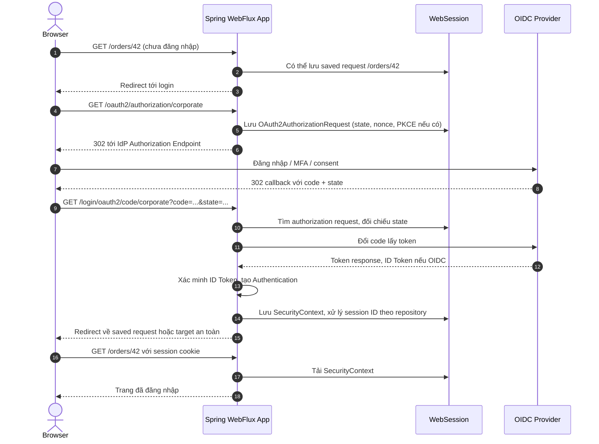

# 20.12. Quản lý WebSession, CSRF và điều hướng sau đăng nhập

## 1. Bối cảnh: đăng nhập Reactive thành công chưa phải toàn bộ câu chuyện

Trong ứng dụng **Spring Security OAuth 2.0/OIDC Client** chạy trên **Spring WebFlux**, luồng OAuth2 Login thường bắt đầu khi browser truy cập `/oauth2/authorization/{registrationId}` và kết thúc khi OpenID Provider (OP) hoặc Authorization Server redirect về `/login/oauth2/code/{registrationId}` kèm authorization code.

Sau khi đổi code lấy token, xác minh ID Token (nếu dùng OIDC) và tạo `Authentication`, ứng dụng vẫn cần giải quyết nhiều câu hỏi quan trọng:

- **Danh tính đã xác thực được lưu ở đâu?** Request tiếp theo có cần đăng nhập lại không?
- **`WebSession` chứa những gì?** Dữ liệu OAuth2 authorization request đang chờ callback có khác `SecurityContext` sau login không?
- **CSRF** còn cần thiết khi login được thực hiện qua redirect từ IdP không?
- **Callback GET có phải gửi CSRF token không?** `state` có thể thay thế CSRF của form thay đổi dữ liệu không?
- Sau đăng nhập, ứng dụng quay về **URL ban đầu**, `/dashboard` hay một đường dẫn khác?
- Nếu có `returnTo`/`redirect` từ browser, làm sao tránh **open redirect** và đánh cắp dữ liệu qua URL?
- **Logout** sẽ xóa WebSession, authorized-client tokens, IdP session và cookie ở những phạm vi nào?
- Ứng dụng chạy **nhiều pod** thì có cần lưu session dùng chung không?

Bài này giải thích ba mảng có liên quan nhưng phải được thiết kế riêng: **WebSession, CSRF và điều hướng sau đăng nhập**. Các ví dụ dùng **Spring Security WebFlux (Reactive)**, không nhầm với Spring MVC/Servlet.

> **Ý chính:** Spring Security giúp thực hiện OIDC Login và lưu `SecurityContext`, nhưng ứng dụng vẫn phải chọn chính sách session, CSRF, saved request, redirect, cookie và logout phù hợp. Không tắt CSRF hoặc nhận URL redirect tùy ý chỉ để khiến login “chạy được”.

### 1.1. Kết quả học tập

Sau bài học, người học có thể:

1. Phân biệt `WebSession`, `SecurityContext`, OAuth2 authorization request, authorized client và CSRF token.
2. Giải thích vì sao OIDC callback cần **session continuity** và đối chiếu `state`.
3. Cấu hình `SecurityWebFilterChain` với `oauth2Login`, CSRF và success/failure handlers.
4. Sử dụng `WebSessionServerSecurityContextRepository`, `WebSessionServerRequestCache` và `RedirectServerAuthenticationSuccessHandler` đúng vai trò.
5. Chọn giữa **quay về saved request** và **điều hướng cố định**.
6. Xử lý cookie `Secure`, `HttpOnly`, `SameSite` qua reverse proxy, load balancer hoặc cross-site login.
7. Hiểu sự khác nhau giữa local logout, OIDC logout và OAuth2 token revocation.
8. Chẩn đoán login loop, `state` mismatch, lỗi `403` do CSRF và redirect sai sau callback.

## 2. Đường đi tổng quan của OAuth2/OIDC Login trên WebFlux

Một luồng OIDC Authorization Code điển hình:



Trong sơ đồ, **WebSession được sử dụng ở cả trước và sau callback**, nhưng dữ liệu tại mỗi bước có mục đích riêng.

- **Trước callback:** lưu authorization request để chống nhầm lẫn/giả mạo response.
- **Sau xác thực thành công:** lưu `SecurityContext` để các HTTP requests tiếp theo nhận ra principal.
- **Khi người dùng bắt đầu từ một trang bị bảo vệ:** có thể lưu requested URL để quay lại sau login.
- **Khi submit form hoặc gọi API bằng cookie session:** CSRF token giúp bảo vệ các request thay đổi trạng thái.

**Không phải mọi dữ liệu trên đều là cùng một object hoặc được lưu cùng một chỗ trong mọi cấu hình.** Các repositories được cấu hình riêng có thể dùng WebSession, session store chia sẻ hoặc một storage khác.

## 3. Những đối tượng cần phân biệt

| Đối tượng | Chức năng | Thời điểm quan trọng | Ví dụ mặc định WebFlux |
| --- | --- | --- | --- |
| `WebSession` | Khung lưu session dữ liệu gắn với browser cookie | Trước và sau login | `org.springframework.web.server.WebSession` |
| `SecurityContext` | Chứa `Authentication` của request đã xác thực | Sau login | `WebSessionServerSecurityContextRepository` |
| `OAuth2AuthorizationRequest` | Chứa authorization parameters như `state`, scopes, redirect URI, PKCE | Trước callback | `WebSessionOAuth2ServerAuthorizationRequestRepository` |
| `ServerAuthorizationRequestRepository` | Lưu/tải/xóa authorization request đang chờ | Redirect và callback | WebSession-backed implementation |
| `ServerRequestCache` | Nhớ URL người dùng định truy cập trước khi bị yêu cầu đăng nhập | Khi authentication bị gián đoạn | `WebSessionServerRequestCache` |
| `ServerCsrfTokenRepository` | Sinh/lưu/tải CSRF token của ứng dụng | Form/API có session cookie | `WebSessionServerCsrfTokenRepository` |
| `OAuth2AuthorizedClient` | Client registration + access/refresh token đã cấp | Khi backend gọi downstream API | Lưu qua authorized-client service/repository |
| `OidcUser` | Principal OIDC chứa ID Token/claims đã được xác minh | Sau OIDC login | Nằm trong `Authentication` |
| HTTP session cookie | Định danh WebSession phía browser | Mỗi request theo cookie policy | Thường là `SESSION` trong WebFlux mặc định |

**`WebSession` không đồng nghĩa `HttpSession`.** `HttpSession` thuộc Servlet; WebFlux sử dụng `WebSession`/`ServerWebExchange` và reactive APIs. Đừng sao chép code `HttpServletRequest.getSession()` vào một reactive handler.

**`OAuth2AuthorizedClient` không đồng nghĩa `SecurityContext`.** Khi backend cần access token để gọi API, hãy tra authorized client thích hợp. Việc giữ user login qua WebSession không tự bảo đảm access token còn hạn, hoặc refresh token đang nằm trong session đó.

### 3.1. Ba loại state hay bị nhầm

| State | Dùng để làm gì? | Khi nào dùng? |
| --- | --- | --- |
| OAuth2 `state` parameter | Liên kết authorization response với authorization request ban đầu | OAuth2 redirect/callback |
| CSRF token | Chống request giả mạo dựa vào cookie ambient authority | Form/API thay đổi dữ liệu |
| WebSession ID | Giúp browser tham chiếu session đã lưu ở server | Các request thuộc phiên |

Không sử dụng một giá trị để thay thế cơ học giá trị khác. `state` trong OAuth2 không được dùng như CSRF token cho `POST /orders`, còn CSRF token trong form không thay thế yêu cầu xác minh `state` của OAuth2 callback.

## 4. `WebSession` lưu `SecurityContext` như thế nào?

Trong Spring Security WebFlux, `ServerSecurityContextRepository` cung cấp contract lưu/tải SecurityContext theo `ServerWebExchange`.

Một implementation phổ biến/default cho OAuth2 Login là:

```java
org.springframework.security.web.server.context
    .WebSessionServerSecurityContextRepository
```

Nó lưu `SecurityContext` trong `WebSession`, giúp browser sử dụng cookie của session để request tiếp theo được nhận dạng.

### 4.1. Vòng đời cơ bản

```text
Browser GET /private
  -> chưa có authentication
  -> bắt đầu OAuth2 Login

Browser callback OAuth2
  -> Spring Security xác thực thành công
  -> SecurityContext(Authentication) được lưu trong WebSession
  -> response có session cookie phù hợp

Browser GET /private lần sau
  -> cookie được gửi kèm
  -> WebSession được khôi phục
  -> SecurityContext được tải
  -> authorization policy đánh giá principal/authorities
```

Theo API của `WebSessionServerSecurityContextRepository`, **khi SecurityContext được save, repository thay đổi session ID để chống session fixation**. Đây là hành vi quan trọng: browser có thể nhận cookie session mới sau login. Đừng coi việc cookie thay đổi là lỗi nếu đó là session ID rotation hợp lệ.

### 4.2. Vì sao chống session fixation?

**Session fixation** xảy ra khi attacker khiến browser của nạn nhân dùng một session identifier mà attacker đã biết trước, rồi nạn nhân đăng nhập và attacker tiếp tục lợi dụng ID đó.

Một biện pháp bảo vệ là **thay đổi session ID khi authentication được lưu thành công**, giảm khả năng tái sử dụng session ID trước login. Dù vậy, vẫn phải:

- Bắt buộc HTTPS khi có session cookie.
- Đặt `Secure`, `HttpOnly`, `SameSite` và cookie path/domain phù hợp.
- Không log cookie/session ID.
- Không truyền session ID trong URL/query parameters.
- Giới hạn thời gian nhàn rỗi/tổng thời gian theo risk policy.
- Invalidate session trên logout theo cơ chế Spring Security.

Session ID rotation **không thay thế** xác minh OAuth2 `state`, OIDC `nonce` hoặc CSRF token cho các form/request thay đổi dữ liệu.

### 4.3. Có nên tự tạo `ServerSecurityContextRepository`?

Phần lớn ứng dụng WebFlux dựa trên OAuth2 Login **không cần** tự triển khai repository chỉ để có session login. Mặc định đã có `WebSessionServerSecurityContextRepository` theo cấu hình OAuth2 login.

Khi có yêu cầu đặc biệt, có thể cấu hình tường minh:

```java
@Configuration
@EnableWebFluxSecurity
class WebFluxSecurityConfiguration {

    @Bean
    SecurityWebFilterChain securityWebFilterChain(ServerHttpSecurity http) {
        var securityContexts =
            new WebSessionServerSecurityContextRepository();

        return http
            .authorizeExchange(exchanges -> exchanges
                .pathMatchers("/", "/assets/**", "/login").permitAll()
                .anyExchange().authenticated())
            .oauth2Login(oauth2 -> oauth2
                .securityContextRepository(securityContexts))
            .build();
    }
}
```

Ví dụ nhấn mạnh API `oauth2Login().securityContextRepository(...)`. Nếu ứng dụng có nhiều `SecurityWebFilterChain` hoặc các luồng authentication khác, cần thống nhất security context repository của các filters có liên quan; không tạo nhiều nơi lưu context xung đột chỉ vì muốn “bật session”.

**Không dùng `NoOpServerSecurityContextRepository` cho interactive session login** nếu mong browser vẫn được xác thực ở request tiếp theo. No-op repository phù hợp các kiến trúc stateless được thiết kế đầy đủ, chứ không phải cách chữa lỗi login WebSession.

## 5. Spring Boot/WebFlux OIDC Login tối thiểu

### 5.1. Dependency

Ví dụ Gradle:

```gradle
dependencies {
    implementation 'org.springframework.boot:spring-boot-starter-webflux'
    implementation 'org.springframework.boot:spring-boot-starter-security'
    implementation 'org.springframework.boot:spring-boot-starter-oauth2-client'
}
```

`spring-boot-starter-webflux` tạo ngăn xếp WebFlux. Không đưa cả Servlet `HttpSecurity` và WebFlux `ServerHttpSecurity` vào cùng một ví dụ rồi kỳ vọng chúng có cùng filter chain.

### 5.2. `application.yml`

```yaml
spring:
  security:
    oauth2:
      client:
        registration:
          corporate:
            provider: corporate-oidc
            client-id: ${CORPORATE_CLIENT_ID}
            client-secret: ${CORPORATE_CLIENT_SECRET}
            authorization-grant-type: authorization_code
            redirect-uri: "{baseUrl}/login/oauth2/code/{registrationId}"
            scope:
              - openid
              - profile
              - email
        provider:
          corporate-oidc:
            issuer-uri: https://idp.example.com/realms/staff
```

Những chi tiết chính:

- `registrationId` là `corporate`.
- URL bắt đầu login thường là `/oauth2/authorization/corporate`.
- Callback mặc định thường là `/login/oauth2/code/corporate`.
- Scope `openid` thể hiện luồng OIDC, dẫn đến kiểm tra ID Token và tạo principal OIDC.
- `issuer-uri` cần trùng issuer chính thức của provider và dùng discovery khi provider hỗ trợ.
- Client secret phải lấy từ secret store/biến môi trường, không hard-code trong Git.

URL callback phải được khai báo đúng trong cấu hình redirect URI của provider. Nếu app đứng sau proxy hoặc dùng context path, cần xử lý external scheme/host/path cẩn thận để Spring xây URL chính xác.

### 5.3. SecurityWebFilterChain với CSRF mặc định

```java
@Configuration
@EnableWebFluxSecurity
class ReactiveLoginSecurity {

    @Bean
    SecurityWebFilterChain securityWebFilterChain(ServerHttpSecurity http) {
        return http
            .authorizeExchange(exchanges -> exchanges
                .pathMatchers("/", "/assets/**", "/login", "/login-error")
                    .permitAll()
                .anyExchange().authenticated())
            .oauth2Login(Customizer.withDefaults())
            .csrf(Customizer.withDefaults())
            .build();
    }
}
```

Trong WebFlux, `ServerHttpSecurity` và `SecurityWebFilterChain` là hai API cốt lõi. `csrf` thường **được bật mặc định**; gọi `.csrf(Customizer.withDefaults())` ở đây nhằm thể hiện ý định giữ CSRF protection.

Với handler tự tạo như `/login-error`, ứng dụng phải có route tương ứng. `permitAll` chỉ cho phép truy cập route, không tự sinh trang HTML.

## 6. WebSession trong Authorization Code: lưu `state` trước callback

Khi Spring Security tạo OAuth2 Authorization Request, nó cần giữ dữ liệu để kiểm tra response nhận về từ IdP. Trong WebFlux, default request repository thường là:

```java
org.springframework.security.oauth2.client.web.server
    .WebSessionOAuth2ServerAuthorizationRequestRepository
```

Lớp này implement:

```java
ServerAuthorizationRequestRepository<OAuth2AuthorizationRequest>
```

Và hỗ trợ:

```java
Mono<Void> saveAuthorizationRequest(
    OAuth2AuthorizationRequest authorizationRequest,
    ServerWebExchange exchange);

Mono<OAuth2AuthorizationRequest> loadAuthorizationRequest(
    ServerWebExchange exchange);

Mono<OAuth2AuthorizationRequest> removeAuthorizationRequest(
    ServerWebExchange exchange);
```

### 6.1. Vì sao callback phải quay lại cùng session?

Đơn giản hóa:

```text
GET /oauth2/authorization/corporate
    WebSession S1 lưu authorizationRequest(state=abc123)
    Browser nhận cookie SESSION=S1
    Browser redirect IdP

IdP redirect:
    GET /login/oauth2/code/corporate?code=xyz&state=abc123
    Browser gửi cookie SESSION=S1
    App tìm authorizationRequest trong S1
    App so state từ callback với state đã lưu
```

Nếu browser không gửi cookie tương ứng ở callback, hoặc session đã hết hạn/mất dữ liệu, ứng dụng có thể **không tìm được authorization request** hoặc không xác minh được `state`. Kết quả thường là **login thất bại** dù IdP đã xác thực user thành công.

Nguyên nhân thường gặp:

- Session cookie bị browser chặn bởi `SameSite`/`Secure`/domain/path.
- Callback đi tới hostname khác với nơi bắt đầu login.
- Session store in-memory của pod A nhưng callback được load balancer gửi đến pod B.
- WebSession hết hạn trong lúc user thực hiện MFA hoặc consent.
- Logout/xóa cookies giữa authorization request và callback.
- Một luồng login mới thay đổi authorization request/session theo behavior repository hiện tại.
- Reverse proxy cấu hình sai scheme/host/path.
- Authorization code hoặc `state` bị sửa/tái sử dụng.

**Không chữa bằng cách bỏ kiểm tra `state`**. Cần sửa session continuity và callback URL. `state` là một cơ chế bảo vệ bắt buộc quan trọng của OAuth2 Authorization Code flow.

### 6.2. `state` không phải CSRF token của form

`state` giúp liên kết authorization response với phiên/request đã khởi tạo, ngăn các tình huống login CSRF và response injection theo cơ chế OAuth2. Nhưng `state`:

- Không được gửi với `POST /api/orders` như CSRF token.
- Không dùng để bảo vệ mọi endpoint thay đổi trạng thái.
- Không thay thế xác minh `nonce` của OIDC khi nonce được dùng.
- Không tự bảo đảm IdP cấp ID Token cho đúng issuer/audience.

Trong OIDC, client còn cần xác minh chữ ký và claims của ID Token, bao gồm issuer, audience, expiry và nonce khi áp dụng.

### 6.3. Session-scoped authorization request khác saved request

**Authorization request repository** lưu đối tượng `OAuth2AuthorizationRequest` để xử lý **callback**.

**Saved request cache** lưu URL người dùng định mở trước khi bị chuyển đi đăng nhập, để xử lý **điều hướng sau login**.

Ví dụ:

```text
Saved Request:
    /orders/42

OAuth2 Authorization Request:
    redirect_uri=https://portal.example.com/login/oauth2/code/corporate
    state=abc123
    scope=openid profile email
    PKCE challenge/verifier metadata (nếu dùng)
```

Đây là hai dữ liệu khác nhau dù có thể cùng nằm trong WebSession. Không tìm saved request trong OAuth2 `state`, và không dùng request cache để lưu authorization code.

## 7. CSRF là gì khi ứng dụng xác thực bằng cookie?

**Cross-Site Request Forgery** là tình huống một website độc hại khiến browser của người dùng đã đăng nhập gửi request sang ứng dụng khác, kèm **cookie được browser tự gắn**. Nếu backend chỉ tin cookie và không kiểm tra nguồn/yếu tố chống giả mạo, request thay đổi dữ liệu có thể được thực hiện ngoài ý muốn.

Ví dụ:

```text
Browser đã login portal.example.com
  cookie SESSION=...

Attacker đưa browser tới trang attacker.example
  trang này cố kích hoạt POST tới portal.example.com/api/bank-transfer
  browser có thể tự gửi cookie theo cookie policy

Nếu backend tin session cookie mà không có CSRF protection,
  request giả mạo có thể tác động lên tài khoản nạn nhân.
```

Trong ứng dụng WebFlux có browser session cookie, **CSRF vẫn rất quan trọng dù đăng nhập thông qua OIDC**.

### 7.1. Vì sao OAuth2 Login không loại bỏ nhu cầu CSRF?

OIDC Login bảo đảm user đã được xác thực theo protocol. Nhưng sau khi đăng nhập, browser vẫn dùng session cookie để gọi các API và submit forms.

- OIDC `state` bảo vệ liên kết authorization request/response.
- Session cookie giúp xác định browser session.
- CSRF token bảo vệ request thay đổi trạng thái trong phiên đó.

Ba vấn đề có bề mặt tấn công khác nhau. Không thể lấy lập luận “IdP đã bảo vệ login” để vô hiệu CSRF cho mọi POST/PUT/PATCH/DELETE của portal.

### 7.2. CSRF khác CORS

**CORS** là cơ chế browser cho phép hoặc chặn JavaScript đọc HTTP response giữa các origins; nó **không phải** cơ chế ngăn mọi request cross-site được gửi đi.

Ngay cả khi CORS chặn script đọc response, một form POST cross-site vẫn có thể được gửi trong những tình huống được browser cho phép.

Vì vậy:

- Bật CSRF protection cho request sử dụng ambient session credentials.
- Cấu hình CORS đúng origin/credentials khi SPA gọi API từ origin khác.
- Dùng `SameSite` cookie làm lớp giảm thiểu bổ sung.
- Không cho rằng chỉ `cors()` hoặc `SameSite=Strict` luôn thay thế CSRF.

## 8. CSRF trong Spring Security WebFlux

Spring Security WebFlux sử dụng:

```java
org.springframework.security.web.server.csrf.CsrfWebFilter
org.springframework.security.web.server.csrf.ServerCsrfTokenRepository
org.springframework.security.web.server.csrf.WebSessionServerCsrfTokenRepository
```

Ở cấu hình phổ biến, CSRF protection **được bật mặc định** và dùng `WebSessionServerCsrfTokenRepository` để giữ expected token trong WebSession.

### 8.1. Những HTTP methods nào cần CSRF?

CSRF thường kiểm tra các phương thức **thay đổi trạng thái**, như POST, PUT, PATCH và DELETE, theo `ServerWebExchangeMatcher` đang được cấu hình. Những phương thức an toàn như GET/HEAD/OPTIONS/TRACE thường không yêu cầu token theo chính sách mặc định.

**Điều kiện bảo mật:** GET/HEAD không được thực hiện thay đổi dữ liệu nhạy cảm. Nếu tạo endpoint `GET /delete-account`, việc CSRF matcher bỏ qua GET sẽ làm endpoint này dễ bị kích hoạt ngoài ý muốn.

### 8.2. `WebSessionServerCsrfTokenRepository`

Kho CSRF WebSession chứa expected CSRF token, sau đó request cần gửi token trong một form field hoặc HTTP header mà browser không tự động gắn thay cho attacker.

Ví dụ cấu hình tường minh:

```java
@Bean
SecurityWebFilterChain securityWebFilterChain(ServerHttpSecurity http) {
    return http
        .authorizeExchange(exchanges -> exchanges
            .pathMatchers("/", "/assets/**").permitAll()
            .anyExchange().authenticated())
        .oauth2Login(Customizer.withDefaults())
        .csrf(csrf -> csrf
            .csrfTokenRepository(new WebSessionServerCsrfTokenRepository()))
        .build();
}
```

Vì đây đã là kho CSRF mặc định ở các phiên bản WebFlux phổ biến, đoạn trên chủ yếu để minh họa extension point.

**Không nhầm WebSessionServerCsrfTokenRepository với WebSessionOAuth2ServerAuthorizationRequestRepository.** Một bên lưu expected CSRF token cho app requests, bên kia lưu OAuth2 authorization request để kiểm tra callback.

### 8.3. CSRF token xuất hiện như thế nào trong request?

Một HTML form truyền thống:

```html
<form method="post" action="/api/profile">
  <input type="text" name="displayName" value="Linh">
  <input type="hidden" name="_csrf" value="${CSRF_TOKEN_FROM_SERVER}">
  <button type="submit">Lưu</button>
</form>
```

`"${CSRF_TOKEN_FROM_SERVER}"` ở đây chỉ là **placeholder minh họa**, không phải biểu thức tự được Spring Security render. Template engine cần lấy token do Spring Security cung cấp và đặt giá trị thực vào field.

Với AJAX/JSON:

```http
POST /api/profile HTTP/1.1
Cookie: SESSION=<session-id>
Content-Type: application/json
X-CSRF-TOKEN: <csrf-token>

{"displayName":"Linh"}
```

Header name có thể phụ thuộc loại `CsrfToken`/repository, ví dụ `X-CSRF-TOKEN` hoặc `X-XSRF-TOKEN`. Frontend phải dùng tên header và token value do server cung cấp, không hard-code tùy tiện rồi bỏ qua đồng bộ.

### 8.4. Trong WebFlux, token được expose qua Mono

Một điểm đặc biệt so với Servlet: trong Reactive stack, request có thể nhận **`Mono<CsrfToken>`** qua exchange attribute, không phải luôn có sẵn `CsrfToken` đồng bộ.

Ví dụ định hướng:

```java
@GetMapping("/csrf")
Mono<Map<String, String>> csrf(ServerWebExchange exchange) {
    Mono<CsrfToken> csrfToken =
        exchange.getAttribute(CsrfToken.class.getName());

    if (csrfToken == null) {
        return Mono.error(new IllegalStateException(
            "CSRF protection is not configured for this request"));
    }

    return csrfToken.map(token -> Map.of(
        "headerName", token.getHeaderName(),
        "parameterName", token.getParameterName(),
        "token", token.getToken()
    ));
}
```

`CsrfToken` thuộc `org.springframework.security.web.server.csrf.CsrfToken`. Đoạn này minh họa cách **resolve Mono trong Reactive handler**, không phải khuyến nghị xuất token ra bất kỳ origin nào. Với production cần:

- Kiểm soát CORS và origin.
- Đặt response `Cache-Control: no-store` khi cấp token nhạy cảm.
- Chỉ trả token phục vụ cùng browser/session hoặc cơ chế SPA được thiết kế.
- Không đưa CSRF token vào URL/query hoặc logs.
- Không tạo endpoint public có thể bị các origin khác khai thác ngoài chính sách.

Theo cấu hình WebFlux hiện đại, `XorServerCsrfTokenRequestAttributeHandler` có thể được dùng mặc định để hỗ trợ chống BREACH. Khi xây SPA tự lấy token, cần hiểu giá trị được expose/masking và cách handler giải mã token gửi lại.

## 9. Cookie-based CSRF cho SPA: khi nào cần?

Một số frontend SPA muốn đọc CSRF token từ cookie `XSRF-TOKEN` và gửi lại trong header `X-XSRF-TOKEN`.

Spring Security WebFlux có:

```java
org.springframework.security.web.server.csrf.CookieServerCsrfTokenRepository
```

Ví dụ cấu hình:

```java
@Bean
SecurityWebFilterChain securityWebFilterChain(ServerHttpSecurity http) {
    return http
        .authorizeExchange(exchanges -> exchanges
            .pathMatchers("/", "/assets/**").permitAll()
            .anyExchange().authenticated())
        .oauth2Login(Customizer.withDefaults())
        .csrf(csrf -> csrf
            .csrfTokenRepository(
                CookieServerCsrfTokenRepository.withHttpOnlyFalse()))
        .build();
}
```

### 9.1. `withHttpOnlyFalse()` có nghĩa gì?

Nó cho phép JavaScript phía browser **đọc cookie CSRF token** để gửi lại trong header. Điều này có thể cần cho một SPA cùng origin.

Nhưng cần phân biệt:

- **CSRF cookie** có thể phải đọc được bởi JavaScript theo thiết kế SPA.
- **Session cookie** và refresh token **không nên** bị làm JavaScript-readable theo thói quen.
- Cookie CSRF cần kết hợp CSRF request handler thích hợp, đặc biệt nếu cấu hình hiện tại có XOR/masked token để chống BREACH.
- Nếu có XSS, attacker có thể đọc CSRF cookie; **CSRF protection không thay thế chống XSS**.
- Không bật `HttpOnly=false` cho **mọi** cookies chỉ vì muốn frontend gửi CSRF.

Nhiều hệ thống có thể dùng **server-rendered form/token meta tags** thay vì cookie-based CSRF. Chọn chiến lược dựa trên frontend architecture, không chuyển sang cookie repository chỉ để bỏ lỗi 403 mà chưa hiểu.

### 9.2. Vì sao SPA gửi cookie nhưng vẫn bị 403?

Một số nguyên nhân:

1. Frontend không gửi header CSRF.
2. Header name sai (`X-CSRF-TOKEN` so với `X-XSRF-TOKEN`).
3. Cookie/token thuộc một WebSession cũ đã hết hạn.
4. Xor/masked token handler và token do SPA đọc không tương thích với nhau.
5. Frontend chưa chủ động kích hoạt việc sinh/resolve CSRF token sau login.
6. Trình duyệt không gửi session cookie do `SameSite`, CORS credentials hoặc domain/path.
7. Frontend đang gọi một host khác backend dự kiến.
8. Một security chain khác có CSRF repository/matcher khác.

Đừng chữa các tình huống này bằng `.csrf(csrf -> csrf.disable())` cho toàn bộ ứng dụng browser session.

## 10. OAuth2 callback GET và CSRF: cơ chế nào kiểm tra?

Trong **Authorization Code response mode query** thông dụng, provider redirect browser về một GET callback:

```http
GET /login/oauth2/code/corporate?code=...&state=...
```

GET mặc định **không yêu cầu CSRF form token**, vì nó được xem là HTTP safe method. Nhưng OAuth2 Login vẫn cần:

- Đối chiếu `state` từ response với request đã lưu.
- Kiểm tra authorization response và sử dụng code theo chuẩn.
- Ràng buộc redirect URI và client registration đúng.
- Xác minh ID Token OIDC (issuer, audience, signature, nonce khi có, thời hạn).
- Không chấp nhận code không thuộc flow đã khởi tạo.

**CSRF token của ứng dụng không phải thứ IdP gửi kèm callback GET.** Không cấu hình một global filter bắt IdP gửi `_csrf` cho GET callback.

### 10.1. Login CSRF và `state`

Một cuộc tấn công **login CSRF** có thể tìm cách khiến nạn nhân bị đăng nhập vào một danh tính không mong muốn hoặc ghép response của attacker vào phiên của nạn nhân.

OAuth2 `state` được tạo và gắn với authorization request/session là một trong những cơ chế chống nhầm lẫn này. Nếu session mất, không thể xác minh state, nên ứng dụng phải **từ chối callback** thay vì bỏ validation.

Với OIDC, `nonce` (nếu được sử dụng) là bảo vệ bổ sung trong ID Token; nó không được dùng thay CSRF token của ứng dụng.

### 10.2. Nếu IdP dùng `response_mode=form_post`?

Một số OIDC Providers hỗ trợ trả Authorization Response qua HTTP POST thay cho GET. Điều này có các hệ quả:

- Callback trở thành **POST**, có thể bị `CsrfWebFilter` chặn vì IdP không có CSRF token của ứng dụng.
- Spring Security OAuth2 Login mặc định có thể cần cấu hình/custom converter để xử lý response mode này đúng giao thức.
- Browser gửi session cookie trong **cross-site POST** có thể bị hạn chế bởi `SameSite=Lax/Strict`.
- Nếu cần `SameSite=None`, cookie phải có `Secure` trên HTTPS và chịu thêm yêu cầu privacy/security.

**Không tắt CSRF toàn cục để hỗ trợ form_post.** Nếu hệ thống đã xác minh provider/flow và có hỗ trợ chuẩn, có thể cấu hình **một ngoại lệ CSRF hẹp chỉ cho callback tương ứng** và giữ **OAuth2 state/nonce/authorization response validation**. Ngoại lệ như vậy phải có threat-model, xác minh chính xác path/method và không mở rộng ra các POST nghiệp vụ khác.

Nếu không có yêu cầu bắt buộc, **Authorization Code callback GET mặc định** thường đơn giản hơn cho WebFlux browser login.

## 11. WebSession cookie: `Secure`, `HttpOnly`, `SameSite`, domain và path

Một OIDC login flow qua browser phụ thuộc nhiều vào cookie session vì authorization request được lưu trước khi browser rời ứng dụng, rồi cần được tìm lại sau callback.

### 11.1. Browser gửi cookie trong trường hợp nào?

Giả sử ứng dụng ở:

```text
https://portal.example.com
```

Sau khi bắt đầu OAuth2 Login, browser lưu một cookie session từ `portal.example.com`. Khi IdP redirect về:

```text
https://portal.example.com/login/oauth2/code/corporate
```

browser phải gửi lại cookie đó để server có thể tải WebSession đã chứa authorization request.

Cookie không được gửi nếu domain/path không khớp, `Secure` không phù hợp HTTPS, SameSite policy chặn loại navigation đang xảy ra, cookie đã hết hạn hoặc browser có restrictions khác.

### 11.2. Bảng lựa chọn cookie

| Thuộc tính | Vai trò | Gợi ý |
| --- | --- | --- |
| `Secure` | Chỉ gửi cookie qua HTTPS | Bật trong production |
| `HttpOnly` | Hạn chế JavaScript đọc cookie | Bật cho session cookie |
| `SameSite=Lax` | Giảm gửi cookie cross-site, thường cho phép top-level GET navigation | Thường phù hợp callback GET |
| `SameSite=Strict` | Rất hạn chế gửi cookie từ cross-site context | Có thể làm callback OIDC từ IdP không mang session cookie |
| `SameSite=None` | Cho phép gửi trong các cross-site contexts | Cần `Secure`; cân nhắc với form_post/embedding |
| `Domain` | Cookie được gửi tới các hostname nào | Ưu tiên host-only nếu không cần chia sẻ |
| `Path` | Cookie được gửi tới paths nào | Phải bao phủ login initiation và callback |
| `Max-Age`/session expiration | Giới hạn vòng đời cookie/session | Phù hợp security policy và flow MFA |

**Không chọn `SameSite=None` cho mọi deployment chỉ vì có OAuth2 Login**. Top-level cross-site GET callback thường hoạt động với `Lax`; `None` làm cookie được gửi trong nhiều trường hợp cross-site hơn, nên cần threat-model và CSRF protection chặt.

### 11.3. Ví dụ cấu hình cookie session bằng WebFlux

Trong một số triển khai WebFlux/Spring Session, `CookieWebSessionIdResolver` cho phép tùy biến session cookie:

```java
@Configuration
class WebSessionCookieConfiguration {

    @Bean
    WebSessionIdResolver webSessionIdResolver() {
        CookieWebSessionIdResolver resolver =
            new CookieWebSessionIdResolver();

        resolver.setCookieName("SESSION");

        resolver.addCookieInitializer(cookie -> cookie
            .httpOnly(true)
            .secure(true)
            .sameSite("Lax")
            .path("/"));

        return resolver;
    }
}
```

Các class thuộc `org.springframework.web.server.session`. Một số phiên bản Spring Framework/Spring Session có cách cấu hình cookie khác nhau; hãy kiểm tra phiên bản hiện dùng và cấu hình auto-configuration.

Nếu app nằm sau reverse proxy TLS termination, proxy phải chuyển và ứng dụng phải hiểu **external HTTPS scheme/host** phù hợp; nếu không, cookie/redirect có thể bị tạo với scheme hoặc host sai.

**Lưu ý:** Cookie resolver phụ thuộc deployment. Đừng khai báo cấu hình cookie đối lập trong ingress/proxy và code rồi kỳ vọng tất cả trình duyệt nhận cùng giá trị. Không cấp cookie `Domain=.example.com` nếu không có lý do chia sẻ session giữa subdomains được tin cậy.

### 11.4. Browser không tự gửi cookie đến API khác chỉ vì có CORS

Nếu frontend và backend ở hai origins, ví dụ `https://app.example.com` gọi `https://api.example.com`, cần xem:

- Fetch/XHR `credentials: "include"` khi request cross-origin có cookie.
- Backend CORS `allowCredentials` và **allowlist exact origins**.
- Cookie Domain/Path/SameSite/Secure.
- CSRF token/header đi cùng session.
- Không dùng `Access-Control-Allow-Origin: *` kết hợp credentials.
- Không dùng CORS như lớp bảo vệ duy nhất cho request thay đổi dữ liệu.

Đây là bài toán khác với top-level redirect OIDC, nhưng thường xuất hiện cùng hệ thống SPA login.

## 12. Sau login, người dùng được redirect đi đâu?

Spring Security WebFlux có handler:

```java
org.springframework.security.web.server.authentication
    .RedirectServerAuthenticationSuccessHandler
```

Default handler **ưu tiên saved request nếu có** và fallback về `/` khi không có target đã lưu.

Ví dụ:

```text
User chưa login mở /orders/42
    -> request bị chặn và có thể được lưu
    -> user đi qua OIDC login
    -> success handler quay lại /orders/42

User bấm nút Login ngay từ trang công khai /
    -> không có saved request
    -> success handler dùng fallback /
```

Với OAuth2 Login, handler nhận **`WebFilterExchange` và `Authentication`** đã được xác thực:

```java
Mono<Void> onAuthenticationSuccess(
    WebFilterExchange webFilterExchange,
    Authentication authentication);
```

Lưu ý **saved request có thể ảnh hưởng đích cuối cùng**. Nếu bạn đặt fallback `/dashboard` nhưng vẫn để request cache hoạt động, handler có thể đưa user về URL trước login thay vì `/dashboard`.

### 12.1. `WebSessionServerRequestCache`

Default request cache phổ biến:

```java
org.springframework.security.web.server.savedrequest
    .WebSessionServerRequestCache
```

Nó lưu thông tin request **trong WebSession** để điều hướng lại. Theo API, implementation này hiện lưu **URL** đã yêu cầu, không lưu nguyên POST body để phát lại giao dịch.

Request cache mặc định hướng tới GET requests. Không kỳ vọng nó tự replay `POST /payments` sau login; hành vi đó có thể nguy hiểm nếu có side effect.

### 12.2. Thiết lập một fallback route

Ví dụ dùng `RedirectServerAuthenticationSuccessHandler`:

```java
@Bean
SecurityWebFilterChain securityWebFilterChain(ServerHttpSecurity http) {
    var successHandler =
        new RedirectServerAuthenticationSuccessHandler("/dashboard");

    return http
        .authorizeExchange(exchanges -> exchanges
            .pathMatchers("/", "/login", "/assets/**").permitAll()
            .anyExchange().authenticated())
        .oauth2Login(oauth2 -> oauth2
            .authenticationSuccessHandler(successHandler))
        .build();
}
```

**Ý nghĩa:** khi không có saved request được dùng, điều hướng tới `/dashboard`.

Đây không phải lời đảm bảo `dashboard` luôn được chọn. Nếu có saved request và handler dùng request cache mặc định, URL đã lưu có thể được ưu tiên.

### 12.3. Điều hướng luôn cố định sau login

Nếu yêu cầu sản phẩm là **luôn** đi về `/dashboard` và không restore URL trước login, có thể dùng `NoOpServerRequestCache`:

```java
@Bean
SecurityWebFilterChain securityWebFilterChain(ServerHttpSecurity http) {
    var noRequestCache = NoOpServerRequestCache.getInstance();

    var successHandler =
        new RedirectServerAuthenticationSuccessHandler("/dashboard");
    successHandler.setRequestCache(noRequestCache);

    return http
        .authorizeExchange(exchanges -> exchanges
            .pathMatchers("/", "/login", "/assets/**").permitAll()
            .anyExchange().authenticated())
        .requestCache(cache -> cache.requestCache(noRequestCache))
        .oauth2Login(oauth2 -> oauth2
            .authenticationSuccessHandler(successHandler))
        .build();
}
```

`NoOpServerRequestCache` là implementation **không lưu request**. Cấu hình vừa đặt cho HTTP request cache, vừa đặt trên success handler giúp mục tiêu “điều hướng cố định” minh bạch.

**Không nhầm NoOpServerRequestCache với NoOpServerSecurityContextRepository.** No-op **request cache** chỉ bỏ tính năng lưu URL trước login; nó **không** khiến WebSession/SecurityContext mất đi.

### 12.4. Chỉ lưu saved request từ một số trang web

Một ứng dụng vừa có UI vừa có API có thể muốn:

- GET `/dashboard/**`, `/orders/**` → lưu để quay lại sau login.
- GET `/api/**` từ JavaScript → **không** lưu để tránh browser bị redirect tới một JSON endpoint.
- GET `/assets/**` → không cần lưu.
- POST/PUT/PATCH/DELETE → không replay sau login.

`WebSessionServerRequestCache` có thể nhận `ServerWebExchangeMatcher`:

```java
@Bean
ServerRequestCache uiRequestCache() {
    var cache = new WebSessionServerRequestCache();

    cache.setSaveRequestMatcher(
        ServerWebExchangeMatchers.pathMatchers(
            HttpMethod.GET,
            "/dashboard/**",
            "/orders/**",
            "/reports/**"));

    return cache;
}
```

Trong security chain:

```java
.requestCache(cache -> cache.requestCache(uiRequestCache))
```

Nếu success handler là bean tự cấu hình, có thể cần `successHandler.setRequestCache(uiRequestCache)` để **cùng một cache** được dùng để lưu và lấy URL.

Một lưu ý: `ServerWebExchangeMatchers.pathMatchers(HttpMethod.GET, ...)` áp dụng theo API WebFlux matcher; phải import đúng `HttpMethod` và `ServerWebExchangeMatchers`. Các patterns phải phản ánh routes thật và không lưu URLs chứa secrets trong query string.

## 13. Tránh open redirect sau OIDC Login

Một yêu cầu phổ biến: login từ trang `/checkout` rồi về lại đó. Developer dễ làm:

```text
/login?returnTo=https://evil.example/collect
```

Sau login, code lấy `returnTo` từ query và gọi `response.setStatusCode(302)` cùng header `Location` tới giá trị đó. Đây là **open redirect**.

### 13.1. Vì sao open redirect nguy hiểm?

Nếu portal đáng tin cho phép redirect ra host tùy ý:

- Attacker có thể dùng URL portal để dụ người dùng rời sang trang phishing.
- Nếu code gắn authorization code, token hoặc session identifier vào URL, thông tin có thể lộ.
- Một callback/redirect hợp lệ bị lợi dụng làm bước trung gian trong luồng tấn công.
- Redirect tới scheme không mong muốn như `javascript:` hoặc `data:` có thể gây hành vi không an toàn ở client khác nhau.

**Không đặt raw access token, refresh token, ID Token hoặc authorization code vào redirect URL.** Các token nên được quản lý ở backend/authorized-client storage theo thiết kế.

### 13.2. Cách đơn giản nhất: cho phép danh sách trang đích

Nếu chỉ cần vài trang sau login, hãy ánh xạ lựa chọn nghiệp vụ thành **các đường dẫn cố định đã cho phép**:

```java
static String allowedTarget(String page) {
    if ("orders".equals(page)) {
        return "/orders";
    }
    if ("reports".equals(page)) {
        return "/reports";
    }
    return "/dashboard";
}
```

Đây là một helper minh họa: `page` chỉ là **tên lựa chọn**, không phải raw URL. Danh sách đường dẫn được viết sẵn nên không thể bị thay bằng một hostname ngoài domain.

Nếu cần redirect động tới một tập lớn đường dẫn nội bộ, phải kiểm tra thêm:

- URL không có scheme/authority ngoài dự kiến.
- Không bắt đầu bằng `//` hoặc chứa cú pháp backslash gây hiểu nhầm origin.
- Chỉ dùng path trong allowlist của app.
- Có giải mã/normalize một lần theo đúng policy, tránh double encoding.
- Không nhận user input trực tiếp làm `Location` khi chưa validate.
- Không cho query string chứa credentials.
- Có policy riêng nếu phải redirect tới một số trusted external domains.

**Cách đơn giản và an toàn thường là dùng saved request cache được cấu hình đúng hoặc fixed post-login target** thay vì tự tạo một cơ chế `returnTo` chung.

### 13.3. Success handler tường minh và Reactor

Một custom `ServerAuthenticationSuccessHandler` có thể trả `Mono<Void>` để kết thúc HTTP response hoặc redirect:

```java
ServerAuthenticationSuccessHandler successHandler =
    (webFilterExchange, authentication) -> {
        // Không lấy URL đích tùy ý từ request/query.
        String target = "/dashboard";

        ServerWebExchange exchange = webFilterExchange.getExchange();

        exchange.getResponse().setStatusCode(HttpStatus.SEE_OTHER);
        exchange.getResponse().getHeaders()
            .setLocation(URI.create(target));

        return exchange.getResponse().setComplete();
    };
```

Đoạn trên **minh họa contract Reactive**, không dùng `response.sendRedirect(...)` của Servlet. Ở production, ưu tiên `RedirectServerAuthenticationSuccessHandler` hoặc `ServerRedirectStrategy` của Spring Security để giữ chính sách redirect nhất quán; custom handler cần xử lý saved request, host validation và status theo nghiệp vụ.

Nếu có bất kỳ database call/HTTP call nào trong custom handler, trả về **Mono kết hợp bằng `flatMap`** và không `.block()` trên event loop.

## 14. Xử lý lỗi đăng nhập và failure redirect

Spring Security WebFlux cho phép cấu hình:

```java
ServerAuthenticationFailureHandler
```

Một implementation thông dụng:

```java
RedirectServerAuthenticationFailureHandler
```

Có thể cấu hình:

```java
@Bean
SecurityWebFilterChain securityWebFilterChain(ServerHttpSecurity http) {
    var success =
        new RedirectServerAuthenticationSuccessHandler("/dashboard");

    var failure =
        new RedirectServerAuthenticationFailureHandler("/login?error");

    return http
        .authorizeExchange(exchanges -> exchanges
            .pathMatchers("/", "/login", "/assets/**").permitAll()
            .anyExchange().authenticated())
        .oauth2Login(oauth2 -> oauth2
            .authenticationSuccessHandler(success)
            .authenticationFailureHandler(failure))
        .build();
}
```

Các giá trị `/dashboard` và `/login?error` là **relative paths trong ứng dụng**, không dùng raw URL do browser cung cấp.

### 14.1. Không đưa exception thô lên query string

Không làm:

```text
/login?error=<full-exception-message-with-token-or-user-info>
```

Lỗi có thể chứa thông tin về provider, client configuration hoặc các giá trị nhạy cảm. Dùng một thông báo generic cho người dùng, log error code/correlation ID đã làm sạch ở backend.

Ví dụ thông báo:

```text
Không thể hoàn tất đăng nhập. Vui lòng thử lại.
Nếu sự cố tiếp diễn, liên hệ bộ phận hỗ trợ và cung cấp mã yêu cầu.
```

Phần kỹ thuật cần tách:

- `state` mismatch/authorization request not found.
- Token Endpoint `invalid_grant`/`invalid_client`.
- ID Token issuer/audience/signature/nonce failure.
- Network/TLS/proxy error.
- Authorization failure do user chưa được cấp quyền.
- CSRF failure cho một POST nghiệp vụ.

**Không coi mọi login failure là lỗi CSRF**; một số là mất session/authorization state và một số là ID Token validation.

### 14.2. Khi login thành công nhưng redirect lại quay về `/login`

Có thể:

1. Trang login cũ đã được lưu vào request cache.
2. `/dashboard` hoặc saved URL vẫn yêu cầu quyền mà user không có.
3. Session cookie không được gửi trong request sau redirect.
4. `SecurityContext` không được lưu vào đúng `ServerSecurityContextRepository`.
5. Reverse proxy làm scheme/host/path redirect sai.
6. Redirect xảy ra giữa hai host có cookie domains khác nhau.
7. Có nhiều `SecurityWebFilterChain` với rules/conflicting repositories.

Cần đọc access logs đã làm sạch và xác định **request nào bắt đầu login, callback nào được xử lý, Set-Cookie nào được phát, request sau redirect có cookie không**. Không tắt SecurityWebFilterChain để làm mất login loop.

## 15. Redirect sau login qua reverse proxy và HTTPS termination

Khi ứng dụng nằm sau ingress/load balancer:

```text
Browser:
    https://portal.example.com

Reverse proxy:
    https://portal.example.com -> http://webflux-service:8080

Spring WebFlux app:
    http://webflux-service:8080
```

Nếu ứng dụng xây redirect URI từ **internal scheme/host** thay vì external request, provider có thể thấy:

```text
http://webflux-service:8080/login/oauth2/code/corporate
```

thay vì:

```text
https://portal.example.com/login/oauth2/code/corporate
```

Điều này gây:

- `redirect_uri_mismatch` tại Authorization Server.
- Browser không truy cập được internal hostname.
- Cookie `Secure` không được gắn/gửi đúng.
- State mất do callback về hostname khác.
- Login thành công tại IdP nhưng app loop hoặc redirect đến URL nội bộ.

### 15.1. Forwarded headers phải đến từ proxy tin cậy

Có thể sử dụng Spring Boot configuration phù hợp, ví dụ:

```yaml
server:
  forward-headers-strategy: framework
```

Cấu hình này hướng Spring Framework xử lý thông tin forwarded headers theo môi trường tương ứng. **Chỉ tin `Forwarded`/`X-Forwarded-*` do reverse proxy/ingress được kiểm soát cung cấp**; phải loại bỏ hoặc ghi đè headers do client trực tiếp gửi để tránh host/scheme spoofing và redirect độc hại.

Với deployment phức tạp, cần kiểm tra chính xác Spring Boot version, ingress controller, proxy protocol và tác động lên `ServerWebExchange.getRequest().getURI()`.

### 15.2. Callback URL phải đúng với client registration

Kiểm tra cả ba nơi:

1. `redirect-uri` trong `spring.security.oauth2.client.registration.*`.
2. Redirect URI được đăng ký tại IdP.
3. External URL browser thực sự gọi vào proxy/app.

Ba giá trị phải phù hợp theo policy provider. Không giảm kiểm tra redirect URI trên Authorization Server để “sửa” lỗi môi trường.

## 16. WebSession trong deployment nhiều instance

Nếu WebFlux app chạy một pod duy nhất, session state có thể nằm trong RAM process tùy default `WebSessionStore`. Khi scale:

```text
Request bắt đầu login -> Pod A
Callback từ IdP      -> Pod B
```

Nếu A và B không chia sẻ session state và load balancer không giữ affinity, B có thể **không tìm được authorization request** đã lưu ở A. Điều đó dẫn đến state/authorization request failure.

Giải pháp kiến trúc có thể là:

- **Shared reactive session store** với Spring Session/Redis hoặc một `WebSessionManager` được cấu hình phù hợp.
- Session affinity được quản lý đúng (chỉ là một chiến lược, có giới hạn khi pod restart).
- Bảo đảm các pods dùng cùng cookie naming/path/domain và encryption/serialization policy.
- Giữ thời gian sống session đủ cho flow login/MFA nhưng không quá dài.
- Kiểm soát timeout, redis availability, connection pool và recovery.
- Không tắt OAuth2 state verification để tránh lỗi callback qua pod khác.

### 16.1. Spring Session WebFlux/Redis

Spring Session có khả năng tích hợp `WebSession` với **ReactiveSessionRepository** và có thể dùng Redis để chia sẻ state giữa instances.

Ví dụ định hướng:

```java
@Configuration
@EnableRedisWebSession
class ReactiveSessionConfiguration {
    // Cần RedisConnectionFactory và các dependencies
    // Spring Session Redis phù hợp với Spring Boot version.
}
```

Đoạn trên chưa phải cấu hình deployment hoàn chỉnh. Cần có Redis connectivity, authentication/TLS, repository setup, session timeout và các điều kiện auto-configuration. Với ứng dụng nhiều nodes, session store phải được vận hành như một dependency có yêu cầu HA và backup/retention phù hợp.

**Quan trọng:** shared WebSession không tự biến authorized-client storage thành shared nếu `ReactiveOAuth2AuthorizedClientService` vẫn dùng in-memory per-pod. Chúng là các repositories có trách nhiệm khác nhau.

### 16.2. Session timeout trong lúc MFA

Ví dụ:

```text
11:00 User bắt đầu OAuth2 Login, authorization request lưu session.
11:03 User nhận OTP và thực hiện MFA.
11:08 User nhập OTP thành công.
11:08 IdP redirect callback về app.
```

Nếu session sống 5 phút và hết hạn lúc 11:05, callback có thể không tìm được authorization request.

Cần cân bằng:

- Inactivity timeout của session trước login.
- Thời gian MFA/consent hợp lý.
- Authorization Code lifetime do IdP quy định.
- Token/CSRF/session expiration policy.
- Việc lưu authorization request và callback cross-pod.

Không kéo dài session vô hạn chỉ vì một số users thực hiện MFA chậm; xem quy trình UX cho login thất bại an toàn, restart flow và clear stale state.

## 17. Logout trên WebFlux và tác động tới session/CSRF

Logout an toàn cần xử lý đúng **Reactive SecurityContext** và WebSession. Đừng chỉ tạo một `@GetMapping("/logout")` trả redirect và xem đó là logout hoàn chỉnh.

Cấu hình phổ biến:

```java
@Bean
SecurityWebFilterChain securityWebFilterChain(ServerHttpSecurity http) {
    return http
        .authorizeExchange(exchanges -> exchanges
            .pathMatchers("/", "/login", "/assets/**").permitAll()
            .anyExchange().authenticated())
        .oauth2Login(Customizer.withDefaults())
        .logout(Customizer.withDefaults())
        .csrf(Customizer.withDefaults())
        .build();
}
```

Khi CSRF được bật, **logout bằng POST có CSRF token** là lựa chọn bảo mật phù hợp. Không tự biến một GET link thành endpoint logout nếu không có threat-model chặt.

Ví dụ HTML form minh họa:

```html
<form method="post" action="/logout">
  <input type="hidden" name="_csrf" value="${CSRF_TOKEN_FROM_SERVER}">
  <button type="submit">Đăng xuất</button>
</form>
```

Phần hidden value phải được render bằng CSRF token thực của session, không phải placeholder chuỗi literal.

### 17.1. Local logout không đồng nghĩa SSO logout

| Hành động | Ảnh hưởng |
| --- | --- |
| Local Spring Security logout | Kết thúc authentication/session theo cấu hình ứng dụng |
| Xóa WebSession hoặc SecurityContext | User phải xác thực lại với app khi policy yêu cầu |
| OIDC RP-Initiated Logout | Có thể yêu cầu IdP kết thúc phiên SSO |
| OIDC Back-Channel Logout | Provider thông báo đăng xuất theo giao thức hỗ trợ |
| OAuth2 token revocation | Yêu cầu Authorization Server thu hồi access/refresh token |
| Xóa authorized client local | Ngừng giữ token trong client store, không tự revoke token tại IdP |

Nếu app logout local nhưng IdP SSO session còn, lần login sau có thể **đăng nhập lại nhanh** vì IdP vẫn nhận cookie SSO. Đó không nhất thiết là bug của WebSession.

Ngược lại, OIDC logout tại IdP không bảo đảm mọi local WebSession/authorized-client records ở tất cả ứng dụng tự bị xóa nếu không cấu hình cơ chế logout federation tương ứng.

### 17.2. CSRF token và session sau logout

Khi session bị invalidate hoặc expected CSRF token bị xóa/đổi theo policy, một SPA có thể tiếp tục giữ token cũ trong memory/cookie. Lần POST kế tiếp có thể bị `403`.

Frontend phải làm mới CSRF token hoặc đi theo login/session bootstrap flow phù hợp sau logout/reauthentication. **Không disable CSRF** chỉ vì user phải lấy token mới sau khi session thay đổi.

## 18. `ReactiveSecurityContextHolder` và principal trong reactive code

Trong Reactive stack, SecurityContext được truyền qua **Reactor Context**, không phải chỉ `ThreadLocal` theo mô hình Servlet.

Ví dụ đọc current user:

```java
@Service
class CurrentUserService {

    Mono<String> currentPrincipalName() {
        return ReactiveSecurityContextHolder.getContext()
            .map(SecurityContext::getAuthentication)
            .map(Authentication::getName);
    }
}
```

Khi không có authenticated context, `Mono` có thể rỗng. Tầng gọi phải quyết định trả `401`, redirect tới login hoặc từ chối truy cập theo policy.

**Không dùng `SecurityContextHolder.getContext()` trong một reactive operator rồi mặc định luôn thấy user**, vì Reactor có thể chạy trên nhiều threads. Nếu cần identity từ controller sang service/gateway, hãy dùng reactive context hoặc truyền account ID đã xác thực một cách tường minh.

### 18.1. Đọc WebSession không đồng nghĩa đọc SecurityContext

Một reactive handler có thể nhận:

```java
@GetMapping("/session-info")
Mono<Map<String, Object>> sessionInfo(
        ServerWebExchange exchange) {

    return exchange.getSession()
        .map(session -> Map.of(
            "sessionIdPresent", session.getId() != null,
            "started", session.isStarted()
        ));
}
```

Ví dụ này chỉ cho thấy cách lấy **WebSession**. Nó không chứng minh user đã đăng nhập, không nên trả raw session ID, và không thay thế authorization rules.

SecurityContext được xử lý qua Spring Security; đọc một session attribute bất kỳ không chứng minh `Authentication` đã được xác thực.

### 18.2. Không block WebSession hoặc SecurityContext reactive APIs

Tránh:

```java
WebSession session = exchange.getSession().block();
```

trong WebFlux event loop. Thay bằng `map`/`flatMap` hoặc handler method nhận reactive type. `.block()` trong reactive request có thể gây lỗi, deadlock hoặc giảm throughput.

## 19. Khi nào nên tách security chains?

Một ứng dụng có thể vừa là:

- **Browser-facing WebFlux portal** sử dụng session cookie, OIDC Login, CSRF.
- **REST API cho machine clients** sử dụng bearer token qua OAuth2 Resource Server và không dùng browser session.

Nếu trộn tất cả vào một chain với `.csrf(csrf -> csrf.disable())`, ứng dụng portal có thể bị bỏ bảo vệ CSRF.

Giải pháp là **phân tách security policy theo routes/chain** khi kiến trúc yêu cầu. Ví dụ khái niệm:

```text
Web UI:
    paths=/app/**, /login/**, /oauth2/**, /logout
    authentication=oauth2Login + WebSession
    csrf=enabled
    redirect=saved request / safe target

Machine API:
    paths=/api/m2m/**
    authentication=bearer token
    state=stateless theo kiến trúc
    csrf=đánh giá theo loại credential thực tế
    response=JSON 401/403, không browser redirect
```

Cấu hình nhiều `SecurityWebFilterChain` đòi hỏi `securityMatcher`, thứ tự chain và authorization rules chính xác; đây là kiến trúc nâng cao. **Không mặc định API có path `/api/**` thì an toàn để tắt CSRF**, nếu API đó vẫn dùng browser session cookie.

## 20. Mẫu cấu hình thực tế: UI WebFlux với safe redirect và CSRF

Ví dụ tổng hợp dùng Spring Security WebFlux, với hai lựa chọn có thể điều chỉnh theo yêu cầu sản phẩm:

```java
@Configuration
@EnableWebFluxSecurity
class PortalSecurityConfiguration {

    @Bean
    ServerRequestCache portalRequestCache() {
        var cache = new WebSessionServerRequestCache();
        cache.setSaveRequestMatcher(
            ServerWebExchangeMatchers.pathMatchers(
                HttpMethod.GET,
                "/app/**",
                "/orders/**",
                "/reports/**"));
        return cache;
    }

    @Bean
    SecurityWebFilterChain securityWebFilterChain(
            ServerHttpSecurity http,
            ServerRequestCache portalRequestCache) {

        var success =
            new RedirectServerAuthenticationSuccessHandler("/app");

        success.setRequestCache(portalRequestCache);

        var failure =
            new RedirectServerAuthenticationFailureHandler("/login?error");

        return http
            .authorizeExchange(exchanges -> exchanges
                .pathMatchers(
                    "/", "/login", "/assets/**", "/favicon.ico")
                    .permitAll()
                .anyExchange()
                    .authenticated())
            .requestCache(cache ->
                cache.requestCache(portalRequestCache))
            .oauth2Login(oauth2 -> oauth2
                .authenticationSuccessHandler(success)
                .authenticationFailureHandler(failure))
            .csrf(Customizer.withDefaults())
            .logout(Customizer.withDefaults())
            .build();
    }
}
```

Ví dụ này minh họa:

1. Chỉ cache URLs của các trang **GET** thuộc UI.
2. Thành công → quay về saved URL nếu có, fallback `/app`.
3. Thất bại → `/login?error`, không leak exception details.
4. CSRF được giữ bật cho browser session.
5. Logout xử lý bằng Spring Security, không tự viết GET logout.
6. OAuth2 Login giữ cơ chế SecurityContext/WebSession mặc định.
7. Có `SecurityWebFilterChain` tường minh cho Spring WebFlux.

Các class cần import từ Spring Security WebFlux, Spring Web và Java; ví dụ lược `import` để tập trung cấu hình. `/login`, `/app` phải được ứng dụng định nghĩa nếu không dùng trang tự sinh; cần cấp `permitAll` đúng đối với trang lỗi và assets.

### 20.1. Nếu yêu cầu luôn về `/app`

Thay request cache và handler bằng:

```java
var noRequestCache = NoOpServerRequestCache.getInstance();

var success =
    new RedirectServerAuthenticationSuccessHandler("/app");

success.setRequestCache(noRequestCache);

// Trên ServerHttpSecurity:
.requestCache(cache -> cache.requestCache(noRequestCache))
.oauth2Login(oauth2 -> oauth2
    .authenticationSuccessHandler(success))
```

Đây là **phương án thay thế** cho phần cache UI ở trên, không đặt cả hai request-cache strategies cùng lúc. Giữ rõ yêu cầu: **khôi phục URL ban đầu** hoặc **luôn về trang cố định**.

### 20.2. Nếu cần trang lỗi khác nhau theo registration

Không nên chuyển hướng dựa trên untrusted query như:

```text
/login?error=...&next=https://untrusted.example
```

Có thể dùng một landing page cố định `/login?error` và hiển thị thông báo generic. Nếu thật sự cần phân biệt provider, dùng registration ID do application quản lý (allowlist) và mã lỗi đã được chuẩn hóa, không đưa raw OAuth2 error description hoặc token lên URL.

## 21. Bảng troubleshooting thực tế

| Triệu chứng | Nguyên nhân thường gặp | Cách kiểm tra |
| --- | --- | --- |
| IdP login xong quay về app nhưng báo `state` invalid | Cookie session mất, authorization request không tìm thấy | Cookie Path/Domain/SameSite, callback host, WebSession store |
| Chỉ lỗi khi có nhiều pods | Session trong RAM pod A, callback vào pod B | Shared session/affinity, ingress routing |
| Callback redirect sang `http://localhost:8080` | Proxy forwarded headers hoặc `redirect-uri` sai | External scheme/host, proxy allowlist |
| Browser không lưu session cookie | `Secure`, `SameSite`, domain/path hoặc browser policy | DevTools cookie/storage và Set-Cookie |
| `POST /api/profile` trả `403` sau login | Thiếu CSRF token, token stale hoặc sai header | CSRF repository, request handler, frontend header |
| GET callback vẫn lỗi dù CSRF bật | Thường không phải form CSRF; có thể lỗi `state`/token exchange | Server logs đã làm sạch, OAuth flow |
| Form POST từ IdP bị `403` | `response_mode=form_post` tương tác với CSRF matcher | Flow support, callback method, cookie SameSite |
| Login thành công rồi quay lại `/login` | Saved URL/redirect handler hoặc session không được khôi phục | Request cache, success handler, SecurityContext repo |
| Login luôn về `/` dù muốn `/app` | Success handler fallback/default hoặc bean chưa wiring | `authenticationSuccessHandler`, request cache |
| Muốn về `/app` nhưng quay lại `/orders/42` | Saved request được ưu tiên | Success handler request cache; dùng NoOp nếu policy yêu cầu |
| API trả JSON sau login thay vì trang | Saved request là unauthenticated GET `/api/...` | SaveRequestMatcher chỉ cho UI |
| User logout rồi SSO login lại tự động | IdP session vẫn sống | Phân biệt local logout và OIDC RP-initiated logout |
| Logout POST trả `403` | Thiếu CSRF token | Form/header CSRF đúng session |
| CSRF 403 chỉ xuất hiện sau timeout | Expected token/session đã hết hạn | Bootstrapping token mới, UX expired session |
| SPA gửi `X-XSRF-TOKEN` nhưng backend từ chối | Cookie repository và XOR/SPA handler chưa khớp | CSRF token request handler và cookie/header mapping |
| 302 redirect tới hostname ngoài ý muốn | Header Forwarded không tin cậy hoặc raw return URL | Proxy trust chain và redirect allowlist |
| Có `WebSession` nhưng `Authentication` rỗng | SecurityContext repo không lưu/khác chain | `WebSessionServerSecurityContextRepository`, authorization flow |
| Session ID thay đổi khi login | Session fixation protection | Đây có thể là hành vi dự kiến |
| WebFlux service không thấy principal | Dùng ThreadLocal sai ngữ cảnh | `ReactiveSecurityContextHolder` |
| Gọi backend bằng access token nhưng portal vẫn login | Token lifecycle khác session | Authorized client store/manager |
| `GET /logout` gây đăng xuất ngoài ý muốn | Cho phép logout bằng GET | Dùng POST + CSRF |

### 21.1. Chẩn đoán theo timeline

Một cách quan sát hữu ích mà không lộ credential:

```text
10:00:01 GET /oauth2/authorization/corporate
         sessionCookiePresent=true
         registrationId=corporate

10:00:02 redirect to IdP
         stateCreated=true (không log giá trị state)

10:00:29 GET /login/oauth2/code/corporate
         sessionCookiePresent=true
         authorizationRequestFound=true
         stateMatched=true

10:00:30 authenticationSuccess=true
         securityContextSaved=true
         redirectTarget=/orders/42

10:00:31 GET /orders/42
         authenticationPresent=true
```

Không ghi `authorization code`, ID Token, access token, refresh token, CSRF token, cookie value hoặc raw `state` vào logs. Có thể sử dụng correlation ID không nhạy cảm và boolean/status flags để điều tra.

### 21.2. Nếu lỗi xảy ra sau redirect, kiểm tra đích trước tiên

Đừng chỉ nhìn response thành công từ Token Endpoint. Cần biết:

- Login callback xử lý ở pod nào?
- `SecurityContext` đã được save chưa?
- Response có `Set-Cookie` không, với thuộc tính nào?
- Browser request tiếp theo có mang cookie mới không?
- Success handler chọn saved request hay fallback?
- URL target có yêu cầu role khác chưa được cấp không?
- Có redirect loop giữa ingress/app/provider không?

Với OAuth2 Login, một lỗi cookie/session có thể tạo cảm giác “token không hợp lệ” trong khi ID Token vẫn đã được xác minh thành công.

## 22. Các kịch bản vận hành và thiết kế

### Kịch bản A — Người dùng mở `/orders/42` trước login

**Bài toán:** Sau đăng nhập OIDC cần quay lại đúng order.

**Giải pháp:** Dùng `WebSessionServerRequestCache` chỉ lưu GET UI routes; `RedirectServerAuthenticationSuccessHandler` ưu tiên URL đã lưu. Không replay POST hoặc lưu URL có secrets trong query.

### Kịch bản B — Ứng dụng phải luôn vào `/dashboard`

**Bài toán:** Sản phẩm muốn một landing page thống nhất sau login, kể cả user vào một deep link.

**Giải pháp:** Dùng `RedirectServerAuthenticationSuccessHandler("/dashboard")` và `NoOpServerRequestCache` nhất quán. Không chỉ đổi fallback mà quên saved request.

### Kịch bản C — Callback sang một domain khác do proxy

**Bài toán:** Login khởi tạo tại `portal.example.com`, callback quay về `internal.portal.example.net`.

**Nguyên nhân có thể:** reverse proxy `Forwarded`/`X-Forwarded-*` hoặc redirect URI cấu hình sai. Browser không gửi đúng cookie session nên authorization request không khớp.

**Giải pháp:** chuẩn hóa public URL, forwarded-header trust và cookie domain/path, cập nhật IdP redirect URI theo cấu hình được phê duyệt. Không bỏ state validation.

### Kịch bản D — MFA lâu làm session expire

**Bài toán:** User mất vài phút phê duyệt MFA, callback không tìm thấy authorization request.

**Giải pháp:** xác định session TTL, network/cookie và policy, cung cấp UX restart login an toàn. Không kéo dài vô hạn session hoặc chấp nhận callback không có state.

### Kịch bản E — SPA login được nhưng POST 403

**Bài toán:** UI từ WebFlux nhận session cookie, GET `/me` thành công, POST `/api/profile` bị CSRF chặn.

**Giải pháp:** frontend nhận CSRF token từ nguồn đã được phép, gửi đúng header/form field, kiểm tra `CookieServerCsrfTokenRepository`/`WebSessionServerCsrfTokenRepository`, XOR handler và session changes.

### Kịch bản F — Dùng `response_mode=form_post`

**Bài toán:** IdP gửi callback POST, browser không mang session cookie và `CsrfWebFilter` từ chối.

**Giải pháp:** đánh giá hỗ trợ response mode của Spring Security/IdP, SameSite cookie, Secure/HTTPS và nếu phải miễn CSRF thì chỉ đúng callback POST với bảo vệ OAuth2 state/nonce còn nguyên; không disable CSRF cho mọi endpoint.

### Kịch bản G — Một API GET được saved rồi browser bị đưa về JSON

**Bài toán:** `fetch("/api/orders")` từ SPA chưa login, request GET này bị lưu và sau login browser bị redirect tới JSON API.

**Giải pháp:** hạn chế `ServerRequestCache` lưu các **trang UI**. Với AJAX API, trả 401/JSON theo policy và để frontend chủ động chuyển hướng login.

### Kịch bản H — Logout local nhưng user lại auto-login từ SSO

**Bài toán:** Logout portal xong vào `/oauth2/authorization/corporate` lại được đăng nhập ngay.

**Giải thích:** browser session ở IdP còn, nên SSO không đòi mật khẩu lần nữa. Cần OIDC logout flow nếu nghiệp vụ yêu cầu kết thúc IdP session, và vẫn phải xử lý local WebSession riêng.

### Kịch bản I — Session cookie đặt SameSite=Strict

**Bài toán:** Callback top-level GET từ IdP không mang session cookie theo browser policy, báo state mismatch.

**Giải pháp:** cân nhắc `SameSite=Lax` cho WebSession cookie trong standard OIDC GET redirect, giữ `Secure`/`HttpOnly` và CSRF protection.

### Kịch bản J — Multi-instance với shared Spring Session

**Bài toán:** Callback có thể tới pod bất kỳ.

**Giải pháp:** cấu hình Spring Session WebFlux với shared reactive store đúng phiên bản, đảm bảo TTL và serialization/HA. Vẫn cần kiểm tra authorized-client service nếu ứng dụng gọi API bằng user tokens.

### Kịch bản K — Một URL redirect do user nhập được lưu làm return target

**Bài toán:** Sau login ứng dụng chuyển browser sang một domain không tin cậy.

**Giải pháp:** bỏ raw return URL; dùng saved request cache hoặc allowlist/fixed target. Không gửi tokens/codes trong redirect URL.

### Kịch bản L — Cookie session không được gửi khi SPA gọi backend cross-origin

**Bài toán:** OIDC login trên top-level navigation thành công, nhưng fetch từ SPA origin khác luôn bị 401.

**Giải pháp:** xem `credentials`/CORS/cookie Domain/SameSite/Secure, tránh wildcard origins và bảo đảm CSRF header đúng với session. Không tắt bảo vệ để chữa sự cố frontend.

## 23. Câu hỏi ôn tập

**1. WebSession trong Spring WebFlux tương đương vai trò gì của HttpSession?**

Nó là abstraction session của WebFlux dùng lưu dữ liệu gắn với browser; không phải `HttpSession` Servlet và không sử dụng APIs `HttpServletRequest.getSession()`.

**2. `WebSessionServerSecurityContextRepository` lưu gì?**

`SecurityContext` chứa authentication của user; khi lưu context, implementation này có cơ chế thay session ID để chống session fixation.

**3. Authorization request có `state` được lưu ở đâu theo mặc định của OAuth2 Client WebFlux?**

Thông qua `WebSessionOAuth2ServerAuthorizationRequestRepository`, gắn với WebSession để đối chiếu khi callback quay về.

**4. OAuth2 `state` có thay CSRF token cho các POST API không?**

Không. State bảo vệ liên kết Authorization Code flow; CSRF token bảo vệ các request thay đổi trạng thái trong browser session.

**5. Vì sao callback GET mặc định thường không cần `_csrf`?**

Vì GET là safe method theo default CSRF matcher; callback vẫn phải được xác minh OAuth2 `state`, code/redirect binding, OIDC ID Token/nonce khi áp dụng.

**6. Nếu IdP sử dụng POST callback thì sao?**

Cần đánh giá hỗ trợ `response_mode=form_post`, CSRF matcher, session cookie SameSite và OAuth2 state validation. Không tắt CSRF toàn bộ ứng dụng.

**7. `WebSessionServerRequestCache` khác OAuth2 authorization request repository ở đâu?**

Request cache giữ URL người dùng định truy cập để redirect sau login; authorization request repository giữ thông tin OAuth2 cần cho callback/state validation.

**8. `RedirectServerAuthenticationSuccessHandler("/dashboard")` có luôn tới `/dashboard` không?**

Không nhất thiết. Khi còn saved request và handler dùng cache, nó có thể ưu tiên URL đã lưu. Dùng NoOp request cache nếu cần target cố định.

**9. `NoOpServerRequestCache` có làm mất WebSession authentication không?**

Không. Nó chỉ bỏ lưu requested URL; SecurityContext repository là cơ chế độc lập.

**10. Vì sao GET `/api/orders` từ SPA không nên luôn được lưu thành saved request?**

Sau login browser có thể bị redirect tới JSON endpoint thay vì trang UI. Nên giới hạn matcher của request cache.

**11. Khi nào dùng `CookieServerCsrfTokenRepository.withHttpOnlyFalse()`?**

Khi SPA thực sự cần JavaScript đọc cookie CSRF token để gửi header, đồng thời đã thiết kế CSRF request handler/XOR behavior phù hợp. Không dùng cấu hình này cho session cookie.

**12. `SameSite=Lax` giúp gì với OIDC GET callback?**

Nó thường cho phép cookie trong top-level cross-site GET navigation mà vẫn giảm nhiều cross-site request contexts khác.

**13. Vì sao `SameSite=Strict` có thể gây login lỗi?**

Top-level navigation từ IdP sang app có thể không gửi session cookie, khiến app không tìm thấy authorization request/state.

**14. Session cookie `Secure` nên bật khi nào?**

Trong production HTTPS, để browser chỉ gửi session cookie qua kênh mã hóa. Cấu hình proxy phải giữ external scheme đúng.

**15. Vì sao nhiều pod có thể bị state mismatch?**

Authorization request được lưu trong session của pod A nhưng callback tới pod B không có state đó nếu không chia sẻ session/affinity.

**16. Spring Session WebFlux giúp gì?**

Cho phép dùng shared reactive session repository (ví dụ Redis) để quản lý WebSession giữa nhiều nodes, thay vì chỉ RAM trong một process.

**17. Local logout có tự kết thúc phiên IdP và revoke refresh token không?**

Không mặc định. Đó là những vòng đời/protocol khác nhau.

**18. CSRF 403 sau logout có thể đến từ đâu?**

Expected token của session đã mất/đổi, frontend vẫn gửi token cũ hoặc cookie/header không tương thích.

**19. Có thể dùng SecurityContextHolder ThreadLocal để lấy user trong reactive chain không?**

Không nên dựa vào nó. Dùng `ReactiveSecurityContextHolder` hoặc truyền identity đã xác thực theo Reactor flow.

**20. Open redirect sau login là gì?**

Ứng dụng đưa browser tới URL tùy ý do bên không tin cậy điều khiển. Tránh bằng fixed targets, saved request cache an toàn hoặc allowlist internal paths.

**21. Vì sao không replay POST đã bị chặn sau login?**

POST có thể gây side effect; replay tự động nguy hiểm và WebSessionServerRequestCache chủ yếu lưu URL, không lưu toàn bộ body để phát lại.

**22. Có thể tắt CSRF cho `/api/**` nếu app dùng OAuth2 Login không?**

Không chỉ dựa vào path. Nếu browser dùng session cookie để gọi API, CSRF vẫn là nguy cơ. Phải phân biệt API stateless bearer-auth và API session-auth theo security architecture.

**23. Thành công login nhưng browser vẫn bị redirect liên tục về IdP nghĩa là gì?**

Có thể SecurityContext không được persist, session cookie bị mất, proxy/callback host sai, hoặc saved request/authorization rule gây vòng lặp. Cần điều tra timeline/cookies/context.

**24. Tại sao `issuer-uri`, `redirect-uri` và external proxy URL phải thống nhất?**

Để app và IdP cùng hiểu đúng Authorization Code flow; nếu callback host/scheme sai sẽ dẫn tới redirect URI mismatch, mất cookie/state hoặc loop.

## 24. Tài liệu tham khảo chính thức

- [Spring Security Reference — OAuth2 Login (Reactive)](https://docs.spring.io/spring-security/reference/reactive/oauth2/login/index.html)
- [Spring Security Reference — OAuth2 Login Core Configuration](https://docs.spring.io/spring-security/reference/reactive/oauth2/login/core.html)
- [Spring Security Reference — OAuth2 Login Advanced Configuration](https://docs.spring.io/spring-security/reference/reactive/oauth2/login/advanced.html)
- [Spring Security Reference — Reactive OAuth2 Client Authorization Grants](https://docs.spring.io/spring-security/reference/reactive/oauth2/client/authorization-grants.html)
- [Spring Security Reference — CSRF for WebFlux](https://docs.spring.io/spring-security/reference/reactive/exploits/csrf.html)
- [Spring Security API — OAuth2LoginSpec](https://docs.spring.io/spring-security/reference/api/java/org/springframework/security/config/web/server/ServerHttpSecurity.OAuth2LoginSpec.html)
- [Spring Security API — WebSessionServerSecurityContextRepository](https://docs.spring.io/spring-security/reference/api/java/org/springframework/security/web/server/context/WebSessionServerSecurityContextRepository.html)
- [Spring Security API — WebSessionOAuth2ServerAuthorizationRequestRepository](https://docs.spring.io/spring-security/reference/api/java/org/springframework/security/oauth2/client/web/server/WebSessionOAuth2ServerAuthorizationRequestRepository.html)
- [Spring Security API — WebSessionServerRequestCache](https://docs.spring.io/spring-security/reference/api/java/org/springframework/security/web/server/savedrequest/WebSessionServerRequestCache.html)
- [Spring Security API — RedirectServerAuthenticationSuccessHandler](https://docs.spring.io/spring-security/reference/api/java/org/springframework/security/web/server/authentication/RedirectServerAuthenticationSuccessHandler.html)
- [Spring Security API — RedirectServerAuthenticationFailureHandler](https://docs.spring.io/spring-security/reference/api/java/org/springframework/security/web/server/authentication/RedirectServerAuthenticationFailureHandler.html)
- [Spring Security API — CookieServerCsrfTokenRepository](https://docs.spring.io/spring-security/reference/api/java/org/springframework/security/web/server/csrf/CookieServerCsrfTokenRepository.html)
- [Spring Session Reference — WebSession Integration](https://docs.spring.io/spring-session/reference/web-session.html)
- [Spring Session Reference — Cookie/WebSession Configuration](https://docs.spring.io/spring-session/reference/configuration/common.html)
- [OpenID Connect Core 1.0](https://openid.net/specs/openid-connect-core-1_0.html)
- [RFC 6749 — OAuth 2.0 Authorization Framework](https://www.rfc-editor.org/rfc/rfc6749)
- [RFC 9700 — Best Current Practice for OAuth 2.0 Security](https://www.rfc-editor.org/rfc/rfc9700)

**Ghi nhớ:** Trong Spring Security Reactive Login, **WebSession** có thể giữ authorization request trước callback, `SecurityContext` sau login, CSRF token và saved requested URL — nhưng đó là **những dữ liệu khác nhau, có repositories và vòng đời khác nhau**. Giữ OAuth2 `state`/OIDC validation, bật CSRF cho các request browser dùng session cookie, quản lý `SameSite`/`Secure`/proxy để callback có đúng session, và chọn rõ **saved request hay fixed redirect** qua success handler. Tránh open redirect, không replay POST, không nhầm local logout với SSO logout, và dùng shared session khi nhiều pods cần xử lý cùng một login flow.
