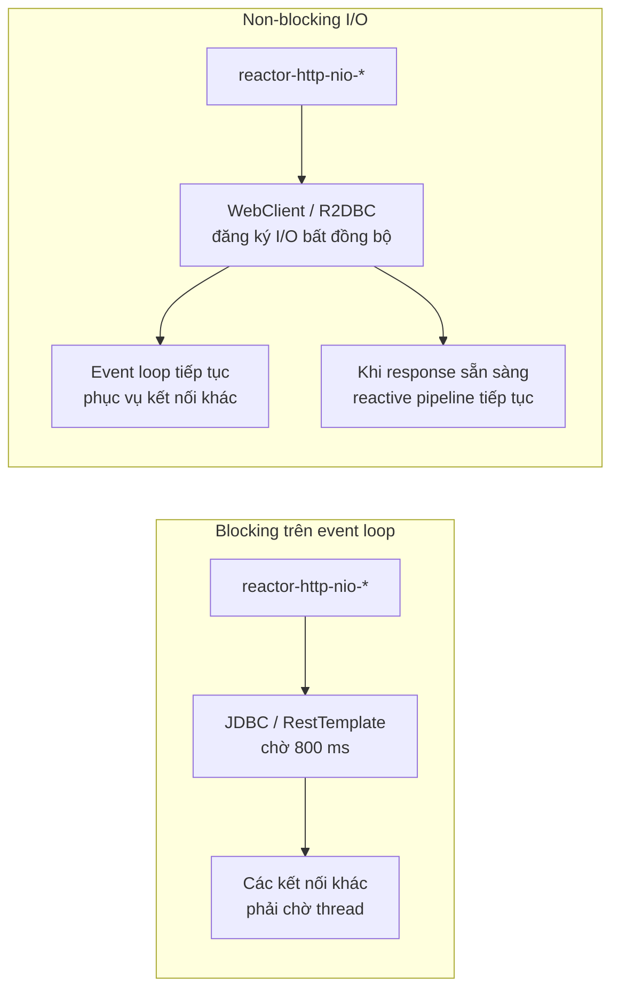
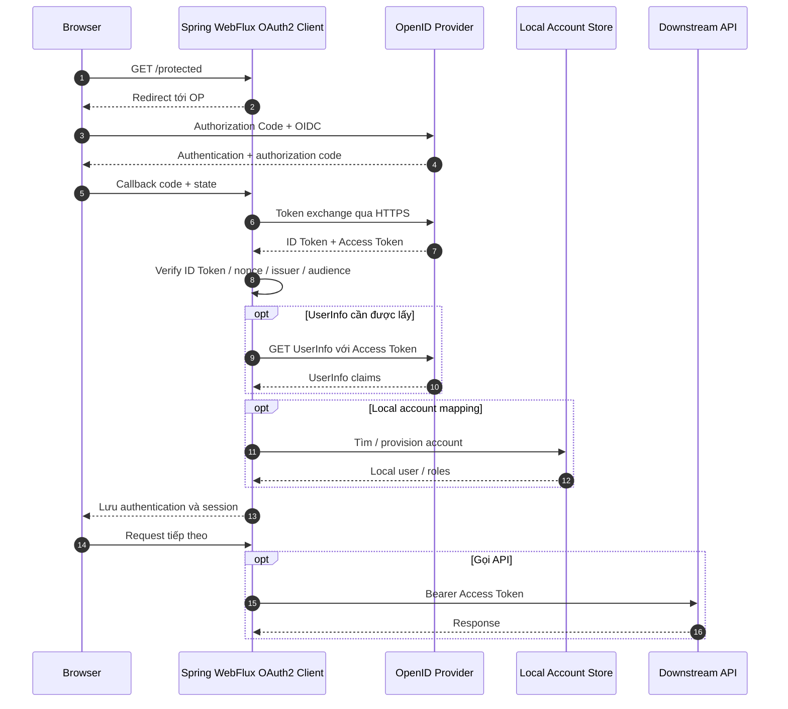

# 20.13. Tránh I/O blocking trong luồng xác thực Reactive

Trong **Spring Security OAuth 2.0/OIDC Client** trên **Spring WebFlux**, một luồng đăng nhập không chỉ có redirect đến OpenID Provider (OP). Ứng dụng còn thực hiện các bước như đổi authorization code lấy token, xác minh ID Token, gọi UserInfo khi cần, ánh xạ người dùng vào hệ thống nội bộ và xây dựng `Authentication` để sử dụng trong request tiếp theo.

Nếu một bước trong chuỗi ấy **chặn (block) thread đang chạy trên Reactor Netty event loop**, toàn bộ ứng dụng có thể chậm bất thường dù lượng request không quá lớn. Một lời gọi JDBC, `RestTemplate`, HTTP client đồng bộ hoặc `Mono.block()` đặt sai chỗ có thể giữ một thread event-loop trong hàng trăm mili giây hay nhiều giây. Trong thời gian đó, thread ấy không phục vụ được những kết nối khác mà nó đang quản lý.

Vì vậy, trong reactive security, **đúng giao thức OAuth2/OIDC vẫn chưa đủ; cách thực thi I/O cũng phải phù hợp mô hình reactive**.

Bài học này giải thích cách phát hiện I/O blocking, phân biệt blocking I/O với thao tác CPU nặng, chọn API non-blocking như `WebClient` và R2DBC, cô lập dependency legacy trên `Schedulers.boundedElastic()` khi không thể thay thế, bảo toàn reactive `SecurityContext` và triển khai OAuth2/OIDC Login mà không biến bước xác thực thành nút thắt hiệu năng.

## 1. Kết quả cần đạt

Sau bài học, người đọc cần phân biệt được:

1. **Event loop** khác thread-per-request của Servlet ở điểm nào.
2. Những hoạt động nào trong **Authorization Code/OIDC Login** có thể thực hiện I/O.
3. Vì sao `block()`, `RestTemplate`, JDBC hoặc HTTP call đồng bộ trong `map`/`flatMap` lại nguy hiểm.
4. Làm sao sử dụng `Mono`/`Flux`, `WebClient` và reactive repositories để giữ luồng non-blocking.
5. Khi nào cần dùng `Mono.fromCallable(...).subscribeOn(Schedulers.boundedElastic())` cho một thao tác blocking không thể loại bỏ.
6. Cách làm việc với `ReactiveSecurityContextHolder` mà không dựa sai vào ThreadLocal.
7. Cách xử lý timeout, cancellation, retry, refresh token và lỗi xác thực theo hướng **fail closed**.
8. Cách phát hiện blocking I/O trong giai đoạn phát triển và theo dõi độ trễ xác thực khi vận hành.

## 2. Reactive có nghĩa gì đối với I/O?

### 2.1. Thread-per-request và event loop

Trong mô hình Servlet truyền thống, một request thường được xử lý trên một worker thread. Khi code gọi database đồng bộ và chờ response, thread đó có thể bị giữ cho tới khi thao tác kết thúc.

Trong WebFlux triển khai trên Reactor Netty, số lượng event-loop threads thường nhỏ hơn nhiều so với số request đang được xử lý đồng thời. Một event-loop thread phục vụ **nhiều kết nối**; mục tiêu là không phải giữ thread chờ I/O.



**Non-blocking không đồng nghĩa I/O không có thời gian chờ.** Mạng vẫn có độ trễ, database vẫn phải thực hiện truy vấn. Khác biệt là trong lúc chờ, thread event-loop không bị khóa chỉ để đợi kết quả.

### 2.2. Một ví dụ dễ hình dung

Giả sử một custom authentication service đọc quyền người dùng từ database và query mất 500 ms.

Nếu nó gọi JDBC đồng bộ trên event loop:

```java
// Anti-pattern trong một reactive operator.
return Mono.just(oidcUser)
    .map(user -> jdbcRepository.findBySubject(user.getSubject()))
    .map(this::buildPrincipal);
```

`map` **không tự tạo thread mới**. Khi lambda chạy trên event loop, `findBySubject(...)` chặn chính event-loop thread cho tới khi database trả kết quả.

Nếu thay bằng một API reactive thật sự:

```java
return reactiveRepository.findBySubject(oidcUser.getSubject())
    .map(this::buildPrincipal);
```

I/O được mô hình hóa bằng publisher và driver non-blocking có thể nhường thread khi chờ response.

### 2.3. Reactor không tự sửa code blocking

Một kiểu dữ liệu `Mono<T>` không đảm bảo bản thân mọi phép tính trong nó là non-blocking.

Ví dụ:

```java
Mono<User> user = Mono.just(blockingRepository.findUser(id));
```

Lời gọi `blockingRepository.findUser(id)` được thực hiện **ngay khi xây Mono**, trước cả subscription. Nếu dòng này chạy trong handler/event loop, thread vẫn bị block.

Ngay cả:

```java
Mono<User> user = Mono.fromCallable(
    () -> blockingRepository.findUser(id));
```

cũng **chưa chắc an toàn**, vì `fromCallable` sẽ chạy trên thread của subscriber nếu không chọn scheduler khác. Cần biết **nơi code blocking thực sự được thực thi**, không chỉ nhìn kiểu trả về.

## 3. Phân biệt blocking I/O, CPU-bound và asynchronous I/O

Ba nhóm thao tác thường bị gom nhầm.

| Loại công việc | Ví dụ | Có chặn event loop không? | Hướng xử lý |
|---|---|---|---|
| **Blocking I/O** | JDBC, `RestTemplate`, `HttpURLConnection`, file read đồng bộ | Có thể chặn thread trong thời gian chờ | Dùng driver/client reactive; nếu bắt buộc thì offload |
| **Non-blocking I/O** | `WebClient`, R2DBC, reactive Redis client | Không giữ event-loop thread chỉ để chờ I/O | Compose publishers; không gọi `block()` |
| **CPU-bound ngắn** | Parse vài claim, kiểm tra null, mapping DTO nhỏ | Không chờ I/O nhưng chiếm CPU một khoảng ngắn | Thường xử lý trực tiếp nếu nhẹ |
| **CPU-bound nặng** | BCrypt/Argon2, crypto đặc biệt, xử lý dữ liệu lớn | Có thể làm event loop không phản hồi đủ nhanh | Đánh giá thread pool/scheduler riêng và giới hạn tải |
| **Asynchronous API giả** | API trả `CompletableFuture` nhưng bên trong tự block trên pool rất nhỏ | Có thể không block event loop, nhưng gây nghẽn pool khác | Kiểm tra implementation và resource limits |

**Blocking I/O** là vấn đề trọng tâm, nhưng không nên coi việc chuyển mọi bước xác minh chữ ký JWT hoặc mapping nhỏ sang `boundedElastic` là tối ưu mặc định. Những thao tác CPU ngắn có thể thực hiện nhanh trên event loop; thao tác CPU nặng cần được đo và cô lập theo chính sách riêng.

## 4. I/O xuất hiện ở đâu trong OAuth 2.0/OIDC Login?

Một luồng đăng nhập OIDC điển hình:



Trong các bước trên:

| Công việc | I/O hay không? | Rủi ro khi tùy biến |
|---|---|---|
| Redirect browser tới OP | Tạo response HTTP | Thường nhẹ, không cần tự gọi OP từ handler |
| Đổi code lấy token | **HTTP network I/O** | Dùng client đồng bộ tại extension point reactive |
| Lấy discovery/JWK metadata | **HTTP network I/O**, có thể cache | Dùng client tự viết làm block hoặc gây request storm |
| Kiểm tra chữ ký/claims ID Token | Chủ yếu **CPU/crypto** | CPU nặng hoặc custom validator gọi DB |
| UserInfo retrieval | **HTTP network I/O** | Dùng `RestTemplate` hoặc `.block()` |
| Ghép user OIDC với tài khoản nội bộ | Thường **database I/O** | Dùng JDBC/JPA repository trong reactive callback |
| Đọc roles/permissions | DB hoặc service network | Query blocking nhiều lần mỗi login |
| Tạo/lưu web session | Có thể I/O tới distributed session store | Backend session implementation blocking |
| Refresh access token | **HTTP network I/O** | Custom refresh code đồng bộ, retry vô hạn |
| Gọi downstream API | **HTTP network I/O** | Dùng `RestClient` đồng bộ trong WebFlux request path |

Khi dùng các thành phần reactive mặc định của Spring Security phù hợp với phiên bản và cấu hình, phần lớn networking trong OAuth2 flow đã có integration reactive. **Nguy cơ thường đến từ custom code**, đặc biệt là service ánh xạ profile, authority mapper, account provisioning, audit, gọi hệ thống cũ hoặc HTTP clients bổ sung.

## 5. Một cấu hình WebFlux OAuth2 Login đúng stack

### 5.1. Dependencies

Ví dụ Gradle Groovy DSL:

```groovy
dependencies {
    implementation 'org.springframework.boot:spring-boot-starter-webflux'
    implementation 'org.springframework.boot:spring-boot-starter-security'
    implementation 'org.springframework.boot:spring-boot-starter-oauth2-client'
}
```

Nếu cần truy cập cơ sở dữ liệu reactive:

```groovy
dependencies {
    implementation 'org.springframework.boot:spring-boot-starter-data-r2dbc'
    runtimeOnly 'org.postgresql:r2dbc-postgresql'
}
```

Phần R2DBC chỉ là lựa chọn minh họa cho PostgreSQL, cần version được quản lý tương thích bởi Spring Boot dependency management.

**Không nhầm `spring-boot-starter-data-jpa` hoặc JDBC driver với R2DBC**: những repository JDBC/JPA truyền thống là blocking I/O dù được gọi từ phương thức trả `Mono`.

### 5.2. application.yml

```yaml
spring:
  security:
    oauth2:
      client:
        registration:
          company:
            provider: company
            client-id: ${OIDC_CLIENT_ID}
            client-secret: ${OIDC_CLIENT_SECRET}
            client-authentication-method: client_secret_basic
            authorization-grant-type: authorization_code
            redirect-uri: "{baseUrl}/login/oauth2/code/{registrationId}"
            scope:
              - openid
              - profile
              - email
        provider:
          company:
            issuer-uri: https://login.example.org
```

Ở WebFlux, Spring dùng `ReactiveClientRegistrationRepository` tương ứng. `issuer-uri` hỗ trợ OIDC discovery; không tự tải issuer/JWKS từ một URL do người dùng tùy ý nhập.

### 5.3. SecurityWebFilterChain

```java
import org.springframework.context.annotation.Bean;
import org.springframework.context.annotation.Configuration;
import org.springframework.security.config.Customizer;
import org.springframework.security.config.annotation.web.reactive.EnableWebFluxSecurity;
import org.springframework.security.config.web.server.ServerHttpSecurity;
import org.springframework.security.web.server.SecurityWebFilterChain;

@Configuration
@EnableWebFluxSecurity
public class ReactiveSecurityConfig {

    @Bean
    SecurityWebFilterChain securityWebFilterChain(ServerHttpSecurity http) {
        return http
            .authorizeExchange(exchanges -> exchanges
                .pathMatchers("/", "/login", "/error", "/css/**").permitAll()
                .anyExchange().authenticated())
            .oauth2Login(Customizer.withDefaults())
            .build();
    }
}
```

`ServerHttpSecurity` và `SecurityWebFilterChain` là API của **Reactive/WebFlux**, khác `HttpSecurity`/`SecurityFilterChain` ở Servlet.

Bản thân `oauth2Login()` không có nghĩa mọi custom business service đã trở thành non-blocking. Khi thêm xử lý database, UserInfo hoặc audit, cần kiểm soát I/O ở từng extension point.

## 6. Anti-pattern số 1: gọi block() bên trong reactive pipeline

### 6.1. Ví dụ sai trong controller sau login

```java
@GetMapping("/me")
public Mono<UserView> me(
        @AuthenticationPrincipal OidcUser principal) {

    UserRecord user = userRepository
        .findByIssuerAndSubject(
            principal.getIdToken().getIssuer().toString(),
            principal.getSubject())
        .block(); // KHÔNG dùng trong reactive request path.

    return Mono.just(new UserView(user.getDisplayName()));
}
```

Giả định `userRepository` trả `Mono<UserRecord>` và `UserView` là DTO của app. Dù database client có vẻ reactive, gọi `block()` ép thread hiện tại **đợi cho đến khi Mono hoàn thành**.

Trong Reactor Netty, `block()` trên event-loop/non-blocking thread có thể gây lỗi runtime như:

```text
IllegalStateException:
block()/blockFirst()/blockLast() are blocking,
which is not supported in thread reactor-http-nio-*
```

hoặc tạo vấn đề hiệu năng trong các ngữ cảnh khác không bị kiểm tra ngay.

### 6.2. Cách đúng: trả Mono và compose

```java
@GetMapping("/me")
public Mono<UserView> me(
        @AuthenticationPrincipal OidcUser principal) {

    return userRepository
        .findByIssuerAndSubject(
            principal.getIdToken().getIssuer().toString(),
            principal.getSubject())
        .map(user -> new UserView(user.getDisplayName()));
}
```

Ở đây controller **không chờ** kết quả bằng cách block. Nó trả publisher cho Spring WebFlux subscribe và viết response khi dữ liệu sẵn sàng.

### 6.3. Những phiên bản sai khác

Không làm:

```java
Mono<UserRecord> userMono = repository.findBySubject(subject);

// Vẫn chặn:
UserRecord user = userMono.toFuture().get();
```

hoặc:

```java
// Thường cũng chặn nếu chạy trên event loop.
UserRecord user = userMono.blockOptional().orElseThrow();
```

Thay vì vậy, dùng `map`, `flatMap`, `zipWhen`, `switchIfEmpty` và các operators khác tùy nhu cầu.

## 7. Anti-pattern số 2: gọi JDBC/JPA trong Mono.map()

Giả sử ứng dụng login OIDC và cần tra quyền người dùng từ một repository JPA.

```java
Mono<OidcUser> process(OidcUser user) {
    return Mono.just(user)
        .map(oidc -> {
            // Blocking I/O chạy trên thread thực thi map().
            return jpaRepository.findBySubject(oidc.getSubject());
        })
        .map(this::createUserView);
}
```

`Mono.just(...)` không tạo thread pool mới. `map(...)` cũng không “tự chuyển sang background thread”. Nếu subscriber đang chạy trên event loop, JDBC/JPA sẽ chặn event-loop thread.

### 7.1. Vì sao không sửa bằng Mono.just(blockingCall())?

Ví dụ:

```java
Mono<UserRecord> load(String subject) {
    // blockingCall chạy ngay lúc phương thức được gọi.
    return Mono.just(jpaRepository.findBySubject(subject));
}
```

Nó chỉ bọc **kết quả đã được tính đồng bộ**. Không hề làm I/O bất đồng bộ.

### 7.2. Khi có thể, chuyển sang R2DBC

Với driver R2DBC thật sự và reactive repository:

```java
public interface LocalAccountRepository
        extends org.springframework.data.repository.reactive
            .ReactiveCrudRepository<LocalAccount, Long> {

    Mono<LocalAccount> findByIssuerAndSubject(
        String issuer,
        String subject
    );
}
```

Đoạn ví dụ giả định entity `LocalAccount` được mapping đúng bởi Spring Data R2DBC và đã import `reactor.core.publisher.Mono`.

Service:

```java
import reactor.core.publisher.Mono;

public final class LocalProfileService {

    private final LocalAccountRepository accounts;

    public LocalProfileService(LocalAccountRepository accounts) {
        this.accounts = accounts;
    }

    public Mono<LocalAccount> findAccount(
            String issuer,
            String subject) {

        return accounts.findByIssuerAndSubject(issuer, subject);
    }
}
```

R2DBC không có nghĩa truy vấn sẽ luôn nhanh, nhưng trong thời gian chờ I/O, pipeline có thể tránh giữ event-loop thread như một JDBC call đồng bộ.

### 7.3. Khi nào chưa thể dùng R2DBC?

Một hệ thống có thể phụ thuộc JPA lazy-loading, stored procedures đặc biệt hoặc thư viện legacy chỉ có synchronous API. Trong trường hợp đó, **không giả vờ rằng dependency là non-blocking**. Cần cô lập đúng thread pool như mục sau và có kế hoạch đánh giá/di chuyển lâu dài.

## 8. Cô lập blocking legacy I/O bằng boundedElastic()

Khi không thể thay JDBC/SDK đồng bộ ngay, Reactor cung cấp một cách **đưa công việc có khả năng block ra khỏi event-loop**:

```java
Mono.fromCallable(() -> blockingCall())
    .subscribeOn(Schedulers.boundedElastic());
```

### 8.1. Mẫu chuẩn cho repository blocking

```java
import reactor.core.publisher.Mono;
import reactor.core.scheduler.Schedulers;

public final class LegacyAccountAdapter {

    private final LegacyJdbcRepository jdbc;

    public LegacyAccountAdapter(LegacyJdbcRepository jdbc) {
        this.jdbc = jdbc;
    }

    public Mono<LocalAccount> loadByExternalIdentity(
            String issuer,
            String subject) {

        return Mono.fromCallable(
                () -> jdbc.findByIssuerAndSubject(issuer, subject))
            .subscribeOn(Schedulers.boundedElastic());
    }
}
```

Ví dụ `LegacyJdbcRepository` là repository đồng bộ do ứng dụng định nghĩa:

```java
public interface LegacyJdbcRepository {
    LocalAccount findByIssuerAndSubject(
        String issuer,
        String subject);
}
```

**Điểm cần nhớ:**

1. `Mono.fromCallable(...)` trì hoãn thực thi operation cho tới subscription.
2. `subscribeOn(Schedulers.boundedElastic())` định hướng nơi source `Callable` được thực thi.
3. Event-loop không bị giữ chỉ vì đợi JDBC call hoàn tất.
4. `boundedElastic` có giới hạn resources, **không làm blocking I/O tự biến thành non-blocking**.
5. Database connection pool và JDBC driver vẫn là các thành phần blocking, cần timeout và sizing riêng.

### 8.2. Vì sao boundedElastic khác parallel?

Reactor có `Schedulers.parallel()` dành cho CPU-bound tasks ngắn. Đừng mặc định dùng `parallel()` cho JDBC/network blocking vì blocking sẽ giữ các threads của CPU pool, làm nghẽn những phép tính khác.

`boundedElastic()` phù hợp hơn để cô lập **blocking I/O**, nhưng nó không phải thread pool vô hạn. Khi lưu lượng vượt khả năng, số jobs chờ có thể tăng và độ trễ vẫn cao. Cần kiểm soát concurrency, size và queue.

### 8.3. Điều không nên làm

```java
// Sai: thao tác blocking đã xảy ra trước khi lập publisher.
LocalAccount account = jdbc.findBySubject(subject);

return Mono.just(account)
    .subscribeOn(Schedulers.boundedElastic());
```

`subscribeOn` không quay ngược thời gian để đưa lệnh JDBC vừa chạy sang thread khác.

Cách đúng:

```java
return Mono.fromCallable(() -> jdbc.findBySubject(subject))
    .subscribeOn(Schedulers.boundedElastic());
```

### 8.4. Đặt ranh giới blocking ở adapter

Không rải `subscribeOn(boundedElastic())` vào mọi controller. Tốt hơn:

```text
OAuth2 Login / Reactive Security
        |
        v
AccountService (Mono<LocalAccount>)
        |
        v
LegacyAccountAdapter
  -> Mono.fromCallable(JDBC)
  -> boundedElastic
        |
        v
Blocking JDBC Library
```

Controller và authentication pipeline chỉ nhìn thấy `Mono`. Adapter nhận trách nhiệm cô lập thao tác đồng bộ, timeout và error mapping theo đặc điểm thư viện.

### 8.5. Đừng cố bọc cả request trong boundedElastic

Ví dụ:

```java
// Không phải cách thiết kế mặc định.
return Mono.fromCallable(() -> {
    // Cả chuỗi phức tạp gồm HTTP, DB, logic có thể bị block.
    return doEverythingSynchronously();
}).subscribeOn(Schedulers.boundedElastic());
```

Cách này có thể hoạt động như bước chuyển tiếp nhưng làm mất nhiều lợi ích của reactive stack, khó theo dõi cancellation và khó quản lý thread pool. Nên cô lập **từng đoạn thực sự blocking**, giữ các thành phần khác reactive.

## 9. subscribeOn và publishOn khác nhau thế nào?

Hai operator dễ nhầm khi xử lý code legacy.

### 9.1. subscribeOn

`subscribeOn` ảnh hưởng đến thread nơi subscription và upstream source được thực thi. Mẫu điển hình:

```java
Mono.fromCallable(() -> legacyDb.load(id))
    .subscribeOn(Schedulers.boundedElastic())
    .map(this::toProfile);
```

Blocking source chạy trên boundedElastic. Những operators tiếp sau có thể tiếp tục chạy trên scheduler đó tùy pipeline và các asynchronous boundaries; không suy ra chúng tự động quay về event-loop.

### 9.2. publishOn

`publishOn` thay đổi scheduler cho **các downstream operators tiếp theo**:

```java
return Mono.just(id)
    .publishOn(Schedulers.boundedElastic())
    .map(legacyDb::load)
    .map(this::toProfile);
```

Mẫu này có thể offload `legacyDb.load` nhưng dễ đặt sai vị trí khi chain dài hoặc được tái cấu trúc. Với **một blocking call rõ ràng**, `Mono.fromCallable(...).subscribeOn(boundedElastic())` thường dễ đọc và tránh thực thi quá sớm.

### 9.3. Không dùng scheduler như quyền truy cập bảo mật

Scheduler chỉ quyết định thực thi code ở đâu, không quyết định user nào được phép truy cập dữ liệu. Khi switch threads, cần hiểu **Reactor Context** và cách SecurityContext được propagate, không copy `Authentication` vào static field hoặc thread-local tự chế.

## 10. Reactive WebClient thay cho RestTemplate trong xác thực

Khi code cần gọi OP UserInfo Endpoint, directory API hoặc một service nội bộ trong login flow, dùng **`WebClient`** thay cho HTTP client đồng bộ khi có thể.

### 10.1. Anti-pattern: RestTemplate bên trong Mono.map()

```java
Mono<UserProfile> loadProfile(String accessToken) {
    return Mono.just(accessToken)
        .map(token -> restTemplate.getForObject(
            "https://userinfo.example.org/profile",
            UserProfile.class
        ));
}
```

`RestTemplate.getForObject(...)` đồng bộ, có thể giữ event-loop thread chờ network. Ngoài ra, ví dụ chưa gửi Bearer token, nên còn không hoàn chỉnh về OAuth.

### 10.2. WebClient non-blocking

```java
import org.springframework.http.HttpHeaders;
import org.springframework.web.reactive.function.client.WebClient;
import reactor.core.publisher.Mono;

public final class ProfileHttpClient {

    private final WebClient webClient;

    public ProfileHttpClient(WebClient.Builder builder) {
        this.webClient = builder
            .baseUrl("https://profiles.example.org")
            .build();
    }

    public Mono<ExternalProfile> load(String accessToken) {
        return webClient.get()
            .uri("/api/me")
            .headers(headers -> headers.setBearerAuth(accessToken))
            .retrieve()
            .bodyToMono(ExternalProfile.class);
    }

    public record ExternalProfile(
        String id,
        String name,
        String email
    ) {}
}
```

Ví dụ:

- `WebClient` trả `Mono<ExternalProfile>` mà không gọi `block()`.
- Access token chỉ được gắn cho API host cố định.
- `setBearerAuth(...)` nhận **token value**, không cần chuỗi `"Bearer "` sẵn.
- DTO chỉ gồm trường cần thiết; response type thật phải khớp hợp đồng provider.
- Cần timeout, retry policy và hạn chế body size theo yêu cầu thực tế.

**Không gửi ID Token thay access token** chỉ vì cả hai đều là JWT. Với OIDC UserInfo, `sub` của UserInfo phải phù hợp ID Token đã xác minh và cần để Spring/extension code kiểm tra đúng theo spec.

### 10.3. Không gọi WebClient.block()

Ví dụ:

```java
// Dù WebClient là reactive, dòng này lại blocking.
ExternalProfile profile = webClient.get()
    .uri("/api/me")
    .retrieve()
    .bodyToMono(ExternalProfile.class)
    .block();
```

Muốn giữ reactive, trả `Mono` và compose:

```java
return webClient.get()
    .uri("/api/me")
    .retrieve()
    .bodyToMono(ExternalProfile.class)
    .map(this::toLocalView);
```

### 10.4. URL UserInfo không được đến từ input tùy ý

Không nhận `userinfoUrl` do browser cung cấp rồi gắn access token vào URL đó. Đây là nguy cơ **credential exfiltration và SSRF**.

OP/UserInfo URL phải đến từ `ClientRegistration`/discovery tin cậy hoặc cấu hình server-side có allowlist. HTTP client cần bảo vệ redirects, TLS verification và outbound host policy.

## 11. Một luồng profile nội bộ non-blocking sau OIDC Login

Giả sử RP đã xác thực OIDC và có `OidcUser`. Ứng dụng cần tra local account theo `iss` và `sub`, rồi trả thông tin cho giao diện.

### 11.1. Tại sao không dùng email làm khóa?

Email có thể thiếu, thay đổi, chưa được xác minh hoặc được cấp lại. Với OIDC, một khóa danh tính external phổ biến là:

```text
(issuer, subject) = (iss, sub)
```

Ví dụ:

```text
(https://login.example.org, user-725)
```

Không dùng display name hoặc `preferred_username` làm khóa tài khoản chỉ vì dễ đọc.

### 11.2. Contract reactive repository

```java
import reactor.core.publisher.Mono;

public interface AccountLookup {
    Mono<LocalAccount> findByIssuerAndSubject(
        String issuer,
        String subject
    );
}

public record LocalAccount(
    String id,
    String displayName,
    String tenantId
) {}
```

Implementation có thể dùng R2DBC hoặc non-blocking service client.

### 11.3. Controller trả Mono, không chặn

```java
import org.springframework.security.core.annotation.AuthenticationPrincipal;
import org.springframework.security.oauth2.core.oidc.user.OidcUser;
import org.springframework.web.bind.annotation.GetMapping;
import org.springframework.web.bind.annotation.RestController;
import org.springframework.security.access.AccessDeniedException;

import reactor.core.publisher.Mono;

@RestController
public class MyProfileController {

    private final AccountLookup accounts;

    public MyProfileController(AccountLookup accounts) {
        this.accounts = accounts;
    }

    @GetMapping("/me")
    public Mono<ProfileView> me(
            @AuthenticationPrincipal OidcUser oidcUser) {

        String issuer =
            oidcUser.getIdToken().getIssuer().toString();
        String subject = oidcUser.getSubject();

        return accounts.findByIssuerAndSubject(issuer, subject)
            .switchIfEmpty(Mono.error(
                new AccessDeniedException(
                    "No local account mapped to this identity")))
            .map(account -> new ProfileView(
                account.id(),
                account.displayName(),
                account.tenantId()
            ));
    }

    public record ProfileView(
        String id,
        String displayName,
        String tenantId
    ) {}
}
```

Lợi ích:

- Lấy `OidcUser` đã được Spring xác minh.
- Không tự parse ID Token từ query/header.
- `AccountLookup` trả publisher non-blocking.
- Nếu local account không tồn tại, **không** âm thầm chọn account khác cùng email.
- Không trả access token, refresh token hay raw ID Token cho browser.
- Dữ liệu tenant xuất ra được kiểm soát qua mapping nội bộ.

### 11.4. Khi cần tạo local account lần đầu

Một flow provisioning reactive có thể là:

```java
public Mono<LocalAccount> findOrProvision(
        String issuer,
        String subject) {

    return accounts.findByIssuerAndSubject(issuer, subject)
        .switchIfEmpty(
            accountProvisioner.createForIdentity(issuer, subject));
}
```

Tuy nhiên, cần phân tích:

- Quyền user có được auto-provision không?
- Ai được tự tạo tenant/account?
- Có unique constraint trên khóa external identity không?
- Nếu hai requests đồng thời cùng provision, có race condition không?
- Dữ liệu user từ OP có được xác minh và cho phép gán role không?

`switchIfEmpty(...)` không thay một unique constraint trong DB. Khi provisioning liên quan quyền/tenant, phải có policy và transaction phù hợp, **không tự cấp ROLE_ADMIN khi người dùng mới đăng nhập**.

## 12. Custom reactive user service: điểm dễ lộ blocking

Spring Security hỗ trợ các extension points để tải OAuth2/OIDC user và biến token/claims thành `OAuth2User` hoặc `OidcUser`. Tên lớp cụ thể và cấu hình DSL có thể khác theo phiên bản, nhưng hợp đồng reactive nhìn chung có dạng:

```java
ReactiveOAuth2UserService<OAuth2UserRequest, OAuth2User>
```

và đối với OIDC:

```java
ReactiveOAuth2UserService<OidcUserRequest, OidcUser>
```

Một implementation reactive trả về **`Mono<...>`**, không được biến quá trình tải user thành lời gọi blocking.

### 12.1. Anti-pattern: tải quyền bằng JDBC ngay trong lambda

```java
// Minh họa lỗi thiết kế, không dùng trong WebFlux event-loop.
Mono<OidcUser> enrich(OidcUser user) {
    return Mono.just(user)
        .map(u -> {
            var roles = jdbcRoleRepository.findRoles(
                u.getIdToken().getIssuer().toString(),
                u.getSubject()
            ); // Blocking JDBC.
            return addAuthorities(u, roles);
        });
}
```

Không phải vì method trả `Mono<OidcUser>` mà JDBC I/O trở thành asynchronous.

### 12.2. Cách đúng với reactive role repository

```java
public Mono<OidcUser> enrich(OidcUser user) {

    String issuer = user.getIdToken().getIssuer().toString();
    String subject = user.getSubject();

    return reactiveRoleRepository.findRoleNames(issuer, subject)
        .collectList()
        .map(roleNames -> addAuthorities(user, roleNames));
}
```

Giả định:

- `reactiveRoleRepository.findRoleNames(...)` trả `Flux<String>` từ một nguồn non-blocking.
- `addAuthorities(...)` chỉ thực hiện mapping CPU nhẹ, không truy vấn DB.
- Roles đến từ nguồn và chính sách ứng dụng tin cậy, không phải arbitrary strings từ unverified claims.
- Khi nâng cấp `OidcUser`, code phải **giữ ID Token/UserInfo và các validations**; không tạo principal mất subject hoặc issuer.

### 12.3. Khi buộc phải dùng JDBC trong custom user service

```java
public Mono<OidcUser> enrichWithLegacyRoles(OidcUser user) {

    String issuer = user.getIdToken().getIssuer().toString();
    String subject = user.getSubject();

    return Mono.fromCallable(() ->
            jdbcRoleRepository.findRoles(issuer, subject))
        .subscribeOn(Schedulers.boundedElastic())
        .map(roleNames -> addAuthorities(user, roleNames));
}
```

Đây là bước chuyển tiếp hợp lý nếu chưa thể loại bỏ JDBC. Cần giới hạn concurrency, timeout và bảo đảm operation không dùng ThreadLocal request security assumptions không được propagate.

### 12.4. Cẩn thận khi tích hợp vào Login DSL

Đừng tự xây một `AuthenticationWebFilter` để bỏ qua xử lý OIDC ID Token chỉ vì muốn bổ sung role. Hãy dùng extension points/user service/authorized client handling mà **phiên bản Spring Security đang dùng hỗ trợ**, giữ phần delegate validate OIDC và thêm các bước enrichment qua reactive composition.

Nếu mục đích chỉ là hiển thị `displayName` hoặc local profile, nhiều ứng dụng có thể đơn giản hơn khi **giữ principal OIDC mặc định** và tải dữ liệu nội bộ ở application service sau login. Không nhất thiết chèn DB I/O vào critical authentication path.

## 13. Không bắt buộc mọi dữ liệu hồ sơ đều được tải trước khi đăng nhập hoàn tất

Một quyết định kiến trúc quan trọng: **điều gì thực sự phải hoàn thành trước khi user được coi là authenticated?**

Ví dụ:

| Dữ liệu | Có cần ngay trong login? | Gợi ý |
|---|---|---|
| ID Token validation, subject/issuer | **Có** | Luôn xác minh đúng OIDC |
| Kiểm tra tài khoản có bị khóa trong hệ thống | Có thể **có**, theo policy | Tra nguồn đáng tin và fail closed khi cần |
| Bằng chứng tenant membership bắt buộc | Có thể **có** | Kiểm tra trước khi cho quyền nhạy cảm |
| Display name | Thường không | Có thể tải lazy trên `/me` |
| Avatar | Thường không | Không làm login phụ thuộc thumbnail service |
| Preferences/theme | Thường không | Tải sau khi vào app |
| Audit event không quyết định login | Tùy yêu cầu | Outbox/queue hoặc pipeline có kiểm soát |
| Quyền thay đổi liên tục | Không nên chỉ cache tại login | Có thể kiểm tra động khi authorization |

Nếu một external profile/avatar service chậm, không nên để mọi user không thể đăng nhập trừ khi nghiệp vụ thực sự đòi hỏi dữ liệu đó. Trái lại, nếu application cần xác minh user không bị khóa, **không bỏ qua kiểm tra này khi DB timeout** chỉ để giữ login nhanh.

### 13.1. Critical authentication path

```text
OIDC protocol validation
   + Account status/tenant checks bắt buộc
   + Authentication creation
= Critical path
```

Còn những dữ liệu như ảnh đại diện, chủ đề giao diện hoặc thông báo có thể được tải trong các bước UI riêng.

Giảm I/O không cần thiết trên critical path thường cải thiện thời gian đăng nhập hơn việc thêm thread pool vào tất cả thao tác.

## 14. Reactive SecurityContext và Reactor Context

Khi code chuyển thread hoặc sử dụng asynchronous boundaries, việc truy cập user hiện tại không nên dựa vào một ThreadLocal tùy ý.

### 14.1. Trong WebFlux dùng ReactiveSecurityContextHolder

```java
import org.springframework.security.core.context.ReactiveSecurityContextHolder;
import reactor.core.publisher.Mono;

public Mono<String> currentPrincipalName() {
    return ReactiveSecurityContextHolder.getContext()
        .map(context -> context.getAuthentication().getName());
}
```

`ReactiveSecurityContextHolder` đọc từ **Reactor Context** liên kết với subscription. Nó khác cách sử dụng `SecurityContextHolder` thông thường trong Servlet.

### 14.2. Anti-pattern với ThreadLocal

```java
// Không nên mặc định dùng cho request WebFlux.
Authentication auth =
    SecurityContextHolder.getContext().getAuthentication();
```

Một reactive pipeline có thể chuyển threads; ThreadLocal không đảm bảo chứa đúng context ở mỗi bước.

Không copy principal vào biến static:

```java
static Authentication currentAuthentication;
```

vì đó là rủi ro trộn identity giữa concurrent requests.

### 14.3. Không tự subscribe bên trong user service

```java
// Anti-pattern: tách tác vụ khỏi login pipeline.
roles.findRoles(subject).subscribe(roles -> updateAuthorities(roles));

return Mono.just(currentUser);
```

Lệnh `subscribe()` có thể chạy ở thời điểm khác, lỗi không được nối lại pipeline, cancellation không còn rõ, và Authentication có thể được trả về **trước** khi roles được cập nhật.

Cách đúng:

```java
return roles.findRoles(subject)
    .map(roleNames -> buildUser(currentUser, roleNames));
```

Giả định `findRoles` trả `Mono<List<String>>`. Nếu trả `Flux<String>`, dùng `collectList()` trước mapping.

### 14.4. Truyền identity tường minh khi vượt trust boundary

Nếu một background job được kích hoạt từ user request rồi chạy sau khi request kết thúc, đừng dựa vào Reactor Context còn tồn tại. Job cần một **identity/context payload đã được xác minh và giảm quyền**, theo chính sách delegation/authorization.

Không lưu `OidcUser` chứa raw tokens vào một hàng đợi chỉ để worker “tiếp tục đăng nhập”.

## 15. Tích hợp blocking SDK ngoài authentication pipeline

Một ứng dụng có thể cần gọi SDK của hệ thống HR, LDAP cũ, file store hoặc audit service chỉ cung cấp synchronous API.

### 15.1. Lớp adapter tách biệt

```java
import reactor.core.publisher.Mono;
import reactor.core.scheduler.Schedulers;

public final class LegacyDirectoryAdapter {

    private final LegacyDirectoryClient client;

    public LegacyDirectoryAdapter(LegacyDirectoryClient client) {
        this.client = client;
    }

    public Mono<DirectoryStatus> lookup(String employeeId) {
        return Mono.fromCallable(() -> client.lookup(employeeId))
            .subscribeOn(Schedulers.boundedElastic());
    }

    public interface LegacyDirectoryClient {
        DirectoryStatus lookup(String employeeId);
    }

    public record DirectoryStatus(
        boolean active,
        String organization
    ) {}
}
```

Sau đó trong service:

```java
return directory.lookup(employeeId)
    .flatMap(status -> {
        if (!status.active()) {
            return Mono.error(
                new AccessDeniedException("Account is disabled"));
        }
        return Mono.just(status);
    });
```

Blocking SDK được cô lập khỏi event loop và kết quả được đưa về pipeline để quyết định authorization.

### 15.2. BoundedElastic không thay timeout của I/O client

Nếu `client.lookup(...)` bị treo vì socket timeout không được cấu hình, một boundedElastic thread vẫn có thể bị giữ rất lâu. Dù gọi:

```java
.timeout(Duration.ofSeconds(3))
```

trên Mono, việc cancellation timeout **không đảm bảo** lập tức ngắt một blocking library call đang chạy nếu client không hỗ trợ interruption/timeout.

Do đó cần:

- HTTP/connect/read timeout ở chính SDK/client.
- Connection pool và executor giới hạn.
- Reactive timeout ở pipeline để giới hạn thời gian đợi của request.
- Cơ chế circuit breaker, bulkhead hoặc load shedding theo nhu cầu.
- Metrics về thread saturation và số tác vụ chờ.

### 15.3. Không tùy tiện tăng boundedElastic vô hạn

Nếu mỗi request login cần 4 blocking calls × 3 giây, có thể tạo áp lực lớn lên pool, DB và hệ thống đích. Tăng thread count vô hạn không giải quyết database connection bottleneck, thậm chí tăng tải và latency.

Ưu tiên **giảm số blocking calls**, batch query hợp lý, cache metadata không nhạy cảm với invalidation policy, và chuyển sang non-blocking API khi khả thi.

## 16. Timeout trong luồng xác thực

Một Authentication flow có thể gặp mạng chậm hoặc OP/DB tạm thời không sẵn sàng.

### 16.1. Dùng timeout có chủ đích

```java
import java.time.Duration;
import reactor.core.publisher.Mono;

public Mono<LocalAccount> resolveAccount(
        String issuer,
        String subject) {

    return accounts.findByIssuerAndSubject(issuer, subject)
        .timeout(Duration.ofSeconds(2));
}
```

Đây là ví dụ. Ngưỡng thực tế phải dựa trên SLO, mạng, database và UX.

**Timeout không đồng nghĩa “cho phép đăng nhập”.** Nếu local account status là điều kiện bắt buộc, hết thời gian truy vấn phải được xử lý theo chính sách từ chối/thử lại, không tạo role mặc định quyền cao.

### 16.2. Phân biệt optional với security-critical

Sai:

```java
return accountService.checkAdminPermission(subject)
    .onErrorReturn(true); // Fail open: rất nguy hiểm.
```

Nếu không thể xác minh quyền quản trị, không được coi user có quyền:

```java
return accountService.checkAdminPermission(subject)
    .onErrorReturn(false);
```

Chọn `onErrorReturn(false)` có thể phù hợp với một **permission check**. Với authentication critical path, đôi khi tốt hơn là propagate lỗi có mã rõ để user biết dịch vụ tạm không sẵn sàng, thay vì giả định account chắc chắn bị vô hiệu hóa.

Với field hiển thị không quan trọng, fallback lại hợp lý:

```java
return avatarService.fetchAvatar(subject)
    .timeout(Duration.ofMillis(500))
    .onErrorReturn("/images/default-avatar.png");
```

Phân biệt dữ liệu **định danh/quyền** với dữ liệu **thẩm mỹ** để chọn fail-open/fail-closed đúng.

### 16.3. Retry không phải mặc định an toàn

`retryWhen(...)` có thể hữu ích cho timeout tạm thời, nhưng không nên retry vô điều kiện:

- `invalid_grant` khi đổi authorization code: code dùng một lần, retry có thể thất bại.
- Refresh token rotation/reuse errors: retry token cũ có thể kích hoạt replay detection.
- HTTP 401/403: thường cần xử lý authentication/authorization, không phải network retry.
- Create/provision user: retry có thể tạo duplicate nếu operation không idempotent.
- Database connection outage: nhiều retries đồng thời có thể tăng tải.

Chỉ retry **lỗi transient đã phân loại**, giới hạn số lần, thêm backoff/jitter phù hợp và đảm bảo operation idempotent hoặc có khóa dữ liệu.

## 17. Kiểm soát concurrency, connection pool và backpressure

Reactive không làm Resource Server/DB có năng lực vô hạn.

### 17.1. Giới hạn số external calls

Nếu 1.000 users đăng nhập đồng thời và mỗi flow gọi 3 microservices, downstream có thể chịu 3.000 requests. Dù WebClient non-blocking, service đích vẫn phải có capacity.

Cần quản lý:

- Connection pool của HTTP client.
- Số active requests và pending acquire.
- Timeout.
- Rate limits.
- Concurrency theo endpoint/provider.
- Circuit breaker cho phụ thuộc không cần thiết.
- Bảo vệ local account provisioning khỏi race condition.

### 17.2. flatMap có thể tạo nhiều I/O đồng thời

Ví dụ:

```java
return Flux.fromIterable(userIds)
    .flatMap(id -> accountService.load(id))
    .collectList();
```

`flatMap` có thể thực thi nhiều asynchronous requests cùng lúc. Khi xử lý batch lớn, có thể giới hạn concurrency:

```java
return Flux.fromIterable(userIds)
    .flatMap(id -> accountService.load(id), 8)
    .collectList();
```

Con số `8` chỉ minh họa. Chọn giới hạn theo công suất DB/AS/API và latency thực tế, không theo một hằng số tùy tiện.

Trong login flow thông thường chỉ cần một user, nhưng các bước enrichment như đọc memberships/permissions từ nhiều services có thể tạo fan-out cần kiểm soát.

### 17.3. Backpressure không phải phép màu cho HTTP login

Reactive Streams hỗ trợ backpressure trong nhiều pipelines, nhưng:

- Browser vẫn có thể mở nhiều kết nối.
- OP/AS có rate limits.
- DB pool vẫn hữu hạn.
- Một blocking SDK vẫn có thể chiếm hết boundedElastic pool.

Do đó cần traffic control, timeouts và tài nguyên phù hợp ngoài việc trả `Mono`.

## 18. Crypto và password hashing: CPU-heavy không hẳn là I/O blocking

Không phải tác vụ gây chậm nào trong xác thực cũng là blocking I/O.

### 18.1. OIDC ID Token signature validation

Xác minh chữ ký JWT và claims chủ yếu sử dụng CPU, nhưng việc lấy JWKS có thể yêu cầu HTTP network I/O (thường có cache).

- Không tự bỏ JWT validation để giảm độ trễ.
- Không dùng decoder đồng bộ tự viết chặn network trên event loop.
- Tận dụng reactive integration và cache keys có kiểm soát.
- Giới hạn issuer/JWK endpoint trong trust policy, chống SSRF.
- Không cho attacker điều khiển `jku`/`x5u` tùy ý dẫn tới tải key từ host lạ.

### 18.2. BCrypt/Argon2

Nếu ứng dụng kết hợp form login với password verification, BCrypt/Argon2 được thiết kế tiêu tốn CPU để chống brute force. Chúng không phải database I/O nhưng có thể chiếm thread trong thời gian đáng kể.

Nếu custom reactive authentication manager trực tiếp gọi blocking/CPU-heavy hash verification trên event-loop, cần đánh giá offloading/worker pool thích hợp.

Tuy nhiên, nếu sử dụng authentication implementation mặc định có cơ chế xử lý riêng, không nên tự bọc lại mọi bước bằng `boundedElastic` mà không hiểu pipeline. Mục tiêu là **không chiếm event-loop quá lâu**, không phải thay đổi ngẫu nhiên validation flow.

### 18.3. CPU nhỏ nên giữ đơn giản

Những thao tác như đọc `sub`, tạo DTO, chọn display name fallback hoặc kiểm tra một tập nhỏ claims không đòi hỏi scheduler riêng. Việc chuyển threads quá nhiều có thể tăng overhead.

## 19. Không tự dùng blocking HTTP client cho Token Endpoint

Trong flow OIDC chuẩn, Spring Security chịu trách nhiệm token exchange. Nếu tự tùy biến để thêm tham số/token response client, cần giữ mô hình reactive.

### 19.1. Anti-pattern

```java
Mono<TokenResponse> exchange(AuthorizationCode code) {
    return Mono.just(
        restTemplate.postForObject(
            tokenUri,
            makeRequest(code),
            TokenResponse.class
        )
    );
}
```

Vấn đề:

- `RestTemplate` là synchronous.
- `Mono.just(...)` gọi `postForObject(...)` **ngay lập tức**.
- Nếu flow chạy trên event loop, thread sẽ bị block.
- Retry code exchange sai có thể vi phạm single-use code requirement.
- Tự viết Token Endpoint exchange có thể bỏ qua client authentication/PKCE checks.

### 19.2. Ưu tiên extension points reactive

Nếu cần custom token parameters hoặc provider behavior, dùng những API reactive token response client mà phiên bản Spring Security hỗ trợ. Giữ nguyên các bước:

1. Authorization code correlation với `state`.
2. PKCE `code_verifier` khi áp dụng.
3. Client authentication theo `ClientRegistration`.
4. Token Endpoint HTTPS và response validation.
5. OIDC ID Token validation.
6. Authorized client persistence.

Không “sửa performance” bằng cách bỏ các kiểm tra an toàn.

## 20. Refresh token và việc gọi API trong reactive application

Khi RP cần gọi downstream API, `ReactiveOAuth2AuthorizedClientManager` điều phối authorized clients/reactive token lifecycle.

Một số loại liên quan:

| Reactive type | Chức năng |
|---|---|
| `ReactiveClientRegistrationRepository` | Cấu hình OAuth registrations |
| `ServerOAuth2AuthorizedClientRepository` | Nạp/lưu authorized client theo web exchange |
| `ReactiveOAuth2AuthorizedClientService` | Nạp/lưu authorized client ngoài web exchange |
| `ReactiveOAuth2AuthorizedClientManager` | Authorize/reauthorize và refresh theo provider |
| `DefaultReactiveOAuth2AuthorizedClientManager` | Manager cho request có `ServerWebExchange` |
| `AuthorizedClientServiceReactiveOAuth2AuthorizedClientManager` | Manager ngoài web request |

Không dùng `DefaultOAuth2AuthorizedClientManager` của Servlet trong handler WebFlux.

### 20.1. WebClient OAuth2 integration

Với WebFlux, Spring Security có `ServerOAuth2AuthorizedClientExchangeFilterFunction` để dùng access token do authorized client manager quản lý.

Mô hình:

```text
WebFlux Controller
    |
    v
Reactive Service
    |
    v
WebClient + OAuth2 Exchange Filter
    |
    v
ReactiveOAuth2AuthorizedClientManager
    |
    +-- Load authorized client
    +-- Refresh token if needed
    |
    v
Authorization: Bearer access_token
    |
    v
Resource Server
```

Không cấu hình một WebClient toàn cục tự gắn user access token vào **mọi URL** được caller gửi. Dùng client theo API origin tin cậy và chọn registration rõ ràng để tránh rò rỉ credential.

### 20.2. Client Credentials trong worker reactive

Một scheduled worker không có `ServerWebExchange` của browser. Nếu dùng Client Credentials Grant, cần service-based reactive manager và principal kỹ thuật thích hợp, không tái sử dụng phiên của một user bất kỳ.

Không tự tạo `OidcUser` giả từ client ID. Client credentials token đại diện cho workload/client, không phải một End-User đã đăng nhập.

## 21. Reactive SecurityContext khi dùng boundedElastic

### 21.1. Reactor Context thường được propagate qua operators

Trong một pipeline được compose đúng cách, Reactor Context được chuyển theo subscription dù thread thực thi có thể thay đổi.

Ví dụ:

```java
return ReactiveSecurityContextHolder.getContext()
    .map(ctx -> ctx.getAuthentication().getName())
    .flatMap(name ->
        legacyDirectoryAdapter.lookup(name));
```

Bản thân adapter dùng `boundedElastic` cho blocking call. Ở đây principal name được đọc từ reactive security context **trước khi** gọi adapter.

### 21.2. Legacy SDK dựa trên ThreadLocal

Một số SDK cũ đọc user ID từ `ThreadLocal` hoặc `SecurityContextHolder` của Servlet. Chúng có thể nhận `null` hoặc dữ liệu sai nếu gọi trong reactive environment.

Giải pháp an toàn hơn:

- Truyền **identity hoặc correlation context tường minh** vào adapter.
- Không yêu cầu SDK tự đọc Authentication từ thread-local.
- Với logging MDC, dùng context propagation mechanism phù hợp và kiểm soát dữ liệu nhạy cảm.
- Không dùng static variables làm current user.
- Không cache `Authentication` trong singleton service để dùng cho request sau.

### 21.3. Không tự subscribe() trong service

Sai:

```java
public Mono<UserView> me(String subject) {
    accounts.findBySubject(subject)
        .subscribe(user -> auditSomething(user));

    return Mono.just(new UserView("done"));
}
```

Tác vụ audit chạy tách khỏi pipeline và error handling/context không còn rõ. Nếu audit là điều kiện nghiệp vụ phải hoàn thành, compose:

```java
return accounts.findBySubject(subject)
    .flatMap(user ->
        auditService.writeEvent(user)
            .thenReturn(new UserView(user.displayName())));
```

Nếu audit là sự kiện phụ không cần hoàn tất đồng bộ với request, dùng event/outbox/queue có chính sách riêng, không fire-and-forget tự phát trong authentication pipeline.

## 22. BlockHound và cách nhận diện blocking call

**BlockHound** là công cụ có thể phát hiện một số thao tác blocking xảy ra trên threads được đánh dấu non-blocking trong môi trường Reactor.

### 22.1. Dùng trong môi trường phát triển/kiểm thử

Một ví dụ ý tưởng:

```java
import reactor.blockhound.BlockHound;

public class ReactiveTestBootstrap {
    public static void installBlockHound() {
        BlockHound.install();
    }
}
```

BlockHound có yêu cầu tương thích Java/JVM instrumentation và phiên bản thư viện; trên một số JDK có thể cần JVM flags hoặc cấu hình bổ sung. **Không bật tùy tiện trong production** trước khi đánh giá performance/compatibility.

Khi phát hiện một blocking operation trên non-blocking thread, công cụ có thể ném lỗi tương tự:

```text
reactor.blockhound.BlockingOperationError:
  Blocking call! java.lang.Thread.sleep
```

Ví dụ này cho thấy nguyên lý phát hiện; không phải mọi blocking SDK call sẽ được công cụ nhận diện trong mọi môi trường.

### 22.2. Dấu hiệu từ logs và thread names

Những threads như:

```text
reactor-http-nio-1
reactor-http-nio-2
```

thường liên quan Netty event loop. Nếu stack trace trên thread ấy cho thấy:

```text
java.net.SocketInputStream.read
java.sql.PreparedStatement.executeQuery
org.springframework.web.client.RestTemplate.exchange
Thread.sleep
Mono.block
```

thì cần xem xét có blocking call trong reactive request path hay không. Đừng dựa duy nhất vào thread name để kết luận; đọc stack trace và vị trí source thực tế.

### 22.3. BlockHound không thay load testing

BlockHound hữu ích để tìm những lời gọi blocking cụ thể; nó không chứng minh latency/throughput production đã đạt yêu cầu. Cần thêm performance testing và quan sát:

- P50/P95/P99 login latency.
- Event loop utilization.
- Reactive HTTP client connection pool saturation.
- DB pool wait time.
- BoundedElastic queued tasks và active threads.
- Token Endpoint latency/error rate.
- UserInfo/identity service latency.
- Số login failures do timeout.
- CPU/GC pressure.

## 23. Một phương án kiểm soát login latency theo từng bước

Có thể chia luồng OIDC login thành các nhóm latency:

```text
Browser authorization redirect / OP interactive login
  -> không nằm hoàn toàn trong thời gian server processing

Callback vào RP
  -> state verification
  -> token exchange HTTP
  -> ID Token validation
  -> optional UserInfo HTTP
  -> local identity/role lookup
  -> Authentication/session persistence
  -> redirect response
```

Nếu callback chậm, hãy xác định **bước nào mất thời gian**, không tăng Netty event-loop threads theo phản xạ.

Ví dụ:

| Bước | Triệu chứng | Hướng xử lý |
|---|---|---|
| Token exchange | Chậm theo network/OP | Timeout/TLS/connection pool; không tự retry code |
| JWKS retrieval | Chậm khi cache miss | Cache key/discovery hợp lý, trusted issuer |
| UserInfo | Thường xuyên chậm | Chỉ lấy claims cần, non-blocking HTTP, timeout |
| Local account lookup | Chậm hoặc block | R2DBC; nếu legacy JDBC thì boundedElastic |
| Groups/roles enrichment | Nhiều calls fan-out | Batch, giới hạn concurrency, phân biệt critical/optional |
| Session store | Chậm ở Redis/DB | Reactive driver, persistence performance |
| Login success audit | Không cần nhưng chặn | Queue/outbox hoặc non-blocking audit với policy |
| Crypto | CPU cao | Đo chi phí và chọn worker scheduling phù hợp |

### 23.1. Tối ưu đúng thứ tự

1. Loại bỏ I/O không cần thiết trong critical path.
2. Thay blocking clients bằng non-blocking drivers.
3. Offload rõ ràng phần legacy blocking còn lại.
4. Thêm timeout/circuit breaker và giới hạn concurrency.
5. Đo performance; chỉ sau đó xem xét thread pool/connection pool sizing.

Tăng số event-loop threads không khắc phục bản chất của một blocking call lâu. Nó có thể chỉ làm lỗi khó nhìn thấy hơn và tăng chi phí tài nguyên.

## 24. Phân biệt timeout, cancellation và interruption

Reactive timeout có thể **hủy subscription** khi hết thời gian chờ, nhưng hành vi hủy I/O phụ thuộc upstream/client.

Với `WebClient` và driver non-blocking, cancellation thường có khả năng giải phóng tài nguyên network theo cơ chế thư viện.

Với JDBC cũ được bọc bằng `fromCallable`, thread chạy query có thể vẫn đang chờ socket dù subscription bị hủy. Không mặc định `timeout(Duration.ofSeconds(2))` sẽ lập tức dừng một JDBC query đã gửi.

Do đó:

- Cấu hình connect/read/query timeout ở driver.
- Có deadline/timeout reactive ở request path.
- Giới hạn số concurrent blocking calls.
- Chú ý interruptibility của SDK.
- Đảm bảo cleanup tài nguyên trong `try/finally` hoặc APIs an toàn.
- Không spawn thread thủ công mà không quản lý lifecycle.

## 25. Một giải pháp đầy đủ cho legacy account lookup

Ví dụ yêu cầu:

- User đã đăng nhập OIDC, có issuer và subject hợp lệ.
- Ứng dụng còn dùng legacy JDBC để tra local account.
- Không muốn block event loop.
- Nếu account không tồn tại hoặc lookup lỗi thì **không được cấp quyền**.

### 25.1. Repository legacy

```java
public interface LegacyAccountRepository {
    LocalAccount findByExternalIdentity(
        String issuer, String subject);
}

public record LocalAccount(
    long localId,
    String displayName,
    boolean active
) {}
```

### 25.2. Adapter cô lập blocking I/O

```java
import java.time.Duration;
import reactor.core.publisher.Mono;
import reactor.core.scheduler.Schedulers;

public final class ReactiveAccountAdapter {

    private final LegacyAccountRepository legacyRepository;

    public ReactiveAccountAdapter(
            LegacyAccountRepository legacyRepository) {
        this.legacyRepository = legacyRepository;
    }

    public Mono<LocalAccount> findByExternalIdentity(
            String issuer,
            String subject) {

        return Mono.fromCallable(() ->
                legacyRepository.findByExternalIdentity(
                    issuer, subject))
            .subscribeOn(Schedulers.boundedElastic())
            .timeout(Duration.ofSeconds(3));
    }
}
```

Nếu repository trả `null`, `Mono.fromCallable` hoàn thành rỗng, không phát một `null` value. Application service phải xử lý empty result.

### 25.3. Service áp dụng policy

```java
import org.springframework.security.access.AccessDeniedException;
import reactor.core.publisher.Mono;

public final class LocalIdentityService {

    private final ReactiveAccountAdapter accounts;

    public LocalIdentityService(ReactiveAccountAdapter accounts) {
        this.accounts = accounts;
    }

    public Mono<LocalAccount> requireActiveAccount(
            String issuer,
            String subject) {

        return accounts.findByExternalIdentity(issuer, subject)
            .switchIfEmpty(Mono.error(
                new AccessDeniedException(
                    "Local identity not provisioned")))
            .flatMap(account -> {
                if (!account.active()) {
                    return Mono.error(new AccessDeniedException(
                        "Local account is disabled"));
                }
                return Mono.just(account);
            });
    }
}
```

**Điểm an toàn:** một OIDC ID Token hợp lệ là bằng chứng đăng nhập từ OP, nhưng nếu business policy yêu cầu user có local account còn hoạt động, code không tự cấp quyền khi account lookup thất bại.

### 25.4. Controller sử dụng service reactive

```java
import org.springframework.security.core.annotation.AuthenticationPrincipal;
import org.springframework.security.oauth2.core.oidc.user.OidcUser;
import org.springframework.web.bind.annotation.GetMapping;
import org.springframework.web.bind.annotation.RestController;
import reactor.core.publisher.Mono;

@RestController
public class HomeController {

    private final LocalIdentityService identities;

    public HomeController(LocalIdentityService identities) {
        this.identities = identities;
    }

    @GetMapping("/home")
    public Mono<HomeView> home(
            @AuthenticationPrincipal OidcUser user) {

        String issuer = user.getIdToken().getIssuer().toString();
        String subject = user.getSubject();

        return identities.requireActiveAccount(issuer, subject)
            .map(account -> new HomeView(
                account.localId(),
                account.displayName()
            ));
    }

    public record HomeView(long userId, String displayName) {}
}
```

Đây là ví dụ sau login, không tự thay OIDC authentication filters. Một ứng dụng thật có thể muốn kiểm tra local account **trong quá trình tạo Authentication** nếu policy bắt buộc ngay lúc login; khi đó tích hợp service này vào extension point reactive được hỗ trợ, thay vì dựa vào controller `/home`.

## 26. Anti-pattern cần tránh

### 26.1. Mono.just của lời gọi I/O đồng bộ

```java
Mono.just(jdbcRepository.findById(id));
```

Blocking call đã chạy ngay.

### 26.2. block() sau WebClient

```java
webClient.get()
    .retrieve()
    .bodyToMono(UserInfo.class)
    .block();
```

WebClient non-blocking bị biến thành chờ đồng bộ.

### 26.3. subscribe() thủ công để cập nhật Authentication

```java
roleService.loadRoles(userId)
    .subscribe(roles -> mutateCurrentPrincipal(roles));
```

Có race condition, mất error propagation và context.

### 26.4. Dùng parallel() cho JDBC

```java
Mono.fromCallable(() -> jdbc.query())
    .subscribeOn(Schedulers.parallel());
```

`parallel()` thiên về CPU tasks; blocking JDBC nên dùng pool phù hợp như `boundedElastic` và kiểm soát tải.

### 26.5. Offload sau khi đã block

```java
var result = restTemplate.getForObject(url, Foo.class);
return Mono.just(result).subscribeOn(Schedulers.boundedElastic());
```

Thread hiện tại đã bị block trước khi Mono được tạo.

### 26.6. Cho phép khi không gọi được database quyền

```java
permissionService.canAdmin(user)
    .onErrorReturn(true);
```

Fail-open có thể tạo lỗ hổng authorization.

### 26.7. Retry OAuth authorization code không giới hạn

Authorization code dùng một lần. Khi Token Endpoint trả `invalid_grant`, retry cùng code có thể không hợp lệ.

### 26.8. Coi boundedElastic là vô hạn

Nếu hàng nghìn JDBC calls dài được offload, pool và DB vẫn có giới hạn. Cần bulkhead, concurrency limit và timeouts.

### 26.9. Dựa vào ThreadLocal để lấy current user

Trong WebFlux, dùng reactive context hoặc truyền identity tường minh; không dựa vào `SecurityContextHolder` servlet-style xuyên mọi thread switches.

### 26.10. Tự tải UserInfo từ URL do request cung cấp

Không gửi access token đến endpoint tùy ý, kể cả khi dùng non-blocking WebClient. Tốc độ không thay thế trust boundary.

### 26.11. Tắt OIDC validation để giảm latency

Không bỏ chữ ký, issuer, audience, nonce, state hoặc PKCE chỉ vì authentication chậm. Tối ưu I/O đúng tầng.

### 26.12. Làm login phụ thuộc avatar/preference service

Nếu những dữ liệu này không phải điều kiện xác thực, tải sau login hoặc có fallback an toàn, không chặn critical path.

## 27. Checklist khi tích hợp Reactive OAuth2/OIDC Login

Trước khi đưa một extension authentication vào WebFlux, xác định:

1. **Đúng web stack chưa?** `SecurityWebFilterChain` và `ServerHttpSecurity` thay cho Servlet DSL.
2. **Luồng login đang dùng integration reactive của Spring chưa?** Không tự gọi HTTP/token exchange đồng bộ.
3. **Có `block()`, `blockOptional()`, `toFuture().get()` hoặc `Thread.sleep()` trong request path không?**
4. **Có JDBC/JPA/RestTemplate/legacy SDK trong lambda `map`/`flatMap` không?**
5. **Có thật sự dùng non-blocking driver không?** Một phương thức trả `Mono` có thể bọc thao tác blocking.
6. **Các blocking dependency bắt buộc đã offload đúng bằng boundedElastic chưa?**
7. **Các calls đã có client-level timeout và reactive deadline chưa?**
8. **Có giới hạn concurrency và connection pool phù hợp không?**
9. **Có tự `subscribe()`/fire-and-forget rồi làm mất error propagation không?**
10. **Có lấy identity bằng Reactor Context hoặc truyền tường minh không?**
11. **Login policy có fail closed khi không thể xác minh account status/role không?**
12. **Có phân biệt profile tùy chọn với security-critical data không?**
13. **Có retry nhầm `invalid_grant`, user provisioning hoặc tác vụ không idempotent không?**
14. **Có bảo toàn OIDC issuer/audience/signature/nonce/state validation không?**
15. **Có dùng đúng access token và resource origin khi gọi UserInfo/downstream API không?**
16. **Có quan sát event-loop, boundedElastic, DB pool và P95/P99 login latency không?**
17. **Có xem xét session store/Redis/HTTP clients đang thực sự non-blocking không?**
18. **Các kiểm thử phát hiện blocking và performance có phù hợp với runtime/JDK không?**

**Ghi nhớ:** Trong **Reactive OAuth2/OIDC Login**, mục tiêu không phải là “mọi thứ phải trả về `Mono`”, mà là **không để I/O đồng bộ giữ event-loop thread**. Ưu tiên `WebClient`, R2DBC và các abstraction reactive của Spring Security; khi buộc phải dùng JDBC/SDK đồng bộ, cô lập thao tác bằng `Mono.fromCallable(...).subscribeOn(Schedulers.boundedElastic())` cùng timeout và giới hạn tài nguyên. Giữ security context trong Reactor Context, compose publishers thay vì `block()` hoặc `subscribe()` tùy tiện, và không đánh đổi kiểm tra OIDC hay quyền truy cập để lấy tốc độ.

## 28. Tài liệu tham khảo

- [Spring Security — Reactive OAuth 2.0 Login](https://docs.spring.io/spring-security/reference/reactive/oauth2/login/index.html): cấu hình OIDC/OAuth2 Login trên WebFlux và extension points.
- [Spring Security — Reactive OAuth 2.0 Client](https://docs.spring.io/spring-security/reference/reactive/oauth2/client/index.html): reactive authorized clients và WebClient integrations.
- [Spring Security — WebFlux Security](https://docs.spring.io/spring-security/reference/reactive/configuration/webflux.html): `SecurityWebFilterChain`, `ServerHttpSecurity` và reactive web filters.
- [Spring Security — Reactive Authentication](https://docs.spring.io/spring-security/reference/reactive/authentication/index.html): reactive authentication và security context.
- [Spring Framework — WebFlux](https://docs.spring.io/spring-framework/reference/web/webflux.html): event-loop processing và non-blocking I/O.
- [Spring Framework — WebClient](https://docs.spring.io/spring-framework/reference/web/webflux-webclient.html): asynchronous HTTP client, request/response và operators.
- [Project Reactor Reference Guide](https://projectreactor.io/docs/core/release/reference/): `Mono`, `Flux`, schedulers, context và backpressure.
- [Project Reactor — FAQ: Wrapping a Synchronous, Blocking Call](https://projectreactor.io/docs/core/release/reference/faq.html#faq.wrap-blocking): `fromCallable` và `boundedElastic`.
- [R2DBC Specification](https://r2dbc.io/spec/1.0.0.RELEASE/spec/html/): reactive database connectivity và non-blocking database interactions.
- [BlockHound](https://github.com/reactor/BlockHound): phát hiện blocking calls trên non-blocking threads.
- [OpenID Connect Core 1.0](https://openid.net/specs/openid-connect-core-1_0.html): ID Token, nonce, UserInfo và OIDC validation.
- [RFC 6749 — OAuth 2.0 Authorization Framework](https://www.rfc-editor.org/rfc/rfc6749): Authorization Code Flow và token exchange.
- [RFC 7636 — Proof Key for Code Exchange](https://www.rfc-editor.org/rfc/rfc7636): PKCE.
- [RFC 9700 — Best Current Practice for OAuth 2.0 Security](https://www.rfc-editor.org/rfc/rfc9700): bảo vệ OAuth client/tokens và các nguyên tắc bảo mật.
