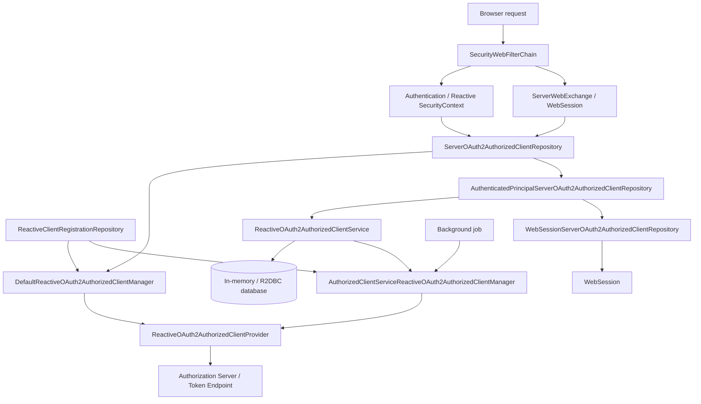
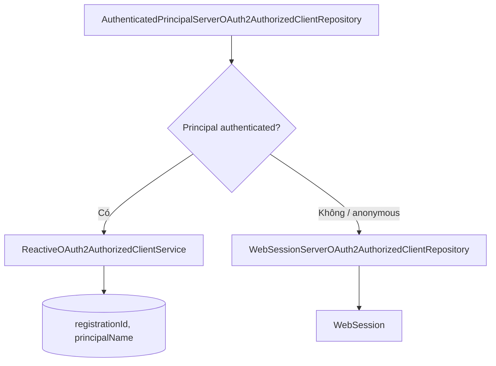
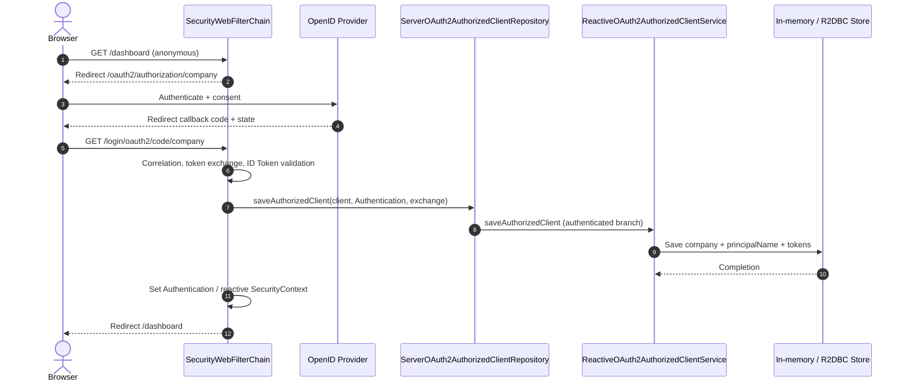
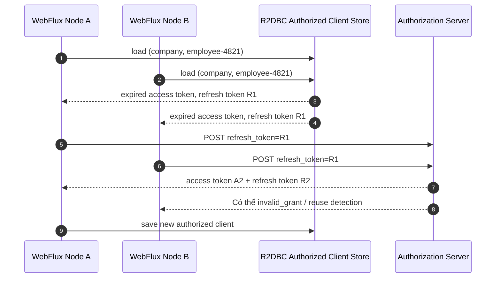

# 21.4. ReactiveOAuth2AuthorizedClientService và ServerOAuth2AuthorizedClientRepository

## 1. Bối cảnh: đăng nhập OIDC trên WebFlux, token được lưu ở đâu?

Giả sử **Employee Portal** sử dụng **Spring Boot WebFlux** và **Spring Security OAuth 2.0 / OIDC Client**:

- Người dùng vào `/dashboard` rồi đăng nhập bằng OIDC qua đăng ký `company`.
- Backend nhận **access token** và có thể nhận **refresh token** để gọi Employee API.
- Một request khác cần dùng lại token đã được cấp mà không bắt người dùng đăng nhập từ đầu.
- Ngoài ra, một tác vụ nền gọi Reports API bằng `client_credentials`, không có browser session.

Trong Servlet/MVC có `OAuth2AuthorizedClientService` và `OAuth2AuthorizedClientRepository`. Với **Reactive WebFlux**, Spring Security cung cấp hai contract tương ứng, có tên dễ nhầm:

1. **`ReactiveOAuth2AuthorizedClientService`** — quản lý trạng thái **`OAuth2AuthorizedClient` ở cấp ứng dụng**, tra cứu bằng **registration ID + principal name** mà không cần HTTP request.
2. **`ServerOAuth2AuthorizedClientRepository`** — đọc/ghi/xóa authorized client **trong ngữ cảnh request WebFlux**, nhận **`Authentication` + `ServerWebExchange`**.

Cả hai đều có thể liên quan đến cùng một access token, nhưng **không phải hai interface có thể thay thế trực tiếp cho nhau**.

> **Mấu chốt:** `ReactiveOAuth2AuthorizedClientService` trả lời “client registration này đã có token nào cho principal này trong kho ứng dụng?”, còn `ServerOAuth2AuthorizedClientRepository` trả lời “authorized client nào gắn với request, principal và WebFlux exchange hiện tại?”. Một repository có thể **ủy quyền việc lưu dữ liệu cho service**, nhưng bản thân repository không nhất thiết là database.

Bài thuộc chương **21. OAuth2 Client Reactive**, tập trung vào cấu trúc, lifecycle, implementation, cấu hình WebFlux và các lỗi thường gặp khi lưu và sử dụng token.

### Mục tiêu học tập

Sau bài, bạn có thể:

1. Phân biệt `ClientRegistration`, `OAuth2AuthorizedClient`, `Authentication`, `WebSession` và hai abstraction về authorized-client persistence.
2. Hiểu chữ ký phương thức `Mono<T>` và ý nghĩa không có authorized client.
3. Biết khi nào dùng `InMemoryReactiveOAuth2AuthorizedClientService`, `R2dbcReactiveOAuth2AuthorizedClientService` và `WebSessionServerOAuth2AuthorizedClientRepository`.
4. Tạo `AuthenticatedPrincipalServerOAuth2AuthorizedClientRepository` từ reactive service và hiểu cơ chế authenticated/anonymous.
5. Kết nối với `ServerHttpSecurity.oauth2Login()`, `oauth2Client()` và `ReactiveOAuth2AuthorizedClientManager`.
6. Tách **request-bound user authorization** khỏi **service-tier Client Credentials**.
7. Tránh các lỗi `block()` trong event loop, sai principal key, token leak, refresh race và cấu hình session không nhất quán.
8. Thiết kế persistence token an toàn trong môi trường nhiều instance.

Các ví dụ bên dưới tập trung vào **Spring Boot 3.x, Spring Security 6.x, Java 17+ và WebFlux**. Cần dùng các phiên bản dependency tương thích theo BOM. Một số API còn hiện diện trong tài liệu Spring Security 7.x, nhưng ví dụ **không yêu cầu nâng cấp sang 7.x**.

## 2. `OAuth2AuthorizedClient` đại diện cho điều gì?

Một `OAuth2AuthorizedClient` lưu thông tin về **một client registration đã được cấp token trong một ngữ cảnh principal**:

```text
OAuth2AuthorizedClient
├── ClientRegistration
│   ├── registrationId
│   ├── clientId
│   ├── authorizationGrantType
│   └── providerDetails (tokenUri, issuer, ...)
├── principalName
├── OAuth2AccessToken
│   ├── tokenType
│   ├── tokenValue  [BÍ MẬT]
│   ├── issuedAt
│   ├── expiresAt
│   └── scopes
└── OAuth2RefreshToken (có thể không có)
    └── tokenValue  [BÍ MẬT]
```

Ví dụ về các authorized clients:

| `clientRegistrationId` | `principalName` | Ngữ cảnh |
| --- | --- | --- |
| `company` | `employee-4821` | Token được cấp cho user sau OIDC Login |
| `company` | `employee-9274` | Token user khác, cùng registration |
| `partner` | `partner-user-31` | Token từ một đăng ký/provider khác |
| `reports-api` | `reports-batch` | Token của workload dùng Client Credentials |

**Registration ID không phải client ID do Authorization Server cấp.** Nó là khóa nội bộ Spring để tra cứu cấu hình `ClientRegistration`.

**Principal name không bắt buộc là email**, cũng không có nghĩa `principal("reports-batch")` tự tạo một user đã đăng nhập. Trong nền tảng đa issuer/tenant, phải đảm bảo namespace định danh không bị trùng.

### 2.1. Những gì không thuộc authorized-client store

| Dữ liệu | Thành phần chủ quản |
| --- | --- |
| Cấu hình client ID/secret, token URI, scope mặc định | `ReactiveClientRegistrationRepository` và secret/config store |
| Trạng thái người dùng đang đăng nhập | `Authentication` / `SecurityContext` |
| HTTP session của browser | `WebSession` và session store |
| Request tạm chứa OAuth `state`/PKCE/nonce | `ServerAuthorizationRequestRepository<OAuth2AuthorizationRequest>` |
| Access/refresh token của authorized client | `ReactiveOAuth2AuthorizedClientService` hoặc `ServerOAuth2AuthorizedClientRepository` |
| Token mà API cần xác minh ở request inbound | Resource Server authentication/authorization |
| Hồ sơ nghiệp vụ, vai trò nội bộ | Application user/profile/authorization data |

Không lấy sự tồn tại của một authorized-client row làm bằng chứng rằng **request hiện tại đến từ principal đó**. Chỉ có session/authentication được xác thực và chính sách quyền phù hợp mới xác định user hiện tại có quyền hành động.

## 3. Hai lớp persistence đứng ở đâu trong kiến trúc Reactive?

### 3.1. Sơ đồ tổng thể



Đây là sơ đồ trách nhiệm, không phải trace thứ tự method cụ thể. Một `DefaultReactiveOAuth2AuthorizedClientManager` phục vụ flow có `ServerWebExchange`; `AuthorizedClientServiceReactiveOAuth2AuthorizedClientManager` dùng service trực tiếp ở service tier.

### 3.2. Bảng so sánh quan trọng nhất

| Tiêu chí | `ReactiveOAuth2AuthorizedClientService` | `ServerOAuth2AuthorizedClientRepository` |
| --- | --- | --- |
| Lớp abstraction | Application-level authorized-client persistence | WebFlux request-level authorized-client persistence |
| Phụ thuộc `ServerWebExchange`? | **Không** | **Có** |
| Cần `Authentication` khi save? | Có | Có |
| Load theo | `registrationId` + `principalName` | `registrationId` + `Authentication` + `ServerWebExchange` |
| Trả về | `Mono<OAuth2AuthorizedClient>` hoặc `Mono.empty()` | `Mono<OAuth2AuthorizedClient>` hoặc `Mono.empty()` |
| Save/remove trả về | `Mono<Void>` | `Mono<Void>` |
| Implementation | `InMemoryReactiveOAuth2AuthorizedClientService`, `R2dbcReactiveOAuth2AuthorizedClientService` | `AuthenticatedPrincipalServerOAuth2AuthorizedClientRepository`, `WebSessionServerOAuth2AuthorizedClientRepository` |
| Manager thông dụng | `AuthorizedClientServiceReactiveOAuth2AuthorizedClientManager` | `DefaultReactiveOAuth2AuthorizedClientManager` |
| Hoàn cảnh | Service tier, background, token store ứng dụng | WebFlux login/client requests |
| Vùng lưu thực tế | Map trong JVM hoặc R2DBC DB | Có thể WebSession **hoặc** ủy quyền cho service |
| Tương đương Servlet | `OAuth2AuthorizedClientService` | `OAuth2AuthorizedClientRepository` |

Điểm dễ nhầm: tên **`ServerOAuth2AuthorizedClientRepository`** có chữ *Server* chỉ stack WebFlux `ServerWebExchange`, **không có nghĩa tự động lưu vào Redis/database của máy chủ**.

## 4. `ReactiveOAuth2AuthorizedClientService` — contract và ý nghĩa

### 4.1. Ba thao tác chính

Interface có ba thao tác chính; dưới đây là chữ ký đơn giản hóa theo contract Spring Security:

```java
public interface ReactiveOAuth2AuthorizedClientService {

    <T extends OAuth2AuthorizedClient> Mono<T> loadAuthorizedClient(
            String clientRegistrationId, String principalName);

    Mono<Void> saveAuthorizedClient(
            OAuth2AuthorizedClient authorizedClient,
            Authentication principal);

    Mono<Void> removeAuthorizedClient(
            String clientRegistrationId, String principalName);
}
```

Các type `OAuth2AuthorizedClient`, `Authentication` và `Mono` lần lượt đến từ Spring Security OAuth2 Client, Spring Security Core và Reactor.

**Load** dùng hai khóa dạng String, không phụ thuộc HTTP request. **Save** nhận Authentication để xác định `principal.getName()`. **Remove** cần chính xác cùng cặp khóa dùng khi lưu.

### 4.2. `Mono.empty()` có nghĩa gì?

Trong Reactor, kết quả không có bản ghi là một Publisher **hoàn thành mà không phát giá trị**. Vì thế:

```java
Mono<OAuth2AuthorizedClient> lookup =
        authorizedClientService.loadAuthorizedClient(
                "company", "employee-4821");
```

Nếu chưa có authorized client, lookup thường hoàn thành rỗng. **Không phải method trực tiếp trả Java `null`** cho caller reactive thông thường; không gọi `lookup.getAccessToken()` vì lookup là `Mono`.

Có thể diễn đạt:

```java
return authorizedClientService
        .loadAuthorizedClient("company", principalName)
        .map(client -> client.getAccessToken().getExpiresAt().toString())
        .defaultIfEmpty("NO_AUTHORIZED_CLIENT");
```

Trong ví dụ, `defaultIfEmpty` chỉ cung cấp metadata/giá trị fallback. **Không nên tự tạo access token giả khi không thấy authorized client**, cũng không lấy token của một user khác để thay thế.

### 4.3. Reactor Publisher là lazy

Lưu/xóa trả `Mono<Void>`:

```java
Mono<Void> write =
        authorizedClientService.saveAuthorizedClient(
                authorizedClient, authentication);
```

Dòng trên **chưa bảo đảm thao tác ghi đã thực hiện** nếu Publisher không được subscribe trong một pipeline phù hợp.

Trong WebFlux, nên **compose**:

```java
return authorizedClientService
        .saveAuthorizedClient(authorizedClient, authentication)
        .thenReturn("SAVED");
```

Không làm:

```java
// PHẢN MẪU: side effect tách khỏi lifecycle request.
authorizedClientService
        .saveAuthorizedClient(authorizedClient, authentication)
        .subscribe();

return Mono.just("SAVED");
```

Vì manual `subscribe()` làm mất khả năng đảm bảo trình tự, propagate error/cancel và theo dõi kết quả theo request. Trong một WebFlux handler, hãy **trả Publisher cho framework hoặc compose các operator**.

### 4.4. Khi nào dùng service trực tiếp?

- Một background job cần load/token theo `registrationId + servicePrincipalName`.
- Lớp hạ tầng quản lý lifecycle token của client.
- Một operation disconnect cần remove local authorized client theo key đáng tin.
- Một công cụ vận hành có quyền audit metadata token, không đọc raw value.
- Tích hợp R2DBC shared database cho nhiều node.

Khi việc lấy mới/refresh token quan trọng, **ưu tiên `ReactiveOAuth2AuthorizedClientManager`** thay vì gọi `loadAuthorizedClient` rồi tự viết token refresh logic. Service chỉ đảm nhiệm persistence.

## 5. `ServerOAuth2AuthorizedClientRepository` — contract trong WebFlux request

### 5.1. Chữ ký phương thức

```java
public interface ServerOAuth2AuthorizedClientRepository {

    <T extends OAuth2AuthorizedClient> Mono<T> loadAuthorizedClient(
            String clientRegistrationId,
            Authentication principal,
            ServerWebExchange exchange);

    Mono<Void> saveAuthorizedClient(
            OAuth2AuthorizedClient authorizedClient,
            Authentication principal,
            ServerWebExchange exchange);

    Mono<Void> removeAuthorizedClient(
            String clientRegistrationId,
            Authentication principal,
            ServerWebExchange exchange);
}
```

Điểm khác biệt lớn nhất là **`ServerWebExchange`**. Nó là abstraction cho HTTP request và response hiện tại của WebFlux, có thể truy cập session và attributes theo cơ chế reactive.

### 5.2. `ServerWebExchange` không phải `HttpServletRequest`

| Servlet/MVC | WebFlux/Reactive |
| --- | --- |
| `HttpServletRequest` | `ServerWebExchange` |
| `HttpSession` | `WebSession` |
| `SecurityFilterChain` | `SecurityWebFilterChain` |
| `HttpSecurity` | `ServerHttpSecurity` |
| `SecurityContextHolder` thường gắn với thread | `ReactiveSecurityContextHolder` gắn với Reactor Context |
| `OAuth2AuthorizedClientRepository` | `ServerOAuth2AuthorizedClientRepository` |
| `OAuth2AuthorizedClientService` | `ReactiveOAuth2AuthorizedClientService` |

Đừng dùng `ThreadLocal SecurityContextHolder` như nguồn principal đáng tin trong một reactive chain chạy qua nhiều scheduler/thread. Trong WebFlux, lấy Authentication từ các cơ chế reactive như `exchange.getPrincipal()`, argument resolution hoặc `ReactiveSecurityContextHolder.getContext()`.

### 5.3. Ví dụ đọc theo WebFlux exchange

Một controller tối giản minh họa thao tác **đọc metadata**, không trả token:

```java
package com.example.portal.web;

import java.util.Map;

import org.springframework.security.core.Authentication;
import org.springframework.security.oauth2.client.OAuth2AuthorizedClient;
import org.springframework.security.oauth2.client.web.server.ServerOAuth2AuthorizedClientRepository;
import org.springframework.web.bind.annotation.GetMapping;
import org.springframework.web.bind.annotation.RestController;
import org.springframework.web.server.ServerWebExchange;

import reactor.core.publisher.Mono;

@RestController
public class AuthorizedClientMetadataController {

    private final ServerOAuth2AuthorizedClientRepository repository;

    public AuthorizedClientMetadataController(
            ServerOAuth2AuthorizedClientRepository repository) {
        this.repository = repository;
    }

    @GetMapping("/me/authorized-client")
    public Mono<Map<String, Object>> status(ServerWebExchange exchange) {
        return exchange.getPrincipal()
                .cast(Authentication.class)
                .flatMap(authentication ->
                        repository.loadAuthorizedClient(
                                "company", authentication, exchange))
                .map(client -> Map.<String, Object>of(
                        "registrationId",
                        client.getClientRegistration().getRegistrationId(),
                        "expiresAt",
                        client.getAccessToken().getExpiresAt().toString()))
                .switchIfEmpty(Mono.just(Map.of(
                        "status", "NO_AUTHORIZED_CLIENT")));
    }
}
```

Giả định endpoint đã được `SecurityWebFilterChain` bảo vệ và `company` thực sự là registration user được cấp quyền. Đoạn code cố ý không trả `accessToken.getTokenValue()` hoặc refresh token cho browser.

Nếu cần **cấp hoặc refresh token**, controller nên dùng **ReactiveAuthorizedClientManager**/argument resolver thay vì chỉ `repository.loadAuthorizedClient`.

### 5.4. Đừng nhầm repository với authentication/session store

`ServerOAuth2AuthorizedClientRepository` có thể lưu token trong WebSession, nhưng **không phải** nơi duy nhất giữ Authentication. `ServerSecurityContextRepository` quản lý cách SecurityContext được lưu/phục hồi; OAuth authorization request correlation có repository riêng.

Một user có authorized client trong database nhưng **không có session/authentication hợp lệ** vẫn phải được hệ thống xác thực trước khi gọi endpoint user-bound.

## 6. `InMemoryReactiveOAuth2AuthorizedClientService`

### 6.1. Khi nào phù hợp?

Đây là implementation mặc định thường gặp của reactive service, lưu authorized clients trong **bộ nhớ JVM**:

- Demo, local development và bài học.
- Workload ít yêu cầu persistence.
- Ứng dụng có thể cho user authorize lại khi restart.
- M2M Client Credentials token dễ xin mới sau restart.

Ưu điểm là cấu hình đơn giản và không cần database. Nhược điểm là **không chia sẻ state giữa các node**, mất dữ liệu khi process restart và cần kiểm soát vòng đời token trong memory.

### 6.2. Tạo bean service

```java
package com.example.portal.security;

import org.springframework.context.annotation.Bean;
import org.springframework.context.annotation.Configuration;
import org.springframework.security.oauth2.client.InMemoryReactiveOAuth2AuthorizedClientService;
import org.springframework.security.oauth2.client.ReactiveOAuth2AuthorizedClientService;
import org.springframework.security.oauth2.client.registration.ReactiveClientRegistrationRepository;

@Configuration
public class AuthorizedClientStorageConfig {

    @Bean
    ReactiveOAuth2AuthorizedClientService authorizedClientService(
            ReactiveClientRegistrationRepository registrations) {

        return new InMemoryReactiveOAuth2AuthorizedClientService(registrations);
    }
}
```

Trong ứng dụng dùng Spring Boot auto-configuration, có thể đã có bean reactive service phù hợp. Chỉ tạo bean tường minh khi cần quản lý behavior/wiring. Nếu muốn persistent store, **thay** implementation chứ không tạo hai bean cùng kiểu mà không xác định bean nào được manager/repository sử dụng.

### 6.3. Vì sao không lưu JWT/refresh token vào một Map tự thiết kế?

Một Map tùy biến thường làm mất:

- Khóa định danh `registrationId + principalName` đúng cách.
- Logic tương thích với `ReactiveOAuth2AuthorizedClientManager`.
- Thời điểm expiration/scopes/refresh token metadata.
- Quy tắc cập nhật token sau refresh.
- Cleanup, revoke, concurrency và bảo mật credential.
- Integration với OAuth2 Login/WebClient.

Nên dùng abstraction do Spring Security cung cấp, chỉ tùy biến khi thực sự có yêu cầu như tenant-aware key hoặc encryption.

## 7. `AuthenticatedPrincipalServerOAuth2AuthorizedClientRepository`: cầu nối repository → service

### 7.1. Cách hoạt động

Một implementation rất quan trọng là:

```java
new AuthenticatedPrincipalServerOAuth2AuthorizedClientRepository(
        authorizedClientService);
```

Repository này **phân nhánh theo tình trạng principal**:

- Với **principal đã authenticated**, ủy quyền load/save/remove cho `ReactiveOAuth2AuthorizedClientService`.
- Với **request chưa authenticated hoặc anonymous**, ủy quyền cho một `ServerOAuth2AuthorizedClientRepository` khác, mặc định là **`WebSessionServerOAuth2AuthorizedClientRepository`**.
- Có thể tùy biến anonymous repository qua `setAnonymousAuthorizedClientRepository(...)` khi có yêu cầu riêng.

### 7.2. Sơ đồ điều hướng



Điểm cần nhớ: **authenticated không có nghĩa token sẽ được lưu vào WebSession**. Với adapter này, authenticated branch thường dùng service. Ngược lại, anonymous branch có thể dựa vào WebSession thay vì service.

### 7.3. Tạo bean repository từ service

```java
package com.example.portal.security;

import org.springframework.context.annotation.Bean;
import org.springframework.context.annotation.Configuration;
import org.springframework.security.oauth2.client.ReactiveOAuth2AuthorizedClientService;
import org.springframework.security.oauth2.client.web.server.AuthenticatedPrincipalServerOAuth2AuthorizedClientRepository;
import org.springframework.security.oauth2.client.web.server.ServerOAuth2AuthorizedClientRepository;

@Configuration
public class AuthorizedClientRepositoryConfig {

    @Bean
    ServerOAuth2AuthorizedClientRepository authorizedClientRepository(
            ReactiveOAuth2AuthorizedClientService service) {

        return new AuthenticatedPrincipalServerOAuth2AuthorizedClientRepository(
                service);
    }
}
```

Kết hợp bean `authorizedClientService` ở mục 6.2, ứng dụng có **một repository phù hợp HTTP request** nối xuống **một service lưu token**.

### 7.4. Vì sao anonymous repository vẫn có ý nghĩa?

Trong một số flow OAuth2, trạng thái request/authorized client có thể tồn tại trước khi Spring đánh dấu user đã authenticated. WebSession giúp gắn trạng thái vào chuỗi HTTP requests của browser.

Tuy nhiên cần phân biệt:

- `WebSessionServerOAuth2AuthorizedClientRepository` lưu **authorized client** theo session.
- `WebSessionOAuth2ServerAuthorizationRequestRepository` lưu **authorization request** trước callback, gồm `state` và những dữ liệu correlation.
- Cả hai khác với `ServerSecurityContextRepository` quản lý SecurityContext sau login.

Không tùy tiện xóa hoặc bỏ WebSession của OAuth2 flow rồi kết luận “token persistence lỗi”.

## 8. `WebSessionServerOAuth2AuthorizedClientRepository`

### 8.1. Bản chất

`WebSessionServerOAuth2AuthorizedClientRepository` lưu `OAuth2AuthorizedClient` trong **WebFlux `WebSession`**, không yêu cầu một reactive application-level service.

```java
ServerOAuth2AuthorizedClientRepository repository =
        new WebSessionServerOAuth2AuthorizedClientRepository();
```

Phù hợp khi trạng thái token chỉ cần tồn tại theo session browser và không cần application-level persistence độc lập.

### 8.2. Có giống HTTP Session của Servlet không?

Không hoàn toàn:

- WebFlux dùng **`WebSession`**, không phải `HttpSession`.
- Dữ liệu `WebSession` có thể ở memory hoặc được quản lý thông qua Spring Session/solution phù hợp.
- Cookie ở browser thường chứa **session identifier**, không mặc nhiên chứa access/refresh token.
- Khi session hết hạn hoặc bị invalidated, dữ liệu authorized client nằm riêng trong session có thể biến mất.
- Với shared Spring Session, authorized client trong WebSession có thể được lưu ở session store chung nếu serialization và session configuration phù hợp.

### 8.3. Đừng coi WebSession là persistent database token store

| Tình huống | WebSession repository | Application-level reactive service |
| --- | --- | --- |
| Browser session còn | Có thể load authorized client | Có thể load bằng principal name |
| Browser logout/invalidate session | Dữ liệu session có thể mất | Token có thể còn cho đến khi bị xóa theo policy |
| Không có HTTP exchange | Không phù hợp để gọi trực tiếp | Phù hợp |
| Scheduled job | Không nên phụ thuộc browser session | Dùng reactive service-tier manager |
| Multi-node | Phụ thuộc session store và cấu hình | Phụ thuộc implementation (in-memory/R2DBC) |
| User thay đổi principal name | Không tự giải quyết permission | Key service có thể thay đổi/miss |
| Token cần quản lý độc lập session | Không phải lựa chọn chính | Phù hợp hơn với lifecycle được thiết kế |

**Lưu token trong WebSession không tự bảo đảm revoke token ở Authorization Server khi logout.** Xóa bản sao local và revoke credential ở OP là hai thao tác khác nhau.

## 9. Ví dụ end-to-end: reactive service và request repository

### 9.1. Dependencies

Maven với WebFlux và Spring Security OAuth2 Client:

```xml
<dependencies>
    <dependency>
        <groupId>org.springframework.boot</groupId>
        <artifactId>spring-boot-starter-webflux</artifactId>
    </dependency>
    <dependency>
        <groupId>org.springframework.boot</groupId>
        <artifactId>spring-boot-starter-security</artifactId>
    </dependency>
    <dependency>
        <groupId>org.springframework.boot</groupId>
        <artifactId>spring-boot-starter-oauth2-client</artifactId>
    </dependency>
</dependencies>
```

Gradle Kotlin DSL:

```kotlin
dependencies {
    implementation("org.springframework.boot:spring-boot-starter-webflux")
    implementation("org.springframework.boot:spring-boot-starter-security")
    implementation("org.springframework.boot:spring-boot-starter-oauth2-client")
}
```

Ví dụ này là **WebFlux**. Nếu project thêm cả `spring-boot-starter-web`, Spring Boot có thể mặc định chọn Servlet stack theo điều kiện auto-configuration. Cần xác nhận application type mong muốn, không nghĩ rằng chỉ import `Mono` là toàn bộ security stack tự trở thành reactive.

### 9.2. Client registrations

```yaml
spring:
  security:
    oauth2:
      client:
        registration:
          company:
            provider: company-oidc
            client-id: ${OIDC_CLIENT_ID}
            client-secret: ${OIDC_CLIENT_SECRET}
            client-authentication-method: client_secret_basic
            authorization-grant-type: authorization_code
            redirect-uri: "{baseUrl}/login/oauth2/code/{registrationId}"
            scope:
              - openid
              - profile
              - employee.read

          reports-api:
            provider: reports-as
            client-id: ${REPORTS_CLIENT_ID}
            client-secret: ${REPORTS_CLIENT_SECRET}
            client-authentication-method: client_secret_basic
            authorization-grant-type: client_credentials
            scope:
              - reports.read

        provider:
          company-oidc:
            issuer-uri: https://identity.example.com/realms/company
          reports-as:
            token-uri: https://auth.example.com/oauth2/token
```

Các URL và credentials đều minh họa. Trong môi trường thật, phải dùng Authorization Server/OP tin cậy, secrets manager và scopes/audience do Resource Server xác nhận.

`company` dùng **browser OIDC Login**. `reports-api` dùng **service identity** không cần browser. Hai registrations không đồng nghĩa mọi principal đều được dùng token của cả hai.

### 9.3. SecurityWebFilterChain và repository

```java
package com.example.portal.security;

import org.springframework.context.annotation.Bean;
import org.springframework.context.annotation.Configuration;
import org.springframework.security.config.annotation.web.reactive.EnableWebFluxSecurity;
import org.springframework.security.config.web.server.ServerHttpSecurity;
import org.springframework.security.oauth2.client.web.server.ServerOAuth2AuthorizedClientRepository;
import org.springframework.security.web.server.SecurityWebFilterChain;

@Configuration
@EnableWebFluxSecurity
public class ReactiveSecurityConfig {

    @Bean
    SecurityWebFilterChain securityWebFilterChain(
            ServerHttpSecurity http,
            ServerOAuth2AuthorizedClientRepository authorizedClients) {

        return http
                .authorizeExchange(exchanges -> exchanges
                        .pathMatchers("/", "/css/**", "/error").permitAll()
                        .anyExchange().authenticated())
                .oauth2Login(oauth2 -> oauth2
                        .authorizedClientRepository(authorizedClients))
                .oauth2Client(oauth2 -> oauth2
                        .authorizedClientRepository(authorizedClients))
                .build();
    }
}
```

Kết hợp với service/repository bean ở mục 6.2 và 7.3, ứng dụng dùng request repository này để quản lý authorized client trong flow reactive phù hợp.

Các lưu ý:

- `SecurityWebFilterChain` là WebFlux, không phải `SecurityFilterChain` của Servlet.
- `oauth2Login` là flow người dùng; `oauth2Client` hỗ trợ OAuth2 Client authorization interactions.
- Không viết một controller tự nhận `code` để thay Spring Security callback web filter.
- Callback, state, PKCE/nonce và ID Token validation vẫn phải chạy theo cơ chế OIDC; authorized client repository **không thay thế** các bước đó.
- Tùy cấu hình ứng dụng, Spring Boot/Security có thể tự cung cấp default repository/service. Khi đã tạo bean tường minh, hãy sử dụng nhất quán trong SecurityWebFilterChain và manager.
- Với browser login, cookie/session/proxy/redirect URI vẫn ảnh hưởng tính liên tục request.

### 9.4. Luồng đăng nhập và lưu authorized client



Đây là sơ đồ **khái niệm**. Phân nhánh authenticated/anonymous phụ thuộc Authentication ở đúng thời điểm. Nếu framework còn dùng WebSession cho trạng thái trước khi user được xác thực, đó không mâu thuẫn với kiến trúc. Không sử dụng sơ đồ để đoán chính xác thứ tự implementation giữa các phiên bản Spring Security.

### 9.5. Dùng lại token ở request tiếp theo

```text
Browser GET /employee/me
      |
      v
WebFlux khôi phục Authentication theo SecurityContext/session
      |
      v
Repository loadAuthorizedClient("company", authentication, exchange)
      |
      +-- AuthenticatedPrincipal adapter
                |
                v
          ReactiveOAuth2AuthorizedClientService
                |
                v
          (company, employee-4821) -> OAuth2AuthorizedClient
      |
      v
ReactiveAuthorizedClientManager / WebClient
      |
      +-- Token còn phù hợp -> gọi Employee API
      +-- Cần refresh -> Token Endpoint -> save authorized client mới
```

**`loadAuthorizedClient` chỉ đọc**. Nó không tự gửi refresh token tới Token Endpoint. Logic authorize/re-authorize thuộc về manager và reactive authorized client provider.

## 10. `ReactiveOAuth2AuthorizedClientManager` quyết định cấp/refresh token

### 10.1. Hai abstraction lưu trữ không tự làm mới token

Khi code gọi:

```java
authorizedClientService.loadAuthorizedClient(
        "company", "employee-4821");
```

hoặc:

```java
authorizedClientRepository.loadAuthorizedClient(
        "company", authentication, exchange);
```

mục tiêu là **tìm authorized client đã có**. Các phương thức đó không tự quyết định xem token phải được refresh hoặc client cần xin quyền mới.

Thành phần điều phối là **`ReactiveOAuth2AuthorizedClientManager`**:

- Tìm client registration.
- Đọc authorized client theo principal/request.
- Chọn `ReactiveOAuth2AuthorizedClientProvider` có thể xử lý grant tương ứng.
- Nếu cần, liên hệ Authorization Server để acquire/refresh token.
- Lưu thành công qua repository/service hoặc xử lý authorized client không còn hợp lệ.
- Trả `Mono<OAuth2AuthorizedClient>` cho caller.

### 10.2. Default manager trong HTTP request

`DefaultReactiveOAuth2AuthorizedClientManager` làm việc với:

- `ReactiveClientRegistrationRepository`.
- `ServerOAuth2AuthorizedClientRepository`.
- Ngữ cảnh có `ServerWebExchange`.

Ví dụ cấu hình:

```java
package com.example.portal.security;

import org.springframework.context.annotation.Bean;
import org.springframework.context.annotation.Configuration;
import org.springframework.security.oauth2.client.DefaultReactiveOAuth2AuthorizedClientManager;
import org.springframework.security.oauth2.client.ReactiveOAuth2AuthorizedClientManager;
import org.springframework.security.oauth2.client.ReactiveOAuth2AuthorizedClientProvider;
import org.springframework.security.oauth2.client.ReactiveOAuth2AuthorizedClientProviderBuilder;
import org.springframework.security.oauth2.client.registration.ReactiveClientRegistrationRepository;
import org.springframework.security.oauth2.client.web.server.ServerOAuth2AuthorizedClientRepository;

@Configuration
public class ReactiveRequestManagerConfig {

    @Bean("requestAuthorizedClientManager")
    ReactiveOAuth2AuthorizedClientManager requestAuthorizedClientManager(
            ReactiveClientRegistrationRepository registrations,
            ServerOAuth2AuthorizedClientRepository authorizedClients) {

        ReactiveOAuth2AuthorizedClientProvider provider =
                ReactiveOAuth2AuthorizedClientProviderBuilder.builder()
                        .authorizationCode()
                        .refreshToken()
                        .build();

        var manager = new DefaultReactiveOAuth2AuthorizedClientManager(
                registrations, authorizedClients);

        manager.setAuthorizedClientProvider(provider);
        return manager;
    }
}
```

Ví dụ chỉ bật những grant mà luồng user-based ở đây cần. Nếu hệ thống còn dùng Client Credentials trong **một ngữ cảnh HTTP thích hợp**, provider có thể được cấu hình thêm `clientCredentials()` theo yêu cầu. Nhưng scheduled job không có `ServerWebExchange` nên thường nên sử dụng **service-tier manager** ở mục tiếp theo.

**Một điểm lưu ý:** Spring Security có thể tự cấu hình `ReactiveOAuth2AuthorizedClientManager` trong một số phiên bản/kịch bản. Chỉ khai báo manager tường minh khi cần thay provider hoặc xử lý đặc biệt, và đảm bảo code sử dụng đúng bean.

### 10.3. Service-tier manager cho background/reactive pipelines

Tên lớp đúng cho reactive stack là:

```text
AuthorizedClientServiceReactiveOAuth2AuthorizedClientManager
```

**Không phải** `AuthorizedClientServiceOAuth2AuthorizedClientManager`, vốn thuộc Servlet/imperative stack.

Tạo bean:

```java
package com.example.portal.security;

import org.springframework.context.annotation.Bean;
import org.springframework.context.annotation.Configuration;
import org.springframework.security.oauth2.client.AuthorizedClientServiceReactiveOAuth2AuthorizedClientManager;
import org.springframework.security.oauth2.client.ReactiveOAuth2AuthorizedClientManager;
import org.springframework.security.oauth2.client.ReactiveOAuth2AuthorizedClientProvider;
import org.springframework.security.oauth2.client.ReactiveOAuth2AuthorizedClientProviderBuilder;
import org.springframework.security.oauth2.client.ReactiveOAuth2AuthorizedClientService;
import org.springframework.security.oauth2.client.registration.ReactiveClientRegistrationRepository;

@Configuration
public class ReactiveServiceManagerConfig {

    @Bean("serviceAuthorizedClientManager")
    ReactiveOAuth2AuthorizedClientManager serviceAuthorizedClientManager(
            ReactiveClientRegistrationRepository registrations,
            ReactiveOAuth2AuthorizedClientService authorizedClients) {

        ReactiveOAuth2AuthorizedClientProvider provider =
                ReactiveOAuth2AuthorizedClientProviderBuilder.builder()
                        .clientCredentials()
                        .build();

        var manager =
                new AuthorizedClientServiceReactiveOAuth2AuthorizedClientManager(
                        registrations,
                        authorizedClients);

        manager.setAuthorizedClientProvider(provider);
        return manager;
    }
}
```

Manager này **không cần `ServerWebExchange`**. Nó rất phù hợp cho:

- `@Scheduled` job.
- Message consumer.
- Backend integration cần Client Credentials.
- Service-tier logic không gắn với một HTTP request cụ thể.

Nó lưu authorized client bằng `ReactiveOAuth2AuthorizedClientService`, nên kho in-memory/R2DBC có thể được tái sử dụng giữa những lần job chạy theo policy.

### 10.4. Bảng chọn manager

| Tiêu chí | `DefaultReactiveOAuth2AuthorizedClientManager` | `AuthorizedClientServiceReactiveOAuth2AuthorizedClientManager` |
| --- | --- | --- |
| Ngữ cảnh chính | HTTP WebFlux request | Background/service tier |
| Kho lưu token | `ServerOAuth2AuthorizedClientRepository` | `ReactiveOAuth2AuthorizedClientService` |
| Cần `ServerWebExchange` | **Có** theo contract/ngữ cảnh sử dụng | **Không** |
| Phù hợp | Reactive web user requests, OAuth2 Client cho browser | M2M job, queue consumer, service |
| Grant ví dụ | `authorization_code`, `refresh_token` | `client_credentials`; các grant khác nếu cấu hình và có ngữ cảnh phù hợp |
| Trả kết quả | `Mono<OAuth2AuthorizedClient>` | `Mono<OAuth2AuthorizedClient>` |
| Không có client/provider phù hợp | Có thể `Mono.empty()` hoặc báo lỗi tùy trường hợp | Tương tự |
| Tự quản lý quyền nghiệp vụ | Không | Không |

Không chọn manager chỉ vì class nào có tên ngắn hơn; phải căn cứ vào **có/không có WebFlux exchange** và loại grant cần thực thi.

## 11. WebFlux WebClient sử dụng repository trong request

### 11.1. Filter dành cho WebFlux, không phải Servlet

Trong WebFlux, Spring Security cung cấp:

```java
ServerOAuth2AuthorizedClientExchangeFilterFunction
```

để kết nối `WebClient` với reactive authorized client manager hoặc client repository.

**Không dùng `ServletOAuth2AuthorizedClientExchangeFilterFunction`** dành cho Spring MVC, vì nó gắn với Servlet request và manager imperative.

### 11.2. Cấu hình WebClient với reactive manager

```java
package com.example.portal.http;

import org.springframework.beans.factory.annotation.Qualifier;
import org.springframework.context.annotation.Bean;
import org.springframework.context.annotation.Configuration;
import org.springframework.security.oauth2.client.ReactiveOAuth2AuthorizedClientManager;
import org.springframework.security.oauth2.client.web.reactive.function.client.ServerOAuth2AuthorizedClientExchangeFilterFunction;
import org.springframework.web.reactive.function.client.WebClient;

@Configuration
public class EmployeeWebClientConfig {

    @Bean("employeeApiWebClient")
    WebClient employeeApiWebClient(
            WebClient.Builder builder,
            @Qualifier("requestAuthorizedClientManager")
            ReactiveOAuth2AuthorizedClientManager manager) {

        var oauth2 =
                new ServerOAuth2AuthorizedClientExchangeFilterFunction(manager);

        // Chọn OAuth2 registration tại từng request, không gắn
        // mặc định token người dùng vào mọi outbound HTTP call.
        return builder.clone()
                .baseUrl("https://employee-api.example.com")
                .filter(oauth2)
                .build();
    }
}
```

Với default manager, filter có thể phối hợp request/exchange context mà framework cung cấp trong HTTP request reactive. Cần kiểm tra deployment cụ thể nếu code chạy ngoài WebFlux request context.

### 11.3. Service gọi Employee API theo registration tường minh

```java
package com.example.portal.employee;

import static org.springframework.security.oauth2.client.web.reactive.function.client
        .ServerOAuth2AuthorizedClientExchangeFilterFunction.clientRegistrationId;

import org.springframework.beans.factory.annotation.Qualifier;
import org.springframework.stereotype.Service;
import org.springframework.web.reactive.function.client.WebClient;

import reactor.core.publisher.Mono;

@Service
public class EmployeeApiClient {

    private final WebClient webClient;

    public EmployeeApiClient(
            @Qualifier("employeeApiWebClient") WebClient webClient) {
        this.webClient = webClient;
    }

    public Mono<String> myProfile() {
        return webClient.get()
                .uri("/v1/employees/me")
                .attributes(clientRegistrationId("company"))
                .retrieve()
                .bodyToMono(String.class);
    }
}
```

`clientRegistrationId("company")` là khóa cấu hình. Nếu user đã có authorized client được cấp theo registration này, manager có thể load và sử dụng token đó; nếu cần, có thể refresh theo provider. **OIDC Login thành công không bảo đảm access token có audience/scope phù hợp mọi API** — Employee API vẫn phải validate token và authorization.

### 11.4. `@RegisteredOAuth2AuthorizedClient` ở controller reactive

Một lựa chọn thuận tiện là argument resolver:

```java
package com.example.portal.web;

import java.util.Map;

import org.springframework.security.oauth2.client.OAuth2AuthorizedClient;
import org.springframework.security.oauth2.client.annotation.RegisteredOAuth2AuthorizedClient;
import org.springframework.web.bind.annotation.GetMapping;
import org.springframework.web.bind.annotation.RestController;

import reactor.core.publisher.Mono;

@RestController
public class AuthorizedClientController {

    @GetMapping("/me/token-metadata")
    public Mono<Map<String, Object>> tokenMetadata(
            @RegisteredOAuth2AuthorizedClient("company")
            OAuth2AuthorizedClient authorizedClient) {

        return Mono.just(Map.of(
                "registrationId",
                authorizedClient.getClientRegistration().getRegistrationId(),
                "expiresAt",
                authorizedClient.getAccessToken().getExpiresAt().toString()));
    }
}
```

`@RegisteredOAuth2AuthorizedClient` có thể được giải quyết bởi OAuth2 authorized client argument resolver, sử dụng reactive manager theo cấu hình. Đây là cách tránh phải gọi service/repository thủ công trong mọi controller.

**Không trả raw access token hoặc refresh token** về browser. Ví dụ chỉ hiển thị metadata học tập, trong production có thể không cần công khai thời điểm token hết hạn cho client UI.

### 11.5. Cảnh báo về default access token

`ServerOAuth2AuthorizedClientExchangeFilterFunction` có tùy chọn:

```java
oauth2.setDefaultOAuth2AuthorizedClient(true);
```

Khi bật, WebClient có thể mặc định lấy access token gắn với user đang authenticated và gửi theo mọi HTTP calls sử dụng client đó. Nếu WebClient được dùng cho nhiều destinations hoặc URL do browser đưa vào, đây là nguy cơ **lộ token**.

Vì vậy, ưu tiên:

- Dedicated WebClient cho Resource Server đáng tin cậy.
- Chọn `clientRegistrationId(...)` hoặc authorized client rõ ràng.
- Không bật default user token trên WebClient đa mục đích.
- Giới hạn host/path, redirect và TLS; không gửi Bearer token tới arbitrary destination.
- Giữ user Authentication/authorization phù hợp với API operation.

**Repository giữ token đúng chưa đủ nếu outbound WebClient gửi token đến sai nơi.**

## 12. Service-tier Client Credentials trên reactive stack

### 12.1. Principal kỹ thuật ổn định

Tác vụ Reports API chạy không có browser session:

```java
OAuth2AuthorizeRequest request =
        OAuth2AuthorizeRequest.withClientRegistrationId("reports-api")
                .principal("reports-batch")
                .build();
```

Ý nghĩa:

- `reports-api` chọn OAuth2 client credentials configuration.
- `reports-batch` là **principal key nội bộ**, ổn định qua các lần chạy job.
- Không tạo `Authentication` cho browser user.
- Không cần `ServerWebExchange`.

### 12.2. Service trả Mono từ manager

```java
package com.example.portal.reports;

import org.springframework.beans.factory.annotation.Qualifier;
import org.springframework.security.oauth2.client.OAuth2AuthorizeRequest;
import org.springframework.security.oauth2.client.ReactiveOAuth2AuthorizedClientManager;
import org.springframework.stereotype.Service;
import org.springframework.web.reactive.function.client.WebClient;

import reactor.core.publisher.Mono;

@Service
public class ReportsApiClient {

    private final ReactiveOAuth2AuthorizedClientManager manager;
    private final WebClient reportsHttp;

    public ReportsApiClient(
            @Qualifier("serviceAuthorizedClientManager")
            ReactiveOAuth2AuthorizedClientManager manager,
            WebClient.Builder builder) {

        this.manager = manager;

        // Client riêng chỉ gọi host Reports API đáng tin.
        this.reportsHttp = builder.clone()
                .baseUrl("https://reports-api.example.com")
                .build();
    }

    public Mono<String> dailySummary() {
        OAuth2AuthorizeRequest request =
                OAuth2AuthorizeRequest
                        .withClientRegistrationId("reports-api")
                        .principal("reports-batch")
                        .build();

        return manager.authorize(request)
                .switchIfEmpty(Mono.error(
                        new IllegalStateException(
                                "Reports client is not authorized")))
                .flatMap(authorized ->
                        reportsHttp.get()
                                .uri("/v1/reports/daily")
                                .headers(headers -> headers.setBearerAuth(
                                        authorized.getAccessToken()
                                                .getTokenValue()))
                                .retrieve()
                                .bodyToMono(String.class));
    }
}
```

Những điểm quan trọng:

- **Không gọi `block()`** để lấy token rồi gọi API.
- **Không gọi `subscribe()` thủ công** trong service.
- Cả authorize và HTTP request nằm trong **cùng một reactive pipeline**; lỗi propagate theo Reactor.
- HTTP destination do backend quyết định, không phải URL nhập từ browser.
- Token M2M không đại diện một user cụ thể; trước khi dùng API này phục vụ user request, backend vẫn phải kiểm tra quyền user.
- Không trả token trong HTTP response; chỉ sử dụng token trong Bearer header gửi Resource Server.

### 12.3. Dùng trong scheduled workflow

Có thể viết một job theo mô hình reactive và quyết định rõ nơi subscribe tại **ranh giới scheduling framework**. Ví dụ một scheduled method không trả Publisher thường cần orchestrator chịu trách nhiệm thực thi/đăng ký, xử lý lỗi và shutdown; không nên gọi `subscribe()` rải rác ở service business rồi coi job thành công ngay.

Một lựa chọn khác là sử dụng scheduler/reactive scheduling hỗ trợ Publisher theo phiên bản Spring Framework và cấu hình tương ứng. Dù chọn gì, **service API vẫn trả `Mono` và không block event loop**.

### 12.4. Có cần refresh token trong Client Credentials không?

Theo OAuth 2.0, Authorization Server thông thường **không cấp refresh token** với `client_credentials`. Khi access token hết hạn, manager/provider có thể thực hiện một **Client Credentials Grant mới** bằng credential của ứng dụng.

Vì thế phải tách:

- User authorization code: refresh token có thể tồn tại và rotation.
- App client credentials: thường xin access token mới; không cần user session.

## 13. Lưu trữ bằng R2DBC: `R2dbcReactiveOAuth2AuthorizedClientService`

### 13.1. Vì sao không dùng JDBC trong event loop?

JDBC thông thường là **blocking I/O**. Nếu gọi `JdbcOAuth2AuthorizedClientService` (Servlet service) trong một WebFlux reactive chain rồi `block()` để lấy kết quả, bạn có thể khóa event loop và làm latency tăng khi database chậm.

Với nhu cầu persistent authorized clients trên reactive stack, Spring Security có:

```text
R2dbcReactiveOAuth2AuthorizedClientService
```

Implementation này sử dụng **`DatabaseClient` của Spring R2DBC**, trả `Mono` và tích hợp với `ReactiveOAuth2AuthorizedClientService`.

### 13.2. Dependencies cho R2DBC

Ví dụ mở rộng Maven với PostgreSQL (tùy database thực tế):

```xml
<dependencies>
    <dependency>
        <groupId>org.springframework.boot</groupId>
        <artifactId>spring-boot-starter-webflux</artifactId>
    </dependency>
    <dependency>
        <groupId>org.springframework.boot</groupId>
        <artifactId>spring-boot-starter-security</artifactId>
    </dependency>
    <dependency>
        <groupId>org.springframework.boot</groupId>
        <artifactId>spring-boot-starter-oauth2-client</artifactId>
    </dependency>
    <dependency>
        <groupId>org.springframework.boot</groupId>
        <artifactId>spring-boot-starter-data-r2dbc</artifactId>
    </dependency>
    <dependency>
        <groupId>org.postgresql</groupId>
        <artifactId>r2dbc-postgresql</artifactId>
        <scope>runtime</scope>
    </dependency>
</dependencies>
```

Nếu dùng Gradle:

```kotlin
dependencies {
    implementation("org.springframework.boot:spring-boot-starter-webflux")
    implementation("org.springframework.boot:spring-boot-starter-security")
    implementation("org.springframework.boot:spring-boot-starter-oauth2-client")
    implementation("org.springframework.boot:spring-boot-starter-data-r2dbc")
    runtimeOnly("org.postgresql:r2dbc-postgresql")
}
```

`spring-boot-starter-data-r2dbc` tạo cơ sở để dùng connection factory, `DatabaseClient` và reactive database access. Cần cấu hình driver/DB/SSL/credentials phù hợp.

### 13.3. Cấu hình DataSource reactive

```yaml
spring:
  r2dbc:
    url: r2dbc:postgresql://db.example.internal:5432/portal
    username: ${PORTAL_DB_USERNAME}
    password: ${PORTAL_DB_PASSWORD}
```

Các giá trị là minh họa; với production:

- Dùng TLS/SSL theo yêu cầu database và driver.
- Secrets đến từ secret manager.
- DB account có quyền tối thiểu với bảng authorized client.
- Kết nối nằm trong mạng riêng/egress policy.
- Không trộn migration SQL tự động thiếu kiểm soát với schema đã có.

### 13.4. Cấu hình bean R2DBC service

```java
package com.example.portal.security;

import org.springframework.context.annotation.Bean;
import org.springframework.context.annotation.Configuration;
import org.springframework.r2dbc.core.DatabaseClient;
import org.springframework.security.oauth2.client.R2dbcReactiveOAuth2AuthorizedClientService;
import org.springframework.security.oauth2.client.ReactiveOAuth2AuthorizedClientService;
import org.springframework.security.oauth2.client.registration.ReactiveClientRegistrationRepository;

@Configuration
public class R2dbcTokenPersistenceConfig {

    @Bean
    ReactiveOAuth2AuthorizedClientService authorizedClientService(
            DatabaseClient databaseClient,
            ReactiveClientRegistrationRepository registrations) {

        return new R2dbcReactiveOAuth2AuthorizedClientService(
                databaseClient, registrations);
    }
}
```

Đây là **cấu hình thay thế** `InMemoryReactiveOAuth2AuthorizedClientService` ở mục 6.2, không đặt cả hai bean `authorizedClientService` với tên giống nhau trong cùng một application context.

Service R2DBC **không tự tạo bảng**. Nó cần bảng `oauth2_authorized_client` tương thích với schema và SQL/row mapping đi kèm đúng phiên bản Spring Security. Tài liệu API chỉ rõ resource schema:

```text
classpath:org/springframework/security/oauth2/client/oauth2-client-schema.sql
```

Hãy dùng migration (Flyway/Liquibase hoặc cơ chế được quản trị) để chuẩn bị schema đúng dialect/driver trước khi chạy.

### 13.5. Những cột quan trọng trong bảng

Schema điển hình có:

| Cột | Ý nghĩa |
| --- | --- |
| `client_registration_id` | Khóa registration |
| `principal_name` | Khóa danh tính/ngữ cảnh authorized client |
| `access_token_type` | Loại access token như Bearer |
| `access_token_value` | **Access token nhạy cảm**, dạng binary phù hợp mapper |
| `access_token_issued_at` | Thời điểm cấp access token |
| `access_token_expires_at` | Thời điểm hết hạn |
| `access_token_scopes` | Tập scopes |
| `refresh_token_value` | Refresh token nhạy cảm, có thể null |
| `refresh_token_issued_at` | Thời điểm refresh token được cấp, nếu có |
| `created_at` | Metadata tạo row theo schema |
| Primary key `(client_registration_id, principal_name)` | Khóa tra cứu/ghi authorized client |

Không copy một DDL dùng `BLOB` của H2 sang PostgreSQL rồi kết luận R2DBC sẽ hoạt động. PostgreSQL có kiểu `BYTEA`, driver có quy ước mapping binary riêng. Cần đối chiếu **Spring Security version + R2DBC driver + schema SQL** và sử dụng migration được kiểm soát.

### 13.6. Lưu token dưới dạng binary không có nghĩa đã mã hóa

`access_token_value` và `refresh_token_value` chứa credential. **BLOB/BYTEA không phải encryption**. Database admins, backup exports hoặc một tài khoản DB có quyền SELECT vẫn có thể truy cập token nếu không có thêm biện pháp.

Hệ thống production cần:

- Least privilege cho DB user và công cụ admin.
- TLS giữa app và DB.
- Encryption at rest, backup protection.
- Application-layer encryption/envelope encryption khi threat model yêu cầu.
- KMS/secret rotation, audit truy cập và retention.
- SQL/HTTP log masking; không ghi token trong parameters/traces.
- Chính sách xóa/revoke token và handling khi user disconnect/logout.
- Khả năng xử lý lỗi giải mã token: fail closed, không tạo token giả.

Nếu dùng application-layer encryption, cần tùy biến mapper/serialization đúng API của phiên bản đang dùng, đảm bảo token có thể được giải mã sau rotation và update không làm hỏng dữ liệu cũ.

## 14. Điều gì xảy ra khi một node restart hoặc browser logout?

### 14.1. Khác biệt giữa ba cách lưu

| Sự kiện | InMemory service | R2DBC service | WebSession repository |
| --- | --- | --- | --- |
| JVM restart | Mất authorized clients của instance | Token còn nếu DB còn | Phụ thuộc session store |
| Browser session invalidated | Service không tự bị xóa chỉ vì session | DB row có thể vẫn còn | Authorized client trong session có thể mất |
| Nhiều node | Mỗi node có state riêng | Có thể dùng DB chung | Cần shared WebSession store hoặc affinity |
| Client Credentials job | Có thể xin token mới khi cần | Có thể reuse token shared | Không nên phụ thuộc browser session |
| User đổi principal name | Dữ liệu cũ không tìm theo key mới | Tương tự | Session có thể giữ state riêng |
| OP revoke token | Không tự đồng bộ revoke | Không tự đồng bộ revoke | Không tự đồng bộ revoke |
| Database down | Không dùng DB | Load/save có thể lỗi | Có thể hoạt động nếu session store riêng còn dùng được |

### 14.2. User logout khác remove authorized client

Logout có thể làm mất Authentication và SecurityContext ở browser, nhưng **không tự bảo đảm mọi token lưu trong application-level service đã bị xóa hoặc revoke tại OP**.

Nếu sản phẩm yêu cầu disconnect token, cần xác định:

1. Lấy đúng `registrationId` và `principalName` từ authentication đáng tin trước khi xóa.
2. Gọi `removeAuthorizedClient` trên store/repository đang thực sự dùng.
3. Nếu có yêu cầu revoke, sử dụng token revocation của Authorization Server khi hỗ trợ.
4. Tính đến refresh token, session/logout tại OP và retention policy.
5. Không xóa token của một principal khác từ query input.

Ví dụ xóa local authorized client theo service:

```java
public Mono<Void> disconnect(
        ReactiveOAuth2AuthorizedClientService service,
        String principalName) {

    return service.removeAuthorizedClient(
            "company", principalName);
}
```

Đoạn này giả định **principalName đã lấy từ Authentication đáng tin hoặc workflow có quyền xóa**. Không expose endpoint nhận arbitrary principalName rồi gọi remove mà thiếu authorization.

### 14.3. R2DBC shared token không thay shared WebSession

Nếu Node A nhận callback login và save token vào R2DBC DB, nhưng Node B không thể phục hồi Authentication/session của browser, user vẫn có thể bị coi là anonymous.

Khả năng dùng chung token và khả năng dùng chung web session là **hai nhu cầu khác nhau**:

- `ReactiveOAuth2AuthorizedClientService` giải quyết authorized-client persistence.
- `WebSession`/Spring Session giải quyết browser session state.
- `ServerSecurityContextRepository` giải quyết cách SecurityContext được lưu/phục hồi.
- OAuth2 request correlation cần session/authorization request repository nhất quán qua callback.

Vì vậy, R2DBC authorized-client store **không tự làm ứng dụng WebFlux trở thành clustered SSO session system**.

## 15. Những lỗi đặc trưng của Reactive: `block()`, `subscribe()` và context propagation

### 15.1. Tránh `block()` trên event loop

Phản mẫu:

```java
// PHẢN MẪU trong WebFlux request handler:
OAuth2AuthorizedClient client =
        authorizedClientService
                .loadAuthorizedClient("company", principalName)
                .block();

return Mono.just(client.getAccessToken().getExpiresAt().toString());
```

Những vấn đề:

- Chặn thread xử lý reactive I/O.
- Dễ làm hệ thống chậm nghiêm trọng khi store hoặc OP bị trễ.
- Có thể gây exception do block không hợp lệ trên Reactor event-loop thread.
- Cản trở cancellation/backpressure và timeout propagation.

Thay bằng composition:

```java
return authorizedClientService
        .loadAuthorizedClient("company", principalName)
        .map(client ->
                client.getAccessToken().getExpiresAt().toString())
        .switchIfEmpty(Mono.error(
                new IllegalStateException("No authorized client")));
```

### 15.2. Tránh tự `subscribe()` vào thao tác save/remove

Sai:

```java
authorizedClientService.saveAuthorizedClient(client, principal)
        .subscribe();
return Mono.just("OK");
```

Không có bảo đảm save đã thành công khi trả “OK”, exception có thể không được propagate đúng. Nên:

```java
return authorizedClientService
        .saveAuthorizedClient(client, principal)
        .thenReturn("OK");
```

Nếu caller tiếp theo cần đọc row vừa save, chain:

```java
return authorizedClientService
        .saveAuthorizedClient(client, principal)
        .then(authorizedClientService.loadAuthorizedClient(
                client.getClientRegistration().getRegistrationId(),
                principal.getName()));
```

Đoạn trên minh họa **thứ tự reactive**; khi database có replication lag hay concurrent writes vẫn cần chính sách nhất quán thích hợp.

### 15.3. Reactive SecurityContext không phải ThreadLocal thông thường

Trong WebFlux, SecurityContext được truyền theo Reactor Context. Khi dùng:

```java
ReactiveSecurityContextHolder.getContext()
```

kết quả là reactive Publisher chứa SecurityContext trong subscription hiện tại nếu có.

Không viết code dùng `SecurityContextHolder.getContext().getAuthentication()` rồi tin rằng cùng principal luôn tồn tại khi pipeline chuyển scheduler hoặc làm việc với async callbacks. Trong reactive app, hãy nhận principal/Authentication qua controller method, `ServerWebExchange.getPrincipal()` hoặc các API reactive security context.

### 15.4. Không tự chuyển principal giữa các users

Một singleton service có thể được dùng bởi nhiều HTTP requests:

```text
Request A: principal employee-4821
Request B: principal employee-9274
```

Nếu service lưu `lastAuthentication` hoặc `lastToken` trong một field mutable dùng chung rồi mỗi request đọc field đó, B có thể vô tình nhận token của A.

Phương án đúng:

- Xác định principal theo **mỗi subscription/request**.
- Dùng repository/manager với key `(registrationId, principalName)`.
- Không cache raw access token chung trên singleton bean theo “last authenticated user”.
- Với user-bound WebClient, không dùng token mặc định trên HTTP client gọi nhiều host hoặc nhiều nghiệp vụ không liên quan.

### 15.5. Blocking SDK hoặc JDBC legacy trong pipeline

Nếu một thư viện bắt buộc dùng JDBC/SDK blocking, không gọi nó trên event loop. Nếu buộc tích hợp tạm, có thể offload một operation bằng `Schedulers.boundedElastic()` như một phương án chuyển tiếp được cân nhắc:

```java
Mono<String> blockingBoundary = Mono.fromCallable(() -> {
            // Ví dụ hàm legacy đồng bộ; không đặt trong event loop.
            return blockingLegacyIntegration();
        })
        .subscribeOn(Schedulers.boundedElastic());
```

Đây là **mẫu chuyển giao blocking work**, không phải khuyến nghị thay thế R2DBC khi đã có reactive service chính thức. Cần kiểm soát thread pool, timeout, cancellation và không giữ secrets trong logs.

## 16. Cách Reactive Repository xử lý người dùng anonymous và authenticated

### 16.1. Anonymous branch không đồng nghĩa tự đăng nhập

`AuthenticatedPrincipalServerOAuth2AuthorizedClientRepository` dùng một anonymous repository khi principal chưa authenticated.

Điều này **không cho phép client tạo một authorized client trong session rồi coi user là authenticated**. Authentication vẫn phải được Spring Security xác thực trong OIDC Login hoặc cơ chế tương ứng.

Sơ đồ:

```text
Request tới WebFlux
       |
       v
Có Authentication hợp lệ?
       |
       +-- Có:
       |     AuthenticatedPrincipalServerOAuth2AuthorizedClientRepository
       |        -> ReactiveOAuth2AuthorizedClientService
       |        -> load/save theo registration + principalName
       |
       +-- Không / anonymous:
             -> WebSessionServerOAuth2AuthorizedClientRepository
             -> gắn authorized client với WebSession theo policy
```

Nếu bạn tùy biến anonymous repository để không lưu bất cứ token nào, cần hiểu ảnh hưởng đến flow và các tình huống trước khi user được authenticated. Không thay đổi tùy tiện chỉ để “giảm session storage”.

### 16.2. Login callback và state correlation vẫn khác nhau

Đừng nhầm hai repository:

| Repository | Dữ liệu | Giai đoạn |
| --- | --- | --- |
| `ServerAuthorizationRequestRepository<OAuth2AuthorizationRequest>` | OAuth authorization request, `state`, redirect URI, PKCE attributes | Trước và trong callback |
| `ServerOAuth2AuthorizedClientRepository` | OAuth2 authorized client và access/refresh token | Sau khi token đã được cấp, khi sử dụng lại |
| `ServerSecurityContextRepository` | SecurityContext / Authentication | Duy trì danh tính user trong request/session |
| `ReactiveOAuth2AuthorizedClientService` | Application-level token persistence | Qua các requests hoặc background jobs |

Một lỗi “authorization request not found”/state mismatch xảy ra **trước khi hình thành authorized client**, nên thường liên quan session/cookie/callback/correlation, không phải lỗi R2DBC authorized client table.

### 16.3. Không dùng WebSession token store để thay thế quyền của người dùng

Nếu một session có authorized client cho registration `partner`, việc một browser request mới có cùng session ID không có nghĩa mọi operation đều được phép. Backend vẫn phải:

- Xác minh Authentication.
- Kiểm tra quyền truy cập tenant/API operation.
- Chọn registration đúng.
- Đảm bảo token không bị dùng sai principal.
- Chỉ gửi token tới Resource Server được phép.

**AuthenticatedPrincipal repository** giúp chọn kho theo loại principal, không tự thực hiện object-level authorization của ứng dụng.

## 17. Bảo mật token trong service, repository và WebSession

### 17.1. Access token và refresh token là credential

Với token Bearer, người sở hữu token hợp lệ có thể thử sử dụng nó tại Resource Server phù hợp. Refresh token còn có thể giúp lấy token mới nếu còn hiệu lực và đúng client policy.

Cả hai cần được bảo vệ:

- Không log raw token.
- Không đưa token vào URL query string.
- Không trả token thô cho frontend không có hợp đồng thiết kế cho phép.
- Không serialize toàn bộ authorized client vào monitoring/traces.
- Không cho phép SQL/HTTP debug logs chứa values của token.
- Không đưa refresh token vào API request thông thường; refresh token chỉ dùng tại Token Endpoint theo flow tương ứng.

### 17.2. Bảo vệ WebSession

Nếu authorized client nằm trong `WebSession`:

1. Cấu hình cookie session `Secure` khi chạy HTTPS và `HttpOnly` theo policy.
2. Xác định `SameSite` phù hợp với OIDC redirect flow, không sửa tùy tiện gây mất session/state.
3. Phòng ngừa session fixation, session hijacking và session ID leakage.
4. Giới hạn TTL/idle timeout, kiểm soát logout/session invalidation.
5. Nếu dùng Spring Session/Redis, bảo vệ Redis network, authentication, encryption và access logs.
6. Bảo vệ session serialization/backups vì chúng có thể chứa `OAuth2AuthorizedClient` với token nhạy cảm.

**Cookie thường mang session ID, không đồng nghĩa raw token được gửi về browser**, nhưng nếu có XSS/session hijacking hoặc session store bị lộ, thông tin authorized client có thể bị sử dụng trái phép.

### 17.3. Bảo vệ service lưu trong database

Với R2DBC database:

| Lớp | Yêu cầu |
| --- | --- |
| Đường truyền | TLS tới database nếu policy yêu cầu |
| Database account | Least privilege theo schema/table |
| Storage | Encryption at rest/backup encryption |
| Application encryption | Cân nhắc AEAD/envelope encryption khi threat model yêu cầu |
| Key management | Secrets/KMS/HSM, rotation, phân quyền riêng |
| Audit | Biết ai truy xuất/khôi phục dữ liệu token |
| Logging | Không ghi SQL bind token values |
| Retention | Xóa token khi không còn cần theo chính sách |
| Recovery | Kế hoạch khi DB restore một refresh token đã rotation |
| Multi-tenant | Cách ly principal/registration/tenant phù hợp |

**Binary column không đồng nghĩa encryption**. Nếu người có quyền SELECT đọc được access/refresh token plaintext, database-level encryption at rest có thể không bảo vệ khỏi kịch bản đó.

### 17.4. Sự khác nhau giữa logout và revoke

- **Logout local:** kết thúc SecurityContext/WebSession của user theo cấu hình.
- **Remove authorized client:** xóa token tại kho local, có thể là service hoặc session repository.
- **Token revocation:** yêu cầu Authorization Server thu hồi token nếu hỗ trợ.
- **OIDC RP-Initiated Logout:** liên quan tới phiên đăng nhập tại OpenID Provider nếu ứng dụng dùng flow đó.

Không đồng nhất bốn thao tác này. Đặc biệt, service R2DBC có thể giữ token sau khi user logout; điều đó có thể là bug hoặc là chính sách sản phẩm, phải được quyết định rõ.

### 17.5. Multi-tenant và principal collision

`principalName` là một chuỗi. Với OIDC, `sub` chỉ đảm bảo duy nhất trong phạm vi issuer; nếu ghép các user từ nhiều issuer mà không dùng registration/namespace riêng, key có thể va chạm.

Ví dụ rủi ro:

```text
(oidc-shared, subject-123) thuộc issuer A
(oidc-shared, subject-123) thuộc issuer B
```

Nếu cả hai bị lưu cùng cặp key, có thể ghi đè hoặc lấy nhầm token. Giải pháp:

- Tách registration theo issuer/tenant khi hợp lý.
- Dùng principal name có namespace đã được quản lý đồng bộ toàn flow.
- Dùng custom tenant-aware repository/service khi đa tenant động yêu cầu.
- Không dùng email chưa xác minh làm identity key duy nhất.
- Kiểm tra token issuer/audience và business permission độc lập.

**Không đưa `principalName` từ query param chưa xác thực vào `loadAuthorizedClient` để đọc token của người khác.** Một API “cho biết registration và user name để lấy token” là nguy cơ nghiêm trọng nếu không có authorization.

## 18. Vòng đời refresh token, concurrency và multi-node

### 18.1. Có token trong kho không có nghĩa token còn hợp lệ

Row trong database hoặc entry trong WebSession có thể chứa:

- Access token đã hết hạn.
- Access token bị revoke trước expiry.
- Refresh token không còn hợp lệ.
- Token không phù hợp audience/scope của API.
- Token thuộc issuer/registration cũ sau khi đổi cấu hình.

`ReactiveOAuth2AuthorizedClientService.loadAuthorizedClient` **không xác minh toàn bộ những điều này**. Việc quản lý lifecycle chủ yếu thuộc manager/provider và Resource Server khi API xác minh token.

### 18.2. Refresh token rotation race

Giả sử hai WebFlux requests cùng principal, cùng registration và cùng thấy access token hết hạn.



Nếu OP áp dụng refresh token rotation nghiêm ngặt, việc dùng lại R1 có thể gây `invalid_grant` hoặc ảnh hưởng token family. **Shared R2DBC persistence không tự cung cấp distributed refresh lock**.

### 18.3. Giải pháp concurrency cần cân nhắc

- Lock/single-flight theo `(registrationId, principalName)`.
- Đọc lại authorized client sau khi có lock, tránh refresh nếu node khác đã xử lý.
- Optimistic concurrency/versioning hoặc compare-and-set khi dùng custom store.
- Không retry refresh token đã rotation như một HTTP request idempotent.
- Giới hạn retry/timeout, nhất là khi OP trả 429 hoặc 5xx.
- Xử lý tình huống OP cấp token mới thành công nhưng database save thất bại.
- Giám sát `invalid_grant`, re-authorization attempts và token save conflicts.

### 18.4. Transaction DB không bao trùm Token Endpoint

Một refresh operation có thể là:

```text
(1) App gọi Token Endpoint
(2) OP cấp access + refresh token mới
(3) App save authorized client xuống R2DBC DB
```

Không có một transaction ACID tự động bao trùm cả OP và DB. Nếu bước 3 lỗi, DB có thể còn refresh token cũ không dùng được. Cần recovery/reauthorization policy, không thể rollback OP chỉ bằng DB transaction.

### 18.5. Cleanup token hết hạn

Không xóa ngay mọi row có `access_token_expires_at` đã qua, bởi có row vẫn giữ **refresh token còn hiệu lực** để cấp access token mới. Schema tiêu chuẩn không nhất thiết có `refresh_token_expires_at`.

Cleanup nên dựa trên:

- User disconnect/revoke.
- Retention và privacy policy.
- Provider refresh token lifetime/rotation.
- Những token không còn dùng theo thiết kế ứng dụng.
- Tính nhất quán giữa session, store và tenant.
- Tác động đến background integrations đang phụ thuộc token.

**Đừng chạy cron “DELETE WHERE access_token_expires_at < NOW()” một cách vô điều kiện** rồi ngạc nhiên khi user phải authorize lại liên tục.

## 19. Lỗi database, session và identity: cần phân loại đúng

### 19.1. Sai cấu hình store

| Triệu chứng | Lý do khả dĩ |
| --- | --- |
| Có `ReactiveOAuth2AuthorizedClientService` bean nhưng repository vẫn lưu session | Repository được cấu hình là `WebSessionServerOAuth2AuthorizedClientRepository` thay vì adapter mong muốn |
| Có R2DBC bean nhưng WebClient không tìm thấy token | Manager/repository dùng bean khác hoặc principal/registration key không khớp |
| R2DBC table not found | Chưa chạy migration, sai database/schema |
| R2DBC binary mapping error | Schema/token type/driver không tương thích |
| Sau restart token biến mất | Vẫn dùng in-memory service hoặc session store trong memory |
| DB có token nhưng user anonymous | SecurityContext/WebSession không được phục hồi |
| Job không có ServerWebExchange | Dùng `DefaultReactiveOAuth2AuthorizedClientManager` thay service-tier manager |
| `block()` không được phép | Dùng imperative operation trong reactive event loop |
| `Mono<Void>` save bị bỏ qua | Publisher không được compose/subscribed bởi pipeline |
| Token không refresh dù store có row | Chưa dùng manager/provider phù hợp, không có refresh token, key sai |
| User B thấy token của A | Shared mutable state hoặc principal lấy từ input không đáng tin |
| Refresh token `invalid_grant` lặp trên nhiều node | Rotation race hoặc token hết hạn/revoked |

### 19.2. WebSession loss không giống DB loss

Nếu callback OAuth2 báo thiếu state/correlation:

- Kiểm tra browser cookie/session.
- Kiểm tra SameSite/Secure, reverse proxy, domain, HTTPS và session affinity/shared store.
- Kiểm tra thời gian session timeout.
- Kiểm tra authorization request repository của OAuth flow.

Không mặc định tăng database connection pool hoặc R2DBC timeout, vì lỗi xảy ra trước khi có authorized client cần save.

Nếu browser login xong vẫn anonymous:

- Kiểm tra `ServerSecurityContextRepository`.
- Kiểm tra security/session persistence.
- Kiểm tra cookie/path/domain/CSRF và reverse proxy.
- Phân biệt callback login failure với authorized client persistence failure.

### 19.3. Token Endpoint failure khác token persistence failure

| Giai đoạn | Lỗi điển hình | Hướng sửa |
| --- | --- | --- |
| Browser authorization | `invalid_request`, redirect URI sai | Client registration/OP settings |
| Callback | State mismatch, session lost | Authorization request repository/cookie |
| Token exchange | `invalid_client`, `invalid_grant` | Secret, PKCE, redirect URI, OP |
| ID Token validation | Sai signature/issuer/audience/nonce | OIDC configuration/security |
| Authorized client save | DB down, serializer error | Reactive service/repository |
| Authorized client load | Wrong principal key, missing row | Service/repository/Authentication |
| Refresh | Expired/rotated refresh token | Reactive manager/provider, concurrency |
| Resource Server | 401/403 | Token issuer/audience/scopes/permissions |
| WebSession persistence | Session invalidated/not shared | Session store và WebFlux security |

Tăng timeout của `R2dbcReactiveOAuth2AuthorizedClientService` không chữa được Token Endpoint timeout; thay repository không chữa được sai chữ ký ID Token.

## 20. Observability: đo mà không làm lộ credential

### 20.1. Metrics đề xuất

| Metric gợi ý | Ý nghĩa |
| --- | --- |
| `oauth2.reactive.authorized_client.load` | Số lần load token theo registration |
| `oauth2.reactive.authorized_client.save` | Số lần save/update authorized client |
| `oauth2.reactive.authorized_client.remove` | Số lần remove authorized client |
| `oauth2.reactive.authorized_client.load.duration` | Latency của store |
| `oauth2.reactive.authorized_client.save.errors` | Lỗi persistence theo loại |
| `oauth2.reactive.authorize.requests` | Số lần manager được yêu cầu authorize |
| `oauth2.reactive.refresh.success` / `failure` | Tình trạng refresh token |
| `oauth2.reactive.db.pool.wait` | Chờ kết nối database |
| `oauth2.reactive.websession.expired` | Dấu hiệu mất session |
| `oauth2.reactive.api.401` / `403` | Lỗi Bearer token/quyền API |

Đây là **tên metrics minh họa**, không phải khẳng định Spring Security tự phát ra đầy đủ. Cần instrument bằng Micrometer/OpenTelemetry hoặc công cụ tương ứng.

### 20.2. Logging an toàn

Nên ghi những trường có kiểm soát:

```text
event=authorized_client_loaded
registration_id=company
principal_type=interactive_user
store=r2dbc
result=hit
duration_ms=12

event=authorized_client_refresh_failed
registration_id=company
reason=invalid_grant

event=authorized_client_saved
registration_id=reports-api
principal_type=service
result=success
```

Không ghi:

- `accessToken.getTokenValue()`.
- `refreshToken.getTokenValue()`.
- ID Token, client secret, Authorization header, PKCE code verifier.
- SQL bind parameters chứa raw token.
- Full serialized WebSession hoặc OAuth2AuthorizedClient.
- Email/subject cụ thể trong metric labels công khai.
- Full callback URL có `code` hoặc `state`.

### 20.3. Đo latency riêng của manager, store và API

```text
WebFlux handler
    |
    +-- ReactiveOAuth2AuthorizedClientManager
    |       |
    |       +-- Reactive service/repository load
    |       +-- Token Endpoint, nếu refresh/acquire
    |       +-- Reactive service/repository save
    |
    +-- WebClient outbound Resource Server
            |
            +-- API latency, 401/403, timeout
```

Một request chậm có thể do DB, Token Endpoint hoặc Resource Server. Đo tách từng pha sẽ giúp xử lý đúng nguyên nhân, thay vì đổ mọi lỗi cho “OAuth login chậm”.

## 21. Kịch bản thực hành và kết quả mong đợi

Các kịch bản sau mô tả **hành vi dự kiến**, không phải test đã chạy với OP hoặc database thật.

### 21.1. Case A — Save và load reactive service

```text
Input:
  registrationId=company
  principalName=employee-4821

Action:
  saveAuthorizedClient(client, authentication)
  -> Mono<Void> hoàn tất
  loadAuthorizedClient(company, employee-4821)

Expected:
  Mono emit đúng authorized client đã lưu.
  Không trả raw token cho browser.
```

### 21.2. Case B — Load không thấy row

```text
Store:
  Không có (company, employee-4821).

Action:
  loadAuthorizedClient("company", "employee-4821")

Expected:
  Mono.empty() hoặc kết quả tương đương theo contract,
  không tự tạo token giả hoặc lấy token của principal khác.
```

### 21.3. Case C — Authentication request vs service tier

```text
HTTP WebFlux request:
  Authentication=employee-4821
  ServerWebExchange đang có

Expected:
  DefaultReactiveOAuth2AuthorizedClientManager
  + ServerOAuth2AuthorizedClientRepository.

Scheduled job:
  Không có ServerWebExchange
  principal=reports-batch

Expected:
  AuthorizedClientServiceReactiveOAuth2AuthorizedClientManager
  + ReactiveOAuth2AuthorizedClientService.
```

### 21.4. Case D — Anonymous flow dùng WebSession repository

```text
Principal:
  Chưa authenticated hoặc anonymous.

Repository:
  AuthenticatedPrincipalServerOAuth2AuthorizedClientRepository.

Expected:
  Repository có thể ủy quyền cho
  WebSessionServerOAuth2AuthorizedClientRepository
  theo chính sách mặc định cho anonymous.
```

Không hiểu nhầm là session anonymous tạo ra quyền user.

### 21.5. Case E — InMemory service và restart

```text
Before:
  Node A có (company, employee-4821) trong memory.

Action:
  Node A restart.

Expected:
  State in-memory bị mất.
  App cần flow reauthorization/refresh/acquire lại
  tùy grant và policy, không có token tự phục hồi.
```

### 21.6. Case F — R2DBC persistence và session mất

```text
Database:
  (company, employee-4821) vẫn có token.

Browser:
  WebSession hết hạn; request anonymous.

Expected:
  User cần Authentication hợp lệ theo web security.
  Không được dùng row DB làm bằng chứng đăng nhập.
```

### 21.7. Case G — Sai principal naming strategy

```text
Before:
  token lưu theo (company, employee-4821).

After:
  code load theo (company, employee@example.com).

Expected:
  Không tìm được cùng row nếu key không đổi.
  Cần migration hoặc user reauthorize có kiểm soát.
```

### 21.8. Case H — Hai node refresh cùng lúc

```text
Node A và B:
  Cùng đọc refresh token R1 đã lưu.

OP:
  Bật refresh token rotation.

Expected:
  Có thể gặp invalid_grant/reuse detection.
  Shared R2DBC storage không tự khóa refresh theo key.
```

### 21.9. Case I — Job Client Credentials không có user session

```text
Job:
  registrationId=reports-api
  principalName=reports-batch

Expected:
  Reactive service-tier manager có thể xin/reuse token.
  Không cần WebSession hoặc browser login.
```

### 21.10. Case J — Resource Server trả 401

```text
Store:
  Có access token theo expiresAt.

API:
  Token đã revoke hoặc audience sai, trả 401.

Expected:
  Xử lý lỗi Resource Server và token lifecycle theo policy.
  Không dùng token của user/service khác làm fallback.
```

### 21.11. Case K — User logout

```text
User:
  Invalidate WebSession.

Store:
  R2DBC service vẫn có row token theo principal.

Expected:
  Không mặc định token đã revoke tại OP.
  Việc xóa local row hoặc revoke phải có chính sách riêng.
```

### 21.12. Case L — Một lỗi code dùng `block()`

```text
WebFlux handler:
  authorizedClientService.loadAuthorizedClient(...).block()

Expected:
  Có thể block event loop hoặc bị Reactor từ chối.
  Cần compose flatMap/map/then.
```

### 21.13. Case M — OAuth2 WebClient gửi token sai host

```text
WebClient:
  setDefaultOAuth2AuthorizedClient(true).

Call:
  URL do user nhập ở host không đáng tin.

Expected design:
  Không dùng default token trên HTTP client đa dụng;
  tách WebClient và giới hạn outbound destination.
```

### 21.14. Case N — Database không thể lưu token sau refresh

```text
OP:
  Cấp access token A2 + refresh token R2.

R2DBC:
  Save lỗi.

Expected:
  Authorization workflow báo lỗi/recovery phù hợp.
  Không giả định OP rollback refresh token rotation.
```

## 22. Bảng chẩn đoán nhanh

| Triệu chứng | Nguyên nhân thường gặp | Cách giải quyết |
| --- | --- | --- |
| `NoSuchBeanDefinitionException: ReactiveOAuth2AuthorizedClientService` | Chưa tạo bean/auto-config không hoạt động | Kiểm tra WebFlux OAuth2 Client dependency/bean |
| `ServerOAuth2AuthorizedClientRepository` dùng sai store | Adapter/session repo wiring không nhất quán | Chọn đúng repo và reactive service |
| User login xong nhưng API không có authorized client | Principal ID/registration/repository không khớp | Đồng bộ `oauth2Login`, `oauth2Client` và manager |
| Sau restart mất token | In-memory service | Chuyển R2DBC khi cần persistence |
| DB đã lưu token nhưng browser anonymous | Session/SecurityContext không còn | Spring Session/cookie/security context |
| `Table oauth2_authorized_client does not exist` | Chưa migration R2DBC schema | Áp schema chính thức đúng dialect |
| PostgreSQL binary mapping error | BYTEA/driver/mapper không thống nhất | Đối chiếu Spring Security, R2DBC driver, schema |
| `Mono.empty()` rồi NPE | Xử lý reactive result như giá trị trực tiếp | Dùng `switchIfEmpty`/`flatMap` |
| Save/remove không chạy | Tạo Mono nhưng không compose/subscribe | Trả Publisher/compose bằng `then` |
| `block() not supported` | Imperative call trong event loop | Loại `block()` khỏi reactive chain |
| Job thiếu `ServerWebExchange` | Dùng default request manager | Dùng service-tier manager |
| Request user A nhận token B | Mutable shared cache hoặc principal untrusted | Authentication theo request + token store key |
| Refresh `invalid_grant` | Refresh token hết hạn/rotation race | Coordination và reauthorization policy |
| API trả 401 | Token sai issuer/audience/hết hạn/revoked | Kiểm tra Resource Server contract |
| API trả 403 | Thiếu scope/quyền | Kiểm tra authorized scopes và business policy |
| Chỉ một node không thấy token | In-memory store hoặc session affinity | Shared persistence khi cần |
| Token bị lộ trong log | SQL/HTTP header debug | Masking và hạn chế credential logging |
| Logout không xóa token R2DBC | Policy chỉ xóa session | Thực hiện remove/revoke theo yêu cầu |
| Session callback mất state | Cookie/proxy/session correlation | Kiểm tra authorization request repository |

### 22.1. Sơ đồ tìm lỗi theo giai đoạn

```text
WebFlux user/login hoặc background client cần access token
         |
         v
Có ClientRegistration đúng registrationId?
         |
         +-- Không -> cấu hình ReactiveClientRegistrationRepository
         |
         v
Context là HTTP ServerWebExchange hay service tier?
         |
         +-- HTTP -> ServerOAuth2AuthorizedClientRepository
         |           + DefaultReactiveOAuth2AuthorizedClientManager
         |
         +-- Background -> ReactiveOAuth2AuthorizedClientService
                          + AuthorizedClientServiceReactiveOAuth2AuthorizedClientManager
         |
         v
PrincipalName có nhất quán với key lúc save?
         |
         +-- Không -> sai token store key
         |
         v
Load authorized client
         |
         +-- Mono.empty? -> grant/consent/token acquisition đúng flow
         |
         +-- Error? -> database/session/mapper permissions
         |
         v
Manager kiểm tra token và provider
         |
         +-- Refresh/token endpoint lỗi -> OP/grant/secret
         |
         +-- Save lỗi -> reactive persistence/store
         |
         v
OAuth2AuthorizedClient có access token phù hợp
         |
         v
WebClient gọi Resource Server được phép
         |
         +-- 401 -> token validity/issuer/audience
         +-- 403 -> scope/authorization policy
         +-- timeout -> network/API
         |
         v
Trả dữ liệu đúng quyền cho caller
```

## 23. Câu hỏi thường gặp

### 23.1. Service và repository đều lưu token, có bắt buộc tạo cả hai không?

Không phải mọi kiến trúc đều bắt buộc khai báo hai bean thủ công. Spring Boot/Security có thể tự cấu hình; bạn cũng có thể dùng `WebSessionServerOAuth2AuthorizedClientRepository` mà không dùng application-level service cho flow đó.

Tuy nhiên, khi dùng `AuthenticatedPrincipalServerOAuth2AuthorizedClientRepository`, **reactive service là thành phần mà adapter ủy quyền cho authenticated principal**. Với background job, manager service-tier dùng reactive service trực tiếp.

### 23.2. `ReactiveOAuth2AuthorizedClientService` có nhận `ServerWebExchange` không?

**Không.** Load/remove dùng registration ID + principal name; save dùng authorized client và Authentication. Đây là khác biệt chính so với `ServerOAuth2AuthorizedClientRepository`.

### 23.3. `ServerOAuth2AuthorizedClientRepository` có luôn lưu token trong database không?

**Không.** `WebSessionServerOAuth2AuthorizedClientRepository` lưu trong WebSession; `AuthenticatedPrincipalServerOAuth2AuthorizedClientRepository` có thể ủy quyền cho service với authenticated principal. Chính service có thể dùng memory hoặc R2DBC.

### 23.4. `WebSessionServerOAuth2AuthorizedClientRepository` có lưu vào HttpSession không?

Trong **WebFlux**, abstraction phù hợp là `WebSession`. Đây là môi trường khác `HttpSession` của Servlet, dù tài liệu của một số API có mô tả lịch sử không nhất quán.

### 23.5. Tại sao gọi `loadAuthorizedClient` không tự refresh access token?

Vì service/repository chỉ phụ trách lưu/tra cứu. `ReactiveOAuth2AuthorizedClientManager` và `ReactiveOAuth2AuthorizedClientProvider` mới điều phối reauthorization theo grant.

### 23.6. Tại sao `saveAuthorizedClient` không ghi dữ liệu?

Có thể bạn chỉ tạo `Mono<Void>` mà chưa compose vào pipeline được subscribe. Trong WebFlux, phải trả/compose Publisher thay vì gọi `subscribe()` tách rời một cách tùy tiện.

### 23.7. Có thể gọi `block()` trong WebFlux handler không?

Không nên. Nó có thể gây lỗi hoặc block event loop. Dùng `flatMap`, `map`, `then` và các operator Reactor.

### 23.8. `R2dbcReactiveOAuth2AuthorizedClientService` có tự tạo bảng không?

Không. Cần bảng theo schema Spring Security phù hợp với dialect/driver và migration được quản trị.

### 23.9. Vì sao R2DBC có dữ liệu mà browser vẫn phải đăng nhập lại?

Authorized client token store **không phải SecurityContext/session store**. Browser phải có Authentication hợp lệ; token DB tồn tại không chứng minh request hiện tại thuộc user nào.

### 23.10. Có nên xóa tất cả token khi user logout?

Phụ thuộc chính sách sản phẩm, privacy và token lifecycle. Logout local không tự revoke token tại Authorization Server; nếu cần disconnect, phải remove đúng authorized client và có thể gọi token revocation riêng.

### 23.11. Dùng Client Credentials trong job có cần repository WebSession không?

Không. Service-tier reactive manager có thể dùng `ReactiveOAuth2AuthorizedClientService` với principal kỹ thuật ổn định và không cần `ServerWebExchange`.

### 23.12. User principal có phải luôn bằng OIDC `sub` không?

Không nhất thiết; phụ thuộc cách `Authentication.getName()` được cấu hình. `sub` cũng cần namespace theo issuer trong multi-provider systems. Khi đổi principal naming strategy, row token cũ có thể không được tìm bằng key mới.

### 23.13. Vì sao shared R2DBC store không ngăn refresh token race?

R2DBC cung cấp persistence, không phải distributed single-flight refresh coordinator. Hai nodes có thể đồng thời load cùng refresh token và gọi OP. Nếu provider dùng rotation, cần locking/re-read/optimistic concurrency theo key.

### 23.14. R2DBC token column là binary thì đã được mã hóa chưa?

Không. Binary chỉ là kiểu lưu dữ liệu; cần least privilege, TLS, encryption at rest, backup protection và có thể application-level encryption theo threat model.

### 23.15. WebClient dùng repository có tự chọn đúng API host không?

Không. OAuth2 filter giúp lấy/gắn token. Destination allowlist, HTTP redirects, TLS và quyền nghiệp vụ phải được ứng dụng/hạ tầng kiểm soát.

### 23.16. `Mono.empty()` của manager nghĩa là OP chắc chắn bị lỗi không?

Không. Nó có thể biểu thị manager/provider không hỗ trợ authorization trong ngữ cảnh đó. OP/token failures có thể là error signal. Cần phân biệt **empty**, **error** và **HTTP 401/403 của Resource Server**.

### 23.17. Có thể dùng service trực tiếp để đọc token cho background job không?

Có thể load authorized client theo registration/principal, nhưng nếu token đã hết hạn, chỉ load không thực hiện reauthorization. Thường nên dùng `AuthorizedClientServiceReactiveOAuth2AuthorizedClientManager` để điều phối lifecycle.

### 23.18. Có nên dùng email làm principal key?

Không nên mặc định, vì email có thể đổi/trùng hoặc chưa verified. Dùng định danh ổn định từ nguồn tin cậy, có namespace issuer/tenant khi cần và phù hợp Authentication của ứng dụng.

### 23.19. Nếu Token Endpoint timeout, có phải lỗi repository không?

Không. Token Endpoint thuộc quá trình xin/refresh token. Repository chỉ lưu/tra cứu; cần đo riêng thời gian Token Endpoint, store và Resource Server.

### 23.20. Nếu dùng Spring Session Redis, có cần R2DBC token store nữa không?

Tùy yêu cầu. Shared WebSession có thể đáp ứng browser-session token persistence; R2DBC service hữu ích cho application-level persistence độc lập session hoặc service-tier. Đây là quyết định kiến trúc, không có quy tắc bắt buộc dùng cả hai.

## 24. Tổng kết

**`ReactiveOAuth2AuthorizedClientService` và `ServerOAuth2AuthorizedClientRepository` đều quản lý `OAuth2AuthorizedClient` trong Spring Security Reactive, nhưng khác nhau về phạm vi và ngữ cảnh:**

- **`ReactiveOAuth2AuthorizedClientService`** là storage contract cấp ứng dụng; load/remove theo **`registrationId + principalName`**, save theo `OAuth2AuthorizedClient + Authentication`. Có thể dùng `InMemoryReactiveOAuth2AuthorizedClientService` hoặc `R2dbcReactiveOAuth2AuthorizedClientService`.
- **`ServerOAuth2AuthorizedClientRepository`** là contract gắn với **`ServerWebExchange`** và `Authentication` của WebFlux HTTP request. Nó có thể sử dụng `WebSessionServerOAuth2AuthorizedClientRepository` hoặc adapter `AuthenticatedPrincipalServerOAuth2AuthorizedClientRepository`.
- **`AuthenticatedPrincipalServerOAuth2AuthorizedClientRepository`** thường là cầu nối: authenticated principal → reactive service; anonymous principal → WebSession repository theo mặc định.
- **`DefaultReactiveOAuth2AuthorizedClientManager`** phối hợp repository trong HTTP exchange; **`AuthorizedClientServiceReactiveOAuth2AuthorizedClientManager`** phối hợp service ngoài HTTP exchange.
- **`ServerOAuth2AuthorizedClientExchangeFilterFunction`** giúp WebClient gắn access token nhưng không tự thay thế API authorization/destination validation.
- **Reactive composition** là bắt buộc: không dùng `block()` trên event loop hoặc gọi `subscribe()` tùy tiện để save/remove.
- **Persist token khác persist login**: R2DBC authorized client store không thay WebSession/SecurityContext; browser logout không tự revoke token ở OP.
- **Production cần bảo mật và consistency**: bảo vệ access/refresh token, xử lý refresh rotation race, multi-node, schema migration và quyền truy cập dữ liệu.

Nếu chỉ nhớ một sơ đồ, hãy nhớ:

```text
WebFlux HTTP request
  -> ServerWebExchange + Authentication
  -> ServerOAuth2AuthorizedClientRepository
  -> (có thể) ReactiveOAuth2AuthorizedClientService
  -> WebClient/API token

Background reactive service
  -> OAuth2AuthorizeRequest(registrationId, service principal)
  -> AuthorizedClientServiceReactiveOAuth2AuthorizedClientManager
  -> ReactiveOAuth2AuthorizedClientService
  -> Token Endpoint/API
```

Sự tách biệt này giúp bạn cấu hình đúng token persistence, tránh phụ thuộc WebSession cho background jobs, hạn chế dùng nhầm token giữa users và quản lý OAuth2 Client Reactive một cách nhất quán.

### Tài liệu tham khảo

- [Spring Security — OAuth2 Client Reactive: Core Interfaces / Classes](https://docs.spring.io/spring-security/reference/reactive/oauth2/client/core.html)
- [Spring Security — OAuth2 Client Reactive: Authorized Client Features](https://docs.spring.io/spring-security/reference/reactive/oauth2/client/authorized-clients.html)
- [Spring Security — OAuth2 Client Reactive](https://docs.spring.io/spring-security/reference/reactive/oauth2/client/index.html)
- [Spring Security — OAuth2 Login Reactive Core](https://docs.spring.io/spring-security/reference/reactive/oauth2/login/core.html)
- [Spring Security API — ReactiveOAuth2AuthorizedClientService](https://docs.spring.io/spring-security/reference/api/java/org/springframework/security/oauth2/client/ReactiveOAuth2AuthorizedClientService.html)
- [Spring Security API — ServerOAuth2AuthorizedClientRepository](https://docs.spring.io/spring-security/reference/api/java/org/springframework/security/oauth2/client/web/server/ServerOAuth2AuthorizedClientRepository.html)
- [Spring Security API — AuthenticatedPrincipalServerOAuth2AuthorizedClientRepository](https://docs.spring.io/spring-security/reference/api/java/org/springframework/security/oauth2/client/web/server/AuthenticatedPrincipalServerOAuth2AuthorizedClientRepository.html)
- [Spring Security API — WebSessionServerOAuth2AuthorizedClientRepository](https://docs.spring.io/spring-security/reference/api/java/org/springframework/security/oauth2/client/web/server/WebSessionServerOAuth2AuthorizedClientRepository.html)
- [Spring Security API — R2dbcReactiveOAuth2AuthorizedClientService](https://docs.spring.io/spring-security/reference/api/java/org/springframework/security/oauth2/client/R2dbcReactiveOAuth2AuthorizedClientService.html)
- [Spring Security API — AuthorizedClientServiceReactiveOAuth2AuthorizedClientManager](https://docs.spring.io/spring-security/reference/api/java/org/springframework/security/oauth2/client/AuthorizedClientServiceReactiveOAuth2AuthorizedClientManager.html)
- [Spring Security — OAuth2 Client JDBC/R2DBC Database Schema](https://docs.spring.io/spring-security/reference/reactive/appendix/database-schema.html)
- [Spring Framework — WebClient](https://docs.spring.io/spring-framework/reference/web/webflux-webclient.html)
- [Spring Project Reactor — Reactive Programming](https://projectreactor.io/docs/core/release/reference/)
- [OAuth 2.0 Authorization Framework — RFC 6749](https://www.rfc-editor.org/rfc/rfc6749)
- [OAuth 2.0 Bearer Token Usage — RFC 6750](https://www.rfc-editor.org/rfc/rfc6750)
- [OAuth 2.0 Token Revocation — RFC 7009](https://www.rfc-editor.org/rfc/rfc7009)
- [OAuth 2.0 Security Best Current Practice — RFC 9700](https://www.rfc-editor.org/rfc/rfc9700)
