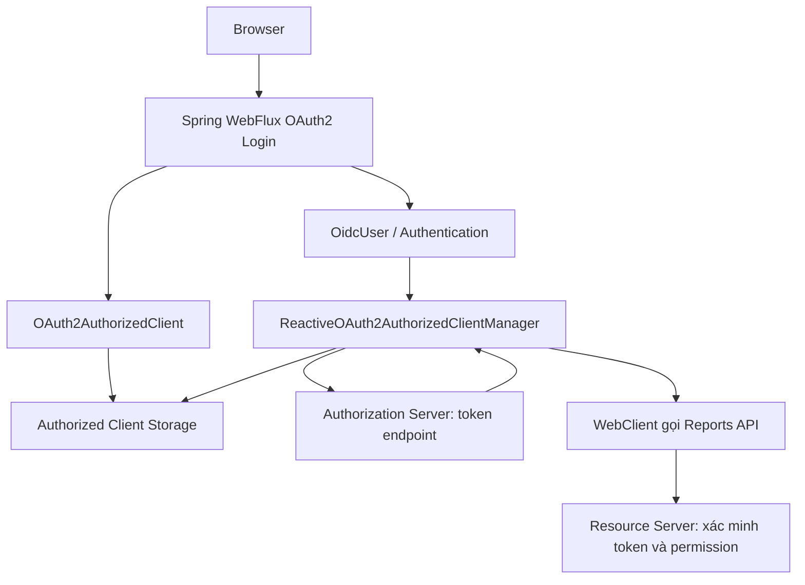
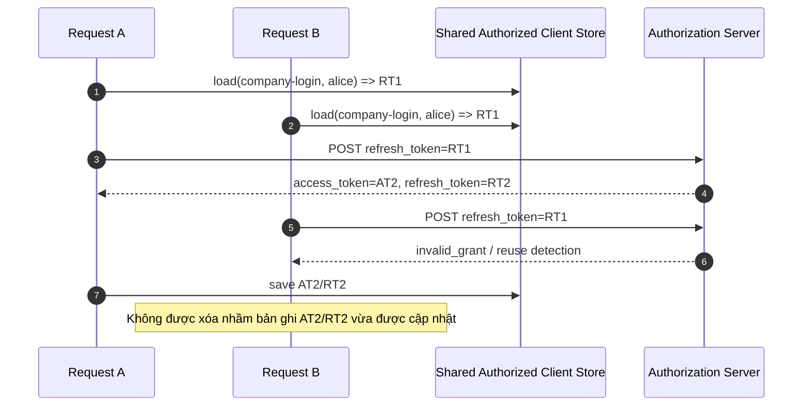
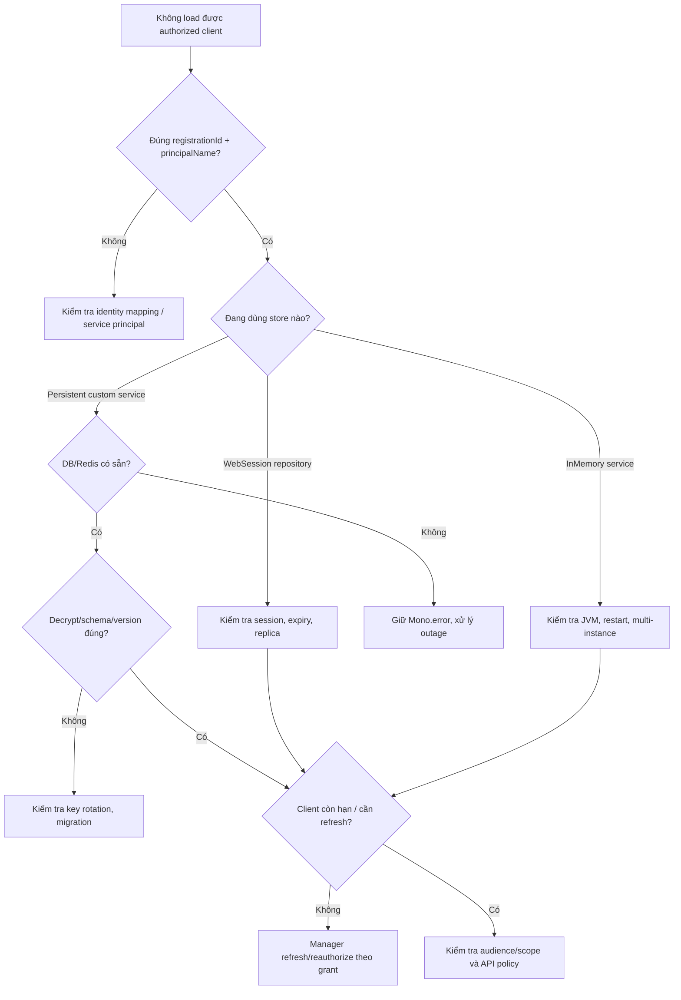

# 21.5. InMemoryReactiveOAuth2AuthorizedClientService và kho lưu tùy chỉnh

Trong **Spring Security OAuth 2.0 / OpenID Connect (OIDC) Client** chạy trên **Spring WebFlux**, ứng dụng không chỉ cần đăng nhập hoặc xin access token một lần. Nó còn phải **lưu, tìm lại, làm mới và xóa những OAuth2 authorized client** trong suốt vòng đời của người dùng hoặc tiến trình nền. Một ứng dụng Reactive có thể dùng bộ nhớ trong tiến trình cho môi trường thử nghiệm, nhưng hệ thống nhiều instance, có yêu cầu bảo vệ token chặt chẽ hoặc cần giữ trạng thái sau khi restart thường phải cân nhắc một kho lưu bền vững.

Thành phần trọng tâm của bài là **`InMemoryReactiveOAuth2AuthorizedClientService`**, một triển khai của `ReactiveOAuth2AuthorizedClientService`. Từ đó, ta thiết kế kho tùy chỉnh theo đúng contract của Spring Security, chẳng hạn với R2DBC, Redis Reactive hoặc một dịch vụ lưu trữ có API phi blocking.

Điều cần ghi nhớ ngay từ đầu:

- `OAuth2AuthorizedClient` giữ **client registration**, **principal name**, **access token** và **refresh token nếu được cấp**. Nó không phải đối tượng `Authentication`/`OidcUser`.
- `ReactiveOAuth2AuthorizedClientService` có khóa tra cứu logic **`(clientRegistrationId, principalName)`**. Nó không tự phân vùng theo tenant, session, audience hoặc scope.
- `InMemoryReactiveOAuth2AuthorizedClientService` giữ dữ liệu **trong bộ nhớ một JVM**, không tự chia sẻ giữa các replicas và không bền vững qua restart.
- `ServerOAuth2AuthorizedClientRepository` có ngữ cảnh `ServerWebExchange`/user session; **không đồng nhất** với service ở tầng lưu trữ.
- Custom store phải bảo vệ token như **credential bí mật**, bảo toàn refresh token rotation, tránh ghi đè đồng thời và không làm blocking Reactor event loop.

## 1. Mục tiêu học tập

Sau khi hoàn thành bài, bạn có thể:

1. Giải thích vai trò của `ReactiveOAuth2AuthorizedClientService` trong Spring Security Reactive OAuth2 Client.
2. Phân biệt `InMemoryReactiveOAuth2AuthorizedClientService` với `WebSessionServerOAuth2AuthorizedClientRepository` và `AuthenticatedPrincipalServerOAuth2AuthorizedClientRepository`.
3. Sử dụng đúng các hàm `loadAuthorizedClient`, `saveAuthorizedClient` và `removeAuthorizedClient`.
4. Hiểu vì sao `Mono.empty()`, `Mono<Void>`, lazy execution và non-blocking IO quan trọng với kho token.
5. Tạo một `AuthorizedClientServiceReactiveOAuth2AuthorizedClientManager` cho tác vụ nền.
6. Thiết kế schema/Redis key an toàn dựa trên `registrationId` và `principalName`.
7. Viết skeleton của một custom `ReactiveOAuth2AuthorizedClientService` dùng repository và mã hóa token.
8. Xử lý token expiration, refresh token rotation, concurrent refresh và multi-instance.
9. Phân biệt **xóa token local** với **thu hồi token tại Authorization Server**.
10. Kiểm thử service Reactive với `StepVerifier` và mock storage mà không cần credential thật.

## 2. Đặt authorized client vào đúng vị trí kiến trúc

Giả sử một cổng báo cáo sử dụng OIDC Login và gọi Reports API:



Có **ba đối tượng khác nhau**:

| Đối tượng | Chứa thông tin gì? | Mục đích |
|---|---|---|
| `Authentication` / `OidcUser` | Danh tính đã đăng nhập, authorities, ID Token/UserInfo nếu là OIDC | Xác thực user trong ứng dụng web |
| `ClientRegistration` | `registrationId`, `clientId`, grant type, scopes, token endpoint, provider | Cấu hình một OAuth2 client |
| `OAuth2AuthorizedClient` | `ClientRegistration`, `principalName`, access/refresh tokens | Đại diện cho client **đã được cấp quyền** |

Một user OIDC có thể đăng nhập thành công nhưng **chưa có authorized client dành cho một API thứ hai**. Ngược lại, một job `client_credentials` có thể có authorized client mà **không hề có `OidcUser`**.

### 2.1. Ví dụ dữ liệu được lưu

```text
registrationId = "company-login"
principalName  = "employee-42"
accessToken    = <BÍ MẬT>
accessExpires  = 2026-11-16T04:00:00Z
refreshToken   = <BÍ MẬT, nếu được provider cấp>

registrationId = "inventory-service"
principalName  = "service:nightly-import"
accessToken    = <BÍ MẬT>
accessExpires  = 2026-11-16T03:45:00Z
refreshToken   = null (thường gặp với client_credentials)
```

Hai bản ghi có thể có cùng principal nhưng khác registration; cùng registration cũng có thể có nhiều principal. Khóa service phải phản ánh **cả hai chiều**.

## 3. Contract ReactiveOAuth2AuthorizedClientService

Interface nằm trong package:

```java
org.springframework.security.oauth2.client
        .ReactiveOAuth2AuthorizedClientService
```

Ba thao tác quan trọng của service:

```java
<T extends OAuth2AuthorizedClient> Mono<T> loadAuthorizedClient(
        String clientRegistrationId,
        String principalName);

Mono<Void> saveAuthorizedClient(
        OAuth2AuthorizedClient authorizedClient,
        Authentication principal);

Mono<Void> removeAuthorizedClient(
        String clientRegistrationId,
        String principalName);
```

Đây là chữ ký rút gọn để làm rõ contract; khi triển khai cần import các kiểu từ Spring Security và Reactor tương ứng.

### 3.1. loadAuthorizedClient

`loadAuthorizedClient(registrationId, principalName)` tìm authorized client theo cặp khóa. Ví dụ:

```java
Mono<OAuth2AuthorizedClient> authorizedClient =
        service.<OAuth2AuthorizedClient>loadAuthorizedClient(
                "company-login", authentication.getName());
```

Khi không tìm thấy, một triển khai Reactive nên hoàn tất bằng `Mono.empty()`, **không** trả `null` thay cho `Mono`. Một lỗi storage thật, chẳng hạn database unavailable, nên được phát ra qua tín hiệu `onError` để caller phân biệt “không có token” với “không truy cập được kho token”.

### 3.2. saveAuthorizedClient

`saveAuthorizedClient(authorizedClient, principal)` lưu token tương ứng với principal do authentication cung cấp:

```java
Mono<Void> saved = service.saveAuthorizedClient(
        authorizedClient, authenticatedPrincipal);
```

`Mono<Void>` là completion signal, không phải Boolean. Thành công thường phát `onComplete`; lỗi phát `onError`. Khi dùng storage tùy chỉnh, cần bảo đảm principal name dùng để lưu **nhất quán** với `OAuth2AuthorizedClient.getPrincipalName()` và chính sách danh tính của ứng dụng. Một custom store có thể từ chối trạng thái không nhất quán thay vì ghi token dưới sai owner.

### 3.3. removeAuthorizedClient

```java
Mono<Void> removed = service.removeAuthorizedClient(
        "company-login", authentication.getName());
```

Việc xóa chỉ tác động **kho local mà service này quản lý**. Nó **không tự revoke token tại Authorization Server**, không xóa `WebSession` và không bảo đảm user đã logout khỏi OpenID Provider.

### 3.4. Không có subscribe thì chưa thực hiện thao tác

Reactor publisher thường là **lazy**. Chỉ tạo:

```java
Mono<Void> operation = service.removeAuthorizedClient("company-login", "alice");
```

không bảo đảm lệnh xóa đã chạy. Trong WebFlux, hãy **return hoặc compose publisher**:

```java
return service.removeAuthorizedClient("company-login", "alice")
        .then(Mono.just("Authorized client was removed"));
```

Không gọi `subscribe()` tùy tiện trong controller/service chỉ để tạo side effect fire-and-forget: lỗi có thể bị bỏ quên, lifecycle khó kiểm soát và HTTP response có thể gửi trước khi storage cập nhật.

### 3.5. So sánh Servlet và Reactive

| Servlet / đồng bộ | Reactive / WebFlux |
|---|---|
| `OAuth2AuthorizedClientService` | `ReactiveOAuth2AuthorizedClientService` |
| `InMemoryOAuth2AuthorizedClientService` | `InMemoryReactiveOAuth2AuthorizedClientService` |
| `OAuth2AuthorizedClientRepository` | `ServerOAuth2AuthorizedClientRepository` |
| `OAuth2AuthorizedClientManager` | `ReactiveOAuth2AuthorizedClientManager` |
| `AuthorizedClientServiceOAuth2AuthorizedClientManager` | `AuthorizedClientServiceReactiveOAuth2AuthorizedClientManager` |
| Trả `OAuth2AuthorizedClient` hoặc `null` | Trả `Mono<OAuth2AuthorizedClient>` hoặc `Mono.empty()` |
| Thao tác storage có thể blocking | Không blocking event-loop; dùng Reactive IO |

Không bọc một JDBC service blocking bằng `Mono.just(service.loadAuthorizedClient(...))` rồi coi như đã trở thành non-blocking: JDBC call đã chạy ngay lúc tạo `Mono`. Nếu bắt buộc phải dùng driver blocking trong giai đoạn chuyển đổi, cần cô lập sang scheduler thích hợp và quản lý tài nguyên; trong kiến trúc Reactive đúng nghĩa nên ưu tiên R2DBC hoặc client storage phi blocking.

## 4. InMemoryReactiveOAuth2AuthorizedClientService là gì?

`InMemoryReactiveOAuth2AuthorizedClientService` là triển khai lưu authorized clients **trong bộ nhớ của một application instance**. Nó thích hợp để:

- Học các API Reactive OAuth2 Client.
- Chạy integration test với token giả.
- Thử nghiệm ứng dụng đơn instance, không yêu cầu giữ token qua restart.
- Phát triển nhanh trước khi bổ sung kho lưu bền vững.

Điểm cần giới hạn kỳ vọng:

| Tính chất | InMemoryReactiveOAuth2AuthorizedClientService |
|---|---|
| Vị trí lưu | Heap của JVM ứng dụng |
| Lưu qua restart | Không |
| Chia sẻ giữa nhiều container/replica | Không |
| Tự mã hóa token bằng KMS | Không phải tính năng mặc định của in-memory store |
| Có thể tìm theo `registrationId` và `principalName` | Có |
| Tự xin hoặc refresh access token | Không; đó là nhiệm vụ manager/provider |
| Tự revoke token ở provider khi remove | Không |
| Đồng bộ refresh giữa nhiều instance | Không |
| Tự xóa theo lifetime token và business retention | Không nên giả định; cần policy rõ ràng |

Một service có thể lưu token trong memory, nhưng việc **token còn hiệu lực hay cần refresh** là quyết định của `ReactiveOAuth2AuthorizedClientManager`/provider và Authorization Server. Không đọc token trong memory rồi dùng mãi mà không xét expiration.

### 4.1. Khởi tạo bean in-memory

Với `ReactiveClientRegistrationRepository` đã được Spring Boot cấu hình:

```java
import org.springframework.context.annotation.Bean;
import org.springframework.context.annotation.Configuration;
import org.springframework.security.oauth2.client
        .InMemoryReactiveOAuth2AuthorizedClientService;
import org.springframework.security.oauth2.client
        .ReactiveOAuth2AuthorizedClientService;
import org.springframework.security.oauth2.client.registration
        .ReactiveClientRegistrationRepository;

@Configuration
class AuthorizedClientStorageConfig {

    @Bean
    ReactiveOAuth2AuthorizedClientService authorizedClientService(
            ReactiveClientRegistrationRepository registrations) {

        return new InMemoryReactiveOAuth2AuthorizedClientService(
                registrations);
    }
}
```

Đây là cấu hình minh họa khi ứng dụng **muốn tự khai báo** service. Một dự án Spring Boot có thể đã có bean do auto-configuration cung cấp; khi đó không nên tạo thêm bean cùng mục đích mà không kiểm tra cơ chế chọn/inject.

### 4.2. Cấu hình registration mẫu

```yaml
spring:
  security:
    oauth2:
      client:
        registration:
          company-login:
            provider: company
            client-id: "${OIDC_CLIENT_ID}"
            client-secret: "${OIDC_CLIENT_SECRET}"
            authorization-grant-type: authorization_code
            client-authentication-method: client_secret_basic
            redirect-uri: "{baseUrl}/login/oauth2/code/{registrationId}"
            scope: [openid, profile, email]
          inventory-service:
            provider: company
            client-id: "${INVENTORY_CLIENT_ID}"
            client-secret: "${INVENTORY_CLIENT_SECRET}"
            authorization-grant-type: client_credentials
            client-authentication-method: client_secret_basic
            scope: [inventory.read]
        provider:
          company:
            issuer-uri: "https://idp.example.org/realms/company"
```

`company-login` phục vụ OIDC Authorization Code Flow, còn `inventory-service` dùng service-to-service authorization. Chúng có thể cùng tồn tại trong ứng dụng, nhưng **không phải mọi client cần lưu cùng cách hoặc cùng vòng đời**.

### 4.3. Ví dụ tải client và xử lý Mono.empty

```java
import org.springframework.security.oauth2.client.OAuth2AuthorizedClient;
import org.springframework.security.oauth2.client
        .ReactiveOAuth2AuthorizedClientService;
import reactor.core.publisher.Mono;

final class ClientLookup {

    private final ReactiveOAuth2AuthorizedClientService service;

    ClientLookup(ReactiveOAuth2AuthorizedClientService service) {
        this.service = service;
    }

    Mono<OAuth2AuthorizedClient> find(
            String registrationId, String principalName) {

        return service.<OAuth2AuthorizedClient>loadAuthorizedClient(
                registrationId, principalName);
    }
}
```

Lớp trên chỉ **tìm authorized client**. Nó không gửi request đến token endpoint, không refresh token và không xác minh quyền dùng token cho một API. Nếu mục tiêu là “lấy token còn phù hợp để gọi API”, hãy dùng `ReactiveOAuth2AuthorizedClientManager` thay vì chỉ `loadAuthorizedClient`.

### 4.4. Mono.empty khác lỗi storage

Ví dụ phân biệt:

```java
return service.<OAuth2AuthorizedClient>loadAuthorizedClient(
                registrationId, principalName)
        .switchIfEmpty(Mono.error(
                new IllegalStateException("No authorized client found")));
```

`switchIfEmpty` chỉ dùng cho **không có bản ghi**. Nếu repository bên dưới trả `onError` do mất kết nối DB, lỗi sẽ tiếp tục đi qua pipeline; **không dùng `onErrorResume(error -> Mono.empty())` vô điều kiện** để che mọi sự cố storage như “chưa từng đăng nhập”.

## 5. Vì sao in-memory không phù hợp mọi môi trường?

### 5.1. Restart hoặc rolling deployment

Giả sử user đã đăng nhập, token của họ chỉ có trong heap instance A. Khi instance A được restart:

```text
Trước restart:
  JVM A memory -> (company-login, employee-42) -> AT1/RT1

Sau restart:
  JVM A memory -> không còn authorized client
```

Session HTTP có thể vẫn tồn tại ở một kho khác, nhưng authorized client trong memory service **không tự khôi phục**. Tùy cấu hình repository, user có thể phải ủy quyền lại hoặc downstream API call không lấy được token.

### 5.2. Horizontal scaling

```text
Load balancer
   |
   +--> Pod A: InMemory store A
   |       company-login, employee-42 -> AT1/RT1
   |
   +--> Pod B: InMemory store B
           không có bản ghi đó
```

Nếu request tiếp theo tới pod B, authorized client không xuất hiện chỉ vì pod A đã có token. Sticky session có thể che một phần triệu chứng nhưng không thay thế chiến lược lưu trữ/phục hồi khi pod crash, autoscale hoặc failover.

### 5.3. Tăng số principals và registrations

Một kho memory theo cặp khóa có thể tích lũy nhiều bản ghi:

```text
(company-login, user-a)
(company-login, user-b)
(partner-login, user-a)
(inventory-service, service:import)
...
```

Nếu ứng dụng dùng principal name ngẫu nhiên như `job-<UUID>` mỗi lần chạy, số dòng có thể tăng không cần thiết. Trước khi quyết định in-memory hay persistent store, cần có quy tắc principal ổn định, retention và cleanup.

### 5.4. In-memory vẫn lưu credential nhạy cảm

“Không ghi xuống disk” không nghĩa là access/refresh token an toàn tuyệt đối. Token có thể xuất hiện trong heap dump, diagnostic tooling, crash report hoặc log nếu developer in object. Phải giới hạn quyền truy cập JVM diagnostics, bảo vệ dump và không serialize token vào response HTTP.

## 6. Phân biệt service và ServerOAuth2AuthorizedClientRepository

Trong WebFlux, có **hai abstraction** gần nhau nhưng không giống nhau.

`ReactiveOAuth2AuthorizedClientService`:

```java
loadAuthorizedClient(registrationId, principalName);
saveAuthorizedClient(authorizedClient, authentication);
removeAuthorizedClient(registrationId, principalName);
```

`ServerOAuth2AuthorizedClientRepository`:

```java
loadAuthorizedClient(registrationId, authentication, serverWebExchange);
saveAuthorizedClient(authorizedClient, authentication, serverWebExchange);
removeAuthorizedClient(registrationId, authentication, serverWebExchange);
```

Repository có thêm **`ServerWebExchange`**, cho phép lưu theo WebSession hoặc chính sách của request hiện tại. Service có thể được gọi ở tầng business/service mà không cần HTTP request.

| Thuộc tính | ReactiveOAuth2AuthorizedClientService | ServerOAuth2AuthorizedClientRepository |
|---|---|---|
| Đầu vào load | `registrationId` + `principalName` | `registrationId` + `Authentication` + `ServerWebExchange` |
| Phù hợp background job | Có | Không thuận tiện nếu không có web exchange |
| Có thể dùng persistence | Có, qua custom service | Có, nếu repository delegate tới service tương ứng |
| Có thể lưu theo WebSession | Không phải semantics mặc định của service | Có, tùy implementation |
| Có thể tìm client user từ session khác | Theo store và principal | Tùy principal/session và repository |

### 6.1. WebSessionServerOAuth2AuthorizedClientRepository

`WebSessionServerOAuth2AuthorizedClientRepository` là một cách lưu authorized client theo **WebSession** của WebFlux. Nó phù hợp khi muốn trạng thái gắn chặt với session. Nếu session bị mất, hết hạn hoặc không chia sẻ giữa các nodes, bản ghi session repository cũng có thể không còn sẵn.

**Không mặc định** rằng việc đọc một `ReactiveOAuth2AuthorizedClientService` do bạn inject sẽ thấy token đã được lưu trong một `WebSessionServerOAuth2AuthorizedClientRepository` độc lập.

### 6.2. AuthenticatedPrincipalServerOAuth2AuthorizedClientRepository

`AuthenticatedPrincipalServerOAuth2AuthorizedClientRepository` sử dụng authenticated principal và có thể delegate tới `ReactiveOAuth2AuthorizedClientService`. Với cấu hình có hỗ trợ anonymous principal, nó cũng có thể dùng WebSession repository làm fallback theo API/policy.

Khi bạn thay `ReactiveOAuth2AuthorizedClientService` bằng implementation bền vững, **phải kiểm tra repository đang sử dụng có thực sự delegate tới service đó không**. Chỉ tạo bean custom service không bảo đảm toàn bộ luồng OAuth2 Login/WebClient đang dùng bean mới.

### 6.3. Authorization Request repository không phải Authorized Client repository

Một kho thứ ba thường xuất hiện:

`WebSessionOAuth2ServerAuthorizationRequestRepository` dùng để lưu **`OAuth2AuthorizationRequest`** ban đầu, gồm `state` và dữ liệu correlation/PKCE cần cho callback của Authorization Code Flow.

```text
Trước callback:
  ServerAuthorizationRequestRepository
     -> OAuth2AuthorizationRequest, state, PKCE context

Sau khi được cấp token:
  ServerOAuth2AuthorizedClientRepository hoặc
  ReactiveOAuth2AuthorizedClientService
     -> OAuth2AuthorizedClient, access/refresh token
```

Mất `state` trong callback là lỗi khác với “không tìm thấy authorized client sau login”. Không sửa sai bằng cách gộp hai loại dữ liệu vào một map không có security policy.

## 7. Lựa chọn kho lưu: InMemory, R2DBC, Redis Reactive

| Tiêu chí | InMemory service | R2DBC database | Reactive Redis / KV Store |
|---|---|---|---|
| Giữ qua restart JVM | Không | Có nếu DB bền vững | Có thể, theo persistence/TTL của Redis |
| Dùng chung giữa replicas | Không | Có | Có |
| Truy vấn composite key | Có | Có qua primary key/index | Có qua key đã mã hóa/namespace |
| CAS/optimistic locking | Cần tự thiết kế nếu cần | Có thể dùng version/transaction | Có thể dùng CAS/Lua/transaction tùy hệ thống |
| Token encryption | Phụ thuộc vận hành heap | Nên mã hóa ciphertext trước khi lưu/áp dụng encryption-at-rest | Nên mã hóa ciphertext và bảo vệ mạng/ACL |
| Retention/TTL | Cần chính sách riêng | Cleanup job / lifecycle policy | TTL hỗ trợ nhưng phải xét refresh token lifetime |
| Non-blocking | Không gọi IO bên ngoài | Cần R2DBC driver reactive | Dùng ReactiveRedisTemplate hoặc client reactive |
| Phức tạp vận hành | Thấp | Schema, migration, backup, HA | TTL, cluster, eviction, persistence, keyspace |

Không có lựa chọn nào mặc nhiên tốt nhất. Đối với user-delegated refresh tokens, persistence giúp giữ phiên qua restart nhưng cũng tạo **kho credential nhạy cảm cần bảo vệ**. Với `client_credentials`, đôi khi có thể xin token mới sau restart mà không cần lưu lâu dài; quyết định còn phụ thuộc quota/token endpoint latency.

### 7.1. Không dùng TTL theo access token expiration một cách máy móc

Một bản ghi có thể chứa:

```text
access token hết hạn sau 20 phút
refresh token còn hiệu lực trong nhiều giờ/ngày
```

Nếu Redis key tự xóa khi access token hết hạn, ứng dụng mất luôn refresh token còn có thể sử dụng. TTL/retention phải căn cứ **vòng đời authorized client và refresh token** theo policy, không chỉ `accessToken.expiresAt`.

Ngược lại, giữ mọi refresh token mãi mãi là sai. Token có thể bị thu hồi hoặc user chấm dứt session; retention phải có giới hạn và dọn dẹp phù hợp quyền riêng tư và vận hành.

### 7.2. Tách database cache và lifecycle manager

Một custom store chỉ cần thực hiện **read/write/delete** đúng hợp đồng. Nó không nên tự thực hiện HTTP POST token endpoint khi người dùng gọi `load`:

```text
loadAuthorizedClient(...) -> đọc storage
saveAuthorizedClient(...) -> lưu authorized client
removeAuthorizedClient(...) -> xóa storage

ReactiveOAuth2AuthorizedClientManager
   -> quyết định grant, reauthorization, refresh
   -> gọi provider/token endpoint nếu cần
   -> cập nhật store qua service/repository
```

Nếu custom store tự refresh token trong `load`, bạn dễ tạo side effect bất ngờ, nested retry, race condition và khó kiểm soát lỗi `invalid_grant`.

## 8. Thiết kế schema cho kho R2DBC

Với database quan hệ, mô hình thường có composite key:

```sql
-- Ví dụ PostgreSQL DDL minh họa, KHÔNG phải schema mặc định của Spring.
CREATE TABLE reactive_oauth2_authorized_client (
    client_registration_id   varchar(150) NOT NULL,
    principal_name           varchar(300) NOT NULL,
    access_token_type        varchar(40) NOT NULL,
    access_token_ciphertext  bytea NOT NULL,
    access_issued_at         timestamptz NOT NULL,
    access_expires_at        timestamptz NOT NULL,
    access_scopes_json       text NOT NULL,
    refresh_token_ciphertext bytea,
    refresh_issued_at        timestamptz,
    record_version           bigint NOT NULL DEFAULT 0,
    updated_at               timestamptz NOT NULL DEFAULT now(),
    PRIMARY KEY (client_registration_id, principal_name)
);
```

Các trường token là **ciphertext**, không phải giá trị plain-text. Schema và kích thước cột cần được thiết kế theo provider, yêu cầu mã hóa, database và storage retention của dự án.

### 8.1. Vì sao khóa kép?

```text
registrationId = company-login, principal = alice -> token A
registrationId = company-login, principal = bob   -> token B
registrationId = partner-login, principal = alice -> token C
```

Nếu chỉ khóa theo `registrationId`, Alice và Bob có thể ghi đè token của nhau. Nếu chỉ khóa theo `principalName`, token của Corporate OP và Partner OP có thể lẫn nhau.

Trong dự án multi-tenant, cặp khóa này **không tự bao gồm tenant**. Nếu hai tenant chia sẻ cùng registration và principal string, cần thiết kế partition/namespace hoặc ánh xạ local identity ổn định có kiểm soát.

### 8.2. Lưu những gì để tái dựng OAuth2AuthorizedClient?

Tối thiểu ứng dụng cần:

- `client_registration_id` để tìm `ClientRegistration` hiện tại.
- `principal_name` để chọn chủ thể.
- `access_token_type`, access token value, `issuedAt`, `expiresAt` và scopes.
- Refresh token value/issuedAt nếu có.
- Version/updatedAt nếu cần bảo vệ concurrent updates.

`ClientRegistration` thường được tái tìm từ `ReactiveClientRegistrationRepository`; không nhất thiết serialize toàn bộ object Java vào database. Việc lưu Java serialized objects nguyên xi dễ bị ràng buộc vào phiên bản class, tiềm ẩn vấn đề bảo mật và khó migration.

### 8.3. Không lưu refresh token thành text hiển thị

Refresh token thường có vòng đời dài và có thể cho phép tiếp tục lấy access token. Cần:

1. Mã hóa token trước khi ghi DB bằng cơ chế tin cậy, ví dụ envelope encryption với key do KMS quản lý.
2. Tách quyền quản lý encryption keys khỏi quyền chỉ truy vấn DB.
3. Giới hạn quyền đọc storage và audit truy cập.
4. Bảo vệ bản sao lưu, replica, backup, crash dump và log.
5. Hỗ trợ key rotation, token revocation và cleanup.

Không ghi token value hoặc secret vào metric label, exception message, HTTP response hay debug trace.

## 9. Ví dụ custom ReactiveOAuth2AuthorizedClientService

Trong phần này, ta minh họa cách **triển khai contract** mà không khóa bài vào một database cụ thể. Một adapter có thể dùng Spring Data R2DBC, một adapter khác dùng Reactive Redis. Chúng cùng thực hiện interface lưu record đã mã hóa.

### 9.1. Các kiểu dữ liệu của tầng storage

```java
import java.time.Instant;
import java.util.Set;
import reactor.core.publisher.Mono;

// Record thuộc ứng dụng, không phải class của Spring Security.
record StoredAuthorizedClient(
        String registrationId,
        String principalName,
        String accessTokenType,
        byte[] encryptedAccessToken,
        Instant accessIssuedAt,
        Instant accessExpiresAt,
        Set<String> accessScopes,
        byte[] encryptedRefreshToken,
        Instant refreshIssuedAt,
        long version) {}

interface AuthorizedClientRecordStore {
    Mono<StoredAuthorizedClient> find(
            String registrationId, String principalName);

    Mono<Void> upsert(StoredAuthorizedClient value);

    Mono<Void> delete(
            String registrationId, String principalName);
}

interface TokenProtector {
    Mono<byte[]> encrypt(String clearTextToken);
    Mono<String> decrypt(byte[] ciphertext);
}
```

Hai interface `AuthorizedClientRecordStore` và `TokenProtector` là **abstraction do ứng dụng xây dựng**. Một implementation thực tế phải kiểm soát encryption key, xử lý lỗi, versioning và xóa token an toàn; đoạn code này không tự thực hiện mã hóa.

### 9.2. Skeleton của service tùy chỉnh

```java
import java.util.Set;
import org.springframework.security.core.Authentication;
import org.springframework.security.oauth2.client.OAuth2AuthorizedClient;
import org.springframework.security.oauth2.client
        .ReactiveOAuth2AuthorizedClientService;
import org.springframework.security.oauth2.client.registration.ClientRegistration;
import org.springframework.security.oauth2.client.registration
        .ReactiveClientRegistrationRepository;
import org.springframework.security.oauth2.core.OAuth2AccessToken;
import org.springframework.security.oauth2.core.OAuth2RefreshToken;
import reactor.core.publisher.Mono;

final class EncryptedReactiveAuthorizedClientService
        implements ReactiveOAuth2AuthorizedClientService {

    private final ReactiveClientRegistrationRepository registrations;
    private final AuthorizedClientRecordStore records;
    private final TokenProtector tokens;

    EncryptedReactiveAuthorizedClientService(
            ReactiveClientRegistrationRepository registrations,
            AuthorizedClientRecordStore records,
            TokenProtector tokens) {
        this.registrations = registrations;
        this.records = records;
        this.tokens = tokens;
    }

    @Override
    @SuppressWarnings("unchecked")
    public <T extends OAuth2AuthorizedClient> Mono<T> loadAuthorizedClient(
            String registrationId, String principalName) {

        return records.find(registrationId, principalName)
                .flatMap(row -> {
                    Mono<ClientRegistration> registration =
                            registrations.findByRegistrationId(registrationId)
                                    .switchIfEmpty(Mono.error(
                                            new IllegalStateException(
                                                    "Unknown client registration")));

                    Mono<String> access =
                            tokens.decrypt(row.encryptedAccessToken());

                    Mono<String> refresh =
                            row.encryptedRefreshToken() == null
                                    ? Mono.just("")
                                    : tokens.decrypt(row.encryptedRefreshToken());

                    return Mono.zip(registration, access, refresh)
                            .map(tuple -> {
                                if (!"Bearer".equalsIgnoreCase(
                                        row.accessTokenType())) {
                                    throw new IllegalStateException(
                                            "Unsupported access token type");
                                }

                                OAuth2AccessToken accessToken =
                                        new OAuth2AccessToken(
                                                OAuth2AccessToken.TokenType.BEARER,
                                                tuple.getT2(),
                                                row.accessIssuedAt(),
                                                row.accessExpiresAt(),
                                                row.accessScopes());

                                OAuth2RefreshToken refreshToken =
                                        row.encryptedRefreshToken() == null
                                                ? null
                                                : new OAuth2RefreshToken(
                                                        tuple.getT3(),
                                                        row.refreshIssuedAt());

                                OAuth2AuthorizedClient client =
                                        new OAuth2AuthorizedClient(
                                                tuple.getT1(),
                                                row.principalName(),
                                                accessToken,
                                                refreshToken);
                                return (T) client;
                            });
                });
    }

    @Override
    public Mono<Void> saveAuthorizedClient(
            OAuth2AuthorizedClient client, Authentication principal) {

        String registrationId =
                client.getClientRegistration().getRegistrationId();
        String principalName = principal.getName();

        if (!principalName.equals(client.getPrincipalName())) {
            return Mono.error(new IllegalArgumentException(
                    "Principal differs from authorized client owner"));
        }

        OAuth2AccessToken accessToken = client.getAccessToken();
        OAuth2RefreshToken refreshToken = client.getRefreshToken();

        Mono<byte[]> accessEncrypted =
                tokens.encrypt(accessToken.getTokenValue());
        Mono<byte[]> refreshEncrypted =
                refreshToken == null
                        ? Mono.just(new byte[0])
                        : tokens.encrypt(refreshToken.getTokenValue());

        return Mono.zip(accessEncrypted, refreshEncrypted)
                .flatMap(ciphertexts ->
                        records.upsert(new StoredAuthorizedClient(
                                registrationId,
                                principalName,
                                accessToken.getTokenType().getValue(),
                                ciphertexts.getT1(),
                                accessToken.getIssuedAt(),
                                accessToken.getExpiresAt(),
                                Set.copyOf(accessToken.getScopes()),
                                refreshToken == null
                                        ? null
                                        : ciphertexts.getT2(),
                                refreshToken == null
                                        ? null
                                        : refreshToken.getIssuedAt(),
                                0L)));
    }

    @Override
    public Mono<Void> removeAuthorizedClient(
            String registrationId, String principalName) {
        return records.delete(registrationId, principalName);
    }
}
```

Đây là một **skeleton giáo dục cho đường đi dữ liệu**, không phải production-ready storage: `records.upsert(...)` phải triển khai chính sách transaction/optimistic concurrency, `TokenProtector` cần mã hóa thực sự bằng key được quản lý, và `version` không thể luôn ghi `0L` nếu database đã có bản ghi. Một implementation thực tế phải có cơ chế lấy version hiện tại và xử lý xung đột khi refresh token đổi. Nếu dùng `Mono.zip`, tất cả các Mono thành phần phải phát đúng một giá trị khi dữ liệu tồn tại; Mono trống có thể làm kết quả toàn bộ là empty ngoài ý muốn.

**Ranh giới cần giữ:** service này chỉ tái dựng hoặc lưu `OAuth2AuthorizedClient`. Nó không tự gọi token endpoint, không tự quyết định scope mới và không phân quyền user sử dụng token.

### 9.3. Vì sao load có thể là Mono.empty?

`records.find(...)` nên trả `Mono.empty()` khi không có row. Khi đó `flatMap` cũng hoàn tất rỗng. Đây là hành vi cần thiết để manager phân biệt chưa có authorized client với một client đã lưu.

Nếu có row nhưng `ClientRegistration` đã bị xóa hoặc ciphertext không giải mã được, đó không phải “chưa từng có authorized client”: nên báo lỗi có kiểm soát, dọn dữ liệu hoặc yêu cầu reauthorization theo chính sách, **không tự nuốt lỗi và trả token khác**.

### 9.4. Tính nguyên tử và phiên bản bản ghi

Ví dụ khi refresh token rotation:

```text
DB: (company-login, alice) có AT1/RT1, version=5
Instance A đọc version 5, refresh RT1 -> AT2/RT2
Instance B vẫn đọc version 5, refresh RT1 -> invalid_grant
Instance A ghi version 6
Instance B không được xóa/ghi đè version 6 theo dữ liệu cũ
```

Vì vậy `upsert` sản xuất cần xác định một trong các cơ chế:

- Transaction với row lock phù hợp nếu database và workload cho phép.
- Optimistic concurrency: `UPDATE ... WHERE version=:expectedVersion`, chỉ thành công khi row chưa đổi.
- Distributed single-flight/lock theo `(registrationId, principalName)` cho toàn cụm.
- Kiểm tra lại version hiện có trước khi failure handler xóa bản ghi do `invalid_grant` của một request cũ.

Không suy luận rằng “Reactive” tự bảo đảm atomic update hoặc không có race. Reactor chỉ là mô hình bất đồng bộ; nhất quán dữ liệu vẫn thuộc design của store.

## 10. Đưa custom store vào Spring application

Nếu ứng dụng đã triển khai `AuthorizedClientRecordStore` và `TokenProtector`, có thể đăng ký:

```java
import org.springframework.context.annotation.Bean;
import org.springframework.context.annotation.Configuration;
import org.springframework.security.oauth2.client
        .ReactiveOAuth2AuthorizedClientService;
import org.springframework.security.oauth2.client.registration
        .ReactiveClientRegistrationRepository;

@Configuration
class PersistentOAuth2ClientConfig {

    @Bean
    ReactiveOAuth2AuthorizedClientService authorizedClientService(
            ReactiveClientRegistrationRepository registrations,
            AuthorizedClientRecordStore records,
            TokenProtector protector) {

        return new EncryptedReactiveAuthorizedClientService(
                registrations, records, protector);
    }
}
```

Đây là **phương án thay thế** bean `InMemoryReactiveOAuth2AuthorizedClientService` ở mục 4.1. Không giữ hai bean cùng tên/kiểu và mong Spring tự chọn đúng. Nếu có nhiều storage purpose, dùng `@Qualifier` hoặc cấu hình rõ các manager/repository.

### 10.1. Lưu qua WebFlux login

Trong web login, khi sử dụng `ServerOAuth2AuthorizedClientRepository` có khả năng delegate tới service, bạn cần bảo đảm repository thật sự sử dụng bean persistent store:

```java
import org.springframework.context.annotation.Bean;
import org.springframework.security.oauth2.client
        .ReactiveOAuth2AuthorizedClientService;
import org.springframework.security.oauth2.client.web.server
        .AuthenticatedPrincipalServerOAuth2AuthorizedClientRepository;
import org.springframework.security.oauth2.client.web.server
        .ServerOAuth2AuthorizedClientRepository;

@Bean
ServerOAuth2AuthorizedClientRepository authorizedClientRepository(
        ReactiveOAuth2AuthorizedClientService service) {

    return new AuthenticatedPrincipalServerOAuth2AuthorizedClientRepository(
            service);
}
```

`AuthenticatedPrincipalServerOAuth2AuthorizedClientRepository` có thể ủy quyền authorized clients của authenticated principal cho service và sử dụng chiến lược khác đối với anonymous user theo cấu hình/implementation. Nếu ứng dụng chủ động sử dụng `WebSessionServerOAuth2AuthorizedClientRepository`, đó là một chiến lược lưu khác; tạo custom service không tự chuyển session data sang DB.

### 10.2. Không thay request repository vì muốn persistence token

OIDC Login còn có `ServerAuthorizationRequestRepository` lưu authorization request/`state`/PKCE giữa redirect và callback. Không thay nó bằng `ReactiveOAuth2AuthorizedClientService` để lưu token. Chúng có lifecycle khác nhau và có thể cần backend lưu trữ khác nhau.

## 11. AuthorizedClientServiceReactiveOAuth2AuthorizedClientManager

Nếu ứng dụng có background job hoặc service client không phụ thuộc HTTP request, Spring Security Reactive cung cấp `AuthorizedClientServiceReactiveOAuth2AuthorizedClientManager`.

Manager này sử dụng:

- `ReactiveClientRegistrationRepository` để tìm registration.
- `ReactiveOAuth2AuthorizedClientService` để đọc/lưu/xóa authorized client.
- `ReactiveOAuth2AuthorizedClientProvider` để xử lý grant.

### 11.1. Bean manager cho service-tier

```java
import org.springframework.context.annotation.Bean;
import org.springframework.context.annotation.Configuration;
import org.springframework.security.oauth2.client
        .AuthorizedClientServiceReactiveOAuth2AuthorizedClientManager;
import org.springframework.security.oauth2.client
        .ReactiveOAuth2AuthorizedClientManager;
import org.springframework.security.oauth2.client
        .ReactiveOAuth2AuthorizedClientProvider;
import org.springframework.security.oauth2.client
        .ReactiveOAuth2AuthorizedClientProviderBuilder;
import org.springframework.security.oauth2.client
        .ReactiveOAuth2AuthorizedClientService;
import org.springframework.security.oauth2.client.registration
        .ReactiveClientRegistrationRepository;

@Configuration
class ReactiveServiceClientManagerConfig {

    @Bean
    ReactiveOAuth2AuthorizedClientManager serviceClientManager(
            ReactiveClientRegistrationRepository registrations,
            ReactiveOAuth2AuthorizedClientService authorizedClients) {

        ReactiveOAuth2AuthorizedClientProvider provider =
                ReactiveOAuth2AuthorizedClientProviderBuilder.builder()
                        .clientCredentials()
                        .refreshToken()
                        .build();

        var manager =
                new AuthorizedClientServiceReactiveOAuth2AuthorizedClientManager(
                        registrations, authorizedClients);
        manager.setAuthorizedClientProvider(provider);
        return manager;
    }
}
```

Đoạn này minh họa một manager hỗ trợ `client_credentials` và `refresh_token`. Bạn chỉ nên bật grant thực sự cần. Với `authorization_code`, người dùng cần flow browser để được cấp grant ban đầu; service manager không tự tạo authorization code từ background job.

### 11.2. Xin token cho một job phi blocking

```java
import org.springframework.security.oauth2.client
        .OAuth2AuthorizeRequest;
import org.springframework.security.oauth2.client.OAuth2AuthorizedClient;
import org.springframework.security.oauth2.client
        .ReactiveOAuth2AuthorizedClientManager;
import reactor.core.publisher.Mono;

final class InventoryTokenProvider {

    private final ReactiveOAuth2AuthorizedClientManager manager;

    InventoryTokenProvider(ReactiveOAuth2AuthorizedClientManager manager) {
        this.manager = manager;
    }

    Mono<OAuth2AuthorizedClient> authorizedClient() {
        OAuth2AuthorizeRequest request =
                OAuth2AuthorizeRequest
                        .withClientRegistrationId("inventory-service")
                        .principal("service:nightly-import")
                        .build();

        return manager.authorize(request)
                .switchIfEmpty(Mono.error(
                        new IllegalStateException(
                                "Could not authorize inventory-service")));
    }
}
```

`principal("service:nightly-import")` là tên chủ thể logic phía Spring để quản lý khóa storage cho `client_credentials`. Nó không phải user OIDC và không thay thế client authentication tại Authorization Server.

Giữ tên principal ổn định; nếu mỗi lần chạy tạo `job-<UUID>`, manager có thể lưu thành nhiều authorized client khác nhau và tăng request tới token endpoint không cần thiết.

### 11.3. Kết hợp manager và WebClient

```java
import org.springframework.web.reactive.function.client.WebClient;
import reactor.core.publisher.Mono;

final class InventoryApi {

    private final InventoryTokenProvider tokenProvider;
    private final WebClient client = WebClient.builder()
            .baseUrl("https://inventory-api.example.org")
            .build();

    InventoryApi(InventoryTokenProvider tokenProvider) {
        this.tokenProvider = tokenProvider;
    }

    Mono<String> listItems() {
        return tokenProvider.authorizedClient()
                .flatMap(authorized -> client.get()
                        .uri("/v1/items")
                        .headers(headers -> headers.setBearerAuth(
                                authorized.getAccessToken().getTokenValue()))
                        .retrieve()
                        .bodyToMono(String.class));
    }
}
```

Ví dụ giữ URL API cố định để tránh gửi bearer token tới host ngoài allowlist. Trong ứng dụng production có thể cấu hình OAuth2-aware WebClient filter để tự resolve authorized client, nhưng **không log token**, không gửi sang host tùy ý từ input user và không nhầm token `client_credentials` với token của người dùng.

Manager chịu trách nhiệm tìm lại hoặc xin token mới theo grant; `ReactiveOAuth2AuthorizedClientService` chỉ là backend lưu trữ.

## 12. Manager WebFlux và service manager: chọn đúng ngữ cảnh

Khi ứng dụng có HTTP request/`ServerWebExchange`, một lựa chọn khác là `DefaultReactiveOAuth2AuthorizedClientManager` phối hợp với `ServerOAuth2AuthorizedClientRepository`.

| Tiêu chí | DefaultReactiveOAuth2AuthorizedClientManager | AuthorizedClientServiceReactiveOAuth2AuthorizedClientManager |
|---|---|---|
| Ngữ cảnh | WebFlux server request | Service/background, không cần web exchange |
| Kho lưu | `ServerOAuth2AuthorizedClientRepository` | `ReactiveOAuth2AuthorizedClientService` |
| Principal | Authentication trong reactive web context hoặc cung cấp hợp lệ | Principal logic của lời gọi authorize |
| Ứng dụng điển hình | BFF, web login, outbound API call theo user | Scheduler, đồng bộ service, batch |
| Cần request/response context | Thường có | Không |

Không dùng service manager ngoài request rồi mặc định nó tìm được token nằm riêng trong `WebSessionServerOAuth2AuthorizedClientRepository`. Nếu kiến trúc cần chia sẻ authorized client với service, chọn repository delegate/strategies nhất quán.

### 12.1. Khi có cả web login và background job

Một ứng dụng có thể dùng:

```text
WebFlux Login
  -> ServerOAuth2AuthorizedClientRepository
  -> authorized client theo user/session

Background Worker
  -> AuthorizedClientServiceReactiveOAuth2AuthorizedClientManager
  -> ReactiveOAuth2AuthorizedClientService
  -> authorized client theo service principal
```

Có thể sử dụng cùng database nhưng cần phân quyền, phân vùng khóa và retention khác nhau nếu các credential thuộc những trust boundary khác nhau. Không làm một background job đọc token người dùng chỉ bằng cách tự cung cấp principal name từ query string.

### 12.2. Khi nào không nên dùng JDBC trong reactive pipeline?

`JdbcOAuth2AuthorizedClientService` thuộc synchronous Servlet stack; dùng trực tiếp trong handler WebFlux có thể block event-loop. `R2dbcEntityTemplate`, `DatabaseClient` hoặc repository Reactive là những lựa chọn phù hợp hơn nếu dùng database quan hệ.

Nếu doanh nghiệp buộc dùng DAO đồng bộ, phải cô lập blocking IO bằng scheduler có kiểm soát, chịu giới hạn thread pool và xem đó là bước chuyển tiếp có chủ đích — không gắn nhãn “Reactive” cho một method JDBC blocking chỉ vì return `Mono`.

## 13. Concurrent refresh và kho lưu tùy chỉnh

Một trong những lý do quan trọng để chọn store cẩn thận là **refresh token rotation**. Giả sử người dùng Alice có AT1/RT1; hai request đồng thời đều thấy AT1 sắp hết hạn:



Hệ quả có thể gồm:

- Một request thất bại dù một request khác đã refresh thành công.
- Provider phát hiện reuse RT1 và thu hồi token family tùy chính sách.
- Failure handler của request B xóa authorized client mới nếu không xét version.
- Hai instance ghi đè nhau trong storage.

### 13.1. Single-flight theo cặp khóa

Một chiến lược là chỉ cho phép **một refresh đang chạy** cho mỗi `(registrationId, principalName)`. Các request cùng khóa chờ kết quả với deadline rồi đọc lại authorized client từ store. Điều này có thể triển khai:

- Trong một JVM: cache `Mono` đang chạy / mutex async theo khóa, có cleanup và giới hạn bộ nhớ.
- Nhiều JVM: distributed lock, optimistic version hoặc một service token broker chuyên dụng.
- Với DB: transaction/lock hoặc CAS có guard version, tránh lost update.

Không dùng `synchronized` toàn cục để chặn Reactor event loop, và cũng không dùng một khóa chung cho tất cả users/registrations khiến toàn bộ hệ thống bị serialized.

### 13.2. Không retry mù quáng refresh token

Nếu request refresh RT1 được OP xử lý nhưng response chứa RT2 bị mất, POST lại RT1 có thể bị phát hiện như replay. Một custom store bền vững **không thể làm request POST trở nên idempotent**.

Thiết kế cần phân loại `invalid_grant`, outcome unknown, token endpoint 5xx/timeout và hợp đồng provider. Không thêm generic HTTP retry vào mọi token POST chỉ vì store đã có optimistic locking.

### 13.3. Save AT2/RT2 thất bại cần xử lý riêng

```text
Authorization Server: RT1 -> RT2 (đã thành công)
Client nhận AT2 + RT2
Database ghi AT2/RT2 thất bại
Database vẫn còn RT1
```

Trong tình huống này, replay RT1 không giải quyết nguyên nhân. Cần có policy phục hồi/reconciliation, báo lỗi có kiểm soát và có thể yêu cầu reauthorization; tuyệt đối không đưa RT2 ra log để “lưu tạm”.

### 13.4. Xóa theo version khi nhận invalid_grant

Một lỗi `invalid_grant` đến từ một refresh đang dùng bản ghi cũ không nên được phép xóa **bản ghi mới** mà request khác vừa lưu. Store có version có thể cung cấp thao tác “remove if version unchanged” và business failure handler phải hiểu semantics đó.

`removeAuthorizedClient(registrationId, principalName)` trong interface gốc không có tham số version. Nếu custom concurrency policy yêu cầu CAS, cần bổ sung logic ở tầng repository/manager/failure handling phù hợp; chỉ đổi implementation của `remove` không thể biết caller đang giữ version nào nếu không truyền thêm ngữ cảnh đáng tin.

## 14. Token retention, revocation và logout

`removeAuthorizedClient(...)` chỉ là thao tác xóa từ storage tương ứng. Những hành động sau **khác nhau**:

| Hành động | Kết quả |
|---|---|
| Xóa authorized client khỏi service | Không còn bản ghi trong service; token đã phát hành có thể vẫn còn hiệu lực |
| Xóa WebSession | Session của browser có thể kết thúc; token stored elsewhere không nhất thiết bị xóa |
| Logout OIDC tại OP | Thay đổi phiên đăng nhập tại OP tùy logout flow; không mặc nhiên revoke mọi refresh token |
| Revocation endpoint | Yêu cầu Authorization Server thu hồi token khi endpoint và policy hỗ trợ |
| Disable user/client | Có thể ảnh hưởng token issuance mới; access token cũ có thể tồn tại tới expiration |

Khi logout hoặc user rút consent:

1. Xác định storage nào thực sự giữ authorized client.
2. Dọn đúng bản ghi của user/registration, tránh xóa token user khác.
3. Thực hiện revocation/logout flow phù hợp với provider nếu yêu cầu.
4. Không công bố refresh token trong response hoặc log.
5. Kiểm tra session cookie và trạng thái OIDC riêng.

### 14.1. Retention không bằng expiresAt của access token

Một access token có thể chỉ sống 15 phút, nhưng refresh token còn hợp lệ nhiều giờ. Xóa toàn bộ authorized client ngay lúc access token hết hạn sẽ làm mất khả năng refresh.

Ngược lại, giữ refresh token vô hạn làm tăng rủi ro. TTL/retention nên dựa trên chính sách token, thời điểm hoạt động cuối cùng, consent/user lifecycle và yêu cầu tuân thủ. Không tự thay `expiresAt` để “kéo dài” token khi API đã từ chối.

### 14.2. Rotation mã hóa và đổi key

Trong kho mã hóa, rotation key bảo vệ ciphertext **khác** refresh token rotation của OAuth2:

- **Encryption key rotation**: thay key dùng mã hóa token đang lưu.
- **Refresh token rotation**: Authorization Server tiêu thụ refresh token cũ và phát token mới.

Thiết kế phải có cách giải mã ciphertext được mã hóa bằng key cũ trong giai đoạn chuyển đổi, chẳng hạn key version/key ID hoặc envelope encryption. Không để thay encryption key làm toàn bộ authorized clients không thể đọc và buộc user login lại ngoài kế hoạch.

## 15. Multi-tenant và security boundary

Một ứng dụng multi-tenant có thể có:

```text
company-login, user-42 (tenant A)
company-login, user-42 (tenant B)
```

Nếu **registration và principal string giống hệt nhau**, service mặc định không có chiều khóa tenant thứ ba. Custom store cần xác định:

- Tenant có registration riêng không?
- Principal name có phải local identity ổn định, duy nhất giữa tenants không?
- Có tách bảng/schema/database/namespace theo tenant không?
- Token do Authorization Server phát hành có thật sự ràng buộc tenant/audience không?
- User/job có được phép đọc token của tenant đó không?

**Không lấy `tenantId` từ HTTP query parameter rồi nối vào key để truy vấn token** mà không xác minh quyền thuộc tenant. Khóa storage không thay thế authorization.

### 15.1. Tránh dùng email làm principal name

Email hoặc username hiển thị có thể thay đổi hoặc trùng giữa hai issuer. Với OIDC, nhận diện subject bên ngoài thường phải dựa trên **`(iss, sub)`**, rồi ánh xạ tới local user ID khi phù hợp.

Nếu ứng dụng thay principal name từ `sub` sang email sau khi đã lưu token:

```text
Trước: (company-login, employee-42)
Sau:   (company-login, alice@example.org)
```

Kho có thể không tìm được bản ghi cũ và tạo bản ghi mới. Cần kế hoạch migration/cleanup và không cho hai người khác nhau sở hữu cùng key sau đổi tên.

### 15.2. Client credentials và service principal

Với `client_credentials`, principal name là tên logic phía application:

```text
(inventory-service, service:nightly-import)
```

Nó không tự được gửi tới OP làm danh tính người dùng. Nếu hai tenant thực sự phải có client ID/credential hoặc permission khác nhau, cần các registrations hoặc chính sách token tương ứng; chỉ đổi service principal tạo nhiều cache entries chứ không tạo các OAuth2 identities mới ở provider.

## 16. Redis Reactive: schema key và TTL

Nếu dùng Redis, có thể thiết kế key với namespace riêng:

```text
oauth2:authorized-client:v1:<encoded-registration-id>:<encoded-principal-id>
```

**Không** nối delimiter ngây thơ nếu principal có thể chứa dấu `:`. Có thể dùng hash định danh nội bộ hoặc encoding không nhập nhằng. Tránh đưa email/subject thuần vào Redis key khi key có thể bị log/quan sát bởi nhiều hệ thống.

Redis record có thể là một encrypted binary blob gồm:

```json
{
  "schemaVersion": 1,
  "registrationId": "inventory-service",
  "principalName": "service:nightly-import",
  "encryptedAccessToken": "<BINARY_OR_BASE64_CIPHERTEXT>",
  "accessExpiresAt": "2026-11-16T04:00:00Z",
  "encryptedRefreshToken": null,
  "recordVersion": 8
}
```

Đây là ví dụ cấu trúc **khái niệm**; không lưu cleartext token vào JSON. Các trường issuedAt/scopes/tokenType cũng cần được bảo toàn để tái dựng `OAuth2AuthorizedClient`.

### 16.1. ReactiveRedisTemplate

Với Spring Data Redis Reactive:

```java
// Minh họa: ReactiveRedisTemplate là một API phi blocking.
Mono<Boolean> written =
        reactiveRedisTemplate.opsForValue()
                .set(redisKey, encryptedPayload, ttl);

Mono<byte[]> read =
        reactiveRedisTemplate.opsForValue().get(redisKey);
```

Các biến `redisKey`, `encryptedPayload`, `ttl` và `reactiveRedisTemplate` giả định đã được cấu hình. Serializer phải tương thích kiểu value thực tế, và `Boolean` trả về của `set` cần được kiểm tra nếu policy yêu cầu xác nhận lưu.

**Không dùng `ReactiveRedisTemplate` chỉ để serialize nguyên `OAuth2AuthorizedClient` thành Java object serialization mặc định.** Nên định nghĩa schema/version và mã hóa rõ ràng, kiểm soát TTL và quá trình migration.

### 16.2. Race và eviction

Redis cluster có thể bị eviction theo policy memory hoặc failover. Nếu Redis là **source of truth duy nhất** cho refresh token, eviction có thể khiến user phải login lại. Nếu Redis chỉ là cache trước DB, cần thiết kế cache invalidation/versioning để không trả refresh token cũ sau khi DB đã có RT mới.

Với cập nhật token rotation, thao tác `GET` rồi `SET` độc lập không bảo đảm không có lost update. Có thể dùng CAS/Lua/transaction hoặc cơ chế locking phù hợp, cùng cách xử lý khi compare thất bại.

## 17. R2DBC: phi blocking không đồng nghĩa tự động transactional

Spring Data R2DBC hỗ trợ reactive database access qua các API như `DatabaseClient` và `R2dbcEntityTemplate`. Một custom `AuthorizedClientRecordStore` có thể dùng chúng để thực hiện:

```sql
SELECT *
FROM reactive_oauth2_authorized_client
WHERE client_registration_id = :registrationId
  AND principal_name = :principalName;
```

và:

```sql
UPDATE reactive_oauth2_authorized_client
SET access_token_ciphertext = :encryptedAccess,
    refresh_token_ciphertext = :encryptedRefresh,
    record_version = record_version + 1,
    updated_at = now()
WHERE client_registration_id = :registrationId
  AND principal_name = :principalName
  AND record_version = :expectedVersion;
```

Nếu UPDATE ảnh hưởng 0 dòng, có thể là bản ghi đã bị xóa hoặc một request khác đã cập nhật version. Không nên **retry HTTP refresh-token grant** chỉ vì CAS thất bại; cần đọc lại authorized client đang có và quyết định theo trạng thái mới.

### 17.1. R2dbcTransactionManager

Khi cần nhóm nhiều database operations, có thể dùng `R2dbcTransactionManager`/`TransactionalOperator` để giữ một transaction Reactive:

```java
Mono<Void> operation =
        updateAuthorizedClientRecord(record)
                .then(writeAuditEvent(event))
                .as(transactionalOperator::transactional);
```

`updateAuthorizedClientRecord` và `writeAuditEvent` là hai hàm **ứng dụng phải triển khai**; `transactionalOperator` là bean được cấu hình với reactive transaction manager. Không đặt HTTP token endpoint call vào một database transaction kéo dài qua mạng chỉ để cố làm “atomic” giữa OP và database: hai hệ thống không cùng transaction và lock dài gây tắc nghẽn.

### 17.2. Database outage có ý nghĩa khác “token missing”

```text
SELECT không thấy row -> Mono.empty() (nếu contract là chưa có)
DB timeout / connection refused -> Mono.error(...)
Ciphertext invalid -> Mono.error(...)
ClientRegistration đã bị xóa -> controlled error / cleanup policy
```

Nếu biến mọi database exception thành `Mono.empty()`, manager có thể tưởng chưa có authorized client và phát nhiều token mới không cần thiết. Lỗi storage phải được quan sát và xử lý theo chính sách retry/deadline riêng.

## 18. Kiểm thử InMemoryReactiveOAuth2AuthorizedClientService

Vì implementation memory không cần database/token endpoint, có thể kiểm thử contract với `StepVerifier`.

### 18.1. Dữ liệu giả cho test

```java
import java.time.Instant;
import java.util.Set;
import org.springframework.security.authentication
        .UsernamePasswordAuthenticationToken;
import org.springframework.security.oauth2.client.OAuth2AuthorizedClient;
import org.springframework.security.oauth2.client
        .InMemoryReactiveOAuth2AuthorizedClientService;
import org.springframework.security.oauth2.client.registration
        .InMemoryReactiveClientRegistrationRepository;
import org.springframework.security.oauth2.client.registration.ClientRegistration;
import org.springframework.security.oauth2.core.AuthorizationGrantType;
import org.springframework.security.oauth2.core.OAuth2AccessToken;
import reactor.test.StepVerifier;

ClientRegistration registration =
        ClientRegistration.withRegistrationId("inventory-service")
                .clientId("test-client")
                .clientSecret("test-secret-not-real")
                .authorizationGrantType(AuthorizationGrantType.CLIENT_CREDENTIALS)
                .tokenUri("https://idp.example.org/oauth2/token")
                .build();

var registrations = new InMemoryReactiveClientRegistrationRepository(
        registration);

var service = new InMemoryReactiveOAuth2AuthorizedClientService(
        registrations);

var principal = new UsernamePasswordAuthenticationToken(
        "service:nightly-import", "not-used", java.util.List.of());

var accessToken = new OAuth2AccessToken(
        OAuth2AccessToken.TokenType.BEARER,
        "fake-test-access-token",
        Instant.now(),
        Instant.now().plusSeconds(600),
        Set.of("inventory.read"));

var authorizedClient = new OAuth2AuthorizedClient(
        registration, principal.getName(), accessToken);
```

Các đoạn code `var` ở trên cần đặt trong phương thức test hoặc fixture; chỉ dùng fake token/secret. Không ghi test với token production. Ba-parameter `UsernamePasswordAuthenticationToken` ở đây dùng tạo authentication **giả trong test**, không phải phương thức xác thực người dùng thật.

### 18.2. Test save rồi load

```java
StepVerifier.create(
        service.saveAuthorizedClient(authorizedClient, principal)
                .then(service.<OAuth2AuthorizedClient>loadAuthorizedClient(
                        "inventory-service",
                        "service:nightly-import")))
        .assertNext(loaded -> {
            org.assertj.core.api.Assertions
                    .assertThat(loaded.getPrincipalName())
                    .isEqualTo("service:nightly-import");
            org.assertj.core.api.Assertions
                    .assertThat(loaded.getAccessToken().getTokenValue())
                    .isEqualTo("fake-test-access-token");
        })
        .verifyComplete();
```

Nếu chỉ gọi `saveAuthorizedClient(...)` mà không subscribe/compose, test có thể đọc lại trước khi save thực sự chạy. `then(...)` thể hiện thứ tự trong Reactive pipeline.

### 18.3. Test remove và không tìm thấy

```java
StepVerifier.create(
        service.removeAuthorizedClient(
                        "inventory-service",
                        "service:nightly-import")
                .then(service.<OAuth2AuthorizedClient>loadAuthorizedClient(
                        "inventory-service",
                        "service:nightly-import")))
        .verifyComplete();
```

Với một client không tồn tại, `Mono.empty()` hoàn tất bình thường. Test này không chứng minh token đã bị revoke ở Authorization Server; nó chỉ xác minh local storage.

### 18.4. Test cách ly theo principal

Một test khác nên tạo:

```text
(inventory-service, service:job-a) -> token-a
(inventory-service, service:job-b) -> token-b
```

Sau đó xác minh load theo `service:job-a` **không bao giờ** trả token B. Tương tự, test hai registration của cùng principal để bảo đảm composite key hoạt động đúng.

## 19. Kiểm thử custom persistent store

Với một service tùy chỉnh, cần nhiều hơn unit test của Mono:

| Test | Điều cần chứng minh |
|---|---|
| Save/load roundtrip | Reconstruct đúng registration, token type, value, issued/expires time, scopes và refresh token |
| Missing record | `Mono.empty()`, không trả `null` |
| Storage outage | `Mono.error()` được phát ra, không biến thành cache miss |
| Encryption | DB/Redis chỉ thấy ciphertext; decrypt đúng bằng key được phép |
| Wrong key/corrupt payload | Lỗi có kiểm soát, không trả token giả |
| Two principals | Không lộ token của user/service khác |
| Two registrations | Không dùng nhầm token giữa API/provider |
| Concurrent save | CAS/versioning ngăn ghi đè RT mới |
| Concurrent delete | Failure của request cũ không xóa bản ghi version mới |
| Refresh rotation | RT1 được thay bằng RT2 đúng thứ tự và bảo toàn state |
| TTL | Không xóa refresh token chỉ vì access token đã hết hạn |
| Restart/multi-instance | Có thể đọc lại authorized client từ storage chung |
| Security | Không log token/secret, kiểm soát access đến DB và KMS |
| Logout/revocation | Local deletion và provider-side revocation có policy riêng |

### 19.1. Test với database thật trong container

Nếu chọn R2DBC/PostgreSQL, integration test có thể dùng một database test biệt lập với schema migration tương ứng. Không cần gọi Authorization Server thật chỉ để kiểm tra storage; hãy tạo `OAuth2AuthorizedClient` với token giả rồi lưu/tải lại.

Với Redis Reactive, dùng instance test riêng, key namespace test và cấu hình TTL/eviction có thể kiểm soát. Tránh sử dụng Redis production trong unit/integration tests.

### 19.2. StepVerifier và lỗi phi blocking

Ví dụ test một custom record store giả báo lỗi:

```java
Mono<OAuth2AuthorizedClient> result =
        customService.<OAuth2AuthorizedClient>loadAuthorizedClient(
                "company-login", "employee-42");

StepVerifier.create(result)
        .expectErrorMatches(error ->
                error instanceof StorageUnavailableException)
        .verify();
```

`StorageUnavailableException` là **kiểu exception minh họa do ứng dụng định nghĩa**, dùng để kiểm tra error propagation. Không nên tạo implementation che mọi lỗi storage bằng `onErrorReturn(fakeToken)` hoặc `Mono.empty()`.

### 19.3. Test cancellation và timeout

Với Reactive IO, cancellation có thể xảy ra khi browser đóng kết nối hoặc deadline hết hạn. Nhưng nếu provider đã xử lý refresh-token request trước khi pipeline bị cancel, cancellation local không có nghĩa token rotation chưa xảy ra.

Do đó test cần xét:

- Deadline request và số attempts đến database/token endpoint.
- Trạng thái lưu nếu response refresh nhận được nhưng database save gặp lỗi.
- Trường hợp user bỏ request trong lúc storage đang ghi.
- Idempotency/CAS của storage operation và cơ chế retry phù hợp.

Không đặt generic retry lên refresh-token POST chỉ vì database/repository API là Reactive.

## 20. Quan sát và xử lý sự cố

| Triệu chứng | Nguyên nhân có thể | Cách xử lý |
|---|---|---|
| Login xong nhưng service.load trả empty | Authorized client nằm trong WebSession repository, không phải service được inject | Xem cấu hình `ServerOAuth2AuthorizedClientRepository` và nơi lưu thực tế |
| Restart làm mất token | Đang dùng `InMemoryReactiveOAuth2AuthorizedClientService` | Dùng persistent store nếu cần giữ qua restart |
| Pod B không tìm thấy token của pod A | In-memory store không chia sẻ giữa replicas | Dùng shared storage hoặc session strategy phù hợp |
| Manager liên tục xin token mới | Principal thay đổi theo job run hoặc store trả empty do lỗi bị nuốt | Giữ principal ổn định; không che lỗi database |
| Store trả token user khác | Key chỉ có registration, thiếu principal hoặc tenant isolation | Thiết kế composite key và policy identity |
| Access token đã hết hạn dù load thành công | Service chỉ đọc, không tự refresh | Dùng `ReactiveOAuth2AuthorizedClientManager` để authorize |
| `invalid_grant` sau refresh đồng thời | Hai instance cùng dùng rotating refresh token cũ | Single-flight/CAS/read-after-refresh và failure handling có version |
| Mất RT2 sau database outage | Refresh thành công nhưng lưu mới thất bại | Reconciliation/reauthorization theo policy, không replay RT1 mù quáng |
| Application WebFlux chậm/treo dưới tải | DAO JDBC/`block()` chạy trên event loop | Dùng R2DBC/Reactive Redis hoặc cô lập blocking |
| Redis key bị xóa quá sớm | TTL theo access token expiration | Xác định TTL theo refresh token và retention policy |
| Token của tenant A xuất hiện ở tenant B | Principal/registration hoặc mapping tenant không được kiểm soát | Thêm isolation/authorization trên cả storage và API |
| Xóa authorized client rồi API vẫn chấp nhận token | Remove local không phải revocation | Xem revocation/expiration/introspection phía provider |
| Không giải mã được token sau rotate KMS key | Thiếu key version/migration policy | Quản trị khóa/envelope encryption và rollover |
| Token bị lộ trong log | In toàn bộ authorized client, token request/response hoặc exception | Redaction và hạn chế logging/diagnostics |
| Có nhiều `ReactiveOAuth2AuthorizedClientService` beans | Bean ambiguity/chọn sai implementation | Dùng qualifier hoặc tách manager/repository rõ ràng |

### 20.1. Sơ đồ chẩn đoán



Phân biệt rõ lỗi **missing key**, **sai store**, **outage**, **token đã hết hạn** và **API từ chối token**. Mỗi loại nằm ở một tầng khác nhau.

### 20.2. Logging và metrics an toàn

Có thể ghi các trường ít nhạy cảm:

```text
oauth2.storage=redis-reactive
oauth2.registrationId=inventory-service
oauth2.operation=load
oauth2.result=hit
oauth2.latencyMs=8
correlationId=server-generated
```

Metric hữu ích:

- Hit/miss/error rate theo registration hoặc nhóm registration.
- Latency của `load`, `save`, `remove`.
- Số lần refresh-token exchange và số lỗi `invalid_grant`.
- Tỷ lệ retry/single-flight chờ theo nhóm.
- Số bản ghi hết hạn và thời gian cleanup.
- Token endpoint request rate khi redeploy hoặc scale-out.

Không dùng `principalName`, email, user ID, refresh token ID hoặc tenant ID có cardinality cao làm nhãn metrics vô hạn. **Không** ghi access token, refresh token, Authorization header, client secret hoặc bản ghi ciphertext có thể bị lộ cùng key.

## 21. Tình huống tổng hợp: WebFlux Portal nhiều replicas và Inventory Job

Giả sử hệ thống có:

- **Portal**: đăng nhập OIDC bằng `company-login` cho nhân viên; gọi Reports API thay mặt họ.
- **Inventory Job**: dùng `inventory-service` với grant `client_credentials`.
- **Ba replicas WebFlux** chạy sau load balancer.
- **PostgreSQL/R2DBC** làm kho authorized client dùng chung; token được mã hóa trước khi lưu.

Sơ đồ:

```text
Browser / employee
       |
       v
   Load Balancer
     /   |   \
  Pod A Pod B Pod C  (WebFlux)
     \   |   /
      Reactive Authorized Client Store
         |        |
         |        +-- (company-login, employee-42) -> AT/RT
         |        +-- (company-login, employee-99) -> AT/RT
         |
         +-- (inventory-service, service:nightly-import) -> AT
                 |
                 v
              Inventory API
```

Quy tắc vận hành:

1. Portal lấy `Authentication` của nhân viên và tìm authorized client của **đúng registration + principal**.
2. Backend giải mã token trong phạm vi cần thiết, không trả refresh token tới browser.
3. Manager kiểm tra access-token lifetime, dùng refresh token khi được phép và lưu token mới.
4. Khi nhiều pods cùng refresh một user, storage/versioning hoặc single-flight ngăn reuse RT cũ.
5. Inventory Job có principal service ổn định, không tạo bản ghi theo mỗi user web.
6. Resource Server của Reports và Inventory vẫn xác minh issuer/audience/scope và object-level permission.
7. Logout/revocation có quy trình riêng; `removeAuthorizedClient` không tự thu hồi token provider.
8. Khi PostgreSQL outage, hệ thống phát tín hiệu storage error thay vì đánh tráo thành “chưa đăng nhập”; UX/retry xử lý theo chính sách.

### 21.1. Checklist chọn giải pháp storage

Trước khi triển khai production, nhóm kỹ thuật nên thống nhất:

| Câu hỏi | Điều cần quyết định |
|---|---|
| Có bao nhiêu pods và có restart thường xuyên không? | In-memory có đáp ứng lifecycle không? |
| Token thuộc user hay service? | Principal name và access policy nào? |
| Login dùng repository nào? | WebSession hay delegate tới Reactive service? |
| Có cần lưu refresh token qua restart không? | Cân bằng UX, bảo mật và retention |
| Dùng R2DBC hay Reactive Redis? | Độ bền, TTL, HA, backup, consistency |
| Có cần mã hóa token trước khi lưu không? | KMS/envelope encryption, key rotation |
| Có cần tenant isolation không? | Registration, principal, namespace/schema và policy |
| Refresh token có rotation không? | Single-flight, versioning, lỗi unknown outcome |
| Khi invalid_grant xảy ra phải làm gì? | Xóa/đánh dấu đúng phiên bản và reauthorize |
| Có cần audit/logout/revocation không? | Owner của từng workflow, token retention |
| Có chạy hoàn toàn phi blocking không? | Driver Reactive, tránh `block()` ở event loop |
| Test thế nào? | StepVerifier, integration storage, concurrency, security |

## 22. Những lỗi thiết kế cần tránh

1. **Coi `InMemoryReactiveOAuth2AuthorizedClientService` là kho dùng chung** giữa nhiều replicas.
2. **Dùng `WebSessionServerOAuth2AuthorizedClientRepository` rồi tra cứu bằng một service khác** và kết luận token chưa được cấp.
3. **Chỉ lưu theo `registrationId`**, làm token của các principal khác nhau ghi đè nhau.
4. **Dùng email/username thay đổi được làm principal key** mà không có migration plan.
5. **Dùng `Mono.just(blockingDaoCall())`** và nghĩ đã có IO phi blocking.
6. **Gọi `subscribe()` fire-and-forget trong handler** rồi bỏ qua lỗi lưu token.
7. **Gộp authorization request state/PKCE và authorized client token vào một kho không phân biệt lifecycle**.
8. **Lưu cleartext access/refresh token trong DB, Redis hoặc log** mà không có bảo vệ.
9. **Đặt Redis TTL bằng thời hạn access token**, xóa refresh token còn có thể dùng.
10. **Bỏ qua refresh token rotation và race**, khiến một request xóa token mới của request khác.
11. **Retry `invalid_grant` với cùng refresh token** hoặc replay token endpoint POST khi outcome chưa rõ.
12. **Biến mọi exception thành `Mono.empty()`**, làm mất khả năng phân biệt database outage với cache miss.
13. **Cho user chọn `principalName` hoặc tenant tùy ý** để tìm authorized client của người khác.
14. **Dùng `removeAuthorizedClient` như một thay thế cho token revocation tại OP**.
15. **Lưu Java serialized object toàn bộ**, không có schema/version và không xét security deserialization.
16. **Xóa toàn bộ authorized client khi access token hết hạn**, làm mất refresh token.
17. **Dùng service token `client_credentials` như thể là token của người dùng OIDC**.
18. **Không kiểm tra audience/scope ở downstream API**, tin rằng store đã trả token thì có thể truy cập.
19. **Tạo nhiều bean cùng kiểu mà không chọn đúng bean cho manager/repository**, dẫn tới token đi vào kho khác dự kiến.
20. **Không kiểm thử save/load sau restart, multi-instance và key rotation**, để sự cố xuất hiện khi deploy.

## 23. Câu hỏi ôn tập

1. `InMemoryReactiveOAuth2AuthorizedClientService` thực hiện contract nào của Spring Security?
2. Vì sao authorized client không đồng nhất với `OidcUser` hoặc `Authentication`?
3. Khóa tra cứu của `ReactiveOAuth2AuthorizedClientService` gồm những trường nào?
4. `Mono.empty()` khác `Mono.error()` ở tình huống load authorized client như thế nào?
5. Vì sao gọi `saveAuthorizedClient(...)` nhưng không subscribe/compose có thể không lưu được dữ liệu?
6. `ServerOAuth2AuthorizedClientRepository` khác `ReactiveOAuth2AuthorizedClientService` ở tham số nào và ý nghĩa vòng đời ra sao?
7. `WebSessionServerOAuth2AuthorizedClientRepository` thích hợp trong trường hợp nào? Có hạn chế gì với multi-instance?
8. Khi đổi service sang R2DBC, làm sao bảo đảm login flow đang thật sự dùng store mới?
9. `AuthorizedClientServiceReactiveOAuth2AuthorizedClientManager` và `DefaultReactiveOAuth2AuthorizedClientManager` khác nhau về ngữ cảnh nào?
10. Vì sao custom store không nên tự refresh token trong `loadAuthorizedClient(...)`?
11. Khi lưu OAuth2AuthorizedClient, cần bảo toàn những thông tin access/refresh token nào?
12. Với refresh token rotation, vì sao CAS/versioning hoặc single-flight có ích?
13. Khi request B dùng RT1 và nhận `invalid_grant` nhưng A đã lưu RT2, store cần tránh điều gì?
14. Vì sao TTL của Redis không nên mặc định bằng access-token expiration?
15. Nếu user đăng xuất, gọi `removeAuthorizedClient` đã đủ để thu hồi token ở provider chưa?
16. Trong multi-tenant, tại sao chỉ thêm tenant vào principal name có thể chưa đủ?
17. Vì sao encrypted token cần key rotation policy riêng với refresh token rotation?
18. Một background job `client_credentials` nên dùng principal name kiểu nào?
19. Làm sao test save/load/delete của service Reactive không cần Authorization Server thật?
20. Khi chuyển từ InMemory sang persistent storage, những rủi ro về dữ liệu, concurrency và quyền truy cập nào phải xem xét?

## Tài liệu tham khảo

- [Spring Security Reference — Reactive OAuth2 Client](https://docs.spring.io/spring-security/reference/reactive/oauth2/client/index.html)
- [Spring Security Reference — Reactive OAuth2 Client: Core](https://docs.spring.io/spring-security/reference/reactive/oauth2/client/core.html)
- [Spring Security Reference — Reactive OAuth2 Login](https://docs.spring.io/spring-security/reference/reactive/oauth2/login/index.html)
- [Spring Security API — ReactiveOAuth2AuthorizedClientService](https://docs.spring.io/spring-security/reference/api/java/org/springframework/security/oauth2/client/ReactiveOAuth2AuthorizedClientService.html)
- [Spring Security API — InMemoryReactiveOAuth2AuthorizedClientService](https://docs.spring.io/spring-security/reference/api/java/org/springframework/security/oauth2/client/InMemoryReactiveOAuth2AuthorizedClientService.html)
- [Spring Security API — ServerOAuth2AuthorizedClientRepository](https://docs.spring.io/spring-security/reference/api/java/org/springframework/security/oauth2/client/web/server/ServerOAuth2AuthorizedClientRepository.html)
- [Spring Security API — WebSessionServerOAuth2AuthorizedClientRepository](https://docs.spring.io/spring-security/reference/api/java/org/springframework/security/oauth2/client/web/server/WebSessionServerOAuth2AuthorizedClientRepository.html)
- [Spring Security API — AuthenticatedPrincipalServerOAuth2AuthorizedClientRepository](https://docs.spring.io/spring-security/reference/api/java/org/springframework/security/oauth2/client/web/server/AuthenticatedPrincipalServerOAuth2AuthorizedClientRepository.html)
- [Spring Security API — AuthorizedClientServiceReactiveOAuth2AuthorizedClientManager](https://docs.spring.io/spring-security/reference/api/java/org/springframework/security/oauth2/client/AuthorizedClientServiceReactiveOAuth2AuthorizedClientManager.html)
- [Spring Security API — DefaultReactiveOAuth2AuthorizedClientManager](https://docs.spring.io/spring-security/reference/api/java/org/springframework/security/oauth2/client/web/DefaultReactiveOAuth2AuthorizedClientManager.html)
- [Spring Data R2DBC Reference](https://docs.spring.io/spring-data/relational/reference/r2dbc.html)
- [Spring Data Redis Reference — Reactive API](https://docs.spring.io/spring-data/redis/reference/redis/redis-repositories.html)
- [Project Reactor Reference](https://projectreactor.io/docs/core/release/reference/)
- [RFC 6749 — OAuth 2.0 Authorization Framework](https://datatracker.ietf.org/doc/html/rfc6749)
- [RFC 9700 — OAuth 2.0 Security Best Current Practice](https://www.rfc-editor.org/rfc/rfc9700.html)
