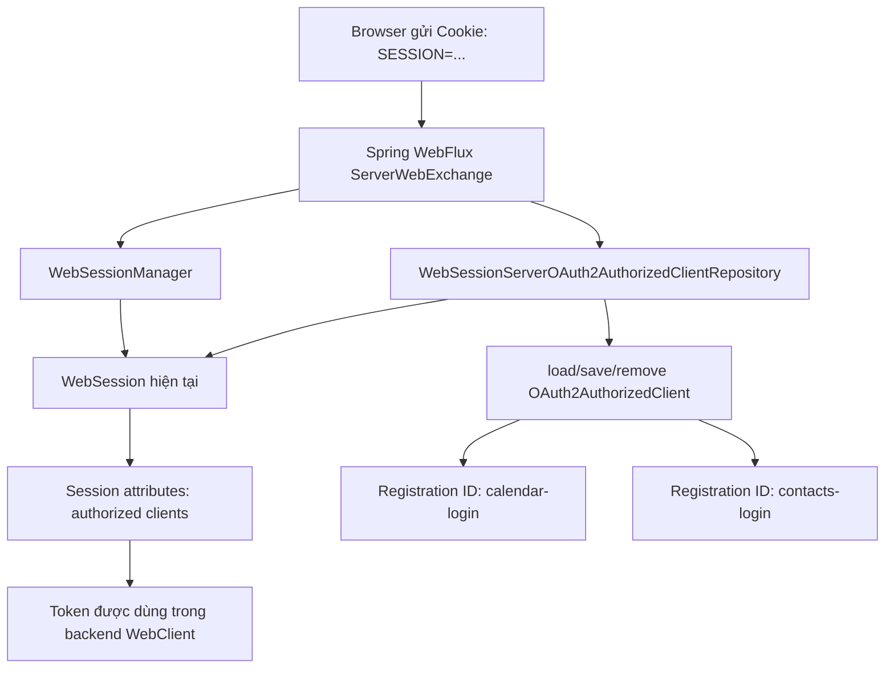
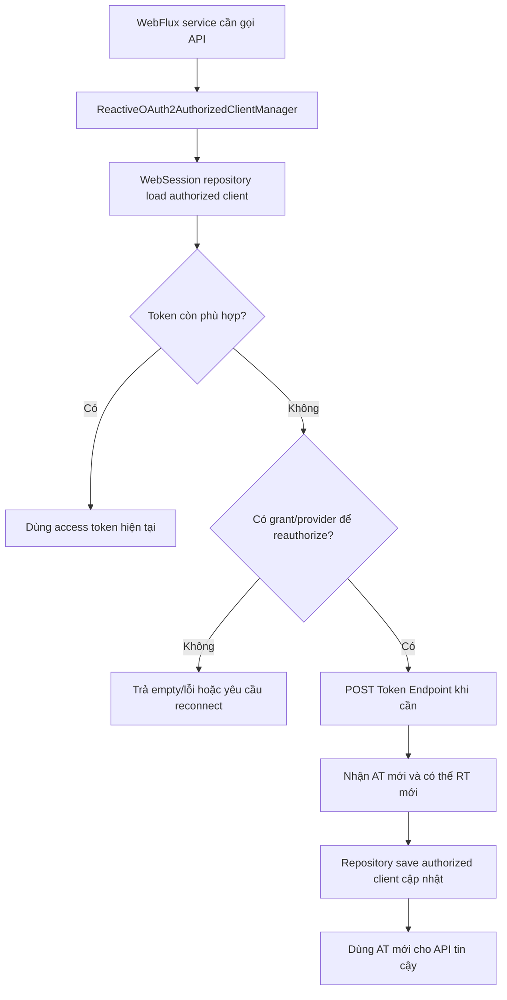
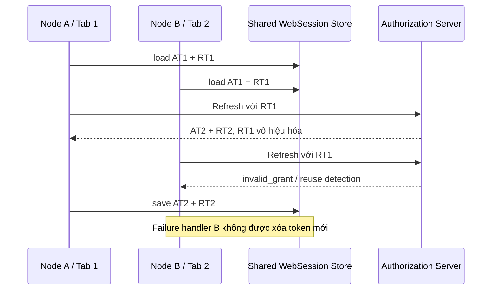

# 21.6. WebSessionServerOAuth2AuthorizedClientRepository

Trong **Spring Security OAuth 2.0 / OpenID Connect (OIDC) Client** chạy trên **Spring WebFlux**, backend có thể đăng nhập người dùng qua OIDC rồi dùng OAuth2 access token để gọi một REST API thay mặt người dùng. Để tái sử dụng token ở các HTTP requests tiếp theo, Spring Security cần một thành phần **lưu và tải `OAuth2AuthorizedClient`**.

Một implementation quan trọng cho ứng dụng reactive có phiên web là **`WebSessionServerOAuth2AuthorizedClientRepository`**. Thay vì yêu cầu một database hay service lưu token độc lập, implementation này giữ authorized clients trong **`WebSession`** gắn với browser/session hiện tại.

Tên lớp khá dài, nhưng mỗi thành phần đều có ý nghĩa:

- **WebSession**: trạng thái phiên của Spring WebFlux.
- **Server**: dùng trong ngữ cảnh HTTP server reactive, nơi có `ServerWebExchange`.
- **OAuth2AuthorizedClient**: đối tượng chứa registration và token đã cấp.
- **Repository**: cung cấp thao tác tải, lưu, xóa theo API Spring Security.

Bài học giải thích cơ chế, ví dụ cấu hình **Spring Boot 3.x / Spring Security 6.x / Reactor / WebFlux**, ranh giới bảo mật của việc lưu token theo phiên, khác biệt với authorized client service, tích hợp `WebClient`, refresh token, logout, scale nhiều instance, testing và các lỗi vận hành.

> **Điểm cốt lõi:** Repository này là *token storage theo WebSession*, không phải kho danh tính đa người dùng độc lập. Lưu access/refresh token trong session tạo sự thuận tiện cho web login, nhưng phải hiểu scope của session, quá trình logout và việc các requests đồng thời đọc/ghi dữ liệu.

Các token, client IDs, URL và secrets trong ví dụ đều giả lập. Không đưa credential thật vào source code, log hoặc tài liệu.

## 1. Ba khái niệm cần phân biệt từ đầu

Khi làm OAuth2 Client trong WebFlux, bạn sẽ gặp ba loại dữ liệu khác nhau:

| Thành phần | Nó mô tả gì? | Ví dụ |
| --- | --- | --- |
| `ClientRegistration` | Cấu hình một OAuth2/OIDC client: ID, secret, provider, redirect URI, scopes | `calendar-login` đăng ký tại OP |
| `Authentication` | Danh tính và authorities của người dùng đã đăng nhập vào ứng dụng | `OAuth2AuthenticationToken` với `OidcUser` |
| `OAuth2AuthorizedClient` | Trạng thái OAuth2 Client được cấp token cho một registration/principal | Access token `AT1`, refresh token `RT1` |

Một `ClientRegistration` có thể tồn tại ngay từ lúc ứng dụng khởi động, chưa có người dùng nào đăng nhập và chưa có token nào được cấp. Sau khi người dùng hoàn thành Authorization Code Flow, ứng dụng mới có thể tạo `OAuth2AuthorizedClient`.

### 1.1. Vì sao không đọc access token từ `Authentication.getCredentials()`?

`Authentication` dùng cho **xác thực và phân quyền trong ứng dụng**. Một user OIDC thường có principal `OidcUser`, nhưng access token dùng để gọi downstream API được quản lý theo **authorized client**. Việc giả định `Authentication.getCredentials()` chứa access token là sai ranh giới abstraction.

Trong WebFlux:

```text
ReactiveSecurityContextHolder / SecurityContext
    |
    +-- Authentication (OidcUser, authorities)
         Dùng để kiểm tra user đăng nhập/quyền nội bộ

ServerOAuth2AuthorizedClientRepository
    |
    +-- OAuth2AuthorizedClient (ClientRegistration, access/refresh token)
         Dùng để gọi downstream API
```

Hai cấu trúc cùng có thể liên quan browser session nhưng **không phải cùng object**, và cũng không có cùng chính sách lưu giữ.

### 1.2. Repository registration khác repository authorized client

| Câu hỏi | Thành phần trả lời |
| --- | --- |
| “`calendar-login` là client nào?” | `ReactiveClientRegistrationRepository` |
| “User đã được đăng nhập chưa?” | `SecurityContext`/`Authentication` |
| “Phiên này có access token `calendar-login` chưa?” | `ServerOAuth2AuthorizedClientRepository` |
| “Cần refresh hoặc xin token mới không?” | `ReactiveOAuth2AuthorizedClientManager` và provider |
| “API cho phép truy cập tài nguyên này không?” | Resource Server và authorization policy của API |

Không dùng `ReactiveClientRegistrationRepository.findByRegistrationId(...)` để tìm access token người dùng. Kết quả của nó chỉ là metadata của client.

## 2. `WebSessionServerOAuth2AuthorizedClientRepository` nằm ở đâu?

Spring Security có interface:

```java
package org.springframework.security.oauth2.client.web.server;

public interface ServerOAuth2AuthorizedClientRepository {
    // loadAuthorizedClient(...)
    // saveAuthorizedClient(...)
    // removeAuthorizedClient(...)
}
```

`WebSessionServerOAuth2AuthorizedClientRepository` là một implementation của interface đó. Nó dựa vào **`ServerWebExchange.getSession()`** để truy cập `WebSession` của request và quản lý authorized clients trong session attributes.



Mỗi khi ứng dụng xử lý một request cần token, repository có thể tải authorized client đã lưu. Khi một manager cấp/refresh token, repository có thể lưu lại trạng thái mới. Khi token bị loại bỏ hoặc user ngắt kết nối một integration, repository có thể xóa authorized client tương ứng.

### 2.1. `WebSession` là gì?

`WebSession` là abstraction phiên của Spring WebFlux; không phải `jakarta.servlet.http.HttpSession`. Một số API liên quan:

```java
Mono<WebSession> sessionMono = exchange.getSession();

// Ví dụ thao tác dữ liệu phiên (không phải lời khuyên lưu raw token):
sessionMono.flatMap(session -> {
    session.getAttributes().put("uiTheme", "dark");
    return Mono.empty();
});
```

`WebSession` có session ID, các attributes và cơ chế timeout/invalidation. Trong ứng dụng dùng Spring Session, dữ liệu có thể được đưa ra Redis hoặc một kho chia sẻ khác; chi tiết do `WebSessionStore` và cấu hình Spring Session quyết định.

**Browser cookie thường giữ một session ID, không phải toàn bộ refresh token** trong ứng dụng server-side WebSession thông dụng. Token nhạy cảm nằm phía server hoặc kho session do server quản lý. Tuy nhiên, việc bảo vệ cookie vẫn rất quan trọng vì cookie có thể trao quyền truy cập phiên.

### 2.2. Đây không phải persistent token store độc lập

Lưu token trong WebSession thường phù hợp với chức năng **ngắn hạn theo phiên web**:

- Browser đăng nhập OIDC.
- Controller trong cùng phiên gọi một API của provider.
- Người dùng logout hoặc session hết hạn, dữ liệu phiên được hủy theo vòng đời đã định.

Nó kém phù hợp nếu:

- Một job `@Scheduled` cần token sau khi browser đóng hoặc session hết hạn.
- Worker không có `ServerWebExchange` nhưng cần đọc authorized client.
- Ứng dụng phải lưu delegated access token dài hạn sau khi user offline.
- Bạn muốn quản lý tokens theo tài khoản nội bộ độc lập với từng browser/device.

Những trường hợp đó thường cần **`ReactiveOAuth2AuthorizedClientService`** hoặc một thiết kế token store khác có lifecycle và bảo vệ rõ ràng.

## 3. API của `ServerOAuth2AuthorizedClientRepository`

Ba thao tác chính của interface:

```java
import org.springframework.security.core.Authentication;
import org.springframework.security.oauth2.client.OAuth2AuthorizedClient;
import org.springframework.security.oauth2.client.web.server.ServerOAuth2AuthorizedClientRepository;
import org.springframework.web.server.ServerWebExchange;
import reactor.core.publisher.Mono;

// Chữ ký khái niệm của interface trong Spring Security 6:
<T extends OAuth2AuthorizedClient> Mono<T> loadAuthorizedClient(
        String clientRegistrationId,
        Authentication principal,
        ServerWebExchange exchange);

Mono<Void> saveAuthorizedClient(
        OAuth2AuthorizedClient authorizedClient,
        Authentication principal,
        ServerWebExchange exchange);

Mono<Void> removeAuthorizedClient(
        String clientRegistrationId,
        Authentication principal,
        ServerWebExchange exchange);
```

Đây là **minh họa contract**, không phải một interface cần định nghĩa lại. API chính xác nên được đối chiếu với Javadoc của phiên bản Spring Security trong ứng dụng.

### 3.1. `loadAuthorizedClient`

```java
Mono<OAuth2AuthorizedClient> clientMono =
        repository.loadAuthorizedClient(
                "calendar-login", authentication, exchange);
```

Kết quả có thể:

- Phát một `OAuth2AuthorizedClient` nếu tồn tại trong session.
- Hoàn tất rỗng nếu không tìm thấy.
- Phát lỗi khi thao tác session/store thất bại.

**Một Mono rỗng không chứng minh user đã bị OP thu hồi consent.** Có thể session mới, session timeout, user chưa authorize registration đó, hoặc client đã bị xóa khỏi session.

### 3.2. `saveAuthorizedClient`

```java
Mono<Void> save = repository.saveAuthorizedClient(
        authorizedClient, authentication, exchange);
```

Thao tác này lưu trạng thái authorized client được cấp hoặc cập nhật trong phiên. Khi manager refresh token và có authorized client mới, repository có thể được dùng để **lưu access token/refresh token mới**.

Không tự chia hai token thành nhiều `session.setAttribute` tùy tiện vì dễ làm lệch thế hệ token và khó quản lý logout.

### 3.3. `removeAuthorizedClient`

```java
Mono<Void> removal = repository.removeAuthorizedClient(
        "calendar-login", authentication, exchange);
```

Thao tác này **xóa trạng thái authorized client khỏi session**, nhưng không tự gọi OP Token Revocation Endpoint, không tự logout SSO và không xóa token đang lưu ở những kho khác.

Nếu app muốn “Ngắt kết nối Calendar”, thường còn phải thiết kế thu hồi token tại OP nếu hỗ trợ, xóa dữ liệu nghiệp vụ hoặc dừng background jobs liên quan.

### 3.4. `Mono<Void>` phải được compose vào pipeline

Sai:

```java
// KHÔNG NÊN: tạo publisher rồi không ai subscribe.
repository.removeAuthorizedClient(
        "calendar-login", authentication, exchange);

return Mono.just("Disconnected");
```

Publisher của thao tác xóa bị bỏ rơi; không có bảo đảm việc xóa được thực hiện.

Đúng:

```java
return repository.removeAuthorizedClient(
                "calendar-login", authentication, exchange)
        .thenReturn("Disconnected");
```

Spring WebFlux subscribe vào pipeline trả về từ handler. Không tự gọi `subscribe()` để tạo side effect tách rời transaction/response.

## 4. Điểm đặc biệt: token được phân vùng theo WebSession

Một implementation WebSession session-scoped thường giữ authorized clients theo **registration ID bên trong session hiện tại**.

Ví dụ về **mô hình logic** (không phải tên session attribute công khai được đảm bảo ổn định):

```text
WebSession S-101 (Browser A)
  authorizedClients:
    calendar-login -> OAuth2AuthorizedClient(AT_A, RT_A)
    contacts-login -> OAuth2AuthorizedClient(AT_C, RT_C)

WebSession S-202 (Browser B)
  authorizedClients:
    calendar-login -> OAuth2AuthorizedClient(AT_B, RT_B)
```

Điều này có một hệ quả quan trọng:

> **Đừng mặc định tham số `Authentication principal` khiến implementation WebSession trở thành kho token phân vùng theo mọi principal.** Ranh giới chính của implementation là phiên `WebSession`, còn authorized client entries thường được tìm theo registration ID trong phiên. Hãy đối chiếu implementation đúng version nếu bạn muốn dựa vào chi tiết keying.

Một browser có thể mở nhiều tab cùng session, nhưng một WebSession cũng có thể tồn tại qua các chuyển đổi account/login nếu ứng dụng không dọn đúng. Không dùng repository session-scoped như database token đa người dùng dùng chung.

### 4.1. Tại sao nhiều tabs lại nhìn thấy cùng authorized client?

Hai tabs của cùng browser profile thường gửi cùng session cookie. Nếu cả hai gọi API với `calendar-login`:

```text
Tab 1 ----+
          +----> WebSession S-101 ---> calendar-login token
Tab 2 ----+
```

Đây là hành vi thường phù hợp với trải nghiệm user login. Tuy nhiên, cả hai tab có thể đồng thời phát hiện access token gần hết hạn và cùng cố refresh, gây race với refresh token rotation. Nội dung ở phần concurrency sẽ giải thích.

### 4.2. Trường hợp đổi user trong cùng session

Giả sử:

1. User A đăng nhập, authorized client `calendar-login` lưu token của A.
2. Ứng dụng cho chuyển tài khoản mà không invalidate/cleanup session.
3. User B đăng nhập trong cùng WebSession.
4. Code gọi repository cho `calendar-login` mà không kiểm tra session đã được reset/đúng user.

Đây là một **điểm cần bảo vệ đặc biệt**. Nếu implementation lưu theo registration ID trong WebSession, không thể coi sự tồn tại của `Authentication principal` mới là đủ để tự loại token của A.

Thực hành an toàn:

- Áp dụng session lifecycle/switch-account policy rõ ràng.
- Invalidate session hoặc xóa các authorized clients cũ khi user logout/chuyển account, phù hợp kiến trúc.
- Không chuyển token của user trước sang user mới.
- Nếu ứng dụng hỗ trợ nhiều delegated identities trong cùng một browser session, **dùng storage có phân vùng theo identity riêng**, không dựa vào một entry per registration.
- Có kiểm thử “login A → logout → login B” để phát hiện token lẫn.

### 4.3. Registration ID không đại diện cho user

`calendar-login` là định danh **OAuth2 client configuration**. Nó không phải user ID, tenant ID hay `sub`. Hai users có thể dùng cùng registration nhưng phải có những token đúng với từng ngữ cảnh.

Nếu cần một record theo **(registration, principal)** bền vững trên nhiều phiên, hãy cân nhắc authorized client service thay vì session repository đơn thuần.

## 5. Luồng lưu token sau OIDC login

Giả sử app khai báo registration `calendar-login` dùng Authorization Code + OIDC.

```mermaid
sequenceDiagram
    autonumber
    actor U as Browser
    participant APP as WebFlux Application
    participant OP as OpenID Provider
    participant REPO as WebSession AuthorizedClientRepository
    U->>APP: GET /oauth2/authorization/calendar-login
    APP-->>U: Redirect tới OP /authorize
    U->>OP: Login, consent
    OP-->>U: Redirect ?code=...&state=...
    U->>APP: GET /login/oauth2/code/calendar-login
    Note over APP: Kiểm tra state, đổi code lấy token,
OIDC validation và Authentication
    APP->>REPO: saveAuthorizedClient(AT1, RT1 nếu có)
    REPO->>REPO: Lưu trong WebSession
    APP-->>U: Login thành công và session cookie
    U->>APP: GET /api/calendar
    APP->>REPO: loadAuthorizedClient("calendar-login", ...)
    REPO-->>APP: OAuth2AuthorizedClient
    APP-->>U: Response nghiệp vụ
```

Đây là luồng khái niệm; các filters, handlers và managers có thể tham gia ở các bước khác nhau theo cấu hình Spring Security. Quan trọng là **registration được chọn trước authentication**, còn **authorized client được lưu sau khi token được cấp**.

### 5.1. Lưu token trong WebSession không làm nó “thành token của session”

Access token vẫn là một **OAuth2 credential do Authorization Server cấp**, có scopes/audience/expiry theo hợp đồng bên ngoài. WebSession chỉ là nơi backend lưu credential để dùng lại.

Do đó:

- Xóa session không tự thu hồi token ở Authorization Server.
- Token bị revoke ở OP không tự xóa entry trong session.
- Session timeout khác access token expiry.
- User có session hợp lệ vẫn có thể bị API từ chối vì thiếu scope.
- ID Token dành cho OIDC login không mặc định được dùng làm Bearer token cho API.

## 6. Cấu hình Spring Boot WebFlux + OAuth2 Client

### 6.1. Dependencies Maven

```xml
<dependencies>
    <dependency>
        <groupId>org.springframework.boot</groupId>
        <artifactId>spring-boot-starter-webflux</artifactId>
    </dependency>
    <dependency>
        <groupId>org.springframework.boot</groupId>
        <artifactId>spring-boot-starter-oauth2-client</artifactId>
    </dependency>
</dependencies>
```

### 6.2. Dependencies Gradle

```groovy
dependencies {
    implementation 'org.springframework.boot:spring-boot-starter-webflux'
    implementation 'org.springframework.boot:spring-boot-starter-oauth2-client'
}
```

Nếu dự án đồng thời có `spring-boot-starter-web` một cách không chủ đích, Spring Boot có thể chọn Servlet application type. Hãy xác định app thật sự chạy WebFlux trước khi đăng ký `ServerOAuth2AuthorizedClientRepository`.

### 6.3. `application.yml`

```yaml
spring:
  security:
    oauth2:
      client:
        registration:
          calendar-login:
            provider: calendar-op
            client-id: ${CALENDAR_CLIENT_ID}
            client-secret: ${CALENDAR_CLIENT_SECRET}
            client-authentication-method: client_secret_basic
            authorization-grant-type: authorization_code
            redirect-uri: "{baseUrl}/login/oauth2/code/{registrationId}"
            scope:
              - openid
              - profile
              - calendar.read

        provider:
          calendar-op:
            issuer-uri: ${CALENDAR_ISSUER_URI}
```

Trong ứng dụng thực, `calendar.read` chỉ có giá trị nếu OP/API hỗ trợ và cấp quyền đó. `openid` yêu cầu ngữ cảnh OIDC. Refresh token **không được đảm bảo** chỉ vì user đã đăng nhập; việc cấp phụ thuộc OP policy, loại client và consent.

### 6.4. `application.properties` tương đương

```properties
spring.security.oauth2.client.registration.calendar-login.provider=calendar-op
spring.security.oauth2.client.registration.calendar-login.client-id=${CALENDAR_CLIENT_ID}
spring.security.oauth2.client.registration.calendar-login.client-secret=${CALENDAR_CLIENT_SECRET}
spring.security.oauth2.client.registration.calendar-login.client-authentication-method=client_secret_basic
spring.security.oauth2.client.registration.calendar-login.authorization-grant-type=authorization_code
spring.security.oauth2.client.registration.calendar-login.redirect-uri={baseUrl}/login/oauth2/code/{registrationId}
spring.security.oauth2.client.registration.calendar-login.scope=openid,profile,calendar.read
spring.security.oauth2.client.provider.calendar-op.issuer-uri=${CALENDAR_ISSUER_URI}
```

Dùng YAML hoặc properties theo dự án, không commit client secret thật. OP phải cho phép redirect URI mà Spring tạo từ public base URL; với reverse proxy cần cấu hình forwarded headers chỉ từ proxy tin cậy.

## 7. Tự khai báo `WebSessionServerOAuth2AuthorizedClientRepository` bean

Nếu muốn **chủ động chọn session-based authorized client storage** cho WebFlux app:

```java
import org.springframework.context.annotation.Bean;
import org.springframework.context.annotation.Configuration;
import org.springframework.security.oauth2.client.web.server.ServerOAuth2AuthorizedClientRepository;
import org.springframework.security.oauth2.client.web.server.WebSessionServerOAuth2AuthorizedClientRepository;

@Configuration
public class ReactiveAuthorizedClientStorageConfig {

    @Bean
    ServerOAuth2AuthorizedClientRepository
            authorizedClientRepository() {

        return new WebSessionServerOAuth2AuthorizedClientRepository();
    }
}
```

Class này hoạt động theo `WebSession` hiện tại. Thông thường bạn không cần một access token database schema để bắt đầu.

**Cảnh báo về auto-configuration:** tùy Spring Boot/Security phiên bản và beans khác, framework có thể đã cung cấp một repository thích hợp. Khai báo bean của bạn có thể thay đổi chính sách lưu token đang được áp dụng, đặc biệt nếu app trước đó dùng `AuthenticatedPrincipalServerOAuth2AuthorizedClientRepository` hoặc một custom service. Chỉ thay khi bạn **muốn session-based semantics** và đã hiểu tác động đến multi-user, logout và background jobs.

### 7.1. Một repository không tự kích hoạt login

Bean này không thay:

- `ReactiveClientRegistrationRepository` để tìm client.
- `SecurityWebFilterChain`/`oauth2Login()` để login.
- OP Token Endpoint để cấp token.
- `ReactiveOAuth2AuthorizedClientManager` khi backend muốn cấp/refresh token để gọi API.
- Resource Server để xác minh Bearer token đi vào API.

Repository chỉ cung cấp **cách lưu/tìm/xóa authorized clients**.

### 7.2. Tại sao không tự tạo session attribute `"access_token"`?

Anti-pattern:

```java
// Không nên: nhân bản token trực tiếp vào session attribute của app.
exchange.getSession().doOnNext(session -> {
    session.getAttributes().put(
            "access_token",
            authorizedClient.getAccessToken().getTokenValue());
});
```

Như vậy:

- Token nằm thêm một nơi ngoài abstraction.
- Access token cũ có thể tồn tại dù manager đã refresh.
- Không có xử lý refresh token tương ứng.
- Logout/cleanup khó hơn.
- Người đọc session có thêm một đường lấy credential.

Hãy để authorized client repository/manager điều phối token; nếu cần state UI, chỉ lưu dữ liệu tối thiểu không nhạy cảm.

## 8. Dùng repository trong `ReactiveOAuth2AuthorizedClientManager`

Một cách phổ biến là kết hợp repository với **`DefaultReactiveOAuth2AuthorizedClientManager`** trong ngữ cảnh có `ServerWebExchange`.

```java
import org.springframework.context.annotation.Bean;
import org.springframework.context.annotation.Configuration;
import org.springframework.security.oauth2.client.DefaultReactiveOAuth2AuthorizedClientManager;
import org.springframework.security.oauth2.client.ReactiveOAuth2AuthorizedClientManager;
import org.springframework.security.oauth2.client.ReactiveOAuth2AuthorizedClientProvider;
import org.springframework.security.oauth2.client.ReactiveOAuth2AuthorizedClientProviderBuilder;
import org.springframework.security.oauth2.client.registration.ReactiveClientRegistrationRepository;
import org.springframework.security.oauth2.client.web.server.ServerOAuth2AuthorizedClientRepository;

@Configuration
public class ReactiveOAuth2ManagerConfig {

    @Bean
    ReactiveOAuth2AuthorizedClientManager
            reactiveAuthorizedClientManager(
                    ReactiveClientRegistrationRepository registrations,
                    ServerOAuth2AuthorizedClientRepository authorizedClients) {

        ReactiveOAuth2AuthorizedClientProvider provider =
                ReactiveOAuth2AuthorizedClientProviderBuilder.builder()
                        .authorizationCode()
                        .refreshToken()
                        .build();

        DefaultReactiveOAuth2AuthorizedClientManager manager =
                new DefaultReactiveOAuth2AuthorizedClientManager(
                        registrations, authorizedClients);

        manager.setAuthorizedClientProvider(provider);
        return manager;
    }
}
```

Điểm quan trọng:

1. `DefaultReactiveOAuth2AuthorizedClientManager` dùng **reactive repository dành cho HTTP server**.
2. `refreshToken()` provider có thể thực hiện reauthorization nếu có refresh token và access token cần cấp lại.
3. `authorizationCode()` không tự bật browser login từ một background job; browser flow và callback phải được xử lý riêng.
4. Manager có thể **dùng lại token hiện có**, cấp token mới hoặc trả empty/error theo ngữ cảnh.
5. Manager cần ngữ cảnh `ServerWebExchange` phù hợp khi làm việc với repository session-based. Nếu gọi trực tiếp từ service, phải sử dụng context/request attributes theo API của phiên bản Spring Security tương ứng; tích hợp `WebClient` trong request thường thuận tiện hơn.

### 8.1. `OAuth2AuthorizedClient` không đồng nghĩa token hợp lệ mãi

Một access token được lưu trong WebSession vẫn có `expiresAt`. Manager/provider có thể refresh khi cần, nhưng session repository tự nó **không gọi Token Endpoint** và không kiểm tra đầy đủ audience/scope của token đối với mọi API.

Repository chỉ giữ trạng thái; **lifecycle** thuộc manager/provider và **API authorization** thuộc Resource Server.

### 8.2. Vòng đời token khi access token hết hạn



Không có bảo đảm **mỗi lần gọi manager là một lần refresh**. Nó có thể chỉ load và trả token hiện tại khi chưa cần reauthorization.

## 9. Tích hợp `WebClient` với authorized client trong session

Trong WebFlux, outbound HTTP client thường là **`WebClient`**. Spring Security cung cấp **`ServerOAuth2AuthorizedClientExchangeFilterFunction`** để kết hợp token acquisition/attachment vào requests.

### 9.1. Cấu hình WebClient

Một cấu hình dùng manager đã tạo ở mục 8:

```java
import org.springframework.context.annotation.Bean;
import org.springframework.context.annotation.Configuration;
import org.springframework.security.oauth2.client.ReactiveOAuth2AuthorizedClientManager;
import org.springframework.security.oauth2.client.web.reactive.function.client.ServerOAuth2AuthorizedClientExchangeFilterFunction;
import org.springframework.web.reactive.function.client.WebClient;

@Configuration
public class CalendarWebClientConfig {

    @Bean("calendarWebClient")
    WebClient calendarWebClient(
            ReactiveOAuth2AuthorizedClientManager manager) {

        ServerOAuth2AuthorizedClientExchangeFilterFunction oauth2 =
                new ServerOAuth2AuthorizedClientExchangeFilterFunction(
                        manager);

        return WebClient.builder()
                .baseUrl("https://calendar-api.example.com")
                .filter(oauth2)
                .build();
    }
}
```

Tại nơi gọi:

```java
import static org.springframework.security.oauth2.client.web.reactive.function.client.ServerOAuth2AuthorizedClientExchangeFilterFunction.clientRegistrationId;

// Dùng trong request WebFlux có principal/context phù hợp.
Mono<String> events = calendarWebClient.get()
        .uri("/v1/events")
        .attributes(clientRegistrationId("calendar-login"))
        .retrieve()
        .bodyToMono(String.class);
```

`clientRegistrationId(...)` ở đây là **request attribute để OAuth2 filter chọn registration**, không phải HTTP header gửi cho Calendar API.

### 9.2. Không tự động gắn token vào mọi HTTP request

Chỉ tạo `WebSessionServerOAuth2AuthorizedClientRepository` **không làm mọi `WebClient` tự gắn Bearer token**. Bạn cần:

- Một `WebClient` có OAuth2 exchange filter phù hợp, hoặc
- Chủ động lấy `OAuth2AuthorizedClient` và gắn token vào request ở một adapter đã được kiểm soát.

Không kết hợp nhiều cơ chế gắn `Authorization` header cho cùng request nếu không có lý do rõ, vì có thể dùng nhầm registration/principal và rất khó chẩn đoán.

### 9.3. Cẩn thận với default client registration

Một số cấu hình của OAuth2 WebClient filter có thể tự chọn authorized client mặc định hoặc lấy từ Authentication hiện tại. Điều đó tiện lợi nhưng nguy hiểm nếu cùng WebClient gọi **nhiều API hosts**: access token có thể bị gửi tới request không có mục đích OAuth2 phù hợp.

Nên chọn registration rõ ràng theo tính năng và đặt **base URL cố định của API đáng tin cậy**. Không lấy đích API từ query parameter rồi gửi kèm token. Khi redirect sang host khác, không forward Bearer header nếu destination chưa được phép.

### 9.4. WebSession repository không thay thế `WebClient` retry policy

Nếu downstream API trả `401 invalid_token`, việc repository đã lưu một authorized client không làm API response tự được gửi lại. Invalidation/failure handling và retry HTTP nghiệp vụ là hai chính sách khác nhau; đặc biệt với POST/PATCH/streaming, không retry mù để tránh tạo tác động trùng.

## 10. Các triển khai repository/service khác: chọn đúng semantics

Trong reactive OAuth2 Client, bạn có thể gặp:

| Thành phần | Cơ sở lưu/truy xuất | Phù hợp |
| --- | --- | --- |
| **`WebSessionServerOAuth2AuthorizedClientRepository`** | `WebSession` hiện tại | Token gắn browser session |
| **`AuthenticatedPrincipalServerOAuth2AuthorizedClientRepository`** | Dùng `ReactiveOAuth2AuthorizedClientService` cho principal đã authenticated và có thể dùng repository khác cho anonymous | Token gắn principal/service theo cấu hình |
| **`ReactiveOAuth2AuthorizedClientService`** | Dịch vụ lưu token theo registration/principal, không buộc WebSession | Backend jobs, dữ liệu token cần tồn tại ngoài phiên |
| **`InMemoryReactiveOAuth2AuthorizedClientService`** | In-memory service theo principal/registration | Demo/single-instance hoặc mô hình ngắn hạn |
| **Custom reactive service/repository** | Database/distributed store có policy riêng | Nhu cầu retention, multi-instance và consistency |

### 10.1. `AuthenticatedPrincipalServerOAuth2AuthorizedClientRepository` khác thế nào?

Implementation này phối hợp **Authentication** với `ReactiveOAuth2AuthorizedClientService` để quản lý authorized clients cho **principal đã xác thực**. Với principal anonymous, có thể dùng một repository riêng (thường session-based) theo cấu hình.

Điều quan trọng là **semantics keying và lifecycle khác** so với `WebSessionServerOAuth2AuthorizedClientRepository` thuần túy:

- Session repository thiên về **một browser WebSession**.
- Service-based repository có thể gắn token theo **principal name và registration** độc lập từng session.
- Nếu user logout nhưng authorized client service còn giữ token, token có thể tồn tại **ngoài session** theo retention policy.

Đừng thay một implementation bằng implementation khác mà không kiểm tra yêu cầu nghiệp vụ và bảo mật.

### 10.2. Ví dụ service-backed repository

Một ứng dụng có thể chủ động đăng ký:

```java
import org.springframework.context.annotation.Bean;
import org.springframework.context.annotation.Configuration;
import org.springframework.security.oauth2.client.ReactiveOAuth2AuthorizedClientService;
import org.springframework.security.oauth2.client.web.server.AuthenticatedPrincipalServerOAuth2AuthorizedClientRepository;
import org.springframework.security.oauth2.client.web.server.ServerOAuth2AuthorizedClientRepository;
import org.springframework.security.oauth2.client.web.server.WebSessionServerOAuth2AuthorizedClientRepository;

@Configuration
class PrincipalAwareAuthorizedClientConfig {

    @Bean
    ServerOAuth2AuthorizedClientRepository authorizedClientRepository(
            ReactiveOAuth2AuthorizedClientService service) {

        AuthenticatedPrincipalServerOAuth2AuthorizedClientRepository repository =
                new AuthenticatedPrincipalServerOAuth2AuthorizedClientRepository(
                        service);

        repository.setAnonymousAuthorizedClientRepository(
                new WebSessionServerOAuth2AuthorizedClientRepository());

        return repository;
    }
}
```

**Đây là phương án thay thế**, không phải bean thứ hai cần khai báo đồng thời với bean `authorizedClientRepository()` thuần WebSession ở mục 7. Tên method và bean trong cấu hình dự án cần được tổ chức không mâu thuẫn.

Hãy xác nhận API `setAnonymousAuthorizedClientRepository` trên phiên bản Spring Security bạn dùng. Mục đích ví dụ là minh họa lựa chọn **service-backed for authenticated vs session-backed for anonymous**, không có nghĩa ứng dụng bắt buộc phải có mô hình đó.

### 10.3. Khi nào không nên dùng session repository?

Không nên phụ thuộc chỉ vào WebSession khi:

- User ủy quyền cho lịch cá nhân để chạy đồng bộ ban đêm sau khi browser logout.
- Worker tiếp tục chạy dù session hết hạn.
- Có yêu cầu quản lý consent dài hạn theo internal account.
- Hệ thống cần tự phục hồi token qua database sau restart mà không có browser session.
- Nhiều thiết bị của cùng user cần dùng chung delegated authorization theo chính sách sản phẩm.

Những trường hợp này cần thiết kế service/token storage riêng, có quyền truy cập, encryption, retention, logout/revocation và audit rõ ràng. Chuyển sang service không tự làm token an toàn hơn nếu storage hoặc identity mapping sai.

## 11. WebSession và Reactor Context không phải một thứ

Trong WebFlux:

- `WebSession` là **trạng thái phiên** có thể tồn tại qua nhiều HTTP requests.
- **Reactor Context** là context đi cùng chuỗi xử lý reactive, nơi Spring Security có thể truyền `SecurityContext`/`Authentication`.
- `ServerWebExchange` đại diện cho **HTTP exchange của request hiện tại**.

Một yêu cầu thường có cả ba, nhưng chúng có vòng đời khác nhau.

```text
Browser session (nhiều requests)
    +-- WebSession S-101: authorized clients / session state

Request #1 reactive pipeline
    +-- ServerWebExchange #1
    +-- Reactor Context: Authentication

Request #2 reactive pipeline
    +-- ServerWebExchange #2
    +-- Reactor Context: Authentication

Background job
    +-- Không có ServerWebExchange từ browser
    +-- Không mặc định có Authentication user
```

### 11.1. Không lấy `HttpSession` trong WebFlux

Sai trong pure WebFlux:

```java
import jakarta.servlet.http.HttpSession;

// Không phải API session của WebFlux:
void useSession(HttpSession session) { ... }
```

Đúng với WebFlux:

```java
import org.springframework.web.server.ServerWebExchange;
import reactor.core.publisher.Mono;

Mono<String> currentSessionId(ServerWebExchange exchange) {
    return exchange.getSession()
            .map(session -> session.getId());
}
```

**Không trả session ID ra API hay log production.** Đoạn code chỉ minh họa cách đi từ `ServerWebExchange` đến `WebSession`. Session ID là credential nhạy cảm, có thể dẫn đến session hijacking nếu bị lộ.

### 11.2. Không lấy Authentication từ thread-local kiểu Servlet

Trong reactive code, dùng:

```java
ReactiveSecurityContextHolder.getContext()
        .map(SecurityContext::getAuthentication)
```

theo pipeline phù hợp. Không giả định `SecurityContextHolder.getContext()` trả user hiện tại ở mọi Reactor thread. Không lưu `Authentication` trong static mutable field để truy cập từ scheduler.

### 11.3. Không `block()` để đọc authorized client

Sai:

```java
OAuth2AuthorizedClient client =
        repository.<OAuth2AuthorizedClient>loadAuthorizedClient(
                "calendar-login", authentication, exchange)
                .block();
```

Trong WebFlux event loop, `block()` có thể gây lỗi hoặc làm nghẽn thread. Đúng là compose:

```java
return repository.<OAuth2AuthorizedClient>loadAuthorizedClient(
                "calendar-login", authentication, exchange)
        .flatMap(client -> callTrustedApi(client));
```

`callTrustedApi` ở đây là service reactive giả định trả `Mono<T>`, không phải một API Spring Security có sẵn.

## 12. Controller xem metadata authorized client

Một endpoint internal để hiển thị trạng thái “đã kết nối Calendar” **không cần trả token**. Có thể tra repository rồi tạo DTO chỉ chứa thông tin tối thiểu:

```java
import java.time.Instant;

import org.springframework.security.core.Authentication;
import org.springframework.security.oauth2.client.OAuth2AuthorizedClient;
import org.springframework.security.oauth2.client.web.server.ServerOAuth2AuthorizedClientRepository;
import org.springframework.web.bind.annotation.GetMapping;
import org.springframework.web.bind.annotation.RestController;
import org.springframework.web.server.ServerWebExchange;

import reactor.core.publisher.Mono;

@RestController
public class CalendarConnectionController {

    record CalendarConnection(boolean connected,
                              Instant accessTokenExpiresAt) {}

    private final ServerOAuth2AuthorizedClientRepository repository;

    public CalendarConnectionController(
            ServerOAuth2AuthorizedClientRepository repository) {
        this.repository = repository;
    }

    @GetMapping("/api/calendar/connection")
    Mono<CalendarConnection> connection(
            Authentication authentication,
            ServerWebExchange exchange) {

        return repository.<OAuth2AuthorizedClient>loadAuthorizedClient(
                    "calendar-login", authentication, exchange)
                .map(client -> new CalendarConnection(
                        true,
                        client.getAccessToken().getExpiresAt()))
                .defaultIfEmpty(
                        new CalendarConnection(false, null));
    }
}
```

**Giả định:** endpoint đã được Spring Security bảo vệ, `Authentication` tương ứng request hiện tại và user được phép xem thông tin kết nối. Đây là endpoint minh họa; ứng dụng production có thể chỉ cần trả boolean `connected`, tránh xuất expiry nếu UI không có nhu cầu.

**Không được hiểu `connected=true` là access token chắc chắn được API chấp nhận.** Token có thể bị revoke hoặc thiếu scope/audience dù đang lưu trong session.

### 12.1. Tại sao không trả cả `OAuth2AuthorizedClient`?

Không làm:

```java
@GetMapping("/debug/authorized-client")
Mono<OAuth2AuthorizedClient> debug(...) {
    return repository.loadAuthorizedClient(...);
}
```

JSON serialization có thể làm lộ access token, refresh token hoặc client secret/metadata. Nếu cần hỗ trợ kỹ thuật, chỉ trả các trường **đã được phép công bố**, không gửi raw object cho browser.

## 13. Xóa authorized client trong WebSession khi user disconnect

Giả sử người dùng muốn “Ngắt kết nối Calendar”. Một endpoint nội bộ có thể xóa authorized client trong phiên:

```java
import org.springframework.http.ResponseEntity;
import org.springframework.security.core.Authentication;
import org.springframework.security.oauth2.client.web.server.ServerOAuth2AuthorizedClientRepository;
import org.springframework.web.bind.annotation.DeleteMapping;
import org.springframework.web.bind.annotation.RestController;
import org.springframework.web.server.ServerWebExchange;

import reactor.core.publisher.Mono;

@RestController
class CalendarDisconnectController {

    private final ServerOAuth2AuthorizedClientRepository repository;

    CalendarDisconnectController(
            ServerOAuth2AuthorizedClientRepository repository) {
        this.repository = repository;
    }

    @DeleteMapping("/api/calendar/connection")
    Mono<ResponseEntity<Void>> disconnect(
            Authentication authentication,
            ServerWebExchange exchange) {

        return repository.removeAuthorizedClient(
                    "calendar-login", authentication, exchange)
                .thenReturn(ResponseEntity.noContent().build());
    }
}
```

**Cảnh báo:** Đây mới là xóa trạng thái **local WebSession**. Nếu yêu cầu nghiệp vụ là thu hồi consent hoặc vô hiệu hóa refresh token tại OP, cần một workflow riêng với revocation endpoint được hỗ trợ, cleanup các kho token khác và audit. `removeAuthorizedClient` không tự gửi request revocation.

Đối với DELETE từ browser dùng cookie, hãy giữ **CSRF protection** phù hợp. Không tắt CSRF toàn ứng dụng chỉ vì test nhận 403.

### 13.1. Có cần kiểm tra ownership không?

Trong session-based repository, request đã được xác thực và session hiện tại là điều kiện khởi đầu. Tuy nhiên, app nhiều tài khoản hoặc nhiều OP cần kiểm tra **đây có thật sự là liên kết của user hiện tại** theo account/session lifecycle, đặc biệt khi chuyển account mà không hủy phiên.

Không nhận một `principalName` từ URL rồi tin đó là token được phép xóa/đọc. Quyền disconnect phải gắn với authenticated principal và integration tương ứng.

### 13.2. Dọn toàn bộ session có thay thế xóa từng client không?

Khi logout, session có thể bị invalidated và các session attributes bị xóa; khi đó tất cả authorized clients giữ chỉ trong session ấy sẽ biến mất. Tuy nhiên:

- Có thể còn authorized clients ở một service/database khác.
- Access/refresh tokens đã phát vẫn có thể có hiệu lực tại OP.
- Một browser khác có session riêng không bị ảnh hưởng.
- Hệ thống backup có thể còn lưu session snapshot.

“Xóa local session” và “thu hồi toàn bộ quyền OAuth2 ở OP” là hai thao tác khác nhau.

## 14. Logout, session fixation và đổi tài khoản

Một website có session thường cần xử lý:

- Logout khỏi ứng dụng.
- Logout tại OP nếu OIDC logout được hỗ trợ.
- Đổi người dùng trong cùng browser.
- Session timeout.
- Session invalidation do user/account bị khóa.
- Thu hồi token khi integration bị disconnect.
- Quản lý nhiều browser/devices.

### 14.1. Cấu hình logout reactive

```java
import org.springframework.context.annotation.Bean;
import org.springframework.context.annotation.Configuration;
import org.springframework.security.config.Customizer;
import org.springframework.security.config.web.server.ServerHttpSecurity;
import org.springframework.security.web.server.SecurityWebFilterChain;

@Configuration
public class ReactiveSecurityConfig {

    @Bean
    SecurityWebFilterChain securityWebFilterChain(
            ServerHttpSecurity http) {

        return http
                .authorizeExchange(exchanges -> exchanges
                        .pathMatchers("/", "/login", "/error",
                                      "/css/**", "/js/**")
                            .permitAll()
                        .anyExchange()
                            .authenticated())
                .oauth2Login(Customizer.withDefaults())
                .logout(Customizer.withDefaults())
                .build();
    }
}
```

Cấu hình này là **khung khởi đầu**, không phải lời khẳng định logout mặc định đã thực hiện mọi loại cleanup hoặc OIDC RP-Initiated Logout. Xác nhận logic logout/session invalidation thực tế, CSRF và authorized client repository đã được cấu hình trong ứng dụng.

Nếu chỉ dùng WebSession repository cho tokens, invalidate session đúng cách là bước quan trọng để không giữ token qua login của người dùng khác. Nếu dùng service-backed repository, phải thiết kế **remove/revoke theo principal/registration** riêng.

### 14.2. Session fixation

Không tự giữ nguyên session/token state của người A sau khi user B login. Spring Security có cơ chế session management và authentication integration tùy phiên bản, nhưng **custom authentication, account switching hoặc session migrations** có thể khiến app tự chịu trách nhiệm dọn dữ liệu.

Một bộ test tối thiểu:

```text
Login A -> authorize Calendar A
Logout A -> session invalidated/authorized client cleared
Login B -> Calendar A token không được nhìn thấy
Login B -> authorize Calendar B
```

Nếu app hỗ trợ "switch account" mà không logout, hãy thiết kế lại token store để phân vùng identity và kiểm thử riêng.

## 15. `WebSession` là token store nhạy cảm

`OAuth2AuthorizedClient` có thể chứa:

- `OAuth2AccessToken` với raw `tokenValue`.
- `OAuth2RefreshToken` nếu OP cấp.
- `ClientRegistration` với thông tin client/provider, có thể có client secret trong object liên quan.
- `principalName` gắn identity.
- Expiry/scope metadata.

Tất cả đều cần được bảo vệ. Không coi dữ liệu trong session là vô hại chỉ vì browser không nhìn thấy trực tiếp.

### 15.1. Bề mặt cần bảo vệ

| Bề mặt | Nguy cơ | Biện pháp |
| --- | --- | --- |
| Session cookie | Bị lấy cắp dẫn tới session hijacking | HTTPS, Secure, HttpOnly, SameSite phù hợp, chống XSS/CSRF |
| In-memory WebSession | Memory dump/debug logs | Giới hạn diagnostic tooling, không dump token |
| Spring Session Redis/JDBC | Nhiều operators/service accounts có thể đọc token | Network isolation, ACL, TLS, encryption, backup policy |
| Application logs/APM | Raw Authorization header/token response bị ghi lại | Redaction và data minimization |
| Session replication/backups | Token tồn tại lâu hơn session TTL thực tế | Retention và cleanup rõ |
| Multiple browser tabs | Đồng thời refresh RT cũ | Coordination/optimistic locking khi cần |
| Login user A → B | Stale authorized client trong cùng session | Session invalidation hoặc identity-aware storage |
| Xóa authorized client | Token vẫn có thể có hiệu lực ở OP | Revocation/disconnect policy |

### 15.2. Cookie có cần chứa refresh token không?

**Không.** Trong kiến trúc WebSession server-side thông dụng, cookie chỉ cần chứa một session identifier. Access/refresh tokens nằm server-side. Không tự serialize token vào client-side cookie, localStorage hay HTML chỉ để WebClient dễ lấy.

Nếu một ứng dụng cố tình dùng client-side session/token architecture, threat model sẽ khác; không thể suy các thuộc tính bảo mật của server-side `WebSession` áp dụng nguyên vẹn.

### 15.3. SameSite cần xét OIDC callback

`SameSite=Lax` thường phù hợp Authorization Code Flow callback top-level GET, nhưng một số OIDC deployments dùng `response_mode=form_post`. Với cross-site form POST callback, cookie policy có thể khiến session chứa `state` không được gửi và login thất bại. Đừng sửa bằng cách tắt toàn bộ cookie security; chọn chế độ được OP/flow hỗ trợ và kiểm thử browser thực tế.

## 16. Spring Session và chạy nhiều instance

Một WebFlux app chạy nhiều replicas có thể gặp:

```text
Browser -> Node A: Login thành công, token lưu trong local session
Browser -> Node B: Gọi API, session/token không tìm thấy
```

Nếu session chỉ ở memory của Node A, Node B không có state. Các giải pháp gồm:

- Session stickiness ở load balancer nếu chấp nhận giới hạn này.
- Shared reactive session store qua **Spring Session** với công nghệ phù hợp.
- Kiến trúc token store khác khi cần tách authorized client khỏi browser session.
- Cơ chế session migration và failover rõ ràng.

### 16.1. Shared session không tự giải quyết concurrency

Ngay cả khi nhiều nodes dùng chung Redis/session store, hai requests đồng thời có thể tải cùng bản authorized client rồi cùng refresh. Spring Session giúp truy cập phiên giữa nodes, **không tự bảo đảm atomic refresh-token rotation hay distributed locking**.

Ví dụ:



Nếu OP dùng refresh token rotation, việc dùng lại RT1 có thể làm provider từ chối hoặc thậm chí thu hồi token family theo policy.

### 16.2. Điều phối refresh theo session và registration

Nếu hệ thống cần chặn race, một chiến lược là single-flight theo key:

```text
key = (sessionOrTrustedPrincipalNamespace, registrationId)
```

Bên trong vùng điều phối:

1. Lấy lock/lease hoặc vai trò leader theo key.
2. **Đọc lại authorized client mới nhất sau khi có lock**.
3. Chỉ refresh nếu token vẫn cần cấp lại.
4. Lưu AT/RT mới cùng một thế hệ token.
5. Followers đọc lại kết quả mới thay vì dùng RT cũ.
6. Xử lý timeout/crash theo policy của OP; không retry RT đã có thể được rotate.
7. Dùng conditional save/delete khi storage hỗ trợ để tránh stale writes.

**Không mặc định `WebSessionServerOAuth2AuthorizedClientRepository` có distributed CAS/locking**. Nếu cần bảo đảm mạnh, ứng dụng phải bổ sung cơ chế ở orchestration/store hoặc chọn kiến trúc khác.

### 16.3. Không giữ raw session ID trong lock key/log

Một key lock dựa trên session cần được thiết kế để không làm lộ session identifier. Có thể dùng định danh nội bộ được bảo vệ hoặc hash/HMAC phù hợp, giới hạn quyền đọc lock store. Không ghi raw session cookie vào metric labels.

## 17. Refresh token rotation và cập nhật session an toàn

Giả sử repository đang giữ:

```text
WebSession S-101:
  calendar-login:
    accessToken  = AT1
    refreshToken = RT1
```

Khi manager refresh thành công, OP trả:

```text
accessToken  = AT2
refreshToken = RT2
```

Session cần thấy **một authorized client cập nhật nhất quán**, không phải AT2 ghép RT1 cũ:

```text
WebSession S-101:
  calendar-login:
    accessToken  = AT2
    refreshToken = RT2
```

**Không tự giữ RT1** khi OP đã cấp RT2; reuse token cũ có thể kích hoạt security policy của OP.

### 17.1. Nếu refresh response không có `refresh_token` mới

OAuth2 không bắt buộc OP luôn rotate. Nếu refresh response không có token mới, xử lý theo protocol/provider contract; với cơ chế không rotation, refresh token hiện tại thường vẫn dùng được. Không tự lưu `null` vào refresh token field chỉ do response không mang trường mới.

Để tránh sai semantics, ưu tiên provider chuẩn của Spring Security, đồng thời xác minh storage thực sự lưu authorized client mới.

### 17.2. Crash sau khi OP rotate nhưng trước khi save

Một vấn đề phân tán không thể bỏ qua:

```text
Client gửi RT1 -> OP
OP vô hiệu hóa RT1 và cấp RT2
Client nhận RT2 nhưng node crash trước khi lưu WebSession
Store vẫn còn RT1
```

Không có transaction ACID chung giữa database/session store của ứng dụng và OP. Retry mù với RT1 có thể bị coi là reuse. Cần recovery policy, OP grace period nếu có, hoặc user reauthorization khi không khôi phục được.

### 17.3. Session serialization ảnh hưởng thế nào?

Khi lưu `OAuth2AuthorizedClient` vào session store ngoài JVM, các đối tượng liên quan phải được biểu diễn/serialize theo cơ chế của Spring Session và serializer tương thích. Nếu framework version, serialization modules hoặc custom principal/config thay đổi, session cũ có thể không đọc được sau deployment.

Không giải quyết bằng việc log serialized session hoặc token thật. Dùng test fixture và kiểm tra migration/compatibility khi nâng phiên bản.

## 18. `loadAuthorizedClient` có phải kiểm tra token expiry không?

Không. Repository có nhiệm vụ **lấy object đã lưu** theo ngữ cảnh. Nó không phải Resource Server token validator hay OAuth2 provider.

```java
return repository.<OAuth2AuthorizedClient>loadAuthorizedClient(
        "calendar-login", authentication, exchange)
        .map(client -> client.getAccessToken().getExpiresAt());
```

Kết quả chỉ là metadata. Nếu expiry ở quá khứ, repository vẫn có thể trả object. Manager/provider sẽ quyết định có thể refresh hay phải reauthorize.

Đừng đặt logic “token còn hạn không?” trong mọi controller rồi tự gọi Token Endpoint. Tập trung token lifecycle vào manager/provider để tránh race và duplicate implementations.

### 18.1. Session TTL khác token TTL

| Thời hạn | Nó quyết định |
| --- | --- |
| WebSession max idle time | Session bị hết hạn sau thời gian không hoạt động theo store/config |
| Access token `expiresAt` | Token được API/OP chấp nhận trong thời hạn nào |
| Refresh token lifetime | Khả năng xin token mới, có thể chịu absolute/inactivity limits |
| OIDC ID Token `exp` | Thời hạn của bằng chứng xác thực tại thời điểm ID Token được xác minh |
| OP SSO session | User có còn đăng nhập tại OP hay không |
| Authorized client service retention | Token được giữ ngoài browser session bao lâu nếu có |

Không kéo dài `WebSession` chỉ vì refresh token còn hiệu lực, hoặc mặc định hủy toàn bộ OP SSO session khi WebSession hết hạn.

## 19. Chủ động thao tác repository khi nào?

Trong ứng dụng bình thường, **Spring Security filters, argument resolvers và authorized client managers** sẽ gọi repository khi cần. Bạn không nhất thiết phải tự gọi `load/save/remove` từ mọi controller.

Các trường hợp có thể cần gọi trực tiếp:

- Hiển thị trạng thái một integration đã được kết nối hay chưa (metadata tối thiểu).
- Xây chức năng disconnect một OAuth2 client trong phiên.
- Thực hiện migration/cleanup có kiểm soát.
- Kiểm thử repository implementation.
- Tùy biến cơ chế lưu authorized client khi có yêu cầu đặc thù.

**Không nên gọi repository trực tiếp** để thay toàn bộ logic refresh, consent hoặc token endpoint exchange đã có sẵn trong Spring Security.

### 19.1. Nếu cần session attribute khác ngoài authorized client

Dữ liệu UI như `theme`, `wizardStep` có thể có lifecycle theo session, nhưng không nên nhân bản toàn bộ UserInfo claims hoặc raw tokens vào `WebSession`. Việc một object sống trong session store không biến nó thành dữ liệu ít nhạy cảm.

## 20. Kiểm thử trực tiếp repository bằng `MockServerWebExchange`

Có thể kiểm tra hành vi lưu/tải/xóa trong môi trường test mà không cần OP thật.

### 20.1. Dependencies test

Gradle:

```groovy
dependencies {
    testImplementation 'org.springframework.boot:spring-boot-starter-test'
    testImplementation 'org.springframework.security:spring-security-test'
    testImplementation 'io.projectreactor:reactor-test'
}
```

Maven:

```xml
<dependency>
    <groupId>org.springframework.boot</groupId>
    <artifactId>spring-boot-starter-test</artifactId>
    <scope>test</scope>
</dependency>
<dependency>
    <groupId>org.springframework.security</groupId>
    <artifactId>spring-security-test</artifactId>
    <scope>test</scope>
</dependency>
<dependency>
    <groupId>io.projectreactor</groupId>
    <artifactId>reactor-test</artifactId>
    <scope>test</scope>
</dependency>
```

### 20.2. Test lưu và tải authorized client

```java
import static org.junit.jupiter.api.Assertions.assertEquals;

import java.time.Instant;
import java.util.List;
import java.util.Set;

import org.junit.jupiter.api.Test;
import org.springframework.mock.http.server.reactive.MockServerHttpRequest;
import org.springframework.mock.web.server.MockServerWebExchange;
import org.springframework.security.authentication.UsernamePasswordAuthenticationToken;
import org.springframework.security.core.Authentication;
import org.springframework.security.core.authority.SimpleGrantedAuthority;
import org.springframework.security.oauth2.client.OAuth2AuthorizedClient;
import org.springframework.security.oauth2.client.registration.ClientRegistration;
import org.springframework.security.oauth2.client.web.server.WebSessionServerOAuth2AuthorizedClientRepository;
import org.springframework.security.oauth2.core.AuthorizationGrantType;
import org.springframework.security.oauth2.core.ClientAuthenticationMethod;
import org.springframework.security.oauth2.core.OAuth2AccessToken;

import reactor.test.StepVerifier;

class WebSessionAuthorizedClientRepositoryTest {

    private ClientRegistration registration() {
        return ClientRegistration.withRegistrationId("calendar-login")
                .clientId("test-client")
                .clientSecret("test-secret-only")
                .clientAuthenticationMethod(
                        ClientAuthenticationMethod.CLIENT_SECRET_BASIC)
                .authorizationGrantType(
                        AuthorizationGrantType.AUTHORIZATION_CODE)
                .redirectUri(
                        "{baseUrl}/login/oauth2/code/{registrationId}")
                .authorizationUri("https://idp.test/authorize")
                .tokenUri("https://idp.test/token")
                .jwkSetUri("https://idp.test/jwks")
                .issuerUri("https://idp.test")
                .scope("openid", "calendar.read")
                .clientName("Calendar Test")
                .build();
    }

    private Authentication user() {
        return new UsernamePasswordAuthenticationToken(
                "learner", "not-a-real-password",
                List.of(new SimpleGrantedAuthority("ROLE_USER")));
    }

    @Test
    void savesLoadsAndRemovesWithinSameExchange() {
        var repository =
                new WebSessionServerOAuth2AuthorizedClientRepository();

        var exchange = MockServerWebExchange.from(
                MockServerHttpRequest.get("/"));

        var registration = registration();
        var accessToken = new OAuth2AccessToken(
                OAuth2AccessToken.TokenType.BEARER,
                "TEST_AT1",
                Instant.now(),
                Instant.now().plusSeconds(300),
                Set.of("calendar.read"));

        var authorizedClient = new OAuth2AuthorizedClient(
                registration, "learner", accessToken);

        StepVerifier.create(repository.saveAuthorizedClient(
                authorizedClient, user(), exchange))
                .verifyComplete();

        StepVerifier.create(
                repository.<OAuth2AuthorizedClient>loadAuthorizedClient(
                        "calendar-login", user(), exchange))
                .assertNext(loaded -> assertEquals(
                        "TEST_AT1",
                        loaded.getAccessToken().getTokenValue()))
                .verifyComplete();

        StepVerifier.create(repository.removeAuthorizedClient(
                "calendar-login", user(), exchange))
                .verifyComplete();

        StepVerifier.create(
                repository.<OAuth2AuthorizedClient>loadAuthorizedClient(
                        "calendar-login", user(), exchange))
                .verifyComplete();
    }
}
```

Test fixture dùng token giả `TEST_AT1` và OP URL `idp.test`; repository unit test **không gọi token endpoint thật**. Test này chỉ xác nhận đường lưu/tải/xóa trên một exchange/session; nó không chứng minh OAuth2 Login hay refresh token an toàn.

### 20.3. Test phân tách hai WebSessions

Ý tưởng:

```text
Given:
  Exchange A với WebSession A
  Exchange B với WebSession B

When:
  Save authorized client calendar-login chỉ vào A

Then:
  Load calendar-login từ A -> có client
  Load calendar-login từ B -> empty
```

Dùng hai `MockServerWebExchange` độc lập trong test để thể hiện hai session. Không nhầm với hai HTTP exchanges đã được cấu hình dùng **cùng một session ID/session store**; trong integration tests cần test cả **shared browser cookie** khi muốn mô phỏng nhiều request.

### 20.4. Test nhiều registrations trong cùng session

```text
Given:
  WebSession S-101
  calendar-login -> AT_CAL
  contacts-login -> AT_CONTACTS

When:
  removeAuthorizedClient("calendar-login", ...)

Then:
  calendar-login -> empty
  contacts-login -> vẫn tồn tại
```

Việc xóa một authorized client cụ thể không nhất thiết phải xóa toàn bộ session hoặc những integrations khác. Tính độc lập này phụ thuộc registration IDs đã được quản lý và repo logic.

### 20.5. Test chuyển user trong cùng WebSession

Đây là một regression test quan trọng về security:

```text
Login A
  -> lưu Calendar token của A
Logout A / switch account
Login B trong browser context tương ứng
  -> không được đọc token Calendar của A
```

Nếu repository token được lưu theo session và session không bị reset khi chuyển user, cần có cleanup/identity-aware storage phù hợp. Test phải phản ánh **login/logout/session invalidation thật của ứng dụng**, không chỉ thay một `Authentication` variable trong unit test rồi suy ra Spring đã cô lập token.

## 21. Kiểm thử end-to-end bằng `WebTestClient`

Khi muốn kiểm tra OAuth2 Login và session lifecycle thực tế, dùng `WebTestClient` với app Spring WebFlux, OP test double hoặc test Authorization Server.

Các tình huống cần có:

1. Browser bắt đầu login qua `/oauth2/authorization/calendar-login`.
2. Callback OIDC hợp lệ, user nhận session.
3. Backend load được authorized client trong cùng session.
4. Browser mới không đọc được authorized client của browser cũ.
5. Logout/session invalidation dọn token được lưu theo session.
6. Reload page hoặc request mới với cookie hợp lệ vẫn load được client trước khi session hết hạn.
7. Access token sắp hết hạn và refresh token hợp lệ → manager có thể cập nhật authorized client đúng cách.
8. Refresh token rotation đồng thời → không ghi đè token mới hoặc gửi trùng RT cũ ngoài policy.
9. API downstream trả `401 invalid_token` → failure policy không tự replay unsafe operations.
10. Spring Session distributed store có tính nhất quán mà ứng dụng yêu cầu.

### 21.1. Khung `WebTestClient`

```java
import org.junit.jupiter.api.Test;
import org.springframework.beans.factory.annotation.Autowired;
import org.springframework.boot.test.autoconfigure.web.reactive.AutoConfigureWebTestClient;
import org.springframework.boot.test.context.SpringBootTest;
import org.springframework.test.web.reactive.server.WebTestClient;

@SpringBootTest(
        webEnvironment = SpringBootTest.WebEnvironment.RANDOM_PORT)
@AutoConfigureWebTestClient
class ReactiveOAuth2LoginFlowTest {

    @Autowired
    WebTestClient webTestClient;

    @Test
    void initiatesCalendarOidcAuthorization() {
        webTestClient.get()
                .uri("/oauth2/authorization/calendar-login")
                .exchange()
                .expectStatus()
                .is3xxRedirection();
    }
}
```

Test này chỉ chứng minh application có thể khởi đầu redirect trong môi trường test đã cấu hình, **không đủ để xác minh ID Token, token storage hoặc logout**. Một integration test đầy đủ phải kiểm tra Location, callback state/nonce/PKCE và authorized client bằng fixture an toàn.

### 21.2. `mockOidcLogin()` kiểm tra được gì?

Spring Security Test có helpers cho WebFlux để mô phỏng OIDC principal. Chúng hữu ích để kiểm tra controller authorization, nhưng **không tự tạo một OAuth2AuthorizedClient đã được lưu vào WebSession** và cũng không thực hiện token response/refresh thật.

Vì vậy tách:

- **Controller tests** với mocked principal.
- **Repository tests** với authorized client fixture.
- **Login/token integration tests** với OP test double.

Không tuyên bố đã kiểm thử `WebSessionServerOAuth2AuthorizedClientRepository` chỉ vì endpoint với `mockOidcLogin()` trả 200.

## 22. Những lỗi thường gặp

| Hiện tượng | Nguyên nhân có thể | Hướng xử lý |
| --- | --- | --- |
| Login thành công, request sau không tìm thấy authorized client | Session cookie mất, session store khác node, sai registration ID | Xác minh cookie/session routing, repository và registration |
| `loadAuthorizedClient` trả empty | Chưa save, khác WebSession hoặc đã remove | So session lifecycle; empty không đồng nghĩa OP revoke |
| `saveAuthorizedClient` không có tác dụng | Mono bị bỏ rơi, không compose/subscribe | Đưa publisher vào reactive chain |
| `removeAuthorizedClient` không xóa | Mono không được chạy hoặc dùng sai exchange | Compose `then(...)` và dùng session hiện tại |
| Background `@Scheduled` không lấy được token | Không có `ServerWebExchange` / WebSession | Dùng service-based manager và authorized client service |
| Hai browser tabs refresh cùng RT | Race trên cùng WebSession authorized client | Single-flight/coordination, re-read và persistence an toàn |
| Sau logout vẫn có token ở database | Có service-backed repository hoặc kho khác | Xây cleanup/revocation theo từng storage |
| User B thấy Calendar A token | Đổi account mà không reset session/authorized client | Session invalidation hoặc identity-aware store |
| Spring Session Redis không thấy token mới | Serialization/update propagation/concurrency policy | Kiểm tra store config và write consistency bằng fixture |
| WebClient không gửi Bearer | Chưa gắn OAuth2 filter hoặc chọn registration sai | Cấu hình manager/filter và registration |
| WebClient gửi token tới API sai | Default authorized client hoặc target URL tùy ý | Explicit registration + fixed trusted API base URL |
| API trả 401 dù token có trong session | Token expired/revoked/wrong audience/issuer | Dùng manager và kiểm tra API challenge/contract |
| API 403 insufficient_scope | Thiếu quyền/consent | Không refresh vô hạn; xem scope và policy |
| Session timeout nhưng token ở OP vẫn hiệu lực | Local session lifecycle khác token lifecycle | Xử lý revoke/logout theo mục đích |
| Bean collision khi tự khai báo repository | Spring Boot đã auto-config repo khác | Xác định rõ implementation nào được inject |
| Method dùng `HttpSession` không hoạt động | Nhầm Servlet và WebFlux | Dùng `WebSession`/`ServerWebExchange` |
| Code gọi `.block()` gây lỗi | Blocking trên Reactor event-loop | Compose Mono/Flux |
| Không thể deserialize session sau deploy | Thay class/version/serializer | Kiểm thử migration/serialization compatibility |
| REST controller trả token JSON | Serialize nhầm `OAuth2AuthorizedClient` | Chỉ trả DTO tối thiểu |
| Multiple providers lẫn dữ liệu | Registration ID/account mapping không rõ | Tách issuer, registration và principal policy |
| Session cookie không gửi về sau callback | SameSite/Secure/proxy/base URL sai | Kiểm tra cookie attributes, OP response mode và reverse proxy |

## 23. Các anti-pattern cần tránh

### 23.1. Cho rằng repository tự refresh token

`WebSessionServerOAuth2AuthorizedClientRepository` chỉ quản lý lưu/tải/xóa. Nó không có trách nhiệm chủ động gọi Token Endpoint hoặc quyết định token còn hạn. Dùng `ReactiveOAuth2AuthorizedClientManager` và provider phù hợp.

### 23.2. Dùng WebSession như token database cho mọi users

Một WebSession là ngữ cảnh một browser session. Nếu nhiều accounts cần cùng một session, một entry per registration không phải mô hình multi-account token store.

### 23.3. Dùng session ID làm audit identity

Session ID là credential, không phải user ID. Không ghi nó vào logs/metrics hoặc dùng làm khóa business account lâu dài.

### 23.4. Chuyển access token ra frontend để “giảm session”

Không tự chuyển raw token/refresh token sang localStorage hay JSON response. Điều này làm lộ credential trong browser và tạo threat model khác với backend token storage.

### 23.5. Ghi toàn bộ `OAuth2AuthorizedClient` ra log

Object có thể mang raw access/refresh token và client metadata. Chỉ log registration ID và các metadata tối thiểu, tuyệt đối không ghi `getTokenValue()`.

### 23.6. Lấy token bằng `.block()` trong WebFlux

Blocking làm mất ưu điểm reactive, có thể gây nghẽn hoặc exception. Compose publisher và để framework subscribe.

### 23.7. Dùng token của user A sau khi chuyển sang B

Không dựa vào principal parameter để giả định repository session tự phân vùng nhiều users. Session/authentication lifecycle phải xử lý account switching.

### 23.8. Xóa local authorized client rồi coi là token đã bị revoke

Xóa state trong WebSession không hủy token ở OP. Nếu business policy yêu cầu thu hồi, dùng revocation endpoint và xử lý sự cố/trạng thái riêng.

### 23.9. Mặc định Spring Session giải quyết mọi race

Shared session làm dữ liệu truy cập được từ nhiều nodes, nhưng refresh token rotation, atomic updates và stale deletes vẫn cần cơ chế nhất quán riêng.

### 23.10. Đổi repository implementation mà không kiểm tra logout

Service-based repository có thể để token tồn tại qua nhiều sessions. Session-based repository thường mất token khi session bị invalidate. Thay implementation là thay **bảo mật và vòng đời dữ liệu**, không chỉ đổi chỗ lưu.

## 24. Bài thực hành tự kiểm tra

**Bài 1 — Phân biệt registration và authorized client.** `ReactiveClientRegistrationRepository.findByRegistrationId("calendar-login")` trả gì?

> `Mono<ClientRegistration>`, gồm cấu hình OAuth2 Client. Nó không trả access token của user.

**Bài 2 — Repository session-scoped.** Hai tabs của cùng browser dùng chung session. Chúng có thể cùng đọc authorized client không?

> Có thể, nếu hai tabs có cùng WebSession/cookie. Điều này tiện lợi nhưng có nguy cơ concurrent refresh.

**Bài 3 — Principal parameter.** Có thể coi `principal` truyền vào `WebSessionServerOAuth2AuthorizedClientRepository.loadAuthorizedClient` là bảo đảm kho token đã phân vùng theo mọi user không?

> Không. Implementation này dựa trên WebSession và thường tìm theo registration ID trong session. Không dùng nó như multi-principal database mà thiếu thêm policy/identity-aware storage.

**Bài 4 — `Mono<Void>`.** Controller gọi `repository.removeAuthorizedClient(...)` rồi bỏ kết quả, trả `Mono.just("OK")`. Điều gì sai?

> Publisher xóa không được compose, không bảo đảm thao tác được thực thi. Phải dùng `.then(...)`/`.thenReturn(...)`.

**Bài 5 — Background job.** Job chạy mỗi đêm, không có browser `ServerWebExchange`. Có phù hợp dùng repository WebSession không?

> Không thuận tiện. Dùng `ReactiveOAuth2AuthorizedClientService` và manager cho background với principal/grant được xác định rõ.

**Bài 6 — OIDC logout.** User logout app và session token bị xóa. Có đồng nghĩa refresh token bị revoke tại OP không?

> Không. Local session invalidation khác revocation ở Authorization Server.

**Bài 7 — API 401.** Repository tải được access token nhưng API trả 401. Có phải lỗi load repository?

> Không nhất thiết. Token có thể hết hạn, sai issuer/audience hoặc bị revoke. Dùng manager/provider và phân loại response.

**Bài 8 — Multiple registrations.** Session có `calendar-login` và `contacts-login`. Xóa `calendar-login` có nhất thiết xóa `contacts-login` không?

> Không. `removeAuthorizedClient` theo registration ID nhắm vào entry tương ứng, khác với invalidate toàn bộ WebSession.

**Bài 9 — Refresh rotation.** Hai nodes cùng dùng RT1, một node nhận RT2. Vì sao shared Redis chưa đủ bảo đảm an toàn?

> Cả hai có thể đọc RT1 trước khi token mới được lưu. Cần coordination và tránh stale updates/deletes.

**Bài 10 — Switch account.** A logout, B login trong cùng browser. Làm thế nào bảo đảm B không dùng token A?

> Session lifecycle/authorized client cleanup khi logout hoặc token store có phân vùng identity đúng. Kiểm thử bằng login A→logout→login B.

**Bài 11 — Token storage security.** Browser cookie chỉ chứa session ID. Có thể coi server-side session store không nhạy cảm không?

> Không. Nó có thể chứa access/refresh tokens, principal và client metadata; cần ACL, encryption/transport protection và retention.

**Bài 12 — WebClient.** Có bean `WebSessionServerOAuth2AuthorizedClientRepository` nhưng WebClient không gắn Bearer header. Vì sao?

> Repository không tự cấu hình outbound HTTP. Cần OAuth2 exchange filter/manager hoặc adapter cấp/gắn token đúng cách.

**Bài 13 — Test.** `mockOidcLogin()` khiến controller trả 200. Đã chứng minh authorized client được lưu WebSession chưa?

> Chưa. Mock principal không tự mô phỏng token issuance/persistence; cần test repo và login/token integration.

**Bài 14 — SameSite.** Session cookie không gửi khi OP callback `form_post`. Có thể gây lỗi gì?

> Có thể mất `state`/session correlation, khiến OIDC callback thất bại. Cần cookie policy phù hợp với response mode và browser.

**Bài 15 — Multi-instance.** Local in-memory WebSession tại Node A, callback/request mới vào Node B. Có thể xảy ra vấn đề gì?

> Node B có thể không tìm được session/correlation/authorized client. Cần routing hoặc shared session architecture phù hợp.

## 25. Mẫu quyết định lựa chọn storage

```text
Cần lưu OAuth2AuthorizedClient sau khi cấp token
                        |
                        v
Token chỉ phục vụ browser session hiện tại?
                +-------+-------+
                |               |
               Có              Không
                |               |
                v               v
       WebSession repository   Token cần sống ngoài session?
                |               |
                |           +---+-----------------+
                |           |                     |
                |          Có                    Không/khác
                |           |                     |
                |           v                     v
                |     ReactiveOAuth2         Đánh giá business
                |     AuthorizedClient       lifecycle/persistence
                |     Service phù hợp
                |
                v
       Có nhiều users/tài khoản trong
       cùng một session không?
                |
          +-----+-----+
          |           |
         Không        Có
          |           |
          v           v
     Session-scoped  Thiết kế identity-aware
     có thể phù hợp token store / cleanup
          |
          v
       Có nhiều app instances?
          |
       +--+--+
       |     |
      Không  Có
       |     |
       v     v
   Kiểm tra  Shared session/distributed store,
   lifecycle concurrency và failover
          |
          v
     Security, logout, testing,
     rotation, retention và observability
```

**Các điểm cần ghi nhớ:**

1. **`WebSessionServerOAuth2AuthorizedClientRepository` triển khai `ServerOAuth2AuthorizedClientRepository`** để lưu/tải/xóa `OAuth2AuthorizedClient` trong WebFlux `WebSession`.
2. **Lưu token theo WebSession khác với lưu token theo principal ở một service độc lập.** Không mặc định `principal` bảo đảm multi-account isolation khi dùng session repository.
3. **`load`, `save` và `remove` trả `Mono`**; phải compose vào reactive pipeline, không bỏ publisher hoặc `block()` trên event-loop.
4. **`ReactiveClientRegistrationRepository` chỉ giữ metadata client**, `Authentication` giữ principal, còn authorized client repository giữ credential đã cấp.
5. **`DefaultReactiveOAuth2AuthorizedClientManager`** có thể dùng repository và provider để reuse/refresh token trong ngữ cảnh WebFlux request.
6. **`WebClient` cần OAuth2 filter/manager hoặc adapter phù hợp**; repository tồn tại không có nghĩa mọi request tự có Bearer token.
7. **Logout, account switching, session timeout và revoke token ở OP là các vòng đời khác nhau.** Xóa local session không tự thu hồi token bên ngoài.
8. **Refresh token rotation, hai tabs và nhiều instances** có thể tạo race; shared session không thay distributed coordination khi cần bảo đảm mạnh.
9. **Server-side session store là nơi chứa credential nhạy cảm**: bảo vệ cookie, ACL/TLS/encryption, backups, logging và retention.
10. **Kiểm thử tách repository behavior, WebSession isolation và OIDC protocol flow**; test với mock principal không tự chứng minh token đã được lưu đúng.

### Tài liệu tham khảo

- [Spring Security Reference — Reactive OAuth 2.0 Client](https://docs.spring.io/spring-security/reference/reactive/oauth2/client/index.html).
- [Spring Security Reference — Reactive OAuth 2.0 Login](https://docs.spring.io/spring-security/reference/reactive/oauth2/login/index.html).
- [Spring Security API — WebSessionServerOAuth2AuthorizedClientRepository](https://docs.spring.io/spring-security/site/docs/current/api/org/springframework/security/oauth2/client/web/server/WebSessionServerOAuth2AuthorizedClientRepository.html).
- [Spring Security API — ServerOAuth2AuthorizedClientRepository](https://docs.spring.io/spring-security/site/docs/current/api/org/springframework/security/oauth2/client/web/server/ServerOAuth2AuthorizedClientRepository.html).
- [Spring Security API — AuthenticatedPrincipalServerOAuth2AuthorizedClientRepository](https://docs.spring.io/spring-security/site/docs/current/api/org/springframework/security/oauth2/client/web/server/AuthenticatedPrincipalServerOAuth2AuthorizedClientRepository.html).
- [Spring Security API — DefaultReactiveOAuth2AuthorizedClientManager](https://docs.spring.io/spring-security/site/docs/current/api/org/springframework/security/oauth2/client/DefaultReactiveOAuth2AuthorizedClientManager.html).
- [Spring Security API — ServerOAuth2AuthorizedClientExchangeFilterFunction](https://docs.spring.io/spring-security/site/docs/current/api/org/springframework/security/oauth2/client/web/reactive/function/client/ServerOAuth2AuthorizedClientExchangeFilterFunction.html).
- [Spring Framework Reference — Web Sessions](https://docs.spring.io/spring-framework/reference/web/webflux/controller/ann-methods/sessionattributes.html).
- [Spring Session Reference](https://docs.spring.io/spring-session/reference/).
- [Project Reactor Reference](https://projectreactor.io/docs/core/release/reference/).
- [OpenID Connect Core 1.0](https://openid.net/specs/openid-connect-core-1_0.html).
- [RFC 6749 — OAuth 2.0 Authorization Framework](https://www.rfc-editor.org/rfc/rfc6749).
- [RFC 6750 — OAuth 2.0 Bearer Token Usage](https://www.rfc-editor.org/rfc/rfc6750).
- [RFC 7009 — OAuth 2.0 Token Revocation](https://www.rfc-editor.org/rfc/rfc7009).
- [RFC 9700 — OAuth 2.0 Security Best Current Practice](https://www.rfc-editor.org/rfc/rfc9700).
