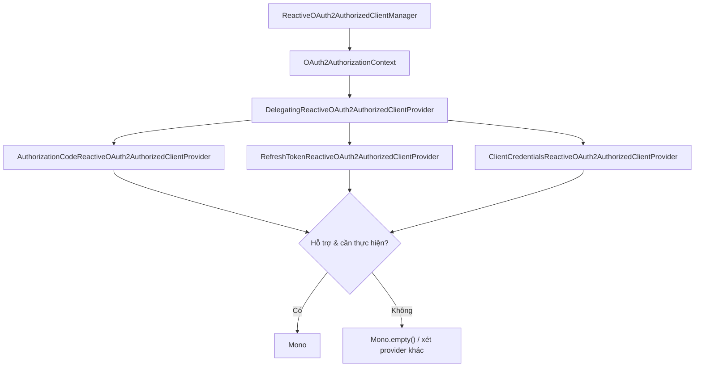
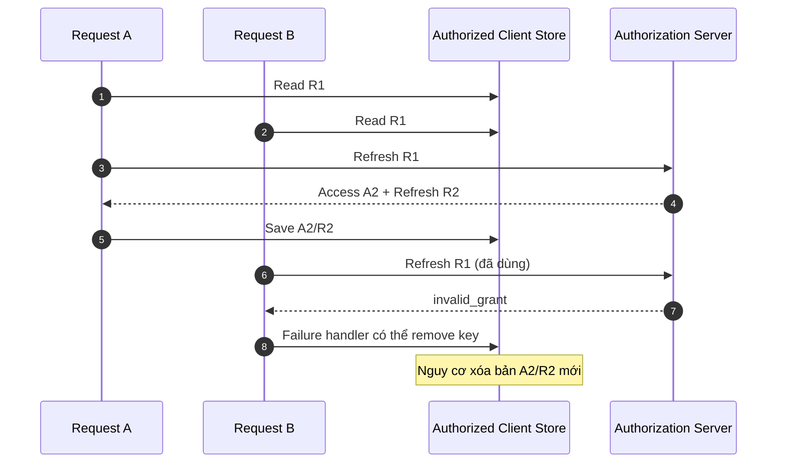
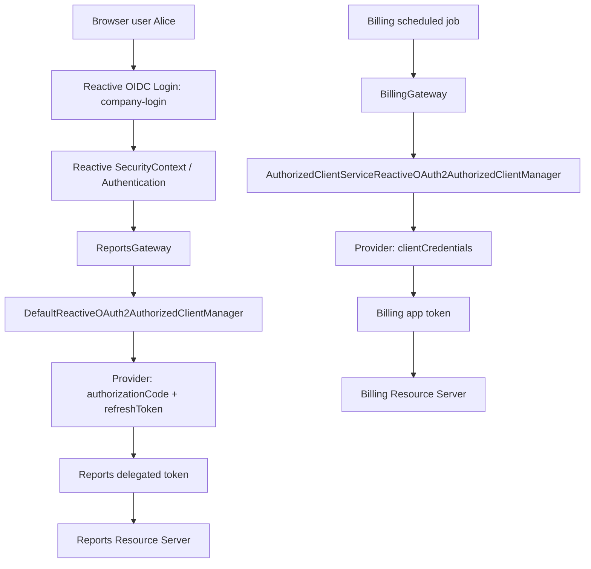

# 21.7. ReactiveOAuth2AuthorizedClientProviderBuilder và lựa chọn grant

Trong ứng dụng **Spring Security OAuth 2.0 / OpenID Connect (OIDC) Client** chạy bằng **Spring WebFlux**, một ứng dụng có thể vừa đăng nhập người dùng bằng OIDC, vừa gọi API thay mặt người dùng và vừa thực hiện tác vụ máy–máy (machine-to-machine). Những tình huống này dùng các **OAuth 2.0 authorization grant** khác nhau, ví dụ `authorization_code`, `refresh_token` và `client_credentials`.

Một câu hỏi quan trọng là: **khi Spring Security cần cấp hoặc cấp lại access token, thành phần nào quyết định sử dụng grant nào?**

Trên Reactive stack, chúng ta thường kết hợp:

- **`ReactiveOAuth2AuthorizedClientProviderBuilder`** để chọn những grant mà ứng dụng muốn hỗ trợ.
- **`ReactiveOAuth2AuthorizedClientProvider`** để thực thi hoặc quyết định có thể thực thi từng grant.
- **`ReactiveOAuth2AuthorizedClientManager`** để điều phối authorization, authorized client và persistence.
- **`ClientRegistration`** để mô tả grant được đăng ký, scope, client ID và nhà cung cấp.
- **`ServerOAuth2AuthorizedClientExchangeFilterFunction`** để đưa access token phù hợp vào outbound `WebClient` request.

Ví dụ cấu hình một provider tổng hợp:

```java
ReactiveOAuth2AuthorizedClientProvider provider =
    ReactiveOAuth2AuthorizedClientProviderBuilder.builder()
        .authorizationCode()
        .refreshToken()
        .clientCredentials()
        .build();
```

Ba dòng `authorizationCode()`, `refreshToken()`, `clientCredentials()` **không có nghĩa mỗi HTTP request đều lần lượt thực hiện cả ba grant**. Builder tạo một chuỗi chiến lược; khi manager cần authorize/re-authorize một client, các chiến lược chỉ hành động nếu **grant, token và authorization context** phù hợp.

Bài này giải thích sâu cơ chế đó, đưa ví dụ WebFlux hoàn chỉnh và làm rõ các lựa chọn grant trong browser login, API delegation, background job, token refresh, client credentials và các tình huống lỗi.

> **Phạm vi:** Java 17+, Spring Boot 3.x và Spring Security 6.x trên **Reactive WebFlux**. Các đoạn code tập trung vào API của Spring Security 6.5. Một số class hoặc chính sách grant có thể thay đổi ở phiên bản khác; tham khảo tài liệu chính thức của phiên bản đang dùng. Các domain `example.test`, client ID và scope là dữ liệu minh họa.

---

## 1. Bài toán: một ứng dụng, nhiều cách lấy token

Giả sử có một ứng dụng **Operations Portal**:

1. Nhân viên mở trình duyệt và đăng nhập bằng Company OIDC.
2. Người dùng xem dashboard, portal gọi **Reports API** dưới danh tính của người dùng.
3. Một background job đồng bộ dữ liệu với **Billing API** bằng danh tính của chính ứng dụng.
4. Access token của Reports API hết hạn; nếu có refresh token, portal cần xin access token mới.

Ta có thể có ba client registrations:

| Client registration | Mục đích | Grant thường dùng |
| --- | --- | --- |
| `company-login` | Người dùng đăng nhập OIDC | `authorization_code`, có thể tiếp tục `refresh_token` |
| `reports-api` | Đọc báo cáo theo quyền người dùng | `authorization_code`, có thể tiếp tục `refresh_token` |
| `billing-service` | Worker gọi Billing API với quyền ứng dụng | `client_credentials` |

Đối với ứng dụng này, một builder tổng hợp hỗ trợ ba grant là hợp lý. Tuy nhiên, mỗi registration vẫn chỉ có **một `authorization-grant-type` đã đăng ký**, còn refresh token là **grant bổ trợ để làm mới authorized client đã có**.

### 1.1. Đặt ba quyết định vào đúng lớp

```text
ClientRegistration
  "Ứng dụng đã đăng ký grant nào với Authorization Server?"
                        |
                        v
ReactiveOAuth2AuthorizedClientProvider
  "Với registration + authorization context này,
   tôi có thể cấp/cấp lại token theo grant nào?"
                        |
                        v
ReactiveOAuth2AuthorizedClientManager
  "Lưu/đọc authorized client nào, theo principal nào,
   xử lý thành công/thất bại ra sao?"
                        |
                        v
WebClient / ứng dụng
  "Dùng access token đó gọi Resource Server nào?"
```

**Builder quyết định năng lực của client-side authorization infrastructure, không tự cấp quyền ở phía Authorization Server.** Dù builder hỗ trợ `clientCredentials()`, registration vẫn phải được cấu hình đúng `client_credentials` và Authorization Server phải chấp nhận client authentication.

## 2. Phân biệt grant, scope, role và authorized client

Một số khái niệm nghe giống nhau nhưng phục vụ mục đích khác nhau:

| Khái niệm | Câu hỏi | Ví dụ |
| --- | --- | --- |
| **Authorization grant** | Client sử dụng cơ chế nào để lấy token? | `authorization_code`, `client_credentials` |
| **Scope** | Client được yêu cầu/cấp quyền truy cập nào? | `reports.read`, `openid` |
| **Business role** | Người dùng được làm gì trong nghiệp vụ? | `ROLE_EDITOR`, `ROLE_ADMIN` |
| **`ClientRegistration`** | Client được đăng ký với provider ra sao? | ID `reports-api` và grant `authorization_code` |
| **`OAuth2AuthorizedClient`** | Token nào đang được quản lý cho registration + principal? | `reports-api / alice / access token` |
| **`OAuth2AuthorizationContext`** | Dữ liệu nào được provider cần khi authorize? | Registration, principal, client đang có, context attributes |

Ví dụ một `ClientRegistration` có scope `reports.read` không chứng minh user hiện tại đã đồng ý cấp scope đó. **Scope trong cấu hình là yêu cầu**, còn token response và Resource Server policy quyết định những quyền thực sự sử dụng được.

Ngoài ra, `ROLE_ADMIN` trong phiên đăng nhập không tự biến access token cho API khác thành token có `billing.write`.

## 3. Đối tượng và interface của Reactive OAuth2 Client

### 3.1. Các interface chủ chốt

```java
import org.springframework.security.oauth2.client.ReactiveOAuth2AuthorizedClientManager;
import org.springframework.security.oauth2.client.ReactiveOAuth2AuthorizedClientProvider;
import org.springframework.security.oauth2.client.ReactiveOAuth2AuthorizedClientProviderBuilder;
```

Trách nhiệm:

- **`ReactiveOAuth2AuthorizedClientProvider`**: chiến lược xử lý authorization/re-authorization. Trả một `Mono<OAuth2AuthorizedClient>` khi có thể tạo authorized client; trả empty khi không hỗ trợ hoặc không cần cấp lại theo contract của provider.
- **`ReactiveOAuth2AuthorizedClientManager`**: điểm điều phối cấp token ở cấp ứng dụng; đọc/lưu state và chọn provider tổng hợp.
- **`ReactiveOAuth2AuthorizedClientProviderBuilder`**: xây dựng **`DelegatingReactiveOAuth2AuthorizedClientProvider`** gồm nhiều provider con.

### 3.2. Vì sao tên có tiền tố Reactive?

Trong WebFlux, operations được thể hiện bằng Reactor publisher:

```java
Mono<OAuth2AuthorizedClient> result =
    authorizedClientManager.authorize(authorizeRequest);
```

Một publisher thường **chưa thực thi chỉ vì được tạo ra**. Subscriber/chuỗi Reactor quyết định lúc thực sự chạy:

```java
return authorizedClientManager.authorize(authorizeRequest)
    .flatMap(client -> callResourceServer(client));
```

Trong ví dụ, `callResourceServer(client)` là một method nghiệp vụ trả `Mono<?>`, không phải API có sẵn của Spring Security.

Không gọi `.block()` bên trong WebFlux request handling chỉ để lấy token, vì blocking có thể chiếm event-loop thread và làm giảm thông lượng.

### 3.3. Reactive khác Servlet

| Servlet OAuth2 Client | Reactive WebFlux OAuth2 Client |
| --- | --- |
| `OAuth2AuthorizedClientManager` | `ReactiveOAuth2AuthorizedClientManager` |
| `OAuth2AuthorizedClientProviderBuilder` | `ReactiveOAuth2AuthorizedClientProviderBuilder` |
| `DefaultOAuth2AuthorizedClientManager` | `DefaultReactiveOAuth2AuthorizedClientManager` |
| `AuthorizedClientServiceOAuth2AuthorizedClientManager` | `AuthorizedClientServiceReactiveOAuth2AuthorizedClientManager` |
| `ClientRegistrationRepository` | `ReactiveClientRegistrationRepository` |
| `OAuth2AuthorizedClientService` | `ReactiveOAuth2AuthorizedClientService` |
| `OAuth2ClientHttpRequestInterceptor` cho RestClient | `ServerOAuth2AuthorizedClientExchangeFilterFunction` cho WebClient |
| `HttpSecurity` | `ServerHttpSecurity` |

Không chỉ đổi tên class: **Servlet dùng blocking interfaces/request context; WebFlux dùng `Mono`/`ServerWebExchange`** và reactive security context.

## 4. ReactiveOAuth2AuthorizedClientProviderBuilder hoạt động thế nào?

Builder tạo một provider tổng hợp từ những chiến lược đã chọn:

```java
ReactiveOAuth2AuthorizedClientProvider provider =
    ReactiveOAuth2AuthorizedClientProviderBuilder.builder()
        .authorizationCode()
        .refreshToken()
        .clientCredentials()
        .build();
```

Về mặt khái niệm:



Về cơ bản, builder đặt một tập chiến lược vào **composite**. Mỗi chiến lược tự đánh giá authorization context:

- Registration dùng grant nào?
- Đã tồn tại authorized client chưa?
- Access token còn hạn không?
- Có refresh token không?
- Có những attributes cần thiết không?
- Việc cấp token có cần browser interaction hay không?

Không phải tất cả strategies đều được gọi vào token endpoint, và **empty publisher không tự động có nghĩa một exception hay thiếu quyền**. Tùy manager và authorized client đã có, trường hợp “không cần authorize lại” có thể khiến manager giữ token đang dùng được.

### 4.1. Các method thường dùng

| Builder method | Provider được thêm | Mục đích |
| --- | --- | --- |
| `authorizationCode()` | `AuthorizationCodeReactiveOAuth2AuthorizedClientProvider` | Authorization Code Flow / tái sử dụng authorized client của code flow |
| `refreshToken()` | `RefreshTokenReactiveOAuth2AuthorizedClientProvider` | Dùng refresh token đã được cấp để lấy access token mới |
| `clientCredentials()` | `ClientCredentialsReactiveOAuth2AuthorizedClientProvider` | Cấp access token bằng client identity |
| `password()` | `PasswordReactiveOAuth2AuthorizedClientProvider` | Grant cũ; **deprecated và không dùng cho tích hợp mới** |
| `provider(custom)` | Provider mở rộng | Extension grant/logic đặc biệt có hợp đồng rõ |
| `build()` | `DelegatingReactiveOAuth2AuthorizedClientProvider` | Tạo provider tổng hợp |

Trong Spring Security 6.5, `password()` được đánh dấu **deprecated, for removal**. OAuth 2.0 Security Best Current Practice (RFC 9700) không cho phép dùng Resource Owner Password Credentials grant trong hệ thống theo thông lệ bảo mật hiện đại.

### 4.2. Composite không phải “fallback credential”

Không được hiểu:

```text
authorization_code thất bại
    => tự chuyển sang client_credentials
    => dùng token ứng dụng thay cho user
```

Đây là một lỗi phân quyền nghiêm trọng. Nếu Reports API yêu cầu delegated user consent, token `client_credentials` không đại diện user đó. **Provider selection phải tuân theo grant đã đăng ký, principal và authorization policy**.

## 5. Grant authorization_code: dùng khi có người dùng tương tác

**Authorization Code** thường dùng khi user đăng nhập hoặc cấp quyền cho một API qua browser:

```text
Browser -> Spring WebFlux app
        -> Authorization Server authorization endpoint
        -> User login / consent
        -> Callback tới app với code + state
        -> Backend đổi code lấy token
        -> Authorized client được lưu
```

Với OIDC Login, scope `openid` yêu cầu ID Token và các kiểm tra danh tính OIDC tương ứng; không làm thay đổi bản chất authorization code.

### 5.1. Tại sao authorizationCode() không tự chạy toàn bộ browser flow trong background?

`AuthorizationCodeReactiveOAuth2AuthorizedClientProvider` hỗ trợ grant `authorization_code` trong ngữ cảnh hạ tầng client, nhưng **browser redirect** được phối hợp bởi các WebFlux filters/resolvers thích hợp, ví dụ `OAuth2AuthorizationRequestRedirectWebFilter`. Manager không thể biến một scheduled job không có browser thành người dùng đã đồng ý cấp quyền.

Trong web flow thường có:

- `DefaultServerOAuth2AuthorizationRequestResolver` tạo authorization request.
- `ServerAuthorizationRequestRepository` lưu correlation state.
- Browser đi qua OP, rồi callback về ứng dụng.
- Spring Security hoàn tất token exchange và xác thực.
- `OAuth2AuthorizedClient` được lưu để tái sử dụng.

**Bật `authorizationCode()` trong builder không tự tạo consent của người dùng**, không bảo đảm có authorized client nếu registration chưa được cấp quyền.

### 5.2. OIDC login và API registration có thể khác nhau

Một người dùng có thể đăng nhập bằng `company-login` nhưng cần gọi API `reports-api`:

```text
Login:
  registration=company-login
  scopes=openid profile

Reports:
  registration=reports-api
  scopes=reports.read
```

Đăng nhập qua Company SSO **không tự cấp token cho `reports-api`**. Nếu người dùng chưa authorize Reports, ứng dụng cần một authorization/consent flow thích hợp thay vì âm thầm gửi login token tới Reports.

### 5.3. Khi nào chọn grant này?

Phù hợp với:

- Browser login bằng OIDC.
- Ứng dụng web gọi API thay mặt user đã cấp quyền.
- Kết nối tài khoản bên thứ ba, ví dụ Calendar hoặc CRM integration.
- Những nơi cần MFA/SSO/consent do OP quản lý.

Không phù hợp với một worker chạy độc lập mà không có browser hoặc delegated user context.

## 6. Grant refresh_token: làm mới authorized client đã có

**Refresh token grant** được dùng khi:

1. Một `OAuth2AuthorizedClient` đã tồn tại.
2. Authorization Server từng cấp `OAuth2RefreshToken`.
3. Access token đang hết hoặc gần hết hạn theo provider/skew.
4. Manager được cấu hình hỗ trợ `refreshToken()`.
5. Authorization Server chấp nhận refresh token và client authentication.

Ví dụ:

```text
T0: Authorization code được đổi lấy:
    access_token=A1, refresh_token=R1

T1: Access token A1 sắp hết hạn
    manager -> RefreshTokenReactiveOAuth2AuthorizedClientProvider

T2: Token endpoint:
    grant_type=refresh_token
    refresh_token=R1

T3: Token response:
    access_token=A2
    refresh_token=R2 (nếu có rotation)

T4: Authorized client mới được lưu để dùng A2/R2
```

### 6.1. refreshToken() không xin OP cấp refresh token

```java
ReactiveOAuth2AuthorizedClientProvider provider =
    ReactiveOAuth2AuthorizedClientProviderBuilder.builder()
        .refreshToken()
        .build();
```

Cấu hình này **chỉ mở khả năng sử dụng một refresh token đã được cấp**, không làm Authorization Server trả `refresh_token` ở lần login đầu. Việc cấp refresh token tùy loại client, scope/consent, `offline_access` hoặc tham số provider-specific và policy của AS.

Nếu authorized client không có `getRefreshToken()`, refresh-token provider không thể tạo refresh token từ access token.

### 6.2. Refresh token không nâng scope

Nếu user chỉ cấp `reports.read`, refresh grant không phải con đường lấy thêm `reports.write` mà không có authorization/consent bổ sung.

**OAuth scope, business role và grant hoàn toàn khác nhau.**

### 6.3. Kết quả `invalid_grant`

Token endpoint có thể trả:

```json
{
  "error": "invalid_grant",
  "error_description": "Refresh token is expired or revoked"
}
```

Đây là một **authorization failure**. Manager có failure handler để xử lý, thường bao gồm loại bỏ authorized client cũ cho lỗi như `invalid_grant`. Lần dùng sau có thể phải thực hiện authorization mới theo grant/flow phù hợp.

Không retry vô hạn cùng refresh token hỏng, không tự tăng `expiresAt` và không lấy token của user khác làm fallback.

## 7. Grant client_credentials: ứng dụng tự xác thực

`client_credentials` phù hợp với **machine-to-machine**: ứng dụng hoặc service worker tự xác thực với Authorization Server rồi nhận access token cho quyền đã cấp.

```text
Billing worker
    |
    v
Token Endpoint
  grant_type=client_credentials
  client authentication (secret/private key/...)
    |
    v
Access token dành cho billing-service client
    |
    v
Billing Resource Server
```

Không cần người dùng đi qua login page hoặc consent browser trong mỗi lần cấp token. Quyền được cấp theo client/app configuration và policy của Authorization Server.

### 7.1. Tại sao không cần refresh token?

Theo OAuth 2.0, response của client credentials grant thông thường **không cấp refresh token** (RFC 6749 dùng mức khuyến nghị `SHOULD NOT`). Khi access token hết hạn, client dùng lại client credentials để xin token mới.

Do vậy, đối với app-only client:

```java
ReactiveOAuth2AuthorizedClientProvider provider =
    ReactiveOAuth2AuthorizedClientProviderBuilder.builder()
        .clientCredentials()
        .build();
```

là một lựa chọn đủ rõ trong nhiều trường hợp.

### 7.2. Token ứng dụng không tự đại diện cho người dùng

Nếu user Alice đang duyệt một đơn hàng, không được dùng client credentials token rồi tuyên bố API call mang quyền của Alice, trừ khi API thực sự cho phép app-only action và lưu audit nghiệp vụ khác.

| Delegated user authorization | App-only authorization |
| --- | --- |
| Có user và consent/ủy quyền của user khi cần | Không cần tương tác user |
| Thường dùng authorization code | Thường dùng client credentials |
| Token có thể mang subject/user context | Token đại diện client/service identity |
| Có thể dùng refresh token nếu được cấp | Thường xin access token mới bằng credentials |
| Backend phải kiểm tra resource ownership/tenant | Backend phải kiểm tra service permissions và workload identity |

## 8. Password grant là tính năng legacy, không nên đưa vào thiết kế mới

Builder 6.5 vẫn mô tả `password()` cho compatibility, nhưng API này đã bị đánh dấu **deprecated for removal** và OAuth 2.0 Security Best Current Practice không cho phép dùng Resource Owner Password Credentials grant.

Một ví dụ **không nên triển khai mới**:

```java
// LEGACY, DEPRECATED, KHÔNG DÙNG CHO TÍCH HỢP MỚI.
ReactiveOAuth2AuthorizedClientProvider legacy =
    ReactiveOAuth2AuthorizedClientProviderBuilder.builder()
        .password()
        .build();
```

Nhược điểm bảo mật gồm:

- Ứng dụng phải xử lý mật khẩu user trực tiếp.
- Khó áp dụng MFA, phishing-resistant authentication và các chính sách SSO hiện đại.
- Phá ranh giới giữa client và nhà cung cấp danh tính.
- Không phù hợp với consent và các yêu cầu xác thực tăng cường.

Thay thế thường là **Authorization Code + PKCE** cho user-interactive use cases; với machine-to-machine, dùng `client_credentials` hoặc grant thích hợp khác theo trust model. Không nhầm password grant của OAuth2 với form login tại chính ứng dụng.

## 9. Cấu hình mẫu: Spring Boot WebFlux với nhiều registrations

### 9.1. Maven dependencies

```xml
<dependencies>
    <dependency>
        <groupId>org.springframework.boot</groupId>
        <artifactId>spring-boot-starter-webflux</artifactId>
    </dependency>
    <dependency>
        <groupId>org.springframework.boot</groupId>
        <artifactId>spring-boot-starter-security</artifactId>
    </dependency>
    <dependency>
        <groupId>org.springframework.boot</groupId>
        <artifactId>spring-boot-starter-oauth2-client</artifactId>
    </dependency>
</dependencies>
```

Ví dụ dùng Spring Boot BOM quản lý các phiên bản tương thích. Vì đây là **WebFlux server**, không thêm `spring-boot-starter-web` chỉ để dùng HTTP client. Nếu cả hai web starters xuất hiện, cần xác minh loại ứng dụng đang chạy vì Spring Boot thường ưu tiên MVC khi cả hai cùng có mặt.

### 9.2. application.yml

```yaml
spring:
  security:
    oauth2:
      client:
        registration:
          company-login:
            provider: company
            client-id: ${LOGIN_CLIENT_ID}
            client-secret: ${LOGIN_CLIENT_SECRET}
            authorization-grant-type: authorization_code
            redirect-uri: "{baseUrl}/login/oauth2/code/{registrationId}"
            scope:
              - openid
              - profile
              - email

          reports-api:
            provider: company
            client-id: ${REPORTS_CLIENT_ID}
            client-secret: ${REPORTS_CLIENT_SECRET}
            authorization-grant-type: authorization_code
            redirect-uri: "{baseUrl}/login/oauth2/code/{registrationId}"
            scope:
              - reports.read

          billing-service:
            provider: company
            client-id: ${BILLING_CLIENT_ID}
            client-secret: ${BILLING_CLIENT_SECRET}
            authorization-grant-type: client_credentials
            scope:
              - billing.read

        provider:
          company:
            issuer-uri: https://id.example.test/realms/company
```

Các scope `reports.read` và `billing.read` là ví dụ; chúng cần được Authorization Server/Resource Server định nghĩa. Client secret phải đọc từ secret store hoặc environment, không commit vào repository.

### 9.3. So sánh YAML và builder

```text
registration.company-login.authorization-grant-type = authorization_code
registration.reports-api.authorization-grant-type   = authorization_code
registration.billing-service.authorization-grant-type = client_credentials

Builder hỗ trợ:
    authorizationCode()
    refreshToken()
    clientCredentials()

Kết quả:
    company-login  -> code flow, refresh nếu đã được cấp token
    reports-api    -> code flow, refresh nếu đã được cấp token
    billing-service -> client_credentials, lấy token ứng dụng
```

**Registration có grant `client_credentials` không tự chuyển sang authorization code chỉ vì builder bật `authorizationCode()`**; provider phải có điều kiện phù hợp với registration.

## 10. Cấu hình ReactiveAuthorizedClientProvider cho web request

Với request WebFlux có `ServerWebExchange`, dùng `DefaultReactiveOAuth2AuthorizedClientManager`:

```java
import org.springframework.context.annotation.Bean;
import org.springframework.context.annotation.Configuration;
import org.springframework.security.oauth2.client.DefaultReactiveOAuth2AuthorizedClientManager;
import org.springframework.security.oauth2.client.ReactiveOAuth2AuthorizedClientManager;
import org.springframework.security.oauth2.client.ReactiveOAuth2AuthorizedClientProvider;
import org.springframework.security.oauth2.client.ReactiveOAuth2AuthorizedClientProviderBuilder;
import org.springframework.security.oauth2.client.registration.ReactiveClientRegistrationRepository;
import org.springframework.security.oauth2.client.web.server.ServerOAuth2AuthorizedClientRepository;

@Configuration
class WebOAuth2ClientManagerConfig {

    @Bean
    ReactiveOAuth2AuthorizedClientManager webAuthorizedClientManager(
            ReactiveClientRegistrationRepository registrations,
            ServerOAuth2AuthorizedClientRepository authorizedClients) {

        ReactiveOAuth2AuthorizedClientProvider provider =
            ReactiveOAuth2AuthorizedClientProviderBuilder.builder()
                .authorizationCode()
                .refreshToken()
                .clientCredentials()
                .build();

        DefaultReactiveOAuth2AuthorizedClientManager manager =
            new DefaultReactiveOAuth2AuthorizedClientManager(
                registrations, authorizedClients);

        manager.setAuthorizedClientProvider(provider);

        return manager;
    }
}
```

Đây là một ví dụ đầy đủ cho **manager dùng trong web exchange**. Các abstraction:

- `ReactiveClientRegistrationRepository`: tìm registration theo ID.
- `ServerOAuth2AuthorizedClientRepository`: lưu/tải authorized clients trong ngữ cảnh server request.
- `ReactiveOAuth2AuthorizedClientProvider`: tập grant strategies từ builder.
- `DefaultReactiveOAuth2AuthorizedClientManager`: điều phối authorization.

Spring Boot/Spring Security có thể auto-configure những thành phần này cho tình huống phổ biến. **Chỉ đăng ký manager tùy chỉnh khi có nhu cầu chủ động kiểm soát grant, token client, handler hoặc persistence**; nếu có nhiều manager bean, dùng `@Qualifier` khi inject.

### 10.1. SecurityWebFilterChain

```java
import org.springframework.context.annotation.Bean;
import org.springframework.context.annotation.Configuration;
import org.springframework.security.config.annotation.web.reactive.EnableWebFluxSecurity;
import org.springframework.security.config.web.server.ServerHttpSecurity;
import org.springframework.security.web.server.SecurityWebFilterChain;

@Configuration
@EnableWebFluxSecurity
class ReactiveWebSecurityConfiguration {

    @Bean
    SecurityWebFilterChain webFilterChain(ServerHttpSecurity http) {
        return http
            .authorizeExchange(exchanges -> exchanges
                .pathMatchers("/", "/error", "/public/**").permitAll()
                .anyExchange().authenticated())
            .oauth2Login(login -> { })
            .oauth2Client(client -> { })
            .build();
    }
}
```

Ở WebFlux, cấu hình đúng là **`SecurityWebFilterChain` + `ServerHttpSecurity`**, không phải Servlet `HttpSecurity`. `oauth2Login()` phục vụ login user; `oauth2Client()` hỗ trợ flow/ủy quyền client. Manager và provider builder quản lý việc dùng authorized clients để truy cập API.

### 10.2. Vì sao khai báo builder cả ba grant không có nghĩa mọi user có cả ba quyền?

Builder chỉ cho framework biết những grant **được xử lý nếu chúng phù hợp**, không:

- Gửi user tới Authorization Server tự động trong mọi request.
- Cấp user quyền `billing.read`.
- Chuyển token user sang token app-only.
- Thêm refresh token khi OP không phát hành.
- Bỏ qua consent, PKCE hoặc OIDC validation.

## 11. Cấu hình riêng cho background/service-level client_credentials

**`DefaultReactiveOAuth2AuthorizedClientManager` được thiết kế để hoạt động trong context của `ServerWebExchange`**. Khi chạy background job không có HTTP request, dùng:

**`AuthorizedClientServiceReactiveOAuth2AuthorizedClientManager`**.

Nó làm việc với **`ReactiveOAuth2AuthorizedClientService`**, không cần session WebFlux.

```java
import org.springframework.context.annotation.Bean;
import org.springframework.context.annotation.Configuration;
import org.springframework.security.oauth2.client.AuthorizedClientServiceReactiveOAuth2AuthorizedClientManager;
import org.springframework.security.oauth2.client.ReactiveOAuth2AuthorizedClientManager;
import org.springframework.security.oauth2.client.ReactiveOAuth2AuthorizedClientProvider;
import org.springframework.security.oauth2.client.ReactiveOAuth2AuthorizedClientProviderBuilder;
import org.springframework.security.oauth2.client.ReactiveOAuth2AuthorizedClientService;
import org.springframework.security.oauth2.client.registration.ReactiveClientRegistrationRepository;

@Configuration
class MachineClientManagerConfiguration {

    @Bean
    ReactiveOAuth2AuthorizedClientManager machineAuthorizedClientManager(
            ReactiveClientRegistrationRepository registrations,
            ReactiveOAuth2AuthorizedClientService storage) {

        ReactiveOAuth2AuthorizedClientProvider provider =
            ReactiveOAuth2AuthorizedClientProviderBuilder.builder()
                .clientCredentials()
                .build();

        AuthorizedClientServiceReactiveOAuth2AuthorizedClientManager manager =
            new AuthorizedClientServiceReactiveOAuth2AuthorizedClientManager(
                registrations, storage);

        manager.setAuthorizedClientProvider(provider);
        return manager;
    }
}
```

Vì provider chỉ chứa `clientCredentials()`, manager này **không xử lý authorization code cho user**. Đây là cách rõ ràng để áp dụng **least privilege** cho worker.

### 11.1. Tách manager cũng là tách trách nhiệm

```text
Web app / request:
  DefaultReactiveOAuth2AuthorizedClientManager
  ServerOAuth2AuthorizedClientRepository
  authorizationCode + refreshToken

Background job:
  AuthorizedClientServiceReactiveOAuth2AuthorizedClientManager
  ReactiveOAuth2AuthorizedClientService
  clientCredentials
```

Không nhất thiết mỗi app phải dùng hai manager, nhưng việc tách theo **user-delegated** và **app-only** làm giảm rủi ro gọi nhầm grant/identity.

### 11.2. Lựa chọn principal cho machine token

`OAuth2AuthorizedClient` được gắn với registration ID và principal name. Với `client_credentials`, principal thường là một định danh kỹ thuật ổn định do backend quản lý, chẳng hạn `billing-worker`, chứ không phải user đang thao tác trên giao diện.

Không lấy principal từ query parameter HTTP để truy vấn token của người khác.

## 12. Sử dụng manager trong reactive background job

Ta có thể authorize machine client bằng `OAuth2AuthorizeRequest`:

```java
import org.springframework.beans.factory.annotation.Qualifier;
import org.springframework.security.oauth2.client.OAuth2AuthorizeRequest;
import org.springframework.security.oauth2.client.OAuth2AuthorizedClient;
import org.springframework.security.oauth2.client.ReactiveOAuth2AuthorizedClientManager;
import org.springframework.stereotype.Service;
import reactor.core.publisher.Mono;

@Service
class BillingTokenService {

    private final ReactiveOAuth2AuthorizedClientManager manager;

    BillingTokenService(
            @Qualifier("machineAuthorizedClientManager")
            ReactiveOAuth2AuthorizedClientManager manager) {
        this.manager = manager;
    }

    Mono<OAuth2AuthorizedClient> billingAuthorizedClient() {
        OAuth2AuthorizeRequest request =
            OAuth2AuthorizeRequest.withClientRegistrationId("billing-service")
                .principal("billing-worker")
                .build();

        return manager.authorize(request)
            .switchIfEmpty(Mono.error(
                new IllegalStateException(
                    "billing-service authorization was unavailable")));
    }
}
```

Ở đây:

- `withClientRegistrationId("billing-service")` chọn đúng registration.
- `principal("billing-worker")` cung cấp service identity dùng để lưu/tải authorized client.
- `authorize(request)` trả publisher reactive, không chặn thread.
- `switchIfEmpty` phân biệt tình huống manager không trả client; token endpoint error cũng có thể xuất hiện dưới dạng error signal.

**Không trả token value cho browser chỉ vì service đã nhận được `OAuth2AuthorizedClient`**. Token là credential dành cho backend gọi đúng API.

### 12.1. Dùng WebClient gọi Billing API theo authorized client

```java
import org.springframework.stereotype.Service;
import org.springframework.web.reactive.function.client.WebClient;
import reactor.core.publisher.Mono;

@Service
class BillingGateway {

    private final BillingTokenService tokenService;
    private final WebClient billingWebClient;

    BillingGateway(BillingTokenService tokenService,
                   WebClient.Builder builder) {
        this.tokenService = tokenService;
        this.billingWebClient = builder
            .baseUrl("https://billing.example.test")
            .build();
    }

    Mono<String> loadStatus() {
        return tokenService.billingAuthorizedClient()
            .flatMap(client -> billingWebClient.get()
                .uri("/v1/status")
                .headers(headers -> headers.setBearerAuth(
                    client.getAccessToken().getTokenValue()))
                .retrieve()
                .bodyToMono(String.class));
    }
}
```

Ví dụ trên tách rõ **manager chủ động authorize** và **WebClient gửi token** để dễ học. Trong ứng dụng lớn, có thể dùng `ServerOAuth2AuthorizedClientExchangeFilterFunction` nhằm tập trung việc gắn bearer header và authorization failure handling, nhưng phải chọn manager/principal tương ứng.

**Không cho destination URI đến từ input tùy ý**, vì `setBearerAuth(...)` có thể gửi token ra host không đáng tin.

## 13. WebClient với ServerOAuth2AuthorizedClientExchangeFilterFunction

Trên Reactive WebFlux, Spring Security hỗ trợ:

```java
import org.springframework.security.oauth2.client.web.reactive.function.client
    .ServerOAuth2AuthorizedClientExchangeFilterFunction;
```

Trong file Java thực tế, import phải là một dòng:

```java
import org.springframework.security.oauth2.client.web.reactive.function.client.ServerOAuth2AuthorizedClientExchangeFilterFunction;
```

Cấu hình bean:

```java
import org.springframework.beans.factory.annotation.Qualifier;
import org.springframework.context.annotation.Bean;
import org.springframework.context.annotation.Configuration;
import org.springframework.security.oauth2.client.ReactiveOAuth2AuthorizedClientManager;
import org.springframework.security.oauth2.client.web.reactive.function.client.ServerOAuth2AuthorizedClientExchangeFilterFunction;
import org.springframework.web.reactive.function.client.WebClient;

@Configuration
class ReportsWebClientConfiguration {

    @Bean
    WebClient reportsWebClient(
            WebClient.Builder builder,
            @Qualifier("webAuthorizedClientManager")
            ReactiveOAuth2AuthorizedClientManager manager) {

        ServerOAuth2AuthorizedClientExchangeFilterFunction oauth2 =
            new ServerOAuth2AuthorizedClientExchangeFilterFunction(manager);

        return builder
            .baseUrl("https://reports.example.test")
            .filter(oauth2)
            .build();
    }
}
```

Filter phối hợp manager để tìm/cấp/refresh authorized client, rồi gắn Bearer access token cho outbound API request.

### 13.1. Chọn registration trong từng request

```java
import static org.springframework.security.oauth2.client.web.reactive.function.client.ServerOAuth2AuthorizedClientExchangeFilterFunction.clientRegistrationId;

import org.springframework.stereotype.Service;
import org.springframework.web.reactive.function.client.WebClient;
import reactor.core.publisher.Mono;

@Service
class ReportsGateway {

    private final WebClient reportsWebClient;

    ReportsGateway(WebClient reportsWebClient) {
        this.reportsWebClient = reportsWebClient;
    }

    Mono<String> myReports() {
        return reportsWebClient.get()
            .uri("/v1/reports/mine")
            .attributes(clientRegistrationId("reports-api"))
            .retrieve()
            .bodyToMono(String.class);
    }
}
```

Đoạn `.attributes(clientRegistrationId("reports-api"))` là **request attribute của WebClient**, không phải query parameter hay HTTP header. Nó chọn client registration trên từng outbound request.

### 13.2. Không dùng token login cho mọi API

Giả sử user login bằng `company-login`, rồi service gọi Reports API. Nếu không chỉ định client, một cấu hình default token có thể dùng token của login registration thay vì Reports.

Token login với scope `openid profile` không tự có quyền `reports.read`. Với API nhiều registrations, nên **chỉ định `clientRegistrationId` tường minh** và giới hạn destination theo API.

### 13.3. Có thể truyền authorized client tường minh

```java
import static org.springframework.security.oauth2.client.web.reactive.function.client.ServerOAuth2AuthorizedClientExchangeFilterFunction.oauth2AuthorizedClient;

Mono<String> response = webClient.get()
    .uri("https://reports.example.test/v1/reports")
    .attributes(oauth2AuthorizedClient(authorizedClient))
    .retrieve()
    .bodyToMono(String.class);
```

`authorizedClient` phải đến từ authorization flow hợp lệ và đúng principal/registration. Nếu đã cung cấp object, không đồng thời chỉ định một `clientRegistrationId` xung đột rồi phụ thuộc vào precedence ngầm.

## 14. Chọn grant theo ClientRegistration, không theo hostname

Một lỗi thiết kế là suy ra grant từ URL, ví dụ:

```text
URL chứa /billing -> dùng client_credentials
URL chứa /reports -> dùng authorization_code
```

**Hostname/path không phải policy grant**. API có thể hỗ trợ cả delegated và app-only tokens, hoặc một route không cho app-only. Grant nên là thuộc tính của **ClientRegistration đã được kiểm soát** và quyền thực sự của Authorization Server.

### 14.1. Bảng quyết định grant

| Tình huống | Grant nên chọn | Có cần user? | Có refresh token không? |
| --- | --- | --- | --- |
| Đăng nhập browser OIDC | `authorization_code` (+ PKCE khi thích hợp) | Có | Có thể, do OP quyết định |
| User ủy quyền cho Calendar API | `authorization_code` | Có, ít nhất lúc cấp quyền ban đầu | Có thể |
| Access token đã cấp hết hạn và còn refresh token | `refresh_token` | Thường không cần browser tương tác lúc refresh | Dùng token cũ để xin token mới |
| Cron job gọi API của chính ứng dụng | `client_credentials` | Không | Thường không cần; xin token mới bằng credentials |
| SPA/native public client | Authorization Code + PKCE | Có | Policy nghiêm ngặt, rotation/sender-constraint khi được cấp |
| Muốn user nhập mật khẩu trực tiếp cho client | `password` legacy | Có mật khẩu nhưng không có browser redirect | Không khuyến nghị/không thiết kế mới |
| API yêu cầu ủy quyền tùy chỉnh | Extension grant được provider hỗ trợ | Tùy grant | Theo contract của AS |

### 14.2. Một registration có thể có hai phương thức authorization song song?

`ClientRegistration.getAuthorizationGrantType()` mô tả grant chính như `authorization_code` hoặc `client_credentials`. Việc dùng `refresh_token` là **re-authorization của authorized client đã có**, không có nghĩa registration cần đổi grant type trong YAML sang `refresh_token`.

Ví dụ hợp lý:

```yaml
authorization-grant-type: authorization_code
scope: openid, profile, offline_access
```

Khi OP cấp refresh token, `refreshToken()` provider có thể dùng để refresh về sau.

## 15. Cấu hình các grant bằng builder và tùy chỉnh clock skew

Builder hỗ trợ overload để điều chỉnh provider:

```java
import java.time.Duration;
import org.springframework.security.oauth2.client.ReactiveOAuth2AuthorizedClientProvider;
import org.springframework.security.oauth2.client.ReactiveOAuth2AuthorizedClientProviderBuilder;

ReactiveOAuth2AuthorizedClientProvider provider =
    ReactiveOAuth2AuthorizedClientProviderBuilder.builder()
        .authorizationCode()
        .refreshToken(config -> config
            .clockSkew(Duration.ofSeconds(90)))
        .clientCredentials(config -> config
            .clockSkew(Duration.ofSeconds(90)))
        .build();
```

**Clock skew** giúp coi access token như sắp hết hạn trước mốc `expiresAt` để giảm rủi ro token hết hạn trên đường truyền.

Ví dụ:

```text
Access token expiresAt = 10:00:00
Clock skew             = 90 seconds

Từ khoảng 09:58:30:
  provider có thể coi token cần được làm mới
```

Không nên đặt skew lớn hơn toàn bộ lifetime của access token mà không cân nhắc, vì manager có thể muốn refresh/renew quá thường xuyên.

### 15.1. Clock skew không kéo dài token

Skew chỉ là chính sách **đánh giá token đã gần hết hạn**. Nó không thể làm access token bị revoke hợp lệ trở lại, không thay thời gian hết hạn ghi trong token và không bảo đảm Resource Server cho phép mọi request.

### 15.2. Tùy chỉnh token response client

Trong trường hợp cần custom HTTP client cho token endpoint, builder cho phép inject một `ReactiveOAuth2AccessTokenResponseClient<...>`.

Ví dụ cho refresh token:

```java
import org.springframework.security.oauth2.client.ReactiveOAuth2AuthorizedClientProvider;
import org.springframework.security.oauth2.client.ReactiveOAuth2AuthorizedClientProviderBuilder;
import org.springframework.security.oauth2.client.endpoint.ReactiveOAuth2AccessTokenResponseClient;
import org.springframework.security.oauth2.core.endpoint.OAuth2RefreshTokenGrantRequest;

ReactiveOAuth2AccessTokenResponseClient<OAuth2RefreshTokenGrantRequest>
    refreshResponseClient = /* implementation đã cấu hình an toàn */;

ReactiveOAuth2AuthorizedClientProvider provider =
    ReactiveOAuth2AuthorizedClientProviderBuilder.builder()
        .authorizationCode()
        .refreshToken(config ->
            config.accessTokenResponseClient(refreshResponseClient))
        .build();
```

Đoạn `refreshResponseClient` là một dependency do ứng dụng cấu hình, không phải instance tự tạo từ comment. Khi cần custom timeout, retry, TLS hoặc request parameters, nên xem tài liệu `WebClientReactiveRefreshTokenTokenResponseClient` của phiên bản Spring Security đang dùng.

**Không tự thay token endpoint bằng URL do user nhập** và không in refresh token hoặc client secret khi debug.

### 15.3. Tùy chỉnh client_credentials response client

Tương tự:

```java
ReactiveOAuth2AccessTokenResponseClient<OAuth2ClientCredentialsGrantRequest>
    credentialsClient = /* implementation dành cho client_credentials */;

ReactiveOAuth2AuthorizedClientProvider provider =
    ReactiveOAuth2AuthorizedClientProviderBuilder.builder()
        .clientCredentials(config ->
            config.accessTokenResponseClient(credentialsClient))
        .build();
```

Generic type phải khớp grant request. Không truyền response client của refresh grant vào builder của client credentials.

## 16. Tự viết extension grant provider bằng provider(...)

Một số hệ thống có grant mở rộng như:

- JWT bearer token grant;
- Token exchange;
- Những grant theo hợp đồng riêng với Authorization Server.

Builder cho phép:

```java
ReactiveOAuth2AuthorizedClientProvider provider =
    ReactiveOAuth2AuthorizedClientProviderBuilder.builder()
        .authorizationCode()
        .refreshToken()
        .provider(customProvider)
        .build();
```

`customProvider` là instance `ReactiveOAuth2AuthorizedClientProvider` do ứng dụng triển khai. Nó phải biết:

1. Làm thế nào xác định registration/grant phù hợp;
2. Điều kiện nào khiến nó không thể authorize, và lúc nào trả `Mono.empty()`;
3. Token endpoint hoặc cơ chế exchange nào được tin cậy;
4. Cách ràng buộc principal, audience, scope;
5. Cách xử lý token response và error;
6. Có thể refresh/reauthorize không;
7. Không chặn Reactor event loop.

### 16.1. Skeleton logic của extension provider

```java
import org.springframework.security.oauth2.client.OAuth2AuthorizationContext;
import org.springframework.security.oauth2.client.ReactiveOAuth2AuthorizedClientProvider;
import org.springframework.security.oauth2.client.OAuth2AuthorizedClient;
import reactor.core.publisher.Mono;

class CustomGrantProvider implements ReactiveOAuth2AuthorizedClientProvider {

    @Override
    public Mono<OAuth2AuthorizedClient> authorize(
            OAuth2AuthorizationContext context) {

        if (!supportsCustomGrant(context)) {
            return Mono.empty();
        }

        // Thực hiện exchange theo một grant đã được AS hỗ trợ.
        // Phải kiểm tra client, principal, scope và token response.
        return performTrustedTokenExchange(context);
    }

    private boolean supportsCustomGrant(OAuth2AuthorizationContext context) {
        // Policy do ứng dụng triển khai.
        return false; // Skeleton: chưa bật bất kỳ extension grant nào.
    }

    private Mono<OAuth2AuthorizedClient> performTrustedTokenExchange(
            OAuth2AuthorizationContext context) {
        // Tích hợp token endpoint theo contract riêng.
        return Mono.empty(); // Skeleton; không phải implementation hoàn chỉnh.
    }
}
```

Skeleton trên **không tự cấp token**. Nó chỉ giải thích API cần triển khai. Với production, ưu tiên provider có sẵn do Spring Security cung cấp hoặc một extension đã được kiểm chứng thay vì tự viết OAuth protocol từ đầu.

### 16.2. Tại sao không dùng custom grant để né consent?

Provider mở rộng phải tuân thủ authorization policy của AS và resource owner. Không dùng nó làm cơ chế vượt scope, giả mạo principal hoặc đổi token của user A thành quyền user B.

## 17. Các trạng thái khi provider được ủy quyền xử lý

Một provider không phải lúc nào cũng tạo token mới. Dưới đây là các tình huống quan trọng:

| Ngữ cảnh | Hành vi khái niệm |
| --- | --- |
| Registration dùng `client_credentials`, chưa có token | Provider `clientCredentials` có thể gọi token endpoint |
| Registration dùng `client_credentials`, token vẫn còn hạn | Không cần cấp mới; có thể trả empty ở cấp provider |
| Registration dùng `authorization_code`, token còn hạn | Có thể tái sử dụng authorized client |
| Registration dùng `authorization_code`, có refresh token, token hết hạn | Provider `refreshToken` có thể đổi token mới |
| Registration dùng `authorization_code`, không có refresh token, token hết hạn | Không thể refresh bằng refresh grant; có thể cần authorization flow mới |
| Registration dùng grant khác provider đang xét | Provider không xử lý, thường trả `Mono.empty()` |
| Token endpoint trả `invalid_grant` | Authorization failure, không phải empty-as-success |
| Token endpoint trả `invalid_client` | Lỗi client authentication/configuration, cần xử lý vận hành |

### 17.1. Mono.empty() khác Mono.error(...)

```java
Mono.empty();                         // Không có giá trị để emit.
Mono.error(new IllegalStateException("authorization failed"));
```

Trong provider, empty có thể mang nghĩa **grant không phù hợp hoặc không cần re-authorization**. Error là một thất bại thực sự.

Ở cấp manager:

- Có thể dùng lại authorized client hiện có nếu chưa cần cấp lại.
- Có thể phát OAuth2AuthorizationException nếu token endpoint lỗi.
- Có thể không emit authorized client nếu không thể authorize theo grant/context.

Không viết logic “`Mono.empty()` nghĩa là client bị revoke” ở mọi tầng.

### 17.2. Cẩn trọng với switchIfEmpty

Một service có thể dùng:

```java
manager.authorize(request)
    .switchIfEmpty(Mono.error(
        new IllegalStateException("No authorized client available")));
```

Cách này hợp lý khi downstream bắt buộc phải có authorized client. Nhưng nó **không thay thế error handling** cho invalid_grant, network timeout hoặc invalid_client, vốn thường đã là error signals.

## 18. Success handler và Failure handler

`ReactiveOAuth2AuthorizedClientManager` không chỉ chạy provider. Nó còn quản lý persistence và các callback theo kết quả authorization.

### 18.1. Khi thành công

Một successful authorization/re-authorization tạo `OAuth2AuthorizedClient` mới. Manager thường dùng **`ReactiveOAuth2AuthorizationSuccessHandler`** để lưu client qua repository/service tương ứng.

Ví dụ refresh token rotation:

```text
Trước:
  reports-api + alice -> access=A1, refresh=R1

Refresh R1 thành công:
  access=A2, refresh=R2

Success handler:
  lưu authorized client mới A2/R2
```

Không chỉ cập nhật access token mà bỏ refresh token mới; việc dùng R1 sau khi OP đã rotate có thể dẫn tới `invalid_grant`.

### 18.2. Khi thất bại

Một **`ReactiveOAuth2AuthorizationFailureHandler`** xử lý authorization failure. Manager mặc định có cơ chế loại bỏ authorized client đã lưu khi gặp lỗi thích hợp, điển hình `invalid_grant`.

Không nên xóa mọi token với mọi exception. Lỗi API timeout hoặc 503 không chứng minh refresh token bị revoke.

### 18.3. Tùy chỉnh handler có thể thay behavior mặc định

Nếu gọi:

```java
manager.setAuthorizationFailureHandler(customFailureHandler);
```

thì bạn cần xem cách giữ **cleanup mặc định**. Nếu custom handler chỉ log và không delegate removal, token hỏng có thể tiếp tục được dùng trong những request tiếp theo.

Tương tự, thay success handler mà quên lưu token mới có thể làm ứng dụng bị mất cập nhật refresh token.

## 19. Lỗi từ Resource Server không giống lỗi token endpoint

Có hai đường lỗi khác nhau:

```text
Authorization Server / token endpoint:
  refresh_token -> invalid_grant
       |
       v
  ReactiveOAuth2AuthorizedClientManager
       |
       v
  ReactiveOAuth2AuthorizationFailureHandler

Resource Server / API:
  GET /reports + Bearer access token
       |
       +--> 401 invalid_token
       +--> 403 insufficient_scope
       |
       v
  WebClient exchange filter
       |
       v
  Authorization failure handler nếu đã cấu hình nối
```

Manager chỉ biết những gì xảy ra trong **authorize/re-authorize**. Nếu tự tạo HTTP client khác rồi nhận 401 từ API, không tự động chắc chắn manager đã nhận lỗi đó.

### 19.1. Constructor của ServerOAuth2AuthorizedClientExchangeFilterFunction rất quan trọng

Theo Javadoc Spring Security 6.5:

- Khi tạo `ServerOAuth2AuthorizedClientExchangeFilterFunction(manager)`, các lỗi Resource Server 401/403 **không mặc định được chuyển** đến `ReactiveOAuth2AuthorizationFailureHandler`. Cần cấu hình handler nếu muốn dọn authorized client lỗi.
- Khi tạo bằng `(ReactiveClientRegistrationRepository, ServerOAuth2AuthorizedClientRepository)`, Spring Security có cơ chế chuyển lỗi tới removal handler theo error code.

Vì vậy, chỉ vì builder hỗ trợ `refreshToken()` **không có nghĩa 401 từ API sẽ được xử lý/retry đúng cách**.

### 19.2. 401 invalid_token và 403 insufficient_scope

| Phản hồi | Ý nghĩa chính | Hướng xử lý |
| --- | --- | --- |
| `401` + `invalid_token` | Access token bị Resource Server từ chối | Xem revoked/expired/audience/issuer và cleanup đúng policy |
| `403` + `insufficient_scope` | Token có thể hợp lệ nhưng thiếu quyền | Xin scope/consent hợp lệ; không refresh rồi retry vô hạn |
| `503` / timeout | Sự cố API/network | Retry có giới hạn theo tính idempotent, không coi token hỏng |
| `400` + `invalid_grant` ở token endpoint | Refresh/grant không hợp lệ | Authorization failure; reauthorize khi được phép |
| `401` + `invalid_client` ở token endpoint | Client credentials sai/đổi | Kiểm tra cấu hình secret/cert; không login lại user để sửa |

### 19.3. Không tự động fallback sang client quyền cao

Nếu `reports-api` bị `insufficient_scope`, việc thử `billing-service` hoặc `admin-api` không phải “lựa chọn grant thông minh” mà là **bypass authorization policy**.

Chỉ dùng registration/grant đã được business policy cho phép cho API đó.

## 20. Provider chỉ là strategy; manager mới điều phối context

Một chỗ dễ hiểu sai là gọi trực tiếp:

```java
provider.authorize(context);
```

trong controller/service để “lấy token nhanh”. Trong thiết kế thông thường, bạn nên gọi:

```java
authorizedClientManager.authorize(request);
```

vì manager còn có trách nhiệm:

- Tìm đúng `ClientRegistration`;
- Gắn đúng principal;
- Tải authorized client đang được lưu;
- Xác định context attributes;
- Gọi composite provider;
- Lưu authorized client sau thành công;
- Chạy failure handler và xử lý lỗi thích hợp.

**Gọi provider trực tiếp bỏ qua hoặc buộc bạn tự triển khai những trách nhiệm đó**. Trong bài tập kỹ thuật có thể dùng provider để mô phỏng strategy, nhưng code nghiệp vụ nên dựa vào manager.

### 20.1. Context attributes dùng khi nào?

`OAuth2AuthorizationContext` có thể chứa các attributes mà provider cần. Với một số legacy/extension grants, context có thể cần username, password hoặc subject token tùy grant.

Cấu hình context attributes cần kiểm soát nguồn dữ liệu:

- Không lấy credential người dùng từ một query parameter tùy ý.
- Không dùng principal của user B khi request thuộc user A.
- Không ghép token từ session khác vào context.
- Không log các attributes chứa secrets.

Với authorization code và client credentials thông thường, framework có khả năng tự dựng context theo registration và principal; bạn không cần custom mapper nếu không có nhu cầu.

## 21. Lựa chọn grant là chính sách nghiệp vụ và bảo mật

Giả sử một service có ba method:

```text
loadMyReports(user)      -> reports-api / delegated user token
loadBillingStatus(job)   -> billing-service / app token
loginWithCompany(user)   -> company-login / OIDC login
```

Không nên viết một hàm:

```java
String grantType = request.getParameter("grant");
String registrationId = request.getParameter("client");
```

rồi cho caller tự chọn grant và registration để lấy token. Điều đó đặt quyết định bảo mật vào dữ liệu không tin cậy.

Một thiết kế tốt hơn:

```java
enum Integration {
    REPORTS,
    BILLING
}

record ClientPolicy(String registrationId, boolean appOnly) {
}

final class ClientPolicies {
    static ClientPolicy forIntegration(Integration integration) {
        return switch (integration) {
            case REPORTS -> new ClientPolicy("reports-api", false);
            case BILLING -> new ClientPolicy("billing-service", true);
        };
    }
}
```

**Ánh xạ phải do backend sở hữu**, và service vẫn cần kiểm tra user/tenant/resource authorization trước khi gọi API. Enum đơn giản ở ví dụ chỉ để diễn tả ranh giới quyết định.

### 21.1. Không dùng grant như bản thay thế role check

Một user đã login không có quyền xem báo cáo mật thì dù authorization code token có scope nào, ứng dụng vẫn phải kiểm tra policy nghiệp vụ và Resource Server vẫn phải bảo vệ tài nguyên.

### 21.2. Scope API không phải access token audience

Một token có scope `reports.read` chưa chắc được phát hành cho Reports API đúng audience. API còn có thể kiểm tra issuer/audience/resource indicator. Builder không tạo claim audience bằng cách đổi grant.

## 22. Session, repository và persistence

**Authorized client** không phải một object chỉ tồn tại trong method gọi token. Khi request sau đến, manager cần tra token đã lưu.

Trên Reactive stack:

| Thành phần | Vai trò |
| --- | --- |
| `ServerOAuth2AuthorizedClientRepository` | Lưu/tải authorized client gắn WebFlux request/principal |
| `ReactiveOAuth2AuthorizedClientService` | Lưu/tải authorized client ở tầng service, không yêu cầu WebSession request |
| `ReactiveClientRegistrationRepository` | Chứa `ClientRegistration` đã cấu hình |
| `ReactiveOAuth2AuthorizedClientManager` | Kết nối provider với persistence |
| `ServerAuthorizationRequestRepository` | Lưu authorization request/state qua redirect, **không phải authorized client token store** |

Một user có thể có:

```text
(reports-api, alice)   -> access A1, optional refresh R1
(reports-api, bob)     -> access B1, optional refresh R2
(billing-service, billing-worker) -> access S1
```

Trộn các entries theo registration hoặc principal có thể gây **cross-user token leakage**.

### 22.1. Login session và authorized client storage khác nhau

`WebSession` có thể lưu thông tin user đăng nhập, correlation state hoặc authorized clients tùy repository. Nhưng:

- Authorization request lưu trước callback;
- SecurityContext lưu Authentication;
- OAuth2AuthorizedClient lưu token đã cấp.

Không đọc `ServerAuthorizationRequestRepository` để tìm refresh token; ở giai đoạn authorization request token thường chưa tồn tại.

### 22.2. Multi-instance

Nếu ứng dụng có nhiều WebFlux nodes, session/authorized client storage phải nhất quán. Với machine-to-machine, service-level manager thường phù hợp hơn local WebSession. Khi dùng Redis/database, cần bảo vệ token values, quản lý TTL, session invalidation và concurrent updates.

## 23. Refresh token rotation và concurrency

Một khó khăn thực tế xuất hiện khi hai requests cùng refresh token `R1`:



Builder `refreshToken()` **không tự giải quyết mọi race condition của persistence**. Nếu OP dùng refresh token rotation, cần cân nhắc:

- Single-flight hoặc lock theo `(registrationId, principal)`;
- Optimistic locking/version field;
- Compare-and-delete để không xóa nhầm token mới;
- Shared persistence giữa nhiều nodes;
- Clock skew hợp lý;
- Không retry vô hạn `invalid_grant`.

Với app-only client credentials, nhiều worker cùng xin access token có thể gây tải token endpoint; cân nhắc cache và coordination theo security model.

## 24. Quy trình phân loại lỗi khi chọn grant

Khi gặp lỗi `401/403` hoặc không nhận được token, hãy đi theo đúng lớp:

### 24.1. Registration có đúng không?

```yaml
registration:
  reports-api:
    authorization-grant-type: authorization_code
```

Nếu code gọi `clientRegistrationId("reports-api")` nhưng trong YAML registration là `reports-client`, lookup không tìm đúng entry.

### 24.2. Grant được bật trong builder không?

Một builder chỉ bật:

```java
ReactiveOAuth2AuthorizedClientProviderBuilder.builder()
    .clientCredentials()
    .build();
```

không thể thay thế authorization code flow cho một registration `authorization_code`.

### 24.3. Có đủ authorization context không?

- Với code flow: user đã authorize/consent chưa?
- Với refresh: client đã có refresh token chưa?
- Với client credentials: client authentication method và secret/cert có hợp lệ không?
- Với extension: đã có những attributes bắt buộc chưa?
- Với service-level job: có principal kỹ thuật ổn định không?

### 24.4. Token endpoint thực sự trả gì?

- `invalid_client`: kiểm tra client authentication.
- `invalid_grant`: grant/refresh token không hợp lệ.
- `invalid_scope`: xin scope không được chấp nhận.
- Timeout/5xx: sự cố Authorization Server/network.
- Không có refresh token: chính sách token issuance, không nhất thiết là lỗi của builder.

### 24.5. Resource Server có chấp nhận token không?

Một token lấy được thành công vẫn có thể không dùng được cho API do:

- Audience/resource sai;
- Issuer không được tin cậy;
- Scope thiếu;
- Token hết hạn hoặc bị revoke;
- User/tenant không có permission;
- Gửi nhầm token của registration khác.

Không giải quyết tất cả các lỗi này bằng cách bật thêm `clientCredentials()` hoặc `refreshToken()`.

## 25. Những sai lầm thường gặp

| Hiện tượng | Sai lầm phổ biến | Giải pháp |
| --- | --- | --- |
| Login OIDC thành công nhưng không có refresh token | Tưởng `.refreshToken()` bắt OP cấp refresh token | Kiểm tra offline access/consent/provider token policy |
| Manager không refresh token | Không bật refresh provider hoặc token đã lưu không có refresh token | Xem builder và `OAuth2AuthorizedClient.getRefreshToken()` |
| Background job lỗi thiếu WebExchange | Dùng `DefaultReactiveOAuth2AuthorizedClientManager` ngoài web context | Dùng `AuthorizedClientServiceReactiveOAuth2AuthorizedClientManager` |
| Browser login đột nhiên dùng machine token | Registration/principal fallback sai | Tách user-delegated và app-only manager |
| API 401 khi có token | Audience/issuer sai hoặc token expired/revoked | Kiểm tra API policy, đúng registration |
| API 403 `insufficient_scope` | Coi là access token hỏng và refresh lại | Xin đúng scope qua authorization hợp lệ |
| `client_credentials` không có refresh token | Mong mọi grant đều nhận refresh token | Xin access token mới bằng client credentials |
| Builder bật nhiều grant nhưng không authorize được | Registration không match hoặc thiếu context/consent | Phân biệt capabilities với authorization thực tế |
| `Mono` không phát request | Tạo publisher rồi không subscribe/return | Compose pipeline Reactor đúng |
| WebFlux request bị chậm | `.block()` hoặc HTTP client blocking trên event loop | Dùng reactive token client và non-blocking WebClient |
| Code dùng Servlet builder trong WebFlux | Nhầm `OAuth2AuthorizedClientProviderBuilder` | Dùng `ReactiveOAuth2AuthorizedClientProviderBuilder` |
| Refresh token rotate rồi `invalid_grant` | Cache còn lưu refresh token cũ | Lưu authorized client cập nhật, kiểm soát concurrent refresh |
| Custom success handler làm mất token | Handler không lưu authorized client mới | Giữ persistence behavior |
| Custom failure handler làm token lỗi tồn tại | Handler chỉ ghi log, không delegate cleanup | Bảo đảm removal đúng error code/store |
| User A dùng token user B | Principal được suy ra từ input/thay đổi sai | Dùng Authentication đáng tin và token store theo principal |
| API công khai nhận Bearer token | WebClient dùng default OAuth client rộng | Tách WebClient, explicit registration, allowlist destination |
| Token endpoint bị spam | Retry token failure vô hạn | Timeout/retry policy có giới hạn và circuit breaker |
| Dev login tốt nhưng production báo invalid redirect | Reverse proxy/public origin sai | Đồng bộ redirect URI, forwarded headers tin cậy |
| Tự lấy password grant để tích hợp SSO | Dùng API legacy đã deprecate | Authorization Code + PKCE / OIDC |
| Token nhận được nhưng app không có ROLE_ADMIN | Nhầm OAuth grant/scope với business role | Kiểm tra policy backend và mapping role |

## 26. Ví dụ thực tế: kết hợp web delegated và app-only nhưng không trộn quyền

Một kiến trúc gợi ý:



Từ góc nhìn security review:

- **Web side** gắn user principal và token delegation.
- **Worker side** dùng service principal, client credentials và persistence độc lập.
- Không lấy token user từ web session để worker chạy sau khi user logout trừ khi có delegated offline access hợp lệ.
- Không dùng service token để “mượn quyền” trên tài nguyên mà API chỉ cho user.
- Giới hạn API destinations và OAuth2 client registrations ở từng gateway.

### 26.1. Một service không nên trực tiếp nhận raw grant type

Nếu UI gửi:

```http
POST /api/run-report?grant_type=client_credentials
```

backend không nên cho query đó đổi phương thức ủy quyền. Người dùng chỉ yêu cầu **thao tác nghiệp vụ**; backend quyết định authorization từ policy. Grant không phải một tùy chọn tùy ý do browser chọn.

### 26.2. Logging an toàn

Một event minh họa:

```json
{
  "event": "oauth2_reactive_authorization",
  "registration_id": "billing-service",
  "grant_category": "client_credentials",
  "outcome": "authorized",
  "environment": "staging",
  "trace_id": "internal-trace-id"
}
```

Đây là schema do ứng dụng thiết kế. Không log access token, refresh token, ID Token, client secret, Authorization header, toàn bộ `OAuth2AuthorizedClient` hoặc token endpoint response chứa credential.

## 27. Câu hỏi tự kiểm tra

### Câu 1. Builder có .authorizationCode().refreshToken().clientCredentials(). Điều đó có nghĩa request nào cũng thực hiện cả ba grant?

> Không. Builder tạo **composite provider** với nhiều strategy. Provider xử lý dựa vào `ClientRegistration`, token/context và điều kiện của grant. Không được xem đây là chuỗi fallback tự động vượt quyền.

### Câu 2. Registration có `authorization-grant-type: authorization_code`. Có cần đổi YAML sang `refresh_token` để dùng refresh token không?

> Không. `authorization_code` là grant chính để có token ban đầu; `refreshToken()` provider có thể dùng refresh token đã được OP cấp để re-authorize khi access token hết hạn.

### Câu 3. Tại sao .refreshToken() không làm login response có refresh token?

> Việc **cấp** refresh token do Authorization Server quyết định. Builder chỉ bật khả năng **sử dụng** credential đó nếu nó tồn tại và còn hợp lệ.

### Câu 4. Job chạy không có HTTP request nên dùng manager nào?

> Thường dùng `AuthorizedClientServiceReactiveOAuth2AuthorizedClientManager` với `ReactiveOAuth2AuthorizedClientService`. Với app-only, bật provider `clientCredentials()` và dùng principal kỹ thuật ổn định.

### Câu 5. Khi nào client_credentials phù hợp?

> Khi workload đại diện cho **chính ứng dụng/service** và Resource Server đã cấp app permissions tương ứng. Không dùng làm token thay user trong nghiệp vụ yêu cầu delegated consent.

### Câu 6. Có nên thêm .password() cho một tích hợp mới không?

> Không. API đã deprecated for removal trong Spring Security 6.5 và OAuth Security BCP không cho phép dùng password grant. Chọn Authorization Code + PKCE/OIDC hoặc grant hiện đại thích hợp.

### Câu 7. Provider trả Mono.empty() có đồng nghĩa authorization thất bại không?

> Không. Provider có thể không hỗ trợ grant hoặc không cần cấp lại vì token còn hiệu lực. Error thực sự có thể được biểu diễn bằng `Mono.error(...)`. Manager và application layer diễn giải theo hợp đồng của từng API.

### Câu 8. Vì sao không gọi provider.authorize(context) trực tiếp ở controller?

> Vì manager quản lý ClientRegistration, authorized client persistence, principal/context, success/failure handlers và nhiều grant strategies. Dùng manager giúp tránh bỏ qua các trách nhiệm đó.

### Câu 9. Reports API trả 403 insufficient_scope. Có nên thử billing-service token không?

> Không. Scope/permission không đủ không phải tín hiệu để đổi sang app-only client có quyền khác. Cần bổ sung consent/permission hợp lệ cho registration phù hợp.

### Câu 10. Hai request cùng dùng refresh token R1 và OP rotate token. Rủi ro gì?

> Một request có thể lưu R2, request kia dùng lại R1 rồi nhận `invalid_grant` và xóa nhầm bản mới. Cần thiết kế lock/version/CAS và store nhất quán nếu concurrency đáng kể.

### Câu 11. `clientRegistrationId("reports-api")` có tự kiểm tra quyền nghiệp vụ không?

> Không. Nó chọn OAuth2 ClientRegistration cho outbound API call. Backend và Resource Server vẫn phải kiểm tra role, resource owner, scope, audience và tenant.

### Câu 12. Vì sao một Spring Security WebFlux app không nên dùng `OAuth2AuthorizedClientProviderBuilder` của Servlet?

> Vì đây là API blocking/Servlet tương ứng. WebFlux cần `ReactiveOAuth2AuthorizedClientProviderBuilder`, Reactive manager và publishers `Mono`.

### Câu 13. Có thể cấu hình clock skew cho refresh token provider không?

> Có. Builder hỗ trợ `refreshToken(config -> config.clockSkew(Duration.ofSeconds(...)))`. Đây là ngưỡng đánh giá token gần hết hạn, không làm token bị revoke hợp lệ trở lại.

### Câu 14. Tại sao WebClient có Bearer token mà Resource Server vẫn 401?

> Có thể token sai audience, issuer, đã hết hạn/revoke hoặc thuộc registration không phù hợp. Builder chỉ xử lý cấp/lấy token, không bảo đảm một API bất kỳ chấp nhận nó.

### Câu 15. User có thể tự truyền `clientRegistrationId` hoặc `principal` qua query để chọn token không?

> Không nên cho phép. Backend phải ánh xạ từ hành động đã được kiểm tra quyền sang registration/destination allowlist, còn principal phải từ Authentication tin cậy hoặc service identity được cấu hình.

### Câu 16. Đổi AuthorizationFailureHandler để chỉ log có vấn đề gì?

> Có thể thay behavior cleanup của manager, khiến authorized client hỏng tiếp tục được dùng. Custom handler phải giữ/chủ động thực hiện cleanup theo error code và repository/service đúng.

### Câu 17. Tại sao không cấp refresh token ở client_credentials là bình thường?

> Vì ứng dụng có thể dùng lại client authentication để lấy access token mới; theo RFC 6749 refresh token không được khuyến nghị cấp kèm cho grant này.

### Câu 18. Muốn token response client dùng timeout riêng thì tùy chỉnh ở đâu?

> Tùy grant, bạn có thể truyền `ReactiveOAuth2AccessTokenResponseClient<...>` qua consumer overload của builder, ví dụ `refreshToken(config -> config.accessTokenResponseClient(customClient))`, bảo đảm generic request type chính xác.

## 28. Ghi nhớ và sơ đồ quyết định

```text
Ứng dụng cần token để gọi API?
       |
       v
Tài nguyên yêu cầu quyền của USER hay ỨNG DỤNG?
       |
       +-- USER
       |     |
       |     v
       |  User đã cấp quyền?
       |     |
       |     +-- Chưa -> authorization_code
       |     |           (browser + consent + state/PKCE nếu cần)
       |     |
       |     +-- Đã có OAuth2AuthorizedClient
       |             |
       |             +-- Access token còn hạn -> dùng lại
       |             |
       |             +-- Hết hạn và có refresh token
       |             |      -> refresh_token
       |             |
       |             +-- Không thể refresh
       |                    -> reauthorization theo flow/policy
       |
       +-- ỨNG DỤNG
              |
              v
         client_credentials
              |
              +-- Token còn hạn -> dùng lại
              |
              +-- Token hết hạn -> lấy token mới bằng client credentials
       |
       v
ReactiveOAuth2AuthorizedClientProviderBuilder
   cấu hình những grant strategies được phép hỗ trợ
       |
       v
ReactiveOAuth2AuthorizedClientManager
   - registration + principal
   - authorized client storage
   - provider delegation
   - success/failure handlers
       |
       v
WebClient gửi Bearer access token
       |
       v
Resource Server xác thực token và kiểm tra permission
```

**Những điểm quan trọng nhất:**

1. **`ReactiveOAuth2AuthorizedClientProviderBuilder` xây dựng composite provider** từ các grant mà ứng dụng chọn hỗ trợ. Không phải cứ bật builder là Authorization Server đồng ý cấp quyền.
2. **`authorizationCode()` dành cho luồng tương tác người dùng**, thường thông qua WebFlux login/authorization filters.
3. **`refreshToken()` dành cho authorized client đã có refresh token hợp lệ**; không tự yêu cầu OP cấp refresh token.
4. **`clientCredentials()` dành cho app-only access**, không thay thế delegated user authorization.
5. **Manager quyết định việc dùng provider trong ngữ cảnh registration/principal**, đồng thời lưu authorized client và xử lý failure.
6. **Tách DefaultReactiveOAuth2AuthorizedClientManager và service-level manager theo ngữ cảnh**; background jobs không nên phụ thuộc `ServerWebExchange`.
7. **Không dùng password grant cho tích hợp mới**, không để user chọn grant hoặc registration tùy ý, và không gửi token đến đích không tin cậy.
8. **Phân biệt token endpoint errors với Resource Server errors**, và giữ chính sách retry, refresh, cleanup cùng concurrency hợp lý.

### Tài liệu tham khảo

- [Spring Security 6.5 — Reactive OAuth2 Client Core Interfaces and Classes](https://docs.spring.io/spring-security/reference/6.5/reactive/oauth2/client/core.html)
- [Spring Security 6.5 — Reactive OAuth2 Authorization Grants](https://docs.spring.io/spring-security/reference/6.5/reactive/oauth2/client/authorization-grants.html)
- [Spring Security 6.5 API — ReactiveOAuth2AuthorizedClientProviderBuilder](https://docs.spring.io/spring-security/reference/6.5/api/java/org/springframework/security/oauth2/client/ReactiveOAuth2AuthorizedClientProviderBuilder.html)
- [Spring Security 6.5 API — DefaultReactiveOAuth2AuthorizedClientManager](https://docs.spring.io/spring-security/reference/6.5/api/java/org/springframework/security/oauth2/client/DefaultReactiveOAuth2AuthorizedClientManager.html)
- [Spring Security 6.5 API — AuthorizedClientServiceReactiveOAuth2AuthorizedClientManager](https://docs.spring.io/spring-security/reference/6.5/api/java/org/springframework/security/oauth2/client/AuthorizedClientServiceReactiveOAuth2AuthorizedClientManager.html)
- [Spring Security 6.5 — Reactive Authorized Clients and WebClient Integration](https://docs.spring.io/spring-security/reference/6.5/reactive/oauth2/client/authorized-clients.html)
- [Spring Security 6.5 API — ServerOAuth2AuthorizedClientExchangeFilterFunction](https://docs.spring.io/spring-security/reference/6.5/api/java/org/springframework/security/oauth2/client/web/reactive/function/client/ServerOAuth2AuthorizedClientExchangeFilterFunction.html)
- [RFC 6749 — OAuth 2.0 Authorization Framework](https://www.rfc-editor.org/rfc/rfc6749)
- [RFC 9700 — OAuth 2.0 Security Best Current Practice](https://www.rfc-editor.org/rfc/rfc9700)
