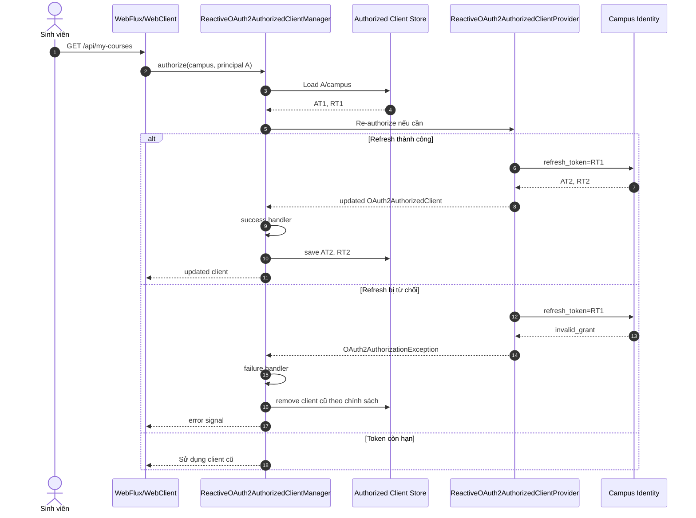
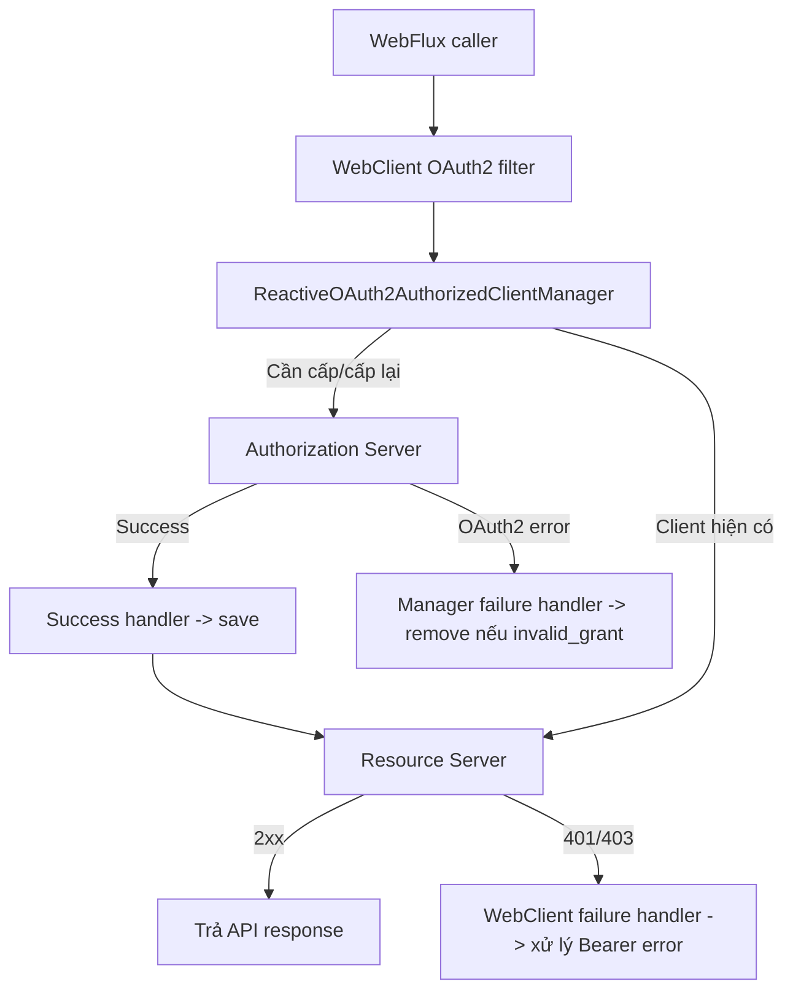
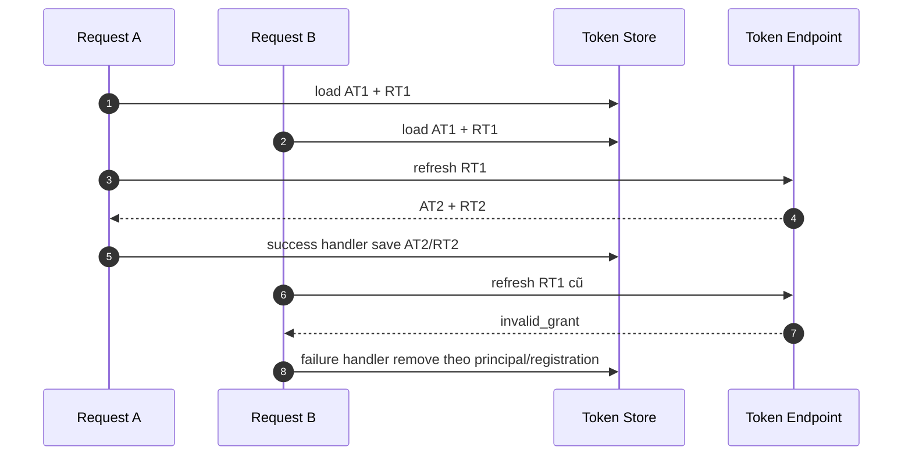

# 21.8. Success handler, failure handler và cập nhật authorized client

## Mục tiêu bài học

Trong bài này, bạn sẽ:

- Nắm rõ vai trò của `ReactiveOAuth2AuthorizationSuccessHandler` và `ReactiveOAuth2AuthorizationFailureHandler` trong Spring Security **OAuth2 Client Reactive/WebFlux**.
- Hiểu `DefaultReactiveOAuth2AuthorizedClientManager` điều phối authorization, lưu token mới và loại bỏ trạng thái không hợp lệ.
- Phân biệt `ServerOAuth2AuthorizedClientRepository` với `ReactiveOAuth2AuthorizedClientService`.
- Biết khi nào dùng `DefaultReactiveOAuth2AuthorizedClientManager` và khi nào dùng `AuthorizedClientServiceReactiveOAuth2AuthorizedClientManager`.
- Tùy biến success/failure handler mà **không làm mất persistence mặc định** hoặc vô tình xóa authorized client của người dùng khác.
- Phân biệt lỗi `invalid_grant` từ **Token Endpoint** với HTTP 401/403 từ **Resource Server**, đồng thời cấu hình xử lý lỗi `WebClient` đúng vị trí.
- Hiểu các rủi ro của refresh-token rotation, concurrent requests, nhiều instance và reactive `Mono<Void>`.
- Viết các bài kiểm thử, xử lý lỗi, observability và authorization phù hợp với một ứng dụng OIDC Client thật.

---

## 1. Bối cảnh: token thay đổi theo thời gian

Giả sử **Learning Portal** là ứng dụng Spring Boot WebFlux. Sinh viên đăng nhập thông qua **Campus Identity**, một OpenID Provider. Sau OAuth2 Authorization Code Flow với OIDC, Portal có thông tin:

```text
ClientRegistration: campus
Principal: student-7e04
Access Token: AT1
Refresh Token: RT1
Access Token expiresAt: 10:00
```

Portal gọi **Course API**:

```http
GET /api/me/courses HTTP/1.1
Host: courses.example.org
Authorization: Bearer <AT1>
```

Đến 10:01, AT1 không còn đủ hạn. OAuth2 Client có thể xin token mới bằng RT1. OP trả:

```text
Access Token: AT2
Refresh Token: RT2 (nếu dùng refresh-token rotation)
Access Token expiresAt: 11:00
```

**Vấn đề 1:** Nếu chỉ trả AT2 về cho request hiện tại mà không lưu AT2/RT2, request sau lại đọc RT1, có thể gặp `invalid_grant`.

**Vấn đề 2:** Nếu OP từ chối RT1 vì bị thu hồi, ứng dụng cần dọn trạng thái không còn hợp lệ thay vì liên tục dùng lại grant cũ.

Hai điểm mở rộng của Spring Security xử lý các hệ quả ấy:

```java
ReactiveOAuth2AuthorizationSuccessHandler
ReactiveOAuth2AuthorizationFailureHandler
```

Chúng là **callback bất đồng bộ trong vòng đời authorized client**, không phải HTTP status handler chung của mọi REST API.

### 1.1. Sơ đồ Authorization Manager



Không phải mỗi lần gọi `authorize(...)` đều xin token mới. Khi token còn đủ hạn, manager có thể trả state đã lưu; **success handler không nhất thiết chạy khi chỉ tái sử dụng một token**.

## 2. Các lớp cần phân biệt

| Thành phần | Nhiệm vụ |
| --- | --- |
| `ClientRegistration` | Cấu hình OAuth client: Client ID, issuer/provider, grant, scope, endpoints |
| `ReactiveClientRegistrationRepository` | Tìm ClientRegistration theo registration ID |
| `Authentication` | Principal hiện tại mà OAuth2 authorized client được gắn vào |
| `OAuth2AuthorizedClient` | Chứa ClientRegistration, principal name, access token và optional refresh token |
| `ReactiveOAuth2AuthorizedClientProvider` | Thực thi grant, ví dụ refresh token hoặc client credentials |
| `ReactiveOAuth2AuthorizedClientManager` | Điều phối tải state, provider và handlers |
| `ReactiveOAuth2AuthorizationSuccessHandler` | Xử lý hậu quả khi authorize/re-authorize thành công |
| `ReactiveOAuth2AuthorizationFailureHandler` | Xử lý hậu quả khi authorize/re-authorize thất bại |
| `ServerOAuth2AuthorizedClientRepository` | Lưu state trong ngữ cảnh WebFlux `ServerWebExchange` |
| `ReactiveOAuth2AuthorizedClientService` | Lưu state theo registration ID và principal name, không cần exchange |
| `ServerOAuth2AuthorizedClientExchangeFilterFunction` | OAuth2 filter của outbound WebClient; có thể nhận phản hồi lỗi từ Resource Server |

Một bản ghi:

```text
AuthorizedClient
    registration = campus
    principalName = student-7e04
    accessToken = AT2
    refreshToken = RT2
```

**Không nhầm:** ID Token và `OidcUser` chứng minh người dùng đã đăng nhập với OIDC Client. Access Token trong `OAuth2AuthorizedClient` mới là credential để gọi Resource Server tương ứng. Success handler lưu token không tự động tạo một `OidcUser` mới.

### 2.1. Một user có thể có nhiều authorized client

```text
student A + campus  -> authorized client A/campus
student A + partner -> authorized client A/partner
student B + campus  -> authorized client B/campus
```

Bởi vậy các hoạt động save/remove không thể chỉ dựa vào `"campus"` mà bỏ principal. Không dùng biến static như `lastAuthorizedClient` trong một bean singleton.

## 3. Hợp đồng Reactive của success handler

Giao diện thuộc package:

```java
org.springframework.security.oauth2.client.ReactiveOAuth2AuthorizationSuccessHandler
```

Chữ ký:

```java
@FunctionalInterface
public interface ReactiveOAuth2AuthorizationSuccessHandler {

    Mono<Void> onAuthorizationSuccess(
        OAuth2AuthorizedClient authorizedClient,
        Authentication principal,
        Map<String, Object> attributes
    );
}
```

Ý nghĩa:

- `authorizedClient` chứa trạng thái đã được cấp/cấp lại.
- `principal` liên kết OAuth2 authorization với danh tính.
- `attributes` có thể mang context như `ServerWebExchange` trong ứng dụng WebFlux.
- `Mono<Void>` kết thúc khi hậu xử lý hoàn tất hoặc phát lỗi.

**Quy tắc Reactor:** để manager/framework **subscribe** vào `Mono<Void>` mà handler trả về. Không gọi `.subscribe()` tự do rồi trả `Mono.empty()` khi thực ra đang cần lưu dữ liệu.

### 3.1. Mặc định thành công

`DefaultReactiveOAuth2AuthorizedClientManager` mặc định lưu authorized client mới thông qua `ServerOAuth2AuthorizedClientRepository`.

Với manager service-based, việc lưu được thực hiện qua `ReactiveOAuth2AuthorizedClientService`.

```text
AT1/RT1 -> Token Endpoint -> AT2/RT2
                                  |
                                  v
                           success handler
                                  |
                                  v
                             save state
```

Khi refresh token rotation, phải lưu cả **AT2 và RT2**, không chỉ thay access token.

### 3.2. Không phải callback của HTTP 200

Một HTTP `200 OK` từ Course API không tự gọi success handler này. Handler được dùng khi **authorization hoặc re-authorization** thành công. Hai loại metric khác nhau:

```text
OAuth2 Authorization success count
Course API HTTP 200 count
```

Không dùng handler làm một bộ đếm mọi request API thành công.

## 4. Hợp đồng Reactive của failure handler

Giao diện:

```java
@FunctionalInterface
public interface ReactiveOAuth2AuthorizationFailureHandler {

    Mono<Void> onAuthorizationFailure(
        OAuth2AuthorizationException authorizationException,
        Authentication principal,
        Map<String, Object> attributes
    );
}
```

`OAuth2AuthorizationException` chứa `OAuth2Error`, ví dụ:

```java
String errorCode = authorizationException
    .getError()
    .getErrorCode();
```

Các error code liên quan OAuth2 Token Endpoint:

```text
invalid_grant
invalid_client
invalid_scope
unauthorized_client
server_error
temporarily_unavailable
```

**Không phải lỗi nào cũng có nghĩa token phải bị xóa.**

### 4.1. `invalid_grant`

Một refresh request có thể bị từ chối:

```http
HTTP/1.1 400 Bad Request
Content-Type: application/json

{
  "error": "invalid_grant",
  "error_description": "Refresh token is no longer valid"
}
```

Các nguyên nhân có thể là grant bị thu hồi, refresh token hết hạn hoặc token rotation/reuse.

Default failure handler của manager thường được xây bằng:

```java
RemoveAuthorizedClientReactiveOAuth2AuthorizationFailureHandler
```

và loại authorized client đã lưu khi `invalid_grant` xảy ra trong re-authorization. Mục đích là không tiếp tục dùng một grant đã được xác định không còn hợp lệ.

### 4.2. Không xóa trên mọi lỗi

| Lỗi | Ý nghĩa | Hướng xử lý |
| --- | --- | --- |
| `invalid_grant` | Grant/refresh token bị từ chối | Remove/re-authorization theo policy |
| `invalid_client` | Client ID/secret hoặc client authentication method sai | Sửa cấu hình và credentials |
| `invalid_scope` | Scope yêu cầu chưa được phép | Sửa cấu hình/scope/consent |
| HTTP 5xx ở Token Endpoint | AS tạm unavailable | Retry/backoff có giới hạn |
| Timeout sau refresh | OP có thể đã xử lý rotation dù response mất | Không retry RT1 mù quáng |
| SSL certificate error | Lỗi trust/hostname | Sửa TLS, không tắt verification |

Nếu tùy biến handler để xóa mọi token trên mọi exception, một sự cố mạng ngắn có thể khiến rất nhiều người phải đăng nhập lại.

### 4.3. Remove local state không phải Token Revocation

```text
repository.removeAuthorizedClient(...)
```

không đồng nghĩa Authorization Server đã thu hồi Access Token/Refresh Token. Logout, local state removal, Token Revocation Endpoint và OP SSO logout là những vòng đời khác nhau.

## 5. Cấu hình WebFlux OIDC Client và manager

### 5.1. Cấu hình registration

Ví dụ:

```yaml
spring:
  security:
    oauth2:
      client:
        registration:
          campus:
            provider: campus
            client-id: ${CAMPUS_CLIENT_ID}
            client-secret: ${CAMPUS_CLIENT_SECRET}
            authorization-grant-type: authorization_code
            client-authentication-method: client_secret_basic
            redirect-uri: "{baseUrl}/login/oauth2/code/{registrationId}"
            scope:
              - openid
              - profile
              - courses.read
        provider:
          campus:
            issuer-uri: https://login.example.org/realms/campus
```

Các giá trị chỉ minh họa; cần đăng ký client thật và bảo vệ secret. `campus` là `registrationId`, còn `${CAMPUS_CLIENT_ID}` là OAuth Client ID mà Authorization Server cấp.

### 5.2. SecurityWebFilterChain

```java
@Configuration
@EnableWebFluxSecurity
class SecurityConfig {

    @Bean
    SecurityWebFilterChain securityWebFilterChain(
            ServerHttpSecurity http) {

        return http
            .authorizeExchange(exchanges -> exchanges
                .pathMatchers("/", "/error", "/assets/**").permitAll()
                .anyExchange().authenticated()
            )
            .oauth2Login(Customizer.withDefaults())
            .oauth2Client(Customizer.withDefaults())
            .build();
    }
}
```

Đây là WebFlux Reactive, không dùng `HttpSecurity` hay `SecurityFilterChain` của Servlet.

### 5.3. DefaultReactiveOAuth2AuthorizedClientManager

```java
@Configuration
class OAuth2ManagerConfig {

    @Bean("webClientManager")
    ReactiveOAuth2AuthorizedClientManager webClientManager(
            ReactiveClientRegistrationRepository registrations,
            ServerOAuth2AuthorizedClientRepository repository) {

        ReactiveOAuth2AuthorizedClientProvider provider =
            ReactiveOAuth2AuthorizedClientProviderBuilder.builder()
                .authorizationCode()
                .refreshToken()
                .build();

        DefaultReactiveOAuth2AuthorizedClientManager manager =
            new DefaultReactiveOAuth2AuthorizedClientManager(
                registrations, repository
            );

        manager.setAuthorizedClientProvider(provider);

        return manager;
    }
}
```

Cấu hình này cho phép manager dùng repository có request context và refresh-token provider. Không cần đặt custom handlers nếu default persistence và error policy phù hợp.

**Chú ý:** `authorizationCode()` trong provider chain không tạo được authorization code cho một user chưa đi qua browser. OIDC Login cần khởi tạo authorization request và callback trước khi có authorized client.

### 5.4. Vì sao các handler không xuất hiện trong bean trên?

Vì default manager đã có handler lưu authorized client khi authorization thành công và xử lý `invalid_grant` theo chính sách. Việc override không cần thiết có thể làm mất logic mặc định.

## 6. Kho lưu state: repository WebFlux

Giao diện:

```java
public interface ServerOAuth2AuthorizedClientRepository {

    <T extends OAuth2AuthorizedClient> Mono<T> loadAuthorizedClient(
        String clientRegistrationId,
        Authentication principal,
        ServerWebExchange exchange
    );

    Mono<Void> saveAuthorizedClient(
        OAuth2AuthorizedClient authorizedClient,
        Authentication principal,
        ServerWebExchange exchange
    );

    Mono<Void> removeAuthorizedClient(
        String clientRegistrationId,
        Authentication principal,
        ServerWebExchange exchange
    );
}
```

Những implementation tiêu biểu:

- `WebSessionServerOAuth2AuthorizedClientRepository`: lưu state trong WebSession.
- `AuthenticatedPrincipalServerOAuth2AuthorizedClientRepository`: khi principal authenticated, thường delegate cho `ReactiveOAuth2AuthorizedClientService`, còn anonymous có thể dùng WebSession fallback.

Các implementation mang **vòng đời lưu trữ khác nhau**. Nếu dùng persistent service, logout local session không mặc nhiên xóa token ở database.

### 6.1. Tra cứu không làm mới token

```java
Mono<OAuth2AuthorizedClient> saved =
    repository.loadAuthorizedClient(
        "campus",
        authentication,
        exchange
    );
```

Lời gọi này chỉ tải state. Nó có thể trả client chứa access token hết hạn; **manager/provider** mới là nơi cân nhắc refresh hoặc authorization.

### 6.2. Save phải dùng đúng principal

```java
Mono<Void> write =
    repository.saveAuthorizedClient(
        updatedClient,
        authentication,
        exchange
    );
```

Nếu `authentication` là của user B nhưng `updatedClient` thuộc user A, ứng dụng có thể làm lẫn token giữa users. Phải giữ binding theo request và registration.

## 7. Truyền ServerWebExchange cho manager

`DefaultReactiveOAuth2AuthorizedClientManager` hoạt động trong WebFlux request context. Với một caller tự gọi manager, có thể xây:

```java
OAuth2AuthorizeRequest authorizationRequest =
    OAuth2AuthorizeRequest
        .withClientRegistrationId("campus")
        .principal(authentication)
        .attribute(
            ServerWebExchange.class.getName(),
            exchange
        )
        .build();

Mono<OAuth2AuthorizedClient> authorizedClient =
    manager.authorize(authorizationRequest);
```

Điều này giúp manager biết exchange để repository thao tác WebSession hoặc context phù hợp.

Một controller chỉ để minh họa:

```java
@GetMapping("/internal/oauth2/status")
Mono<Map<String, Object>> status(
        Authentication authentication,
        ServerWebExchange exchange) {

    OAuth2AuthorizeRequest request =
        OAuth2AuthorizeRequest
            .withClientRegistrationId("campus")
            .principal(authentication)
            .attribute(ServerWebExchange.class.getName(), exchange)
            .build();

    return manager.authorize(request)
        .map(client -> Map.<String, Object>of(
            "registrationId",
            client.getClientRegistration().getRegistrationId(),
            "hasRefreshToken",
            client.getRefreshToken() != null
        ))
        .switchIfEmpty(Mono.just(
            Map.<String, Object>of(
                "registrationId", "campus",
                "authorized", false
            )
        ));
}
```

Không trả token value hoặc refresh token. Endpoint debug phải được bảo vệ thích hợp, hoặc không triển khai trong production.

**Không tạo `ServerWebExchange` giả rồi lưu trong static field để dùng cho scheduled job.** Với tác vụ không có HTTP request, phải dùng manager khác.

## 8. Khi nào success handler được gọi?

Mô hình thường gặp:

```text
manager.authorize(request)
  |
  +-- Có token còn dùng được
  |      -> trả authorized client hiện có
  |
  +-- Refresh Token Grant thực hiện thành công
  |      -> tạo client mới
  |      -> success handler lưu client mới
  |
  +-- Client Credentials Grant thực hiện thành công
  |      -> tạo client mới
  |      -> success handler lưu client mới
  |
  +-- Token Endpoint báo lỗi
         -> failure handler theo OAuth2 error
```

Success handler **không phải một timer** làm mới token khi không có request. Nó được kích hoạt trong flow mà manager thực sự authorize/re-authorize.

### 8.1. Refresh-token rotation

Trạng thái ban đầu:

```text
campus/student-A:
    AT1
    RT1
```

OP trả:

```text
AT2
RT2
```

Lần lưu thành công phải dẫn đến:

```text
campus/student-A:
    AT2
    RT2
```

Nếu chỉ lưu AT2 nhưng giữ RT1, lần refresh tiếp theo có thể thất bại.

### 8.2. Save hoàn tất trước khi tiếp tục

Trong Reactive chain:

```text
provider returns authorizedClient
    -> successHandler.onAuthorizationSuccess(...)
        -> Mono<Void> save completes
            -> manager emits authorizedClient
```

Việc tách save bằng `.subscribe()` có thể làm mất thứ tự và khả năng truyền lỗi.

## 9. Tùy biến success handler: giữ logic save

Một developer muốn thêm audit/metrics sau khi cấp token mới. Đoạn code sai:

```java
manager.setAuthorizationSuccessHandler(
    (client, principal, attrs) -> {
        meterRegistry.counter("oauth2.success").increment();
        return Mono.empty();
    }
);
```

Vì đã thay handler mặc định nhưng **không lưu authorized client**. Khi request sau chạy, store có thể vẫn mang RT1 cũ.

### 9.1. Ví dụ với ReactiveOAuth2AuthorizedClientService

Nếu manager sử dụng service store, một handler có thể thực hiện save rồi ghi metric:

```java
manager.setAuthorizationSuccessHandler(
    (client, principal, attrs) -> {

        String registrationId =
            client.getClientRegistration().getRegistrationId();

        return authorizedClientService
            .saveAuthorizedClient(client, principal)
            .doOnSuccess(ignored -> meterRegistry.counter(
                "oauth2.authorize.success",
                "registration", registrationId
            ).increment());
    }
);
```

Yêu cầu:

- `authorizedClientService` chính là store mà manager đang dùng.
- `saveAuthorizedClient` trả `Mono<Void>`; completion phải nằm trong chain.
- Token/secret không xuất hiện trong metric tags hoặc logs.
- Khi save lỗi, pipeline có thể báo lỗi thay vì coi state đã cập nhật bền vững.

Đối với WebFlux repository, callback cần `ServerWebExchange` đúng ngữ cảnh.

### 9.2. Ví dụ với ServerOAuth2AuthorizedClientRepository

```java
manager.setAuthorizationSuccessHandler(
    (client, principal, attrs) -> {

        ServerWebExchange exchange =
            (ServerWebExchange) attrs.get(
                ServerWebExchange.class.getName()
            );

        if (exchange == null) {
            return Mono.error(
                new IllegalStateException(
                    "Missing ServerWebExchange in success handler"
                )
            );
        }

        return repository.saveAuthorizedClient(
            client, principal, exchange
        );
    }
);
```

Đây là ví dụ extension point; bình thường **không cần** tự viết đoạn này vì manager đã có save handler mặc định. Nếu cần thêm audit, gắn operator sau `saveAuthorizedClient(...)` thay vì bỏ hẳn save.

### 9.3. Đừng tự subscribe

Sai:

```java
repository.saveAuthorizedClient(client, principal, exchange)
    .subscribe();

return Mono.empty();
```

Nguy cơ:

- Caller nhận “complete” trước khi save hoàn thành.
- Lỗi save không được quản lý theo flow.
- Reactive context/correlation có thể thất lạc.
- Token mới có thể được dùng rồi nhưng store vẫn cũ.

Đúng: **return `Mono<Void>`** của thao tác lưu.

## 10. Default failure handler và chính sách xóa

`RemoveAuthorizedClientReactiveOAuth2AuthorizationFailureHandler` là implementation có thể xóa authorized client khi `OAuth2Error.getErrorCode()` thuộc tập mã lỗi được cấu hình.

Mặc định của manager tập trung vào **`invalid_grant`**.

### 10.1. Tại sao không xóa trên mọi lỗi?

Một Token Endpoint trả HTTP 503 không chứng minh RT1 bị thu hồi. Xóa authorized client trong tình huống đó có thể khiến browser phải login lại không cần thiết.

Với lỗi `invalid_client`, cần xem client authentication configuration/secret. Cứ xóa token rồi xin lại bằng cùng secret sai sẽ tạo vòng thất bại.

### 10.2. Cách dùng remover helper với service

Một cách viết custom failure handler nhưng vẫn delegate logic error code:

```java
RemoveAuthorizedClientReactiveOAuth2AuthorizationFailureHandler remover =
    new RemoveAuthorizedClientReactiveOAuth2AuthorizationFailureHandler(
        (registrationId, principal, attrs) ->
            authorizedClientService.removeAuthorizedClient(
                registrationId,
                principal.getName()
            )
    );

manager.setAuthorizationFailureHandler(
    (exception, principal, attrs) -> {
        String errorCode = exception.getError().getErrorCode();

        return remover.onAuthorizationFailure(
                exception, principal, attrs
            )
            .doOnSuccess(ignored -> meterRegistry.counter(
                "oauth2.authorize.failure",
                "error", errorCode
            ).increment());
    }
);
```

Code minh họa API của các dòng Spring Security hỗ trợ constructor nhận `OAuth2AuthorizedClientRemover`; cần đối chiếu version thực tế khi tích hợp. Nếu không cần custom policy, nên giữ default.

**Lưu ý:** Metric failure ở trên đo số sự kiện lỗi, không chứng minh mọi sự kiện đã dẫn đến remove: remover chỉ hoạt động với error code thuộc policy.

### 10.3. Error signal vẫn cần được quan sát

Một handler có thể hoàn tất `Mono<Void>` sau khi remove. Điều đó không đồng nghĩa `authorize(...)` trở thành thành công. Caller vẫn cần xử lý authorization error hoặc trường hợp không có authorized client.

Đừng đặt `.onErrorResume(...)` để trả một token cũ không còn hợp lệ chỉ nhằm tránh 401 cho người dùng.

## 11. WebClient có failure handler riêng cho lỗi Resource Server

Giả sử Token Endpoint vừa cấp AT2, nhưng Course API trả:

```http
HTTP/1.1 401 Unauthorized
WWW-Authenticate: Bearer error="invalid_token"
```

Lỗi này xuất phát từ **Resource Server**, không phải một `invalid_grant` của Token Endpoint.

Spring Security Reactive dùng:

```java
ServerOAuth2AuthorizedClientExchangeFilterFunction
```

để tích hợp OAuth2 vào outbound `WebClient`.

### 11.1. Cấu hình với manager

```java
@Bean
WebClient courseApiWebClient(
        ReactiveOAuth2AuthorizedClientManager manager) {

    ServerOAuth2AuthorizedClientExchangeFilterFunction oauth2 =
        new ServerOAuth2AuthorizedClientExchangeFilterFunction(
            manager
        );

    return WebClient.builder()
        .baseUrl("https://courses.example.org")
        .filter(oauth2)
        .build();
}
```

Và:

```java
import static org.springframework.security.oauth2.client.web.reactive.function.client.ServerOAuth2AuthorizedClientExchangeFilterFunction.clientRegistrationId;

Mono<CourseDto[]> courses = courseApiWebClient.get()
    .uri("/api/me/courses")
    .attributes(clientRegistrationId("campus"))
    .retrieve()
    .bodyToMono(CourseDto[].class);
```

Các imports/DTO và behavior lỗi cần được bổ sung cho project. Endpoint của Portal phải được bảo vệ khi gọi API thay người dùng.

### 11.2. Hai constructor có hành vi khác nhau

Theo Spring Security:

1. `new ServerOAuth2AuthorizedClientExchangeFilterFunction(registrations, repository)` có thể cài sẵn failure handler để xử lý một số 401/403 Bearer errors từ Resource Server.
2. `new ServerOAuth2AuthorizedClientExchangeFilterFunction(manager)` **không tự cài handler cho lỗi Resource Server**; cần gọi `setAuthorizationFailureHandler(...)` nếu muốn state bị từ chối được remove.

Điều này **không thay thế** manager failure handler vốn xử lý lỗi khi authorize/re-authorize.

### 11.3. Gắn handler cho WebClient filter

Ví dụ dùng WebFlux repository:

```java
ServerOAuth2AuthorizedClientExchangeFilterFunction oauth2 =
    new ServerOAuth2AuthorizedClientExchangeFilterFunction(
        webClientManager
    );

RemoveAuthorizedClientReactiveOAuth2AuthorizationFailureHandler remover =
    new RemoveAuthorizedClientReactiveOAuth2AuthorizationFailureHandler(
        (registrationId, principal, attrs) -> {

            ServerWebExchange exchange =
                (ServerWebExchange) attrs.get(
                    ServerWebExchange.class.getName()
                );

            if (exchange == null) {
                return Mono.error(new IllegalStateException(
                    "Missing exchange when removing authorized client"
                ));
            }

            return repository.removeAuthorizedClient(
                registrationId, principal, exchange
            );
        }
    );

oauth2.setAuthorizationFailureHandler(remover);
```

Phần `attrs` phải thực sự có exchange ở đường gọi đang được sử dụng. Đối với manager service/background, dùng remover delegate tới `ReactiveOAuth2AuthorizedClientService` thay vì repository dựa trên exchange.

### 11.4. 401 khác 403

| Resource Server response | Ý nghĩa thông thường | Điều cần làm |
| --- | --- | --- |
| `401 invalid_token` | Token hết hạn, bị thu hồi hoặc không hợp lệ | Có thể remove state theo error policy; điều tra issuer/audience |
| `403 insufficient_scope` | Token không có scope cần thiết | Sửa scope/consent/policy, không refresh vô hạn |
| 403 nghiệp vụ | Không có quyền xem/sửa một bản ghi | Kiểm tra ownership và role |
| 429 | Rate limit | Backoff/retry có giới hạn |
| 500/503 | Resource Server tạm lỗi | Không mặc định remove OAuth2 grant |

**Không mặc định “HTTP 401/403 = xóa mọi authorized client”**. Handler dựa trên OAuth2 Bearer error codes và chính sách được cấu hình.

### 11.5. Failure handler không đảm bảo tự retry request vừa thất bại

Thông thường, việc remove giúp **request sau** có thể lấy token mới. Tự retry POST sau khi nhận lỗi có thể gây thao tác trùng nếu phía API đã thực hiện side effect rồi mất response.

Cần xác định HTTP method, idempotency key, retry budget và policy nghiệp vụ trước khi retry.

## 12. Vòng đời Token Endpoint và Resource Server



Có thể dùng cùng interface `ReactiveOAuth2AuthorizationFailureHandler` tại cả manager và filter, nhưng chúng **được kích hoạt ở hai vị trí khác nhau**. Vì vậy đừng xem một API error là Token Endpoint error chỉ vì handler class giống nhau.

## 13. Service/background manager không cần exchange

Một background job chạy theo lịch không có WebFlux request hay WebSession. Manager phù hợp:

```java
AuthorizedClientServiceReactiveOAuth2AuthorizedClientManager
```

Cấu hình:

```java
@Bean("serviceClientManager")
ReactiveOAuth2AuthorizedClientManager serviceClientManager(
        ReactiveClientRegistrationRepository registrations,
        ReactiveOAuth2AuthorizedClientService service) {

    ReactiveOAuth2AuthorizedClientProvider provider =
        ReactiveOAuth2AuthorizedClientProviderBuilder.builder()
            .clientCredentials()
            .build();

    AuthorizedClientServiceReactiveOAuth2AuthorizedClientManager manager =
        new AuthorizedClientServiceReactiveOAuth2AuthorizedClientManager(
            registrations, service
        );

    manager.setAuthorizedClientProvider(provider);
    return manager;
}
```

Caller:

```java
OAuth2AuthorizeRequest request =
    OAuth2AuthorizeRequest
        .withClientRegistrationId("course-sync")
        .principal("course-sync-service")
        .build();

Mono<OAuth2AuthorizedClient> result =
    serviceClientManager.authorize(request);
```

`"course-sync-service"` là tên principal kỹ thuật dùng làm khóa state, không phải một `OidcUser` đang đăng nhập.

### 13.1. `ReactiveOAuth2AuthorizedClientService`

Giao diện:

```java
<T extends OAuth2AuthorizedClient> Mono<T> loadAuthorizedClient(
    String registrationId,
    String principalName
);

Mono<Void> saveAuthorizedClient(
    OAuth2AuthorizedClient client,
    Authentication principal
);

Mono<Void> removeAuthorizedClient(
    String registrationId,
    String principalName
);
```

Một số implementation:

- `InMemoryReactiveOAuth2AuthorizedClientService`: dữ liệu trong bộ nhớ một JVM.
- `R2dbcReactiveOAuth2AuthorizedClientService`: dữ liệu qua R2DBC/database khi có schema và cấu hình.
- Service tùy biến: có thể dùng shared token store với mã hóa/quyền truy cập phù hợp.

Không giả định in-memory state được chia sẻ giữa các pod khác nhau.

### 13.2. Client Credentials không cần Refresh Token theo cách thông dụng

Khi M2M access token hết hạn, `clientCredentials()` provider có thể xin token mới tại Token Endpoint. Refresh token thường không được cấp cho Client Credentials Grant theo RFC 6749. Không dùng logic refresh grant chỉ vì phần lớn ví dụ OIDC Web Login có refresh token.

## 14. Refresh-token rotation và race giữa nhiều request

Hai tab cùng cần refresh AT1 khi RT1 còn dùng được.



Có thể xuất hiện vấn đề: request B nhận `invalid_grant` trễ rồi xóa **AT2/RT2 mới của A** nếu remove chỉ theo principal/registration mà không có kiểm tra version.

Hậu quả:

- User phải login/reauthorize lại dù A vừa refresh thành công.
- OP có thể thu hồi token family khi phát hiện reuse.
- Lỗi khó tái hiện nếu chỉ có một request tuần tự.
- Nhiều pod cùng chia shared state làm vấn đề thường xuyên hơn.

### 14.1. Hướng xử lý

- Dùng **single-flight refresh** cho cùng registration, principal và tenant.
- Dùng **optimistic concurrency** hoặc CAS/version khi lưu/xóa state.
- Dùng distributed lock nếu nhiều instance cùng refresh một grant.
- Không ghi đè state mới bằng RT1 đọc từ cache cũ.
- Trước khi remove sau lỗi đến muộn, cân nhắc kiểm tra version nếu kiến trúc cho phép.
- Giới hạn retry khi Token Endpoint timeout; không retry vô hạn rotating refresh token.

`DefaultReactiveOAuth2AuthorizedClientManager` hỗ trợ flow và hooks nhưng **không phải distributed lock tự động**.

### 14.2. Conditional remove ở custom store

Thay vì logic xóa mọi bản ghi:

```text
DELETE authorized_client
WHERE registration_id = campus AND principal = A
```

custom store có thể cần:

```text
DELETE authorized_client
WHERE registration_id = campus
  AND principal = A
  AND version = expected_version
```

Đây là ý tưởng persistence, **không phải chữ ký method mặc định** của Spring Security. Mục đích tránh request lỗi cũ xóa state mới.

## 15. WebSession, logout và lưu bền vững

Ba vòng đời cần phân biệt:

```text
Authentication / WebSession:
    Browser đã đăng nhập

Authorized Client Store:
    Access Token / Refresh Token của registration

Authorization Server:
    Grant/Consent/Token Revocation/SSO session
```

Khi WebSession hết hạn, những token chỉ lưu trong WebSession có thể không còn được tải. Nếu state được lưu trong R2DBC service, bản ghi có thể **vẫn còn** sau browser logout.

Việc `removeAuthorizedClient(...)` ở repository/service **không tự gọi** Token Revocation Endpoint. Nếu sản phẩm đòi revoke, phải triển khai chính sách bên Authorization Server.

### 15.1. Lưu lâu dài có nghĩa phải bảo vệ lâu dài

Token store cần:

- Giới hạn quyền đọc/ghi và truy cập từ service khác.
- Mã hóa phù hợp khi lưu at-rest, quản lý khóa riêng.
- Xóa token hết hiệu lực và retention policy rõ ràng.
- Tách môi trường dev/staging/prod.
- Tách token theo principal/registration/tenant.
- Giám sát truy cập bất thường mà không ghi raw token vào log.

## 16. Những lỗi Reactor cần tránh

### 16.1. `Mono.empty()` không phải “đã lưu token”

Ví dụ:

```java
ReactiveOAuth2AuthorizationSuccessHandler wrongHandler =
    (client, principal, attrs) -> {
        service.saveAuthorizedClient(client, principal);
        return Mono.empty();
    };
```

Publisher lưu dữ liệu **không được subscribe** nên có thể không hề chạy.

Đúng:

```java
ReactiveOAuth2AuthorizationSuccessHandler handler =
    (client, principal, attrs) ->
        service.saveAuthorizedClient(client, principal);
```

### 16.2. Đừng gọi `.block()` trong WebFlux handler

Sai:

```java
OAuth2AuthorizedClient client =
    manager.authorize(request).block();
```

trong event-loop của WebFlux.

Đúng:

```java
return manager.authorize(request)
    .map(client -> client.getClientRegistration().getRegistrationId());
```

hoặc chain `flatMap` để gọi outbound API.

### 16.3. Reactive SecurityContext không phải ThreadLocal Servlet

`ReactiveSecurityContextHolder` dựa trên **Reactor context**. Không dùng `SecurityContextHolder.getContext()` rồi mặc định Authentication vẫn đúng khi code chuyển scheduler/thread.

Nếu cần principal, dùng WebFlux integration, `Authentication` được inject ở controller hoặc lấy qua Reactive SecurityContext, rồi truyền đúng vào authorize request.

### 16.4. `Mono.empty()` và `Mono.error()` khác nhau

`authorize(...)` có thể trả empty nếu không có provider nào authorize được và không có existing client phù hợp. Còn lỗi Token Endpoint thường dẫn đến error signal.

Ví dụ:

```java
return manager.authorize(request)
    .switchIfEmpty(Mono.error(
        new IllegalStateException("Authorized client unavailable")
    ));
```

Hãy phân biệt “chưa có grant” với “grant hiện có bị từ chối” khi thiết kế UX và telemetry.

## 17. Logging và metrics

Metadata thường có ích:

```text
registrationId = campus
grant = refresh_token
event = authorization_success
expiresAt = <timestamp>
correlationId = <safe-id>
```

hoặc:

```text
registrationId = campus
event = authorization_failure
errorCode = invalid_grant
```

Không log:

```text
access_token
refresh_token
client_secret
authorization_code
ID Token nguyên văn
client_assertion
session cookie
Authorization header
```

### 17.1. Không dùng dữ liệu cá nhân làm metric tag

Không đặt email hoặc `sub` của từng user thành metric tag; nguy cơ lộ dữ liệu và cardinality tăng mạnh.

Tags thường phù hợp hơn:

```text
registrationId
grantType
errorCode
serviceName
environment
```

### 17.2. Đếm đúng sự kiện

`success handler` đo số lần cấp/cấp lại authorized client, **không phải** tổng số HTTP 200 từ API. `failure handler` đo authorization failures, không mặc nhiên bằng số lượng bản ghi token bị remove.

## 18. Kiểm thử success handler và token rotation

### 18.1. Test scenario

```text
Given:
    Store có campus/student-A -> AT1 expired, RT1
    Mock Token Endpoint trả AT2, RT2

When:
    manager.authorize(campus, student-A)

Then:
    Manager trả AT2
    Store có AT2 và RT2
    Request sau không dùng RT1
```

Kiểm tra cả **kết quả manager** và **state đã lưu**, vì một handler không lưu token vẫn có thể khiến request hiện tại nhận AT2.

### 18.2. Test bằng StepVerifier

Ví dụ giả định fixture `updatedClient` và `authentication`:

```java
ReactiveOAuth2AuthorizationSuccessHandler handler =
    (client, principal, attrs) ->
        authorizedClientService.saveAuthorizedClient(client, principal);

StepVerifier.create(
        handler.onAuthorizationSuccess(
            updatedClient,
            authentication,
            Map.of()
        )
    )
    .verifyComplete();
```

Sau đó load lại state qua service để xác minh giá trị cập nhật.

### 18.3. Test handler không tự subscribe

Dùng một fake store trả `Mono` có controlled completion; manager chỉ phát authorized client khi save hoàn tất. Đây là cách phát hiện code đã gọi `.subscribe()` riêng rồi trả `Mono.empty()`.

## 19. Kiểm thử failure handler

Các tình huống:

| Test case | Kỳ vọng |
| --- | --- |
| Refresh token bị OP từ chối `invalid_grant` | Failure handler theo policy loại state cũ |
| Token Endpoint HTTP 503 | Không mặc định xóa grant |
| Timeout sau refresh | Báo lỗi phù hợp, không retry mù |
| Course API trả 401 `invalid_token` | WebClient filter nhận lỗi nếu được cấu hình handler |
| Course API trả 403 `insufficient_scope` | Không tự tăng quyền/refresh vô hạn |
| Hai refresh đồng thời | Không làm mất state mới sau lỗi của request cũ khi custom store có CAS |
| Save AT2/RT2 bị lỗi database | Request biết save thất bại; không coi state đã bền vững |
| User A và B cùng registration | Không đọc/xóa token của nhau |

### 19.1. WebTestClient và mockOidcLogin

`SecurityMockServerConfigurers.mockOidcLogin()` cho phép tạo một OIDC principal giả để test controller/authorization. Nó **không chạy toàn bộ** Authorization Code Flow và không tự chứng minh refresh-token persistence.

Cần test riêng manager, Token Endpoint mock và authorized-client store khi kiểm tra lifecycle.

### 19.2. Outbound WebClient test

Nên kiểm tra:

- Token thuộc đúng principal và registration.
- Request gửi tới Course API có header Bearer đúng test token.
- 401 có OAuth2 Bearer challenge được chuyển đến filter failure handler khi cấu hình.
- Không gửi token sang host tùy ý/redirect không được phép.
- Không ghi Authorization header vào logs.

## 20. Chẩn đoán lỗi thường gặp

| Biểu hiện | Nguyên nhân khả dĩ | Hướng xử lý |
| --- | --- | --- |
| Refresh thành công nhưng token store vẫn AT1 | Custom success handler quên save | Giữ persistence |
| Sau refresh lại bị `invalid_grant` | RT2 không được lưu hoặc bị ghi đè | Lưu full client, kiểm tra rotation |
| Handler không chạy khi access token còn hạn | Không có authorize event mới | Đây có thể là hành vi đúng |
| Course API 401 lặp lại | WebClient filter manager constructor chưa có RS failure handler | Cấu hình filter handler |
| 403 vẫn xảy ra sau refresh | Thiếu scope/role/ownership | Sửa quyền, không refresh mãi |
| Job không có exchange | Dùng DefaultReactive manager ngoài WebFlux request | Dùng service-based manager |
| State mất khi request chuyển pod | WebSession/in-memory store không shared | Cấu hình shared persistence/session |
| Logout nhưng R2DBC vẫn còn token | Store có vòng đời khác WebSession | Cleanup/revoke policy |
| Request B xóa AT2 của A | Invalid-grant race | Conditional delete, lock/single-flight |
| Save không thực hiện | Mono bị bỏ không subscribe | Return/chain Mono |
| Event-loop bị block | `.block()` trong handler | Dùng Reactor operators |
| `NoSuchBeanDefinition` manager | Thiếu starter/config hoặc multiple beans | Kiểm tra bean và `@Qualifier` |
| User A gọi API bằng token B | Principal key/store sai | Phân tách user/tenant/registration |
| Access token lộ trong logs | HTTP tracing/raw headers | Redact và hạn chế quyền đọc |
| API 401 do dùng nhầm ID Token | Sai token purpose/audience | Dùng Access Token của authorized client |
| Xóa token local nhưng OP vẫn chấp nhận | Chưa revoke remote grant | Tích hợp revocation theo chính sách |

### 20.1. Quy trình điều tra

1. **Registration:** chọn đúng `registrationId`, Client ID, issuer, grant và scopes chưa?
2. **Principal:** token được cấp cho End-User hay service nào?
3. **Store:** manager dùng repository/service nào? Có trùng store sau OAuth2 Login?
4. **Provider:** đã cấu hình refresh token/client credentials grant đúng chưa?
5. **Token Endpoint:** thành công, `invalid_grant` hay timeout?
6. **Success handler:** có hoàn tất save AT2/RT2 không?
7. **Failure handler:** loại state theo error code nào? Có race không?
8. **WebClient filter:** 401/403 của Resource Server có handler riêng không?
9. **Resource Server:** audience/scope/role/ownership có đúng?
10. **Security:** có vô tình log token/secret hoặc gửi Bearer token sai host không?

Không chữa lỗi bằng cách tắt JWT signature verification ở Resource Server hoặc dùng chung Access Token của một account.

## 21. Các tình huống thực tế

### Tình huống A — Sinh viên login OIDC và refresh thành công

A đã OIDC Login, manager tải AT1/RT1. OP trả AT2/RT2. Success handler lưu client cập nhật. Course API được gọi với Access Token mới của A.

### Tình huống B — User rút consent

OP thu hồi refresh token. Manager nhận `invalid_grant`, default failure handler loại state không còn hợp lệ. Portal cần khởi tạo authorization/login lại theo UX thay vì retry RT1 vô hạn.

### Tình huống C — Token bị Resource Server revoke

AT1 chưa hết hạn theo local clock nhưng Course API trả 401 `invalid_token`. WebClient filter có handler phù hợp thì có thể remove state này; **request sau** có cơ hội xin token mới.

### Tình huống D — Thiếu scope

Token còn hạn với `courses.read`; API ghi điểm yêu cầu `grades.write`. Filter không nên tạo vòng remove/refresh; thay bằng kiểm tra scope và chính sách quyền.

### Tình huống E — Scheduled M2M

Job dùng `client_credentials`, service-based manager, principal `"course-sync-service"`. Success handler lưu token theo registration và service principal; không có OIDC End-User.

### Tình huống F — Hai tab refresh cạnh tranh

A lưu RT2, B nhận `invalid_grant` khi dùng RT1 cũ. Failure handler B có nguy cơ xóa state mới. Cần single-flight hoặc CAS/optimistic versioning.

### Tình huống G — Metric-only success handler

Developer override success handler nhưng chỉ ghi metric. AT2/RT2 không được lưu. Sau một lần refresh thành công, request sau lại gặp grant cũ. Cần gọi `saveAuthorizedClient` trước và chain metric sau completion.

## 22. Bài tập thực hành

### Bài tập 1 — Phân biệt handler

**Yêu cầu:** OP trả AT2/RT2 sau Refresh Token Grant thành công.

**Đáp án:** success handler lưu `OAuth2AuthorizedClient` chứa token cập nhật, thường thông qua repository/service mặc định.

### Bài tập 2 — `invalid_grant`

**Yêu cầu:** Refresh Token RT1 bị OP từ chối.

**Đáp án:** failure handler có thể loại state không hợp lệ theo default error code policy; user có thể cần re-authorization.

### Bài tập 3 — Manager nào?

| Bối cảnh | Lựa chọn |
| --- | --- |
| WebFlux request với OIDC user | `DefaultReactiveOAuth2AuthorizedClientManager` |
| Scheduled M2M job | `AuthorizedClientServiceReactiveOAuth2AuthorizedClientManager` |
| WebFlux request token store | `ServerOAuth2AuthorizedClientRepository` |
| Service/background token store | `ReactiveOAuth2AuthorizedClientService` |

### Bài tập 4 — Sửa lỗi Mono

Sai:

```java
service.saveAuthorizedClient(client, principal);
return Mono.empty();
```

Đúng:

```java
return service.saveAuthorizedClient(client, principal);
```

### Bài tập 5 — Xử lý Course API 401

**Câu hỏi:** Nếu WebClient filter tạo từ `ReactiveOAuth2AuthorizedClientManager`, vì sao 401 có thể không dọn token?

**Đáp án:** filter constructor đó không tự cài Resource Server failure handler. Cần cấu hình `setAuthorizationFailureHandler(...)` cho filter nếu mong hành vi này.

### Bài tập 6 — Race refresh

**Câu hỏi:** B nhận `invalid_grant` sau khi A đã lưu RT2. Xóa state bằng registration + principal có an toàn tuyệt đối không?

**Đáp án:** Không. Nếu không có version guard, B có thể xóa bản mới. Nên dùng CAS/lock/single-flight phù hợp.

### Bài tập 7 — Logout

**Câu hỏi:** Remove authorized client local có kết thúc OP SSO session không?

**Đáp án:** Không. Cần logout/revocation riêng theo chức năng provider.

### Bài tập 8 — Thông tin cần log

**Câu hỏi:** Có thể log RT1 để debug không?

**Đáp án:** Không. Log mã lỗi, registration, timestamp/correlation ID và metadata tối thiểu.

## 23. Câu hỏi tự kiểm tra

**1. Success handler Reactive trả kiểu gì?**

> `Mono<Void>`; caller phải chain/subscribe đúng qua framework.

**2. Failure handler nhận exception gì?**

> `OAuth2AuthorizationException`, kèm `Authentication` và attributes.

**3. Manager WebFlux lưu authorized client mặc định ở đâu?**

> Qua `ServerOAuth2AuthorizedClientRepository` khi authorization thành công.

**4. `invalid_grant` thường dẫn đến hành vi gì?**

> Default failure handler loại authorized client đã lưu không còn hợp lệ.

**5. Token còn hạn có buộc success handler chạy không?**

> Không; có thể chỉ reuse state.

**6. Vì sao một handler chỉ ghi metric là nguy hiểm?**

> Override default save, khiến token mới không được lưu.

**7. Lỗi 401 của Resource Server có phải `invalid_grant` không?**

> Không. Đây là lỗi Bearer token sử dụng API; filter có handler riêng.

**8. WebClient filter tạo bằng manager có tự động xử lý 401/403 không?**

> Không có handler Resource Server tự động theo constructor đó; cần cấu hình khi muốn remove.

**9. Đâu là manager thích hợp cho scheduled job?**

> `AuthorizedClientServiceReactiveOAuth2AuthorizedClientManager`.

**10. Refresh-token rotation có thể gây vấn đề gì?**

> Nhiều request dùng cùng refresh token cũ, và failure handler của request lỗi có thể xóa state mới.

**11. `Mono<Void>` được tạo mà không return/subscribe có chạy không?**

> Thường không, vì Reactor publisher là lazy.

**12. Xóa token local có revoke grant tại Authorization Server không?**

> Không mặc nhiên.

**13. Có `OidcUser` hợp lệ có nghĩa được phép gọi mọi API không?**

> Không; Resource Server còn kiểm tra Access Token, scope, audience và quyền tài nguyên.

**14. Nên log token để debug lỗi không?**

> Không; token là credential nhạy cảm.

---

## Ghi nhớ

Trong **Spring Security OAuth2 Client Reactive**, `ReactiveOAuth2AuthorizationSuccessHandler` xử lý **authorization/re-authorization thành công** và mặc định giúp **lưu `OAuth2AuthorizedClient` mới**; `ReactiveOAuth2AuthorizationFailureHandler` xử lý OAuth2 errors và mặc định có thể **remove authorized client khi `invalid_grant`**. `DefaultReactiveOAuth2AuthorizedClientManager` dùng `ServerOAuth2AuthorizedClientRepository` trong WebFlux request, còn `AuthorizedClientServiceReactiveOAuth2AuthorizedClientManager` dùng `ReactiveOAuth2AuthorizedClientService` ngoài request. Khi tùy biến handler, phải **giữ persistence, chain `Mono<Void>`, đúng principal/registration và không xóa tất cả token trên lỗi tạm thời**. Đối với 401/403 từ Resource Server, cần chú ý **failure handler riêng của `ServerOAuth2AuthorizedClientExchangeFilterFunction`**. Cuối cùng, xử lý refresh-token rotation concurrency, session lifecycle, revoke policy và kiểm soát quyền ở API độc lập với việc một token đã được cấp thành công.

## Tài liệu tham khảo

- [Spring Security — Reactive OAuth2 Client Core Interfaces](https://docs.spring.io/spring-security/reference/reactive/oauth2/client/core.html): manager, provider, handlers và persistence.
- [Spring Security — Reactive Authorized Clients](https://docs.spring.io/spring-security/reference/reactive/oauth2/client/authorized-clients.html): WebClient filter và authorized client state.
- [Spring Security API — DefaultReactiveOAuth2AuthorizedClientManager](https://docs.spring.io/spring-security/reference/api/java/org/springframework/security/oauth2/client/web/DefaultReactiveOAuth2AuthorizedClientManager.html): default success/failure behavior.
- [Spring Security API — ReactiveOAuth2AuthorizationSuccessHandler](https://docs.spring.io/spring-security/reference/api/java/org/springframework/security/oauth2/client/ReactiveOAuth2AuthorizationSuccessHandler.html): chữ ký callback Reactive.
- [Spring Security API — RemoveAuthorizedClientReactiveOAuth2AuthorizationFailureHandler](https://docs.spring.io/spring-security/reference/api/java/org/springframework/security/oauth2/client/RemoveAuthorizedClientReactiveOAuth2AuthorizationFailureHandler.html): xóa state theo OAuth2 error code.
- [Spring Security API — ServerOAuth2AuthorizedClientExchangeFilterFunction](https://docs.spring.io/spring-security/reference/api/java/org/springframework/security/oauth2/client/web/reactive/function/client/ServerOAuth2AuthorizedClientExchangeFilterFunction.html): 401/403 failure handling ở outbound WebClient.
- [Spring Security API — ServerOAuth2AuthorizedClientRepository](https://docs.spring.io/spring-security/reference/api/java/org/springframework/security/oauth2/client/web/server/ServerOAuth2AuthorizedClientRepository.html): load/save/remove với `ServerWebExchange`.
- [RFC 6749 — OAuth 2.0](https://www.rfc-editor.org/rfc/rfc6749): Token Endpoint và lỗi OAuth2.
- [RFC 6750 — OAuth 2.0 Bearer Token Usage](https://www.rfc-editor.org/rfc/rfc6750): Bearer token, `invalid_token`, `insufficient_scope`.
