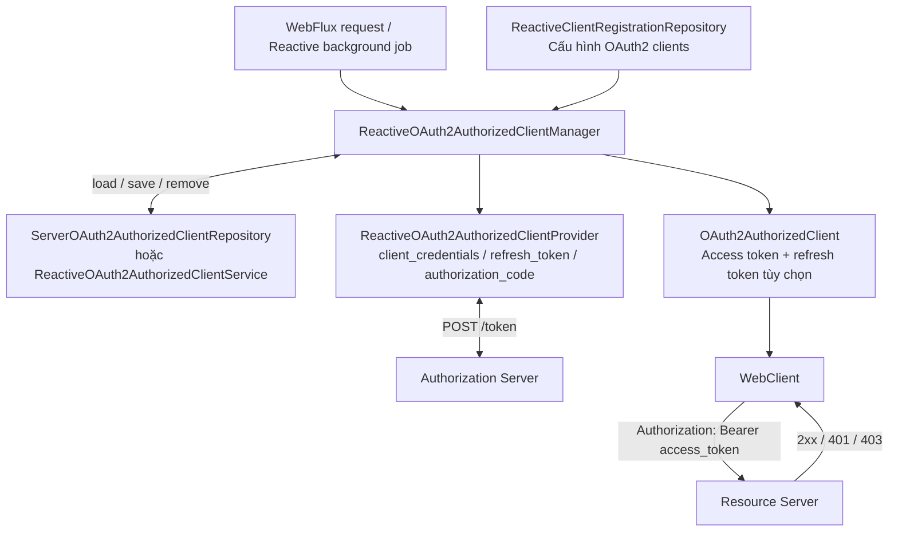
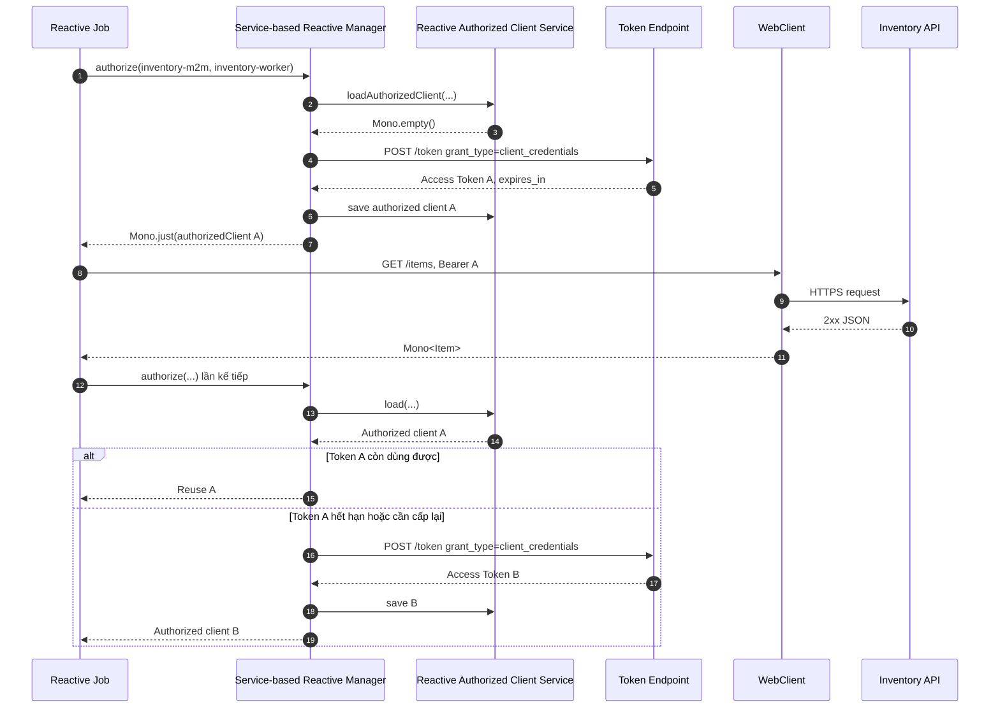

# 21.11. Client credentials, refresh token và truy cập tài nguyên qua Reactive

## 1. Mục tiêu: lấy, duy trì và sử dụng access token trong Spring Security WebFlux

Trong **Spring Security OAuth 2.0/OIDC Client**, ứng dụng WebFlux có thể đóng vai trò **OAuth2 Client** để lấy access token và gọi một API được bảo vệ (*Resource Server*). Hai tình huống quan trọng là:

- **Machine-to-machine:** một background worker hoặc backend xin access token bằng **`client_credentials`**, với quyền của chính ứng dụng, không cần browser hoặc người dùng đăng nhập.
- **User-delegated access:** người dùng đăng nhập qua **Authorization Code/OIDC Login**; ứng dụng giữ `OAuth2AuthorizedClient` chứa access token, có thể chứa **refresh token**, để gọi API thay mặt người dùng. Khi access token đến hạn, client có thể dùng **`refresh_token` grant** để xin token mới.

Trong hệ sinh thái **Reactive**, những hoạt động này được kết nối qua:

```java
ReactiveOAuth2AuthorizedClientManager
ReactiveOAuth2AuthorizedClientProvider
ReactiveOAuth2AuthorizedClientService
ServerOAuth2AuthorizedClientRepository
ServerOAuth2AuthorizedClientExchangeFilterFunction
WebClient
```

Dữ liệu luân chuyển qua `Mono<OAuth2AuthorizedClient>` và các chuỗi Reactor (`map`, `flatMap`, `switchIfEmpty`, `onErrorResume`), thay vì gọi HTTP/token provider theo kiểu chặn thread.

**Thông điệp chính:** `client_credentials` và `refresh_token` **không phải hai tên cho cùng một thao tác**. `client_credentials` cho phép client tự chứng minh danh tính để lấy access token; `refresh_token` chỉ dùng được khi Authorization Server **đã cấp refresh token hợp lệ** cho một authorized client trước đó. HTTP client gửi access token tới **đúng downstream Resource Server**, không gửi refresh token hoặc ID Token cho API.

### 1.1. Sau bài này, bạn có thể

1. Đọc được cấu hình `spring.security.oauth2.client.registration.*` cho `client_credentials` và `authorization_code`.
2. Phân biệt manager **dành cho WebFlux request** với manager **dành cho background task**.
3. Xây provider chain cho `clientCredentials()` và `refreshToken()`.
4. Lấy `OAuth2AuthorizedClient` qua reactive manager mà không `.block()`.
5. Gọi Resource Server bằng `WebClient` với bearer token phù hợp.
6. Tích hợp `ServerOAuth2AuthorizedClientExchangeFilterFunction` để giảm code lấy token thủ công.
7. Giải thích access token expiry, reauthorization, refresh token rotation và local removal.
8. Phân biệt lỗi Token Endpoint (`invalid_client`, `invalid_grant`) và lỗi API (`401`, `403`).
9. Thiết kế bảo vệ secret, token, session, concurrency, timeout và retry.
10. Nhận biết khi nào cần `ReactiveOAuth2AuthorizedClientService` bền vững thay cho in-memory.

## 2. Kiến trúc Reactive OAuth2 Client



Phân chia trách nhiệm:

| Thành phần | Công việc | Không nên nhầm với |
| --- | --- | --- |
| `ClientRegistration` | Client ID, client authentication, grant, scopes, endpoints | Token đã được cấp |
| `ReactiveClientRegistrationRepository` | Tìm registration theo `registrationId` | Kho authorized clients |
| `OAuth2AuthorizedClient` | `ClientRegistration` + `principalName` + access token + refresh token nếu có | `Authentication`/`OidcUser` |
| `ReactiveOAuth2AuthorizedClientService` | Reactive load/save/remove authorized client theo principal và registration | Manager xin token |
| `ServerOAuth2AuthorizedClientRepository` | Load/save/remove trong ngữ cảnh `ServerWebExchange` | Authorization request repository |
| `ReactiveOAuth2AuthorizedClientManager` | Điều phối cấp/cấp lại token và persistence | API Resource Server |
| `ReactiveOAuth2AuthorizedClientProvider` | Thực hiện một hay nhiều authorization grants | Kho lưu token |
| `ServerOAuth2AuthorizedClientExchangeFilterFunction` | Tích hợp manager và bearer token vào `WebClient` request | Server authentication filter |
| `WebClient` | Gọi HTTP API theo chuỗi Reactor | Token Endpoint, trừ khi dùng làm transport của token client |

`ClientRegistration` chỉ biết **cách xin token**; một registration hợp lệ không chứng minh token đã được cấp. `OAuth2AuthorizedClient` được tạo sau khi có access token và gắn với principal dùng làm khóa lưu trữ.

### 2.1. Chỗ nào là OIDC?

Khi người dùng đăng nhập bằng OpenID Connect, `oauth2Login()` có thể tạo `OidcUser` và nhận **ID Token** để xác minh danh tính. `OAuth2AuthorizedClient` giữ **access token** dùng gọi API và refresh token nếu được cấp.

- **ID Token:** dành cho OIDC Client xác minh người dùng; không tự động là credential cho Resource Server.
- **Access token:** gửi tới API trong `Authorization: Bearer ...`.
- **Refresh token:** gửi tới **Authorization Server Token Endpoint**, không gửi tới Resource Server.
- **WebSession cookie:** giữ login/session phía browser, không đồng nghĩa refresh token.

Với `client_credentials`, không có user tương tác nên **không tạo `OidcUser` theo luồng chuẩn**, dù Authorization Server cũng hỗ trợ OIDC.

## 3. Phân biệt `client_credentials`, `authorization_code` và `refresh_token`

| Tiêu chí | `client_credentials` | `authorization_code` | `refresh_token` |
| --- | --- | --- | --- |
| Tình huống | Service-to-service | Browser user login/consent | Cấp lại access token từ grant trước |
| Có browser redirect? | Không | Có | Không |
| Chứng minh quyền gì? | Danh tính/quyền của OAuth client | Quyền được user cấp theo flow | Quyền gắn với refresh token còn hiệu lực |
| Cần token đã cấp trước? | Không | Không; cần authorization code hợp lệ | **Có: refresh token** |
| Token Endpoint request | `grant_type=client_credentials` | `grant_type=authorization_code` | `grant_type=refresh_token` |
| `principalName` trong storage | Tên service ổn định | Principal đã xác thực | Giữ liên kết với authorized client trước |
| Refresh token trong response | Thông thường không | Có thể | Có thể rotate/cấp token mới |
| ID Token | Không phải kết quả chuẩn | Có trong OIDC Login | OIDC có quy định riêng, không luôn trả |
| Provider Spring Security | `.clientCredentials()` | `.authorizationCode()` | `.refreshToken()` |

**Điểm cần nhớ:** Registration gốc của user thường vẫn là `authorization_code`. Bạn **không đổi** `authorization-grant-type` trong YAML thành `refresh_token` chỉ vì muốn Spring Security làm mới token. Thay vào đó, manager có `refreshToken()` provider khi gặp authorized client đã có refresh token.

Với client credentials, token hết hạn thường được **cấp lại bằng chính `client_credentials` grant**.

## 4. Reactive stack không hoạt động giống Servlet stack

Đây là những cặp tên dễ nhầm:

| Servlet/non-reactive | Reactive WebFlux |
| --- | --- |
| `ClientRegistrationRepository` | `ReactiveClientRegistrationRepository` |
| `OAuth2AuthorizedClientService` | `ReactiveOAuth2AuthorizedClientService` |
| `InMemoryOAuth2AuthorizedClientService` | `InMemoryReactiveOAuth2AuthorizedClientService` |
| `OAuth2AuthorizedClientManager` | `ReactiveOAuth2AuthorizedClientManager` |
| `OAuth2AuthorizedClientProvider` | `ReactiveOAuth2AuthorizedClientProvider` |
| `DefaultOAuth2AuthorizedClientManager` | `DefaultReactiveOAuth2AuthorizedClientManager` |
| `AuthorizedClientServiceOAuth2AuthorizedClientManager` | `AuthorizedClientServiceReactiveOAuth2AuthorizedClientManager` |
| `OAuth2AuthorizedClientRepository` | `ServerOAuth2AuthorizedClientRepository` |
| `ServletOAuth2AuthorizedClientExchangeFilterFunction` | `ServerOAuth2AuthorizedClientExchangeFilterFunction` |
| `HttpSecurity` / `SecurityFilterChain` | `ServerHttpSecurity` / `SecurityWebFilterChain` |
| `SecurityContextHolder` | `ReactiveSecurityContextHolder` |

Không inject một Servlet service hay manager vào WebFlux với mong đợi `.authorize()` trả `Mono`. Hai API có contract khác nhau.

Trong ứng dụng Reactive, không nên:

```java
OAuth2AuthorizedClient client = manager.authorize(request).block();
```

trong request/event loop. Cách đúng:

```java
Mono<OAuth2AuthorizedClient> clientMono = manager.authorize(request);

return clientMono.flatMap(client -> callApi(client));
```

`Mono` mô tả một phép tính bất đồng bộ. Việc gọi thật xảy ra khi publisher được subscribe bởi WebFlux/Reactor; xử lý phải **compose**, không tự subscribe ở nhiều tầng rồi làm mất error/cancellation propagation.

## 5. Cấu hình Spring Boot cho machine-to-machine

### 5.1. Dependency

Ví dụ Gradle cho Spring WebFlux:

```gradle
dependencies {
    implementation 'org.springframework.boot:spring-boot-starter-webflux'
    implementation 'org.springframework.boot:spring-boot-starter-security'
    implementation 'org.springframework.boot:spring-boot-starter-oauth2-client'
}
```

Spring Boot/Spring Security quản lý versions tương thích. Đừng tự trộn versions của Spring Framework, Reactor và Spring Security không tương thích.

### 5.2. Registration `client_credentials`

```yaml
spring:
  security:
    oauth2:
      client:
        registration:
          inventory-m2m:
            provider: company-auth
            client-id: ${INVENTORY_CLIENT_ID}
            client-secret: ${INVENTORY_CLIENT_SECRET}
            authorization-grant-type: client_credentials
            client-authentication-method: client_secret_basic
            scope:
              - inventory.read

        provider:
          company-auth:
            token-uri: https://auth.example.com/oauth2/token

downstreams:
  inventory:
    base-url: https://inventory-api.example.com
```

Giải thích:

- `inventory-m2m` là **registration ID nội bộ** mà Java code dùng để gọi manager.
- `client-id`/`client-secret` do Authorization Server cấp; phải bảo vệ bằng environment/secret manager.
- `authorization-grant-type: client_credentials` là grant **không dùng browser/redirect URI**.
- `client-authentication-method` phải đúng phương thức provider cho phép; `client_secret_basic` là trường hợp phổ biến.
- `scope` là quyền **yêu cầu**, không phải quyền được tự động cấp.
- `provider.token-uri` là **Token Endpoint** dùng xin token, không phải URL API đích.
- `downstreams.inventory.base-url` là **property riêng của ứng dụng**, không được Spring Security tự động biến thành authorization target.

Không khai báo `redirect-uri`, `user-info-uri` hoặc `scope: openid` theo thói quen cho một registration thuần machine-to-machine nếu provider không yêu cầu.

### 5.3. Khi provider hỗ trợ issuer metadata

Một số Authorization Servers hỗ trợ discovery qua `issuer-uri`:

```yaml
provider:
  company-auth:
    issuer-uri: https://login.example.com/realms/workloads
```

Khi dùng discovery, framework có thể lấy `token_endpoint` từ metadata. Điều này tùy khả năng provider và phiên bản Spring Security, và có thể khiến startup phụ thuộc DNS/TLS tới issuer.

Nếu provider chỉ cung cấp `token-uri`, cấu hình trực tiếp. **Không đoán đường dẫn Token Endpoint** hoặc thay issuer hostname tùy tiện chỉ để vượt lỗi mạng. Nếu provider yêu cầu tham số `audience`/`resource`, cần dùng extension point của token response client theo hợp đồng, không trông đợi mọi key tự thêm trong YAML đều được gửi.

## 6. Manager dành cho background job: `AuthorizedClientServiceReactiveOAuth2AuthorizedClientManager`

Một worker hoặc scheduled job **không có `ServerWebExchange` và không có user login session**. Nó cần manager hoạt động độc lập HTTP request:

```java
org.springframework.security.oauth2.client
    .AuthorizedClientServiceReactiveOAuth2AuthorizedClientManager
```

Manager này sử dụng:

- `ReactiveClientRegistrationRepository` để tìm cấu hình OAuth2 client.
- `ReactiveOAuth2AuthorizedClientService` để lưu/tải token theo `(registrationId, principalName)`.
- `ReactiveOAuth2AuthorizedClientProvider` để thực hiện grant.

### 6.1. Cấu hình một manager chỉ hỗ trợ `client_credentials`

```java
@Configuration
class MachineOAuth2ClientConfiguration {

    @Bean
    ReactiveOAuth2AuthorizedClientService reactiveAuthorizedClients(
            ReactiveClientRegistrationRepository registrations) {

        return new InMemoryReactiveOAuth2AuthorizedClientService(
            registrations);
    }

    @Bean("machineAuthorizedClientManager")
    ReactiveOAuth2AuthorizedClientManager machineAuthorizedClientManager(
            ReactiveClientRegistrationRepository registrations,
            ReactiveOAuth2AuthorizedClientService authorizedClients) {

        ReactiveOAuth2AuthorizedClientProvider provider =
            ReactiveOAuth2AuthorizedClientProviderBuilder.builder()
                .clientCredentials()
                .build();

        var manager =
            new AuthorizedClientServiceReactiveOAuth2AuthorizedClientManager(
                registrations,
                authorizedClients);

        manager.setAuthorizedClientProvider(provider);
        return manager;
    }
}
```

Đây là một cấu hình **tường minh để học cơ chế**. Spring Boot/Spring Security có thể cung cấp bean manager/service mặc định khi các điều kiện auto-configuration phù hợp; khi tạo custom manager phải kiểm tra đúng bean mà gateway sử dụng.

`InMemoryReactiveOAuth2AuthorizedClientService` lưu authorized clients trong **RAM của chính JVM**; mất qua restart và không tự chia sẻ giữa các pod. Nó phù hợp khi token có thể xin lại và không cần persistence.

### 6.2. Vì sao không dùng WebFlux request manager trong job?

`DefaultReactiveOAuth2AuthorizedClientManager` được thiết kế để làm việc với `ServerOAuth2AuthorizedClientRepository` trong **ngữ cảnh `ServerWebExchange`**. Background job không có request/response của browser, nên sử dụng service-based manager giúp tránh phải tạo fake `ServerWebExchange`.

Đặc biệt:

```text
User-facing request:
    DefaultReactiveOAuth2AuthorizedClientManager
    + ServerOAuth2AuthorizedClientRepository

Background service:
    AuthorizedClientServiceReactiveOAuth2AuthorizedClientManager
    + ReactiveOAuth2AuthorizedClientService
```

Không phải hai manager là “mạnh/yếu” khác nhau; chúng khác nhau ở **ngữ cảnh lưu authorized client** và cách lấy thông tin hiện hành.

## 7. Xin token bất đồng bộ qua manager

Ở một job, ta cần tên principal ổn định, ví dụ `inventory-worker`.

```java
OAuth2AuthorizeRequest request =
    OAuth2AuthorizeRequest
        .withClientRegistrationId("inventory-m2m")
        .principal("inventory-worker")
        .build();

Mono<OAuth2AuthorizedClient> authorizedClientMono =
    machineAuthorizedClientManager.authorize(request);
```

`principal("inventory-worker")` **không chứng minh một nhân viên đã đăng nhập**. Nó là định danh **service principal** được dùng làm khóa trong authorized-client store.

### 7.1. Đọc token từ Mono và xử lý không có authorized client

```java
Mono<String> accessTokenMono =
    machineAuthorizedClientManager.authorize(request)
        .switchIfEmpty(Mono.error(
            new IllegalStateException(
                "Inventory OAuth2 client authorization unavailable")))
        .map(client ->
            client.getAccessToken().getTokenValue());
```

`switchIfEmpty` quan trọng vì manager có thể không trả authorized client khi không thể authorize theo contract/provider. Tuy nhiên, **lỗi Token Endpoint** có thể đi qua tín hiệu `onError` (như `OAuth2AuthorizationException`) thay vì một `Mono.empty()`.

Không viết:

```java
String token = machineAuthorizedClientManager
    .authorize(request)
    .block()
    .getAccessToken()
    .getTokenValue();
```

Trong WebFlux event loop, `.block()` là hành vi không phù hợp và có thể gây lỗi hoặc giảm throughput. Kết hợp dữ liệu qua Reactor operators.

### 7.2. Vì sao principal name phải ổn định?

Authorized client thường được lưu theo cặp:

```text
(registrationId, principalName)
```

Ví dụ:

```text
(inventory-m2m, inventory-worker)  -> Access Token A
(billing-m2m, billing-worker)      -> Access Token B
```

Nếu mỗi lần job chạy lại dùng:

```java
.principal(UUID.randomUUID().toString())
```

storage sẽ xem là các principals khác nhau, khiến việc reuse authorized client trở nên khó và có thể tạo rất nhiều token requests/entries.

Ngược lại, với **user-delegated tokens**, không được dùng một principal name cố định chung cho mọi người dùng. Điều đó có nguy cơ **trộn token giữa users**.

## 8. Dùng `WebClient` gọi Resource Server với `client_credentials`

Ta có thể gọi manager tường minh rồi chuyển token vào HTTP request. Ví dụ này không cần exchange filter, nên dễ nhìn rõ từng tầng.

### 8.1. Cấu hình WebClient cho downstream

```java
@Configuration
class InventoryHttpConfiguration {

    @Bean("inventoryWebClient")
    WebClient inventoryWebClient(
            WebClient.Builder builder,
            @Value("${downstreams.inventory.base-url}") String baseUrl) {

        return builder.clone()
            .baseUrl(baseUrl)
            .defaultHeader(
                HttpHeaders.ACCEPT, MediaType.APPLICATION_JSON_VALUE)
            .build();
    }
}
```

`RestClient` là blocking client và `WebClient` là reactive client. Trong WebFlux, `WebClient` phù hợp vì trả về `Mono`/`Flux`.

`baseUrl` giúp các gateway gọi relative paths, nhưng **không phải một allowlist bảo mật tuyệt đối**; code vẫn có thể đưa absolute URI vào. Không nhận URL từ user rồi gắn bearer token gửi tới host đó.

### 8.2. Gateway lấy token rồi gọi API bằng `flatMap`

```java
@Service
class InventoryGateway {

    private final ReactiveOAuth2AuthorizedClientManager manager;
    private final WebClient inventory;

    InventoryGateway(
            @Qualifier("machineAuthorizedClientManager")
            ReactiveOAuth2AuthorizedClientManager manager,
            @Qualifier("inventoryWebClient")
            WebClient inventory) {

        this.manager = manager;
        this.inventory = inventory;
    }

    Mono<Item> findItem(String itemId) {
        OAuth2AuthorizeRequest request =
            OAuth2AuthorizeRequest
                .withClientRegistrationId("inventory-m2m")
                .principal("inventory-worker")
                .build();

        return manager.authorize(request)
            .switchIfEmpty(Mono.error(
                new IllegalStateException(
                    "No inventory authorized client available")))
            .flatMap(client ->
                inventory.get()
                    .uri(builder -> builder
                        .path("/api/items/{itemId}")
                        .build(itemId))
                    .headers(headers -> headers.setBearerAuth(
                        client.getAccessToken().getTokenValue()))
                    .retrieve()
                    .bodyToMono(Item.class));
    }

    record Item(String id, String sku, int availableQuantity) {}
}
```

Điểm đáng chú ý:

- Method trả `Mono<Item>`, không `.block()`.
- Manager chọn `inventory-m2m` và principal `inventory-worker`.
- Token được lấy khi publisher được subscribe.
- Bearer token **chỉ** được đưa tới `inventoryWebClient` với base URL của Inventory API.
- URI được dựng từ **path template**, không bằng cách nối URL tuyệt đối do user điều khiển.
- `retrieve()` có thể phát lỗi HTTP khi API trả `4xx/5xx`; lỗi này khác lỗi xin token từ Authorization Server.

Trong dự án lớn có thể dùng **OAuth2 ExchangeFilterFunction** để tự gắn bearer token thay vì lặp logic trong mỗi method. Việc viết tường minh trước giúp hiểu cơ chế và kiểm soát trust boundary.

### 8.3. Tình huống có `Flux`

Nếu API trả stream danh sách:

```java
Flux<Item> findItems() {
    OAuth2AuthorizeRequest request =
        OAuth2AuthorizeRequest
            .withClientRegistrationId("inventory-m2m")
            .principal("inventory-worker")
            .build();

    return manager.authorize(request)
        .switchIfEmpty(Mono.error(
            new IllegalStateException("OAuth2 token unavailable")))
        .flatMapMany(client ->
            inventory.get()
                .uri("/api/items")
                .headers(h -> h.setBearerAuth(
                    client.getAccessToken().getTokenValue()))
                .retrieve()
                .bodyToFlux(Item.class));
}
```

`flatMapMany` chuyển một `Mono` authorized client thành một `Flux` dữ liệu API.

Nếu API trả lượng dữ liệu rất lớn, cần cân nhắc pagination, streaming memory, backpressure và deadline; OAuth2 token handling không tự giải quyết mọi vấn đề reactive pipeline.

## 9. Sơ đồ vòng đời `client_credentials` trong Reactive



Với `client_credentials`, Authorization Server thông thường **không cấp refresh token**. Khi A hết hạn, provider `clientCredentials()` thực hiện **lại client credentials grant** để xin access token mới.

Dùng `refreshToken()` **không giúp ích** nếu không có refresh token để gửi. Không tạo fake refresh token và không dùng client secret làm refresh token.

## 10. User-delegated access: OIDC Login và refresh token

Một ứng dụng WebFlux khác có browser users:

1. Browser bắt đầu OAuth2/OIDC Login.
2. Authorization Server xác thực user và trả authorization code.
3. OAuth2 Client đổi code lấy access token, có thể có refresh token và ID Token.
4. Spring Security xây `OidcUser`/`Authentication`.
5. `OAuth2AuthorizedClient` được lưu để backend dùng access token gọi API.
6. Khi token gần/hết hạn, **`refreshToken()` provider** có thể thực hiện Refresh Token Grant.

### 10.1. Cấu hình registration Authorization Code/OIDC

```yaml
spring:
  security:
    oauth2:
      client:
        registration:
          reports-user:
            provider: company-oidc
            client-id: ${REPORTS_USER_CLIENT_ID}
            client-secret: ${REPORTS_USER_CLIENT_SECRET}
            authorization-grant-type: authorization_code
            client-authentication-method: client_secret_basic
            redirect-uri: "{baseUrl}/login/oauth2/code/{registrationId}"
            scope:
              - openid
              - profile
              - reports.read
              - offline_access

        provider:
          company-oidc:
            issuer-uri: https://login.example.com/realms/staff

downstreams:
  reports:
    base-url: https://reports-api.example.com
```

`offline_access` là một scope trong OIDC liên quan đến khả năng duy trì truy cập ngoại tuyến, nhưng **không bảo đảm provider cấp refresh token**. Provider có thể yêu cầu consent, client policy, session policy hoặc tham số riêng, và có thể không cấp refresh token dù application đã yêu cầu.

**Registration vẫn là `authorization_code`**, không đổi `authorization-grant-type` thành `refresh_token` khi user đã đăng nhập.

### 10.2. `SecurityWebFilterChain` cho OIDC Login và OAuth2 Client

```java
@Configuration
@EnableWebFluxSecurity
class ReactiveLoginConfiguration {

    @Bean
    SecurityWebFilterChain securityWebFilterChain(
            ServerHttpSecurity http) {

        return http
            .authorizeExchange(exchanges -> exchanges
                .pathMatchers("/", "/assets/**").permitAll()
                .anyExchange().authenticated())
            .oauth2Login(Customizer.withDefaults())
            .oauth2Client(Customizer.withDefaults())
            .build();
    }
}
```

Đây là ví dụ ứng dụng WebFlux session-based OAuth2 Login. Sau đăng nhập, `ReactiveSecurityContextHolder` cung cấp `Authentication` trong Reactor Context cho request đã xác thực.

Không nhầm `OidcUser.getIdToken()` với access token để gọi Reports API. Access token ở `OAuth2AuthorizedClient`.

## 11. `refreshToken()` hoạt động khi nào?

`ReactiveOAuth2AuthorizedClientProviderBuilder.builder().refreshToken().build()` bổ sung chiến lược cấp token mới bằng refresh token.

Điều kiện khái niệm:

```text
Authorized client hiện có?
    Không -> refresh provider không có gì để refresh.

Có refresh token?
    Không -> không thực hiện Refresh Token Grant.

Access token còn hiệu lực theo policy/clock skew?
    Có -> thông thường không refresh.

Access token cần làm mới?
    Có -> POST /token grant_type=refresh_token.

Token Endpoint thành công?
    Có -> tạo OAuth2AuthorizedClient với access token mới,
          cập nhật refresh token theo response/provider policy,
          manager lưu token mới.

Token Endpoint lỗi?
    Có -> phát tín hiệu lỗi, manager/failure handler xử lý.
```

**`refreshToken()` không phải scheduler chạy nền**. Provider được gọi khi một `ReactiveOAuth2AuthorizedClientManager` thực hiện `authorize(...)` với authorized client/ngữ cảnh tương ứng.

### 11.1. HTTP Refresh Token Grant

Token Endpoint request minh họa:

```http
POST /oauth2/token HTTP/1.1
Host: login.example.com
Authorization: Basic <client-credentials-if-required>
Content-Type: application/x-www-form-urlencoded

grant_type=refresh_token&refresh_token=<refresh-token>
```

Response minh họa:

```json
{
  "access_token": "REDACTED_ACCESS_TOKEN_B",
  "token_type": "Bearer",
  "expires_in": 3600,
  "scope": "reports.read",
  "refresh_token": "REDACTED_REFRESH_TOKEN_R2"
}
```

Provider cũng có thể **không trả refresh token mới**. Spring Security/token client phải xử lý response theo hợp đồng và không vô tình làm mất refresh token đang được sử dụng nếu không có token mới.

`refresh_token` grant không cho phép client tự mở rộng quyền vượt scope/consent ban đầu. Cấp một access token mới cũng **không có nghĩa** Resource Server sẽ cấp thêm quyền nghiệp vụ.

### 11.2. Access token expiry không tự xóa entry khỏi store

Ví dụ:

```text
10:00 lưu Access Token A, expiresAt = 10:30, Refresh Token R1.
10:15 manager có thể reuse A.
10:31 không có ai gọi authorize -> entry A/R1 vẫn có thể tồn tại.
11:00 có lời gọi authorize -> refresh provider thử R1.
11:01 nhận B/R2 -> manager lưu authorized client cập nhật.
```

`expiresAt` là thông tin để đánh giá việc dùng token, không phải TTL tự động xóa toàn bộ record khỏi `InMemoryReactiveOAuth2AuthorizedClientService`.

Một provider có thể làm mới **sớm hơn thời điểm token hết hạn** qua clock skew để tránh token hết hạn giữa lúc gửi request/API xử lý. Thời gian dự phòng phụ thuộc provider và phiên bản/cấu hình, không phải giá trị cố định bất biến của toàn bộ OAuth2.

## 12. Manager trong WebFlux request: `DefaultReactiveOAuth2AuthorizedClientManager`

Khi code chạy trong **ServerWebExchange** (HTTP request được xử lý bởi WebFlux), dùng manager gắn với `ServerOAuth2AuthorizedClientRepository`:

```java
@Configuration
class WebFluxAuthorizedClientManagerConfiguration {

    @Bean("webAuthorizedClientManager")
    ReactiveOAuth2AuthorizedClientManager webAuthorizedClientManager(
            ReactiveClientRegistrationRepository registrations,
            ServerOAuth2AuthorizedClientRepository authorizedClients) {

        ReactiveOAuth2AuthorizedClientProvider provider =
            ReactiveOAuth2AuthorizedClientProviderBuilder.builder()
                .authorizationCode()
                .refreshToken()
                .clientCredentials()
                .build();

        var manager = new DefaultReactiveOAuth2AuthorizedClientManager(
            registrations,
            authorizedClients);

        manager.setAuthorizedClientProvider(provider);
        return manager;
    }
}
```

Tác dụng của provider chain:

- `.authorizationCode()` cho authorized client thuộc Authorization Code khi flow có điều kiện phù hợp.
- `.refreshToken()` cho authorized client đã có refresh token và cần làm mới.
- `.clientCredentials()` cho registrations machine-to-machine, nếu ứng dụng cũng sử dụng grant này trong request context.

**Có provider chain không đồng nghĩa manager tự khởi động một browser login trong background task.** Authorization Code/OIDC Login vẫn cần đúng browser redirect/callback và authorization request state.

`DefaultReactiveOAuth2AuthorizedClientManager` dùng repository theo request, nên khi gọi `authorize(...)` tường minh phải cung cấp hoặc bảo đảm context WebFlux phù hợp. Nếu một chương trình batch không có `ServerWebExchange`, **service-based manager** là lựa chọn tự nhiên hơn.

### 12.1. Default success/failure handlers

Spring Security Reactive manager có cơ chế:

- **Success handler:** lưu authorized client mới sau authorization/re-authorization thành công.
- **Failure handler:** có thể remove authorized client cũ sau một số OAuth2 errors, ví dụ `invalid_grant` khi refresh token không còn hiệu lực.

Các entry points:

```java
manager.setAuthorizationSuccessHandler(...);
manager.setAuthorizationFailureHandler(...);
```

Thực tế các method nằm trên implementation manager cụ thể. Nếu thay một handler mặc định bằng custom handler **chỉ log**, bạn có thể vô tình mất cơ chế lưu/xóa authorized client. Muốn thêm telemetry, nên **ủy quyền tới behavior phù hợp** hoặc viết logic rõ ràng, không chỉ thay thế rồi bỏ qua persistence.

## 13. Tích hợp `WebClient` với OAuth2 exchange filter

Spring Security Reactive cung cấp:

```java
org.springframework.security.oauth2.client.web.reactive.function.client
    .ServerOAuth2AuthorizedClientExchangeFilterFunction
```

Filter này có thể:

1. Xác định registration/authorized client và principal.
2. Gọi `ReactiveOAuth2AuthorizedClientManager`.
3. Nhận `OAuth2AuthorizedClient` hiện hành hoặc mới được cấp.
4. Gắn `Authorization: Bearer <access-token>` vào outbound request.
5. Xử lý một số Bearer errors do Resource Server trả về thông qua failure handler, nếu được cấu hình.

### 13.1. Tạo WebClient với filter nhận manager

```java
@Configuration
class ReportsWebClientConfiguration {

    @Bean("reportsWebClient")
    WebClient reportsWebClient(
            @Qualifier("webAuthorizedClientManager")
            ReactiveOAuth2AuthorizedClientManager manager,
            WebClient.Builder builder,
            @Value("${downstreams.reports.base-url}") String baseUrl) {

        var oauth2 =
            new ServerOAuth2AuthorizedClientExchangeFilterFunction(
                manager);

        return builder.clone()
            .baseUrl(baseUrl)
            .filter(oauth2)
            .build();
    }
}
```

**Lưu ý về `401/403`:** với constructor nhận manager, một `RemoveAuthorizedClientReactiveOAuth2AuthorizationFailureHandler` cho Resource Server errors **không tự được cấu hình**. Nên gắn handler phù hợp nếu muốn invalid token bị loại khỏi authorized-client store sau khi API từ chối.

### 13.2. Truy cập Reports API bằng registration ID

Ví dụ trong reactive controller/gateway có authenticated WebFlux context:

```java
@Service
class ReportsGateway {

    private final WebClient reports;

    ReportsGateway(
            @Qualifier("reportsWebClient") WebClient reports) {
        this.reports = reports;
    }

    Mono<Report> myReport() {
        return reports.get()
            .uri("/api/reports/me")
            .attributes(
                ServerOAuth2AuthorizedClientExchangeFilterFunction
                    .clientRegistrationId("reports-user"))
            .retrieve()
            .bodyToMono(Report.class);
    }

    record Report(String id, String title) {}
}
```

Filter lấy `reports-user` registration từ request attribute và dùng Reactive SecurityContext/ServerWebExchange đang có khi phù hợp. Đừng tự tạo một fixed `Authentication` thay user trong user-delegated flow.

Khi gọi trong background task (không có WebFlux request), không giả định filter sẽ tự tìm được current user từ `ReactiveSecurityContextHolder`. Dùng service-based manager tường minh như phần 7-8, hoặc truyền authorized client/principal hợp lệ theo API filter đã hỗ trợ.

### 13.3. Chỉ attach token cho đúng downstream

Không cấu hình một **global** `WebClient` dùng mọi URL với:

```java
oauth2.setDefaultOAuth2AuthorizedClient(true);
```

rồi cho phép business code gọi URI tuyệt đối bất kỳ. Theo documented behavior, chế độ này có thể gắn default authorized client's token **cho mọi HTTP request** qua WebClient khi tìm được current authentication.

`setDefaultClientRegistrationId("reports-user")` cũng cần cân nhắc: nó có thể gắn token registration đó vào mọi request qua client. Chỉ dùng khi WebClient/gateway **cố định downstream đáng tin** và không nhận host tùy ý.

Với nhiều APIs, ưu tiên:

```text
reportsWebClient  -> reports API + reports-user registration
inventoryWebClient -> inventory API + inventory-m2m registration
billingWebClient -> billing API + billing-m2m registration
```

`baseUrl` không tuyệt đối ngăn `.uri("https://other-host/...")`; gateway phải dùng relative paths hoặc kiểm soát host allowlist.

## 14. Lấy authorized client từ request hiện tại

Một cách khác là resolve client bằng annotation `@RegisteredOAuth2AuthorizedClient`, nếu MVC/WebFlux argument resolver được cấu hình phù hợp trong ứng dụng.

Ví dụ WebFlux controller:

```java
@RestController
class ReportsController {

    private final WebClient reports;

    ReportsController(
            @Qualifier("reportsWebClient") WebClient reports) {
        this.reports = reports;
    }

    @GetMapping("/my/report")
    Mono<String> myReport(
            @RegisteredOAuth2AuthorizedClient("reports-user")
            OAuth2AuthorizedClient authorizedClient) {

        return reports.get()
            .uri("/api/reports/me")
            .attributes(
                ServerOAuth2AuthorizedClientExchangeFilterFunction
                    .oauth2AuthorizedClient(authorizedClient))
            .retrieve()
            .bodyToMono(String.class);
    }
}
```

`oauth2AuthorizedClient(...)` gắn một **authorized client cụ thể** vào request attributes cho filter. Filter/manager có thể cân nhắc làm mới khi token sắp hết hạn và có refresh token/provider phù hợp.

Để annotation hoạt động đúng, yêu cầu registration tương ứng đã được cấp token và security infrastructure đã được wiring; không giả định nó tự khởi tạo browser consent nếu authorized client không tồn tại.

**Không trả `OAuth2AuthorizedClient` nguyên vẹn trong HTTP response** hoặc gửi refresh token về frontend để debug.

### 14.1. Truyền `ServerWebExchange` khi cần

Filter có helper:

```java
ServerOAuth2AuthorizedClientExchangeFilterFunction
    .serverWebExchange(exchange)
```

để đưa `ServerWebExchange` vào request attributes. Điều này có ích khi cần đảm bảo filter nhận ngữ cảnh của HTTP WebFlux request.

Ví dụ:

```java
Mono<String> fetch(
        ServerWebExchange exchange) {

    return reports.get()
        .uri("/api/reports/me")
        .attributes(
            ServerOAuth2AuthorizedClientExchangeFilterFunction
                .serverWebExchange(exchange))
        .attributes(
            ServerOAuth2AuthorizedClientExchangeFilterFunction
                .clientRegistrationId("reports-user"))
        .retrieve()
        .bodyToMono(String.class);
}
```

`exchange` thuộc HTTP request hiện tại. **Không giữ `ServerWebExchange` để sử dụng từ scheduler sau khi request kết thúc**; background tasks cần identity/storage đúng ngữ cảnh của chúng.

## 15. Hai loại failure handler: Token Endpoint và Resource Server

Không phải mọi OAuth2 failure xuất hiện ở cùng bước.

### 15.1. Manager failure khi authorize/re-authorize

Ví dụ refresh token không còn hiệu lực:

```text
Reactive manager
    -> refresh token provider
        -> POST Token Endpoint grant_type=refresh_token
            -> OAuth2 error: invalid_grant
```

Đây là lỗi **trong authorization/reauthorization**. `DefaultReactiveOAuth2AuthorizedClientManager`/service-based manager có thể dùng `ReactiveOAuth2AuthorizationFailureHandler` để remove authorized client cũ theo error policy.

Các lỗi khác:

- `invalid_client`: secret/method/certificate sai, không nên retry vô hạn.
- `unauthorized_client`: client không được phép dùng grant.
- `invalid_scope`: scope không được phê duyệt.
- TLS/connection timeout: vấn đề HTTP client gửi token request, không mặc nhiên token invalid.

### 15.2. Exchange filter failure sau khi API trả 401/403

Ví dụ:

```http
HTTP/1.1 401 Unauthorized
WWW-Authenticate: Bearer error="invalid_token"
```

Filter có thể chuyển OAuth2 Bearer failure cho `ReactiveOAuth2AuthorizationFailureHandler`. `RemoveAuthorizedClientReactiveOAuth2AuthorizationFailureHandler` **xét OAuth2 error code** rồi có thể remove token cũ để request **sau** có cơ hội xin token mới.

Nếu API trả:

```http
HTTP/1.1 403 Forbidden
WWW-Authenticate: Bearer error="insufficient_scope",
                  scope="reports.admin"
```

thì đó là **thiếu quyền**, không phải đơn thuần token hết hạn. Không nên xóa và retry mãi một access token được cấp với cùng scopes.

### 15.3. Constructor nào có remove handler mặc định?

`ServerOAuth2AuthorizedClientExchangeFilterFunction` hỗ trợ:

```java
new ServerOAuth2AuthorizedClientExchangeFilterFunction(
    ReactiveClientRegistrationRepository registrations,
    ServerOAuth2AuthorizedClientRepository authorizedClients);
```

Với constructor nhận repositories, Spring Security có cấu hình sẵn một **RemoveAuthorizedClientReactiveOAuth2AuthorizationFailureHandler** cho Bearer errors phù hợp.

Trong khi đó:

```java
new ServerOAuth2AuthorizedClientExchangeFilterFunction(
    ReactiveOAuth2AuthorizedClientManager manager);
```

**không tự cấu hình remove handler cho Resource Server 401/403**. Khi dùng manager constructor, nên gắn handler tường minh nếu muốn quản lý lifecycle khi API từ chối token.

Đừng nhầm manager's failure handler (Token Endpoint) với filter's failure handler (downstream API).

### 15.4. Cấu hình remover theo ReactiveAuthorizedClientService

Trong một ứng dụng **service-based token store**, có thể khai báo:

```java
var oauth2 =
    new ServerOAuth2AuthorizedClientExchangeFilterFunction(manager);

var failureHandler =
    new RemoveAuthorizedClientReactiveOAuth2AuthorizationFailureHandler(
        (registrationId, principal, attributes) -> {
            if (principal == null) {
                return Mono.empty();
            }

            return authorizedClients.removeAuthorizedClient(
                registrationId,
                principal.getName());
        });

oauth2.setAuthorizationFailureHandler(failureHandler);
```

Ở ví dụ trên:

- `manager` là `ReactiveOAuth2AuthorizedClientManager` đã được cấu hình.
- `authorizedClients` là **`ReactiveOAuth2AuthorizedClientService` thực sự được manager sử dụng**.
- Callback remover trả `Mono<Void>`.
- Xóa theo đúng `(registrationId, principalName)`.

**Không xóa một service không tham gia lưu token.** Với WebFlux request manager dùng `ServerOAuth2AuthorizedClientRepository`, remover cần liên kết với **repository đang được dùng**, có thể cần `ServerWebExchange` từ attributes/context. Nếu không chắc wiring, constructor nhận `(registrations, repository)` là cách đơn giản cho các use case mặc định.

### 15.5. Remove không tự retry HTTP request hiện tại

Ví dụ:

```text
Lần gọi #1:
    WebClient gửi token A
    API trả 401 invalid_token
    Filter xóa authorized client A nếu error policy phù hợp
    Lần gọi #1 vẫn trả 401/error

Lần gọi #2:
    Manager không còn A, cố xin/cấp token B
    API có thể chấp nhận B, hoặc vẫn từ chối vì policy/audience
```

Đừng giả định exchange filter tự động retry request đầu tiên. Với `POST` có side effect, retry càng cần idempotency policy rõ ràng.

## 16. Refresh Token Rotation trong ứng dụng Reactive

Nhiều provider bật **refresh token rotation**:

```text
Authorized client ban đầu:
    access = A1
    refresh = R1

Refresh request #1:
    dùng R1
    nhận access A2 và refresh R2
    provider có thể vô hiệu R1

Refresh request #2 chạy đồng thời:
    vẫn dùng R1
    có thể bị invalid_grant
```

Ngay cả khi `ReactiveOAuth2AuthorizedClientService` dùng concurrent map, điều đó **không tự bảo đảm** refresh token chỉ được dùng đúng một lần khi hai requests cùng phát hiện access token sắp hết hạn.

### 16.1. Concurrency trong Reactor

Một `Mono` có thể được subscribe nhiều lần hoặc nhiều requests dùng chung authorized client. Nếu không được điều phối:

- Hai requests cùng `load` bản token cũ.
- Cả hai cùng gọi Token Endpoint bằng R1.
- Một request nhận R2; request còn lại `invalid_grant`.
- Một failure handler có thể remove entry vừa được request khác cập nhật.
- Shared store nhiều pod càng cần transaction/version/CAS nếu provider yêu cầu.

Không sửa bằng `.block()` hoặc `synchronized` quanh toàn bộ reactive HTTP flow. `synchronized` giữ lock trong lúc tạo publisher **không giữ lock đúng thời gian subscriber thực sự chạy**; chặn thread khi chờ HTTP làm hỏng lợi ích của Reactor.

### 16.2. Những chiến lược cần cân nhắc

- **Single-flight** theo registration/principal để nhiều requests dùng một kết quả refresh khi phù hợp.
- **Optimistic concurrency/versioned record**, tránh token mới bị dữ liệu cũ ghi đè.
- **Compare-and-remove** khi lỗi của token A đến muộn sau khi store đã có token B.
- **Distributed coordination** nếu nhiều pods chia sẻ một refresh token rotation chain.
- **Bounded retry/backoff** cho timeout/5xx; không retry vô hạn trên `invalid_grant`.
- **Monitoring** token refresh rate, rotation errors và Token Endpoint latency.
- **Không log raw refresh token**, kể cả khi debug concurrency.

Chính sách cụ thể phụ thuộc provider, grant, số instances và storage. Không cần thiết kế distributed locking phức tạp nếu hệ thống chỉ dùng độc lập `client_credentials` tokens per pod và provider không gặp giới hạn.

## 17. `ReactiveOAuth2AuthorizedClientService` và vòng đời dữ liệu

Một triển khai ví dụ:

```java
new InMemoryReactiveOAuth2AuthorizedClientService(registrations);
```

Được sử dụng cho:

```java
Mono<OAuth2AuthorizedClient> loadAuthorizedClient(
    String clientRegistrationId, String principalName);

Mono<Void> saveAuthorizedClient(
    OAuth2AuthorizedClient authorizedClient, Authentication principal);

Mono<Void> removeAuthorizedClient(
    String clientRegistrationId, String principalName);
```

Đây là dạng hợp đồng rút gọn để giải thích reactive persistence.

### 17.1. Chỉ `load` không tự refresh

Sai về mặt lifecycle:

```java
return authorizedClients.loadAuthorizedClient(
        "reports-user", principalName)
    .flatMap(client -> callApiWithToken(
        client.getAccessToken().getTokenValue()));
```

Code này **chỉ load record**. Nếu access token hết hạn, nó vẫn có thể bị dùng sai. `loadAuthorizedClient` không tự gọi refresh provider.

Tốt hơn là gọi **Reactive manager** với registration/principal/ngữ cảnh phù hợp; manager và provider có thể làm mới hoặc cấp lại token trước khi API request được gửi.

### 17.2. Chuyển từ in-memory sang persistent/shared store

In-memory chỉ nằm trong heap JVM:

- Restart/pod replacement làm mất authorized clients.
- Các pods không tự thấy token nhau.
- Expired access token có thể vẫn còn trong map nếu không có cleanup.
- Không có distributed locking/token rotation coordination.

Nếu cần giữ refresh token giữa các deployments, quản lý nhiều users/tenants, retention/audit hoặc chia sẻ giữa nodes, phải chọn implementation persistent phù hợp với **reactive interfaces**.

Không dùng JDBC blocking trong Reactor event loop rồi gọi nó là reactive persistence. Chọn driver/reactive storage hoặc bố trí scheduler riêng có kiểm soát nếu legacy storage bắt buộc blocking. Khi viết custom service, cần bảo toàn chính xác token value, scopes, issuedAt, expiresAt, refresh token và registration binding.

### 17.3. SecurityContext và token storage khác nhau

Trong WebFlux OIDC Login:

- `WebSession`/`ServerSecurityContextRepository` có thể lưu `Authentication` của browser.
- `ServerOAuth2AuthorizedClientRepository`/`ReactiveOAuth2AuthorizedClientService` giữ authorized clients cho việc gọi downstream.
- `ReactiveSecurityContextHolder` giúp truy cập principal hiện hành từ Reactor Context.

**Logout browser không mặc nhiên revoke mọi access/refresh token ở Authorization Server**. Xóa local authorized client không phải token revocation. Nếu yêu cầu logout toàn diện, cần tách session invalidation, OIDC RP-Initiated Logout và token revocation theo provider policy.

## 18. Lỗi thường gặp khi xin và dùng token

| Triệu chứng | Có thể do | Kiểm tra |
| --- | --- | --- |
| `Mono.empty()` khi authorize | Manager/provider không thể authorize theo ngữ cảnh | Registration ID, grant provider, principal |
| `invalid_client` | Secret/auth method/certificate sai | Client registration, provider config, rotation |
| `unauthorized_client` | Client không được dùng grant | Allowed grant types tại Authorization Server |
| `invalid_scope` | Scope chưa được phê duyệt | Requested scopes, IdP policy |
| `invalid_grant` khi refresh | Refresh token expired/revoked/rotated | Token lifecycle, concurrency |
| `401` từ Resource Server | Token hết hạn/revoked/sai audience/issuer hoặc thiếu Authorization header | Bearer challenge, API validator |
| `403` từ Resource Server | Thiếu scopes/roles/permission | API security rules, token scopes |
| Đã xin token nhưng API vẫn 401 | Token không dành cho API hoặc policy sai | Audience, issuer, JWKS/introspection |
| Cứ mỗi request lại xin token | Principal thay đổi, store khác hoặc manager sai | `(registrationId, principalName)`, success handler |
| Sau restart phải login/authorize lại | In-memory token store mất dữ liệu | Storage và WebSession strategy |
| WebFlux `block()` bị lỗi | Blocking call trong event loop | Reactor composition và non-blocking HTTP client |
| Không thấy user principal | ReactiveSecurityContextHolder không có context | Reactor context propagation, HTTP auth |
| Scheduled job đòi ServerWebExchange | Dùng request-based manager trong background | Chuyển sang service-based manager |
| Refresh token không tồn tại | IdP không cấp, không có consent/policy | Initial authorization response, scopes/grants |
| API call leak token sang host khác | Default bearer interceptor và URL động | Fixed base URL, allowlist, redirects |
| `PKIX path building failed` | HTTP client không tin CA của Token Endpoint/API | Truststore, TLS chain, proxy |
| Connect/read timeout | DNS, egress, proxy, remote service | Reactor Netty/WebClient transport, deadlines |
| Nhiều pods cùng refresh R1 | Rotation race | Shared-store concurrency, CAS/single-flight |
| Filter manager constructor vẫn dùng token cũ sau 401 | Chưa gắn remove failure handler | Exchange filter `setAuthorizationFailureHandler` |

### 18.1. Lỗi `invalid_grant` khi refresh

Một token request failure:

```json
{
  "error": "invalid_grant"
}
```

có thể do refresh token hết hạn, bị thu hồi, không thuộc client, hoặc đã bị dùng theo rotation policy.

**Không retry vô hạn cùng refresh token**. Nếu không thể làm mới user token, có thể cần đưa người dùng qua Authorization Code/OIDC Login mới theo policy.

### 18.2. Lỗi Resource Server 401/403

Phân biệt:

```http
HTTP/1.1 401 Unauthorized
WWW-Authenticate: Bearer error="invalid_token"
```

và:

```http
HTTP/1.1 403 Forbidden
WWW-Authenticate: Bearer error="insufficient_scope",
                  scope="reports.admin"
```

`invalid_token` có thể là lý do loại authorized client để không gửi token cũ nữa. `insufficient_scope` đòi xử lý quyền/consent/API policy; không đơn giản làm mới token với cùng scopes.

Không giả định mọi 401/403 là lỗi OAuth2 Bearer chuẩn nếu không có challenge/error code tương ứng.

## 19. Reactive error handling và retry có kiểm soát

Với Reactor, lỗi được truyền qua `onError`. Ví dụ mapping một số lỗi downstream:

```java
Mono<Item> item = inventory.get()
    .uri("/api/items/{id}", itemId)
    .retrieve()
    .onStatus(
        status -> status.value() == 404,
        (request, response) ->
            Mono.error(new ItemNotFoundException(itemId)))
    .bodyToMono(Item.class);
```

Ở đây `ItemNotFoundException` là **exception nghiệp vụ do ứng dụng tự định nghĩa**, không phải class chuẩn Spring Security.

### 19.1. Không bắt tất cả lỗi rồi xin lại token

Sai:

```java
return callApi()
    .onErrorResume(error -> getNewTokenAndRetry());
```

Đoạn code sai vì:

- API có thể đang trả 403 thiếu quyền.
- Downstream có thể lỗi DNS/TLS/timeout.
- Token Endpoint có thể trả `invalid_client`.
- Một POST có thể đã tạo side effect.
- Retry có thể dùng lại chính token cũ nếu store chưa được remove.
- Nhiều concurrent requests có thể gây token issuance storm.

Thay vào đó:

1. Phân loại lỗi **Token Endpoint** khác lỗi **Resource Server**.
2. Chỉ retry các trường hợp được policy cho phép.
3. Giới hạn số lần retry và tổng timeout/deadline.
4. Đảm bảo authorized client được cập nhật đúng trước khi retry.
5. Không tự động retry `403 insufficient_scope`.
6. Với POST có side effect, sử dụng idempotency key hoặc cơ chế kiểm tra trạng thái.

### 19.2. Timeout cho downstream khác timeout Token Endpoint

Ứng dụng có thể cần:

- HTTP connector timeout đến API.
- HTTP connector timeout đến Token Endpoint.
- Deadline tổng gồm authorize + API + retry.
- Circuit breaker/rate limiting riêng cho Authorization Server và mỗi downstream.

**Config timeout trên một `WebClient` bean gọi API không mặc nhiên áp dụng cho WebClient/HTTP client nội bộ của token response client**. Nếu cần proxy/TLS/timeout riêng cho OAuth2 token exchange, cấu hình `ReactiveOAuth2AccessTokenResponseClient` và transport tương ứng của grant đang dùng, theo phiên bản Spring Security.

Từ Spring Security 6.3+, các default configuration flows có thể tự kết nối custom `ReactiveOAuth2AccessTokenResponseClient` beans khi được cung cấp; khi tự tạo manager, phải kiểm tra provider thực sự dùng token client đó.

### 19.3. Không `.subscribe()` thủ công trong service

Sai:

```java
void sendReport() {
    manager.authorize(request)
        .flatMap(this::callApi)
        .subscribe();
}
```

Đoạn này dễ làm mất error propagation, cancellation, security context và connection với transaction/request lifecycle. Thường nên trả:

```java
Mono<Report> sendReport() {
    return manager.authorize(request)
        .switchIfEmpty(Mono.error(
            new IllegalStateException("Authorization unavailable")))
        .flatMap(this::callApi);
}
```

Framework/scheduler ở **boundary** sẽ subscribe một cách có kiểm soát. Với scheduled task, cần thiết kế cách kích hoạt và xử lý errors phù hợp, không tùy tiện fire-and-forget.

## 20. Bảo vệ token và credentials trong Reactive pipelines

Access token dạng bearer là credential; refresh token còn nhạy cảm vì có thể xin access token mới.

- **Không log** access token, refresh token, client secret, token response body hoặc header `Authorization`.
- Không dùng `doOnNext(System.out::println)` trên `OAuth2AuthorizedClient` nếu `toString()` có thể chứa dữ liệu nhạy cảm.
- Không lưu raw token vào Reactor Context nếu không có lý do rõ ràng; chỉ truyền thông tin tối thiểu cần thiết.
- Không đưa access token vào URI/query string. Dùng header `Authorization: Bearer`.
- Không gửi ID Token OIDC thay access token tới Resource Server.
- Không gửi refresh token tới Resource Server/API business.
- Không gắn bearer token vào WebClient dùng **URL do user tùy ý cung cấp**.
- Không auto-follow redirect mang bearer token sang untrusted host.
- Bảo vệ heap dumps, debug endpoints, APM traces và session/store credentials.
- Dùng HTTPS/TLS với Authorization Server, Resource Server và storage chia sẻ.
- Với nhiều tenants/users, không dùng chung principal name gây **cross-account token leakage**.
- Chọn scopes/audience tối thiểu và tách registrations cho những downstream có trust boundary khác nhau.
- Có chính sách logout, token revocation, account disabling và client credential rotation.

### 20.1. Scope và audience khác nhau

Một access token có scope `inventory.read` không tự động dành cho Inventory API nếu audience của token là một API khác. Resource Server có thể kiểm tra `iss`, `aud`, expiry, signature/introspection, scopes và business policy.

Nếu provider yêu cầu thêm `resource` (RFC 8707) hoặc `audience` đặc thù, cần dùng token client extension được hỗ trợ, không chỉ thêm field YAML rồi kỳ vọng Spring tự gửi.

### 20.2. Nên tách WebClient theo downstream

Ví dụ:

```text
inventoryWebClient:
    baseUrl = https://inventory-api.example.com
    registrationId = inventory-m2m

reportsWebClient:
    baseUrl = https://reports-api.example.com
    registrationId = reports-user
```

Gateway kiểm soát API target và registration; business services không truyền cả URL và registration tùy ý.

## 21. Quan sát và vận hành

Tạo telemetry mà **không làm lộ credential**:

```text
oauth2_registration=inventory-m2m
principal_kind=service
grant=client_credentials
authorize_outcome=success
token_endpoint_latency_ms=...
downstream=inventory
api_status=200
```

Hoặc:

```text
oauth2_registration=reports-user
principal_kind=user
grant=refresh_token
authorize_outcome=invalid_grant
downstream_request_sent=false
```

Các tên này là **gợi ý observability**, không phải metrics mặc định chắc chắn có từ Spring Security.

Nên theo dõi:

| Chỉ số | Dùng để làm gì? |
| --- | --- |
| Token request rate theo registration/grant | Phát hiện xin token quá nhiều |
| Reauthorize/refresh success, failure | Phát hiện lỗi rotation/secret/provider |
| Token Endpoint latency/error | Phân biệt outage IdP với API |
| Downstream HTTP 401/403 | Phân tích access token/API authorization |
| API latency, 429, 5xx | Phát hiện rate limit và availability |
| Authorized-client store misses | Phát hiện sai principal, restart, storage lỗi |
| TLS/timeout error category | Chẩn đoán proxy/CA/egress |
| Number of active registrations/principals | Giúp dự đoán storage growth |
| Principal collision/cross-tenant incidents | Điều tra token binding sai |

Metric labels nên giới hạn cardinality; **không đặt raw user subject/email/access token** làm metric label.

### 21.1. Debug token lifecycle theo timeline

Một timeline không chứa token:

```text
09:00 authorize(inventory-m2m, inventory-worker)
      storage=miss
      grant=client_credentials
      token_endpoint=success
      authorized_client_saved=true

09:15 authorize(inventory-m2m, inventory-worker)
      storage=hit
      token_reused=true

10:00 authorize(inventory-m2m, inventory-worker)
      existing_token_needs_reauthorization=true
      token_endpoint=success
      authorized_client_updated=true
```

Không log raw `access_token`, `refresh_token`, client secret hoặc bearer Authorization header.

## 22. Các tình huống thực hành

### Tình huống A — Background service gọi Inventory API

**Bối cảnh:** Scheduled job cần đọc tồn kho mỗi 5 phút, không có user login.

**Thiết kế:** registration `inventory-m2m` với `client_credentials`, `AuthorizedClientServiceReactiveOAuth2AuthorizedClientManager`, principal cố định `inventory-worker`, gateway `WebClient` có base URL cố định. `manager.authorize(...).flatMap(...)` gửi bearer token.

### Tình huống B — Access token đã hết hạn nhưng vẫn lưu trong RAM

**Bối cảnh:** Code dùng `ReactiveOAuth2AuthorizedClientService.loadAuthorizedClient` và gửi token cũ thẳng tới API.

**Lỗi:** Service chỉ đọc record, **không tự cấp lại**.

**Giải pháp:** dùng manager/authorized-client provider để reauthorize trước khi gọi Resource Server.

### Tình huống C — User đã OIDC Login, API cần token theo user

**Bối cảnh:** User A và B cùng đăng nhập `reports-user`; mỗi người chỉ được đọc báo cáo của mình.

**Thiết kế:** token gắn với principal tương ứng, dùng request-based reactive manager/repository hoặc `@RegisteredOAuth2AuthorizedClient` phù hợp. Không dùng `.principal("shared-user")` chung cho mọi users.

### Tình huống D — Provider không cấp refresh token

**Bối cảnh:** Authorized client có access token nhưng `getRefreshToken()` là `null`.

**Giải thích:** `refreshToken()` provider không thể làm mới bằng Refresh Token Grant. Xem consent/IdP policy và nếu cần thì yêu cầu authorization flow mới. `offline_access` không phải bảo đảm.

### Tình huống E — Refresh token rotation và hai requests đồng thời

**Bối cảnh:** Hai WebFlux requests cùng thấy access token sắp hết hạn, cùng gửi R1; request đầu nhận R2, request sau bị `invalid_grant`.

**Thiết kế:** đánh giá single-flight, atomic version/update và handling failure. Không sử dụng blocking locks trên Reactor event loop.

### Tình huống F — Resource Server trả `401 invalid_token`

**Bối cảnh:** WebClient đã gửi token A, API từ chối.

**Thiết kế:** cấu hình exchange filter's `ReactiveOAuth2AuthorizationFailureHandler` tới đúng store. Remove theo OAuth2 error code khi phù hợp, nhưng **request hiện tại không tự retry**; lần gọi sau mới xin token mới.

### Tình huống G — Resource Server trả `403 insufficient_scope`

**Bối cảnh:** Token có `reports.read`, endpoint yêu cầu `reports.admin`.

**Thiết kế:** không retry vô hạn cùng registration. Kiểm tra scopes được Authorization Server cấp và Resource Server policy; thay đổi permission theo quy trình hợp lệ.

### Tình huống H — Job được chuyển sang 8 pods

**Bối cảnh:** Mỗi pod dùng in-memory authorized-client service.

**Hệ quả:** Mỗi pod có thể xin `client_credentials` token riêng. Nếu IdP rate limit hoặc cần share token, cân nhắc shared token store/coordination; nếu độc lập per-pod vẫn phù hợp, có thể giữ kiến trúc đơn giản.

### Tình huống I — WebClient manager request cần ServerWebExchange nhưng job không có

**Bối cảnh:** Developer dùng `DefaultReactiveOAuth2AuthorizedClientManager` trong scheduler, không có exchange/context.

**Giải pháp:** dùng `AuthorizedClientServiceReactiveOAuth2AuthorizedClientManager` với principal service ổn định, không tạo fake request.

### Tình huống J — Client secret rotation làm `invalid_client`

**Bối cảnh:** Token Endpoint từ chối request, dù network vẫn tốt.

**Giải pháp:** kiểm tra secret mới, authentication method, client ID/tenant/realm và token response client's transport. Không retry vô hạn cùng credential cũ.

### Tình huống K — Token sau refresh vẫn bị API từ chối

**Bối cảnh:** Refresh thành công nhưng API trả 401.

**Phân tích:** token có thể sai audience/issuer, provider vừa thay key, Resource Server policy sai hoặc registration dành cho API khác. Refresh không sửa sai trust boundary.

### Tình huống L — WebFlux pipeline dùng `.block()` ở giữa

**Bối cảnh:** Service lấy token bằng manager rồi `.block()` trong controller.

**Hệ quả:** Chặn event loop, có thể gây exception/throughput thấp.

**Giải pháp:** return `Mono`/`Flux` và kết hợp toàn bộ chuỗi với `flatMap`, để WebFlux quản lý subscription.

## 23. Bài tập tự triển khai

### Bài tập 1 — Một downstream, một client credentials registration

Tạo cấu hình:

```yaml
spring:
  security:
    oauth2:
      client:
        registration:
          catalog-m2m:
            provider: corp-auth
            client-id: ${CATALOG_CLIENT_ID}
            client-secret: ${CATALOG_CLIENT_SECRET}
            authorization-grant-type: client_credentials
            scope:
              - catalog.read

        provider:
          corp-auth:
            token-uri: https://auth.example.com/oauth2/token
```

Yêu cầu:

1. Tạo `InMemoryReactiveOAuth2AuthorizedClientService`.
2. Tạo service-based manager chỉ có `clientCredentials()`.
3. Tạo WebClient base URL `https://catalog-api.example.com`.
4. Viết `Mono<CatalogItem> findById(String id)` dùng `manager.authorize(...).flatMap(...)`.
5. Trả lỗi nếu manager không tạo authorized client.
6. Không log token/secret.

### Bài tập 2 — User OIDC và refresh token

Yêu cầu:

1. Registration `user-reports` dùng `authorization_code`, scope `openid`, `reports.read`.
2. Cấu hình `ServerHttpSecurity.oauth2Login()` và `oauth2Client()`.
3. Manager request-based có `.authorizationCode().refreshToken()`.
4. Reports WebClient dùng `ServerOAuth2AuthorizedClientExchangeFilterFunction`.
5. Xác minh token đi tới Reports API là **access token** của user, không phải ID Token.
6. Xử lý khi refresh token null hoặc bị provider trả `invalid_grant`.
7. Giới hạn request cache/session/cookie theo ứng dụng.

### Bài tập 3 — Giả lập Resource Server 401/403

Yêu cầu:

- Với `401 + WWW-Authenticate: Bearer error="invalid_token"`: quan sát handler loại token theo policy và request sau xin token mới.
- Với `403 + insufficient_scope`: không retry cấp token vô hạn.
- Với Token Endpoint `invalid_client`: không nhầm với API 401.
- Với HTTP 503: áp dụng retry có giới hạn, không xóa token vô cớ.

### Bài tập 4 — Scale nhiều instance

Thiết kế cách giữ token/refresh token qua pod replacement nếu nghiệp vụ cần, với:

- Reactive shared authorized-client storage.
- Khóa `(registrationId, principalName)` và tenant binding.
- Atomic refresh token rotation update.
- Cleanup/TTL phù hợp token expiry.
- Authorization Server rate limit/circuit breaker.
- Logs không chứa token.

## 24. Câu hỏi ôn tập

**1. `client_credentials` khác Refresh Token Grant thế nào?**  
`client_credentials` tự dùng client identity/credentials để xin access token. Refresh Token Grant dùng refresh token đã được cấp trước đó để lấy access token mới.

**2. Có nên đặt `authorization-grant-type: refresh_token` cho OIDC registration để tự làm mới?**  
Không. User registration thường giữ `authorization_code`; bật `.refreshToken()` trong authorized-client provider chain.

**3. `ReactiveOAuth2AuthorizedClientManager.authorize(...)` trả về gì?**  
`Mono<OAuth2AuthorizedClient>`, không phải một token đồng bộ.

**4. Vì sao background job không nên dùng `DefaultReactiveOAuth2AuthorizedClientManager` theo thói quen?**  
Manager này gắn với WebFlux request/repository; background job nên dùng `AuthorizedClientServiceReactiveOAuth2AuthorizedClientManager` và reactive service.

**5. `principal("inventory-worker")` có phải user đã login không?**  
Không. Đây là khóa service principal dùng lưu authorized client của `client_credentials`.

**6. Vì sao principal phải ổn định?**  
Storage tra authorized client theo registration ID và principal name. Giá trị thay đổi mỗi lần gây cache misses và xin token lại.

**7. Vì sao không được dùng một principal chung cho mọi user-delegated token?**  
Có nguy cơ nhầm/mix access tokens giữa các users, dẫn đến truy cập sai quyền.

**8. `refreshToken()` provider làm gì khi không có refresh token?**  
Không thể thực hiện Refresh Token Grant; cần xử lý theo grant/authorization flow khác nếu phù hợp.

**9. Access token gần hết hạn có được làm mới trước `expiresAt` không?**  
Có thể theo clock skew/policy của provider, nhằm tránh token hết hạn khi API request đang chạy.

**10. `ReactiveOAuth2AuthorizedClientService.loadAuthorizedClient(...)` có tự refresh không?**  
Không. Đây là thao tác đọc storage; dùng manager để reauthorize.

**11. `WebClient` tự có OAuth2 Bearer token sau khi khai báo YAML không?**  
Không tự động. Cần dùng manager và gắn header hoặc cấu hình `ServerOAuth2AuthorizedClientExchangeFilterFunction`.

**12. Filter lấy registration nào?**  
Có thể dùng request attribute `clientRegistrationId(...)`, authorized client cụ thể hoặc default registration đã cấu hình có chủ đích.

**13. Vì sao không bật `setDefaultOAuth2AuthorizedClient(true)` trên một WebClient gọi mọi URI?**  
Token có thể bị gắn vào mọi request, kể cả API/host không dự định, dẫn tới rò credential.

**14. Constructor filter nhận manager có remove failure handler mặc định không?**  
Không. Cần cấu hình handler khi muốn xử lý Bearer 401/403 và loại token cũ theo policy.

**15. Constructor filter nhận registration repository và authorized client repository thì sao?**  
Có cơ chế remove handler mặc định cho những OAuth2 Bearer error codes thích hợp.

**16. Xóa authorized client sau `401 invalid_token` có tự retry request hiện tại không?**  
Không mặc nhiên. Nó ngăn việc dùng lại token cũ ở request tương lai; retry là quyết định của ứng dụng.

**17. API `403 insufficient_scope` có thể sửa bằng refresh token không?**  
Không tự động. Cần scope/permission phù hợp được provider cấp và API chấp nhận.

**18. Vì sao refresh token rotation có thể gây `invalid_grant` khi hai requests chạy song song?**  
Cả hai dùng cùng refresh token cũ; provider có thể chỉ chấp nhận một lần và vô hiệu token đã sử dụng.

**19. `.block()` trong WebFlux event loop có vấn đề gì?**  
Nó chặn thread reactive, có thể gây exception, giảm throughput hoặc phá vỡ thiết kế non-blocking.

**20. Token Endpoint timeout có thể được sửa chỉ bằng cấu hình WebClient downstream không?**  
Không chắc. OAuth2 token response client có thể dùng một WebClient/HTTP connector riêng.

**21. ID Token OIDC có phải bearer token gửi cho API không?**  
Không mặc định. ID Token dành cho client xác minh identity; access token dành cho Resource Server.

**22. Local logout có luôn revoke refresh token tại Authorization Server không?**  
Không. Session logout, local storage removal và token revocation là các cơ chế khác nhau.

**23. Khi nhiều pods dùng in-memory store, điều gì xảy ra?**  
Mỗi pod có token records riêng; restart mất entries. Nếu cần chia sẻ/consistency, phải thiết kế storage phù hợp.

**24. Khi nào cần retry request API?**  
Chỉ khi lỗi/operation/idempotency và time budget cho phép; không retry vô hạn mọi 401/403/POST.

## 25. Tài liệu tham khảo

- [Spring Security Reference — OAuth 2.0 Client (Reactive)](https://docs.spring.io/spring-security/reference/reactive/oauth2/client/index.html)
- [Spring Security Reference — Reactive OAuth2 Client Core Interfaces](https://docs.spring.io/spring-security/reference/reactive/oauth2/client/core.html)
- [Spring Security Reference — Reactive Authorization Grant Support](https://docs.spring.io/spring-security/reference/reactive/oauth2/client/authorization-grants.html)
- [Spring Security Reference — Reactive Authorized Client Features](https://docs.spring.io/spring-security/reference/reactive/oauth2/client/authorized-clients.html)
- [Spring Security Reference — Reactive OAuth2 Login](https://docs.spring.io/spring-security/reference/reactive/oauth2/login/index.html)
- [Spring Security API — ServerOAuth2AuthorizedClientExchangeFilterFunction](https://docs.spring.io/spring-security/reference/api/java/org/springframework/security/oauth2/client/web/reactive/function/client/ServerOAuth2AuthorizedClientExchangeFilterFunction.html)
- [Spring Security API — RemoveAuthorizedClientReactiveOAuth2AuthorizationFailureHandler](https://docs.spring.io/spring-security/reference/api/java/org/springframework/security/oauth2/client/RemoveAuthorizedClientReactiveOAuth2AuthorizationFailureHandler.html)
- [Spring Security API — DefaultReactiveOAuth2AuthorizedClientManager](https://docs.spring.io/spring-security/reference/api/java/org/springframework/security/oauth2/client/web/DefaultReactiveOAuth2AuthorizedClientManager.html)
- [Spring Security API — AuthorizedClientServiceReactiveOAuth2AuthorizedClientManager](https://docs.spring.io/spring-security/reference/api/java/org/springframework/security/oauth2/client/AuthorizedClientServiceReactiveOAuth2AuthorizedClientManager.html)
- [Spring Framework Reference — WebClient](https://docs.spring.io/spring-framework/reference/web/webflux-webclient.html)
- [RFC 6749 — OAuth 2.0 Authorization Framework](https://www.rfc-editor.org/rfc/rfc6749)
- [RFC 6750 — OAuth 2.0 Bearer Token Usage](https://www.rfc-editor.org/rfc/rfc6750)
- [RFC 7009 — OAuth 2.0 Token Revocation](https://www.rfc-editor.org/rfc/rfc7009)
- [RFC 9700 — Best Current Practice for OAuth 2.0 Security](https://www.rfc-editor.org/rfc/rfc9700)

**Ghi nhớ:** Trong **Spring Security OAuth2 Client Reactive**, manager và provider đảm nhiệm **xin/cấp lại token**, service/repository lưu **`OAuth2AuthorizedClient`**, còn `WebClient` gửi **access token** đến Resource Server. Với **`client_credentials`**, token thường được cấp lại bằng client credentials, không phụ thuộc refresh token. Với **OIDC/Authorization Code**, `.refreshToken()` có thể làm mới access token nếu provider đã cấp refresh token hợp lệ. Hãy chọn request-based hay service-based reactive manager đúng ngữ cảnh, giữ principal/registration binding nhất quán, compose bằng `Mono`/`Flux` thay vì `.block()`, cấu hình failure handler và storage chính xác, đồng thời luôn bảo vệ token, scope/audience, concurrency và trust boundary của từng downstream.
