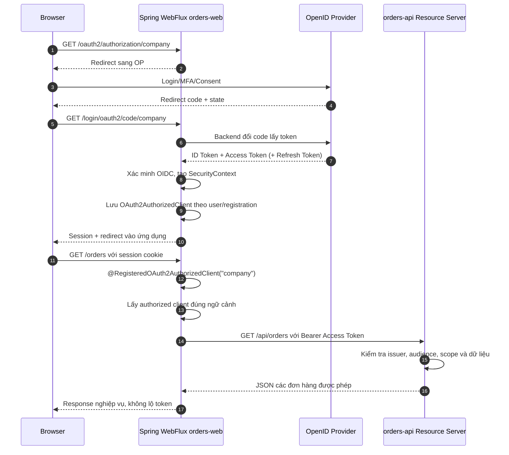
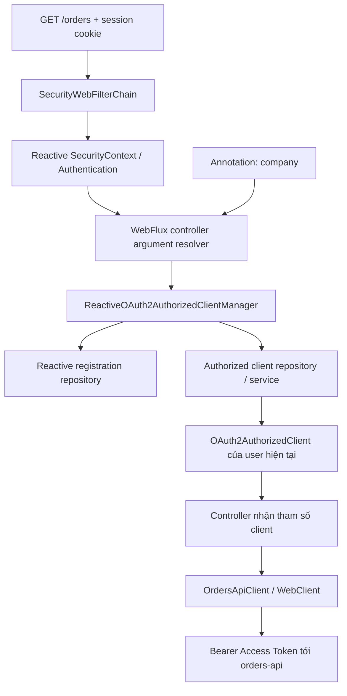
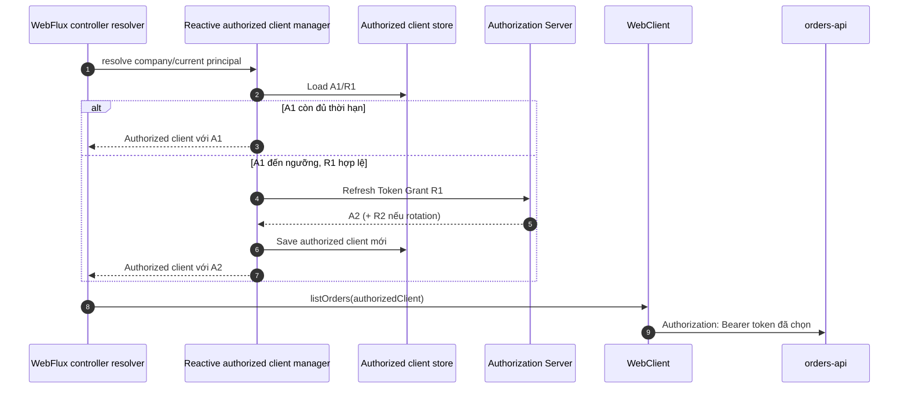
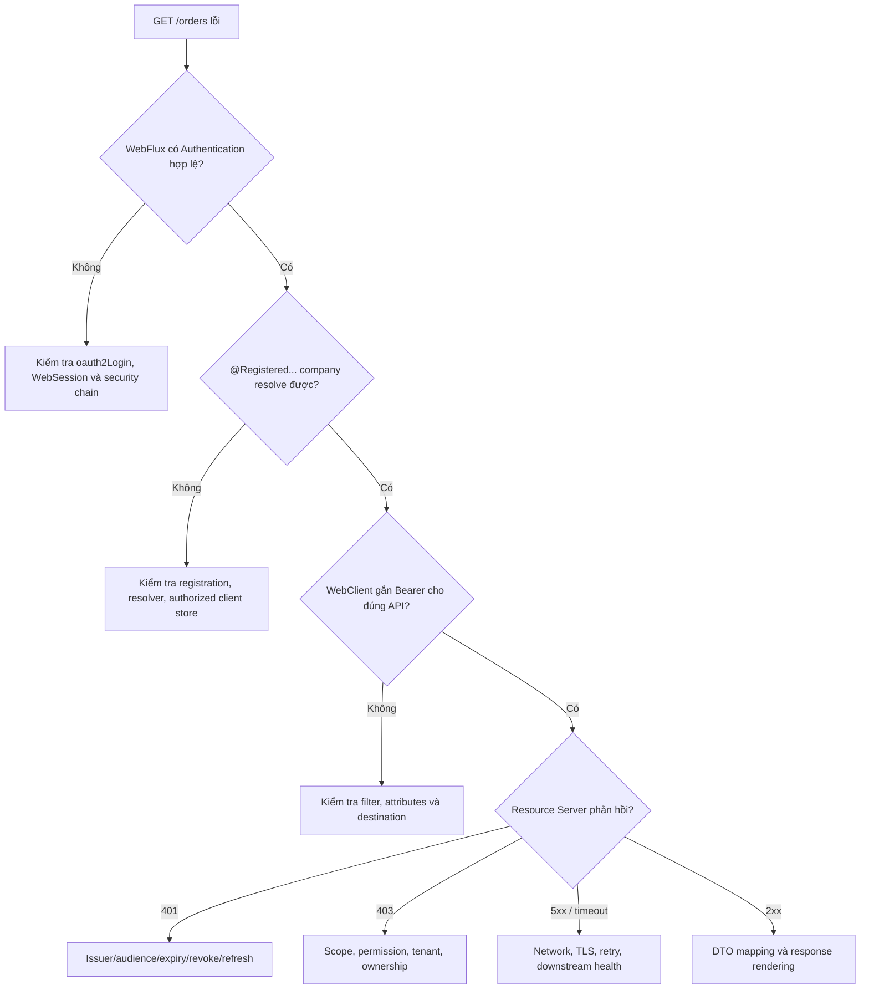

# 21.12. @RegisteredOAuth2AuthorizedClient và controller WebFlux

Trong ứng dụng **Spring Security OAuth 2.0 / OIDC Client chạy trên Spring WebFlux**, đăng nhập OIDC thành công chỉ là bước đầu. Sau khi người dùng đã có `Authentication` trong reactive security context, ứng dụng còn có thể cần gọi một API khác **thay mặt người dùng** bằng OAuth 2.0 Access Token.

Spring Security cung cấp annotation **`@RegisteredOAuth2AuthorizedClient`** để một **controller method của Spring WebFlux** nhận được đối tượng `OAuth2AuthorizedClient` tương ứng với client registration và ngữ cảnh đã xác thực. Thay vì đọc token từ session attribute, tự viết truy vấn token store hoặc dùng ID Token làm Bearer credential, controller có thể yêu cầu framework giải quyết authorized client như một tham số:

```java
@GetMapping("/orders")
public Mono<List<OrderSummary>> orders(
        @RegisteredOAuth2AuthorizedClient("company")
        OAuth2AuthorizedClient authorizedClient) {

    return ordersApi.listOrders(authorizedClient);
}
```

Điều quan trọng không chỉ là annotation hoạt động ra sao, mà còn là **đối tượng nào được chọn, principal nào sở hữu token, liệu token có được làm mới không, và token sẽ được gửi tới đâu**. Một lỗi nhỏ như dùng authorized client của sai registration hoặc bật cấu hình tự gắn Bearer token trên một WebClient dùng chung có thể gây ra lỗi bảo mật nghiêm trọng.

Bài học trình bày đầy đủ vai trò của annotation trên WebFlux controller, các thành phần reactive phía sau, cấu hình Spring Boot, ví dụ gọi API bằng `WebClient`, vòng đời token, giới hạn của reactive context, xử lý lỗi và các tình huống nhiều provider/tenant.

## 1. Bài toán cần giải quyết

Giả sử hệ thống gồm bốn thành phần:

| Thành phần | Vai trò |
|---|---|
| **Browser** | Người dùng đăng nhập và truy cập trang đơn hàng. |
| **`orders-web`** | Ứng dụng Spring Boot WebFlux, đóng vai OIDC Client và backend-for-frontend (BFF). |
| **`company-idp`** | OpenID Provider / Authorization Server, xác thực người dùng và cấp token. |
| **`orders-api`** | Resource Server, nhận Access Token và cung cấp dữ liệu đơn hàng theo quyền. |

Người dùng mở `/orders` sau khi đăng nhập qua OIDC. Browser gửi **session cookie** tới `orders-web`. Nhưng khi backend gọi `orders-api`, Resource Server không tự hiểu session cookie của `orders-web`; nó yêu cầu **Access Token** được cấp cho đúng API.



Annotation giúp giải quyết chính đoạn nối **từ user đang đăng nhập ở WebFlux tới authorized client chứa Access Token**. Nó không tự thay Resource Server kiểm tra quyền và không phải annotation dành để tạo Authorization Server.

### 1.1. Hai lớp credential độc lập

Browser thường dùng:

```http
GET /orders HTTP/1.1
Host: app.example.org
Cookie: SESSION=<session-id>
```

WebFlux backend dùng khi gọi API:

```http
GET /api/orders HTTP/1.1
Host: api.orders.example.org
Authorization: Bearer <access-token>
```

Không chuyển tiếp cookie WebSession của ứng dụng sang một API ngoài chỉ để «chia sẻ login». Ngược lại, không trả Access Token vào JSON cho browser nếu kiến trúc đã quyết định giữ token ở backend.

## 2. `OAuth2AuthorizedClient` là gì?

`OAuth2AuthorizedClient` là đối tượng Spring Security biểu diễn **một OAuth 2.0 client đã được cấp quyền trong một ngữ cảnh principal**, thường gồm:

- `ClientRegistration`: cấu hình registration, client ID, provider endpoints, grant type và các thuộc tính liên quan.
- `principalName`: tên principal/ngữ cảnh dùng để lưu và truy xuất authorized client.
- `OAuth2AccessToken`: giá trị token, loại token, thời điểm cấp/hết hạn, scopes.
- `OAuth2RefreshToken`: Refresh Token nếu Authorization Server đã cấp; có thể `null`.

Ví dụ khái niệm:

```text
ClientRegistration:
  registrationId = company
  clientId       = orders-web
  issuerUri      = https://id.example.org/realms/company

OAuth2AuthorizedClient:
  principalName = oidc-sub-9281
  accessToken:
    tokenValue  = <sensitive>
    expiresAt   = 2026-11-16T10:30:00Z
    scopes      = [openid, profile, orders.read]
  refreshToken  = <sensitive hoặc null>
```

`OAuth2AuthorizedClient` **không đồng nghĩa** với `OidcUser`, `Authentication` hay WebSession.

| Đối tượng | Câu hỏi trả lời | Nơi sử dụng |
|---|---|---|
| `OidcUser` | Người dùng được OP xác thực là ai? | Principal sau OIDC login. |
| `OidcIdToken` | Bằng chứng OIDC về một sự kiện xác thực dành cho client nào? | OIDC Client xác minh. |
| `Authentication` | Request hiện tại đang được xác thực theo ngữ cảnh nào, có authorities gì? | Spring Security authorization trong ứng dụng. |
| `OAuth2AuthorizedClient` | Client registration/principal này có Access/Refresh Token nào để gọi resource? | OAuth2 Client và WebClient outbound. |
| `WebSession` | Làm sao duy trì trạng thái browser giữa các HTTP requests? | Reactive web session. |

**Không gửi ID Token thay Access Token.** ID Token được phát hành cho OIDC Client để xác minh danh tính; một Resource Server cần OAuth2 Access Token có audience, scope và các điều kiện phù hợp với API.

### 2.1. Vì sao `principalName` quan trọng?

Một hệ thống có hai user cùng đăng nhập qua registration `company`:

```text
(company, user-A) -> Access Token A
(company, user-B) -> Access Token B
```

Một kho authorized client không được lưu một token duy nhất theo `registrationId` mà bỏ qua principal; nếu không, token A có thể bị ghi đè bởi B và backend gọi API thay mặt sai người dùng.

Trong interface service, cặp khóa phổ biến là:

```text
(clientRegistrationId, principalName)
```

Với ứng dụng đa issuer/tenant, phải thiết kế principal key/registration/partition để không va chạm và bảo vệ đúng ranh giới dữ liệu. Email thường không phải khóa identity bền vững; trong OIDC, `(issuer, sub)` đã được xác minh là điểm liên kết phù hợp.

## 3. Annotation `@RegisteredOAuth2AuthorizedClient` dùng để làm gì?

Annotation của Spring Security:

```java
import org.springframework.security.oauth2.client.annotation.RegisteredOAuth2AuthorizedClient;
```

được đặt trên **tham số controller method** để framework biết cần giải quyết một authorized client trước khi gọi method.

Ví dụ:

```java
import org.springframework.security.oauth2.client.OAuth2AuthorizedClient;
import org.springframework.security.oauth2.client.annotation.RegisteredOAuth2AuthorizedClient;
import org.springframework.web.bind.annotation.GetMapping;
import org.springframework.web.bind.annotation.RestController;

@RestController
public class AuthorizedClientInfoController {

    @GetMapping("/client-info")
    public String clientInfo(
            @RegisteredOAuth2AuthorizedClient("company")
            OAuth2AuthorizedClient client) {

        return client.getClientRegistration().getRegistrationId();
    }
}
```

Khi request `GET /client-info` đi qua WebFlux security chain và controller argument resolution, Spring Security tìm authorized client **`company`** trong ngữ cảnh hiện tại.

Điểm cốt lõi của annotation:

1. **Chọn `clientRegistrationId`** cần dùng, ví dụ `company`.
2. **Tích hợp với reactive authorized client resolution**, không yêu cầu controller tự đọc WebSession.
3. **Cho phép controller làm việc với một `OAuth2AuthorizedClient` cụ thể**.
4. **Giữ access token trong backend**, nếu ứng dụng chỉ dùng token để gọi API nội bộ.
5. **Có thể phối hợp authorize/refresh** thông qua manager được cấu hình, tùy grant/phiên bản/điều kiện.

### 3.1. Annotation không làm những việc gì?

`@RegisteredOAuth2AuthorizedClient` **không**:

- Tự đăng nhập một user chưa được xác thực.
- Bỏ qua Authorization Code Flow, `state`, PKCE hoặc OIDC ID Token validation.
- Biến Access Token thành quyền truy cập mọi API.
- Tự tạo Refresh Token khi OP không cấp.
- Thay đổi audience/scope mà Authorization Server đã cấp.
- Cho phép caller tùy chọn token của user khác bằng một HTTP parameter.
- Tự đồng bộ role hoặc cập nhật `SecurityContext` sau khi Refresh Token được sử dụng.
- Tạo background scheduler để refresh token theo giờ.

Đó là **điểm tích hợp controller argument**, không phải một cơ chế xác thực thay thế.

### 3.2. Hai cách viết registration trên annotation

Ví dụ đầy đủ:

```java
@RegisteredOAuth2AuthorizedClient("company")
OAuth2AuthorizedClient client
```

Có thể thấy cú pháp tương đương về ý nghĩa:

```java
@RegisteredOAuth2AuthorizedClient(
    registrationId = "company"
)
OAuth2AuthorizedClient client
```

Khi bỏ registration ID, resolver có thể dựa trên authentication/registration trong ngữ cảnh theo khả năng framework. Nhưng ở ứng dụng nhiều provider hoặc nhiều grant, **nên chỉ định registration tường minh** để tránh lựa chọn không rõ ràng.

Không coi value của annotation là `client_id` hay issuer URL. Nó là **registration ID do Spring Boot/ClientRegistrationRepository quản lý**.

## 4. Cơ chế phía sau trên WebFlux

Trên Spring WebFlux, controller sử dụng **reactive argument resolution** và các abstraction reactive của OAuth2 Client.

| Thành phần | Vai trò |
|---|---|
| `ReactiveClientRegistrationRepository` | Tìm `ClientRegistration` theo registration ID. |
| `ServerOAuth2AuthorizedClientRepository` | Lưu/tải authorized client trong `ServerWebExchange`/Authentication context. |
| `ReactiveOAuth2AuthorizedClientService` | Lưu/tải authorized client theo registration/principal, không phụ thuộc trực tiếp WebSession. |
| `ReactiveOAuth2AuthorizedClientManager` | Phối hợp tìm authorized client, authorize và refresh theo provider chain. |
| `OAuth2AuthorizedClientArgumentResolver` | Giải quyết tham số controller được đánh dấu `@RegisteredOAuth2AuthorizedClient` trong WebFlux. |
| `SecurityWebFilterChain` | Thực thi reactive web security, `oauth2Login()` và `oauth2Client()`. |
| `ServerOAuth2AuthorizedClientExchangeFilterFunction` | Gắn Access Token vào WebClient outbound request theo authorized client/registration. |

Luồng ý nghĩa:



Sơ đồ mô tả vai trò, không cam kết ở mọi phiên bản argument resolver sẽ gọi token endpoint ngay trong mọi request. Spring Security có thể trả token hiện có, dùng provider chain để refresh khi cần hoặc báo lỗi khi không thể authorize.

### 4.1. Reactive khác Servlet

Đừng nhầm với một MVC controller dùng cùng annotation trên Servlet. Tên annotation có thể giống nhau, nhưng bộ máy giải quyết tham số và store khác:

| Tiêu chí | Servlet/MVC | Reactive/WebFlux |
|---|---|---|
| HTTP request | `HttpServletRequest` | `ServerWebExchange` |
| Authentication context | `SecurityContextHolder` phổ biến | Reactor Context / `ReactiveSecurityContextHolder` |
| Security DSL | `HttpSecurity` | `ServerHttpSecurity` |
| Security chain | `SecurityFilterChain` | `SecurityWebFilterChain` |
| Registration repository | `ClientRegistrationRepository` | `ReactiveClientRegistrationRepository` |
| Authorized client repository | `OAuth2AuthorizedClientRepository` | `ServerOAuth2AuthorizedClientRepository` |
| Authorized client manager | `OAuth2AuthorizedClientManager` | `ReactiveOAuth2AuthorizedClientManager` |
| WebClient OAuth2 filter | `ServletOAuth2AuthorizedClientExchangeFilterFunction` | `ServerOAuth2AuthorizedClientExchangeFilterFunction` |

Một ứng dụng dùng `spring-boot-starter-web` cùng `WebClient` **không tự trở thành WebFlux server**. Phải xác định inbound HTTP stack đang chạy trước khi chọn interface.

## 5. Chuẩn bị ứng dụng Spring Boot Reactive

### 5.1. Gradle dependencies

Ví dụ Spring Boot dùng WebFlux và OAuth2 Client:

```gradle
dependencies {
    implementation("org.springframework.boot:spring-boot-starter-webflux")
    implementation("org.springframework.boot:spring-boot-starter-security")
    implementation("org.springframework.boot:spring-boot-starter-oauth2-client")
}
```

`spring-boot-starter-webflux` cung cấp WebFlux server/WebClient; `spring-boot-starter-security` cung cấp Spring Security; `spring-boot-starter-oauth2-client` cung cấp OAuth2/OIDC Client.

Nếu thêm `spring-boot-starter-web` cùng lúc, phải kiểm tra **Spring Boot WebApplicationType** và security stack thực tế. Bài này giả định ứng dụng được khởi động ở chế độ **Reactive**.

### 5.2. Khai báo `ClientRegistration`

Ví dụ `application.yml`:

```yaml
spring:
  security:
    oauth2:
      client:
        registration:
          company:
            provider: company-oidc
            client-id: ${OIDC_CLIENT_ID}
            client-secret: ${OIDC_CLIENT_SECRET}
            client-authentication-method: client_secret_basic
            authorization-grant-type: authorization_code
            redirect-uri: "{baseUrl}/login/oauth2/code/{registrationId}"
            scope:
              - openid
              - profile
              - orders.read
        provider:
          company-oidc:
            issuer-uri: https://id.example.org/realms/company
```

Ý nghĩa:

- `company` là registration ID dùng trong annotation.
- `client-id` là danh tính OAuth2 Client được OP/Authorization Server biết.
- `redirect-uri` là callback nhận authorization response tại ứng dụng, không phải endpoint API.
- `scope=openid` yêu cầu OIDC login.
- `orders.read` minh họa scope muốn xin cho API; OP quyết định có cấp hay không.
- `issuer-uri` dùng metadata discovery và các ràng buộc OIDC theo cấu hình.

**Chỉ yêu cầu `orders.read` không tự bảo đảm Access Token có audience phù hợp với `orders-api`.** Một số Authorization Server yêu cầu cấu hình resource/audience riêng. Cần làm đúng hợp đồng cấp token của provider; không bỏ audience validation ở API để chữa mismatch.

### 5.3. SecurityWebFilterChain

```java
import org.springframework.context.annotation.Bean;
import org.springframework.context.annotation.Configuration;
import org.springframework.security.config.Customizer;
import org.springframework.security.config.annotation.web.reactive.EnableWebFluxSecurity;
import org.springframework.security.config.web.server.ServerHttpSecurity;
import org.springframework.security.web.server.SecurityWebFilterChain;

@Configuration
@EnableWebFluxSecurity
public class ReactiveSecurityConfiguration {

    @Bean
    SecurityWebFilterChain securityWebFilterChain(ServerHttpSecurity http) {
        return http
            .authorizeExchange(exchanges -> exchanges
                .pathMatchers("/", "/public/**").permitAll()
                .anyExchange().authenticated()
            )
            .oauth2Login(Customizer.withDefaults())
            .oauth2Client(Customizer.withDefaults())
            .build();
    }
}
```

- `oauth2Login()` xử lý login OIDC bằng Authorization Code Flow, callback và tạo authentication.
- `oauth2Client()` kích hoạt các khả năng client để quản lý authorized client/các tích hợp OAuth2 Client trong reactive web.
- `anyExchange().authenticated()` yêu cầu authentication cho controller nghiệp vụ.
- Endpoints công khai/login được xử lý qua security filter chain; không loại trừ callback khỏi chain.

Không đăng ký cùng lúc nhiều `SecurityWebFilterChain` có matcher trùng mà không thiết kế thứ tự/ranh giới, vì controller có thể rơi vào chain không chứa OAuth2 Client support.

## 6. Ví dụ controller WebFlux tối thiểu

Giả sử chỉ muốn biết authorized client nào đang được giải quyết, **không trả token**:

```java
import java.time.Instant;
import java.util.Map;

import org.springframework.security.oauth2.client.OAuth2AuthorizedClient;
import org.springframework.security.oauth2.client.annotation.RegisteredOAuth2AuthorizedClient;
import org.springframework.web.bind.annotation.GetMapping;
import org.springframework.web.bind.annotation.RestController;
import reactor.core.publisher.Mono;

@RestController
public class ClientMetadataController {

    @GetMapping("/oauth2/client-metadata")
    public Mono<Map<String, Object>> clientMetadata(
            @RegisteredOAuth2AuthorizedClient("company")
            OAuth2AuthorizedClient client) {

        Instant expiresAt = client.getAccessToken().getExpiresAt();

        return Mono.just(Map.of(
            "registrationId",
            client.getClientRegistration().getRegistrationId(),
            "tokenExpiresAt",
            expiresAt == null ? "unknown" : expiresAt.toString()
        ));
    }
}
```

Đây là **ví dụ học tập**: response chỉ hiển thị registration ID và hạn token. Không nên đưa `principalName`, scopes nhạy cảm hoặc thời hạn token ra frontend nếu không cần cho nghiệp vụ.

### 6.1. Tại sao tham số là `OAuth2AuthorizedClient` chứ không phải `String`?

Annotation không phải một cơ chế tự chèn raw token vào method parameter. Nó giải quyết **authorized client object** để controller có cả registration metadata và Access Token cần thiết.

Cách lấy Access Token trong backend:

```java
String bearer = client.getAccessToken().getTokenValue();
```

Tuy nhiên, **không cần** tự lấy chuỗi token trong nhiều tình huống: có thể truyền nguyên `OAuth2AuthorizedClient` cho `WebClient` OAuth2 filter và để filter thêm header.

### 6.2. Không cần viết controller nhận callback để sử dụng annotation

Khi đã bật `oauth2Login()`, Spring Security WebFlux xử lý:

```text
GET /oauth2/authorization/company
GET /login/oauth2/code/company?code=...&state=...
```

Annotation `@RegisteredOAuth2AuthorizedClient` được dùng **sau** khi flow đã cấp token hoặc trong lúc giải quyết authorized client ở request nghiệp vụ. Nó không phải annotation của callback controller.

### 6.3. Controller vẫn là reactive dù tham số là một object thường

Một method WebFlux có thể nhận `OAuth2AuthorizedClient` như một tham số bình thường nhưng trả `Mono<T>`. Phần resolution được framework xử lý phù hợp với WebFlux trước khi gọi method; bên trong service, HTTP call outbound vẫn có thể là reactive.

Không vì thấy tham số không phải `Mono<OAuth2AuthorizedClient>` mà kết luận việc lấy authorized client bắt buộc đang block. Framework có reactive argument resolver cho ngữ cảnh này; tuy nhiên nếu bạn tự viết repository truy vấn JDBC blocking trong reactive path, đó lại là vấn đề cần xử lý ở tầng lưu trữ.

## 7. Thiết kế API mẫu để gọi downstream Resource Server

Giả sử `orders-api` cung cấp:

```http
GET /api/orders HTTP/1.1
Host: api.orders.example.org
Authorization: Bearer <access-token>
```

Response:

```json
[
  {
    "id": 101,
    "number": "SO-2026-0101",
    "status": "PENDING"
  },
  {
    "id": 102,
    "number": "SO-2026-0102",
    "status": "APPROVED"
  }
]
```

Mục tiêu của controller WebFlux:

- Người dùng phải đăng nhập.
- Tìm authorized client của registration `company` **theo đúng principal**.
- Gửi Access Token tới `api.orders.example.org` bằng `WebClient`.
- Trả về dữ liệu nghiệp vụ đã được API cho phép.
- Không trả token value về browser.

Đây là **gọi API bằng delegated user token**; không sử dụng Client Credentials để giả danh người dùng.

## 8. Cấu hình `ServerOAuth2AuthorizedClientExchangeFilterFunction`

Trong WebFlux, một filter phù hợp là:

```java
org.springframework.security.oauth2.client.web.reactive.function.client
    .ServerOAuth2AuthorizedClientExchangeFilterFunction
```

Nó giúp `WebClient` gắn OAuth2 Access Token vào HTTP outbound request.

### 8.1. WebClient Bean với reactive repositories

```java
import org.springframework.context.annotation.Bean;
import org.springframework.context.annotation.Configuration;
import org.springframework.security.oauth2.client.registration.ReactiveClientRegistrationRepository;
import org.springframework.security.oauth2.client.web.server.ServerOAuth2AuthorizedClientRepository;
import org.springframework.security.oauth2.client.web.reactive.function.client.ServerOAuth2AuthorizedClientExchangeFilterFunction;
import org.springframework.web.reactive.function.client.WebClient;

@Configuration
public class OrdersWebClientConfiguration {

    @Bean
    WebClient ordersWebClient(
            ReactiveClientRegistrationRepository registrations,
            ServerOAuth2AuthorizedClientRepository authorizedClients) {

        ServerOAuth2AuthorizedClientExchangeFilterFunction oauth2 =
            new ServerOAuth2AuthorizedClientExchangeFilterFunction(
                registrations,
                authorizedClients
            );

        // Không mặc định thêm token vào mọi request.
        return WebClient.builder()
            .baseUrl("https://api.orders.example.org")
            .filter(oauth2)
            .build();
    }
}
```

Đoạn code dùng constructor nhận `ReactiveClientRegistrationRepository` và `ServerOAuth2AuthorizedClientRepository` của **Reactive stack**. `WebClient` chỉ được cấu hình filter; nó không tự quyết định mọi request bắt buộc mang Access Token.

Khi cần kiểm soát token refresh, failure handler hoặc nhiều provider chains, ứng dụng có thể dùng constructor nhận một `ReactiveOAuth2AuthorizedClientManager` do mình cấu hình (phần sau).

### 8.2. Vì sao không đặt `Authorization` vào default header?

Một sai lầm:

```java
// SAI trong Bean WebClient dùng chung giữa users:
return WebClient.builder()
    .defaultHeader("Authorization", "Bearer " + userAccessToken)
    .build();
```

`WebClient` thường là singleton/shared Bean. Nếu `userAccessToken` thuộc một người dùng cụ thể, token có thể bị dùng bởi request của user khác.

Cách đúng là truyền **authorized client tại request cụ thể**, không lưu token user vào global WebClient configuration.

## 9. Truyền authorized client tường minh qua WebClient attributes

Filter có helper:

```java
ServerOAuth2AuthorizedClientExchangeFilterFunction
    .oauth2AuthorizedClient(authorizedClient)
```

để đưa authorized client vào attributes của một WebClient request.

Service ví dụ:

```java
import java.util.List;

import org.springframework.core.ParameterizedTypeReference;
import org.springframework.security.oauth2.client.OAuth2AuthorizedClient;
import org.springframework.security.oauth2.client.web.reactive.function.client.ServerOAuth2AuthorizedClientExchangeFilterFunction;
import org.springframework.stereotype.Service;
import org.springframework.web.reactive.function.client.WebClient;
import reactor.core.publisher.Mono;

@Service
public class OrdersApiClient {

    private final WebClient ordersWebClient;

    public OrdersApiClient(WebClient ordersWebClient) {
        this.ordersWebClient = ordersWebClient;
    }

    public Mono<List<OrderSummary>> listOrders(
            OAuth2AuthorizedClient authorizedClient) {

        return ordersWebClient.get()
            .uri("/api/orders")
            .attributes(
                ServerOAuth2AuthorizedClientExchangeFilterFunction
                    .oauth2AuthorizedClient(authorizedClient)
            )
            .retrieve()
            .bodyToMono(
                new ParameterizedTypeReference<List<OrderSummary>>() { }
            );
    }
}
```

DTO:

```java
public record OrderSummary(
    long id,
    String number,
    String status
) { }
```

Khi triển khai thật, `OrderSummary` và các public top-level types phải ở các file Java đúng quy định.

**Điểm mấu chốt** là `oauth2AuthorizedClient(authorizedClient)`: nó chỉ rõ token được chọn **cho outbound request này**, không phải mọi request của WebClient.

### 9.1. Tại sao nên truyền object, không truyền raw token?

Controller/service có thể giữ đối tượng `OAuth2AuthorizedClient` với metadata registration và lifecycle. Filter có thể dùng nó để thiết lập Bearer header và kết nối với manager/failure handling theo cấu hình.

Nếu tự truyền chuỗi `tokenValue` qua nhiều lớp, các layer rất dễ:

- Log nhầm token.
- Gửi token tới host khác.
- Giữ token stale sau refresh.
- Không còn biết token gắn với principal/registration nào.

Truyền authorized client không tự giải quyết mọi rủi ro, nhưng **giữ ngữ cảnh tốt hơn** so với chuyển credential thuần.

### 9.2. Không mở WebClient như một HTTP proxy cho URL tùy ý

Tránh:

```java
// Sai nếu URI có thể đến từ người dùng chưa được kiểm soát:
ordersWebClient.get()
    .uri(request.getQueryParam("target"))
    .attributes(
        ServerOAuth2AuthorizedClientExchangeFilterFunction
            .oauth2AuthorizedClient(authorizedClient)
    )
    .retrieve();
```

Nếu caller chọn được URL tới host do họ kiểm soát, backend có thể gửi **Bearer credential** cho kẻ tấn công. Đây là kết hợp rủi ro **SSRF + token exfiltration**.

Dùng base URL được cấu hình cố định, relative URI từ dữ liệu đã kiểm tra và giới hạn redirect tới origin được phép.

## 10. Controller WebFlux hoàn chỉnh với annotation

Kết hợp ví dụ:

```java
import java.util.List;

import org.springframework.security.oauth2.client.OAuth2AuthorizedClient;
import org.springframework.security.oauth2.client.annotation.RegisteredOAuth2AuthorizedClient;
import org.springframework.web.bind.annotation.GetMapping;
import org.springframework.web.bind.annotation.RestController;
import reactor.core.publisher.Mono;

@RestController
public class OrdersController {

    private final OrdersApiClient ordersApi;

    public OrdersController(OrdersApiClient ordersApi) {
        this.ordersApi = ordersApi;
    }

    @GetMapping("/orders")
    public Mono<List<OrderSummary>> orders(
            @RegisteredOAuth2AuthorizedClient("company")
            OAuth2AuthorizedClient authorizedClient) {

        return ordersApi.listOrders(authorizedClient);
    }
}
```

Luồng của method này:

1. Security filter xác thực browser request qua session/security context.
2. WebFlux argument resolver nhìn thấy `@RegisteredOAuth2AuthorizedClient("company")`.
3. Resolver/authorized client machinery tìm hoặc authorize client theo registration `company` và principal tương ứng.
4. Controller nhận `OAuth2AuthorizedClient`.
5. Controller gọi service `OrdersApiClient` bằng đối tượng đã nhận.
6. `WebClient` OAuth2 filter gắn Access Token vào outbound API request.
7. Resource Server kiểm tra token, scope và quyền đối với dữ liệu.
8. Controller trả `Mono<List<OrderSummary>>`, không chứa credential.

### 10.1. Đánh giá quyền endpoint ở controller

`.anyExchange().authenticated()` chỉ yêu cầu user đã đăng nhập, chưa chứng minh họ có quyền xem đơn hàng. Nếu nghiệp vụ yêu cầu kiểm tra role/permission nội bộ trước khi gọi API, có thể đặt thêm authorization tại WebFlux app; Resource Server vẫn phải thực thi policy của chính nó.

Ví dụ với method security reactive trong cấu hình phù hợp:

```java
import org.springframework.security.access.prepost.PreAuthorize;

@PreAuthorize("hasAuthority('orders:read')")
@GetMapping("/orders")
public Mono<List<OrderSummary>> orders(
        @RegisteredOAuth2AuthorizedClient("company")
        OAuth2AuthorizedClient client) {

    return ordersApi.listOrders(client);
}
```

Đoạn code là fragment minh họa trong controller; để dùng method security trong WebFlux, phải cấu hình reactive method security theo phiên bản Spring Security tương ứng, và authority `orders:read` phải đến từ nguồn nội bộ được tin cậy.

Ngay cả khi method này pass, API vẫn cần kiểm tra token scope/audience và tenant/ownership. **Role ứng dụng** không tự trở thành **scope OAuth2**.

### 10.2. Annotation không thay thế đối tượng principal

Nếu service cần biết user nào vừa đăng nhập:

```java
import org.springframework.security.core.annotation.AuthenticationPrincipal;
import org.springframework.security.oauth2.core.oidc.user.OidcUser;

@GetMapping("/orders/me")
public Mono<List<OrderSummary>> myOrders(
        @AuthenticationPrincipal OidcUser user,
        @RegisteredOAuth2AuthorizedClient("company")
        OAuth2AuthorizedClient client) {

    // user.getSubject() dùng cho logic nội bộ/audit khi phù hợp.
    // Downstream API nhận Access Token từ client.
    return ordersApi.listOrders(client);
}
```

Hai tham số có ý nghĩa khác nhau:

- `OidcUser`: hồ sơ/danh tính đã được OP xác thực.
- `OAuth2AuthorizedClient`: Access Token/Refresh Token để client gọi API.

Không lấy `user.getIdToken().getTokenValue()` làm Bearer token thay cho Access Token.

## 11. So sánh với dùng annotation không có registration ID

Trong nhiều ví dụ ngắn, có thể gặp:

```java
@RegisteredOAuth2AuthorizedClient
OAuth2AuthorizedClient authorizedClient
```

Khi không chỉ định registration ID, resolver có thể cố suy ra từ `Authentication` hiện tại hoặc ngữ cảnh được hỗ trợ. Điều này chỉ nên dùng nếu ứng dụng thật sự có **một authorization context rõ ràng**.

Trong dự án có:

```text
registrationId = company
registrationId = partner
registrationId = analytics-service
```

cần chọn registration tường minh để tránh:

- Dùng token `company` khi cần `partner`.
- Nhầm giữa delegated user token và Client Credentials token.
- Gọi API với audience/scope không phù hợp.
- Hiểu sai lý do không tìm thấy authorized client.

**Khuyến nghị:** trên endpoint nghiệp vụ, dùng `@RegisteredOAuth2AuthorizedClient("company")` hoặc registration thích hợp; không lấy annotation trống làm mặc định cho mọi API trong một hệ thống nhiều providers.

## 12. Cách hoạt động của reactive authorized client manager

Một `ReactiveOAuth2AuthorizedClientManager` chịu trách nhiệm phối hợp authorize/re-authorize:

```text
Controller resolver hoặc WebClient OAuth2 filter
       |
       v
ReactiveOAuth2AuthorizedClientManager
       |
       +-- ClientRegistration theo registrationId
       +-- Authorized client theo principal/context
       +-- OAuth2AuthorizedClientProvider chain
       |
       v
Authorized client còn dùng được?
       |
       +-- Có: dùng lại token
       |
       +-- Sắp hết hạn + có Refresh Token: refresh
       |
       +-- Chưa có authorization hợp lệ: xử lý theo grant/provider
       |
       v
Lưu authorized client mới khi phù hợp
```

Trong WebFlux Servlet-free request flow thường gặp:

- `DefaultReactiveOAuth2AuthorizedClientManager` phối hợp với `ReactiveClientRegistrationRepository` và `ServerOAuth2AuthorizedClientRepository`.
- `ReactiveOAuth2AuthorizedClientProvider` xử lý các grant được cấu hình.
- Manager có thể dùng success/failure handlers để cập nhật kho lưu trữ.

Không suy ra rằng **mỗi lần resolver được gọi** sẽ xin token mới. Nếu Access Token còn hợp lệ và đủ xa hạn, manager thường có thể dùng lại.

### 12.1. Cấu hình manager minh họa cho HTTP WebFlux

```java
import org.springframework.context.annotation.Bean;
import org.springframework.context.annotation.Configuration;
import org.springframework.security.oauth2.client.DefaultReactiveOAuth2AuthorizedClientManager;
import org.springframework.security.oauth2.client.ReactiveOAuth2AuthorizedClientManager;
import org.springframework.security.oauth2.client.ReactiveOAuth2AuthorizedClientProvider;
import org.springframework.security.oauth2.client.ReactiveOAuth2AuthorizedClientProviderBuilder;
import org.springframework.security.oauth2.client.registration.ReactiveClientRegistrationRepository;
import org.springframework.security.oauth2.client.web.server.ServerOAuth2AuthorizedClientRepository;

@Configuration
public class ReactiveAuthorizedClientManagerConfiguration {

    @Bean
    ReactiveOAuth2AuthorizedClientManager authorizedClientManager(
            ReactiveClientRegistrationRepository registrations,
            ServerOAuth2AuthorizedClientRepository authorizedClients) {

        ReactiveOAuth2AuthorizedClientProvider provider =
            ReactiveOAuth2AuthorizedClientProviderBuilder.builder()
                .authorizationCode()
                .refreshToken()
                .build();

        DefaultReactiveOAuth2AuthorizedClientManager manager =
            new DefaultReactiveOAuth2AuthorizedClientManager(
                registrations,
                authorizedClients
            );

        manager.setAuthorizedClientProvider(provider);
        return manager;
    }
}
```

Cấu hình này thể hiện provider chain cho Authorization Code và Refresh Token. Trong ứng dụng thực tế, phải đảm bảo **manager mà controller argument resolver/WebClient sử dụng** được wiring nhất quán với kho authorized client từ `oauth2Login()`. Tạo một Bean manager riêng mà không gắn đúng vào consumer sẽ không tự thay đổi hành vi của mọi component.

### 12.2. Đưa manager vào filter của WebClient

```java
import org.springframework.context.annotation.Bean;
import org.springframework.context.annotation.Configuration;
import org.springframework.security.oauth2.client.ReactiveOAuth2AuthorizedClientManager;
import org.springframework.security.oauth2.client.web.reactive.function.client.ServerOAuth2AuthorizedClientExchangeFilterFunction;
import org.springframework.web.reactive.function.client.WebClient;

@Configuration
public class ManagedOrdersWebClientConfiguration {

    @Bean
    WebClient ordersWebClient(
            ReactiveOAuth2AuthorizedClientManager manager) {

        ServerOAuth2AuthorizedClientExchangeFilterFunction oauth2 =
            new ServerOAuth2AuthorizedClientExchangeFilterFunction(
                manager
            );

        // Với constructor manager, xem xét failure handler
        // cho token bị Resource Server từ chối.
        return WebClient.builder()
            .baseUrl("https://api.orders.example.org")
            .filter(oauth2)
            .build();
    }
}
```

Nếu dự án đã tạo WebClient Bean ở phần 8, đây là **mẫu cấu hình thay thế**, không phải Bean thứ hai cần đăng ký trùng tên. Chọn một cấu hình rõ ràng và dùng `@Qualifier` nếu có nhiều WebClient/manager.

### 12.3. Authorization code không thể tự được cấp trong mọi request nền

Manager/provider của Authorization Code Flow cần browser interaction khi chưa có authorization thích hợp. Một background job không có user/session không thể chỉ gọi `authorize(...)` để tự sinh user delegated token.

Nếu token đã tồn tại nhưng Refresh Token hết hạn, luồng có thể phải đưa user qua browser authorization lại. Không fallback sang token của người dùng khác hoặc machine token có quyền cao hơn chỉ để giữ API call thành công.

## 13. Refresh Token: khi nào annotation nhận token đã làm mới?

Một authorized client có thể được lưu sau login:

```text
Access Token A1: expiresAt = 10:05
Refresh Token R1: có
```

Đến 10:04:30, request `GET /orders` có thể kích hoạt authorized client manager. Nếu provider coi Access Token đã tới ngưỡng refresh và OP chấp nhận R1:

```text
R1 -> token endpoint -> Access Token A2 (+ Refresh Token R2 nếu rotation)
```

Sau đó manager/service/repository cần lưu token mới theo đúng principal và registration.



Chi tiết refresh có thể do controller resolver hoặc WebClient OAuth2 filter/manager thực hiện, tùy nơi manager được gọi và cấu hình. Vì vậy không nên khẳng định rằng **chỉ annotation luôn làm refresh**, hoặc rằng **filter sẽ luôn làm refresh** trong mọi cách tạo WebClient.

### 13.1. `clockSkew` và Access Token expiry

Các provider OAuth2 Client thường dùng một khoảng đệm trước `AccessToken.expiresAt`:

\[
\text{refreshThreshold} \approx \text{expiresAt} - \text{clockSkew}
\]

Ví dụ expiresAt=10:05:00, skew=60s: manager/provider có thể xem token là sắp hết hạn từ khoảng 10:04. Skew không phải scheduler; token chỉ được xem xét khi có luồng authorize.

Không đặt skew lớn hơn hoặc gần bằng TTL của token, vì như vậy token có thể bị xem là cần refresh ngay sau khi được cấp, gây tăng token requests và race.

### 13.2. Refresh Token không được đảm bảo luôn có

Nếu Authorization Server không cấp Refresh Token hoặc token đã bị revoke, Spring Security không thể tự tạo R1 mới chỉ từ Access Token/ID Token. Khi cần gọi API, ứng dụng phải xử lý reauthorization hoặc thông báo phù hợp.

Một lỗi `invalid_grant` từ token endpoint có thể xuất phát từ Refresh Token expired, revoke consent, provider rotation hoặc nhiều node cùng refresh. Không retry vô hạn bằng cùng Refresh Token.

### 13.3. ID Token và authorities không tự làm mới

Làm mới Access Token không có nghĩa WebFlux `Authentication`/`OidcUser` trong session được cập nhật mọi claim hay quyền nội bộ. Nếu người dùng bị khóa hoặc membership thay đổi, ứng dụng cần chính sách account/authorization riêng.

## 14. Annotation và `ReactiveSecurityContextHolder`

Trong WebFlux, Spring Security đưa authentication vào **Reactor Context**. Không nên dựa vào Servlet `SecurityContextHolder` ThreadLocal như trong MVC.

Controller có thể nhận `Authentication`:

```java
import org.springframework.security.core.Authentication;

@GetMapping("/who-am-i")
public Mono<String> whoAmI(Authentication authentication) {
    return Mono.just(authentication.getName());
}
```

Hoặc service reactive có thể truy cập context qua:

```java
import org.springframework.security.core.context.ReactiveSecurityContextHolder;
import reactor.core.publisher.Mono;

public Mono<String> currentPrincipalName() {
    return ReactiveSecurityContextHolder.getContext()
        .map(context -> context.getAuthentication().getName());
}
```

Nhưng khi controller **đã nhận authorized client qua annotation**, việc truyền nó tường minh xuống service giúp **không phải tìm lại `Authentication` giữa các operator/reactive callbacks**.

### 14.1. Vì sao tránh ThreadLocal trong reactive pipeline?

Một reactive request có thể được thực thi trên nhiều threads vì I/O scheduling, event loop, hoặc `publishOn`/`subscribeOn`.

Mẫu không phù hợp:

```java
// Có thể null/không phản ánh reactive authentication context:
Authentication auth =
    SecurityContextHolder.getContext().getAuthentication();
```

Không tự dùng giá trị này trong callback được thực thi ở thread khác rồi suy ra đây là user của request. Dùng API WebFlux/reactive context hoặc truyền tham số rõ ràng.

### 14.2. `Mono.defer` không tự khôi phục dữ liệu Servlet

`Mono.defer(...)` trì hoãn xây publisher tới lúc subscribe, nhưng không tự tạo `HttpServletRequest` hoặc nhập một thread-local security context. Nếu code bên trong cần authorized client, cung cấp context đúng bằng reactive manager/annotation hoặc dùng một giá trị đã giải quyết trong request.

### 14.3. Không tự `subscribe()` trong controller

Sai:

```java
@GetMapping("/orders")
public Mono<String> orders(
        @RegisteredOAuth2AuthorizedClient("company")
        OAuth2AuthorizedClient client) {

    ordersApi.listOrders(client)
        .subscribe(); // Fire-and-forget, mất kiểm soát lỗi và lifecycle

    return Mono.just("started");
}
```

Controller trả thành công trước khi downstream API thực sự hoàn tất. Errors có thể không được ánh xạ đúng, và việc subscribe riêng có thể tạo bối cảnh reactive không được mong đợi.

Đúng hơn: **trả publisher cho WebFlux framework** để subscription, cancellation và error propagation được xử lý đúng lifecycle.

## 15. Phân biệt dùng annotation với gọi `ReactiveOAuth2AuthorizedClientManager` trực tiếp

Annotation tiện khi đã có **controller method**. Nhưng một service không phải controller hoặc một scheduled job có thể cần gọi manager trực tiếp.

### 15.1. Trong controller WebFlux

```java
@GetMapping("/orders")
public Mono<List<OrderSummary>> orders(
        @RegisteredOAuth2AuthorizedClient("company")
        OAuth2AuthorizedClient client) {

    return ordersApi.listOrders(client);
}
```

Lợi ích:

- Controller không phải tự biết cách lookup token store.
- Dễ thể hiện registration dùng cho endpoint.
- Service nhận token context rõ ràng.
- Hợp với request đang có user login.

### 15.2. Trong reactive service độc lập

Có thể sử dụng `ReactiveOAuth2AuthorizedClientManager` khi caller cung cấp ngữ cảnh cần thiết:

```java
import org.springframework.security.oauth2.client.OAuth2AuthorizeRequest;
import org.springframework.security.oauth2.client.OAuth2AuthorizedClient;
import org.springframework.security.oauth2.client.ReactiveOAuth2AuthorizedClientManager;
import org.springframework.security.core.Authentication;
import reactor.core.publisher.Mono;

public final class DelegatedTokenService {

    private final ReactiveOAuth2AuthorizedClientManager manager;

    public DelegatedTokenService(
            ReactiveOAuth2AuthorizedClientManager manager) {
        this.manager = manager;
    }

    public Mono<OAuth2AuthorizedClient> authorizedClientFor(
            Authentication user) {

        OAuth2AuthorizeRequest request =
            OAuth2AuthorizeRequest.withClientRegistrationId("company")
                .principal(user)
                .build();

        return manager.authorize(request);
    }
}
```

Ví dụ chỉ minh họa **đầu vào của manager**, không tự bảo đảm request có đủ `ServerWebExchange` khi đang dùng `DefaultReactiveOAuth2AuthorizedClientManager`. Trong WebFlux request flow, một số context attributes cần được provider/manager lấy từ exchange; với background jobs cần manager/service tương ứng.

**Lưu ý authorization:** không cho caller web tùy ý chọn `Authentication` hoặc `principalName` để lấy token của người khác. Tầng service phải nhận principal từ ngữ cảnh đã được xác thực/ủy quyền.

### 15.3. Công việc nền nên dùng manager phù hợp

Một background job không có `ServerWebExchange`, không có browser session và không nên dùng `@RegisteredOAuth2AuthorizedClient` như một magic annotation trên method `@Scheduled`.

Với machine-to-machine `client_credentials`, dùng service-backed reactive manager, chẳng hạn `AuthorizedClientServiceReactiveOAuth2AuthorizedClientManager` trong các phiên bản Spring Security hỗ trợ, cùng `ReactiveOAuth2AuthorizedClientService` và technical principal ổn định.

Không truyền principal từ user login trước đó vào Client Credentials rồi kỳ vọng token đại diện cho user. Token từ Client Credentials cấp cho **ứng dụng/client**, không phải delegated user token.

## 16. So sánh ba kiểu gọi API

| Kiểu | Khi nào phù hợp? | Cần đặc biệt chú ý |
|---|---|---|
| Controller `@RegisteredOAuth2AuthorizedClient("company")` + truyền object | API được gọi theo request của user đã đăng nhập. | Đúng registration, đúng user, không gửi token sai host. |
| WebClient `clientRegistrationId("company")` + reactive manager | Caller muốn filter/manager tự resolve authorized client trong context phù hợp. | Authentication/context, repository, authorization scope và destination. |
| Background manager + `client_credentials` | Không có end user; job/service gọi API của chính ứng dụng. | Technical principal, client credentials, scopes/audience, không giả mạo user. |

Trong nhiều ứng dụng BFF, **kiểu đầu tiên** là lựa chọn dễ hiểu nhất cho endpoint cần user delegation.

### 16.1. Chỉ định registration ID ở WebClient

Filter có helper để chọn registration:

```java
import static org.springframework.security.oauth2.client.web.reactive.function.client.ServerOAuth2AuthorizedClientExchangeFilterFunction.clientRegistrationId;

Mono<String> result = ordersWebClient.get()
    .uri("/api/orders/summary")
    .attributes(clientRegistrationId("company"))
    .retrieve()
    .bodyToMono(String.class);
```

Cách này yêu cầu filter/manager tìm được principal và authorized client đúng trong reactive context. Nếu ngữ cảnh thiếu, hãy dùng explicit `OAuth2AuthorizedClient` từ controller hoặc thiết kế cơ chế manager phù hợp, không truy vấn ngẫu nhiên token trong store.

### 16.2. Khi nào không cần annotation?

Nếu controller chỉ hiển thị hồ sơ OIDC, có thể chỉ cần:

```java
@GetMapping("/profile")
public Mono<Map<String, String>> profile(
        @AuthenticationPrincipal OidcUser user) {

    return Mono.just(Map.of("subject", user.getSubject()));
}
```

Không phải mọi endpoint đã login đều cần Access Token. Hạn chế việc tải hoặc đưa token vào pipeline khi request chỉ dùng dữ liệu đã có và chính sách không đòi hỏi gọi API.

## 17. Cảnh báo: default OAuth2 authorized client trên WebClient

`ServerOAuth2AuthorizedClientExchangeFilterFunction` có các lựa chọn để sử dụng authorized client mặc định hoặc registration mặc định. Cấu hình tiện lợi nhưng rủi ro nếu WebClient gọi nhiều destinations.

Ví dụ ý tưởng:

```java
oauth2.setDefaultOAuth2AuthorizedClient(true);
```

Nếu bật trên WebClient dùng chung, các request không explicit selection có thể **mang Access Token của user đang authenticated**, kể cả lúc gọi endpoint không mong đợi.

Giả sử:

```text
GET https://api.orders.example.org/api/orders      (cần user token)
GET https://status.example.net/health               (không cần token)
GET https://partner-unknown.example.net/public-data (host khác)
```

Một default token policy quá rộng có thể vô tình gắn Bearer token vào request thứ hai hoặc thứ ba.

### 17.1. Chọn explicit token per request

```java
ordersWebClient.get()
    .uri("/api/orders")
    .attributes(
        ServerOAuth2AuthorizedClientExchangeFilterFunction
            .oauth2AuthorizedClient(authorizedClient)
    )
    .retrieve();
```

Chỉ request này có annotation-derived authorized client. Khi gọi API không yêu cầu token, dùng WebClient khác hoặc không gắn OAuth2 attributes.

### 17.2. Base URL cố định và redirect policy

Một WebClient có:

```java
.baseUrl("https://api.orders.example.org")
```

giảm rủi ro gọi nhầm origin nhưng chưa đủ nếu code vẫn cho phép **absolute URI override** hoặc theo redirect sang domain lạ.

Cần:

- Allowlist origins được phép nhận token.
- Không nhận URL đích trực tiếp từ query parameter không đáng tin cậy.
- Không tự forward Authorization header qua redirect cross-origin.
- TLS certificate/hostname verification đúng.
- DNS/proxy policy phù hợp threat model.
- Không log raw `Authorization` header trong wiretap/tracing.

## 18. Nhiều registration và token có audience khác nhau

Giả sử ứng dụng có:

```yaml
spring:
  security:
    oauth2:
      client:
        registration:
          company:
            # Login công ty, token cho resource A
          partner:
            # Login đối tác, token cho resource B
          reports-machine:
            # Client Credentials cho job nội bộ
```

Những registrations có thể thuộc các provider, issuer và grant types khác nhau.

Chọn:

```java
@RegisteredOAuth2AuthorizedClient("company")
OAuth2AuthorizedClient client
```

không có nghĩa mọi người đăng nhập bằng `partner` đều đã có authorization phù hợp với `company`. Khi registration chưa có authorized client, framework có thể không giải quyết được ngay, hoặc cần authorization theo flow được hỗ trợ.

### 18.1. Không dùng token của provider A để gọi API B

Access Token thường có audience/resource/scope mà Authorization Server cấp. Nếu `orders-api` yêu cầu audience `orders-api` nhưng token được cấp cho UserInfo hoặc API khác, Resource Server nên từ chối.

Không tắt validation `aud` hoặc chấp nhận ID Token để làm nó «chạy được». Giải pháp là cấu hình cấp token phù hợp hoặc dùng token exchange/on-behalf-of khi provider hỗ trợ.

### 18.2. Khi user có nhiều authorized clients

Một user có thể đã authorize nhiều registrations:

```text
(company, user-123) -> token-company
(calendar, user-123) -> token-calendar
(payments, user-123) -> token-payments
```

Controller phải chọn registration đúng với API. Đặt registration ID tường minh trong annotation làm code dễ đọc, nhưng vẫn phải bảo vệ việc user được phép sử dụng registration đó theo chính sách.

### 18.3. Principal và email không phải tương đương

Nếu người dùng đổi email, authorized client vẫn cần liên kết với identity ổn định. Trong OIDC, `iss` và `sub` đã xác minh phù hợp cho identity binding, còn `principalName` trong storage phải nhất quán với cách Spring Security tạo authentication.

Không tự tìm token theo email từ query parameter:

```text
GET /orders?email=someone@example.org
    -> load authorized client của someone@example.org
```

Đây là rủi ro token access chéo người dùng nếu không có authorization chặt chẽ.

## 19. Trường hợp tài khoản chưa login hoặc thiếu authorized client

Khi browser chưa có authentication hợp lệ:

- SecurityWebFilterChain có thể chuyển người dùng vào flow login.
- Một endpoint API thuần có thể trả 401 thay vì redirect, tùy cấu hình.
- Resolver có thể không tìm được authorized client phù hợp.
- Nếu người dùng login bằng provider khác, registration được annotation yêu cầu có thể chưa được authorize.

### 19.1. Không cố dùng token mặc định của ứng dụng để thay thế

Nếu `company` authorized client không có, không tự fallback sang token Client Credentials `reports-machine` có quyền rộng hơn. Đây là **thay đổi identity/authorization** và có thể làm API hoạt động với quyền mà user chưa được cấp.

Đúng hơn:

1. Phân loại thiếu authentication hay thiếu authorization.
2. Nếu user chưa login, thực hiện OIDC login theo policy.
3. Nếu đã login nhưng chưa authorize registration cần thiết, dùng flow authorization thích hợp.
4. Nếu Refresh Token bị revoke/hết hạn, yêu cầu authorization lại có kiểm soát.
5. Nếu API trả 403, xử lý quyền nghiệp vụ thay vì đổi token sang principal khác.

### 19.2. Không ghi exception chứa token vào frontend

Nếu argument resolver/manager ném OAuth2 exception, ứng dụng cần chuyển thành thông báo hoặc status phù hợp. Không đưa raw token response, Refresh Token, client secret, state/code hoặc stack trace nội bộ vào HTML/JSON.

Một response như:

```json
{
  "code": "AUTHORIZATION_REQUIRED",
  "message": "Cần xác thực hoặc cấp quyền truy cập lại."
}
```

có thể phù hợp cho API nội bộ nếu kiến trúc đã định nghĩa mã lỗi; không phải format mặc định bắt buộc của Spring Security.

## 20. Xử lý downstream 401 và 403

Khi WebClient gửi Bearer token, Resource Server có thể phản hồi:

| Kết quả | Ý nghĩa có thể | Xử lý |
|---|---|---|
| **200/2xx** | Token và quyền được chấp nhận, request thành công. | Parse DTO, trả dữ liệu đúng scope cho browser. |
| **401** | Token không hợp lệ, hết hạn, bị revoke, sai audience/issuer hoặc chưa gửi header. | Phân loại token validation, refresh/reauthorization/failure handler nếu thích hợp. |
| **403** | Token được nhận diện nhưng không có quyền/tenant/ownership phù hợp. | Không tự cấp thêm scope; báo không đủ quyền. |
| **429** | API giới hạn tốc độ. | Giới hạn retry/backoff, tôn trọng contract. |
| **5xx** | Downstream lỗi. | Timeout, circuit breaker, retry hợp lý. |
| **Network/TLS** | Kết nối không thành công. | Kiểm tra DNS, proxy, TLS, timeout; không tắt certificate verification. |

### 20.1. WebClient `retrieve()` và exception

```java
return ordersWebClient.get()
    .uri("/api/orders")
    .attributes(oauth2AuthorizedClient(client))
    .retrieve()
    .bodyToMono(new ParameterizedTypeReference<List<OrderSummary>>() { });
```

Với `retrieve()`, HTTP 4xx/5xx thường được chuyển thành `WebClientResponseException` khi publisher được subscribe, trừ khi cấu hình handling khác.

Controller/service nên chuẩn hóa lỗi để browser nhận response ứng dụng đúng ngữ nghĩa, **không đưa nguyên downstream error body có credential/chi tiết nội bộ ra ngoài**.

### 20.2. Failure handler của OAuth2 WebClient filter

Spring Security hỗ trợ các authorization failure handlers, ví dụ loại bỏ authorized client bị lỗi trong trường hợp token không còn hợp lệ theo xử lý tương ứng.

Cần chú ý:

- Constructor/filter/manager khác nhau có thể có behavior failure handler mặc định khác nhau.
- Không mặc định **mọi** 401 đều đồng nghĩa Access Token expired.
- Không tự xóa authorized client khi API trả 403 do quyền nghiệp vụ, nếu không có lý do chính sách.
- Xóa token trong local store không làm token bị revoke tại Authorization Server.
- Khi custom manager/filter, kiểm tra cơ chế truyền failure handler thay vì giả định luôn được cấu hình.

### 20.3. Retry an toàn

Một GET đọc dữ liệu có thể có chính sách retry khác POST phê duyệt đơn hàng:

```http
POST /api/orders/42/approve
Authorization: Bearer <access-token>
```

Nếu request có side effect, retry cần idempotency key/hợp đồng API để tránh thực hiện hai lần ngoài ý muốn.

Không tự động làm `401 -> chuyển sang token machine quyền cao -> retry`. Đó là leo thang đặc quyền chứ không phải xử lý token expiry.

## 21. Threading, non-blocking và trả `Mono`

Spring WebFlux dựa trên reactive streams. Controller thường trả `Mono<T>` hoặc `Flux<T>`.

```java
@GetMapping("/orders")
public Mono<List<OrderSummary>> orders(
        @RegisteredOAuth2AuthorizedClient("company")
        OAuth2AuthorizedClient client) {

    return ordersApi.listOrders(client);
}
```

Không gọi:

```java
List<OrderSummary> result =
    ordersApi.listOrders(client).block();
```

trên Reactor event-loop thread, vì `block()` có thể gây lỗi hoặc làm nghẽn khả năng xử lý request. Controller nên **trả publisher**, để WebFlux quản lý subscription và response.

### 21.1. Blocking token store là một vấn đề khác

Nếu bạn tự viết `ReactiveOAuth2AuthorizedClientService` nhưng bên trong lại gọi JDBC blocking trên event-loop, ứng dụng có thể gặp latency hoặc lỗi non-blocking.

Nên sử dụng đúng reactive persistence API hoặc tách blocking operation ra scheduler phù hợp khi bất khả kháng, đồng thời kiểm soát concurrency. Việc dùng interface reactive không tự biến mọi I/O phía dưới thành non-blocking.

### 21.2. Không giữ `OAuth2AuthorizedClient` trong singleton field

Sai:

```java
@Service
public class BadOrdersApiClient {
    private OAuth2AuthorizedClient lastAuthorizedClient;
}
```

Một singleton service phục vụ nhiều users có thể giữ authorized client của A rồi đưa nhầm sang request của B. Truyền object qua **method parameter** hoặc quản lý bằng repository/manager theo principal và request context.

### 21.3. Không tự subscribe để «gửi API ngầm»

Sai:

```java
@GetMapping("/orders")
public Mono<String> orders(
        @RegisteredOAuth2AuthorizedClient("company")
        OAuth2AuthorizedClient client) {

    ordersApi.listOrders(client).subscribe();
    return Mono.just("OK");
}
```

Controller trả `OK` trước khi API hoàn tất, làm mất error propagation/cancellation và có thể tạo request ngoài lifecycle mong muốn. Trả publisher thay vì fire-and-forget.

## 22. Multi-tenant: annotation không tự kiểm soát tenant

Trong một ứng dụng SaaS, người dùng có thể thuộc nhiều tenant:

```text
principal = user-123
tenant alpha -> orders:read
tenant beta  -> không có quyền
```

Khi controller nhận authorized client của user đó, token có thể vẫn chứa quyền ở cấp client/resource hoặc những claim khác nhau. Annotation **không tự quyết định** user được phép xem tenant nào.

Một API request:

```http
GET /api/tenants/beta/orders
Authorization: Bearer <access-token>
```

phải được Resource Server kiểm tra quyền tenant/ownership, không chỉ nhìn thấy Bearer header là cho phép.

### 22.1. Không để client tự chọn registration/tenant không kiểm soát

Ví dụ sai:

```java
String registrationId = request.getQueryParam("registration");
String tenant = request.getQueryParam("tenant");
// Dùng trực tiếp để lookup token và gọi API của tenant bất kỳ.
```

Cần lấy tenant từ membership/policy đã xác thực và giới hạn registrations cho phép. Một token của tenant alpha không được phép gửi tới API tenant beta vì URL do user tự chọn.

### 22.2. PrincipalName không phải phép kiểm tra quyền

Authorized client service có thể load theo `principalName`; nhưng biết principal key không phải bằng chứng caller được phép tải token đó. Tầng service/repository cần enforce chính xác ranh giới user và tenant.

Trong OIDC đa issuer, identity binding nên dựa trên `(issuer, subject)` đã xác minh, không chỉ email hoặc `sub` đơn lẻ dùng chung ở các issuer.

## 23. WebSession, storage và phân tán nhiều node

Trong một WebFlux app có session login, có ít nhất ba loại trạng thái:

| Trạng thái | Nơi lưu phù hợp | Mục đích |
|---|---|---|
| `OAuth2AuthorizationRequest` trước callback | `ServerAuthorizationRequestRepository`, thường WebSession. | Đối chiếu `state`, PKCE/nonce với flow gốc. |
| `Authentication`/`SecurityContext` | `ServerSecurityContextRepository` và session/context phù hợp. | Xác định user đã đăng nhập trong request sau. |
| `OAuth2AuthorizedClient` sau khi cấp token | `ServerOAuth2AuthorizedClientRepository` hoặc `ReactiveOAuth2AuthorizedClientService`. | Lưu Access/Refresh Token của registration/principal. |

Nếu deployment nhiều replica, những store đó phải được thiết kế **nhất quán**. Ví dụ Node A hoàn tất OIDC login nhưng Node B xử lý `GET /orders` và không tìm thấy authorized client, annotation có thể không resolve như kỳ vọng.

Giải pháp tùy kiến trúc:

- Shared WebSession store.
- Authorized client persistence dùng chung.
- Sticky session khi phù hợp, hiểu rõ hạn chế.
- Cùng cấu hình ClientRegistration/provider trên mọi node.
- Principal key nhất quán.
- Cơ chế coordination khi nhiều node refresh cùng một Refresh Token.
- Cookie SameSite/Secure/Path/Domain đúng cho browser.

**Lưu token vào database không tự khôi phục SecurityContext sau logout hoặc session timeout.** Và session còn sống không đồng nghĩa Access Token còn hạn.

### 23.1. Refresh Token Rotation trong cluster

Hai requests của cùng user có thể đồng thời:

```text
Node A: đọc Access Token A1 + Refresh Token R1
Node B: đọc Access Token A1 + Refresh Token R1

Node A: R1 -> A2/R2
Node B: R1 -> invalid_grant / reuse detection
```

Với provider áp dụng Refresh Token Rotation, sử dụng lại R1 có thể khiến token family bị thu hồi.

Cần xem xét single-flight/lock theo authorized client key, optimistic versioning, transactional save và đọc lại token state trước refresh. Tự thêm `clockSkew` không giải quyết concurrency.

### 23.2. User logout nhưng token vẫn tồn tại

Xóa WebSession/SecurityContext không tự revoke Access Token ở Authorization Server. Chính sách logout có thể cần remove authorized client, gọi token revocation endpoint hoặc xử lý OIDC logout phù hợp.

Không để background task tiếp tục dùng Refresh Token của người đã logout nếu sản phẩm yêu cầu dừng delegated access.

## 24. Khi nào cần `AuthorizedClientServiceReactiveOAuth2AuthorizedClientManager`?

Với `client_credentials` chạy trong background, ứng dụng không có `ServerWebExchange`/user session. Khi đó, manager dựa trên `ReactiveOAuth2AuthorizedClientService` phù hợp hơn một manager đòi hỏi web exchange.

Ví dụ cấu trúc:

```text
Scheduled job
   |
   v
AuthorizedClientServiceReactiveOAuth2AuthorizedClientManager
   |
   +-> ReactiveClientRegistrationRepository
   +-> ReactiveOAuth2AuthorizedClientService
   +-> ClientCredentials Reactive Provider
   |
   v
Access Token của application / workload
```

Technical principal có thể là:

```java
OAuth2AuthorizeRequest request =
    OAuth2AuthorizeRequest.withClientRegistrationId("reports-machine")
        .principal("service:nightly-reports")
        .build();
```

**Đây không phải** `@RegisteredOAuth2AuthorizedClient("company")` của một user đã login; hai flow có định danh và chính sách hoàn toàn khác.

Một job muốn **tiếp tục thay mặt một người dùng** khi browser không hoạt động cần quyền offline/delegation hợp lệ và token store bảo mật, không chỉ lưu một `Authentication` trước đó rồi tái sử dụng tùy ý.

## 25. Sử dụng `@AuthenticationPrincipal` song song với annotation

Một controller có thể nhận cả hai:

```java
import org.springframework.security.core.annotation.AuthenticationPrincipal;
import org.springframework.security.oauth2.core.oidc.user.OidcUser;

@GetMapping("/my-orders")
public Mono<List<OrderSummary>> myOrders(
        @AuthenticationPrincipal OidcUser oidcUser,
        @RegisteredOAuth2AuthorizedClient("company")
        OAuth2AuthorizedClient authorizedClient) {

    // Ví dụ sử dụng subject cho audit nội bộ theo policy.
    String subject = oidcUser.getSubject();

    return ordersApi.listOrders(authorizedClient);
}
```

Ứng dụng không cần truyền `subject` tới downstream để API «tin» đó là caller. Resource Server phải xác minh token. Nếu business cần audit, có thể ghi internal account ID/correlation ID được kiểm soát, không đưa raw OIDC claims vào mọi request.

### 25.1. Tránh phụ thuộc mọi principal đều là `OidcUser`

Nếu ứng dụng có cả OIDC login, form login, JWT bearer authentication hoặc một số provider OAuth2 không phải OIDC, principal type có thể khác.

Đừng ép mọi `Authentication.getPrincipal()` thành `OidcUser` trong một endpoint hỗn hợp nếu chưa có điều kiện bảo đảm. Có thể tách security chains/endpoints hoặc xử lý các principal types một cách tường minh.

### 25.2. Authorized client và quyền ứng dụng là hai mặt khác nhau

Một tài khoản nội bộ có thể bị `SUSPENDED` dù OP vẫn cấp Access Token còn hạn. Việc annotation resolve được authorized client không có nghĩa người dùng được phép sử dụng mọi chức năng.

Tầng WebFlux/Resource Server phải kiểm tra account status và policy khi cần. Quyết định nghiệp vụ không nên dựa duy nhất vào sự tồn tại của token.

## 26. Định nghĩa response DTO không làm lộ token

Một endpoint có thể trả:

```json
{
  "orders": [
    { "id": 101, "number": "SO-2026-0101", "status": "PENDING" }
  ]
}
```

Không trả:

```json
{
  "access_token": "<access-token>",
  "refresh_token": "<refresh-token>",
  "id_token": "<id-token>",
  "orders": []
}
```

trong kiến trúc backend giữ credential. Bất kỳ token nào được đưa ra frontend đều mở rộng bề mặt tấn công và phải có thiết kế OAuth2/browser riêng; không mặc định làm vậy chỉ vì controller đã nhận được `OAuth2AuthorizedClient`.

### 26.1. DTO đến từ API vẫn cần xử lý dữ liệu an toàn

Các field do downstream API trả về vẫn có thể chứa văn bản người dùng nhập, ví dụ `customerName` hoặc `notes`. Khi render HTML phải escape/encode đúng để tránh XSS. OAuth2 token validation không thay thế input/output validation.

### 26.2. Không đưa full downstream error response về browser

Error body của API có thể chứa system identifiers, debug details hoặc thông tin nội bộ. Nên chuẩn hóa lỗi tại BFF, giữ log chẩn đoán ở mức quyền phù hợp và không ghi credential.

## 27. Quan sát request và token lifecycle an toàn

Khi gặp vấn đề ở production, logging/metrics nên giúp trả lời:

1. WebFlux user đã login hay chưa?
2. Registration ID được yêu cầu là gì?
3. Resolver có tìm được authorized client của principal hiện tại không?
4. Access Token còn bao lâu đến expiry?
5. Manager có cố refresh không?
6. API đích có đúng resource được phép nhận token không?
7. API trả 401/403 hay lỗi mạng?
8. Có cùng một principal/registration bị refresh đồng thời ở nhiều instance không?

Có thể ghi:

| Thông tin | Nên ghi ở dạng nào? |
|---|---|
| Registration | Alias trong allowlist như `company`. |
| Principal | Internal opaque ID hoặc diagnostic correlation ID theo chính sách. |
| Token expiry | Số giây còn lại, không ghi token value. |
| Refresh | Success/failure, HTTP status, OAuth2 error code đã làm sạch. |
| Downstream call | API alias, route template, status và latency. |
| Session | Có/không có session hợp lệ; không ghi cookie ID. |
| Cluster | Instance ID và loại authorized client store. |

Không ghi **Access Token, Refresh Token, ID Token, authorization code, PKCE verifier, session cookie, client secret hoặc nguyên Bearer header**.

### 27.1. Không dùng raw token làm correlation ID

Token là credential, không phải một mã an toàn để đưa vào log/metric. Khi cần liên kết request, dùng correlation ID được tạo riêng. Nếu provider có token identifier không nhạy cảm, vẫn phải kiểm tra chính sách dữ liệu trước khi ghi.

### 27.2. HTTP wiretap có thể làm lộ token

Wiretap/debug của WebClient/Reactor Netty, proxy hoặc APM có thể ghi toàn bộ headers. Cần redaction và phân quyền, không bật raw HTTP logging trong production chỉ để xem `Authorization` header có tồn tại không.

Có thể quan sát **Boolean hasAuthorizationHeader** thay cho raw value khi debug ở môi trường phù hợp.

## 28. Chẩn đoán lỗi thường gặp

| Triệu chứng | Nguyên nhân cần kiểm tra | Hướng xử lý |
|---|---|---|
| Controller không resolve được authorized client. | Sai registration ID, chưa có authorization cho provider đó, thiếu reactive OAuth2 Client wiring. | Kiểm tra annotation, registration và `oauth2Client()`. |
| User login thành công nhưng WebClient không gửi Bearer. | Thiếu OAuth2 filter hoặc chưa gắn `oauth2AuthorizedClient` attribute. | Kiểm tra WebClient Bean/request attributes. |
| API trả 401 ngay sau login. | Token sai audience/issuer, thiếu Authorization header hoặc API không chấp nhận token. | Kiểm tra token contract và API validation. |
| API trả 403. | Scope/permission/tenant/ownership không đủ. | Xem chính sách Resource Server; không cấp token quyền rộng hơn để bypass. |
| Access Token hết hạn dù WebSession còn sống. | Manager/provider không refresh, thiếu Refresh Token hoặc provider từ chối. | Kiểm tra authorized client lifecycle. |
| Refresh thất bại `invalid_grant`. | Token revoke/expired/rotation hoặc concurrency. | Cleanup/reauthorize và coordination. |
| Một user thấy dữ liệu user khác. | Singleton token cache, sai principal key hoặc token lookup không được bảo vệ. | Isolation theo principal/tenant và bỏ cache global. |
| Reactive pipeline không thấy Authentication. | Đọc ThreadLocal `SecurityContextHolder` trong thread khác. | Dùng Reactor Context hoặc explicit argument. |
| Annotation dùng trong `@Scheduled` không hoạt động. | Không phải controller argument resolution, không có web context. | Dùng service-backed reactive manager. |
| Login theo `company` nhưng controller yêu cầu `partner`. | Registration khác, authorized client chưa được cấp. | Chọn đúng registration hoặc authorize thêm. |
| API thứ hai từ chối token của API thứ nhất. | Audience/scope khác nhau. | Xin token phù hợp với resource. |
| Chỉ lỗi khi scale nhiều node. | WebSession/store không chia sẻ, refresh race. | Thiết kế distributed session/token store. |
| WebClient trả 200 nhưng response rỗng. | DTO/body mapping sai hoặc downstream trả schema khác. | Kiểm tra hợp đồng response và mapping. |
| Controller trả 200 trước khi API hoàn tất. | Tự `subscribe()` và fire-and-forget. | Trả `Mono`/`Flux` cho framework. |
| Token bị gửi tới host lạ. | Default OAuth2 authorized client trên WebClient dùng chung hoặc URI không kiểm soát. | Explicit token, fixed base URL, allowlist. |
| Refresh thành công nhưng user bị logout. | HTTP session/security context có vòng đời riêng. | Kiểm tra session, không chỉ token store. |

### 28.1. Quy trình tách lớp khi debug



Quy trình này tránh sửa sai lớp. Ví dụ 403 do tenant permission không được giải quyết bằng cách tăng clock skew; không tìm được authorized client không được giải quyết bằng cách vô hiệu hóa audience validation ở API.

## 29. Các tình huống học tập để kiểm chứng thiết kế

| Tình huống | Hành vi mong đợi |
|---|---|
| User A đăng nhập company và gọi `/orders` | Controller nhận authorized client của A, API nhận Access Token A. |
| User B đăng nhập company | Không dùng token A; API trả dữ liệu theo quyền B. |
| Browser chưa login | Security chain yêu cầu login hoặc trả 401 theo policy. |
| Controller yêu cầu registration không tồn tại | Không tự lấy token registration khác. |
| Controller yêu cầu registration chưa được user authorize | Xử lý thiếu authorization theo flow/chính sách, không giả mạo token. |
| Access Token còn đủ thời gian | Manager/filter có thể dùng lại token. |
| Access Token sắp hết hạn và có Refresh Token | Refresh theo provider/manger nếu cấu hình và đủ điều kiện. |
| Refresh Token bị revoke | Không fallback sang token của user khác. |
| Provider phát Refresh Token mới | Lưu authorized client cập nhật, không giữ phiên bản cũ. |
| API trả 403 cho tenant beta | Không đổi sang machine token để bypass. |
| WebClient URL đến từ input user | Không gửi Bearer tới origin không tin cậy. |
| HTTP response redirect sang host khác | Không chuyển credential ngoài allowlist. |
| User logout | Không tiếp tục dùng authorized client như authentication proof. |
| Hai node cùng refresh | Cần policy coordination/rotation. |
| Controller trả `Mono` | WebFlux quản lý lifecycle, lỗi propagate đúng. |
| Scheduled job không có request | Dùng service-backed manager và grant thích hợp, không dựa annotation controller. |

Các tình huống là cơ sở hiểu kiến trúc và hành vi mong đợi, không phải một lượt Content QA hoặc một dự án kiểm thử được thực thi trong bước soạn Markdown này.

## 30. Những anti-pattern quan trọng

### 30.1. Dùng `@RegisteredOAuth2AuthorizedClient` để lấy ID Token

`OAuth2AuthorizedClient` có **Access Token** (và có thể Refresh Token), không phải giải pháp lấy ID Token để gửi API. Khi cần identity, dùng `OidcUser`; khi gọi Resource Server, dùng Access Token được cấp đúng audience/scope.

### 30.2. Cache Access Token của user trong Bean singleton

Một field global có thể khiến user A và B chia sẻ credential ngoài ý muốn. Chỉ dùng token theo request/principal hoặc kho authorized client đã được bảo vệ.

### 30.3. Bật default OAuth2 token cho WebClient gọi mọi URL

Nếu token tự gắn vào mọi request, một cuộc gọi nhầm host hoặc redirect có thể làm lộ credential. Chọn explicit `oauth2AuthorizedClient`.

### 30.4. Tự tạo `Authentication` giả để load token người khác

Không cho một API public nhận `principalName` rồi đưa nó vào manager để lấy authorized client của user khác. Authentication phải đến từ ngữ cảnh tin cậy và được kiểm tra quyền.

### 30.5. Dùng Client Credentials để giả danh người dùng

Đổi `principal("alice")` trong một request Client Credentials không tạo delegated user token. Muốn gọi API thay mặt Alice cần flow authorization/delegation phù hợp.

### 30.6. Gọi `block()` trên event loop

Chặn Reactor thread làm giảm thông lượng và có thể gây lỗi. Trả `Mono`/`Flux` từ controller và giữ I/O reactive phù hợp.

### 30.7. Gọi `subscribe()` thủ công rồi trả thành công

Fire-and-forget có thể làm mất lifecycle/error handling. Nếu thật sự cần background workflow, thiết kế job/queue và authorization riêng, không tự subscribe trong controller.

### 30.8. Coi Access Token hợp lệ là quyền truy cập mọi tài nguyên

Resource Server vẫn cần issuer/audience/scope và tenant/resource policy. OAuth2 Client annotation không thay authorization nghiệp vụ.

### 30.9. Coi refresh thành công là user session còn hợp lệ

Token store, WebSession và account/role state có vòng đời khác nhau. Không bỏ kiểm soát session hoặc trạng thái tài khoản.

### 30.10. Hiển thị raw token để debug

Token là credential. Không đưa token vào UI, logs, exception messages hoặc query strings. Chỉ ghi metadata an toàn.

## 31. Kiến trúc tham chiếu cho ứng dụng WebFlux

```text
                          Browser
                            |
                            | SESSION cookie
                            v
                     Spring WebFlux App
                            |
                 SecurityWebFilterChain
                 oauth2Login + oauth2Client
                            |
                  Reactive SecurityContext
                 Authentication / OidcUser
                            |
                    GET /orders controller
                            |
          @RegisteredOAuth2AuthorizedClient("company")
                            |
                OAuth2AuthorizedClient resolver
                            |
          +-----------------+----------------+
          |                                  |
          v                                  v
ReactiveClientRegistrationRepository    ServerOAuth2AuthorizedClientRepository
          |                                  |
          +-----------------+----------------+
                            |
                ReactiveOAuth2AuthorizedClientManager
                            |
                 Access Token / Refresh Token
                            |
                            v
                       OrdersApiClient
                            |
                         WebClient
            ServerOAuth2AuthorizedClientExchangeFilterFunction
                            |
                            | Authorization: Bearer <Access Token>
                            v
                      orders-api
                 Resource Server checks
             issuer / audience / scope / tenant
                            |
                            v
                       OrderSummary DTO
                            |
                            v
                          Browser

Phần bổ trợ:
  - WebSession store và security context
  - Token persistence/refresh rotation handling
  - TLS + endpoint allowlist
  - Account status / internal authorization
  - Observability không lộ credential
```

Mô hình thể hiện sự phân tách trách nhiệm:

- **Spring Security OIDC Login** xác thực user.
- **Reactive authorized client resolver/manager** tìm và quản lý token cho đúng registration/principal.
- **Controller** khai báo rõ authorized client cần dùng.
- **Service/WebClient** gửi Access Token tới API đã được phép.
- **Resource Server** xác minh token và quyền truy cập dữ liệu.
- **WebSession** duy trì browser login, không tự thay thế token của API.

## 32. Trình tự triển khai đề xuất

Khi xây một WebFlux endpoint dùng OAuth2 Client annotation:

1. Xác định ứng dụng chạy **WebFlux server**, không chỉ có `WebClient` trong MVC.
2. Cấu hình `ReactiveClientRegistrationRepository`/Spring Boot registration ID chính xác.
3. Bật `oauth2Login()` và `oauth2Client()` trong SecurityWebFilterChain phù hợp.
4. Đảm bảo OP cấp **Access Token có scope/audience đúng API**.
5. Tại controller, sử dụng `@RegisteredOAuth2AuthorizedClient("registrationId")`.
6. Truyền authorized client vào service thay vì truy vấn token global hay ID Token.
7. Cấu hình `ServerOAuth2AuthorizedClientExchangeFilterFunction` cho WebClient của API.
8. Chỉ gắn token vào request cần thiết, dùng fixed/allowlisted downstream URL.
9. Đảm bảo authorized client manager/repository chia sẻ đúng ngữ cảnh login.
10. Xử lý Access Token expiry, Refresh Token và failure handler theo policy.
11. Kiểm tra user/tenant/role trong domain service và Resource Server.
12. Giữ controller reactive: trả `Mono`/`Flux`, không block/subcribe tùy tiện.
13. Thiết kế session/token persistence khi triển khai nhiều instance.
14. Chuẩn hóa lỗi 401/403/5xx và không lộ token trong logs/responses.

## 33. Tài liệu tham khảo

- [Spring Security Reference — Reactive OAuth2 Client](https://docs.spring.io/spring-security/reference/reactive/oauth2/client/index.html)
- [Spring Security Reference — Reactive OAuth2 Login](https://docs.spring.io/spring-security/reference/reactive/oauth2/login/index.html)
- [Spring Security Reference — Reactive OAuth2 Client Core](https://docs.spring.io/spring-security/reference/reactive/oauth2/client/core.html)
- [Spring Security Reference — Reactive Authorized Clients](https://docs.spring.io/spring-security/reference/reactive/oauth2/client/authorized-clients.html)
- [Spring Security API — RegisteredOAuth2AuthorizedClient](https://docs.spring.io/spring-security/reference/api/java/org/springframework/security/oauth2/client/annotation/RegisteredOAuth2AuthorizedClient.html)
- [Spring Security API — OAuth2AuthorizedClient](https://docs.spring.io/spring-security/reference/api/java/org/springframework/security/oauth2/client/OAuth2AuthorizedClient.html)
- [Spring Security API — ServerOAuth2AuthorizedClientExchangeFilterFunction](https://docs.spring.io/spring-security/reference/api/java/org/springframework/security/oauth2/client/web/reactive/function/client/ServerOAuth2AuthorizedClientExchangeFilterFunction.html)
- [Spring Security API — ReactiveOAuth2AuthorizedClientManager](https://docs.spring.io/spring-security/reference/api/java/org/springframework/security/oauth2/client/ReactiveOAuth2AuthorizedClientManager.html)
- [Spring Security API — DefaultReactiveOAuth2AuthorizedClientManager](https://docs.spring.io/spring-security/reference/api/java/org/springframework/security/oauth2/client/DefaultReactiveOAuth2AuthorizedClientManager.html)
- [Spring Framework Reference — WebFlux Annotated Controllers](https://docs.spring.io/spring-framework/reference/web/webflux/controller.html)
- [Spring Framework Reference — WebClient](https://docs.spring.io/spring-framework/reference/web/webflux-webclient.html)
- [OAuth 2.0 RFC 6749](https://www.rfc-editor.org/rfc/rfc6749)
- [OAuth 2.0 Bearer Token Usage — RFC 6750](https://www.rfc-editor.org/rfc/rfc6750)
- [OAuth 2.0 Security Best Current Practice — RFC 9700](https://www.rfc-editor.org/rfc/rfc9700)
- [OpenID Connect Core 1.0](https://openid.net/specs/openid-connect-core-1_0.html)

**Kết luận:** `@RegisteredOAuth2AuthorizedClient` là điểm tích hợp quan trọng giữa **WebFlux controller** và **Reactive OAuth2 Client**. Annotation giúp controller nhận authorized client của **đúng registration và principal**, còn `ServerOAuth2AuthorizedClientExchangeFilterFunction` đưa **Access Token** vào đúng outbound WebClient request. Hãy giữ tách biệt danh tính OIDC, browser WebSession, authorized client/token store và authorization của Resource Server; ưu tiên truyền authorized client tường minh, tránh WebClient global token/default token, không block Reactor event loop, không dùng token machine để giả danh user và không bỏ qua audience/scope/tenant checks. Làm đúng các ranh giới này giúp luồng gọi API sau OIDC login vừa **reactive, dễ bảo trì, có thể mở rộng**, vừa an toàn cho nhiều người dùng và nhiều tài nguyên.

