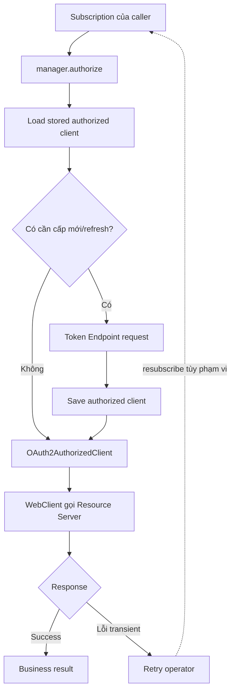
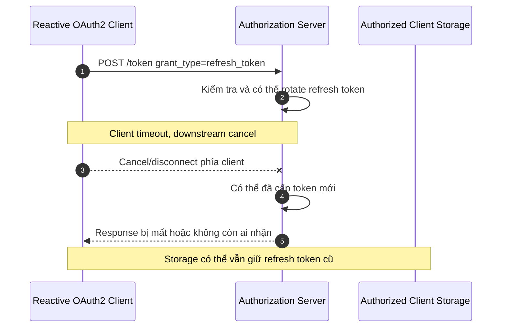

# 21.13. Retry, cancellation, timeout và tránh authorize lặp ngoài ý muốn

> **Module:** Spring Security OAuth 2.0 OIDC Client  
> **Chương:** 21. OAuth2 Client Reactive  
> **Phạm vi:** Spring Security OAuth 2.0 Client trong Spring WebFlux, Reactor và `WebClient`; cách tránh gọi Token Endpoint trùng lặp, kiểm soát thời gian chờ và xử lý cancellation/retry mà không làm hỏng vòng đời access token/refresh token.

Ứng dụng reactive thường có vẻ đơn giản: gọi `ReactiveOAuth2AuthorizedClientManager.authorize(...)` để lấy access token, sau đó gọi API bằng `WebClient`. Tuy nhiên, cùng một `Mono` có thể được **subscribe lại** khi retry; `timeout()` có thể **cancel** request đang gửi đến Token Endpoint; hai request đến gần nhau có thể **cùng nhìn thấy access token sắp hết hạn** và đồng thời refresh. Nếu Authorization Server (AS) dùng **refresh token rotation**, những tình huống này không chỉ gây thêm tải mà có thể dẫn đến `invalid_grant`, mất refresh token mới hoặc cảnh báo replay.

Một số lỗi nguy hiểm thường bắt đầu từ những đoạn code trông hợp lý:

```java
// Rủi ro: retry toàn bộ pipeline có thể thực hiện authorize lần nữa.
return manager.authorize(authorizeRequest)
    .flatMap(client -> callBusinessApi(client))
    .timeout(Duration.ofSeconds(3))
    .retry(3);
```

Đoạn code trên không tự động sai trong mọi hoàn cảnh, nhưng nó **không chỉ retry API**. Tùy nơi đặt operator, nó có thể subscribe lại cả hoạt động chọn authorized client, gọi Token Endpoint và những side effects nằm trong pipeline. Nếu API là thao tác ghi, rủi ro còn tăng lên: request đã được Resource Server thực hiện nhưng client không nhận response trước timeout.

**Nguyên tắc nền tảng của bài:** phân biệt rõ **authorization/re-authorization** với **business API request**, xác định operation nào được retry, operation nào có thể bị cancel, và lưu token theo khóa phù hợp trước khi thiết lập chính sách timeout hoặc retry.

---

## 1. Mục tiêu học tập

Sau bài này, bạn có thể:

1. Giải thích tại sao `Mono` thường là **cold publisher** và subscription mới có thể kích hoạt lại I/O.
2. Hiểu vị trí `ReactiveOAuth2AuthorizedClientManager`, `ReactiveOAuth2AuthorizedClientProvider` và `ReactiveOAuth2AuthorizedClientService` trong reactive Client Credentials/Refresh Token.
3. Phân biệt retry **Token Endpoint request**, retry **authorization pipeline** và retry **Resource Server API request**.
4. Xác định các trường hợp không được blind retry `grant_type=refresh_token`, đặc biệt với refresh token rotation.
5. Giải thích cancellation có thể ngắt xử lý phía client nhưng **không chứng minh** AS/API chưa xử lý request.
6. Thiết lập timeout có phạm vi rõ ràng cho một publisher, HTTP client và toàn bộ chuỗi hoạt động.
7. Sử dụng `Retry.backoff(...)` có giới hạn và chỉ chọn nhóm lỗi transient phù hợp.
8. Nhận diện việc `retryWhen`, `repeat`, `zip`, `flatMap` hoặc nhiều subscriptions vô tình gọi `authorize()` lặp lại.
9. Hiểu giới hạn của `Mono.cache()` đối với access token có thời hạn, errors và cancellation.
10. Thiết kế **single-flight/in-flight deduplication** theo registration ID, principal, tenant và token target.
11. Kiểm soát concurrency khi nhiều requests hoặc nhiều pods cùng refresh một authorized client.
12. Phân biệt HTTP 401/403 tại API với `invalid_client`/`invalid_grant` tại Token Endpoint.
13. Tránh token leakage, privilege escalation và retry vô hạn trong error recovery.
14. Thiết kế các bài kiểm thử với `StepVerifier`, `VirtualTimeScheduler`, mock AS và API để đếm số lần authorize/token request.

## 2. Hai hoạt động không nên nhập làm một

Trong OAuth 2.0 Client reactive có hai quá trình liên quan nhưng khác nhau:

**A. Xin hoặc chuẩn bị authorized client**

```text
Registration + Principal
         |
         v
ReactiveOAuth2AuthorizedClientManager
         |
         +--> Authorized client còn dùng được?
         |       |
         |       +--> Có: dùng lại theo policy
         |
         +--> Không: thực hiện grant/token refresh nếu đủ điều kiện
         |
         v
Mono<OAuth2AuthorizedClient>
```

**B. Sử dụng access token để gọi API**

```text
OAuth2AuthorizedClient
         |
         v
Access Token
         |
         v
WebClient -> Resource Server API
         |
         v
Mono<BusinessResponse>
```

Hai hoạt động có **tập lỗi khác nhau**. Token Endpoint có thể trả `invalid_grant` hoặc `invalid_client`; API có thể trả 401, 403, 429, 500 hoặc timeout. Việc bọc cả hai trong một `retry()` khiến một lỗi từ lớp B vô tình kích hoạt lại lớp A.

### 2.1. Bảng phân định

| Hoạt động | Đối tượng chính | Có side effect bên ngoài? | Điều cần thận trọng |
|---|---|---|---|
| `authorize(...)` dùng client còn hạn | Manager và storage | Có thể chỉ đọc storage | Publisher được subscribe nhiều lần |
| Client Credentials Grant mới | Token Endpoint | AS có thể phát token, ghi audit, giới hạn rate | Xin token dư thừa, quotas |
| Refresh Token Grant | Token Endpoint | AS có thể rotate/invalidate refresh token | Không blind retry khi không biết kết quả |
| GET API | Resource Server | Theo HTTP semantics là safe, nhưng vẫn cần đánh giá API thực tế | Timeout/network, rate-limit |
| POST/PUT/PATCH API | Resource Server | Có thể thay đổi dữ liệu, tạo giao dịch | Cần idempotency/operation policy trước retry |
| Lưu authorized client | Reactive service/repository | Ghi storage/token set | Race/ghi đè refresh token mới |

Một API có tên “GET” nhưng thực hiện side effect bất thường cần được đánh giá theo hành vi thực tế. Không xem HTTP method là bằng chứng duy nhất cho phép retry.

## 3. Các thành phần Reactive OAuth2 Client cần biết

| Thành phần | Trách nhiệm | Không chịu trách nhiệm |
|---|---|---|
| `ReactiveClientRegistrationRepository` | Trả cấu hình OAuth2 Client theo registration ID | Không tự giữ access token |
| `ReactiveOAuth2AuthorizedClientService` | Lưu, đọc, xóa authorized client theo registration/principal | Không tự refresh token khi chỉ load |
| `ServerOAuth2AuthorizedClientRepository` | Lưu và truy xuất authorized client trong WebFlux ServerWebExchange | Không thay thế Token Endpoint |
| `ReactiveOAuth2AuthorizedClientManager` | Authorize/reauthorize bằng providers và storage | Không tự retry mọi business API |
| `ReactiveOAuth2AuthorizedClientProvider` | Thực hiện grant tương ứng khi có điều kiện | Không tự tạo consent của user vắng mặt |
| `OAuth2AuthorizedClient` | Giữ ClientRegistration, access token, refresh token nếu có | Không đại diện trực tiếp cho HTTP session |
| `WebClient` | Thực hiện HTTP calls reactive | Không tự biết mọi token policy nếu không tích hợp OAuth2 |
| `ServerOAuth2AuthorizedClientExchangeFilterFunction` | Tích hợp authorized client với WebClient trong WebFlux | Không tự biến mọi request thành idempotent |

### 3.1. Hai manager thường gặp

**`DefaultReactiveOAuth2AuthorizedClientManager`**:

- Phù hợp khi đang ở trong **ServerWebExchange/HTTP request WebFlux**.
- Dùng `ReactiveClientRegistrationRepository` và `ServerOAuth2AuthorizedClientRepository`.
- Có thể được dùng thông qua OAuth2-aware `WebClient`.

**`AuthorizedClientServiceReactiveOAuth2AuthorizedClientManager`**:

- Phù hợp cho hoạt động **ngoài HTTP request**, ví dụ scheduler, message consumer, batch.
- Dùng `ReactiveClientRegistrationRepository` và `ReactiveOAuth2AuthorizedClientService`.
- Có thể được cấp một principal key của workload cho grant `client_credentials`.

Cả hai trả về `Mono<OAuth2AuthorizedClient>` từ `authorize(...)` theo giao diện manager và có thể chịu tác động từ retry/cancellation của Reactor.

### 3.2. Luồng reactive có những điểm có thể bị lặp



Nếu `retryWhen` được đặt quanh **toàn bộ pipeline**, nhánh quay lại có thể subscribe lại từ đầu, bao gồm manager. Nếu chỉ đặt trên riêng `WebClient.get()...bodyToMono(...)` sau khi authorized client đã được lấy, retry ở API không buộc phải lặp Token Endpoint. Tuy nhiên, mỗi HTTP call vẫn cần bảo đảm token còn hợp lệ và đúng audience.

## 4. Mono là cold publisher: “một biến” không có nghĩa “một lần chạy”

Một hiểu lầm thường gặp:

```java
Mono<OAuth2AuthorizedClient> authorized =
    manager.authorize(request);

// Hai subscriptions có thể kích hoạt hai lần xử lý pipeline.
authorized.subscribe(client -> processA(client));
authorized.subscribe(client -> processB(client));
```

Với reactive publishers thông thường, **mỗi subscription có thể bắt đầu lại tác vụ**. Việc lưu publisher vào một biến không có nghĩa kết quả được tự cache.

### 4.1. Ví dụ đếm subscription

```java
import java.util.concurrent.atomic.AtomicInteger;
import reactor.core.publisher.Mono;

AtomicInteger calls = new AtomicInteger();

Mono<String> tokenWork = Mono.defer(() -> {
    calls.incrementAndGet();
    return Mono.just("result");
});

tokenWork.subscribe();
tokenWork.subscribe();

// calls có thể là 2: cold publisher chạy mỗi subscription.
```

Đoạn ví dụ này không gọi OAuth2 thật; nó cho thấy thuộc tính reactive quan trọng khi hiểu request Token Endpoint.

### 4.2. Các operator có thể dẫn đến resubscription

| Operator/hành vi | Ảnh hưởng |
|---|---|
| `retry()` / `retryWhen(...)` | Subscribe lại source khi có lỗi đúng điều kiện |
| `repeat()` / `repeatWhen(...)` | Subscribe lại source sau khi hoàn thành trong điều kiện |
| Hai lần gọi `subscribe()` | Có thể tạo hai luồng độc lập |
| Tạo hai HTTP requests dùng cùng cold source | Có thể thực hiện authorization hai lần |
| `zip(a, a)` với cùng cold Mono | Có thể subscribe vào source qua hai nhánh |
| `flatMap` ở nhiều request concurrent | Có nhiều authorize attempts diễn ra đồng thời |
| `timeout()` | Cancel upstream khi hết thời gian; không tự retry trừ khi kết hợp operator khác |
| `cache()` | Có thể chia sẻ/cached kết quả giữa subscribers, nhưng có rủi ro cache lỗi/expired token |

**Không khẳng định mọi lần subscribe đều gửi Token Endpoint request.** Manager có thể tìm thấy authorized client đang dùng được trong storage; nhưng **mỗi subscription có cơ hội chạy lại logic authorization**, đặc biệt nếu storage chưa cập nhật hoặc token cần refresh.

## 5. Đặt retry ở đâu sẽ quyết định phần nào chạy lại

Xem hai cách viết:

### 5.1. Retry toàn bộ authorize + business API

```java
Mono<Report> result =
    manager.authorize(authorizeRequest)
        .flatMap(client -> callReportsApi(client))
        .retryWhen(Retry.backoff(2, Duration.ofMillis(200)));
```

Nếu `callReportsApi(client)` lỗi và retry được kích hoạt, toàn bộ source có thể được subscribe lại, bao gồm `manager.authorize(...)`. Trong trường hợp access token đã được cache đúng, manager có thể dùng lại token; nhưng không được **mặc định** điều này xảy ra an toàn trong mọi race.

### 5.2. Retry chỉ riêng HTTP GET sau authorize

```java
Mono<Report> result =
    manager.authorize(authorizeRequest)
        .switchIfEmpty(Mono.error(
            new IllegalStateException("Authorization unavailable")
        ))
        .flatMap(client ->
            callReportsApi(client)
                .retryWhen(reportsGetRetrySpec())
        );
```

Ở đây retry scope nằm trong publisher **API call**. Authorization phía ngoài chỉ được thực hiện một lần cho một subscription của result, trừ khi caller cũng retry hoặc subscribe lại cả result.

Ví dụ giả định `callReportsApi` là một API GET an toàn để retry; `reportsGetRetrySpec()` là policy được định nghĩa ở mục sau. Không copy cách này cho POST chuyển tiền hoặc tác vụ tạo dữ liệu mà chưa có idempotency semantics.

### 5.3. Nguyên tắc: chỉ retry lớp bạn hiểu

Khi exception xảy ra:

1. Xác định nó đến từ Token Endpoint hay API.
2. Xác định request trước đó có thể đã **thành công ở phía server** hay không.
3. Chỉ retry khi thao tác an toàn hoặc có idempotency key/state reconciliation.
4. Giới hạn số lần retry, tổng thời gian và backoff.
5. Để quyền truy cập/token lifecycle do manager/AS quyết định; không tạo fallback quyền cao.

## 6. Retry.backoff có giới hạn cho API GET

Một retry policy đơn giản cho GET:

```java
import java.time.Duration;
import org.springframework.web.reactive.function.client.WebClientResponseException;
import reactor.util.retry.Retry;

static Retry reportsGetRetrySpec() {
    return Retry.backoff(2, Duration.ofMillis(250))
        .maxBackoff(Duration.ofSeconds(2))
        .jitter(0.5)
        .filter(error ->
            error instanceof WebClientResponseException response
                && (response.getStatusCode().is5xxServerError()
                    || response.getStatusCode().value() == 429)
        );
}
```

Ý nghĩa:

- Thử lại tối đa hai lần sau lần đầu khi lỗi qua bộ lọc.
- Chờ theo exponential backoff có giới hạn.
- Jitter giúp nhiều clients không retry đồng thời một lúc.
- Không retry 400/401/403 mặc định vì đây thường không phải lỗi transient.
- Cần cân nhắc header `Retry-After` của HTTP 429/503 khi provider công bố.

Đây là policy minh họa cho **API GET**. Với một số hệ thống, lỗi 500 có thể vẫn phát sinh sau khi server đã hoàn tất thao tác; vì vậy chỉ áp dụng nếu request có semantics an toàn/idempotent rõ.

### 6.1. Lỗi network có thể là transient nhưng vẫn có rủi ro

`WebClientRequestException` có thể đại diện cho lỗi I/O. Tuy nhiên, lỗi kết nối sau khi gửi request khác với lỗi chưa thể kết nối:

- Connect refused trước khi gửi request: thường không có operation ở server.
- Read timeout sau khi gửi request: server có thể đã xử lý và response thất lạc.
- Connection reset: kết quả phía server có thể không biết chắc.
- TLS/hostname verification failure: **không** nên retry như network glitch ngẫu nhiên; có thể là lỗi cấu hình hoặc trust.

Do đó, mở rộng retry filter cho network exceptions phải dựa vào **idempotency của API và quan sát thực tế**, không chỉ `instanceof WebClientRequestException`.

### 6.2. Không nhầm retry với repeat

`retryWhen(...)` chạy lại khi lỗi; `repeat(...)` có thể chạy lại sau khi một publisher đã hoàn thành thành công. Đặt `repeat()` trên Token Endpoint/authorize pipeline có thể tạo gọi lại không cần thiết ngay cả khi không có lỗi.

## 7. Timeout có nhiều tầng

Trong một reactive OAuth2 Client, “timeout 3 giây” có thể chỉ những điều khác nhau:

| Tầng | Ví dụ | Nó giới hạn điều gì? |
|---|---|---|
| Connection establishment | Netty `CONNECT_TIMEOUT_MILLIS` | Thời gian thiết lập TCP connection |
| HTTP response | Reactor Netty `responseTimeout` | Thời gian chờ response theo transport semantics |
| Token Endpoint HTTP call | WebClient/response client của OAuth2 grant | Giai đoạn lấy/refresh token |
| UserInfo Endpoint | Reactive user service/WebClient | Giai đoạn tải dữ liệu user khi OIDC Login |
| API HTTP call | WebClient tới Resource Server | HTTP request API |
| Reactor operator | `Mono.timeout(Duration)` | Thời gian toàn phần từ lúc subscribe vào **publisher được bọc** |
| Business deadline | Request/job orchestration | Tổng ngân sách thời gian của một workflow |

Nếu gọi:

```java
manager.authorize(authorizeRequest)
    .flatMap(client -> callReportsApi(client))
    .timeout(Duration.ofSeconds(3));
```

thì ba giây là giới hạn **cho toàn bộ chuỗi authorize + API**, tính theo subscription vào publisher đó. Nếu mất hai giây ở Token Endpoint, API còn một giây trước timeout ngoài; không thể coi API có đủ ba giây riêng.

### 7.1. Timeout cho API sau authorize

```java
Mono<Report> result = manager.authorize(authorizeRequest)
    .switchIfEmpty(Mono.error(
        new IllegalStateException("No authorized client")
    ))
    .flatMap(client ->
        callReportsApi(client)
            .timeout(Duration.ofSeconds(4))
    );
```

Trong trường hợp này, giới hạn bốn giây áp trên API publisher trong `flatMap`. Authorization phía ngoài chưa có deadline riêng. Cần đặt giới hạn cho Token Endpoint nếu rủi ro chờ lâu tồn tại; không được dựa vào API timeout để ngắt grant.

### 7.2. Timeout toàn hệ thống

Một pipeline có thể dùng deadline tổng bên ngoài, với các timeouts nhỏ hơn cho từng phần:

```java
Mono<Report> workflow =
    manager.authorize(authorizeRequest)
        .timeout(Duration.ofSeconds(5)) // authorizing deadline
        .switchIfEmpty(Mono.error(
            new IllegalStateException("Authorization unavailable")
        ))
        .flatMap(client ->
            callReportsApi(client)
                .timeout(Duration.ofSeconds(4))
        )
        .timeout(Duration.ofSeconds(8)); // overall budget
```

Các số chỉ là ví dụ. Với workflow production, tổng deadline cần tính cả connection acquisition, DNS, TLS, retries/backoff, AS latency và API latency. Một timeout ở operator **không tự thay** các transport timeouts.

### 7.3. Vì sao cần giới hạn ở transport?

Ví dụ cấu hình `WebClient` riêng cho API:

```java
import java.time.Duration;
import io.netty.channel.ChannelOption;
import reactor.netty.http.client.HttpClient;
import org.springframework.http.client.reactive.ReactorClientHttpConnector;
import org.springframework.web.reactive.function.client.WebClient;

HttpClient nettyClient = HttpClient.create()
    .option(ChannelOption.CONNECT_TIMEOUT_MILLIS, 2000)
    .responseTimeout(Duration.ofSeconds(5));

WebClient apiClient = WebClient.builder()
    .clientConnector(new ReactorClientHttpConnector(nettyClient))
    .baseUrl("https://api.example.test")
    .build();
```

**Điểm cực kỳ quan trọng:** cấu hình timeout cho `apiClient` không nhất thiết cấu hình timeout cho WebClient mà **Spring Security Token Endpoint response client** đang sử dụng. Muốn giới hạn HTTP token request, phải cấu hình chính token response client/provider hoặc cấu trúc HTTP client của nó theo phiên bản Spring Security.

Nếu ứng dụng dùng các WebClient instances riêng cho UserInfo, Token Endpoint và API, hãy gắn timeout/metrics theo từng dependency.

## 8. Cancellation trong Reactor có nghĩa gì?

Khi downstream không còn cần kết quả (browser đóng kết nối, `timeout` phát tín hiệu, `take` ngắt, subscriber dispose...), Reactor có thể gửi tín hiệu **cancel** lên upstream.

Cancel có nghĩa: subscriber không muốn nhận thêm tín hiệu từ publisher đó. Nó **không đồng nghĩa**:

- AS chưa từng nhận token request;
- AS chưa phát access token mới;
- Refresh token cũ chắc chắn còn dùng được;
- Database chưa được ghi;
- Resource Server chắc chắn chưa thực hiện POST;
- Toàn bộ network side effects đã rollback.

### 8.1. Một request bị cancel nhưng server vẫn xử lý



Nếu refresh token rotation đã xảy ra, Client không chắc có thể retry cùng refresh token cũ. Blind retry có thể trả `invalid_grant` hoặc kích hoạt chính sách phát hiện reuse của AS.

### 8.2. Không dùng cancellation như một transaction rollback

OAuth2 Token Endpoint là dịch vụ bên ngoài. Nó không tham gia transaction của database ứng dụng theo một cơ chế phân tán mặc định. `timeout()`/cancel là thao tác trên subscription, không phải lời bảo đảm “hủy quyền phát token”.

Tương tự, timeout ở HTTP POST business API không chứng minh thanh toán chưa được xử lý. Nếu cần retry thao tác ghi, thiết kế idempotency key và query trạng thái nghiệp vụ từ server.

### 8.3. Ngắt upstream có thể ảnh hưởng update token storage

Nếu subscription bị cancel trong khoảng AS đã cấp token nhưng manager chưa lưu được authorized client mới, storage có thể chứa record cũ. Với refresh rotation, record cũ có thể trở nên không dùng được.

Cần coi kết quả của timeout/cancel khi refresh là **trạng thái chưa chắc chắn**, không cố kết luận rằng token cũ vẫn hợp lệ.

## 9. Refresh token rotation: tại sao retry đặc biệt nguy hiểm?

Refresh token rotation là cơ chế AS có thể cấp refresh token mới, làm token cũ không còn hợp lệ sau mỗi refresh. Nó hạn chế khả năng dùng lại refresh token bị đánh cắp, nhưng tạo yêu cầu quản lý **thứ tự và concurrency**.

Ví dụ:

```text
Đã lưu: refresh_token = R1
Request A: refresh(R1) -> AS trả access_token A2 và refresh_token R2
Request B: refresh(R1) -> AS có thể trả invalid_grant/replay
Storage ban đầu vẫn có R1 nếu A chưa lưu R2
```

Các nguyên nhân cùng dẫn đến hai requests:

- Hai HTTP requests đồng thời cần access token đã hết hạn.
- Hai subscriptions của cùng `Mono`.
- `retryWhen` bọc toàn bộ authorize pipeline.
- Two instances/pods cùng đọc storage trước khi token mới được lưu.
- Timeout khiến caller thử lại trong khi request ban đầu vẫn đã được AS xử lý.
- Message consumer bị giao lại message và thực hiện authorization lần nữa.

### 9.1. Không retry vô hạn với invalid_grant

`invalid_grant` thường biểu thị grant/refresh token không còn hợp lệ với yêu cầu hiện tại. Những nguyên nhân có thể gồm hết hạn, revoke, client binding, token rotation hoặc code/refresh token đã bị dùng.

Khi xảy ra lỗi này:

1. Không tiếp tục gửi cùng refresh token trong vòng lặp.
2. Kiểm tra trạng thái authorized client mới nhất từ storage đáng tin.
3. Xác định có worker khác đã refresh và ghi bản mới hay không.
4. Nếu có record mới phù hợp, đánh giá khả năng sử dụng theo policy.
5. Nếu không thể khôi phục, yêu cầu reauthorization/consent theo flow hợp lệ khi cần.
6. Ghi nhận sự cố và đánh giá nguy cơ replay theo chính sách của AS.

Lỗi này khác lỗi tạm thời 503. Không thêm `retryWhen(Retry.max(10))` lên toàn bộ refresh pipeline và hy vọng thành công.

### 9.2. AS có thể có chính sách replay riêng

Một số AS có grace period hoặc chính sách xử lý cạnh tranh; một số AS thu hồi cả token family nếu phát hiện refresh token reuse. Không có một mô hình phản hồi duy nhất cho mọi provider. Client phải tuân hợp đồng của AS, không suy rằng retry cùng token cũ luôn an toàn.

### 9.3. Client Credentials khác refresh rotation

Với `client_credentials`, AS thường không phát refresh token. Khi token hết hạn, manager có thể thực hiện grant client_credentials mới. Hai requests có thể gây token mint dư thừa và rate limiting, nhưng không có cùng rủi ro dùng lại refresh token cũ như Authorization Code + refresh token rotation.

Dù vậy, vẫn cần giới hạn concurrency và bảo vệ Client secret/token traffic.

## 10. Vì sao authorize bị lặp ngoài ý muốn?

Các mẫu thường gặp:

### 10.1. Subscribe trong service rồi return publisher khác

```java
// PHẢN VÍ DỤ: tách side effect authorize ra ngoài pipeline.
Mono<OAuth2AuthorizedClient> client = manager.authorize(request);
client.subscribe(this::auditTokenMetadata);
return client;
```

Caller subscribe `client` nữa sẽ có hai subscriptions. Code đã chủ động tạo side effect bất đồng bộ không nằm trong lifecycle được quản lý.

Thay bằng:

```java
return manager.authorize(request)
    .doOnNext(this::auditSafeMetadata);
```

`auditSafeMetadata` không được ghi token values; chỉ ghi registration ID, trạng thái và các trường được phép.

### 10.2. Tạo Mono trước rồi dùng ở hai nhánh độc lập

```java
Mono<OAuth2AuthorizedClient> client = manager.authorize(request);

Mono<ResultA> a = client.flatMap(this::callApiA);
Mono<ResultB> b = client.flatMap(this::callApiB);

return Mono.zip(a, b);
```

Cùng một `client` cold publisher có thể được subscribe qua hai nhánh, nghĩa là manager có thể xử lý hai lần. Nếu API A và API B cùng audience/permission thì việc chia sẻ authorized client có thể hợp lệ; tuy nhiên nên đặt **một bước authorize trước**, rồi fan-out:

```java
return manager.authorize(request)
    .switchIfEmpty(Mono.error(
        new IllegalStateException("No authorized client")
    ))
    .flatMap(client ->
        Mono.zip(
            callApiA(client),
            callApiB(client)
        )
    );
```

Ở phiên bản thứ hai, trong **một subscription vào pipeline này**, manager.authorize chạy một lần trước khi hai API calls bắt đầu. Hai API calls vẫn độc lập và có thể được cancel cùng nhau khi caller cancel.

### 10.3. Retry rộng

```java
// Rủi ro: API timeout kích hoạt lại cả authorization.
return manager.authorize(request)
    .flatMap(this::callApi)
    .retryWhen(Retry.backoff(5, Duration.ofMillis(100)));
```

Đưa retry vào đúng lớp được phép; lỗi token grant cần policy riêng và thường chặt chẽ hơn.

### 10.4. Tạo access token trong map bằng subscribe hoặc block

```java
// KHÔNG NÊN:
return incoming.flatMap(item -> {
    manager.authorize(request).subscribe(client -> send(item, client));
    return Mono.empty();
});
```

Cách này làm mất error propagation và cancellation semantics, khiến kết quả không gắn với người gọi. Thay bằng compose:

```java
return incoming.flatMap(item ->
    manager.authorize(request)
        .flatMap(client -> send(item, client))
);
```

Nhưng với nhiều items, phiên bản compose trên vẫn có **một authorize cho mỗi item**. Nếu tất cả items thật sự dùng cùng authorization context và token target, nên authorize một lần trước rồi xử lý batch theo chính sách.

## 11. Một lần authorize cho cả batch

Giả sử một job xử lý 100 báo cáo, cùng Client registration và cùng workload principal.

**Không tối ưu:**

```java
return Flux.fromIterable(reportIds)
    .flatMap(id ->
        manager.authorize(request)
            .flatMap(client -> fetchReport(client, id))
    );
```

`flatMap` có thể cho nhiều items chạy đồng thời, tạo nhiều authorize attempts. Manager/storage có thể giảm số lần Token Endpoint call, nhưng không có bảo đảm tự single-flight ở mọi môi trường.

**Phù hợp hơn nếu cùng token scope/audience và job ngắn:**

```java
return manager.authorize(request)
    .switchIfEmpty(Mono.error(
        new IllegalStateException("Authorization unavailable")
    ))
    .flatMapMany(client ->
        Flux.fromIterable(reportIds)
            .flatMap(id -> fetchReport(client, id), 8)
    );
```

Đoạn code thực hiện một lần authorize cho một subscription vào batch, sau đó giới hạn tối đa tám API operations concurrent. Tuy nhiên:

- Nếu batch rất dài, token có thể hết hạn trong khi đang xử lý. Cần chính sách kiểm tra/reauthorize giữa các chunks.
- Một token không nên dùng cho nhiều APIs khác audience/scope.
- `flatMap(..., 8)` giới hạn concurrency **trong batch đó**, không giới hạn toàn ứng dụng hoặc nhiều pods.
- Nếu `fetchReport` gây side effect, cần idempotency và ordering policy trước khi chạy concurrent.

### 11.1. Thời hạn token và batch dài

Một cách thiết kế khác là chia batch thành nhiều nhóm có deadline/size phù hợp rồi authorize tại ranh giới nhóm. Nhưng phải kiểm tra token lifetime và rủi ro refresh cùng lúc. Đừng vừa giữ một token cho batch nhiều giờ vừa khẳng định nó luôn còn hạn.

## 12. Mono.cache() không phải cache OAuth2 token an toàn mặc định

Với Reactor, có thể viết:

```java
Mono<OAuth2AuthorizedClient> shared =
    manager.authorize(request).cache();
```

Các subscribers có thể chia sẻ kết quả từ source. Điều này hữu ích cho một số tình huống **single-flight** trong cùng tiến trình, nhưng có các vấn đề:

1. `cache()` có thể lưu kết quả **quá thời hạn access token** nếu giữ Mono lâu.
2. Nó có thể cache cả **error signal**, khiến lần retry sau không thực sự gọi manager.
3. Một `Mono.cache()` đang được truy cập bởi nhiều subscribers có semantics riêng về cancellation; upstream có thể tiếp tục dù một subscriber không còn chờ.
4. Nó không phối hợp giữa nhiều pods/instances.
5. Nếu các requests cần different scopes/resource/audience, chia sẻ một Mono có thể gửi sai token.
6. Không tự xử lý refresh token rotation hoặc các phiên bản authorized client đã được thay thế trong storage.

**Không khai báo:**

```java
// PHẢN VÍ DỤ: cache một authorized client vĩnh viễn cho cả JVM.
static final Mono<OAuth2AuthorizedClient> TOKEN =
    manager.authorize(request).cache();
```

Không dùng một cache vô thời hạn làm nguồn chân lý của token lifecycle. Authorized client manager/service đã có cơ chế lưu và đánh giá token; một cache bổ sung cần TTL/invalidation và phân vùng chính xác.

### 12.1. cache(Duration) có đủ không?

`Mono.cache(Duration)` có thể giới hạn thời gian cache publisher, nhưng một TTL cố định không tự biết:

- Access token thực tế hết hạn lúc nào;
- Token bị revoke sớm;
- Scope/audience hoặc Client credentials thay đổi;
- Refresh token bị rotate;
- Lần authorize hiện tại thất bại ở bước nào;
- Nhiều nodes có cùng bản ghi hay không.

Nếu cần cache, phải dựa vào token expiry với **clock skew**, principal/registration/target và cơ chế invalidation phù hợp. Không lấy thời hạn cookie/session làm TTL token cache.

### 12.2. Cache một operation in-flight khác cache một credential lâu dài

**In-flight deduplication** chỉ muốn gộp những caller cùng chờ **một attempt hiện tại**. Sau khi attempt hoàn tất, mapping chờ được xóa để request sau được manager kiểm tra token mới nhất trong storage.

**Persistent cache** muốn giữ token giữa các attempts; nhiệm vụ này đã thuộc OAuth2 authorized-client storage/manager. Tách hai khái niệm giúp tránh cache error và token cũ ngoài ý muốn.

## 13. Single-flight: gộp authorize đang chạy cùng khóa

Mục tiêu: nếu 20 requests cùng đến lúc access token hết hạn, chỉ một authorization attempt được thực hiện **cho cùng một authorized-client key** trong phạm vi một instance, trong khi các caller có thể chờ chung kết quả.

### 13.1. Chọn khóa dedup đúng

Một khóa thường cần tối thiểu:

```text
registrationId
+ principal identity / workload key
+ tenant boundary (nếu có)
+ resource/audience/scope context (nếu dynamic)
```

**Không dùng chỉ `registrationId`** khi authorized clients gắn với nhiều người dùng. Nếu dùng cùng key cho user A và user B, bạn có nguy cơ đưa token của người này cho người kia.

Ví dụ:

| Registration | Principal | Resource | Có nên share in-flight? |
|---|---|---|---|
| `reporting-m2m` | `nightly-worker` | `reports-api` | Có thể, nếu cùng grant/context |
| `calendar-user` | `user-a` | `calendar-api` | Chỉ giữa requests của user A |
| `calendar-user` | `user-b` | `calendar-api` | **Không** share với user A |
| `shared-m2m` | `worker` | `reports-api` | Không share với request tới inventory-api nếu token target khác |

### 13.2. Thuật toán mô hình

```text
authorizeOnce(key):
    1. Nếu có một attempt đang chạy cho key:
          trả publisher chia sẻ attempt đó.
    2. Nếu chưa có:
          đăng ký atomically một attempt mới cho key.
    3. Chỉ một upstream manager.authorize(...) được subscribe.
    4. Nhiều callers nhận kết quả/thất bại của attempt.
    5. Khi attempt kết thúc (success/error/cancel theo cơ chế quản lý):
          xóa entry in-flight đúng identity.
    6. Request sau quay lại manager/service kiểm tra token state mới.
```

Đây là thiết kế **phạm vi một instance**, cần bảo vệ các races:

- Hai threads cùng tạo entry;
- Entry bị xóa trước khi đăng ký hoàn tất;
- Attempt cũ xóa nhầm entry của attempt mới;
- Caller cancel nhưng các caller khác còn cần kết quả;
- Cache lưu error vô thời hạn;
- Key thay đổi trong khi registration/tenant policy đã được cập nhật.

### 13.3. Vì sao không đưa snippet ConcurrentHashMap ngắn thành giải pháp hoàn chỉnh?

Có thể dùng `ConcurrentHashMap<Key, Mono<...>>` cùng shared publisher, nhưng vị trí `computeIfAbsent(...)`, `cache()` và `doFinally(...)` rất dễ tạo race khi một attempt hoàn thành đồng bộ. Nếu xóa map không so khớp identity của entry, attempt cũ có thể xóa entry mới đang chạy.

Trong ứng dụng production, single-flight cần được kiểm thử với `StepVerifier`, nhiều concurrent subscribers, cancellation và failure; hoặc dùng một library/coordinator có semantics đã được đánh giá. Bài học ưu tiên trình bày **hợp đồng bắt buộc** thay vì quảng bá một đoạn map-code chưa kiểm chứng là khóa distributed đầy đủ.

### 13.4. Có thể bắt đầu từ scope đơn giản hơn

Nếu một job duy nhất xử lý một batch với cùng Client/Principal, chỉ cần đưa `manager.authorize(...)` ra ngoài `Flux.flatMap` như mục 11 có thể đã giảm được nhiều duplicate attempts mà không cần cache toàn cục.

Single-flight hữu ích nhất khi **nhiều request độc lập thật sự đồng thời** cần cùng authorization context.

## 14. Single-flight không giải quyết concurrency giữa các pods

Ngay cả khi instance A bảo đảm chỉ một refresh attempt cho key, instance B cũng có thể bắt đầu refresh cùng key.

```text
Pod A -> shared DB load refresh_token R1
Pod B -> shared DB load refresh_token R1
Pod A -> POST refresh(R1)
Pod B -> POST refresh(R1)
AS    -> rotate R1 to R2 for Pod A
AS    -> reject/replay-handle attempt from Pod B
```

Đây là vấn đề **cross-instance coordination**. Phương án cần cân nhắc:

- Distributed lock theo authorized-client key;
- Lease/leader ownership với expiration và fencing;
- Optimistic locking/compare-and-set trên version token record;
- Token refresh coordinator riêng;
- Khóa workload/tenant phân vùng chính xác;
- AS policy phù hợp với concurrency và refresh token rotation.

Một lock chỉ có TTL nhưng không có cơ chế chống stale writer có thể vẫn không đủ: worker giữ lock hết hạn nhưng tiếp tục ghi token cũ đè token mới. Cần đánh giá **fencing/versioning** trong thiết kế.

### 14.1. Distributed lock không tự làm token request an toàn tuyệt đối

Nếu Pod A gửi refresh rồi crash trước khi lưu R2, dù có lock, storage vẫn có R1. Pod B nhận lock sau đó có thể thử R1 và bị từ chối. Hệ thống cần recovery policy:

1. Đọc state/token version mới nhất.
2. Tránh retry refresh token cũ vô hạn.
3. Phân loại AS errors và khả năng token đã rotate.
4. Yêu cầu reauthorization khi không thể khôi phục.
5. Quan sát tỷ lệ refresh failures để phát hiện race hoặc compromise.

Không có cách client-side tổng quát “undo” một refresh token rotation đã xảy ra trên AS.

## 15. Timeout và retry trong WebClient OAuth2 filter

Trong WebFlux, `ServerOAuth2AuthorizedClientExchangeFilterFunction` có thể tự lấy authorized client và gắn Bearer token khi `WebClient` gọi Resource Server.

Ví dụ trong ngữ cảnh **HTTP request WebFlux**:

```java
import org.springframework.context.annotation.Bean;
import org.springframework.security.oauth2.client.web.reactive.function.client.ServerOAuth2AuthorizedClientExchangeFilterFunction;
import org.springframework.security.oauth2.client.ReactiveOAuth2AuthorizedClientManager;
import org.springframework.web.reactive.function.client.WebClient;

@Bean
WebClient reportsWebClient(
        ReactiveOAuth2AuthorizedClientManager authorizedClientManager) {

    ServerOAuth2AuthorizedClientExchangeFilterFunction oauth2 =
        new ServerOAuth2AuthorizedClientExchangeFilterFunction(
            authorizedClientManager
        );

    return WebClient.builder()
        .baseUrl("https://api.example.test")
        .filter(oauth2)
        .build();
}
```

Và chọn registration cho request:

```java
import static org.springframework.security.oauth2.client.web.reactive.function.client.ServerOAuth2AuthorizedClientExchangeFilterFunction.clientRegistrationId;

Mono<Report> report = reportsWebClient.get()
    .uri("/reports/summary")
    .attributes(clientRegistrationId("reports-api"))
    .retrieve()
    .bodyToMono(Report.class)
    .timeout(Duration.ofSeconds(5));
```

**Quan trọng:** `.timeout(...)` ở đoạn trên áp trên publisher WebClient **bao gồm cả hoạt động filter lấy authorized client**. Nếu filter cần gọi Token Endpoint, thời gian authorize cũng tiêu vào năm giây này. Không giả định timeout chỉ áp dụng sau khi Bearer token đã được gắn.

### 15.1. Retry ngoài filter có thể authorize lặp

```java
reportsWebClient.get()
    .uri("/reports/summary")
    .attributes(clientRegistrationId("reports-api"))
    .retrieve()
    .bodyToMono(Report.class)
    .retryWhen(Retry.backoff(2, Duration.ofMillis(200)));
```

Mỗi attempt HTTP qua WebClient filter có thể lại yêu cầu authorized client. Nếu token cũ được lưu và hợp lệ, manager có thể trả lại nhanh; nếu token cần refresh, có thể xuất hiện authorize/refresh attempts mới.

Vì vậy, khi cần kiểm soát tuyệt đối “một authorization cho toàn API retry group”, bạn có thể tổ chức rõ manager authorize trước rồi mới retry riêng API, hoặc dùng một cơ chế dedup/in-flight chắc chắn. Tránh cấu hình retry vô điều kiện ở cả WebClient filter và service.

### 15.2. Không dùng default authorized client cho mọi API

Nếu WebClient gọi nhiều Resource Servers, đừng bật mặc định dùng authorized client của session hiện tại mà không kiểm soát destination. Một token dành cho API A có thể bị gửi tới API B, gây audience confusion hoặc token leakage.

Chỉ định registration ID rõ ràng hoặc tách WebClient instances theo API, và kiểm tra Resource Server audience/scopes.

## 16. Dùng manager ngoài HTTP request

Scheduled job hoặc queue consumer không có `ServerWebExchange` của browser. Khi đó, manager dựa trên service phù hợp hơn:

```java
import org.springframework.context.annotation.Bean;
import org.springframework.context.annotation.Configuration;
import org.springframework.security.oauth2.client.AuthorizedClientServiceReactiveOAuth2AuthorizedClientManager;
import org.springframework.security.oauth2.client.ReactiveOAuth2AuthorizedClientManager;
import org.springframework.security.oauth2.client.ReactiveOAuth2AuthorizedClientProvider;
import org.springframework.security.oauth2.client.ReactiveOAuth2AuthorizedClientProviderBuilder;
import org.springframework.security.oauth2.client.ReactiveOAuth2AuthorizedClientService;
import org.springframework.security.oauth2.client.registration.ReactiveClientRegistrationRepository;

@Configuration
class BackgroundClientConfiguration {

    @Bean("backgroundAuthorizedClientManager")
    ReactiveOAuth2AuthorizedClientManager backgroundManager(
            ReactiveClientRegistrationRepository registrations,
            ReactiveOAuth2AuthorizedClientService authorizedClients) {

        ReactiveOAuth2AuthorizedClientProvider provider =
            ReactiveOAuth2AuthorizedClientProviderBuilder.builder()
                .clientCredentials()
                .refreshToken()
                .build();

        AuthorizedClientServiceReactiveOAuth2AuthorizedClientManager manager =
            new AuthorizedClientServiceReactiveOAuth2AuthorizedClientManager(
                registrations,
                authorizedClients
            );

        manager.setAuthorizedClientProvider(provider);
        return manager;
    }
}
```

Đoạn cấu hình minh họa manager hỗ trợ hai chiến lược grant khi điều kiện phù hợp. Trong `client_credentials` thường không cần refresh token; provider `refreshToken()` chỉ có tác dụng nếu một authorized client thực sự đã có refresh token và AS cho phép refresh.

### 16.1. OAuth2AuthorizeRequest cho workload

```java
import org.springframework.security.oauth2.client.OAuth2AuthorizeRequest;
import reactor.core.publisher.Mono;

OAuth2AuthorizeRequest request =
    OAuth2AuthorizeRequest
        .withClientRegistrationId("reporting-m2m")
        .principal("nightly-reports-worker")
        .build();

Mono<OAuth2AuthorizedClient> client =
    backgroundManager.authorize(request);
```

`"nightly-reports-worker"` là key logic để quản lý authorized client, **không** phải người dùng đã đăng nhập. Không dùng raw username từ message không tin cậy để đọc refresh token của người khác.

### 16.2. Tạo manager không phải tạo WebSession

Machine authorization khác user login. Manager có thể xin token gọi API, nhưng nó không tự tạo `OidcUser` hoặc phiên trình duyệt cho người dùng.

## 17. Phân loại lỗi trước khi retry Token Endpoint

Không nên gom tất cả exceptions thành “temporary”.

| Tình huống | Nhóm lỗi | Retry? |
|---|---|---|
| DNS/connect failure trước khi request tới AS | Network/infrastructure | Có thể theo policy và idempotency của grant |
| HTTP 503/502 từ Token Endpoint | AS tạm thời không sẵn sàng | Cân nhắc bounded retry; phân biệt request có thể đã xử lý |
| HTTP 429 từ Token Endpoint | Rate limit | Tôn trọng Retry-After/quota; tránh stampede |
| `invalid_client` | Client authentication sai | **Không blind retry**; sửa Client ID, secret hoặc method |
| `unauthorized_client` | Grant chưa được phép | **Không retry** để “xin được” |
| `invalid_scope` | Scope không hợp lệ/không được cấp | **Không retry** cùng payload |
| `invalid_grant` khi refresh | Refresh token không còn hợp lệ hoặc replay/race | **Không retry cùng token cũ** |
| Token response malformed | AS/protocol contract | Điều tra; không đổi token parser thành “chấp nhận mọi thứ” |
| TLS certificate/hostname invalid | Trust failure | **Không** disable TLS verification hoặc retry vô hạn |
| Network timeout sau gửi refresh request | Kết quả AS không xác định | **Không blind retry** refresh cũ |

### 17.1. Client Credentials dễ retry hơn refresh, nhưng không phải miễn phí

Với `client_credentials`, AS có thể phát token mới khi Client gửi lại sau một lỗi mạng. Nếu request trước đã thành công mà response thất lạc, retry có thể làm phát **thêm token**. Điều đó gây quota/rate-limit/audit noise, nên vẫn cần bounded retry và single-flight khi phù hợp.

### 17.2. Refresh Token cần recovery, không chỉ retry

Một policy an toàn có thể ưu tiên đọc authorized client mới nhất từ storage sau lỗi không xác định; nếu vẫn không có state đủ tin cậy, chuyển sang reauthorization/connection-expired handling thay vì lặp request vô hạn. Xem chính sách của AS cho refresh rotation và replay detection.

## 18. Error recovery không được hạ cấp quyền

Khi Token Endpoint lỗi, tuyệt đối không:

- Chuyển sang Client Credentials có quyền cao hơn để dùng thay token user mà chưa có policy.
- Tự tạo JWT với `sub`/`role` từ dữ liệu input để “cứu” request.
- Bỏ issuer/audience/signature validation ở Resource Server.
- Trả raw refresh token/access token về browser để frontend tự thử lại.
- Chọn một principal khác trong authorized client service vì token của người hiện tại không dùng được.

Một fallback an toàn có thể là báo “Kết nối dịch vụ tạm thời không khả dụng”, cho phép thử lại sau hoặc yêu cầu người dùng reauthorize theo flow chuẩn.

### 18.1. onErrorResume dùng khi nào?

`onErrorResume` có thể chuyển lỗi kỹ thuật thành response nghiệp vụ an toàn, nhưng không nên nuốt lỗi bảo mật:

```java
return fetchReports()
    .onErrorResume(ReportServiceUnavailableException.class,
        error -> Mono.just(ReportResult.unavailable()));
```

Đây là pattern minh họa với các types do ứng dụng định nghĩa. Không dùng `onErrorResume(ex -> Mono.just(fakeAdminData))` để tiếp tục thành công khi authorization thất bại.

## 19. HTTP 401/403 và chính sách xóa authorized client

Một access token có thể bị Resource Server từ chối dù chưa hết hạn:

- AS đã thu hồi token.
- Resource Server yêu cầu audience khác.
- Scopes/roles/tenant permissions không đủ.
- Token signature/issuer không hợp lệ với API.
- Chính sách phiên/quyền đã thay đổi.

**401** thường liên quan authentication token không được chấp nhận; **403** thường liên quan authorization không đủ. Không tự động đánh đồng hai lỗi.

### 19.1. Không xóa token cho mọi 403

Nếu API trả 403 vì Client thiếu quyền `reports.export`, xóa token rồi xin lại y nguyên thường vô ích. Nó có thể gây vòng lặp cấp token và làm tăng tải AS.

### 19.2. Một số integration có failure handler

`ServerOAuth2AuthorizedClientExchangeFilterFunction` và các manager/repository có các điểm mở rộng xử lý authorization failure theo version. Khi cấu hình remover/failure handler, cần xác định rõ nó xóa token **khi nào** và có phát sinh reauthorization ở request kế tiếp hay không.

Không xây interceptor 401 → remove → retry vô hạn. Trước khi tái xin token, phải biết lỗi có thực sự là token đã bị revoke/expired, hay audience/permission sai không thể sửa bằng refresh.

### 19.3. Không để retry biến một lần API call thành vòng Token Endpoint

Có thể xảy ra:

```text
API 401
 -> remove stored authorized client
 -> next attempt refresh/authorize
 -> API 401 vì audience vẫn sai
 -> remove again
 -> ...
```

Cần đặt giới hạn attempt cấp lại token và phân biệt lỗi cấu hình cố định với hết hạn thật. Nếu issuer/audience/scopes sai, sửa config và quyền tại AS/Resource Server, không retry tiếp.

## 20. Token Target và cache key

Trong bài về OAuth2 Client Reactive, tránh authorize lặp không có nghĩa chia sẻ **mọi token**. Những thông số như:

- registration ID;
- principal/user;
- tenant;
- scope;
- resource indicator RFC 8707;
- audience extension của provider;
- client authentication context;

có thể khiến token này **không thể dùng thay token khác**.

### 20.1. Registration ID + principal là khóa thông thường

Nhiều authorized-client services lưu record theo cặp:

```text
(clientRegistrationId, principalName)
```

Nếu trong cùng registration/principal, bạn xin resource A rồi resource B bằng custom parameters động nhưng storage không phân biệt target, manager có thể tái sử dụng token A ở B.

Phân vùng theo registration hoặc một storage/manager key được thiết kế đúng có thể cần thiết. Không dùng cache chỉ có key `"machine-client"` cho mọi Resource Server.

### 20.2. Single-flight chỉ hợp lệ khi cùng authorization intent

Hai yêu cầu có cùng Client ID nhưng scopes/audience khác nhau **không nên** bị gộp vào một token request. Kiểm tra intent trước khi quyết định dedup.

## 21. Timeout, cancellation và refresh-token storage consistency

Một failure scenario quan trọng:

```text
T0  Service lưu authorized client version 5: access A1, refresh R1
T1  Worker bắt đầu refresh(R1)
T2  AS chấp nhận R1, tạo A2/R2
T3  Client timeout hoặc bị cancel trước khi hoàn tất save
T4  Storage vẫn version 5 với R1
T5  Worker khác đọc R1 và refresh lại
T6  AS từ chối invalid_grant hoặc xử lý như replay
```

Vấn đề này cần giải quyết ở **vòng đời authorization**:

1. Không retry refresh token cũ một cách vô hạn.
2. Lưu token mới kịp thời và nhất quán khi nhận response.
3. Phối hợp concurrent refresh theo authorized-client key.
4. Tránh cập nhật storage bởi một attempt stale khi đã có version mới.
5. Khi không xác định được kết quả token rotation, chuyển sang recovery/reauthorization.
6. Dùng metrics nhận diện các xung đột xảy ra ở cùng principal/registration.

Tuy vậy, không có cách client-side phổ quát khôi phục R2 nếu AS đã rotate nhưng response mất hoàn toàn. Cần chính sách AS/IdP và quy trình user consent/re-login phù hợp.

## 22. Business idempotency là lớp bảo vệ riêng

Giả sử ứng dụng dùng một access token hợp lệ rồi thực hiện:

```http
POST /payments HTTP/1.1
Host: api.example.test
Authorization: Bearer <redacted>
Idempotency-Key: order-2026-0042
Content-Type: application/json

{"amount":120000,"currency":"VND"}
```

Nếu HTTP timeout sau khi POST được gửi, Resource Server **có thể đã ghi nhận giao dịch**. Authorization manager và token cache không thể giải quyết được việc này.

Một thiết kế an toàn cần:

- Idempotency key ổn định cho cùng operation, do **server API** thực thi.
- Không sinh key mới khi retry cùng giao dịch.
- Cơ chế tra cứu trạng thái khi response không xác định.
- Retry giới hạn theo chính sách nghiệp vụ.
- Kiểm tra quyền trước và trong operation.
- Không lộ token trong logs.

**OAuth2 authorize dedup** và **business operation dedup** là hai việc khác nhau. Giảm token requests không làm POST trở nên idempotent.

## 23. Chặn retry storm và rate-limit amplification

Khi AS chậm hoặc vừa xoay khóa, hàng trăm requests có thể cùng:

1. Phát hiện token cần refresh.
2. Gửi token requests.
3. Nhận timeout.
4. Retry với exponential backoff không jitter.
5. Dồn lên AS ở những mốc thời gian giống nhau.

Đây là **thundering herd**. Một số biện pháp:

- Single-flight per authorized-client key trên một instance.
- Giới hạn concurrent token requests.
- Shared storage/distributed coordination khi nhiều pods.
- Bounded exponential backoff + jitter.
- Respect `Retry-After`, quota và provider-specific limits.
- Circuit breaker chỉ khi semantics phù hợp, không để breaker giữ cached “authorization success” giả.
- Timeouts có ngân sách; không cộng vô hạn nhiều tầng retry.
- Metrics cho authorize attempts, token endpoint latency, refresh failures.
- Cơ chế load shedding/fail fast với response nghiệp vụ an toàn khi AS quá tải.

### 23.1. Không retry cùng một chỗ ở nhiều tầng

Ví dụ cấu hình đồng thời:

```text
Token response client: retry 3 lần
Manager wrapper: retry 3 lần
Business service: retry 3 lần
API gateway: retry 3 lần
```

Có thể dẫn đến lượng attempts cao hơn nhiều so với dự kiến. Thiết kế retry budgets end-to-end, nêu rõ tầng nào chịu trách nhiệm và khi nào ngừng.

## 24. Bounded concurrency trong Reactor

Ngoài single-flight, có thể hạn chế số operations đồng thời:

```java
Flux.fromIterable(tasks)
    .flatMap(task -> executeTask(task), 4);
```

Hàm này giới hạn concurrency của `executeTask` trong **Flux đó**. Nó không tự giảm số lần authorize nếu `executeTask` gọi manager với cùng key; cũng không giới hạn mọi instances trong cluster.

Trong batch một registration, ưu tiên:

```java
return manager.authorize(request)
    .switchIfEmpty(Mono.error(
        new IllegalStateException("Authorization unavailable")
    ))
    .flatMapMany(client ->
        Flux.fromIterable(tasks)
            .flatMap(task -> executeTaskWithToken(task, client), 4)
    );
```

Với batch dài, phải đánh giá token expiry trong quá trình chạy. Một authorized client được cấp lúc bắt đầu không đảm bảo access token còn hạn sau một thời gian dài xử lý.

### 24.1. flatMap, concatMap và flatMapSequential

- `flatMap` cho phép xử lý đồng thời, kết quả có thể không giữ thứ tự.
- `concatMap` xử lý theo thứ tự, giảm concurrency nhưng có thể chậm hơn.
- `flatMapSequential` cho phép một số concurrent work trong khi giữ thứ tự phát kết quả.

Lựa chọn phụ thuộc nghiệp vụ; không chọn `flatMap` concurrency lớn chỉ vì muốn tăng throughput nếu Token Endpoint hoặc API có quota thấp.

## 25. Observability: theo dõi authorize attempts, không log token

Các metrics hữu ích:

| Metric/event | Mục tiêu |
|---|---|
| `oauth2.authorize.attempts` | Số lần manager được yêu cầu authorize theo registration |
| `oauth2.token_endpoint.requests` | Số HTTP token requests thực tế |
| `oauth2.token_endpoint.latency` | Độ trễ grant/refresh |
| `oauth2.refresh.failures` | Lỗi refresh theo nhóm mã |
| `oauth2.authorized_client.storage_errors` | Lỗi load/save/remove |
| `oauth2.inflight_waiters` | Số callers chờ chung một attempt |
| `oauth2.singleflight.deduplicated` | Số token requests tránh được trong cùng instance |
| `oauth2.api.unauthorized` | API 401 sau khi dùng token |
| `oauth2.api.forbidden` | API 403 do policy |
| `oauth2.timeout.cancelled` | Cancellation/timeout quan sát được ở client |
| `oauth2.retry.exhausted` | Hết budget retry |

Các tên trên là **nhãn minh họa do ứng dụng định nghĩa**, không phải danh sách metric name mặc định của Spring Security.

### 25.1. Ghi log an toàn

Ví dụ:

```text
event=oauth2_authorization
registrationId=reports-m2m
principalKind=workload
attempt=1
grantType=client_credentials
result=success
durationMs=420
correlationId=opaque-123
tokenValue=[never-log]
```

Không ghi:

- `access_token`, `refresh_token`, raw ID token;
- Client secret, private key, token endpoint Authorization header;
- Authorization code, PKCE verifier, nonce;
- HTTP body chứa bearer credentials;
- Principal/user details nhạy cảm hoặc tenant identifiers chưa được phép log.

Không log cả `OAuth2AuthorizedClient.toString()` hoặc `ClientRegistration.toString()` một cách không kiểm soát, vì dữ liệu bên trong có thể không phù hợp để công khai.

### 25.2. Phân biệt authorize call và actual token request

Không phải `authorize()` nào cũng gọi Token Endpoint: manager có thể dùng lại authorized client còn hợp lệ. Vì vậy một biểu đồ tăng `authorize.attempts` chưa chắc có token mint tăng tương ứng.

Instrument tại cả **manager boundary** và **token response client HTTP** (đã che thông tin nhạy cảm) để biết retry/caching có thực sự làm tăng mạng hay không.

## 26. Thiết kế test bằng StepVerifier

Khi kiểm thử code reactive, cần kiểm tra subscription và cancel signals, không chỉ kết quả cuối.

### 26.1. Test source được subscribe lại

```java
import java.util.concurrent.atomic.AtomicInteger;
import reactor.core.publisher.Mono;
import reactor.test.StepVerifier;

AtomicInteger attempts = new AtomicInteger();

Mono<String> source = Mono.defer(() -> {
    int n = attempts.incrementAndGet();
    if (n == 1) {
        return Mono.error(new IllegalStateException("transient"));
    }
    return Mono.just("ok");
});

StepVerifier.create(source.retry(1))
    .expectNext("ok")
    .verifyComplete();

// attempts == 2: retry đã subscribe lại source.
```

Đây là test Reactor cơ bản để hiểu retry semantics, **không** khẳng định retry refresh token production an toàn.

### 26.2. Test cancellation

```java
import java.util.concurrent.atomic.AtomicBoolean;
import reactor.core.publisher.Mono;
import reactor.test.StepVerifier;

AtomicBoolean cancelled = new AtomicBoolean(false);

Mono<String> never = Mono.<String>never()
    .doOnCancel(() -> cancelled.set(true));

StepVerifier.create(never)
    .thenCancel()
    .verify();

// cancelled == true
```

Tín hiệu `doOnCancel` cho thấy cancellation của publisher, nhưng **không chứng minh** một Token Endpoint request đã bị rollback nếu code thật đã gửi request.

### 26.3. Virtual time cho backoff

`StepVerifier.withVirtualTime(...)` hỗ trợ test các operator theo thời gian mà không cần chờ thực:

```java
import java.time.Duration;
import reactor.core.publisher.Mono;
import reactor.test.StepVerifier;
import reactor.util.retry.Retry;

StepVerifier.withVirtualTime(() ->
        Mono.<String>error(new IllegalStateException("down"))
            .retryWhen(Retry.fixedDelay(2, Duration.ofSeconds(5)))
    )
    .thenAwait(Duration.ofSeconds(11))
    .expectError()
    .verify();
```

Khi dùng virtual time, tạo publisher/scheduler ở đúng scope của supplier để các timers được quản lý bởi virtual scheduler. Không trộn nguồn network thật với giả lập thời gian rồi kết luận timeout behavior đã được test toàn diện.

## 27. Test integration với mock Authorization Server

Để chứng minh một job không authorize lặp ngoài ý muốn, nên có mock AS hoặc local test OP cho phép **đếm Token Endpoint calls**.

### 27.1. Các kịch bản cần kiểm thử

| Kịch bản | Thiết lập | Điều cần xác nhận |
|---|---|---|
| Token còn hạn | Authorized client đã lưu | Manager có thể dùng lại, không phát token request mới không cần thiết |
| Token hết hạn, 10 concurrent callers | Cùng registration/principal | Không xảy ra refresh storm khi dedup/coordination được cấu hình |
| Retry API GET | API lần đầu 503, lần hai 200 | Chỉ API retry theo scope dự kiến; không authorize dư thừa |
| Retry wrapper quá rộng | `retryWhen` ngoài manager+API | Nhận diện resubscription vào authorize |
| AS trả `invalid_client` | Secret/method sai | Không retry vô hạn, failure được phân loại |
| Refresh token rotation | Hai requests đồng thời dùng R1 | Mô phỏng xung đột, kiểm tra policy recovery |
| AS response chậm, client timeout | AS có thể hoàn thành request sau timeout | Không kết luận token cũ hợp lệ; xử lý uncertain outcome |
| Caller cancel | Cancel giữa lúc authorize | Không làm mất log/metrics; cancellation được propagate theo contract |
| API trả 401 do revocation | Token bị từ chối | Loại bỏ/re-authorize có giới hạn theo policy |
| API trả 403 | Thiếu quyền | Không lặp xin token vô ích |
| Thay audience/resource | Cùng Client ID nhưng target khác | Không share nhầm token giữa APIs |
| Hai pods đồng thời refresh | Shared storage, cùng key | Cơ chế distributed coordination và stale write được test |
| Logout/authorization revoked | Refresh token không còn dùng được | Không tạo phiên đăng nhập giả hoặc fallback quyền rộng |

### 27.2. Test đếm số Token Endpoint requests

Ví dụ test có mock server:

```text
given:
  registrationId = reports-m2m
  principal = nightly-worker
  access token expired
  20 concurrent API requests
  mock AS token endpoint responds after 200 ms

when:
  requests are subscribed concurrently

then:
  authorization behavior matches explicit coordination design
  token endpoint invocation count is bounded/expected
  no access token is logged
  requests use correct API audience
```

Nếu hệ thống chưa có single-flight, kết quả đếm có thể lớn hơn một; đừng viết test với giả định “Spring Security mặc định bảo đảm đúng một refresh trên toàn cluster”. Hãy kiểm thử **hợp đồng mà chính ứng dụng đã thiết kế**.

## 28. Test lỗi timeout sau khi AS đã rotate token

Một test quan trọng và thường bị bỏ qua:

1. Storage có refresh token R1.
2. Client bắt đầu refresh(R1).
3. Mock AS nhận và đánh dấu R1 đã dùng, tạo R2.
4. Response bị trì hoãn quá timeout của Client.
5. Client phát timeout/cancel và không nhận R2.
6. Caller hoặc worker khác thử refresh(R1) lần nữa.
7. Mock AS trả `invalid_grant`.
8. Ứng dụng phải **dừng blind retry** và áp recovery/reauthorization policy.

Test này cho thấy vì sao “timeout → retry ngay” không phải công thức an toàn tổng quát cho refresh grant.

Nếu AS có cơ chế đặc biệt cho retry sau timeout, test policy đó riêng và dựa trên tài liệu provider. Không khẳng định mọi AS đều xử lý giống nhau.

## 29. Lab A — Quan sát retry ngoài và trong flatMap

**Mục tiêu:** thấy operator placement ảnh hưởng số lần authorization.

**Chuẩn bị:** một fake manager trả `Mono<OAuth2AuthorizedClient>` và đếm subscribe; fake GET API trả 503 một lần rồi 200.

**Các bước:**

1. Xây pipeline A: `manager.authorize(...).flatMap(api).retryWhen(...)`.
2. Xây pipeline B: `manager.authorize(...).flatMap(client -> api(client).retryWhen(...))`.
3. Subscribe vào mỗi pipeline trong test riêng.
4. So sánh số lần manager được gọi/subscribed.
5. Kiểm tra cả hai trả kết quả sau API retry đúng điều kiện.
6. Thử gọi `subscribe()` hai lần vào cùng cold Mono để thấy hai attempts.
7. Không dùng refresh token thật; chỉ dùng stub.

**Kết quả mong đợi:** pipeline B cô lập API retry tốt hơn trong một subscription; pipeline A có thể lặp lại authorization khi API lỗi.

## 30. Lab B — Timeout và cancellation trong refresh giả lập

**Mục tiêu:** thấy cancellation không đảo ngược server-side effects.

**Chuẩn bị:** mock Token Endpoint lưu state R1/R2 và có thể delay response; reactive token response client test.

**Các bước:**

1. Giả lập authorized client chứa R1.
2. Gửi refresh request rồi delay response.
3. Đặt `timeout(Duration.ofMillis(...))` ngắn hơn delay.
4. Quan sát client phát timeout và cancellation.
5. Kiểm tra mock AS đã đánh dấu R1 được dùng hay chưa.
6. Thử lại với cùng R1 và quan sát phản hồi theo test AS policy.
7. Viết recovery path không blind retry.
8. Không ghi raw token values trong output test.

**Kết quả mong đợi:** client timeout không chứng minh AS không xử lý refresh; storage có thể cần reauthorization nếu token mới thất lạc.

## 31. Lab C — Single-flight per registration/principal

**Mục tiêu:** thiết kế một in-flight deduplicator trong một process.

**Các bước:**

1. Tạo key gồm registration ID + principal name.
2. Dùng một coordinator lưu in-flight publisher/attempt theo key.
3. Tạo 20 callers đồng thời cho cùng key và token expired.
4. Xác minh upstream token authorization attempt được thực hiện một lần **theo thiết kế coordinator**.
5. Thử key khác principal để đảm bảo không share token người dùng.
6. Thử error result: entry in-flight phải được giải phóng, không cache lỗi mãi.
7. Thử caller cancel trong khi caller khác còn chờ; không làm hỏng attempt của caller còn lại.
8. Thử hoàn thành đồng bộ để phát hiện race khi entry bị xóa quá sớm.
9. Kiểm tra token TTL/invalidation do manager/storage xử lý, không giữ Mono cached vĩnh viễn.

**Kết quả mong đợi:** giảm duplicate authorization trong một instance mà không chia sẻ token sai principal/resource.

## 32. Lab D — Hai pods và refresh token rotation

**Mục tiêu:** hiểu phạm vi của dedup trong một process.

**Chuẩn bị:** hai workers giả lập, shared authorized-client storage, mock AS có refresh token rotation, coordinator có cơ chế distributed lock/version.

**Các bước:**

1. Cả hai workers đọc R1 từ shared storage.
2. Không dùng coordinator: quan sát hai refresh attempts và xung đột.
3. Bật cơ chế ownership/locking trên cùng authorized-client key.
4. Thử hai workers đồng thời.
5. Thử worker A crash sau khi AS rotate nhưng trước khi ghi R2.
6. Thử lease của worker A hết hạn và worker B tiếp tục, kiểm tra stale writer không ghi đè token version mới.
7. Ghi nhận trường hợp cần user reauthorization khi không thể phục hồi token mới.
8. Chỉ dùng tokens giả trong lab.

**Kết quả mong đợi:** single-flight trong JVM không thay cho distributed coordination, và distributed lock không tự giải quyết toàn bộ uncertain outcomes của refresh rotation.

## 33. Lab E — Không retry POST thiếu idempotency

**Mục tiêu:** phân biệt OAuth2 authorization với idempotency của API nghiệp vụ.

**Các bước:**

1. Mock API POST tạo một record và delay response.
2. Cho client timeout sau khi API đã ghi record.
3. Cố retry POST không có idempotency key; quan sát có thể tạo duplicate.
4. Bổ sung idempotency key được server xác nhận và lưu kết quả.
5. Retry cùng request/key và xác nhận server trả cùng operation result mà không tạo thêm record.
6. Dùng một authorized client hợp lệ trong cả hai trường hợp.
7. Kiểm tra authorization dedup không thay business idempotency.

**Kết quả mong đợi:** OAuth2 token lifecycle và API transaction safety là hai vấn đề độc lập.

## 34. Lab F — Retry budget và logging an toàn

**Mục tiêu:** chặn retry storm khi AS/API chậm.

**Các bước:**

1. Mock AS trả 429 hoặc 503 trong một khoảng ngắn.
2. Tạo nhiều concurrent clients theo registration.
3. So sánh behavior khi dùng retry không giới hạn và bounded backoff+jitter **chỉ trong lab**.
4. Đặt giới hạn số calls và tổng deadline.
5. Bật single-flight theo key khi cần.
6. Kiểm tra `Retry-After` được xử lý nếu contract yêu cầu.
7. Quan sát metrics `token_endpoint.requests`, latency, retries, exhausted và in-flight.
8. Xác nhận logs không chứa tokens/secrets.

**Kết quả mong đợi:** yêu cầu authorization được điều tiết, lỗi được trả an toàn và không làm AS chịu tải tăng cấp số nhân.

## 35. Bảng chẩn đoán lỗi thường gặp

| Triệu chứng | Nguyên nhân khả dĩ | Hướng xử lý |
|---|---|---|
| Token Endpoint bị gọi nhiều lần cho một user | Nhiều subscriptions, retry rộng, concurrent refresh | Đếm subscribe/token calls; giới hạn concurrency, single-flight |
| `retryWhen` gây thêm refresh | Operator bao toàn bộ manager+API | Chuyển retry vào API publisher được phép |
| `Mono.cache()` trả token hết hạn | Cache vô thời hạn | Không cache credentials dài hạn; dùng manager/storage TTL policy |
| `Mono.cache()` trả lại cùng lỗi | Error signal đã cached | Cache in-flight có eviction đúng trên error |
| Timeout xảy ra trong authorize | Token HTTP client chậm hoặc deadline quá hẹp | Config token client timeout, phân biệt pipeline total timeout |
| Timeout nhưng AS đã rotate refresh token | Cancellation không rollback side effect | Không blind retry, recovery/re-authorize |
| `invalid_grant` khi nhiều pods | Cùng refresh token bị dùng đồng thời | Distributed coordination, storage versioning |
| `invalid_client` sau retry | Client credential/method sai | Dừng retry; sửa registration/AS |
| API 401 mãi sau refresh | Sai audience, issuer hoặc token revoked | Xem API validation, không lặp refresh vô hạn |
| API 403 mãi sau refresh | Thiếu scope/role/permission | Sửa quyền, không retry token request |
| Bỏ `subscribe()` nên không có HTTP call | Cold publisher không được subscribed bởi caller | Return/combine publisher để framework subscribe |
| Tự `subscribe()` gây duplicate work | Subscription ngoài flow + caller subscription | Bỏ manual subscribe, compose publisher |
| WebClient filter tự gắn token của provider khác | Default authorized client hoặc registration sai | Chỉ định Client registration đúng API |
| `flatMap` quá nhiều concurrent token requests | Authorize nằm bên trong per-item mapper | Authorize theo batch/chunk và giới hạn concurrency |
| Nhiều pods cùng scheduled job | Mỗi pod chạy lịch riêng | Điều phối job, phân biệt workload dedup và token dedup |
| Request bị cancel nhưng DB đã ghi | Cancellation không phải transaction rollback | Idempotency/reconciliation |
| Storage có refresh token cũ sau timeout | Response mới chưa được lưu | Recovery/reauthorization, không retry R1 vô hạn |
| Cache key chỉ có registrationId | Chia token giữa principals/tenants | Key có principal và context đích phù hợp |
| Token có scope đúng nhưng API từ chối | Audience/tenant policy không đúng | Kiểm tra granted token và Resource Server |

## 36. Các hiểu lầm cần tránh

| Hiểu lầm | Cách hiểu đúng |
|---|---|
| “Có một biến `Mono` nên chỉ có một HTTP request.” | Cold Mono có thể thực hiện lại khi subscribe nhiều lần. |
| “Retry một API call không bao giờ authorize lại.” | Nếu retry bọc manager/filter pipeline, authorize có thể được chạy lại. |
| “Timeout nghĩa request chưa được gửi.” | Request có thể đã được xử lý ở server trước khi timeout. |
| “Cancel nghĩa Token Endpoint rollback.” | Reactor cancellation không bảo đảm rollback side effects từ xa. |
| “Refresh token có thể gửi lại tùy ý nếu timeout.” | Refresh rotation có thể đã sử dụng token; retry mù gây `invalid_grant`/replay. |
| “Spring Security mặc định single-flight trên toàn cluster.” | Không được giả định có distributed coordination tự động. |
| “JDBC service có nghĩa refresh hoàn toàn không có race.” | Persistence khác với serialization, compare-and-set và fencing. |
| “Mono.cache() là token manager tốt.” | Cache có thể giữ token hết hạn và errors; thiếu invalidation/context. |
| “Một registration là đủ cho mọi API audience.” | Token targeting phải đúng từng Resource Server và cách lưu/cache. |
| “API 403 thì refresh token.” | 403 thường biểu thị thiếu quyền, refresh không tự cấp quyền. |
| “Gặp invalid_grant cứ retry 10 lần.” | Refresh token có thể bị rotate/revoke, phải dừng và recovery. |
| “Các request dùng chung access token nên POST tự idempotent.” | Token lifecycle không đảm bảo business operation idempotency. |
| “ThreadLocal SecurityContext luôn có trong Reactor.” | Reactive security context gắn với Reactor Context và web infrastructure. |
| “Authorization code, refresh token và client_credentials retry giống nhau.” | Mỗi grant có tính chất stateful/replay khác nhau. |
| “Chỉ cần đặt timeout của WebClient API là Token Endpoint có timeout.” | OAuth2 token response client có thể dùng HTTP client riêng. |
| “Retry vô hạn sẽ làm hệ thống bền vững hơn.” | Có thể gây retry storm/rate limiting và che lỗi cấu hình. |

## 37. Câu hỏi tự kiểm tra

**Câu 1.** Vì sao một `Mono` chứa `manager.authorize(...)` có thể phát sinh nhiều token requests?

*Gợi ý:* cold publishers và multiple subscriptions/retry.

**Câu 2.** Cách đặt `retryWhen` ở ngoài hay bên trong `flatMap(client -> api(client))` khác nhau thế nào?

*Gợi ý:* phạm vi resubscription của upstream.

**Câu 3.** Nếu refresh token R1 đã rotate sang R2 ở AS nhưng client timeout trước khi lưu R2, retry R1 có chắc an toàn không?

*Gợi ý:* không; server đã có thể vô hiệu hóa R1.

**Câu 4.** Reactor cancellation có đảm bảo POST API chưa tạo dữ liệu không?

*Gợi ý:* không; side effect có thể đã hoàn tất trên server.

**Câu 5.** Tại sao cache một `Mono<OAuth2AuthorizedClient>` vô thời hạn là nguy hiểm?

*Gợi ý:* token expiry, revocation, errors và thiếu invalidation.

**Câu 6.** Key single-flight phải chứa gì để không share token giữa users?

*Gợi ý:* principal identity, registration và tenant/resource context khi cần.

**Câu 7.** Single-flight trong JVM có giúp hai pods không cùng refresh token không?

*Gợi ý:* không; cần distributed coordination.

**Câu 8.** Lỗi nào không nên blind retry: `invalid_client`, `invalid_grant` hay 503?

*Gợi ý:* invalid_client/invalid_grant không phải lỗi transient thông thường; với 503 phải xem request outcome và grant.

**Câu 9.** Một manager được gọi nhưng không có HTTP token request; đó có phải lỗi không?

*Gợi ý:* không nhất thiết; authorized client hiện có có thể còn dùng được.

**Câu 10.** Một `timeout(Duration.ofSeconds(5))` đặt sau WebClient có OAuth2 filter có thể tính cả authorize không?

*Gợi ý:* có; nó bọc toàn publisher WebClient/filter.

**Câu 11.** Với API POST gây thay đổi dữ liệu, cần thêm gì nếu muốn retry khi không rõ response?

*Gợi ý:* idempotency key, server-side dedup và reconciliation.

**Câu 12.** Nếu API 403 vì thiếu permission, xóa authorized client rồi xin token mới có giải quyết được không?

*Gợi ý:* không tự động; phải sửa policy/consent/scopes.

**Câu 13.** Vì sao giới hạn `flatMap(..., 8)` không đảm bảo cả cluster chỉ có tám requests?

*Gợi ý:* đây là giới hạn trong Flux instance, không phải distributed semaphore.

**Câu 14.** Vì sao nên có metric riêng cho manager authorize attempts và Token Endpoint requests?

*Gợi ý:* manager có thể tái sử dụng token mà không cần gọi mạng.

## 38. Checklist thiết kế trước production

Trước khi triển khai một reactive OAuth2 Client ở production, cần trả lời:

1. **Grant:** Luồng hiện tại dùng Authorization Code, refresh token hay client_credentials? Đặc tính replay/rotation của grant là gì?
2. **Authorized client key:** registration ID, principal, tenant và token target đã được phân biệt đúng chưa?
3. **Storage:** Session repository, reactive in-memory service hay shared persistent store? Ai có quyền đọc/ghi?
4. **Single-flight:** Có nhiều concurrent callers cho cùng key không? Có gộp in-flight hợp lý không?
5. **Distributed race:** Nhiều pods có dùng cùng refresh token? Cần lock, CAS/version hay token coordinator không?
6. **Timeout:** Có deadline riêng cho Token Endpoint, API và tổng workflow? Transport timeout có được áp đúng HTTP client?
7. **Retry placement:** Retry xảy ra ở manager, WebClient filter, business service hay gateway? Có tầng trùng nhau không?
8. **Retry filter:** Lỗi 400/401/403 và `invalid_grant` có bị retry mù không?
9. **Idempotency:** Business API ghi dữ liệu có cơ chế chống thực hiện trùng khi response không rõ không?
10. **Cancellation:** Có giả định cancel sẽ rollback Token Endpoint hoặc Resource Server không? Nếu có, cần sửa thiết kế.
11. **Token expiry:** Có tránh cache token vượt `expiresAt` và revalidation policy không?
12. **User rights:** Có fallback sang một Client/role khác có quyền rộng khi token user lỗi không? Nếu có, cần loại bỏ hoặc phê duyệt policy riêng.
13. **Observability:** Có đếm token requests thực tế, refresh failures, retry exhaustion và in-flight dedup không?
14. **Secrets:** Logs, HTTP traces, metrics labels và error responses có làm lộ token/secret không?
15. **Tests:** Có kiểm thử concurrent refresh, timeout-after-AS-processing, cancellation, 401/403, API idempotency và đa instance không?

Checklist này là hướng thiết kế kỹ thuật cho bài học, không phải thay thế vòng Content QA của module.

## 39. Tài liệu tham khảo

- [Spring Security Reference — Reactive OAuth2 Client](https://docs.spring.io/spring-security/reference/reactive/oauth2/client/index.html): quản lý OAuth2 Clients, authorized clients và WebClient reactive.
- [Spring Security Reference — Reactive OAuth2 Client Core](https://docs.spring.io/spring-security/reference/reactive/oauth2/client/core.html): ClientRegistration, reactive manager, repository/service.
- [Spring Security Reference — Authorized Clients](https://docs.spring.io/spring-security/reference/reactive/oauth2/client/authorized-clients.html): behavior của reactive authorized clients và WebClient.
- [Spring Security API — ReactiveOAuth2AuthorizedClientManager](https://docs.spring.io/spring-security/reference/api/java/org/springframework/security/oauth2/client/ReactiveOAuth2AuthorizedClientManager.html): hợp đồng `authorize(...)`.
- [Spring Security API — DefaultReactiveOAuth2AuthorizedClientManager](https://docs.spring.io/spring-security/reference/api/java/org/springframework/security/oauth2/client/web/DefaultReactiveOAuth2AuthorizedClientManager.html): manager cho ServerWebExchange.
- [Spring Security API — AuthorizedClientServiceReactiveOAuth2AuthorizedClientManager](https://docs.spring.io/spring-security/reference/api/java/org/springframework/security/oauth2/client/AuthorizedClientServiceReactiveOAuth2AuthorizedClientManager.html): manager cho tác vụ ngoài request.
- [Spring Security API — ReactiveOAuth2AuthorizedClientProviderBuilder](https://docs.spring.io/spring-security/reference/api/java/org/springframework/security/oauth2/client/ReactiveOAuth2AuthorizedClientProviderBuilder.html): các grants/reactive providers.
- [Spring Security API — ServerOAuth2AuthorizedClientExchangeFilterFunction](https://docs.spring.io/spring-security/reference/api/java/org/springframework/security/oauth2/client/web/reactive/function/client/ServerOAuth2AuthorizedClientExchangeFilterFunction.html): kết nối WebClient với OAuth2 authorized clients.
- [Project Reactor Reference — Retry](https://projectreactor.io/docs/core/release/reference/coreFeatures/error-handling.html): `retryWhen` và các cơ chế xử lý lỗi.
- [Project Reactor Reference — Caching and Sharing](https://projectreactor.io/docs/core/release/reference/advancedFeatures/advanced-broadcast-multiple-subscribers-connectableflux.html): xử lý multiple subscribers và chia sẻ publishers.
- [Project Reactor Reference — Testing](https://projectreactor.io/docs/core/release/reference/testing.html): `StepVerifier`, virtual time và cancellation.
- [Spring Framework WebClient](https://docs.spring.io/spring-framework/reference/web/webflux-webclient.html): HTTP client reactive, response/error handling và filter chain.
- [Reactor Netty HTTP Client](https://projectreactor.io/docs/netty/release/reference/http-client.html): connection/response timeouts.
- [RFC 6749 — OAuth 2.0](https://www.rfc-editor.org/rfc/rfc6749): Refresh Token Grant, Token Endpoint và Client Credentials.
- [RFC 9700 — OAuth 2.0 Security Best Current Practice](https://www.rfc-editor.org/rfc/rfc9700): refresh token rotation và chống replay.
- [RFC 7009 — OAuth 2.0 Token Revocation](https://www.rfc-editor.org/rfc/rfc7009): thu hồi token khi authorization không còn phù hợp.

**Kết luận:** Trong Spring Security OAuth2 Client Reactive, `retry` và `timeout` chỉ an toàn khi bạn biết chính xác publisher nào được bọc và side effects nào có thể đã xảy ra từ xa. **Đừng retry toàn bộ authorization + API vô điều kiện**, đừng xem cancellation là rollback, và đặc biệt tránh gửi lại refresh token mù quáng sau timeout khi AS có rotation. Hãy dùng manager/storage đúng ngữ cảnh, tách retry API khỏi token grant, giới hạn concurrency và deadline, phân vùng authorized-client keys chính xác và dùng single-flight/distributed coordination khi cần. OAuth2 token dedup không thay thế idempotency của thao tác nghiệp vụ.
