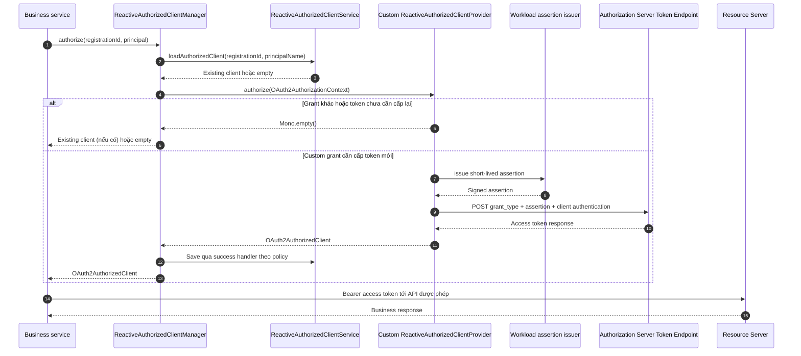
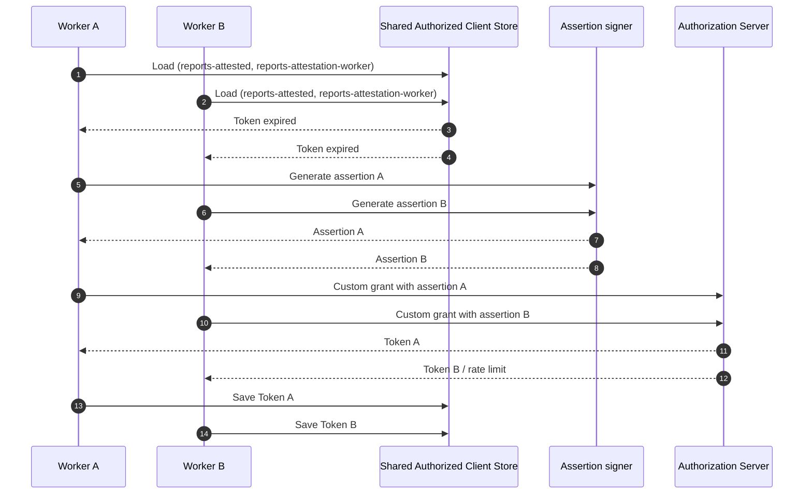

# 22.6. Thiết kế ReactiveOAuth2AuthorizedClientProvider cho grant tùy chỉnh

## 1. Khi nào cần tự viết một Reactive OAuth2 Authorized Client Provider?

Trong **Spring Security OAuth 2.0 / OIDC Client**, nhiều nhu cầu cấp token đã được framework hỗ trợ: Authorization Code, Refresh Token, Client Credentials và, tùy phiên bản, JWT Bearer hoặc Token Exchange. Tuy nhiên, có hệ thống tích hợp một **Authorization Server với extension grant riêng**: server yêu cầu một bằng chứng workload đã ký, một thông tin ủy quyền đặc thù hoặc một giao thức cấp token chưa có provider phù hợp trong thư viện.

Ví dụ, **Employee Portal** có một job gửi báo cáo định kỳ. Authorization Server của doanh nghiệp đưa ra một extension grant giả định:

```text
grant_type=urn:example:oauth:grant-type:workload-attestation
assertion=<short-lived signed workload assertion>
client_id=<registered-client-id>
client_secret=<client-secret>
```

**Tên grant và tham số `assertion` trên chỉ là hợp đồng minh họa.** Một Authorization Server OAuth2 thông thường không tự hiểu grant đó. Chỉ sử dụng khi server thật sự hỗ trợ và đã đăng ký client với grant, client authentication method, scopes/audience đúng chính sách.

Ứng dụng cần:

1. Kiểm tra `ClientRegistration` có dùng đúng grant extension không.
2. Tạo bằng chứng workload bằng thành phần ký đáng tin.
3. Gửi token request bất đồng bộ đến Token Endpoint.
4. Xử lý OAuth2 token response và lỗi theo contract.
5. Tạo `OAuth2AuthorizedClient` cho registration/principal hiện tại.
6. Phối hợp với `ReactiveOAuth2AuthorizedClientManager` để cache/persist, cấp lại token và theo dõi thất bại.
7. Đảm bảo **không block Reactor event loop**, không phát tán bí mật và không trộn token giữa nhiều user/tenant/audience.

Điểm mở rộng chính là:

**`ReactiveOAuth2AuthorizedClientProvider`** với phương thức:

```java
Mono<OAuth2AuthorizedClient> authorize(OAuth2AuthorizationContext context);
```

Provider là một **chiến lược thực hiện grant**; manager quản lý toàn bộ vòng đời authorized client và gọi provider khi cần. Tách trách nhiệm này giúp extension của bạn hòa vào OAuth2 Client của Spring Security thay vì tự gọi HTTP Token Endpoint ở mọi nơi trong nghiệp vụ.

### Mục tiêu sau bài học

Bạn sẽ hiểu và có thể triển khai:

- Contract `ReactiveOAuth2AuthorizedClientProvider`: khi nào trả `Mono.empty()`, khi nào trả token mới và khi nào báo lỗi.
- `OAuth2AuthorizationContext`: registration, principal, authorized client cũ và attributes.
- `ReactiveOAuth2AccessTokenResponseClient<T>`: nơi đóng gói HTTP Token Endpoint.
- `AbstractOAuth2AuthorizationGrantRequest`: request dành riêng cho grant.
- `OAuth2AccessTokenResponse` và `OAuth2AuthorizedClient`.
- `ReactiveOAuth2AuthorizedClientProviderBuilder.provider(...)` cùng `ReactiveOAuth2AuthorizedClientManager`.
- Cách chọn **request-bound manager** và **service-tier manager** cho WebFlux.
- Quyết định cache key, token expiry, principal, scope, audience và tenant.
- Test bằng Reactor `StepVerifier`/fake token response client, xử lý lỗi, quan sát và bảo mật.

Bài thuộc chương **22. Grant mở rộng**. Ví dụ dùng **Java 17+, Spring Boot 3.x và Spring Security 6.x**. Các extension API có mặt theo phiên bản; bạn phải đối chiếu dependency/BOM thực tế. Tên class/contract chính được minh họa theo Spring Security OAuth2 Client reactive.

> **Nguyên tắc:** Trước khi tự thiết kế grant, hãy kiểm tra nó đã có provider chính thức chưa. Tự viết một grant không phải cách mặc định để thay thế Authorization Code, Client Credentials, JWT Bearer hoặc Token Exchange vốn đã có cơ chế chuẩn hóa và hỗ trợ bởi Spring Security ở những phiên bản tương ứng.

## 2. Kiến trúc OAuth2 Client Reactive: vị trí của provider

### 2.1. Các thành phần khác nhau làm những việc khác nhau

| Thành phần | Vai trò chính | Không nên làm |
| --- | --- | --- |
| `ReactiveClientRegistrationRepository` | Tra cứu `ClientRegistration` theo registration ID | Không lưu token của từng user |
| `ClientRegistration` | Client ID/secret, grant type, scopes, token URI và provider | Không đại diện cho user đã đăng nhập |
| `ReactiveOAuth2AuthorizedClientManager` | Điều phối cấp/quản lý lại authorized client | Không tự hiểu mọi extension grant |
| **`ReactiveOAuth2AuthorizedClientProvider`** | Quyết định grant được hỗ trợ và thực hiện cấp lại token theo ngữ cảnh | Không tự quản lý HTTP session hoặc phân quyền nghiệp vụ |
| `OAuth2AuthorizationContext` | Chứa registration, principal, authorized client đang có và context attributes | Không phải authorization request chuyển hướng browser |
| `ReactiveOAuth2AccessTokenResponseClient<T>` | Thực hiện request/response ở Token Endpoint cho một grant | Không quyết định token có được dùng cho tenant nào |
| `OAuth2AccessTokenResponse` | Dữ liệu token response đã parse/validate | Không phải `Authentication` của user |
| `OAuth2AuthorizedClient` | Token + registration + principal name | Không tự refresh token khi được đọc |
| `ReactiveOAuth2AuthorizedClientService` | Lưu/đọc/xóa authorized client theo registration/principal | Không xác thực người gửi HTTP request hiện tại |
| `ServerOAuth2AuthorizedClientRepository` | Authorized client trong ngữ cảnh WebFlux `ServerWebExchange` | Không thay thế SecurityContext |
| `ReactiveOAuth2AuthorizationSuccessHandler` | Lưu/xử lý khi manager cấp token thành công | Không tự tạo provider |
| `ReactiveOAuth2AuthorizationFailureHandler` | Xử lý thất bại theo chính sách | Không phải cơ chế che giấu mọi lỗi |

### 2.2. Luồng tổng quát



Sơ đồ minh họa **service-tier manager** sử dụng reactive service. Với HTTP WebFlux request, manager có thể dùng `ServerOAuth2AuthorizedClientRepository` và `ServerWebExchange` thay vì service trực tiếp.

### 2.3. Cái gì là “grant tùy chỉnh”?

OAuth2 Authorization Framework cho phép **extension grants** thông qua `grant_type` có giá trị định danh URI do Authorization Server thỏa thuận. Một extension có thể yêu cầu thêm trường ở Token Endpoint hoặc cách cấp token khác so với các grant phổ biến.

Có hai mức tùy biến cần phân biệt:

| Tình huống | Hướng đi |
| --- | --- |
| Cùng `client_credentials`, chỉ thêm `audience`/`resource` theo provider | Tùy biến token request converter/client cho grant **đã có** |
| Cùng Authorization Code, chỉ thêm parameter ở authorization endpoint | Tùy biến authorization request resolver |
| Cùng Token Exchange RFC 8693 | Ưu tiên **`TokenExchangeReactiveOAuth2AuthorizedClientProvider`** khi phiên bản có hỗ trợ |
| JWT Bearer Grant RFC 7523 | Ưu tiên provider/response client JWT Bearer có sẵn ở phiên bản phù hợp |
| Extension grant riêng do OP định nghĩa, protocol khác | Có thể cần **custom `ReactiveOAuth2AuthorizedClientProvider`** |
| Muốn gọi Resource Server khác host | Không nhất thiết là grant mới; kiểm tra registration, audience, scopes, token selection |
| Muốn tăng scope mà không có consent/ủy quyền | Không được tự nâng quyền bằng custom grant |

**Đừng coi mọi provider-specific parameter là một grant mới.** Một codebase càng ít tự triển khai protocol, càng dễ bảo trì bảo mật và tương thích phiên bản.

## 3. Contract `ReactiveOAuth2AuthorizedClientProvider`

### 3.1. Interface có một phương thức

```java
package org.springframework.security.oauth2.client;

public interface ReactiveOAuth2AuthorizedClientProvider {

    Mono<OAuth2AuthorizedClient> authorize(
            OAuth2AuthorizationContext context);
}
```

Đây là chữ ký rút gọn cho bài học. Nó không phải một controller handler và không nhận trực tiếp HTTP request.

**`OAuth2AuthorizationContext`** cung cấp:

- `getClientRegistration()`: client registration đã được chọn.
- `getPrincipal()`: `Authentication` làm ngữ cảnh chủ sở hữu authorized client.
- `getAuthorizedClient()`: authorized client cũ, **có thể `null`**.
- `getAttribute(name)` và `getAttributes()`: dữ liệu tùy biến mà manager chuyển vào.
- Một số constants chuẩn cho attributes theo phiên bản.

Provider **không tự chọn arbitrary principal**. Manager đã nhận principal từ `OAuth2AuthorizeRequest`. Custom provider phải dùng principal đó đúng cách và bảo đảm policy của ứng dụng không cho user tự mạo danh principal của người khác.

### 3.2. Ba kết quả cần phân biệt

| Kết quả của `authorize` | Ý nghĩa | Hành vi mong đợi |
| --- | --- | --- |
| **`Mono.empty()`** | Provider không hỗ trợ grant này **hoặc** không cần reauthorize theo contract | Manager có thể thử provider khác hoặc dùng existing authorized client |
| **`Mono.just(authorizedClient)`** | Cấp/cấp lại token thành công | Manager trả authorized client và gọi success handler |
| **`Mono.error(exception)`** | Có lỗi hợp lệ trong grant, transport, token response hoặc policy | Manager/caller nhận lỗi, failure handling theo cấu hình |

Không được trả `Mono.just(null)` vì Reactor không cho phép null item.

Không nên dùng `Mono.empty()` để **che giấu một lỗi Token Endpoint**. Nếu grant đúng nhưng client secret bị OP từ chối, trả empty khiến caller khó phân biệt “provider không hỗ trợ” với “authorization thất bại”.

### 3.3. Khi nào trả empty?

Một provider thiết kế tốt thường xử lý:

```java
if (!CUSTOM_GRANT.equals(
        context.getClientRegistration().getAuthorizationGrantType())) {
    return Mono.empty();
}
```

Đây là bước **grant matching**. Nó đảm bảo khi manager có nhiều providers, provider custom không chặn các grant chuẩn.

Nếu `getAuthorizedClient()` đã có token chưa đến thời điểm cần cấp lại:

```java
if (existing != null && !isExpiring(existing.getAccessToken())) {
    return Mono.empty();
}
```

Tại đây empty nghĩa là **không cần thực hiện lại grant**, không phải authorized client bị mất. Manager có thể giữ existing authorized client. Cách này phù hợp với grant có cache key và chính sách reuse ổn định.

### 3.4. Khi nào nên phát error?

Ví dụ:

- Registration dùng grant custom nhưng Token Endpoint URL thiếu.
- Assertion supplier không thể ký bằng key phù hợp.
- Assertion được yêu cầu nhưng không thể lấy từ trusted source.
- Token Endpoint báo `invalid_client`, `invalid_grant` hoặc `unauthorized_client`.
- Response thiếu `access_token`, có `token_type` không được hỗ trợ, `expires_in` không hợp lệ.
- Không thể xác minh token response theo hợp đồng riêng của server.
- Hệ thống phát hiện principal không được phép sử dụng resource/audience đang yêu cầu.

Với các lỗi OAuth2 có ý nghĩa rõ, có thể dùng `OAuth2AuthorizationException` và `OAuth2Error`. Với lỗi HTTP mạng, cần mapping sang exception có ngữ cảnh hữu ích nhưng **không chứa raw secret hoặc assertion**.

### 3.5. Reactive không có nghĩa “tạo Mono rồi block”

Phản mẫu:

```java
@Override
public Mono<OAuth2AuthorizedClient> authorize(
        OAuth2AuthorizationContext context) {

    // PHẢN MẪU: .block() trên event loop.
    OAuth2AccessTokenResponse response =
            tokenClient.getTokenResponse(request).block();

    return Mono.just(toAuthorizedClient(context, response));
}
```

Đúng là **compose**:

```java
return tokenClient.getTokenResponse(request)
        .map(response -> toAuthorizedClient(context, response));
```

Không gọi `subscribe()` thủ công bên trong provider. Phương thức `authorize` phải trả về một Publisher để manager/caller kiểm soát lifecycle, cancellation, error propagation và backpressure.

## 4. Thiết kế trước khi code: quy tắc của grant extension

Trước khi tạo class, hãy ghi rõ hợp đồng giữa client và Authorization Server:

| Chủ đề | Ví dụ grant workload-attestation | Cần chốt |
| --- | --- | --- |
| Grant type | `urn:example:oauth:grant-type:workload-attestation` | Phải được AS hỗ trợ; không phải chuẩn phổ biến |
| Token endpoint | `https://auth.example.com/oauth2/token` | HTTPS, host tin cậy, TLS validation |
| Client authentication | `client_secret_post` trong demo | Server phải cho phép; production cân nhắc phương thức mạnh hơn |
| Bằng chứng grant | `assertion` là JWT/workload proof có chữ ký | Issuer, audience, subject, clock skew, jti/replay policy |
| Scope | `reports.read` | Registration/AS policy |
| Token response | OAuth2-style `access_token`, `token_type=Bearer`, `expires_in` | Cách parse và xử lý invalid response |
| Refresh | Demo không phát refresh token | Xin assertion/grant mới khi token hết hạn |
| Principal key | `reports-batch` | Ổn định, không từ query user |
| Audience/resource | Một Reports API cố định | Không trộn token khác audience trong cùng cache key |
| Failure response | OAuth error JSON / HTTP status | Error code, retry, fallback |
| Persistence | InMemory hoặc R2DBC service | Access token phải được bảo vệ như secret |
| Observability | Grant, registration, result, duration | Tuyệt đối không log assertion/token |

### 4.1. Một grant tự đặt tên không tự được công nhận

`urn:example:oauth:grant-type:workload-attestation` chỉ là một tên trong bài học. Spring có thể lưu nó dưới dạng `AuthorizationGrantType`, nhưng **Authorization Server phải tự hỗ trợ `grant_type` này**; nếu không, server có thể trả `unsupported_grant_type` hoặc `unauthorized_client`.

Nếu bạn đang dùng Keycloak, Okta, Entra ID hoặc OP khác, phải xác minh extensibility của provider đó. Không mặc định các server hỗ trợ giống nhau.

### 4.2. Có cần một custom Reactive Provider cho Token Exchange không?

Không nhất thiết. Spring Security 6.3+ có **`TokenExchangeReactiveOAuth2AuthorizedClientProvider`** cho token exchange (có thể được cấu hình cùng `WebClientReactiveTokenExchangeTokenResponseClient`). Khi use case đúng RFC 8693, ưu tiên provider đó trước khi viết lại token exchange.

Bài vẫn minh họa **một grant không có implementation có sẵn** để người học hiểu cách thiết kế `ReactiveOAuth2AuthorizedClientProvider`.

### 4.3. Cần tách client authentication khỏi grant credential

Trong ví dụ có:

- **`client_id` và `client_secret`**: xác thực OAuth client tại Token Endpoint theo `client_secret_post` của demo.
- **`assertion`**: credential thể hiện điều kiện riêng của extension grant.

Hai thứ không thay thế nhau. Một hệ thống có thể dùng `private_key_jwt`, mTLS hoặc phương thức khác để xác thực client, trong khi assertion chứng minh workload context. Việc cùng là JWT không làm chúng có cùng mục đích/audience/key.

## 5. Cấu hình Spring Boot và ClientRegistration

### 5.1. Dependencies

```xml
<dependencies>
    <dependency>
        <groupId>org.springframework.boot</groupId>
        <artifactId>spring-boot-starter-webflux</artifactId>
    </dependency>
    <dependency>
        <groupId>org.springframework.boot</groupId>
        <artifactId>spring-boot-starter-security</artifactId>
    </dependency>
    <dependency>
        <groupId>org.springframework.boot</groupId>
        <artifactId>spring-boot-starter-oauth2-client</artifactId>
    </dependency>
</dependencies>
```

Gradle Kotlin DSL:

```kotlin
dependencies {
    implementation("org.springframework.boot:spring-boot-starter-webflux")
    implementation("org.springframework.boot:spring-boot-starter-security")
    implementation("org.springframework.boot:spring-boot-starter-oauth2-client")
}
```

Nếu viết test reactive provider:

```kotlin
dependencies {
    testImplementation("org.springframework.boot:spring-boot-starter-test")
    testImplementation("io.projectreactor:reactor-test")
}
```

Với `reactor-test`, dùng `StepVerifier` để kiểm thử các tín hiệu `next`, `complete`, `error`. Không cần mở một OP thật cho unit test logic provider.

### 5.2. Registration cho extension grant

```yaml
spring:
  security:
    oauth2:
      client:
        registration:
          reports-attested:
            provider: corporate-as
            client-id: ${REPORTS_CLIENT_ID}
            client-secret: ${REPORTS_CLIENT_SECRET}
            client-authentication-method: client_secret_post
            authorization-grant-type: "urn:example:oauth:grant-type:workload-attestation"
            scope:
              - reports.read

        provider:
          corporate-as:
            token-uri: https://auth.example.com/oauth2/token
```

Giải thích:

- `reports-attested` là **registration ID** nội bộ Spring; nó không phải grant type.
- `authorization-grant-type` dùng URI extension; `ClientRegistration` có thể lưu một `AuthorizationGrantType` tùy chỉnh.
- `token-uri` là endpoint phải đúng HTTPS và server phải hỗ trợ grant mới.
- `client_secret_post` được chọn **chỉ để ví dụ form request ở phần transport**. Chỉ dùng nếu server cho phép và có TLS; với production thường ưu tiên cơ chế client authentication phù hợp threat model và provider.
- `scope` và audience cần tuân thủ policy của Authorization Server. Không dùng một token cấp cho Reports API để gọi API khác.
- Credentials được lấy từ secret manager/runtime configuration; không hard-code trong Java/repo.

### 5.3. Không nhầm extension grant với OIDC Login

Grant ở ví dụ **không có redirect browser**, `authorization_code`, callback `state` hay ID Token xác thực user.

Nếu website vẫn có OIDC Login cho nhân viên, đó là một registration/flow riêng. Không dùng `client_credentials` hoặc custom workload grant để “đăng nhập thay” một người dùng.

### 5.4. Các class sẽ được xây

```text
com.example.portal.oauth.extension
├── WorkloadGrantTypes.java
├── ReactiveWorkloadAssertionSupplier.java
├── WorkloadAttestationGrantRequest.java
├── WorkloadAttestationTokenResponseClient.java
├── WorkloadAttestationReactiveOAuth2AuthorizedClientProvider.java
└── WorkloadGrantConfiguration.java

com.example.portal.reports
└── ReportsApiClient.java
```

Trong một codebase thực tế, có thể gộp/tách class theo convention của tổ chức. Ở đây tách class để thấy ranh giới **grant state → Token Endpoint transport → provider → manager**.

## 6. Định nghĩa grant type và source của workload assertion

### 6.1. Một hằng `AuthorizationGrantType` riêng

```java
package com.example.portal.oauth.extension;

import org.springframework.security.oauth2.core.AuthorizationGrantType;

public final class WorkloadGrantTypes {

    public static final String WORKLOAD_ATTESTATION_VALUE =
            "urn:example:oauth:grant-type:workload-attestation";

    public static final AuthorizationGrantType WORKLOAD_ATTESTATION =
            new AuthorizationGrantType(WORKLOAD_ATTESTATION_VALUE);

    private WorkloadGrantTypes() {
    }
}
```

Hằng tập trung ở một class giúp:

- Provider so sánh grant type tường minh.
- Token response client gửi đúng `grant_type`.
- Tests xác minh provider không “ăn” grant của registration khác.
- Không copy chuỗi URI ở nhiều nơi dễ bị typo.

### 6.2. Assertion supplier có contract reactive

```java
package com.example.portal.oauth.extension;

import org.springframework.security.oauth2.client.registration.ClientRegistration;

import reactor.core.publisher.Mono;

@FunctionalInterface
public interface ReactiveWorkloadAssertionSupplier {

    Mono<String> issue(
            ClientRegistration registration,
            String principalName);
}
```

Implementation của interface này có trách nhiệm tạo **assertion có chữ ký, thời hạn ngắn và được OP chấp nhận**. Có thể dùng một signer chạy trong KMS/HSM, workload identity service hoặc bộ phát JWT của chính tổ chức tùy chính sách.

**Không nên** tạo assertion bằng:

- Chuỗi ngẫu nhiên không có chữ ký khi OP đòi signed JWT.
- Static token hard-code lâu dài trong `application.yml`.
- Subject/tenant/audience lấy trực tiếp từ một query parameter chưa kiểm tra quyền.
- Private key lưu trong source code.
- Một blocking key-management SDK chạy trực tiếp trên Reactor event loop.

Một assertion nên có hợp đồng rõ về:

- `iss`, `sub` hoặc workload identity tương ứng.
- `aud` trỏ tới đúng Token Endpoint/AS tùy chính sách.
- `iat`, `exp`, `jti` để giảm replay.
- Thuật toán/kid/chữ ký được server cho phép.
- TTL ngắn và clock skew hợp lý.
- Không chứa PII hoặc secret không cần thiết trong JWT payload.

**Assertion là bí mật có thể dùng để xin token.** Không log nó. Việc supplier trả `Mono` không chứng minh implementation bên trong là non-blocking; nếu signer là blocking SDK, cần offload sang scheduler thích hợp hoặc dùng async client.

### 6.3. Đừng phát assertion nếu token chưa cần cấp lại

Một provider tốt **kiểm tra registration và token lifetime trước**, rồi mới gọi assertion supplier. Nếu token hiện có còn sử dụng được, không cần tạo và ký một assertion mới.

Đây là lý do nên đặt supplier trong `Mono.defer` hoặc chain chỉ được thực hiện khi provider quyết định cần authorize; tránh tạo secret lúc build bean hoặc mỗi lần chỉ đọc context.

## 7. Tạo grant request riêng

### 7.1. Vì sao không truyền chuỗi assertion trần quanh mọi lớp?

`ReactiveOAuth2AccessTokenResponseClient<T>` được thiết kế để nhận một kiểu request đại diện grant. Tạo class:

`WorkloadAttestationGrantRequest`

giúp tách thông tin đầu vào token exchange khỏi `OAuth2AuthorizationContext`.

### 7.2. Implementation `AbstractOAuth2AuthorizationGrantRequest`

```java
package com.example.portal.oauth.extension;

import org.springframework.security.oauth2.client.endpoint.AbstractOAuth2AuthorizationGrantRequest;
import org.springframework.security.oauth2.client.registration.ClientRegistration;
import org.springframework.util.Assert;

public final class WorkloadAttestationGrantRequest
        extends AbstractOAuth2AuthorizationGrantRequest {

    private final String assertion;

    public WorkloadAttestationGrantRequest(
            ClientRegistration clientRegistration,
            String assertion) {

        super(clientRegistration);
        Assert.hasText(assertion, "assertion must not be blank");
        this.assertion = assertion;
    }

    public String getAssertion() {
        return this.assertion;
    }
}
```

Base class mang theo `ClientRegistration`, trong khi subclass giữ credential riêng của grant. Constructor validate assertion để không gửi một request vô nghĩa khi signer gặp lỗi.

**Không override `toString()` để in assertion**. Tránh annotate data-class/codegen tự động tạo method debug chứa bí mật. Khi muốn log, chỉ log registration ID và trạng thái không nhạy cảm.

### 7.3. Kiểu request không quyết định grant đúng hay sai

Một object `WorkloadAttestationGrantRequest` chỉ là DTO Java. Authorization Server mới là bên quyết định grant có hợp lệ. Vì vậy token response client cần:

- Gửi đúng form fields.
- Thực hiện client authentication.
- Parse error response theo contract.
- Validate access token response.
- Thiết lập timeout/TLS/redaction/size limits phù hợp.

Phần tiếp theo sẽ minh họa một client dành riêng cho grant này.

## 8. Token Endpoint transport: `ReactiveOAuth2AccessTokenResponseClient<T>`

### 8.1. Vì sao nên tách HTTP request ra khỏi provider?

Nếu viết tất cả code HTTP trực tiếp trong `authorize(...)`, provider phải xử lý đồng thời:

- Grant matching và token expiration.
- Assertion generation.
- Client authentication.
- HTTP request, timeouts, status codes.
- OAuth2 error JSON.
- Access token response parsing.
- Test network và test authorization logic.

Tách thành một `ReactiveOAuth2AccessTokenResponseClient<WorkloadAttestationGrantRequest>` giúp provider chỉ điều phối **khi nào** nên cấp token, còn response client phụ trách **cách** trao đổi với Token Endpoint.

Contract cơ bản:

```java
public interface ReactiveOAuth2AccessTokenResponseClient<
        T extends AbstractOAuth2AuthorizationGrantRequest> {

    Mono<OAuth2AccessTokenResponse> getTokenResponse(T grantRequest);
}
```

Với một grant có provider chính thức, Spring Security thường cung cấp một WebClient-based response client. Với extension grant riêng của bài, ta tự tạo một response client minh họa.

### 8.2. HTTP request mà Authorization Server kỳ vọng

Đây là request minh họa cho grant giả định **workload-attestation**:

```http
POST /oauth2/token HTTP/1.1
Host: auth.example.com
Content-Type: application/x-www-form-urlencoded

grant_type=urn%3Aexample%3Aoauth%3Agrant-type%3Aworkload-attestation
&client_id=portal-reports
&client_secret=%3Credacted%3E
&assertion=%3Csigned-workload-assertion%3E
```

Các giá trị phải được **form URL-encode đúng cách**, không nối chuỗi raw vào body. Tất cả exchange phải qua HTTPS và host Token Endpoint được lấy từ cấu hình đáng tin.

Ví dụ chọn `client_secret_post` để code ngắn gọn và dễ hiểu. **Production chỉ được dùng phương thức xác thực client mà Authorization Server đã đăng ký và tổ chức chấp nhận**; nếu dùng `client_secret_basic`, `private_key_jwt` hoặc mTLS, cần implementation tương ứng, không chỉ đổi YAML mà giữ nguyên HTTP request phía dưới.

### 8.3. Response OAuth2 hợp lệ

```http
HTTP/1.1 200 OK
Content-Type: application/json
Cache-Control: no-store
Pragma: no-cache

{
  "access_token": "<opaque-or-jwt-access-token>",
  "token_type": "Bearer",
  "expires_in": 1800,
  "scope": "reports.read"
}
```

Với hợp đồng demo, **không có refresh token**. Khi token gần hết hạn, provider sẽ dùng assertion mới để thực hiện grant lại.

Nếu Token Endpoint trả body thiếu `access_token` hoặc `token_type` không hợp lệ, provider **không nên tạo một authorized client nửa vời**.

### 8.4. Token response client mẫu

Class dưới đây được viết để minh họa trực tiếp các bước quan trọng. Nó giả định:

- Chỉ hỗ trợ `ClientAuthenticationMethod.CLIENT_SECRET_POST`.
- Chỉ nhận `token_type=Bearer` và `expires_in` kiểu số dương.
- Không nhận refresh token theo hợp đồng grant minh họa.
- Không expose raw HTTP response body cho caller khi Token Endpoint lỗi.
- Kết nối WebClient được cấu hình TLS, timeout và destination guard ở lớp khởi tạo bean.

```java
package com.example.portal.oauth.extension;

import java.util.Arrays;
import java.util.LinkedHashSet;
import java.util.Map;
import java.util.Set;
import java.util.stream.Collectors;

import org.springframework.core.ParameterizedTypeReference;
import org.springframework.http.HttpStatusCode;
import org.springframework.http.MediaType;
import org.springframework.security.oauth2.client.endpoint.ReactiveOAuth2AccessTokenResponseClient;
import org.springframework.security.oauth2.client.registration.ClientRegistration;
import org.springframework.security.oauth2.core.ClientAuthenticationMethod;
import org.springframework.security.oauth2.core.OAuth2AccessToken;
import org.springframework.security.oauth2.core.endpoint.OAuth2AccessTokenResponse;
import org.springframework.security.oauth2.core.OAuth2AuthorizationException;
import org.springframework.security.oauth2.core.OAuth2Error;
import org.springframework.web.reactive.function.BodyInserters;
import org.springframework.web.reactive.function.client.WebClient;

import reactor.core.publisher.Mono;

public final class WorkloadAttestationTokenResponseClient
        implements ReactiveOAuth2AccessTokenResponseClient<
                WorkloadAttestationGrantRequest> {

    private static final ParameterizedTypeReference<Map<String, Object>> BODY_TYPE =
            new ParameterizedTypeReference<>() {};

    private final WebClient webClient;

    public WorkloadAttestationTokenResponseClient(WebClient webClient) {
        this.webClient = webClient;
    }

    @Override
    public Mono<OAuth2AccessTokenResponse> getTokenResponse(
            WorkloadAttestationGrantRequest request) {

        ClientRegistration registration = request.getClientRegistration();

        // Demo intentionally supports only client_secret_post.
        if (!ClientAuthenticationMethod.CLIENT_SECRET_POST.equals(
                registration.getClientAuthenticationMethod())) {
            return Mono.error(oauthError(
                    "unsupported_client_authentication",
                    "This demo token client requires client_secret_post"));
        }

        String tokenUri = registration.getProviderDetails().getTokenUri();

        if (tokenUri == null || tokenUri.isBlank()) {
            return Mono.error(oauthError(
                    "invalid_client_registration",
                    "Token URI is missing"));
        }

        return webClient.post()
                .uri(tokenUri)
                .contentType(MediaType.APPLICATION_FORM_URLENCODED)
                .body(BodyInserters
                        .fromFormData(
                                "grant_type",
                                WorkloadGrantTypes.WORKLOAD_ATTESTATION_VALUE)
                        .with("client_id", registration.getClientId())
                        .with("client_secret", registration.getClientSecret())
                        .with("assertion", request.getAssertion()))
                .retrieve()
                .onStatus(HttpStatusCode::isError, response ->
                        response.bodyToMono(Void.class)
                                .then(Mono.error(oauthError(
                                        "token_endpoint_error",
                                        "Authorization Server rejected the custom grant"))))
                .bodyToMono(BODY_TYPE)
                .switchIfEmpty(Mono.error(oauthError(
                        "invalid_token_response",
                        "Authorization Server returned an empty response")))
                .map(body -> toTokenResponse(body, registration));
    }

    private OAuth2AccessTokenResponse toTokenResponse(
            Map<String, Object> body, ClientRegistration registration) {

        Object rawToken = body.get("access_token");
        Object rawType = body.get("token_type");
        Object rawLifetime = body.get("expires_in");

        if (!(rawToken instanceof String token) || token.isBlank()) {
            throw oauthError(
                    "invalid_token_response", "Missing access_token");
        }

        if (!(rawType instanceof String type)
                || !"Bearer".equalsIgnoreCase(type)) {
            throw oauthError(
                    "invalid_token_response", "Unsupported token_type");
        }

        if (!(rawLifetime instanceof Number lifetime)
                || lifetime.longValue() <= 0) {
            throw oauthError(
                    "invalid_token_response", "Invalid expires_in");
        }

        // The custom grant contract for this example has no refresh token.
        if (body.get("refresh_token") != null) {
            throw oauthError(
                    "invalid_token_response",
                    "Unexpected refresh_token for this demo grant");
        }

        Set<String> scopes = registration.getScopes();
        Object rawScope = body.get("scope");

        if (rawScope instanceof String scopeText) {
            scopes = Arrays.stream(scopeText.trim().split("\\s+"))
                    .filter(value -> !value.isBlank())
                    .collect(Collectors.toCollection(LinkedHashSet::new));
        }
        else if (rawScope != null) {
            throw oauthError(
                    "invalid_token_response", "Invalid scope format");
        }

        return OAuth2AccessTokenResponse.withToken(token)
                .tokenType(OAuth2AccessToken.TokenType.BEARER)
                .expiresIn(lifetime.longValue())
                .scopes(scopes)
                .build();
    }

    private static OAuth2AuthorizationException oauthError(
            String code, String safeDescription) {

        return new OAuth2AuthorizationException(
                new OAuth2Error(code, safeDescription, null));
    }
}
```

Code này **không phải một OAuth2 protocol library đầy đủ**. Nó trình bày ranh giới thiết kế. Ở production cần bổ sung các ràng buộc phía dưới.

### 8.5. Vì sao phải parse OAuth2 error một cách có kiểm soát?

Token Endpoint có thể trả:

```http
HTTP/1.1 400 Bad Request
Content-Type: application/json

{
  "error": "invalid_grant",
  "error_description": "The workload assertion is expired"
}
```

Một implementation hoàn chỉnh có thể parse **`error`** và **`error_description`**, nhưng phải:

- Giới hạn response body size.
- Chuẩn hóa/mask description trước khi đưa vào logs, metrics hoặc response cho browser.
- Không lộ assertion, client secret, headers hay signed request.
- Không nhận một error code ngoài tập được quản trị để kích hoạt retry/privilege change.
- Tách `invalid_client`, `invalid_grant`, `unsupported_grant_type`, `temporarily_unavailable`, HTTP 429/5xx và lỗi transport.

Client demo trên chuyển HTTP error thành `token_endpoint_error` chung để tránh vô tình phát tán nội dung raw; trong production cần **safe error mapping** chính xác hơn để quyết định retry/incident response. Việc không copy `error_description` từ OP vào exception user-facing là một lựa chọn bảo vệ dữ liệu.

### 8.6. `expires_in` không phải thời điểm user session hết hạn

`expires_in` cho biết thời hạn dự kiến của access token từ lúc được cấp. Khi parse thành `OAuth2AccessTokenResponse`, Spring sử dụng timestamps để quản lý token. Nó **không phải** thời hạn WebSession hoặc ID Token.

Một access token vẫn có thể bị revoke trước thời điểm hết hạn. Resource Server vẫn chịu trách nhiệm xác minh token thực tế khi được sử dụng.

### 8.7. Tránh URL/token endpoint do input bên ngoài kiểm soát

`registration.getProviderDetails().getTokenUri()` phải đến từ cấu hình/repository đáng tin. Không thiết kế:

```java
// PHẢN MẪU: caller tự chỉ định Token Endpoint nhận client_secret.
String tokenUri = browserQueryParameter;
```

và gửi `client_secret`/assertion tới URI đó. Đây là **SSRF + credential disclosure** nghiêm trọng.

Một check sơ bộ `tokenUri.startsWith("https://")` là **không đủ**; application bean nên dùng allowlist exact token endpoint origin, TLS hostname validation, egress network policy, quản lý redirect và không cho request builder tùy ý sửa host.

### 8.8. Timeout của token client

Cần đặt:

- Connection timeout hợp lý theo network.
- Response/read timeout.
- Max response size.
- Maximum concurrency/circuit breaker khi cần.
- Retry budget riêng cho HTTP transport và grant semantics.
- Logger không ghi client-secret hoặc assertion.

Ví dụ Reactor Netty khi dùng connector tương ứng:

```java
import java.time.Duration;

import io.netty.channel.ChannelOption;
import org.springframework.http.client.reactive.ReactorClientHttpConnector;
import org.springframework.web.reactive.function.client.WebClient;
import reactor.netty.http.client.HttpClient;

HttpClient httpClient = HttpClient.create()
        .option(ChannelOption.CONNECT_TIMEOUT_MILLIS, 3000)
        .responseTimeout(Duration.ofSeconds(5))
        .followRedirect(false);

WebClient tokenEndpointWebClient = WebClient.builder()
        .clientConnector(new ReactorClientHttpConnector(httpClient))
        .build();
```

Cấu hình này **không được tắt xác minh chứng chỉ TLS**. Cần bảo vệ host Token Endpoint bằng policy cấp ứng dụng và mạng. Đừng cho phép auto-follow redirect từ Token Endpoint sang một host mới rồi chuyển tiếp client secret.

## 9. Xây `WorkloadAttestationReactiveOAuth2AuthorizedClientProvider`

### 9.1. Trách nhiệm của provider

Provider custom phải thực hiện theo thứ tự:

1. **Grant filter:** chỉ xử lý `WORKLOAD_ATTESTATION`.
2. **Token reuse policy:** nếu `OAuth2AuthorizedClient` hiện có chưa gần hết hạn và tương thích cache key, trả empty.
3. **Assertion issuance:** nếu cần token mới, lấy assertion có thời hạn ngắn từ nguồn tin cậy.
4. **Token Endpoint:** gọi `ReactiveOAuth2AccessTokenResponseClient`.
5. **Authorized client mapping:** gắn token mới với đúng `ClientRegistration` và `context.getPrincipal().getName()`.
6. **Error propagation:** báo lỗi có ý nghĩa, không trả token giả/placeholder.
7. **No blocking:** trả `Mono`, không `block()` hoặc `subscribe()`.

### 9.2. Kiểm tra token expiration với clock skew

Không nên đợi đúng `expiresAt` rồi mới xin token khi request outbound có thể mất vài giây:

```text
issuedAt = 10:00:00
expiresAt = 10:30:00
clockSkew = 60 seconds

Từ khoảng 10:29:00:
  provider có thể coi token cần xin lại trước khi gọi API.
```

Dùng `Clock` có thể inject để test expiry một cách xác định, thay vì phụ thuộc thời gian máy.

### 9.3. Implementation provider

```java
package com.example.portal.oauth.extension;

import java.time.Clock;
import java.time.Duration;
import java.time.Instant;

import org.springframework.security.oauth2.client.OAuth2AuthorizationContext;
import org.springframework.security.oauth2.client.OAuth2AuthorizedClient;
import org.springframework.security.oauth2.client.ReactiveOAuth2AuthorizedClientProvider;
import org.springframework.security.oauth2.client.endpoint.ReactiveOAuth2AccessTokenResponseClient;
import org.springframework.security.oauth2.core.OAuth2AccessToken;
import org.springframework.security.oauth2.core.OAuth2AuthorizationException;
import org.springframework.security.oauth2.core.OAuth2Error;
import org.springframework.util.Assert;

import reactor.core.publisher.Mono;

public final class WorkloadAttestationReactiveOAuth2AuthorizedClientProvider
        implements ReactiveOAuth2AuthorizedClientProvider {

    private final ReactiveWorkloadAssertionSupplier assertionSupplier;
    private final ReactiveOAuth2AccessTokenResponseClient<
            WorkloadAttestationGrantRequest> tokenResponseClient;
    private final Clock clock;
    private final Duration clockSkew;

    public WorkloadAttestationReactiveOAuth2AuthorizedClientProvider(
            ReactiveWorkloadAssertionSupplier assertionSupplier,
            ReactiveOAuth2AccessTokenResponseClient<
                    WorkloadAttestationGrantRequest> tokenResponseClient,
            Clock clock,
            Duration clockSkew) {

        Assert.notNull(assertionSupplier, "assertionSupplier is required");
        Assert.notNull(tokenResponseClient, "tokenResponseClient is required");
        Assert.notNull(clock, "clock is required");
        Assert.notNull(clockSkew, "clockSkew is required");
        Assert.isTrue(!clockSkew.isNegative(), "clockSkew must be >= 0");

        this.assertionSupplier = assertionSupplier;
        this.tokenResponseClient = tokenResponseClient;
        this.clock = clock;
        this.clockSkew = clockSkew;
    }

    @Override
    public Mono<OAuth2AuthorizedClient> authorize(
            OAuth2AuthorizationContext context) {

        // 1. Do not consume requests for any other OAuth2 grant.
        if (!WorkloadGrantTypes.WORKLOAD_ATTESTATION.equals(
                context.getClientRegistration().getAuthorizationGrantType())) {
            return Mono.empty();
        }

        // 2. Reuse only because this example has one fixed scope/audience
        //    per registration and stable principal-specific cache keys.
        OAuth2AuthorizedClient existing = context.getAuthorizedClient();

        if (existing != null && !isExpiring(existing.getAccessToken())) {
            return Mono.empty();
        }

        // 3. Deferred reactive issuance: no assertion is minted when
        //    the provider does not need to re-authorize.
        return Mono.defer(() ->
                assertionSupplier.issue(
                                context.getClientRegistration(),
                                context.getPrincipal().getName())
                        .switchIfEmpty(Mono.error(authorizationError(
                                "invalid_workload_assertion",
                                "Cannot issue workload attestation")))
                        .flatMap(assertion ->
                                tokenResponseClient.getTokenResponse(
                                        new WorkloadAttestationGrantRequest(
                                                context.getClientRegistration(),
                                                assertion)))
                        .map(tokenResponse ->
                                new OAuth2AuthorizedClient(
                                        context.getClientRegistration(),
                                        context.getPrincipal().getName(),
                                        tokenResponse.getAccessToken(),
                                        tokenResponse.getRefreshToken())));
    }

    private boolean isExpiring(OAuth2AccessToken token) {
        Instant expiresAt = token.getExpiresAt();

        return expiresAt == null
                || !expiresAt.isAfter(
                        clock.instant().plus(clockSkew));
    }

    private static OAuth2AuthorizationException authorizationError(
            String code, String safeDescription) {

        return new OAuth2AuthorizationException(
                new OAuth2Error(code, safeDescription, null));
    }
}
```

### 9.4. Giải thích chi tiết từng quyết định

**(1) Chỉ nhận đúng grant.** `ReactiveOAuth2AuthorizedClientProvider` có thể nằm trong chain nhiều providers. Nếu registration dùng `authorization_code` hoặc `client_credentials`, provider custom phải trả `Mono.empty()` thay vì cố trao đổi assertion.

**(2) Token còn phù hợp thì không gọi OP.** Khi manager đã load authorized client còn hạn, provider không cần tạo assertion/token. Trả empty để manager dùng authorized client đã có. **Điều này chỉ đúng nếu cache key xác định đầy đủ token scope/audience/identity mà request cần**. Phần sau sẽ phân tích trường hợp cache key không đủ.

**(3) Mono.defer và reactive supplier.** Không sinh assertion ở constructor hoặc khi startup. Supplier chỉ được gọi khi có subscription thực sự và provider quyết định cần token mới.

**(4) Cấp response client qua dependency injection.** Có thể test provider với fake response client mà không cần HTTP server. Các concern như TLS/HTTP error/parsing nằm trong transport client.

**(5) Giữ đúng principal.** `new OAuth2AuthorizedClient(..., context.getPrincipal().getName(), ...)` đảm bảo manager/service lưu theo principal đã chọn. Không lấy principal từ subject do một caller không đáng tin truyền vào.

**(6) Trả OAuth2AccessTokenResponse thành OAuth2AuthorizedClient.** Response client đã parse token response. Token `getRefreshToken()` là null trong hợp đồng demo. Manager chịu trách nhiệm lưu khi authorization thành công theo success handler.

**(7) Clock/clockSkew.** Dùng `Clock` khiến unit test deterministic và ứng dụng tránh sử dụng token sát hạn. Đặt skew phù hợp token lifetime, không đặt lớn gần bằng toàn bộ TTL dẫn đến xin token liên tục.

### 9.5. Khi grant có thêm actor/audience/tenant, logic này phải thay đổi

Provider trên cố ý chỉ hỗ trợ **một target API và một scope policy cố định trên mỗi registration**. Nếu request có thể dùng một registration/principal nhưng yêu cầu nhiều `audience`, `resource`, `scope` hoặc subject/actor tokens, **không được reuse authorized client chỉ dựa trên `expiresAt`**.

Ví dụ nguy hiểm:

```text
Store key: (token-exchange, employee-4821)

Request A:
  resource=reports-api
  scope=reports.read
  -> lưu TokenA

Request B:
  resource=billing-api
  scope=billing.write
  -> manager load TokenA (còn hạn)
  -> provider trả empty vì chỉ kiểm tra expiresAt
  -> manager có thể trả TokenA sai audience
```

Cần một trong các hướng:

- Tách **ClientRegistration theo resource/permission profile** để có cache key khác.
- Tạo **principal namespace đáng tin** biểu diễn identity + tenant/resource khi thiết kế cho phép.
- Dùng custom authorized client store có key chứa scope/audience/subject context được xác minh.
- Không persist token của grant context-specific và luôn xử lý lại grant một cách tường minh theo policy.
- Kiểm tra metadata token/context trước khi quyết định reuse; không coi token value là JWT có thể decode đáng tin nếu nó là opaque.
- Không nhận principal/target audience tùy ý từ browser chỉ để “tạo key khác”.

**Rủi ro token mix-up do cache key thiếu dimension là một trong những lỗi thiết kế dễ bị bỏ sót nhất khi viết custom grant provider.**

## 10. Đưa custom provider vào `ReactiveOAuth2AuthorizedClientManager`

### 10.1. `ReactiveOAuth2AuthorizedClientProviderBuilder.provider(...)`

Spring Security cho phép tạo provider chain:

```java
ReactiveOAuth2AuthorizedClientProvider provider =
        ReactiveOAuth2AuthorizedClientProviderBuilder.builder()
                .authorizationCode()
                .refreshToken()
                .clientCredentials()
                .provider(workloadAttestationProvider)
                .build();
```

`provider(...)` gắn thêm implementation của bạn vào chain. Những provider chuẩn chỉ xử lý grant phù hợp, provider custom cũng phải tự lọc grant như mục 9.

Một số phiên bản có provider hỗ trợ JWT Bearer/Token Exchange được đăng ký riêng theo hướng dẫn của phiên bản. **Không tự thay thế toàn bộ chain bằng custom provider** nếu ứng dụng còn cần Authorization Code hoặc Client Credentials.

### 10.2. Service-tier manager cho workload extension grant

Ví dụ bean configuration:

```java
package com.example.portal.oauth.extension;

import java.time.Clock;
import java.time.Duration;

import org.springframework.context.annotation.Bean;
import org.springframework.context.annotation.Configuration;
import org.springframework.security.oauth2.client.AuthorizedClientServiceReactiveOAuth2AuthorizedClientManager;
import org.springframework.security.oauth2.client.ReactiveOAuth2AuthorizedClientManager;
import org.springframework.security.oauth2.client.ReactiveOAuth2AuthorizedClientProvider;
import org.springframework.security.oauth2.client.ReactiveOAuth2AuthorizedClientProviderBuilder;
import org.springframework.security.oauth2.client.ReactiveOAuth2AuthorizedClientService;
import org.springframework.security.oauth2.client.endpoint.ReactiveOAuth2AccessTokenResponseClient;
import org.springframework.security.oauth2.client.registration.ReactiveClientRegistrationRepository;
import org.springframework.web.reactive.function.client.WebClient;

@Configuration
public class WorkloadGrantConfiguration {

    @Bean
    ReactiveOAuth2AccessTokenResponseClient<WorkloadAttestationGrantRequest>
            workloadTokenResponseClient() {

        // A dedicated HTTP client for the trusted Token Endpoint.
        // Add connection/read timeout, destination policy and TLS controls
        // as required by the production environment.
        return new WorkloadAttestationTokenResponseClient(
                WebClient.builder().build());
    }

    @Bean
    ReactiveOAuth2AuthorizedClientProvider workloadAttestationProvider(
            ReactiveWorkloadAssertionSupplier assertions,
            ReactiveOAuth2AccessTokenResponseClient<
                    WorkloadAttestationGrantRequest> tokenClient) {

        return new WorkloadAttestationReactiveOAuth2AuthorizedClientProvider(
                assertions,
                tokenClient,
                Clock.systemUTC(),
                Duration.ofSeconds(60));
    }

    @Bean("workloadGrantManager")
    ReactiveOAuth2AuthorizedClientManager workloadGrantManager(
            ReactiveClientRegistrationRepository registrations,
            ReactiveOAuth2AuthorizedClientService authorizedClients,
            ReactiveOAuth2AuthorizedClientProvider workloadAttestationProvider) {

        ReactiveOAuth2AuthorizedClientProvider provider =
                ReactiveOAuth2AuthorizedClientProviderBuilder.builder()
                        .clientCredentials()
                        .provider(workloadAttestationProvider)
                        .build();

        var manager =
                new AuthorizedClientServiceReactiveOAuth2AuthorizedClientManager(
                        registrations,
                        authorizedClients);

        manager.setAuthorizedClientProvider(provider);
        return manager;
    }
}
```

**Bean `ReactiveWorkloadAssertionSupplier` phải được ứng dụng triển khai và cung cấp** từ hệ thống ký thực tế. Cấu hình này sẽ không thể hoạt động nếu thiếu signer bean hoặc AS không hỗ trợ grant minh họa. Không thay signer bằng static unsigned assertion trong production.

Ở đây:

- Manager dùng **`ReactiveOAuth2AuthorizedClientService`** cho workload/background.
- Provider chain hỗ trợ Client Credentials chuẩn và custom grant.
- Registration `reports-attested` sẽ đến custom provider.
- Registration `reports-api` có `client_credentials` (nếu có) sẽ đến built-in provider.
- WebFlux user login (nếu ứng dụng có) có thể có manager riêng theo request context.

### 10.3. Một manager riêng cho WebFlux request-bound grant

Nếu custom grant hợp lệ trong HTTP WebFlux request (không chỉ background), có thể dùng:

```java
@Bean("requestGrantManager")
ReactiveOAuth2AuthorizedClientManager requestGrantManager(
        ReactiveClientRegistrationRepository registrations,
        ServerOAuth2AuthorizedClientRepository authorizedClientRepository,
        ReactiveOAuth2AuthorizedClientProvider workloadAttestationProvider) {

    ReactiveOAuth2AuthorizedClientProvider provider =
            ReactiveOAuth2AuthorizedClientProviderBuilder.builder()
                    .authorizationCode()
                    .refreshToken()
                    .provider(workloadAttestationProvider)
                    .build();

    var manager = new DefaultReactiveOAuth2AuthorizedClientManager(
            registrations, authorizedClientRepository);

    manager.setAuthorizedClientProvider(provider);
    return manager;
}
```

Import `DefaultReactiveOAuth2AuthorizedClientManager` và `ServerOAuth2AuthorizedClientRepository` tương ứng. Đây là **biến thể cho HTTP request**, không nên thêm nó nếu ứng dụng chỉ có background workload grant.

Khác biệt quan trọng:

| Manager | Nguồn persistence | Cần gì? |
| --- | --- | --- |
| `DefaultReactiveOAuth2AuthorizedClientManager` | `ServerOAuth2AuthorizedClientRepository` | Ngữ cảnh `ServerWebExchange` |
| `AuthorizedClientServiceReactiveOAuth2AuthorizedClientManager` | `ReactiveOAuth2AuthorizedClientService` | Chạy ngoài HTTP exchange |
| `ReactiveOAuth2AuthorizedClientProvider` | Không phải store | Grant-specific `OAuth2AuthorizationContext` |
| `ReactiveOAuth2AccessTokenResponseClient` | Không phải store | Grant request và Token Endpoint |

### 10.4. Lựa chọn manager là quyết định kiến trúc

- Với scheduled job, message consumer, service-to-service integration: **service-tier manager**.
- Với WebFlux controller/user-bound interaction: **request-bound manager** và repository liên kết Authentication.
- Với grant cần consent/user authorization: phải có flow tương ứng, không thể chỉ cung cấp một principal String trong background rồi tự nhận quyền của user.
- Với token được cấp cho resource riêng: phải thiết kế scopes/audience và destination hợp lệ.

**Một custom grant không biến access token của client thành ID Token của user.** Đừng dùng extension grant như một giải pháp lách OIDC login hoặc quyền của người dùng.

## 11. Gọi manager từ business service theo cách reactive

### 11.1. `OAuth2AuthorizeRequest` vẫn được dùng trong reactive manager

Request cấp quyền:

```java
OAuth2AuthorizeRequest request = OAuth2AuthorizeRequest
        .withClientRegistrationId("reports-attested")
        .principal("reports-attestation-worker")
        .build();
```

Lưu ý: lớp request có tên `OAuth2AuthorizeRequest`, không phải `ReactiveOAuth2AuthorizeRequest`. Phương thức manager trả về `Mono<OAuth2AuthorizedClient>`.

`principal("reports-attestation-worker")` là **principal kỹ thuật ổn định**, không phải browser user đăng nhập. String này chỉ xác định cache key trong authorized client service; việc gọi manager phải được bảo vệ bởi quyền truy cập của service/workload.

### 11.2. Dùng token gọi một API đã định trước

```java
package com.example.portal.reports;

import org.springframework.beans.factory.annotation.Qualifier;
import org.springframework.security.oauth2.client.OAuth2AuthorizeRequest;
import org.springframework.security.oauth2.client.ReactiveOAuth2AuthorizedClientManager;
import org.springframework.stereotype.Service;
import org.springframework.web.reactive.function.client.WebClient;

import reactor.core.publisher.Mono;

@Service
public class AttestedReportsClient {

    private final ReactiveOAuth2AuthorizedClientManager manager;
    private final WebClient reportsApi;

    public AttestedReportsClient(
            @Qualifier("workloadGrantManager")
            ReactiveOAuth2AuthorizedClientManager manager,
            WebClient.Builder builder) {

        this.manager = manager;
        this.reportsApi = builder.clone()
                .baseUrl("https://reports-api.example.com")
                .build();
    }

    public Mono<String> loadSummary() {
        OAuth2AuthorizeRequest request = OAuth2AuthorizeRequest
                .withClientRegistrationId("reports-attested")
                .principal("reports-attestation-worker")
                .build();

        return manager.authorize(request)
                .switchIfEmpty(Mono.error(
                        new IllegalStateException(
                                "Workload grant is not available")))
                .flatMap(authorizedClient ->
                        reportsApi.get()
                                .uri("/v1/reports/summary")
                                .headers(headers -> headers.setBearerAuth(
                                        authorizedClient.getAccessToken()
                                                .getTokenValue()))
                                .retrieve()
                                .bodyToMono(String.class));
    }
}
```

Điểm cần lưu ý:

- Không gọi `block()` bên trong reactive handler/service.
- Không gọi `subscribe()` rồi trả “success” trước khi token/API call hoàn tất.
- Không cache access token String trong một field static.
- `WebClient` dùng một destination đã được ứng dụng quản trị; **baseUrl một mình chưa phải allowlist** nếu call site có thể dùng absolute URI. Cần hạn chế URL ở typed methods, redirect/egress controls và nếu cần destination guard.
- Khi cung cấp một endpoint cho user gọi `loadSummary()`, backend phải **kiểm tra quyền user trước**. Workload access token không tự cấp quyền cho browser user.
- Nếu token có `audience` cố định, chỉ gửi nó tới Resource Server được phép.
- Nếu Token Endpoint trả `invalid_client`, user login lại không sửa được secret của workload.

### 11.3. Kết quả empty và error

`manager.authorize(request)` có thể:

- Emit authorized client (đã có hoặc mới).
- Hoàn thành rỗng nếu không hỗ trợ grant/ngữ cảnh.
- Phát error nếu có lỗi Token Endpoint, assertion issuer hoặc persistence.

`switchIfEmpty(Mono.error(...))` trong ví dụ xử lý trường hợp rỗng mà không tạo token giả. Ở production, nên mapping thành exception nghiệp vụ đúng loại và cảnh báo nếu grant configuration không khớp.

### 11.4. Có thể dùng WebClient OAuth2 exchange filter không?

Có, Spring Security WebFlux cung cấp `ServerOAuth2AuthorizedClientExchangeFilterFunction`. Tuy nhiên phải:

- Inject **đúng ReactiveAuthorizedClientManager**.
- Chọn đúng registration/principal mỗi call.
- Đảm bảo context cần thiết có sẵn hoặc dùng service-tier manager.
- Không bật default token trên HTTP client gọi URL tùy ý.
- Kiểm soát destination mà Bearer token được gửi.
- Không trộn user-bound Authentication và service principal.

Ví dụ trong bài dùng manager trực tiếp vì nó làm rõ thời điểm custom grant được thực thi, dễ theo dõi code và lỗi.

## 12. Context attributes: truyền dữ liệu tùy chỉnh từ manager vào provider

### 12.1. `OAuth2AuthorizeRequest` và `OAuth2AuthorizationContext` khác nhau

Business code truyền yêu cầu đến manager:

```java
OAuth2AuthorizeRequest request = OAuth2AuthorizeRequest
        .withClientRegistrationId("reports-attested")
        .principal("reports-attestation-worker")
        .build();
```

Manager chuyển dữ liệu thành `OAuth2AuthorizationContext` cho provider. Một số grant cần thêm context, chẳng hạn:

- Tenant/resource đã được xác thực.
- Requested scope đã được kiểm soát.
- Subject token/actor token nếu là token exchange.
- Audience cố định do hệ thống quản lý.
- Credential reference dùng để tạo signed assertion.
- Metadata policy nội bộ, không phải tham số OAuth2 mặc định.

`OAuth2AuthorizeRequest` có thể mang attributes, nhưng **không phải mọi attribute sẽ tự trở thành token endpoint parameter**. Manager có một **context attributes mapper** xác định thứ gì thực sự được chuyển sang provider.

### 12.2. Ví dụ đặt attribute ở nơi gọi

```java
public final class WorkloadContextAttributes {

    public static final String AUDIENCE =
            "com.example.portal.oauth.requestedAudience";

    private WorkloadContextAttributes() {
    }
}
```

Code nghiệp vụ:

```java
OAuth2AuthorizeRequest request = OAuth2AuthorizeRequest
        .withClientRegistrationId("reports-attested")
        .principal("reports-attestation-worker")
        .attributes(attributes -> {
            attributes.put(
                    WorkloadContextAttributes.AUDIENCE,
                    "reports-api");
        })
        .build();
```

**Ví dụ này chỉ mô tả cách truyền metadata, không tự làm Token Endpoint nhận `audience=...`.** Muốn dùng attribute, provider phải đọc `context.getAttribute(...)`, request object mang nó, token response client chuyển nó thành form field theo hợp đồng server.

### 12.3. Cấu hình `setContextAttributesMapper(...)`

Service-tier reactive manager có method:

```java
void setContextAttributesMapper(
        Function<OAuth2AuthorizeRequest, Mono<Map<String, Object>>> mapper);
```

Một mapper minh họa **chỉ cho phép audience đã được quản trị**:

```java
import java.util.Map;
import java.util.Set;

import reactor.core.publisher.Mono;

Set<String> allowedAudiences = Set.of("reports-api");

manager.setContextAttributesMapper(request -> {
    String audience = request.getAttribute(
            WorkloadContextAttributes.AUDIENCE);

    if (audience == null) {
        return Mono.just(Map.of());
    }

    if (!allowedAudiences.contains(audience)) {
        return Mono.error(new IllegalArgumentException(
                "Requested audience is not allowed"));
    }

    return Mono.just(Map.of(
            WorkloadContextAttributes.AUDIENCE,
            audience));
});
```

Đây là **fragment code trong bean factory** nơi biến `manager` là `AuthorizedClientServiceReactiveOAuth2AuthorizedClientManager`, không phải class độc lập. Cách này cho thấy:

- Không chuyển bừa tất cả attributes từ caller.
- Validate audience trước khi tới custom provider.
- Có thể tách validation thuộc policy khỏi transport.
- Error xảy ra trước khi Token Endpoint nhận assertion/secret.

**Không chấp nhận một arbitrary audience chỉ vì nó là String.** Với token trao đổi từ quyền user, caller cũng phải được kiểm tra quyền với tenant/resource trước khi truyền attribute.

### 12.4. Provider đọc attribute bằng `context.getAttribute(...)`

Nếu thiết kế một phiên bản grant thực sự hỗ trợ audience động:

```java
String audience = context.getAttribute(
        WorkloadContextAttributes.AUDIENCE);
```

Provider cần kiểm tra giá trị và truyền tới grant request/response client. Trong bài, implementation ``WorkloadAttestationReactiveOAuth2AuthorizedClientProvider` ở mục 9 **không đọc attribute này**, vì sử dụng **một audience cố định theo registration**.

Đừng copy đoạn mapper ở trên vào implementation demo rồi tưởng Token Endpoint nhận audience mới. Đó là một **bước mở rộng cần thêm code và chính sách token storage**.

### 12.5. Nguy cơ cache token khi attributes làm thay đổi quyền

`OAuth2AuthorizedClientService` thường lưu theo:

```text
(registrationId, principalName)
```

Nhưng request có thêm:

```text
audience=reports-api
scope=reports.read
subject_token=token-A
```

hoặc:

```text
audience=billing-api
scope=billing.write
subject_token=token-B
```

Trong khi cặp key giống nhau, hai access tokens **không thể coi là tương đương**.

Nếu provider trả `Mono.empty()` do token hiện có còn hạn mà không kiểm tra attribute/resource, manager có thể trả token sai audience. Vì vậy, **context attributes phải được phản ánh trong cache-key policy hoặc token reuse policy**.

Không chỉ bổ sung `audience` vào HTTP body mà quên xem authorized client cũ có được reuse hay không.

## 13. Persistence: manager lưu token thế nào và cách tránh token mix-up

### 13.1. Default persistence behavior

Với `AuthorizedClientServiceReactiveOAuth2AuthorizedClientManager`:

- Manager load authorized client hiện có qua `ReactiveOAuth2AuthorizedClientService`.
- Khi provider phát một authorized client mới, **success handler mặc định lưu nó** vào service.
- Khi authorization thất bại trong một số trường hợp như invalid grant, **failure handler** có thể xóa authorized client cũ theo policy mặc định.
- Success/failure handlers có thể được thay thế khi hệ thống cần chính sách riêng.

Dữ liệu thường được lưu theo:

```text
(clientRegistrationId, principalName)
```

Ví dụ:

```text
(reports-attested, reports-attestation-worker)
```

### 13.2. Token có thể có nhiều dimensions hơn storage key

Giả sử một extension grant tùy user và resource:

```text
grant_type=custom-delegation
principalName=employee-4821
subjectToken=credential-for-user-A
resource=reports-api
```

Nếu cùng một registration/principal lại được sử dụng cho `resource=billing-api`, storage key có thể đè row hoặc reuse token sai.

Các phương án:

| Chiến lược | Khi phù hợp | Lưu ý |
| --- | --- | --- |
| Registration riêng cho từng resource/permission profile | Số integration hữu hạn, static | Dễ hiểu và kiểm toán |
| Principal name được namespaced theo identity/tenant/resource | Namespace được quản trị nhất quán | Không nhận principal name từ user chưa được ủy quyền |
| Custom reactive authorized-client service với key giàu ngữ cảnh | Multi-tenant/resource động | Cần migration, concurrency, encryption |
| Không persist token context-specific | Token rất ngắn hạn, mỗi request cần token riêng | Success handler và load path phải được thiết kế đồng bộ |
| Reuse sau khi validate đầy đủ token context | Có metadata đáng tin về audience/scope | Cần chống mix-up, token opaque không thể parse tùy tiện |
| Thay đổi API contract để chỉ dùng fixed audience | Sản phẩm cho phép đơn giản hóa | Ít bề mặt lỗi nhất |

Đối với demo này, **mỗi registration chỉ đại diện một service API, scopes cố định**, còn principal là workload kỹ thuật ổn định. Điều đó khiến chính sách “token còn hạn thì reuse” có nghĩa.

### 13.3. Không dùng claim chưa xác minh làm khóa bảo mật

Nếu application lấy `sub`, `tenant` hoặc `aud` bằng cách Base64 decode payload JWT mà **chưa xác minh chữ ký, issuer, audience và thời hạn**, attacker có thể điều khiển key lưu trữ hoặc token request scope.

Quy tắc:

- Danh tính user phải đến từ Authentication đã xác thực hoặc token đã được validate.
- Workload identity phải đến từ runtime/secret manager/identity provider đáng tin.
- Resource mapping từ cấu hình/policy allowlist.
- Nếu token exchange: subject token phải được đánh giá theo hợp đồng Authorization Server, không coi mọi JWT string là hợp lệ.
- Không dùng email không verified làm principal key khi có nguy cơ trùng/chuyển quyền.

### 13.4. InMemory và R2DBC đều là credential stores

Có thể dùng:

- `InMemoryReactiveOAuth2AuthorizedClientService` cho development/M2M đơn giản.
- `R2dbcReactiveOAuth2AuthorizedClientService` khi cần persistent token storage.
- `ServerOAuth2AuthorizedClientRepository` trong WebFlux HTTP request.

Nhưng:

- In-memory mất khi restart và không shared giữa nhiều instance.
- R2DBC cần schema, migration, TLS, encryption, least privilege, backup và concurrency.
- WebSession repository gắn với session browser, không phải lựa chọn tự nhiên cho background workload.
- Lưu token vào BLOB/BYTEA **không có nghĩa đã mã hóa**.
- Manager thành công và lưu token không chứng minh request tiếp theo có user authorization hợp lệ.

### 13.5. Tùy biến success handler không phải lúc nào cũng giải quyết hết

Về mặt API, có thể thay success handler:

```java
manager.setAuthorizationSuccessHandler(
        (authorizedClient, principal, attributes) -> Mono.empty());
```

Đây là **ví dụ minh họa handler không lưu**. Nhưng chỉ đổi success handler **không làm cho manager ngừng load authorized client cũ từ service**; nếu store đã có token cho cùng key, manager/provider vẫn có thể xem xét token đó.

Muốn xây chế độ **per-request token không persist**, cần thiết kế đồng bộ:

- Không có cached row cũ cho key đó.
- Provider không âm thầm trả empty rồi dùng existing token sai resource.
- Success handler có chủ đích không lưu.
- Failure handler không xóa nhầm token thuộc grant/registration khác.
- Token/client context nhất quán trong toàn pipeline.
- Rate limit của OP chịu được việc xin token thường xuyên.

**Đừng chỉ gắn no-op success handler rồi kết luận đã loại bỏ mọi nguy cơ reuse/cross-resource token.**

## 14. Phân biệt extension grant, token exchange và JWT Bearer

### 14.1. Token Exchange RFC 8693

Token exchange thường gửi:

```text
grant_type=urn:ietf:params:oauth:grant-type:token-exchange
subject_token=<token being exchanged>
subject_token_type=<type of subject token>
requested_token_type=<optional>
audience=<optional>
resource=<optional>
actor_token=<optional>
actor_token_type=<optional>
```

Với phiên bản có `TokenExchangeReactiveOAuth2AuthorizedClientProvider`, nên cấu hình provider chính thức:

```java
TokenExchangeReactiveOAuth2AuthorizedClientProvider tokenExchangeProvider =
        new TokenExchangeReactiveOAuth2AuthorizedClientProvider();

ReactiveOAuth2AuthorizedClientProvider provider =
        ReactiveOAuth2AuthorizedClientProviderBuilder.builder()
                .provider(tokenExchangeProvider)
                .build();
```

Class này có điểm mở rộng **subject token resolver** và **actor token resolver** phù hợp, và response client dành cho token exchange. Tùy phiên bản có thể yêu cầu cấu hình response client/authorization context thêm. **Không tự viết lại RFC 8693 chỉ vì tên grant có dấu hai chấm và nhiều tham số.**

### 14.2. JWT Bearer Grant RFC 7523

JWT bearer authorization grant dùng JWT assertion làm grant credential theo một hợp đồng chuẩn hóa. Spring Security ở các phiên bản phù hợp có `JwtBearerReactiveOAuth2AuthorizedClientProvider`.

Khác với extension `workload-attestation` của bài:

- `grant_type` JWT Bearer có giá trị chuẩn.
- Assertion có nghĩa rõ theo RFC và OP policy.
- Có thể có resolver/response client được Spring hỗ trợ.
- Không phải mọi provider hỗ trợ JWT bearer grant, dù nó là tiêu chuẩn.

Nếu AS hỗ trợ RFC 7523 đúng nghĩa, kiểm tra provider có sẵn trước khi tự xây custom abstraction.

### 14.3. JWT client authentication không phải JWT bearer authorization grant

Hai khái niệm dễ bị nhầm:

1. **`private_key_jwt`**: client dùng JWT assertion để **xác thực chính client** tại Token Endpoint.
2. **JWT bearer grant**: JWT assertion là **authorization grant credential**.
3. **Extension grant**: server có hợp đồng cấp token riêng, đôi khi cũng dùng JWT, nhưng không tự động đồng nghĩa 1 hoặc 2.

Một JWT có thể xuất hiện trong request, nhưng chức năng của nó phải được quyết định bởi **grant type, client authentication method và server contract**, không chỉ bởi định dạng chuỗi.

### 14.4. Chọn API extension nhỏ nhất có thể

| Nhu cầu | Tùy biến nên ưu tiên |
| --- | --- |
| Thêm HTTP header ở Token Endpoint | Token response client/HTTP transport configuration |
| Thêm `audience` cho grant chuẩn | Parameters converter phù hợp token response client |
| Đổi timeout/TLS/proxy | WebClient/HTTP connector được injection |
| Chuyển token giữa audiences theo RFC 8693 | Built-in Token Exchange provider khi có |
| JWT bearer RFC 7523 | Built-in JWT Bearer provider khi có |
| Grant hợp đồng riêng, chưa có implementation | Custom `ReactiveOAuth2AuthorizedClientProvider` |
| Chỉ muốn lưu token vào R2DBC | ReactiveOAuth2AuthorizedClientService, không cần custom grant |
| Chỉ muốn dùng bearer token trong WebClient | Authorized Client Manager + WebClient OAuth2 filter, không cần custom grant |

**Không tùy biến rộng hơn mức cần thiết**; mỗi phần protocol tự viết đều cần test, bảo mật và bảo trì theo phiên bản.

## 15. Thiết kế unit test: không cần kết nối Token Endpoint thật

### 15.1. Tách test provider khỏi test HTTP transport

Vì provider nhận hai dependency:

- `ReactiveWorkloadAssertionSupplier`.
- `ReactiveOAuth2AccessTokenResponseClient<WorkloadAttestationGrantRequest>`.

nên có thể dùng fake reactive dependencies để test logic:

- Grant khác → `Mono.empty()`.
- Custom grant chưa có authorized client → xin assertion và token.
- Token hiện có còn hạn → không gọi signer hoặc Token Endpoint.
- Token hết hạn → token request mới.
- Assertion supplier empty/error → error, không tạo client giả.
- Response client error → propagate error.
- Principal name trong `OAuth2AuthorizedClient` trùng context.
- Không gọi `block()`, không tự subscribe.

### 15.2. Tạo registration dùng cho test

```java
private static ClientRegistration testRegistration() {
    return ClientRegistration.withRegistrationId("reports-attested")
            .clientId("unit-test-client")
            .clientSecret("unit-test-secret")
            .clientAuthenticationMethod(
                    ClientAuthenticationMethod.CLIENT_SECRET_POST)
            .authorizationGrantType(
                    WorkloadGrantTypes.WORKLOAD_ATTESTATION)
            .tokenUri("https://auth.example.test/oauth2/token")
            .scope("reports.read")
            .build();
}
```

Hãy dùng **giá trị test giả**. Không đưa client secret/test artifact trùng với production vào source repo.

### 15.3. Test cấp token mới bằng StepVerifier

Ví dụ JUnit 5 + Reactor Test (imports trình bày đầy đủ bên dưới):

```java
package com.example.portal.oauth.extension;

import static org.junit.jupiter.api.Assertions.assertEquals;

import java.time.Clock;
import java.time.Duration;
import java.util.Set;
import java.util.concurrent.atomic.AtomicInteger;

import org.junit.jupiter.api.Test;
import org.springframework.security.authentication.UsernamePasswordAuthenticationToken;
import org.springframework.security.core.Authentication;
import org.springframework.security.core.authority.AuthorityUtils;
import org.springframework.security.oauth2.client.OAuth2AuthorizationContext;
import org.springframework.security.oauth2.client.endpoint.ReactiveOAuth2AccessTokenResponseClient;
import org.springframework.security.oauth2.client.registration.ClientRegistration;
import org.springframework.security.oauth2.core.ClientAuthenticationMethod;
import org.springframework.security.oauth2.core.OAuth2AccessToken;
import org.springframework.security.oauth2.core.endpoint.OAuth2AccessTokenResponse;

import reactor.core.publisher.Mono;
import reactor.test.StepVerifier;

class WorkloadAttestationProviderTest {

    private static ClientRegistration registration() {
        return ClientRegistration.withRegistrationId("reports-attested")
                .clientId("unit-test-client")
                .clientSecret("unit-test-secret")
                .clientAuthenticationMethod(
                        ClientAuthenticationMethod.CLIENT_SECRET_POST)
                .authorizationGrantType(
                        WorkloadGrantTypes.WORKLOAD_ATTESTATION)
                .tokenUri("https://auth.example.test/oauth2/token")
                .scope("reports.read")
                .build();
    }

    private static Authentication principal() {
        return new UsernamePasswordAuthenticationToken(
                "reports-attestation-worker",
                "N/A",
                AuthorityUtils.NO_AUTHORITIES);
    }

    @Test
    void issuesTokenForCustomGrant() {
        AtomicInteger signerCalls = new AtomicInteger();
        AtomicInteger tokenCalls = new AtomicInteger();

        ReactiveWorkloadAssertionSupplier signer = (registration, name) -> {
            signerCalls.incrementAndGet();
            return Mono.just("signed-assertion-for-unit-test");
        };

        ReactiveOAuth2AccessTokenResponseClient<
                WorkloadAttestationGrantRequest> responseClient = request -> {
            tokenCalls.incrementAndGet();

            return Mono.just(OAuth2AccessTokenResponse
                    .withToken("synthetic-unit-test-access-token")
                    .tokenType(OAuth2AccessToken.TokenType.BEARER)
                    .expiresIn(3600)
                    .scopes(Set.of("reports.read"))
                    .build());
        };

        var provider =
                new WorkloadAttestationReactiveOAuth2AuthorizedClientProvider(
                        signer,
                        responseClient,
                        Clock.systemUTC(),
                        Duration.ofSeconds(60));

        OAuth2AuthorizationContext context =
                OAuth2AuthorizationContext
                        .withClientRegistration(registration())
                        .principal(principal())
                        .build();

        StepVerifier.create(provider.authorize(context))
                .assertNext(client -> {
                    assertEquals("reports-attested",
                            client.getClientRegistration()
                                    .getRegistrationId());
                    assertEquals("reports-attestation-worker",
                            client.getPrincipalName());
                    assertEquals("synthetic-unit-test-access-token",
                            client.getAccessToken().getTokenValue());
                })
                .verifyComplete();

        assertEquals(1, signerCalls.get());
        assertEquals(1, tokenCalls.get());
    }
}
```

Đây là **mã kiểm thử minh họa**, không phải báo cáo test đã chạy. Nó kiểm tra:

- Provider emit authorized client.
- Token đến từ fake response client.
- Principal và registration được bảo toàn.
- Supplier và response client chỉ được gọi đúng lúc.

### 15.4. Test grant không hỗ trợ

Ví dụ logic cần đạt:

```java
ClientRegistration otherRegistration =
        ClientRegistration.withRegistrationId("ordinary-m2m")
                .clientId("ordinary-client")
                .clientSecret("unit-test-secret")
                .authorizationGrantType(
                        AuthorizationGrantType.CLIENT_CREDENTIALS)
                .tokenUri("https://auth.example.test/oauth2/token")
                .build();

OAuth2AuthorizationContext otherContext =
        OAuth2AuthorizationContext
                .withClientRegistration(otherRegistration)
                .principal(principal())
                .build();

StepVerifier.create(provider.authorize(otherContext))
        .verifyComplete();
```

Trong ví dụ này biến `provider` và helper `principal()` được lấy từ class test ở trên; cần import `AuthorizationGrantType`. Kỳ vọng Publisher **empty** và không gọi assertion supplier/token response client. Đây là minh họa một đoạn test, không phải test class độc lập.

### 15.5. Test existing token chưa hết hạn

Đầu vào:

```java
OAuth2AuthorizedClient existing = new OAuth2AuthorizedClient(
        registration(),
        "reports-attestation-worker",
        new OAuth2AccessToken(
                OAuth2AccessToken.TokenType.BEARER,
                "still-valid-token",
                Instant.now().minusSeconds(60),
                Instant.now().plusSeconds(3600),
                Set.of("reports.read")));

OAuth2AuthorizationContext context =
        OAuth2AuthorizationContext.withAuthorizedClient(existing)
                .principal(principal())
                .build();

StepVerifier.create(provider.authorize(context))
        .verifyComplete();
```

Cần import `OAuth2AuthorizedClient`, `Instant` và `Set`. Với clock skew 60 giây, token còn hạn hơn nhiều nên provider **không xin token mới**. Khi test, dùng fake dependency và assert counters không tăng.

Ngược lại, nếu access token đã hết hạn so với injected `Clock`, provider phải phát authorized client mới. Có thể dùng `Clock.fixed(...)` để test một cách deterministic, không dùng `Thread.sleep(...)`.

### 15.6. Test assertion supplier lỗi

Có thể tạo supplier trả:

```java
ReactiveWorkloadAssertionSupplier signer =
        (registration, principal) -> Mono.error(
                new IllegalStateException("Signing service unavailable"));
```

Kỳ vọng `provider.authorize(context)` phát **error**, không phát authorized client giả. Lỗi nên được map thành category an toàn tại service boundary, không trả toàn bộ secret signer detail cho browser.

### 15.7. Test Token Endpoint transport riêng

Với `WorkloadAttestationTokenResponseClient`, cần kiểm tra HTTP-level bằng test server như WireMock, MockWebServer hoặc WebClient exchange-function stub:

1. `POST` đúng token URI.
2. `Content-Type: application/x-www-form-urlencoded`.
3. `grant_type` đúng custom URI.
4. Assertion được form-encode, **không phải đưa vào header/query string**.
5. Client authentication method khớp registration.
6. Response thành công parse đúng token/scopes/expiry.
7. HTTP 400/401/429/5xx được map ra lỗi phù hợp.
8. Response thiếu/malformed `access_token` bị từ chối.
9. Không tự follow redirect đưa client secret/attestation đến host khác.
10. Không log secret/response body trong các assertion failures.

**Không nên gọi OP production từ unit test.** Integration test với mock Token Endpoint và các credentials giả giúp phát hiện lỗi encoding/response mapping mà không tiết lộ dữ liệu thật.

## 16. Bảo mật: mở rộng grant là mở rộng bề mặt tấn công

### 16.1. Dữ liệu nhạy cảm ở từng bước

| Dữ liệu | Vì sao nhạy cảm? | Cần bảo vệ |
| --- | --- | --- |
| Client secret/private key | Xác thực OAuth client | Secret manager/KMS, rotation, least privilege |
| Signed workload assertion | Có thể xin token trong thời gian hiệu lực | Short TTL, jti, audience, anti-replay |
| Access token | Có thể dùng để gọi Resource Server | Không log, lưu mã hóa nếu policy yêu cầu |
| Refresh token (nếu grant cấp) | Có thể xin token mới | Bảo vệ mạnh hơn, rotation handling |
| Subject/actor token | Có thể đại diện user/workload khác | Validate provenance, authorization trước exchange |
| Principal name | Khóa định danh token store | Namespace đúng, không lấy từ untrusted query |
| Audience/resource | Quyết định nơi token được sử dụng | Allowlist và policy |
| Token Endpoint URI | Nơi gửi client secret/assertion | HTTPS trusted origin, không SSRF |
| HTTP tracing/logs | Có thể sao chép header/form body | Redaction, giới hạn retention |

### 16.2. Assertion cần chống replay

Nếu extension dùng JWT assertion có chữ ký:

- `aud` phải dành cho đúng Authorization Server/Token Endpoint theo contract.
- `exp` ngắn, `iat` hợp lý, có thể cần `nbf`.
- `jti` có giá trị duy nhất khi server hỗ trợ/đòi anti-replay.
- OP phải xác minh chữ ký, issuer, audience và subject/workload identity.
- Client không reuse assertion đã bị OP từ chối vì hết hạn/replay.
- KMS/keys được quản lý, không nhúng private key trong container image.
- Clock sync giữa workload, KMS và OP phải được vận hành.

Nếu OP coi assertion là một credential một lần dùng, **retry cùng assertion** có thể bị từ chối hoặc bị đánh dấu replay. Khi retry cần tạo assertion mới theo chính sách, không tự replay vô hạn.

### 16.3. Token Endpoint phải dùng TLS đúng chuẩn

- Không bật trust-all certificates.
- Không bỏ hostname verification.
- Không cho caller cung cấp token URI tùy ý.
- Không tự chuyển secret qua redirect sang host khác.
- Không bật HTTP wiretap lưu raw form body chứa assertion/secret.
- Giới hạn outbound egress tới OP đã đăng ký.
- Quản lý proxy/CA chain đúng cách.

### 16.4. Tách cấp token khỏi quyền user cuối

Một browser user có thể bấm nút “Run report”. Nếu backend dùng workload token có scope rộng, ứng dụng **phải kiểm tra quyền user** trước khi gọi `AttestedReportsClient`.

**Custom grant không tự cấp quyền nghiệp vụ cho user**. Access token xác thực workload trước Resource Server, nhưng user authorization ở Employee Portal là lớp độc lập.

### 16.5. Không dùng mã hóa token như cách thay authorization

Mã hóa access/refresh token tại database có thể giúp giảm rủi ro lộ dữ liệu từ DB, nhưng vẫn cần:

- SecurityContext/Authentication đúng.
- Tenant/user authorization.
- Cache key không trộn identity.
- API destination phù hợp.
- Resource Server validate issuer/audience/scopes.
- Logout/revoke/retention rõ ràng.

Một token được mã hóa tốt nhưng **được giải mã rồi gửi nhầm người/host** vẫn là lỗi nghiêm trọng.

## 17. Xử lý lỗi, timeout và retry cho extension grant

### 17.1. Lỗi Token Endpoint khác lỗi Resource Server

Custom provider có thể thất bại khi **xin token**, trong khi WebClient gọi API có thể thất bại khi **sử dụng token**.

| Giai đoạn | Lỗi | Ý nghĩa thường gặp |
| --- | --- | --- |
| Grant matching | `Mono.empty()` | Provider không hỗ trợ grant này hoặc token chưa cần cấp lại |
| Assertion issuance | Signer/KMS unavailable | Không tạo được grant credential |
| Token Endpoint | `unsupported_grant_type` | Server không hỗ trợ extension grant |
| Token Endpoint | `unauthorized_client` | Client chưa được cho phép dùng grant |
| Token Endpoint | `invalid_client` | Client authentication sai, credential bị revoke |
| Token Endpoint | `invalid_grant` | Assertion invalid/expired/replayed hoặc policy từ chối |
| Token Endpoint | `invalid_scope` | Scope không được phép |
| Token Endpoint | `invalid_request` | Thiếu/sai form fields |
| Token Endpoint | 429, 503, timeout | Rate limit/upstream/network |
| Token response | `invalid_token_response` | Thiếu token, sai type/expiry/scopes |
| Authorized-client save | R2DBC/Redis/store error | Token đã cấp nhưng không lưu được |
| Resource Server | `401 invalid_token` | Token sai, revoked/expired/audience mismatch |
| Resource Server | `403 insufficient_scope` | Token hợp lệ nhưng thiếu quyền cho API |
| Business service | 403 application authorization | Caller không được phép kích hoạt việc dùng service token |

**Không biến `Mono.empty()` thành token rỗng và không tự “fallback” sang một grant khác có quyền rộng hơn** chỉ để làm API thành công.

### 17.2. Retry phải phù hợp loại grant

Một số lỗi tạm thời có thể retry:

- TCP connection reset hoặc connect timeout.
- HTTP 429 theo `Retry-After`.
- HTTP 502/503/504 khi OP quá tải.
- Signing service tạm unavailable nếu policy cho phép.

Nhưng cần đặc biệt thận trọng:

- Một assertion `jti` one-time có thể đã được OP xử lý dù client bị timeout. Retry cùng assertion sẽ bị từ chối như replay.
- Nếu OP cấp access token nhưng response bị mất, yêu cầu lại có thể cấp thêm token và tăng quota.
- `invalid_client`, `unauthorized_client`, `invalid_scope` thường không thể sửa bằng retry y nguyên.
- `invalid_grant` có thể yêu cầu tạo assertion mới, nhưng không phải bất cứ assertion mới nào cũng được phép.
- Đừng để retry khiến token issuance bị flood khi nhiều node cùng khởi động.

Một chính sách hợp lý thường gồm timeout budget, exponential backoff + jitter, phân loại transient/permanent và giới hạn số lần thử; đồng thời quản lý circuit breaker theo Authorization Server.

### 17.3. Ví dụ retry có giới hạn ở tầng transport

Trong reactive code có thể dùng Reactor `Retry`:

```java
Retry retryPolicy = Retry.backoff(2, Duration.ofMillis(200))
        .maxBackoff(Duration.ofSeconds(2))
        .filter(this::isTransientTokenEndpointFailure);
```

Tuy nhiên đoạn code **chỉ minh họa xây một retry policy**. Muốn áp dụng an toàn:

- `isTransientTokenEndpointFailure` phải phân loại đúng lỗi HTTP/transport.
- Retry nên được áp vào đoạn mã có thể **tạo assertion mới nếu cần**, không replay một assertion one-time đã sinh trước đó theo cách mù quáng.
- Không retry lỗi `invalid_client` hoặc `invalid_grant` vô điều kiện.
- Tránh retry cả HTTP API business action nếu request không idempotent.
- Theo dõi tổng latency budget và số lần token requests.

Không đơn giản thêm `retry(10)` vào mọi chain OAuth2 Client. Một lỗi cấu hình grant có thể biến thành hàng chục request lỗi và làm tăng nguy cơ bị AS khóa client.

### 17.4. Circuit breaker nên giới hạn phần nào?

Hệ thống có thể có ba nguồn lỗi độc lập:

```text
Application workflow
    |
    +-- Assertion issuer / KMS
    |
    +-- Authorization Server Token Endpoint
    |
    +-- Reports Resource Server
```

Nếu Reports API trả 503 nhưng token vẫn hợp lệ, không cần giả định Token Endpoint hỏng. Nếu KMS không phát assertion, một API đã có token còn hiệu lực có thể vẫn được gọi theo policy. Circuit breaker/metrics nên phân biệt từng dependency.

### 17.5. Khi refresh token xuất hiện trong custom grant

Demo cố ý không có refresh token. Nhưng một extension grant thực tế có thể trả refresh token nếu AS quy định. Khi đó phải quyết định:

- Response client có parse và giữ refresh token không?
- Định dạng rotation/reuse detection là gì?
- Có dùng built-in `RefreshTokenReactiveOAuth2AuthorizedClientProvider` trong chain không?
- Sau refresh, token còn phù hợp audience/subject/actor không?
- Lỗi `invalid_grant` có xóa authorized client cũ không?
- Có cần re-run extension grant với assertion mới khi refresh thất bại không?

**Không tự giả định mọi custom grant đều được phép có refresh token.** Contract và chính sách của OP quyết định; nếu client chưa thiết kế hỗ trợ, nên fail closed hoặc yêu cầu sửa implementation.

## 18. Concurrency trong hệ thống nhiều instance

### 18.1. Hai nodes cùng thấy token hết hạn



Nếu hai assertions đều hợp lệ, OP có thể cấp hai tokens. Điều này có thể làm tăng quota và gây last-write-wins. Nếu assertion được tạo bằng một `jti` cố định sai cách, OP có thể từ chối request thứ hai vì replay.

**Shared storage không đồng nghĩa distributed single-flight authorization.**

### 18.2. Giải pháp tùy workload

- Dùng lock theo `registrationId + principalName` khi một token được chia sẻ.
- Double-check existing authorized client sau khi có lock.
- Dùng optimistic locking/versioning với custom store nếu nhiều writers.
- Rate limit Token Endpoint theo client/workload.
- Tạo assertion khác `jti` khi policy yêu cầu, không chia sẻ một assertion one-time giữa workers.
- Có jitter khi job khởi chạy cùng lúc.
- Đặt clock skew hợp lý để tránh xin token trước thời hạn quá xa.
- Theo dõi số token issuance và `invalid_grant`/`429`.
- Đánh giá cache/stale token behavior khi token bị OP revoke sớm.

### 18.3. DB transaction không bao trùm Token Endpoint

Một lần cấp token có thể diễn ra:

```text
(1) Sign assertion bằng KMS
(2) POST Token Endpoint
(3) OP cấp token
(4) Manager ghi OAuth2AuthorizedClient xuống R2DBC DB
```

Nếu (4) lỗi, bạn không thể rollback (3) chỉ bằng transaction R2DBC. Token mới có thể tồn tại ở OP mà cache không lưu; request sau có thể xin token khác. Cần runbook vận hành và idempotency/rate-limiting policy phù hợp.

### 18.4. Token cache không nên trở thành nguồn cấp quyền

Nếu user bị vô hiệu hóa hoặc tenant bị thu hồi, một token cũ trong cache có thể còn `expiresAt` ở tương lai. Quyền của caller tại ứng dụng phải được kiểm tra mỗi lần dùng service token. Resource Server cũng phải áp chính sách token/revoke/authorization của nó.

**Provider reuse token theo expiry không đồng nghĩa business permission được kiểm tra lại.**

## 19. Quan sát và vận hành custom grant

### 19.1. Đặt tên metric có tính phân biệt

Các metric minh họa:

| Metric | Ý nghĩa |
| --- | --- |
| `oauth2.custom_grant.authorize.calls` | Số lần gọi provider theo registration |
| `oauth2.custom_grant.provider.unsupported` | Grant không khớp / provider không thực hiện |
| `oauth2.custom_grant.cache.hit` | Existing authorized client được giữ lại |
| `oauth2.custom_grant.assertion.issue.duration` | Thời gian ký/nhận assertion |
| `oauth2.custom_grant.assertion.issue.errors` | Signer/KMS lỗi |
| `oauth2.custom_grant.token_request.duration` | Latency Token Endpoint |
| `oauth2.custom_grant.token_request.errors` | Lỗi grant/token endpoint theo category |
| `oauth2.custom_grant.token_response.invalid` | Response schema/field sai |
| `oauth2.custom_grant.authorized_client.save.errors` | Persistence lỗi |
| `oauth2.custom_grant.api.401` / `403` | Lỗi dùng token ở Resource Server |
| `oauth2.custom_grant.reauthorization.count` | Số lần cần cấp lại token |
| `oauth2.custom_grant.concurrent_requests` | Dấu hiệu nhiều workers xin token cùng key |

Đây là **tên đề xuất**, không phải khẳng định Spring Security tự sinh các metric đó. Có thể instrument bằng Micrometer/OpenTelemetry, nhưng không đưa raw assertion, access token hay user-specific identifier vào label.

### 19.2. Log an toàn

```text
INFO event=custom_grant_authorized
     grant=workload-attestation
     registration_id=reports-attested
     principal_type=service
     result=success
     duration_ms=184

WARN event=custom_grant_failed
     registration_id=reports-attested
     phase=token_endpoint
     oauth_error=invalid_grant

ERROR event=custom_grant_store_failed
      registration_id=reports-attested
      store=r2dbc
      error_category=connection_unavailable
```

Không ghi:

- `assertion` / `subject_token` / `actor_token`.
- Access/refresh token, Authorization header.
- `client_secret`, private key, signing key ID đi kèm đầy đủ bí mật.
- HTTP form body chứa credentials.
- Full OAuth2AuthorizedClient/toString dumps.
- Principal name/email/`sub` cụ thể trong metric labels.
- Token Endpoint raw error description nếu có thể chứa dữ liệu nhạy cảm.
- URL query hoặc trace spans chứa token.

### 19.3. Phân biệt thành công ở ba tầng

```text
Custom grant provider:
  -> đã nhận token

Authorized-client manager:
  -> đã save token theo policy

Resource Server:
  -> đã chấp nhận token và cho phép API operation
```

**Token được cấp không đồng nghĩa API call thành công.** Một token hợp lệ về mặt format vẫn có thể sai audience hoặc thiếu scope tại Resource Server. Đồng thời, manager có thể cấp token nhưng save không thành công; phải phân loại lỗi storage.

### 19.4. Cấu hình key/secret rotation

- Client secret/private key có vòng đời riêng với access token.
- KMS signer có thể đổi key ID, thuật toán hoặc certificate.
- AS cần biết public key/certificate hợp lệ cho assertion.
- Rolling deployment phải tránh node dùng key cũ sau khi OP vô hiệu hóa.
- Phải có cảnh báo về `invalid_client`, `invalid_grant` tăng mạnh sau rotation.
- Không tự bật một fallback key không được quản trị để “giữ hệ thống chạy”.

**Logout user không liên quan trực tiếp tới rotation credential của workload**, trừ khi workload có delegated user context theo thiết kế riêng.

## 20. Bảng troubleshooting

| Triệu chứng | Nguyên nhân có thể | Hướng xử lý |
| --- | --- | --- |
| `authorize(...)` trả `Mono.empty()` | Custom grant không khớp hoặc token chưa hết hạn | Kiểm tra `AuthorizationGrantType` và existing token |
| Custom provider không bao giờ được gọi | Chưa gắn provider vào manager, dùng manager bean khác | Kiểm tra builder/provider chain và injection |
| Có provider nhưng grant `client_credentials` không hoạt động | Chain đã thay chỉ còn custom provider | Thêm built-in grant provider phù hợp |
| `unsupported_grant_type` từ AS | Server không hỗ trợ grant URI | Đăng ký đúng grant/AS contract |
| `unauthorized_client` | Client chưa được cấp quyền dùng extension | Cấu hình client tại AS |
| `invalid_client` | Secret/auth method sai | ClientRegistration, secret rotation, client auth |
| `invalid_grant` | Assertion hết hạn, replay, chữ ký/audience sai | Kiểm tra signer, clock, jti, AS policy |
| `invalid_scope` | Scope không được phép | Registration scopes và AS policy |
| Token Endpoint 429 | Token storm, retry quá mạnh | Jitter, rate limiting, backoff |
| Token Endpoint timeout | Network/AS latency | Kết nối/TLS, timeout budget, circuit breaker |
| Mono được tạo nhưng không có HTTP call | Publisher không được subscribe trong pipeline | Trả/compose Publisher, không dùng fire-and-forget |
| `block() not supported` | Blocking call trên event loop | Loại `block()`, dùng reactive chain |
| Cấp token thành công nhưng app không reuse | Principal/registration key thay đổi | Stable principal và kiểm tra store |
| App reuse token sai audience | Storage key thiếu resource dimension | Tách registrations/store key, validate context |
| User A dùng được token B | Principal lấy từ input/mutable shared cache | Authentication đáng tin và permission kiểm tra |
| Không có AssertionSupplier bean | Chưa triển khai signer của tổ chức | Cung cấp implementation đã ký bằng key an toàn |
| Response thiếu `access_token` | AS response sai hợp đồng hoặc proxy trả body khác | Validate response, không tạo token giả |
| Parser báo `expires_in` sai | API trả String/negative/không có thời hạn | Điều chỉnh theo hợp đồng chuẩn và validation |
| REST API trả 401 dù token vừa cấp | Sai issuer/audience/expiry/revocation | Resource Server contract và registration |
| REST API trả 403 | Thiếu scope/quyền nghiệp vụ | AS scopes/Resource Server policy |
| Token vẫn dùng sau logout user | Store M2M hoặc token persistence độc lập session | Xác định đúng lifecycle/reauthorization policy |
| DB save lỗi sau khi OP cấp token | Storage unavailable/mapper lỗi | Recovery, retry policy, R2DBC/schema |
| Concurrent token requests tăng | Nhiều nodes cùng thấy token expired | Lock/single-flight/rate limit |
| Token/Assertion có trong HTTP logs | Wiretap/body logging chưa mask | Redact, disable sensitive logging và incident response |
| Authorization code login bị hỏng sau thêm custom grant | Manager mặc định bị thay bởi chain không có authorizationCode | Tách manager hoặc bổ sung providers phù hợp |
| `OAuth2AuthorizeRequest` có attribute nhưng provider không thấy | Chưa cấu hình context attributes mapper | Whitelist và map attribute đúng kiểu |
| `refresh_token` bất ngờ từ AS | Response contract khác demo | Thiết kế thêm refresh handling hoặc fail closed |

### 20.1. Đường chẩn đoán

```text
Service cần OAuth access token cho một registration
       |
       v
Registration có grant_type đúng không?
       |
       +-- Không -> ClientRegistration / AS config
       |
       v
Manager có custom ReactiveProvider trong chain?
       |
       +-- Không -> Bean wiring / provider(...)
       |
       v
Principal và cache key đã được xác minh?
       |
       +-- Không -> business authorization / tenant isolation
       |
       v
Đã có token còn hạn và đúng audience/scope?
       |
       +-- Có -> dùng existing authorized client theo policy
       |
       +-- Không -> Generate assertion
                     |
                     +-- KMS lỗi -> signer/dependency
                     |
                     v
                   Token Endpoint
                     |
                     +-- invalid_client -> client authentication
                     +-- invalid_grant -> assertion signature/aud/exp/jti
                     +-- unsupported_grant_type -> AS không hỗ trợ
                     +-- 429/5xx -> rate limit/upstream
                     |
                     v
                  Parse token response
                     |
                     +-- Invalid -> fail closed
                     |
                     v
                  Build OAuth2AuthorizedClient
                     |
                     v
                  Manager persistence / success handler
                     |
                     +-- Save lỗi -> storage/recovery
                     |
                     v
                  Outbound API request
                     |
                     +-- 401 -> issuer/audience/validity
                     +-- 403 -> scope/authorization policy
                     |
                     v
                  Business result
```

## 21. Kịch bản thực hành và kỳ vọng

Những kịch bản dưới đây là **hành vi thiết kế**, không phải kết quả kiểm thử đã chạy.

### 21.1. Case A — Grant không khớp

```text
ClientRegistration:
  grant_type=client_credentials

Custom provider:
  hỗ trợ workload-attestation

Expected:
  Provider trả Mono.empty().
  Delegating provider có thể chuyển cho ClientCredentials provider.
  Không tạo assertion hoặc gọi custom Token Endpoint.
```

### 21.2. Case B — Token chưa hết hạn

```text
AuthorizedClient:
  registration=reports-attested
  principal=reports-attestation-worker
  expiresAt trong tương lai (quá clock skew)

Expected:
  Custom provider trả Mono.empty().
  Manager có thể trả existing authorized client.
  Không ký assertion không cần thiết.
```

### 21.3. Case C — Chưa có token

```text
Request:
  registrationId=reports-attested
  principal=reports-attestation-worker

Store:
  Không có authorized client.

Expected:
  Sign assertion.
  POST custom grant tại Token Endpoint.
  Validate access_token/token_type/expires_in.
  Tạo OAuth2AuthorizedClient và save theo policy.
```

### 21.4. Case D — Assertion hết hạn

```text
Assertion:
  exp đã qua theo clock của AS.

Token Endpoint:
  invalid_grant

Expected:
  Custom provider báo error.
  Không tạo OAuth2AuthorizedClient với token giả.
  Retry chỉ theo policy cho phép tạo assertion mới.
```

### 21.5. Case E — Subject token do browser tự chọn

```text
User input:
  subject_token=token-of-another-user

App:
  Gọi extension/token exchange mà không kiểm tra quyền.

Expected design:
  Từ chối trước khi gửi grant.
  Không lấy token theo subject/tenant do caller tự khai báo.
```

### 21.6. Case F — Cùng principal nhưng khác audience

```text
First:
  registration=shared-exchange
  principal=user-4821
  audience=reports-api
  stored token=TokenA

Second:
  registration=shared-exchange
  principal=user-4821
  audience=billing-api

Expected:
  Không reuse TokenA vì khác audience.
  Cần tách key/registration hoặc policy token context.
```

### 21.7. Case G — Token response malformed

```text
AS response:
  token_type=mac
  hoặc expires_in=-1
  hoặc access_token rỗng

Expected:
  Báo invalid_token_response.
  Không save authorized client không hợp lệ.
```

### 21.8. Case H — Nhiều workers cùng xin token

```text
Workers A và B:
  Đều không có token trong cache.

Expected:
  Có thể tạo hai assertions/tokens nếu không có coordination.
  Sử dụng rate limit/lock khi cần.
  Không chia sẻ cùng one-time jti giữa hai workers.
```

### 21.9. Case I — User logout không làm mất M2M token

```text
Browser user:
  Logout local OIDC session.

Workload:
  reports-attested / reports-attestation-worker

Expected:
  Service token lifecycle độc lập browser session.
  Web request vẫn phải xác thực user nếu cần dùng Reports API
  qua backend có quyền rộng.
```

### 21.10. Case J — Resource Server trả 403

```text
Token:
  scope=reports.read

API endpoint:
  yêu cầu reports.admin

Expected:
  Không tự chuyển sang privileged client hoặc principal khác.
  Kiểm tra business policy và scopes tại AS/Resource Server.
```

### 21.11. Case K — Response 200 nhưng persistence thất bại

```text
AS:
  Đã cấp token.

R2DBC store:
  Save thất bại.

Expected:
  Manager/service báo lỗi theo policy.
  Không suy ra database và AS có distributed transaction.
  Có runbook retry/reacquisition khi cần.
```

### 21.12. Case L — Custom grant thiếu trong client configuration

```text
Registration:
  authorization-grant-type: client_credentials

Application expects:
  workload-attestation

Expected:
  Custom provider không được gọi.
  Sửa ClientRegistration thay vì ép custom provider
  xử lý bất kỳ grant nào.
```

## 22. Câu hỏi thường gặp

### 22.1. `ReactiveOAuth2AuthorizedClientProvider` có phải là một reactive controller không?

Không. Nó là chiến lược **authorize/re-authorize một OAuth2 client** được manager gọi với `OAuth2AuthorizationContext`. Nó không nhận HTTP request trực tiếp từ browser và không cần mapping `@PostMapping`.

### 22.2. Khi nào trả `Mono.empty()`?

Khi provider không hỗ trợ grant của registration, hoặc không cần thực hiện lại authorization theo token lifecycle được thiết kế. Không dùng empty để che một lỗi OAuth2 Token Endpoint.

### 22.3. Vì sao không gọi trực tiếp WebClient tới Token Endpoint từ service nghiệp vụ?

Có thể về mặt kỹ thuật, nhưng bạn sẽ phải tự quản lý registration, principal, token expiration, refresh/cache, lỗi và persistence ở mọi call site. Đưa logic vào provider/response client cho phép manager điều phối lifecycle nhất quán.

### 22.4. Có cần tự viết `OAuth2AuthorizedClient` subclass không?

Thông thường không. Dùng `OAuth2AuthorizedClient` chuẩn chứa `ClientRegistration`, principal name, access token và refresh token (nếu có). Grant-specific input nên được đưa vào subclass của `AbstractOAuth2AuthorizationGrantRequest`.

### 22.5. `OAuth2AuthorizeRequest` có tự chuyển tất cả attributes vào provider không?

Không nên mặc định. Reactive manager có `setContextAttributesMapper(...)`, nên cấu hình mapper chọn và validate những thuộc tính cần chuyển. Attributes cũng không tự thành form parameters ở Token Endpoint.

### 22.6. Có thể dùng `ReactiveOAuth2AuthorizedClientProviderBuilder.provider(...)` không?

Có. Builder có thể ghép provider tùy chỉnh với các provider chuẩn. Custom provider phải trả empty khi grant không khớp để không phá các flow khác.

### 22.7. Có phải `ClientRegistration.authorizationGrantType` chỉ chấp nhận các hằng chuẩn không?

Không. Có thể biểu diễn grant tùy chỉnh bằng `new AuthorizationGrantType("urn:...")` và cấu hình grant type tương ứng. Nhưng **OP phải hỗ trợ grant đó** và cho phép client sử dụng.

### 22.8. Một grant custom có phải luôn cần signed JWT không?

Không. Đây chỉ là ví dụ về `workload-attestation`. Extension grant có thể sử dụng credential/parameters khác; thiết kế phải theo hợp đồng thật của Authorization Server và RFC/profile liên quan.

### 22.9. Vì sao token còn hạn mà provider trả empty lại an toàn?

Chỉ an toàn khi token **phù hợp cùng client, principal, audience, scope, tenant và resource**. Nếu những dimension đó thay đổi theo request nhưng không có trong cache key, việc reuse có thể gây token mix-up.

### 22.10. Provider có nên tự lưu token vào R2DBC không?

Thông thường **không**. Manager dùng success handler và authorized-client service/repository để lưu token. Tách điều này giúp provider tập trung grant logic và dễ test.

### 22.11. Có thể dùng provider trong background job không?

Có, với `AuthorizedClientServiceReactiveOAuth2AuthorizedClientManager` và `ReactiveOAuth2AuthorizedClientService`. Không cần `ServerWebExchange` hoặc browser session cho workload grant.

### 22.12. Token exchange RFC 8693 có cần custom provider không?

Không nhất thiết. Spring Security 6.3+ cung cấp `TokenExchangeReactiveOAuth2AuthorizedClientProvider`; nên dùng provider đó khi hợp đồng đúng RFC và phiên bản hỗ trợ.

### 22.13. JWT assertion trong `private_key_jwt` khác JWT bearer grant thế nào?

`private_key_jwt` là **client authentication**. JWT bearer grant dùng assertion làm **authorization grant credential**. Cùng dùng JWT nhưng ở các lớp giao thức khác nhau.

### 22.14. Có thể cho browser chọn `principalName` và `audience` để xin token không?

Không mặc định. Đây là dữ liệu quyết định token ownership và quyền sử dụng. Phải xác thực caller, kiểm tra permission/tenant và mapping về các giá trị được phép trước khi gọi manager.

### 22.15. Có cần retry `invalid_grant` không?

Không retry y nguyên một cách vô điều kiện. Với assertion expired/one-time, cần đánh giá có được tạo assertion mới không, kết hợp chống replay và giới hạn số lần thử. Với sai chữ ký/audience, retry không sửa được lỗi.

### 22.16. Có thể gọi `block()` trong provider để lấy token nhanh hơn không?

Không. `block()` phá reactive non-blocking contract và có thể khóa event-loop thread. Trả `Mono` và compose `flatMap`/`map`.

### 22.17. Nếu Token Endpoint phát refresh token thì sao?

Phải có hợp đồng và implementation xử lý refresh token, rotation và cache; ví dụ của bài **cố ý không hỗ trợ**. Không tự giả định mọi extension grant có refresh token.

### 22.18. Một service account có cần user OIDC Login để xin custom token không?

Không, nếu grant được thiết kế cho workload identity và ClientRegistration của service. Không dùng token custom để tạo user Authentication/ID Token khi giao thức không có ý nghĩa đó.

### 22.19. Có nên ghi JWT assertion vào log để debug lỗi chữ ký không?

Không. Assertion có thể dùng xin token và là credential. Log error category, key version/reference được kiểm soát, timestamp, correlation ID và metadata đã được mask.

### 22.20. Tại sao test provider bằng fake response client thay vì OP thật?

Vì unit test cần deterministic, không phụ thuộc network hoặc secrets production. Test transport HTTP và integration với mock AS riêng, còn test provider kiểm tra grant filtering, expiry, principal, error propagation và publisher semantics.

## 23. Tổng kết

Một **`ReactiveOAuth2AuthorizedClientProvider` tùy chỉnh** là một chiến lược thực hiện **OAuth 2.0 extension grant** trong Spring Security Reactive. Thiết kế đúng phải tách:

1. **`ClientRegistration`** — khai báo grant type/issuer/token endpoint/client authentication và scopes.
2. **`OAuth2AuthorizationContext`** — registration, principal, authorized client cũ và attributes đã được validate.
3. **`ReactiveOAuth2AuthorizedClientProvider`** — kiểm tra grant, quyết định reuse/re-authorize, điều phối assertion và response client.
4. **`AbstractOAuth2AuthorizationGrantRequest`** subclass — đóng gói credential/parameters dành riêng cho grant.
5. **`ReactiveOAuth2AccessTokenResponseClient`** — thực hiện HTTP request/response Token Endpoint với TLS, error mapping và validation.
6. **`OAuth2AccessTokenResponse` → `OAuth2AuthorizedClient`** — tạo object token có principal/registration chính xác.
7. **`ReactiveOAuth2AuthorizedClientManager`** — gọi provider và quản lý success/failure/persistence.
8. **`ReactiveOAuth2AuthorizedClientService` / repository** — lưu token theo lifecycle đã thiết kế.
9. **WebClient tới Resource Server** — dùng Bearer token ở đúng endpoint, dưới business authorization riêng.

Contract ngắn nhất cần nhớ:

```java
@Override
public Mono<OAuth2AuthorizedClient> authorize(
        OAuth2AuthorizationContext context) {

    if (!CUSTOM_GRANT.equals(
            context.getClientRegistration().getAuthorizationGrantType())) {
        return Mono.empty();
    }

    // Nếu authorized client đã phù hợp, trả Mono.empty()
    // để manager có thể reuse theo đúng policy.

    // Nếu cần token mới: tạo credential theo kiểu reactive,
    // gọi token response client, map response thành authorized client.
    return issueAndExchangeReactively(context);
}
```

`issueAndExchangeReactively(...)` là tên hàm minh họa cho skeleton cuối bài; implementation đầy đủ đã được tách thành `WorkloadAttestationReactiveOAuth2AuthorizedClientProvider` và `WorkloadAttestationTokenResponseClient` ở mục 8–9.

**Điểm cần lưu ý nhất:** Một provider có thể cấp token đúng định dạng nhưng **vẫn không an toàn nếu storage key bỏ sót audience/tenant/subject, hoặc nếu assertion/client secret bị gửi đến sai Token Endpoint**. Hãy bắt đầu từ hợp đồng grant và mô hình quyền, rồi mới viết code reactive.

### Tài liệu tham khảo

- [Spring Security — Reactive OAuth2 Client: Core Interfaces and Classes](https://docs.spring.io/spring-security/reference/reactive/oauth2/client/core.html)
- [Spring Security — Reactive OAuth2 Client: Authorization Grants](https://docs.spring.io/spring-security/reference/reactive/oauth2/client/authorization-grants.html)
- [Spring Security — Reactive OAuth2 Client: Authorized Clients](https://docs.spring.io/spring-security/reference/reactive/oauth2/client/authorized-clients.html)
- [Spring Security API — ReactiveOAuth2AuthorizedClientProvider](https://docs.spring.io/spring-security/reference/api/java/org/springframework/security/oauth2/client/ReactiveOAuth2AuthorizedClientProvider.html)
- [Spring Security API — ReactiveOAuth2AuthorizedClientProviderBuilder](https://docs.spring.io/spring-security/reference/api/java/org/springframework/security/oauth2/client/ReactiveOAuth2AuthorizedClientProviderBuilder.html)
- [Spring Security API — OAuth2AuthorizationContext](https://docs.spring.io/spring-security/reference/api/java/org/springframework/security/oauth2/client/OAuth2AuthorizationContext.html)
- [Spring Security API — AuthorizedClientServiceReactiveOAuth2AuthorizedClientManager](https://docs.spring.io/spring-security/reference/api/java/org/springframework/security/oauth2/client/AuthorizedClientServiceReactiveOAuth2AuthorizedClientManager.html)
- [Spring Security API — ReactiveOAuth2AccessTokenResponseClient](https://docs.spring.io/spring-security/reference/api/java/org/springframework/security/oauth2/client/endpoint/ReactiveOAuth2AccessTokenResponseClient.html)
- [Spring Security API — TokenExchangeReactiveOAuth2AuthorizedClientProvider](https://docs.spring.io/spring-security/reference/api/java/org/springframework/security/oauth2/client/TokenExchangeReactiveOAuth2AuthorizedClientProvider.html)
- [Spring Security API — OAuth2AccessTokenResponse](https://docs.spring.io/spring-security/reference/api/java/org/springframework/security/oauth2/core/endpoint/OAuth2AccessTokenResponse.html)
- [Spring Framework — WebClient](https://docs.spring.io/spring-framework/reference/web/webflux-webclient.html)
- [Project Reactor — Reference Guide](https://projectreactor.io/docs/core/release/reference/)
- [OAuth 2.0 — RFC 6749, Extension Grants](https://www.rfc-editor.org/rfc/rfc6749#section-4.5)
- [OAuth 2.0 — RFC 8693, Token Exchange](https://www.rfc-editor.org/rfc/rfc8693)
- [OAuth 2.0 — RFC 7523, JWT Bearer Profiles](https://www.rfc-editor.org/rfc/rfc7523)
- [OAuth 2.0 — RFC 9700, Security Best Current Practice](https://www.rfc-editor.org/rfc/rfc9700)
