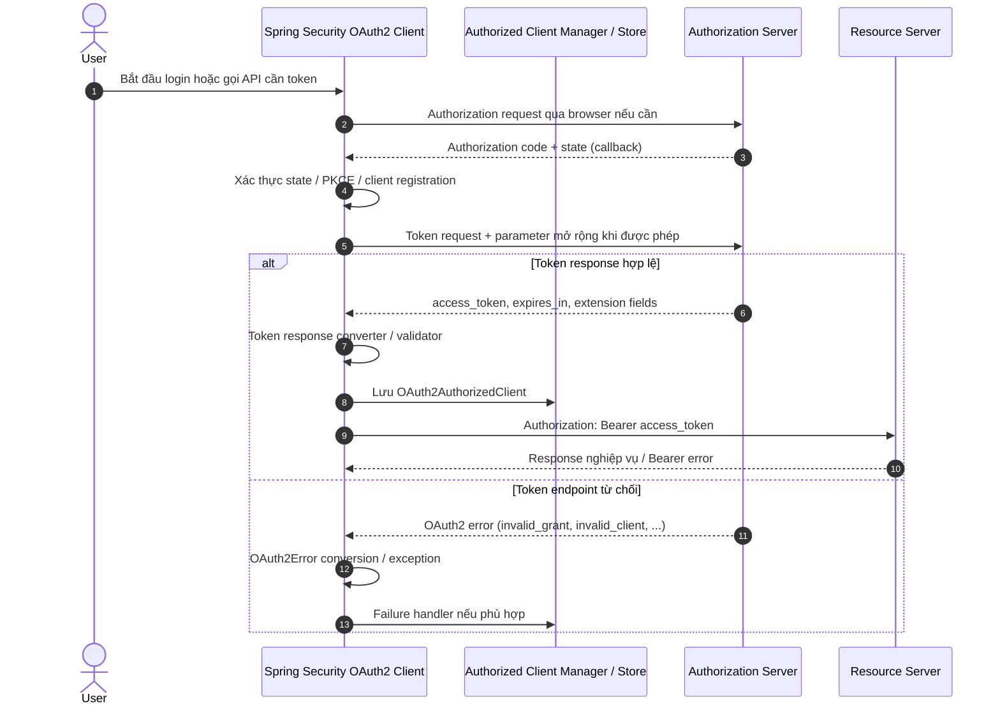
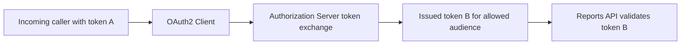

# 22.7. Mở rộng token request, token response và xử lý lỗi

Khi tích hợp **Spring Security OAuth 2.0 / OpenID Connect (OIDC) Client** với một Authorization Server, những request gửi đến **token endpoint** thường tuân theo OAuth 2.0: client gửi `grant_type` cùng các tham số tương ứng, server trả `access_token` hoặc OAuth2 error. Tuy nhiên, các tích hợp thực tế còn có thể yêu cầu:

- Một tham số bổ sung như `resource`, `audience` hoặc thuộc tính riêng do Authorization Server quy định;
- Một phương thức **client authentication** khác, ví dụ `private_key_jwt` thay cho `client_secret_basic`;
- Một **extension grant** như **JWT Bearer Grant (RFC 7523)** hoặc **Token Exchange (RFC 8693)**;
- Chuyển đổi token response không hoàn toàn theo tên trường tiêu chuẩn;
- Phân loại và xử lý lỗi `invalid_grant`, `invalid_client`, `invalid_target`, network timeout hoặc `401 invalid_token` từ Resource Server.

Spring Security cung cấp nhiều extension point để làm việc đó **mà không cần tự viết lại toàn bộ OAuth2 protocol**. Điểm khó là nhận diện **đúng tầng cần mở rộng**: authorization request ở browser, token request ở back channel, token response mapping, hay failure handler của authorized client manager.

Ví dụ token request chuẩn:

```http
POST /oauth2/token HTTP/1.1
Host: id.example.test
Content-Type: application/x-www-form-urlencoded
Authorization: Basic <redacted-client-authentication>

grant_type=authorization_code&
code=<redacted-code>&
redirect_uri=https%3A%2F%2Fapp.example.test%2Flogin%2Foauth2%2Fcode%2Fcompany&
code_verifier=<redacted-pkce-verifier>
```

Provider có thể hỗ trợ thêm một parameter, chẳng hạn:

```text
resource=https://reports.example.test
```

**Điều quan trọng:** thêm `resource` vào request không đồng nghĩa tự có scope, audience hay quyền mới. Authorization Server phải hỗ trợ tham số đó, xác thực client/grant và chỉ cấp token theo **authorization policy** đã cho phép.

Bài học này trình bày một quy trình mở rộng có kiểm soát, với ví dụ **Servlet + RestClient** và **Reactive WebFlux + WebClient**, cách tích hợp token response clients vào Spring Security, phân biệt lỗi tại token endpoint với lỗi tại API, cùng các tình huống kiểm thử và vận hành.

> Các ví dụ API tập trung vào **Spring Security 6.5 / Spring Boot 3.x, Java 17+**. Các class `RestClient*TokenResponseClient` được giới thiệu từ Spring Security 6.4; dự án 6.3 hoặc cũ hơn có thể còn dùng các `Default*TokenResponseClient` và RestOperations. Nội dung code cần đối chiếu phiên bản thực tế trước khi đưa vào production. Host `example.test` và scope chỉ là ví dụ.

---

## 1. Hiểu bốn ranh giới của OAuth2 flow

Một OAuth2 Client sử dụng Authorization Code Flow có thể đi qua hai HTTP endpoints khác nhau của Authorization Server.

**Authorization endpoint:** browser được chuyển hướng tới OP/AS để user xác thực và đồng ý quyền.

```text
GET https://id.example.test/oauth2/authorize?
    response_type=code
    &client_id=...
    &redirect_uri=...
    &scope=openid%20profile
    &state=...
    &code_challenge=...
```

**Token endpoint:** backend dùng authorization code để xin token:

```text
POST https://id.example.test/oauth2/token
Content-Type: application/x-www-form-urlencoded

grant_type=authorization_code
code=...
redirect_uri=...
code_verifier=...
```

Sau đó **Resource Server** nhận access token trong lời gọi API:

```http
GET /v1/reports HTTP/1.1
Host: reports.example.test
Authorization: Bearer <redacted-access-token>
```

Và **Client Manager** quản lý authorized client đã có, cũng như việc cấp lại token khi cần.

| Tầng | Dữ liệu và nhiệm vụ | Extension point điển hình |
| --- | --- | --- |
| Browser authorization request | `scope`, `prompt`, `state`, PKCE challenge, login hint | `OAuth2AuthorizationRequestResolver` / `ServerOAuth2AuthorizationRequestResolver` |
| **Token request** | `grant_type`, `code`, `refresh_token`, client auth, audience | `OAuth2AccessTokenResponseClient` và request converters |
| **Token response** | `access_token`, `token_type`, `expires_in`, `refresh_token`, extension fields | `OAuth2AccessTokenResponseHttpMessageConverter` / reactive body extractor |
| **Authorization lifecycle** | Lưu token, refresh, failure/removal, retry | `OAuth2AuthorizedClientManager` và success/failure handlers |
| **Resource Server API call** | `Authorization: Bearer ...`, 401/403 và scope | `RestClient` / `WebClient` OAuth2 interceptors |

**Không thêm `prompt=consent` vào token request nếu provider yêu cầu nó ở authorization endpoint.** Tương tự, không đưa `refresh_token` vào callback URL và không kỳ vọng một custom JSON converter có thể thay đổi quyền token đã cấp.

## 2. Luồng mở rộng từ đầu đến cuối



Trong sơ đồ, những thay đổi ở **token request/response** đều thuộc back-channel client ↔ Authorization Server. API downstream là tầng khác: nếu API trả 401/403, lỗi đó chỉ đến authorized-client failure handler khi HTTP client được cấu hình chuyển tiếp thông tin tương ứng.

## 3. Grant tiêu chuẩn và extension grant khác nhau

Một **authorization grant** quy định cách client có được access token.

| Grant | `grant_type` | Nội dung chính | Lưu ý |
| --- | --- | --- | --- |
| Authorization Code | `authorization_code` | `code`, `redirect_uri`, có thể PKCE verifier | Có user/browser flow |
| Refresh Token | `refresh_token` | `refresh_token` | Chỉ dùng credential đã được OP cấp |
| Client Credentials | `client_credentials` | Client authentication, scope khi cần | App-only, không giả làm user |
| JWT Bearer | `urn:ietf:params:oauth:grant-type:jwt-bearer` | `assertion` | RFC 7523; JWT cần được AS tin và kiểm tra |
| Token Exchange | `urn:ietf:params:oauth:grant-type:token-exchange` | `subject_token`, `subject_token_type`, tùy chọn `audience`/`resource` | RFC 8693; trao đổi token theo policy |
| Vendor-specific extension | URI hoặc giá trị được đăng ký với AS | Tùy thỏa thuận | Không tự nhận là chuẩn OAuth chung |

Phân biệt hai mức thay đổi:

**Mở rộng tham số của grant hiện có**: vẫn `grant_type=authorization_code`, chỉ thêm `resource` nếu AS hỗ trợ. Client vẫn phải tuân thủ toàn bộ yêu cầu của Authorization Code Flow.

**Mở rộng grant type**: dùng một `grant_type` khác, có request/response và policy riêng. Ví dụ Token Exchange không thể được mô phỏng đúng chỉ bằng việc thêm `subject_token` vào request vốn có `grant_type=authorization_code`.

### 3.1. Cảnh báo về client authentication

`private_key_jwt` là **phương thức xác thực client**, không nhất thiết là grant JWT Bearer. Trong một request Authorization Code + private_key_jwt:

```text
grant_type=authorization_code
code=...
client_assertion_type=urn:ietf:params:oauth:client-assertion-type:jwt-bearer
client_assertion=<signed-client-authentication-jwt>
```

Trong JWT Bearer Authorization Grant:

```text
grant_type=urn:ietf:params:oauth:grant-type:jwt-bearer
assertion=<jwt-authorization-grant>
```

Hai JWT ở hai ví dụ phục vụ **hai mục đích khác nhau**. Đừng nhầm `assertion` (grant) với `client_assertion` (client authentication) hoặc với OIDC ID Token.

---

## 4. Mô hình token response của Spring Security

Spring Security sử dụng **`OAuth2AccessTokenResponse`** làm model token response sau khi chuyển đổi dữ liệu HTTP.

Các trường quan trọng:

| Trường token endpoint | Ý nghĩa | Cách dùng trong client |
| --- | --- | --- |
| `access_token` | Bearer credential dùng gọi API | Trở thành `OAuth2AccessToken` |
| `token_type` | Loại token, thường là `Bearer` | Phải tương thích cách sử dụng |
| `expires_in` | Số giây hiệu lực (nếu được trả) | Tính thời hạn access token |
| `refresh_token` | Credential refresh tùy chọn | Trở thành `OAuth2RefreshToken` khi có |
| `scope` | Quyền đã cấp | Cần phân biệt với scopes đã yêu cầu |
| `id_token` | OIDC ID Token khi áp dụng | Dữ liệu OIDC riêng; không dùng làm API access token |
| `issued_token_type` | Loại token được phát hành trong Token Exchange | Trường mở rộng theo RFC 8693 |
| Custom provider fields | Metadata bổ sung | Có thể giữ trong `additionalParameters` |

Ví dụ JSON hợp lệ về hình thức cho Token Exchange:

```json
{
  "access_token": "REDACTED_ISSUED_TOKEN",
  "issued_token_type": "urn:ietf:params:oauth:token-type:access_token",
  "token_type": "Bearer",
  "expires_in": 900,
  "scope": "reports.read"
}
```

**Không phải cứ JSON có trường `access_token` là token đã đáng tin.** Client vẫn phải tin token endpoint đang cấu hình, xác thực TLS/client credentials, tuân thủ grant policy, còn Resource Server phải kiểm tra token theo issuer/audience/scope của nó.

### 4.1. OIDC ID Token không phải access token

Khi OIDC login, token endpoint có thể trả cả access token và ID Token. ID Token được dùng cho xác thực danh tính client, có quy tắc kiểm tra riêng như signature, `iss`, `aud`, `exp` và `nonce` khi áp dụng.

Nếu custom converter “hoán đổi” ID Token thành access token, Resource Server có thể từ chối; nghiêm trọng hơn, client có thể bỏ qua ranh giới xác thực OIDC. **Không dùng token response converter để thay thế OIDC validation**.

## 5. Các API Spring Security 6.5 dùng trong bài

### 5.1. Servlet stack

```java
import org.springframework.security.oauth2.client.endpoint.OAuth2AccessTokenResponseClient;
import org.springframework.security.oauth2.client.endpoint.RestClientAuthorizationCodeTokenResponseClient;
import org.springframework.security.oauth2.client.endpoint.RestClientRefreshTokenTokenResponseClient;
import org.springframework.security.oauth2.client.endpoint.RestClientClientCredentialsTokenResponseClient;
import org.springframework.security.oauth2.client.endpoint.RestClientTokenExchangeTokenResponseClient;
```

`OAuth2AccessTokenResponseClient<T>` là abstraction cho việc gửi token request và trả `OAuth2AccessTokenResponse` theo một grant request type.

Ví dụ:

```java
OAuth2AccessTokenResponseClient<OAuth2AuthorizationCodeGrantRequest> client =
    new RestClientAuthorizationCodeTokenResponseClient();
```

Loại generic **rất quan trọng**: response client của `OAuth2RefreshTokenGrantRequest` không thể tùy tiện dùng như response client của `OAuth2AuthorizationCodeGrantRequest`.

### 5.2. Reactive stack

```java
import org.springframework.security.oauth2.client.endpoint.ReactiveOAuth2AccessTokenResponseClient;
import org.springframework.security.oauth2.client.endpoint.WebClientReactiveAuthorizationCodeTokenResponseClient;
import org.springframework.security.oauth2.client.endpoint.WebClientReactiveRefreshTokenTokenResponseClient;
import org.springframework.security.oauth2.client.endpoint.WebClientReactiveClientCredentialsTokenResponseClient;
import org.springframework.security.oauth2.client.endpoint.WebClientReactiveTokenExchangeTokenResponseClient;
```

Reactive response client trả **`Mono<OAuth2AccessTokenResponse>`**. Nó không được chặn event loop và không được tự `subscribe()` rồi trả `Mono.empty()`.

### 5.3. Các extension points có trách nhiệm khác nhau

| API | Dùng để | Không dùng để |
| --- | --- | --- |
| `addHeadersConverter` | Thêm HTTP header an toàn cho token request | Thay thế client authentication vô tội vạ |
| `setHeadersConverter` | Thay chiến lược dựng headers | Lấy quyền mới từ AS |
| `addParametersConverter` | Thêm request parameters | Tùy ý xóa `grant_type` hoặc `code_verifier` |
| `setParametersConverter` | Ghi đè tham số mặc định khi cần | Tự động loại bỏ toàn bộ params mặc định |
| `setParametersCustomizer` | Can thiệp đầy đủ map params trước gửi | Bỏ những trường chuẩn bắt buộc |
| `setRestClient` | Tùy chỉnh transport + converters/error handler | Thay policy AS/RS |
| `setBodyExtractor` | Thay cách parse response ở Reactive | Bỏ qua OAuth2 error semantics |
| `setAuthorizationFailureHandler` | Chính sách sau authorization failure | Sửa response payload của OP |
| `OAuth2AuthorizedClientProvider` | Bật grant/logic cấp token | Thay authorization policy của Resource Server |

---

## 6. Thêm token request parameter trên Servlet: addParametersConverter

Đây là lựa chọn đầu tiên khi provider yêu cầu một parameter **ngoài** các trường mặc định.

Ví dụ một OP hỗ trợ token parameter `resource` theo thỏa thuận tích hợp:

```java
import org.springframework.context.annotation.Bean;
import org.springframework.context.annotation.Configuration;
import org.springframework.security.oauth2.client.endpoint.OAuth2AccessTokenResponseClient;
import org.springframework.security.oauth2.client.endpoint.RestClientAuthorizationCodeTokenResponseClient;
import org.springframework.security.oauth2.core.endpoint.OAuth2AuthorizationCodeGrantRequest;
import org.springframework.util.LinkedMultiValueMap;
import org.springframework.util.MultiValueMap;

@Configuration
class AuthorizationCodeTokenClientConfig {

    @Bean
    OAuth2AccessTokenResponseClient<OAuth2AuthorizationCodeGrantRequest>
            authorizationCodeTokenClient() {

        RestClientAuthorizationCodeTokenResponseClient client =
            new RestClientAuthorizationCodeTokenResponseClient();

        client.addParametersConverter(grantRequest -> {
            MultiValueMap<String, String> extra =
                new LinkedMultiValueMap<>();

            String registrationId =
                grantRequest.getClientRegistration().getRegistrationId();

            if ("reports-api".equals(registrationId)) {
                extra.set("resource", "https://reports.example.test");
            }

            return extra;
        });

        return client;
    }
}
```

Điểm quan trọng:

- Với registration khác `reports-api`, converter trả map rỗng: không thêm tham số dành riêng cho Reports.
- Các tham số chuẩn của authorization code request vẫn được Spring Security tạo.
- Chỉ thêm `resource` **nếu Authorization Server đó hỗ trợ và đã có contract rõ ràng**.
- Không lấy resource URL từ query parameter của browser để tránh xin token cho đích ngoài chính sách.
- `resource` không bảo đảm AS cấp audience mong muốn nếu client chưa có quyền.

### 6.1. Khi nào dùng audience thay resource?

Một số OP định nghĩa `audience` riêng; RFC 8707 định nghĩa **resource indicators**. Hai cách không nhất thiết tương đương trên mọi provider.

Nếu OP yêu cầu:

```text
audience=reports-api
```

thì có thể dùng:

```java
client.addParametersConverter(grantRequest -> {
    MultiValueMap<String, String> extra = new LinkedMultiValueMap<>();
    if ("reports-api".equals(
            grantRequest.getClientRegistration().getRegistrationId())) {
        extra.set("audience", "reports-api");
    }
    return extra;
});
```

**Không gửi cả `audience` và `resource` một cách ngẫu nhiên**. Chỉ sử dụng theo đúng thỏa thuận của OP và policy resource/audience.

### 6.2. Không đưa secret vào parameter bổ sung nếu không cần

```java
// Không nên: client secret nhúng cứng hoặc đi qua log parameter map.
extra.set("api_secret", "hardcoded-production-secret");
```

Nếu provider dùng client authentication method đặc biệt, cấu hình đúng method hoặc token HTTP client được bảo vệ, không tạo thêm một pseudo-password parameter tự định nghĩa.

---

## 7. Thêm HTTP headers cho token request

Spring Security hỗ trợ `addHeadersConverter()`:

```java
import org.springframework.http.HttpHeaders;

RestClientAuthorizationCodeTokenResponseClient tokenClient =
    new RestClientAuthorizationCodeTokenResponseClient();

tokenClient.addHeadersConverter(grantRequest -> {
    HttpHeaders headers = new HttpHeaders();
    if ("reports-api".equals(
            grantRequest.getClientRegistration().getRegistrationId())) {
        headers.set("X-Integration-Id", "reports-portal");
    }
    return headers;
});
```

Đây là ví dụ **header metadata không nhạy cảm** do provider đã đồng ý nhận.

**Không ghi đè `Authorization` bằng bearer token của Resource Server**. Token endpoint client authentication và bearer access token dùng gọi API là hai loại credential khác nhau.

### 7.1. addHeadersConverter khác setHeadersConverter

- **`addHeadersConverter`** bổ sung lên headers mặc định, phù hợp khi chỉ cần một header riêng.
- **`setHeadersConverter`** thay converter tạo headers, có thể vô tình làm mất Content-Type hoặc client authentication header nếu cấu hình sai.

Ví dụ cấu hình header converter mức thấp:

```java
DefaultOAuth2TokenRequestHeadersConverter headerConverter =
    new DefaultOAuth2TokenRequestHeadersConverter();

headerConverter.setEncodeClientCredentials(false);

tokenClient.setHeadersConverter(headerConverter);
```

Đây là ví dụ API có sẵn để tương thích với một số token endpoints. **Không tắt encoding cho mọi provider** vì tưởng rằng nó “bảo mật hơn”. Hãy dùng khi tài liệu provider hoặc kiểm thử tương thích xác nhận sự khác biệt cần thiết.

### 7.2. Client authentication cần được đăng ký

`ClientRegistration.clientAuthenticationMethod` xác định cơ chế như `client_secret_basic`, `client_secret_post` hoặc các phương thức khác được hỗ trợ. Với `private_key_jwt` cần cấu hình khóa ký, audience, thuật toán và assertion lifecycle theo OP.

Không dùng custom header bất kỳ để “giả” một phương thức xác thực mà AS không hỗ trợ.

## 8. Ghi đè parameter bằng setParametersConverter

Nếu nhà cung cấp yêu cầu **thay một tham số mặc định**, bạn có thể dùng `setParametersConverter`.

Ví dụ:

```java
RestClientAuthorizationCodeTokenResponseClient tokenClient =
    new RestClientAuthorizationCodeTokenResponseClient();

tokenClient.setParametersConverter(grantRequest -> {
    LinkedMultiValueMap<String, String> overrides =
        new LinkedMultiValueMap<>();

    if ("legacy-idp".equals(
            grantRequest.getClientRegistration().getRegistrationId())) {
        overrides.set("client_id", "registered-alias-id");
    }
    return overrides;
});
```

Trong Spring Security 6.5, method này **không có nghĩa bạn phải tự dựng lại toàn bộ tham số chuẩn**. Các tham số mặc định vẫn được cung cấp; những trường trong converter có thể **override** giá trị tương ứng.

**Nhưng đây là thao tác nhạy cảm**: ghi đè `client_id`, `redirect_uri`, `code` hoặc `code_verifier` dễ khiến token exchange hỏng hoặc tạo rủi ro bảo mật. Ví dụ alias chỉ dùng khi AS thực sự đăng ký và cho phép quy tắc đó; bình thường hãy sửa `ClientRegistration` đúng thay vì dùng converter.

### 8.1. Vì sao không sửa grant_type từ authorization_code thành token-exchange?

```java
// Sai mô hình: đổi chuỗi grant_type không tự biến request
// AuthorizationCodeGrantRequest thành RFC 8693 Token Exchange.
tokenClient.setParametersConverter(grantRequest -> {
    LinkedMultiValueMap<String, String> params =
        new LinkedMultiValueMap<>();
    params.set("grant_type",
        "urn:ietf:params:oauth:grant-type:token-exchange");
    return params;
});
```

Một Token Exchange request cần `subject_token` và `subject_token_type`, đồng thời grant-specific validation và provider phù hợp. Cần dùng **Token Exchange grant support**, không lách bằng string override.

## 9. setParametersCustomizer: chỉnh toàn bộ parameter map

Khi cần can thiệp toàn diện, Spring Security 6.5 hỗ trợ `setParametersCustomizer(...)`.

Ví dụ tài liệu chính thức minh họa việc bỏ `client_id` nếu có `client_assertion`:

```java
RestClientAuthorizationCodeTokenResponseClient tokenClient =
    new RestClientAuthorizationCodeTokenResponseClient();

tokenClient.setParametersCustomizer(parameters -> {
    if (parameters.containsKey("client_assertion")) {
        parameters.remove("client_id");
    }
});
```

Ý nghĩa:

- `addParametersConverter`: **thêm** vào request, dễ giữ nguyên mặc định.
- `setParametersConverter`: **override** giá trị với map trả về, mặc định vẫn tồn tại.
- `setParametersCustomizer`: **can thiệp bản cuối**, có thể thêm, sửa hoặc xóa tham số.

Chỉ bỏ `client_id` nếu token endpoint thực sự yêu cầu và phương thức client authentication được cấu hình đúng. Không dùng cách này để xóa `grant_type`, PKCE `code_verifier` hoặc các trường bắt buộc của giao thức.

### 9.1. Chọn hook theo thay đổi tối thiểu

| Nhu cầu | Ưu tiên |
| --- | --- |
| Chỉ thêm `resource` | `addParametersConverter` |
| Thêm header non-sensitive | `addHeadersConverter` |
| Override một parameter đã có | `setParametersConverter` |
| Bỏ parameter vì client auth method đặc thù | `setParametersCustomizer` |
| Thay transport/TLS/HTTP converter | `setRestClient` |
| Dùng grant type khác | Grant-specific client/provider, không phải converter của grant cũ |

---

## 10. Nối authorization code token client vào SecurityFilterChain

Định nghĩa bean custom response client **chưa phải lúc nào cũng chứng minh** filter đang dùng bean đó trong mọi cấu hình/version. Với một ứng dụng Servlet, có thể cấu hình tường minh:

```java
import org.springframework.context.annotation.Bean;
import org.springframework.context.annotation.Configuration;
import org.springframework.security.config.annotation.web.builders.HttpSecurity;
import org.springframework.security.oauth2.client.endpoint.OAuth2AccessTokenResponseClient;
import org.springframework.security.oauth2.core.endpoint.OAuth2AuthorizationCodeGrantRequest;
import org.springframework.security.web.SecurityFilterChain;

@Configuration
class OAuth2SecurityConfiguration {

    @Bean
    SecurityFilterChain securityFilterChain(
            HttpSecurity http,
            OAuth2AccessTokenResponseClient<OAuth2AuthorizationCodeGrantRequest>
                authorizationCodeTokenClient) throws Exception {

        return http
            .authorizeHttpRequests(auth -> auth
                .requestMatchers("/", "/error").permitAll()
                .anyRequest().authenticated())
            .oauth2Login(login -> login
                .tokenEndpoint(endpoint ->
                    endpoint.accessTokenResponseClient(
                        authorizationCodeTokenClient)))
            .oauth2Client(client -> client
                .authorizationCodeGrant(code ->
                    code.accessTokenResponseClient(
                        authorizationCodeTokenClient)))
            .build();
    }
}
```

Hai DSL có hai vai trò:

- **`oauth2Login().tokenEndpoint()`** điều khiển code exchange trong OAuth2/OIDC Login.
- **`oauth2Client().authorizationCodeGrant()`** điều khiển authorization-code support của OAuth2 Client ở Servlet.

Ứng dụng chỉ dùng OAuth2 Login có thể không cần custom cả hai. Nhưng nếu vừa login vừa kết nối API khác bằng authorization code, phải kiểm tra các flow thật sự sử dụng cấu hình token client mong muốn.

**Đừng tự thay OAuth2LoginAuthenticationProvider hoặc filter chain trừ khi cần thiết**. Token response client và converter là extension point hẹp, ít rủi ro hơn.

## 11. Cấu hình refresh token request khác authorization code request

Token refresh gửi:

```http
POST /oauth2/token HTTP/1.1
Host: id.example.test
Content-Type: application/x-www-form-urlencoded
Authorization: Basic <redacted-client-authentication>

grant_type=refresh_token&refresh_token=<redacted>
```

Nó **không** có `code` hay `redirect_uri` như authorization code token request.

Spring Security cung cấp **`RestClientRefreshTokenTokenResponseClient`**:

```java
RestClientRefreshTokenTokenResponseClient refreshClient =
    new RestClientRefreshTokenTokenResponseClient();

refreshClient.addParametersConverter(grantRequest -> {
    MultiValueMap<String, String> extra =
        new LinkedMultiValueMap<>();
    if ("reports-api".equals(
            grantRequest.getClientRegistration().getRegistrationId())) {
        extra.set("resource", "https://reports.example.test");
    }
    return extra;
});
```

Một số providers có thể yêu cầu resource/audience cả lúc refresh; provider khác có thể bỏ qua hoặc từ chối tham số này. **Không tái sử dụng converter của Authorization Code bằng cách ép generic type**.

### 11.1. Gắn refresh response client vào manager

```java
import org.springframework.context.annotation.Bean;
import org.springframework.context.annotation.Configuration;
import org.springframework.security.oauth2.client.OAuth2AuthorizedClientManager;
import org.springframework.security.oauth2.client.OAuth2AuthorizedClientProvider;
import org.springframework.security.oauth2.client.OAuth2AuthorizedClientProviderBuilder;
import org.springframework.security.oauth2.client.registration.ClientRegistrationRepository;
import org.springframework.security.oauth2.client.web.DefaultOAuth2AuthorizedClientManager;
import org.springframework.security.oauth2.client.web.OAuth2AuthorizedClientRepository;
import org.springframework.security.oauth2.client.endpoint.RestClientRefreshTokenTokenResponseClient;

@Configuration
class ManagerConfiguration {

    @Bean
    OAuth2AuthorizedClientManager authorizedClientManager(
            ClientRegistrationRepository registrations,
            OAuth2AuthorizedClientRepository storage) {

        RestClientRefreshTokenTokenResponseClient refreshClient =
            new RestClientRefreshTokenTokenResponseClient();

        refreshClient.addParametersConverter(request -> {
            org.springframework.util.MultiValueMap<String, String> p =
                new org.springframework.util.LinkedMultiValueMap<>();
            if ("reports-api".equals(
                    request.getClientRegistration().getRegistrationId())) {
                p.set("resource", "https://reports.example.test");
            }
            return p;
        });

        OAuth2AuthorizedClientProvider provider =
            OAuth2AuthorizedClientProviderBuilder.builder()
                .authorizationCode()
                .refreshToken(refresh ->
                    refresh.accessTokenResponseClient(refreshClient))
                .build();

        DefaultOAuth2AuthorizedClientManager manager =
            new DefaultOAuth2AuthorizedClientManager(registrations, storage);

        manager.setAuthorizedClientProvider(provider);
        return manager;
    }
}
```

Đây là manager cho **Servlet request context**. Nếu chạy scheduled job không có request, thường dùng `AuthorizedClientServiceOAuth2AuthorizedClientManager` và `OAuth2AuthorizedClientService` thay vì HTTP-session repository.

### 11.2. refreshToken() không tạo refresh token

Bật `refreshToken()` chỉ cho manager khả năng **dùng refresh token đã được OP cấp**. Nếu `OAuth2AuthorizedClient.getRefreshToken()==null`, provider không thể tự tạo credential từ access token.

Khi refresh thất bại với `invalid_grant`, cần xử lý authorized client đã mất hiệu lực theo failure policy, không retry cùng refresh token vô hạn.

## 12. Client credentials token request và app identity

Với machine-to-machine, sử dụng:

```text
grant_type=client_credentials
scope=reports.read
```

và client authentication được OP hỗ trợ.

Token client tương ứng:

```java
RestClientClientCredentialsTokenResponseClient credentialsClient =
    new RestClientClientCredentialsTokenResponseClient();

credentialsClient.addParametersConverter(request -> {
    MultiValueMap<String, String> extra = new LinkedMultiValueMap<>();
    if ("billing-service".equals(
            request.getClientRegistration().getRegistrationId())) {
        extra.set("audience", "billing-api");
    }
    return extra;
});
```

Cấu hình manager service-level:

```java
AuthorizedClientServiceOAuth2AuthorizedClientManager manager =
    new AuthorizedClientServiceOAuth2AuthorizedClientManager(
        registrations, authorizedClientService);

OAuth2AuthorizedClientProvider provider =
    OAuth2AuthorizedClientProviderBuilder.builder()
        .clientCredentials(configurer ->
            configurer.accessTokenResponseClient(credentialsClient))
        .build();

manager.setAuthorizedClientProvider(provider);
```

Trong ví dụ này, `registrations` có type `ClientRegistrationRepository` và `authorizedClientService` có type `OAuth2AuthorizedClientService`, được inject từ Spring container.

**Đừng dùng client credentials để mượn quyền người dùng** nếu API thực sự yêu cầu delegated user authorization; token app-only và token người dùng có trust boundary khác nhau.

---

## 13. Token Exchange (RFC 8693): extension grant đúng nghĩa

Token Exchange là ví dụ quan trọng nhất của **grant mở rộng**. Client đưa một token đã có (**subject token**) tới Authorization Server và yêu cầu một token khác theo policy.

Một request RFC 8693 có thể trông như:

```http
POST /oauth2/token HTTP/1.1
Host: id.example.test
Content-Type: application/x-www-form-urlencoded
Authorization: Basic <redacted-client-authentication>

grant_type=urn:ietf:params:oauth:grant-type:token-exchange&
subject_token=<redacted-subject-token>&
subject_token_type=urn:ietf:params:oauth:token-type:access_token&
requested_token_type=urn:ietf:params:oauth:token-type:access_token&
audience=reports-api
```

Các trường:

| Parameter | Vai trò |
| --- | --- |
| `grant_type` | Bắt buộc là token-exchange URN |
| `subject_token` | Credential đầu vào đang được trao đổi |
| `subject_token_type` | Kiểu subject token đầu vào |
| `actor_token` | Token actor khi có mô hình delegation |
| `actor_token_type` | Kiểu actor token tương ứng |
| `requested_token_type` | Loại token đầu ra muốn nhận, tùy chọn |
| `audience` | Audience đích, khi AS hỗ trợ |
| `resource` | Resource indicator cụ thể |
| `scope` | Quyền cần cấp theo chính sách AS |

Không phải token nào cũng có thể exchange sang audience bất kỳ. Authorization Server phải xác minh **subject token, client identity, delegation/impersonation policy, allowed audiences và scopes**.

### 13.1. Token Exchange không đồng nghĩa token forwarding

**Forwarding:** gửi token A trực tiếp cho API B.

**Token Exchange:** đưa token A cho Authorization Server được tin cậy, rồi nhận token B theo policy dành cho API B.



Nếu token A không hợp lệ cho Reports API, forwarding là sai. Exchange chỉ hợp lệ khi AS công khai hỗ trợ RFC 8693 và client được phép thực hiện trao đổi đó.

### 13.2. Spring Security 6.5 có hỗ trợ Token Exchange

Spring Security có **`TokenExchangeOAuth2AuthorizedClientProvider`** và **`RestClientTokenExchangeTokenResponseClient`**; trên Reactive có các phiên bản tương ứng.

Một token response client tùy chỉnh cho Token Exchange:

```java
import org.springframework.security.oauth2.client.endpoint.RestClientTokenExchangeTokenResponseClient;
import org.springframework.util.LinkedMultiValueMap;
import org.springframework.util.MultiValueMap;

RestClientTokenExchangeTokenResponseClient exchangeClient =
    new RestClientTokenExchangeTokenResponseClient();

exchangeClient.addParametersConverter(grantRequest -> {
    MultiValueMap<String, String> extra = new LinkedMultiValueMap<>();

    if ("reports-exchange".equals(
            grantRequest.getClientRegistration().getRegistrationId())) {
        extra.set("audience", "reports-api");
    }

    return extra;
});
```

Đây chỉ là phần **thêm audience**. Provider vẫn cần **subject token được giải quyết an toàn từ authentication/context** và registration có grant token-exchange được Authorization Server chấp thuận.

### 13.3. Đưa response client vào provider

```java
TokenExchangeOAuth2AuthorizedClientProvider exchangeProvider =
    new TokenExchangeOAuth2AuthorizedClientProvider();

exchangeProvider.setAccessTokenResponseClient(exchangeClient);

OAuth2AuthorizedClientProvider provider =
    OAuth2AuthorizedClientProviderBuilder.builder()
        .provider(exchangeProvider)
        .build();
```

Các class thuộc package `org.springframework.security.oauth2.client`, builder tương ứng ở cùng package.

Sau đó đăng ký provider trên manager:

```java
DefaultOAuth2AuthorizedClientManager manager =
    new DefaultOAuth2AuthorizedClientManager(
        clientRegistrationRepository,
        authorizedClientRepository);

manager.setAuthorizedClientProvider(provider);
```

Snippet giả định các repository được cung cấp qua DI. Nếu ứng dụng cần cả authorization code/refresh/token exchange, build một composite provider phù hợp, ví dụ:

```java
OAuth2AuthorizedClientProvider provider =
    OAuth2AuthorizedClientProviderBuilder.builder()
        .authorizationCode()
        .refreshToken()
        .provider(exchangeProvider)
        .build();
```

**Không có fallback tự động từ authorization code sang token exchange hay client credentials để vượt quyền**. Grant được chọn theo `ClientRegistration`/context đã cấu hình.

### 13.4. Registration dành cho Token Exchange

```yaml
spring:
  security:
    oauth2:
      client:
        registration:
          reports-exchange:
            provider: company
            client-id: ${EXCHANGE_CLIENT_ID}
            client-secret: ${EXCHANGE_CLIENT_SECRET}
            authorization-grant-type: urn:ietf:params:oauth:grant-type:token-exchange
            scope:
              - reports.read

        provider:
          company:
            token-uri: https://id.example.test/oauth2/token
```

Một `token-uri` vẫn cần HTTPS hợp lệ. Scope `reports.read` ở đây chỉ có ý nghĩa nếu AS hỗ trợ; policy exchange có thể còn yêu cầu audience, resource và các token types.

### 13.5. Đừng dùng token của một người khác làm subject token

Nếu request đang xử lý cho Alice, không cho phép browser truyền `subjectToken` tùy ý rồi đem đổi cho Reports API. Token đầu vào phải đến từ nguồn đáng tin, được ràng buộc với ngữ cảnh thực thi, chủ thể/tenant phù hợp và quyền exchange đã được kiểm tra.

Trong hệ thống nhiều tenant, audience/resource không được chọn từ URL do người dùng tùy ý nhập.

## 14. JWT Bearer Grant (RFC 7523) và private_key_jwt

Một grant mở rộng khác là **JWT Bearer Authorization Grant**:

```http
POST /oauth2/token HTTP/1.1
Host: id.example.test
Content-Type: application/x-www-form-urlencoded

grant_type=urn:ietf:params:oauth:grant-type:jwt-bearer&
assertion=<redacted-signed-jwt>
```

Authorization Server kiểm tra chữ ký JWT, issuer, audience, thời hạn, subject và các ràng buộc theo hợp đồng.

Trong Spring Security 6.x, `JwtBearerOAuth2AuthorizedClientProvider` được dùng để hỗ trợ grant này; token client có thể là `RestClientJwtBearerTokenResponseClient`.

```java
RestClientJwtBearerTokenResponseClient jwtClient =
    new RestClientJwtBearerTokenResponseClient();

JwtBearerOAuth2AuthorizedClientProvider jwtProvider =
    new JwtBearerOAuth2AuthorizedClientProvider();

jwtProvider.setAccessTokenResponseClient(jwtClient);

OAuth2AuthorizedClientProvider provider =
    OAuth2AuthorizedClientProviderBuilder.builder()
        .provider(jwtProvider)
        .build();
```

Provider còn cần **JWT assertion hợp lệ** từ authorization context theo cơ chế được hỗ trợ. Với `JwtAuthenticationToken`, Spring Security có cơ chế giải quyết assertion từ principal JWT theo contract của provider; nếu cần assertion khác, cấu hình resolver tin cậy.

**Phải phân biệt**:

- `grant_type=...jwt-bearer` cùng `assertion`: JWT dùng như *authorization grant*;
- `client_assertion_type=...jwt-bearer` cùng `client_assertion`: JWT dùng để *xác thực client*;
- `id_token`: OIDC token dùng để xác thực danh tính cho client.

Đưa một ID Token vào `assertion` mà không có quy tắc OP chấp thuận không tự tạo JWT Bearer Grant hợp lệ.

---

## 15. Tùy chỉnh token response: tại sao cần converter?

Phần lớn Authorization Servers trả JSON chuẩn:

```json
{
  "access_token": "REDACTED_ACCESS_TOKEN",
  "token_type": "Bearer",
  "expires_in": 3600,
  "refresh_token": "REDACTED_REFRESH_TOKEN",
  "scope": "reports.read"
}
```

Nhưng một provider legacy có thể trả tên trường khác:

```json
{
  "accessToken": "REDACTED_ACCESS_TOKEN",
  "tokenType": "Bearer",
  "expiresIn": 3600,
  "refreshToken": "REDACTED_REFRESH_TOKEN",
  "permissions": "reports.read",
  "tenant": "west"
}
```

Đây **không phải OAuth2 access token response tiêu chuẩn**. Nếu cần tích hợp, một response converter có thể chuẩn hóa tên trường thành model Spring Security.

**Nguyên tắc:** thay đổi cách parse, không thay tính hợp lệ của token. Không tự tạo một access token giả, bỏ qua signature/audience/expiry, hoặc bí mật nâng cấp scope.

### 15.1. Converter mặc định

Spring Security cung cấp:

- **`OAuth2AccessTokenResponseHttpMessageConverter`**: HTTP message converter cho token response JSON trên Servlet/RestClient.
- **`DefaultMapOAuth2AccessTokenResponseConverter`**: chuyển Map tham số sang `OAuth2AccessTokenResponse`.
- **`OAuth2AccessTokenResponse.Builder`**: tạo model khi thực sự cần custom mapping.

Nếu provider đã trả format tiêu chuẩn, **để converter mặc định** là lựa chọn ít rủi ro nhất.

## 16. Servlet response mapping: normalize rồi delegate

Một cách an toàn khi provider dùng tên field khác là **chuẩn hóa chỉ những field được biết**, sau đó delegate tới converter chuẩn của Spring Security.

```java
import java.util.LinkedHashMap;
import java.util.Map;

import org.springframework.context.annotation.Bean;
import org.springframework.context.annotation.Configuration;
import org.springframework.security.oauth2.core.endpoint.DefaultMapOAuth2AccessTokenResponseConverter;
import org.springframework.security.oauth2.core.endpoint.OAuth2AccessTokenResponse;
import org.springframework.security.oauth2.core.http.converter.OAuth2AccessTokenResponseHttpMessageConverter;

@Configuration
class LegacyTokenResponseMapping {

    @Bean
    OAuth2AccessTokenResponseHttpMessageConverter
            accessTokenResponseConverter() {

        OAuth2AccessTokenResponseHttpMessageConverter converter =
            new OAuth2AccessTokenResponseHttpMessageConverter();

        DefaultMapOAuth2AccessTokenResponseConverter delegate =
            new DefaultMapOAuth2AccessTokenResponseConverter();

        converter.setAccessTokenResponseConverter(raw -> {
            Map<String, Object> normalized =
                new LinkedHashMap<>(raw);

            copyAlias(normalized, "accessToken", "access_token");
            copyAlias(normalized, "tokenType", "token_type");
            copyAlias(normalized, "expiresIn", "expires_in");
            copyAlias(normalized, "refreshToken", "refresh_token");
            copyAlias(normalized, "permissions", "scope");

            OAuth2AccessTokenResponse response =
                delegate.convert(normalized);

            if (response == null) {
                throw new IllegalArgumentException(
                    "Invalid OAuth2 access token response");
            }

            return response;
        });

        return converter;
    }

    private static void copyAlias(Map<String, Object> values,
                                  String source,
                                  String target) {
        if (!values.containsKey(target) && values.containsKey(source)) {
            values.put(target, values.get(source));
        }
    }
}
```

**Giải thích:**

1. Không sửa `raw` tại chỗ; tạo một `LinkedHashMap` mới.
2. Chỉ ánh xạ những alias đã được ký hợp đồng với provider.
3. Không thay `access_token` đã đúng bằng `accessToken` nếu cả hai có mặt.
4. Delegate giúp giữ các quy tắc chuẩn của Spring Security thay vì tự dựng token.
5. Không đổi thời hạn/token type thành giá trị “cho chạy được” khi response bị hỏng.

Nếu response có trường `tenant`, nó có thể được giữ như additional metadata tùy converter. **Đừng dùng metadata này làm quyền tenant đã được xác thực** nếu chưa xác minh nguồn và chính sách.

### 16.1. Cảnh báo về mapping expiresIn

Nếu provider trả:

```json
{ "expiresIn": 3600000 }
```

có thể đó là **milliseconds**, trong khi OAuth2 `expires_in` được biểu diễn bằng **seconds**. Chép thẳng có thể làm client nghĩ token sống lâu gấp 1.000 lần.

Cần hợp đồng provider rõ ràng; nếu phải đổi đơn vị, hãy làm điều đó trong converter theo registration/provider và kiểm tra overflow, số âm và giới hạn policy. Không giả định mọi field đặt tên `expiresIn` là milliseconds.

### 16.2. Nguy cơ dữ liệu mâu thuẫn

Nếu response có cả `accessToken` và `access_token` nhưng giá trị khác nhau, nên **coi là lỗi hợp đồng** thay vì chọn tùy tiện. Với security-critical fields, có thể thiết kế converter fail closed khi dữ liệu mâu thuẫn.

## 17. Dùng custom converter trong RestClient của token response client

Một bean converter **không nhất thiết tự được token client sử dụng**. Với `RestClientAuthorizationCodeTokenResponseClient`, bạn có thể tạo một RestClient chuyên cho token endpoint:

```java
import org.springframework.http.converter.FormHttpMessageConverter;
import org.springframework.security.oauth2.client.endpoint.RestClientAuthorizationCodeTokenResponseClient;
import org.springframework.security.oauth2.client.http.OAuth2ErrorResponseErrorHandler;
import org.springframework.security.oauth2.core.http.converter.OAuth2AccessTokenResponseHttpMessageConverter;
import org.springframework.web.client.RestClient;

OAuth2AccessTokenResponseHttpMessageConverter tokenConverter =
    new OAuth2AccessTokenResponseHttpMessageConverter();

// Có thể gọi setAccessTokenResponseConverter(...) tại đây,
// hoặc dùng bean converter từ phần 16.

RestClient tokenRestClient = RestClient.builder()
    .messageConverters(converters -> {
        converters.clear();
        converters.add(new FormHttpMessageConverter());
        converters.add(tokenConverter);
    })
    .defaultStatusHandler(new OAuth2ErrorResponseErrorHandler())
    .build();

RestClientAuthorizationCodeTokenResponseClient tokenClient =
    new RestClientAuthorizationCodeTokenResponseClient();

tokenClient.setRestClient(tokenRestClient);
```

**Cần giữ cả hai thành phần:**

- `FormHttpMessageConverter` để gửi request form-urlencoded.
- `OAuth2AccessTokenResponseHttpMessageConverter` để đọc token response.

Đồng thời, **`OAuth2ErrorResponseErrorHandler`** giữ việc chuyển HTTP OAuth2 error thành failure phù hợp. Nếu chỉ tạo `RestClient.builder().build()` rồi đưa vào token client mà không có converter/error handler, token exchange có thể hỏng hoặc lỗi bị xử lý sai.

### 17.1. Tùy chỉnh transport với giới hạn bảo mật

Token RestClient có thể được cấu hình TLS, proxy tin cậy, connection/request timeout, telemetry redaction và network policy. Nhưng:

- Chỉ gửi token request tới `token-uri` của OP đã cấu hình và được tin cậy.
- Không tự động follow redirect để gửi client secret đến origin khác.
- Không log request form chứa `code`, `refresh_token`, `assertion` hoặc `client_assertion`.
- Không tắt TLS certificate verification.
- Không replay refresh token nhiều lần khi nhận `invalid_grant`.

## 18. Reactive token request: WebClientReactiveAuthorizationCodeTokenResponseClient

Trên WebFlux, API có chức năng tương tự nhưng thực thi non-blocking:

```java
import org.springframework.context.annotation.Bean;
import org.springframework.context.annotation.Configuration;
import org.springframework.security.oauth2.client.endpoint.ReactiveOAuth2AccessTokenResponseClient;
import org.springframework.security.oauth2.client.endpoint.WebClientReactiveAuthorizationCodeTokenResponseClient;
import org.springframework.security.oauth2.core.endpoint.OAuth2AuthorizationCodeGrantRequest;
import org.springframework.util.LinkedMultiValueMap;
import org.springframework.util.MultiValueMap;

@Configuration
class ReactiveTokenClientConfiguration {

    @Bean
    ReactiveOAuth2AccessTokenResponseClient<OAuth2AuthorizationCodeGrantRequest>
            reactiveAuthorizationCodeTokenClient() {

        WebClientReactiveAuthorizationCodeTokenResponseClient client =
            new WebClientReactiveAuthorizationCodeTokenResponseClient();

        client.addParametersConverter(request -> {
            MultiValueMap<String, String> extra =
                new LinkedMultiValueMap<>();

            if ("reports-api".equals(
                    request.getClientRegistration().getRegistrationId())) {
                extra.set("resource", "https://reports.example.test");
            }

            return extra;
        });

        return client;
    }
}
```

Cách gọi `addParametersConverter()` có ý nghĩa tương tự Servlet: **thêm** tham số mà không làm mất các tham số mặc định.

### 18.1. Reactive cũng có ba mức tùy biến parameters

```java
WebClientReactiveAuthorizationCodeTokenResponseClient client =
    new WebClientReactiveAuthorizationCodeTokenResponseClient();

client.addParametersConverter(request -> {
    LinkedMultiValueMap<String, String> extra =
        new LinkedMultiValueMap<>();
    extra.set("resource", "https://reports.example.test");
    return extra;
});

// Khi cần override một tham số mặc định:
client.setParametersConverter(request -> {
    LinkedMultiValueMap<String, String> override =
        new LinkedMultiValueMap<>();
    // Override có điều kiện theo registration đã cấu hình.
    return override;
});

// Khi thật sự cần chỉnh map cuối:
client.setParametersCustomizer(params -> {
    if (params.containsKey("client_assertion")) {
        params.remove("client_id");
    }
});
```

Đây là minh họa ba extension points; **không nhất thiết gọi cả ba trên cùng client trong production**. Chọn hook tối thiểu theo contract provider.

### 18.2. Đừng chặn Reactor event loop

```java
// Sai trong reactive pipeline:
OAuth2AccessTokenResponse response =
    client.getTokenResponse(request).block();
```

Thay vào đó, compose publisher:

```java
Mono<OAuth2AccessTokenResponse> response =
    client.getTokenResponse(request)
        .doOnNext(value -> recordSafeSuccessMetric());
```

`recordSafeSuccessMetric()` là method observability do ứng dụng định nghĩa; không được ghi raw token. Thông thường manager đã thay bạn gọi response client; application layer không cần gọi trực tiếp.

## 19. Reactive token response: BodyExtractor và error mapping

Trên Reactive, `WebClientReactiveAuthorizationCodeTokenResponseClient` hỗ trợ **`setBodyExtractor(...)`** để tùy chỉnh chuyển đổi body thành `OAuth2AccessTokenResponse`.

Ví dụ **skeleton** cho response converter:

```java
import java.util.Map;
import org.springframework.core.ParameterizedTypeReference;
import org.springframework.http.ReactiveHttpInputMessage;
import org.springframework.security.oauth2.client.endpoint.WebClientReactiveAuthorizationCodeTokenResponseClient;
import org.springframework.security.oauth2.core.endpoint.DefaultMapOAuth2AccessTokenResponseConverter;
import org.springframework.security.oauth2.core.endpoint.OAuth2AccessTokenResponse;
import org.springframework.web.reactive.function.BodyExtractor;
import org.springframework.web.reactive.function.BodyExtractors;
import reactor.core.publisher.Mono;

WebClientReactiveAuthorizationCodeTokenResponseClient client =
    new WebClientReactiveAuthorizationCodeTokenResponseClient();

BodyExtractor<Mono<Map<String, Object>>, ReactiveHttpInputMessage>
    mapExtractor = BodyExtractors.toMono(
        new ParameterizedTypeReference<Map<String, Object>>() {});

DefaultMapOAuth2AccessTokenResponseConverter delegate =
    new DefaultMapOAuth2AccessTokenResponseConverter();

client.setBodyExtractor((inputMessage, context) ->
    mapExtractor.extract(inputMessage, context)
        .map(raw -> {
            Map<String, Object> normalized = normalizeProviderFields(raw);
            OAuth2AccessTokenResponse result =
                delegate.convert(normalized);
            if (result == null) {
                throw new IllegalArgumentException(
                    "Token response could not be converted");
            }
            return result;
        })
);
```

`normalizeProviderFields(...)` là hàm do ứng dụng triển khai theo hợp đồng provider, tương tự mục 16. Ví dụ **không độc lập hoàn chỉnh** cho tới khi bạn triển khai hàm này và điều kiện lỗi.

**Cảnh báo đặc biệt quan trọng:** khi thay **BodyExtractor**, bạn phải chủ động phát hiện và chuyển **OAuth2 Error Response** thành Reactor error signal phù hợp. Converter không được xem:

```json
{"error":"invalid_grant"}
```

là một access token response hợp lệ hoặc trả `Mono.empty()` để che lỗi.

### 19.1. Có thể giữ body extractor mặc định không?

Có, và đó thường là lựa chọn tốt nhất. Spring Security cung cấp **`OAuth2BodyExtractors.oauth2AccessTokenResponse()`** làm mặc định để parse token response và xử lý lỗi theo hợp đồng. Chỉ viết custom extractor nếu provider thực sự không tương thích và bạn đã xác định phương án error propagation.

### 19.2. Thêm WebClient transport riêng

```java
WebClient tokenHttpClient = WebClient.builder()
    // TLS/proxy/timeout/observability được cấu hình có kiểm soát.
    .build();

WebClientReactiveAuthorizationCodeTokenResponseClient client =
    new WebClientReactiveAuthorizationCodeTokenResponseClient();

client.setWebClient(tokenHttpClient);
```

Việc dùng custom `WebClient` cho **token endpoint** khác với `WebClient` có OAuth2 filter để gọi Resource Server. Không cấu hình token HTTP client sao cho nó lại gắn access token đang xin vào request token endpoint.

## 20. Gắn reactive response client vào manager đúng cách

Khi cần refresh token với parameter riêng trong WebFlux:

```java
import org.springframework.context.annotation.Bean;
import org.springframework.context.annotation.Configuration;
import org.springframework.security.oauth2.client.DefaultReactiveOAuth2AuthorizedClientManager;
import org.springframework.security.oauth2.client.ReactiveOAuth2AuthorizedClientManager;
import org.springframework.security.oauth2.client.ReactiveOAuth2AuthorizedClientProvider;
import org.springframework.security.oauth2.client.ReactiveOAuth2AuthorizedClientProviderBuilder;
import org.springframework.security.oauth2.client.endpoint.WebClientReactiveRefreshTokenTokenResponseClient;
import org.springframework.security.oauth2.client.registration.ReactiveClientRegistrationRepository;
import org.springframework.security.oauth2.client.web.server.ServerOAuth2AuthorizedClientRepository;

@Configuration
class ReactiveManagerConfiguration {

    @Bean
    ReactiveOAuth2AuthorizedClientManager webAuthorizedClientManager(
            ReactiveClientRegistrationRepository registrations,
            ServerOAuth2AuthorizedClientRepository storage) {

        WebClientReactiveRefreshTokenTokenResponseClient refreshClient =
            new WebClientReactiveRefreshTokenTokenResponseClient();

        refreshClient.addParametersConverter(request -> {
            org.springframework.util.LinkedMultiValueMap<String, String> p =
                new org.springframework.util.LinkedMultiValueMap<>();

            if ("reports-api".equals(
                    request.getClientRegistration().getRegistrationId())) {
                p.set("resource", "https://reports.example.test");
            }

            return p;
        });

        ReactiveOAuth2AuthorizedClientProvider provider =
            ReactiveOAuth2AuthorizedClientProviderBuilder.builder()
                .authorizationCode()
                .refreshToken(configurer ->
                    configurer.accessTokenResponseClient(refreshClient))
                .build();

        DefaultReactiveOAuth2AuthorizedClientManager manager =
            new DefaultReactiveOAuth2AuthorizedClientManager(
                registrations, storage);

        manager.setAuthorizedClientProvider(provider);
        return manager;
    }
}
```

Những lưu ý:

- `DefaultReactiveOAuth2AuthorizedClientManager` dành cho **`ServerWebExchange` context**.
- Trong background worker không có HTTP exchange, dùng `AuthorizedClientServiceReactiveOAuth2AuthorizedClientManager` và `ReactiveOAuth2AuthorizedClientService`.
- `refreshToken()` không tạo refresh token khi OP chưa cấp.
- Một authorization code token response client được custom riêng cho login có thể cần được cấu hình ở **reactive OAuth2 login authentication manager/DSL** nếu hạ tầng đó không lấy bean theo auto-configuration như bạn dự kiến.

---

## 21. OAuth2 Error Response: mô hình chuẩn

OAuth2 token endpoint thường trả lỗi JSON theo RFC 6749:

```http
HTTP/1.1 400 Bad Request
Content-Type: application/json
Cache-Control: no-store
Pragma: no-cache

{
  "error": "invalid_grant",
  "error_description": "Refresh token expired",
  "error_uri": "https://id.example.test/docs/errors"
}
```

**`error`** là mã lỗi để phân loại. `error_description` và `error_uri` có thể chứa dữ liệu do OP cung cấp; không mặc định hiển thị nguyên nội dung lên UI hay tự động backend fetch error_uri.

Trong Spring Security, model tương ứng là **`OAuth2Error`**. Khi token endpoint trả lỗi, client nên phát ra **`OAuth2AuthorizationException`** hoặc exception phù hợp để manager/failure handler xử lý, không trả một response giả như:

```json
{"access_token": "PLACEHOLDER_TOKEN"}
```

### 21.1. Các mã lỗi thường gặp

| Error code | Nguồn điển hình | Ý nghĩa chính | Cách ứng dụng phản ứng |
| --- | --- | --- | --- |
| `invalid_request` | Token endpoint | Thiếu/sai tham số | Kiểm tra converter và protocol |
| `invalid_client` | Token endpoint | Client authentication thất bại | Kiểm tra client ID/secret/cert, không retry vô hạn |
| `invalid_grant` | Token endpoint | Code/refresh token/grant invalid, expired hoặc revoked | Dừng dùng grant cũ, reauthorize khi phù hợp |
| `unauthorized_client` | Token endpoint | Client không được dùng grant này | Sửa AS registration/policy |
| `unsupported_grant_type` | Token endpoint | AS không hỗ trợ `grant_type` | Không tự thay sang client_credentials |
| `invalid_scope` | Token endpoint | Xin scope không hợp lệ | Kiểm tra scope được cấp và provider policy |
| `invalid_target` | Token Exchange | Audience/resource mục tiêu không được phép | Kiểm tra token exchange policy |
| `temporarily_unavailable` | Provider | Dịch vụ tạm thời không sẵn sàng | Retry/backoff có giới hạn nếu hợp lý |
| `invalid_token` | Resource Server Bearer challenge | Access token không hợp lệ | Xem audience/expiry/revocation và failure handling |
| `insufficient_scope` | Resource Server Bearer challenge | Quyền token không đủ | Xin consent/scope đúng; không refresh vô hạn |

**Một mã HTTP không đồng nhất với một OAuth2 error code.** Ví dụ 401 tại API không chứng minh token endpoint trả `invalid_client`; 403 có thể do policy tài nguyên dù access token hợp lệ.

## 22. Servlet: tùy chỉnh OAuth2Error converter

Trong Spring Security 6.5, **`OAuth2ErrorResponseErrorHandler`** có thể dùng **`OAuth2ErrorHttpMessageConverter`** để chuyển JSON lỗi thành `OAuth2Error`.

Giả sử provider cũ có field `vendor_error` thay cho `error`. Bạn có thể normalize **theo hợp đồng đã biết**, không tự che lỗi:

```java
import org.springframework.security.oauth2.client.http.OAuth2ErrorResponseErrorHandler;
import org.springframework.security.oauth2.core.OAuth2Error;
import org.springframework.security.oauth2.core.http.converter.OAuth2ErrorHttpMessageConverter;

OAuth2ErrorHttpMessageConverter converter =
    new OAuth2ErrorHttpMessageConverter();

converter.setErrorConverter(parameters -> {
    String code = parameters.get("error");

    if (code == null || code.isBlank()) {
        code = parameters.get("vendor_error");
    }
    if (code == null || code.isBlank()) {
        code = "server_error";
    }

    // Không phản chiếu nguyên error_description nếu chứa thông tin nhạy cảm.
    return new OAuth2Error(
        code,
        "Token endpoint rejected the authorization request",
        null);
});

OAuth2ErrorResponseErrorHandler errorHandler =
    new OAuth2ErrorResponseErrorHandler();

errorHandler.setErrorConverter(converter);
```

Sau đó gắn handler vào token RestClient cùng token response converter như mục 17:

```java
RestClient tokenRestClient = RestClient.builder()
    .messageConverters(converters -> {
        converters.clear();
        converters.add(new FormHttpMessageConverter());
        converters.add(tokenResponseConverter);
    })
    .defaultStatusHandler(errorHandler)
    .build();

tokenClient.setRestClient(tokenRestClient);
```

`tokenResponseConverter` là instance `OAuth2AccessTokenResponseHttpMessageConverter` do bạn tạo. Bài này dùng hai snippet tách biệt để thể hiện trách nhiệm; trong production hãy tạo bean/configuration phù hợp.

### 22.1. Tại sao không chỉ log HTTP status và trả null?

Nếu token endpoint trả `invalid_grant`, manager cần biết để xử lý authorized client cũ. Khi error handler chỉ trả `null` hoặc phản hồi giả, manager có thể coi authorization thành công dù token không hợp lệ, gây retry loop hoặc rò rỉ credential.

**Fail closed**: nhận lỗi từ provider → chuyển thành loại lỗi rõ ràng → để manager/failure policy xử lý; không tự chuyển lỗi thành success.

### 22.2. Lỗi định dạng khác OAuth2

Nếu provider trả HTML `500 Internal Server Error`, lỗi proxy hoặc JSON không parse được, đó là **transport/protocol error** cần phân loại riêng. Không tùy tiện ánh xạ mọi exception thành `invalid_grant` rồi xóa refresh token của user.

## 23. Reactive: xử lý lỗi mà không phá Reactor contract

Trên Reactive stack, token client cần trả:

```java
Mono<OAuth2AccessTokenResponse>
```

khi thành công, và phát:

```java
Mono.error(authorizationException)
```

khi thất bại.

Nếu custom BodyExtractor thấy:

```json
{
  "error": "invalid_grant"
}
```

phải phát lỗi phù hợp, không trả `Mono.empty()` khiến manager hiểu nhầm là không cần authorize.

### 23.1. Reactive error handling trong service layer

Khi gọi một manager đã được cấu hình, ứng dụng có thể phân loại lỗi:

```java
return manager.authorize(authorizeRequest)
    .switchIfEmpty(Mono.error(
        new IllegalStateException("Authorized client unavailable")))
    .onErrorMap(
        OAuth2AuthorizationException.class,
        exception -> classifyForApplication(exception));
```

`classifyForApplication(...)` là hàm do ứng dụng định nghĩa để chuyển exception thành một business exception **không chứa token hoặc raw provider description**. Nó không thay thế manager failure handler và không được che mất error code cần cho cleanup.

### 23.2. Không tự subscribe trong token client

Sai:

```java
webClient.post()
    .uri(tokenUri)
    .retrieve()
    .bodyToMono(String.class)
    .subscribe(body -> saveToken(body)); // side effect bị tách khỏi manager
return Mono.empty();
```

Đúng về mặt thiết kế: trả **một publisher** phản ánh thành công/thất bại để manager quyết định lưu token/cleanup. Trong phần lớn tình huống, dùng response client có sẵn và customize hooks đã ổn định thay vì tự viết publisher token endpoint.

## 24. Authorization failure handler và authorized client cũ

Một `OAuth2AuthorizedClient` chứa `ClientRegistration`, principal, access token và có thể refresh token. Khi refresh trả `invalid_grant`, refresh token cũ có thể không còn dùng được.

Spring Security có:

- **`OAuth2AuthorizationFailureHandler`** trên Servlet;
- **`ReactiveOAuth2AuthorizationFailureHandler`** trên Reactive;
- Các removal handlers phù hợp để xóa authorized client khi lỗi thuộc nhóm cần xóa.

### 24.1. Chỉ xóa record có căn cứ

```text
Before:
  (reports-api, alice) -> { A1, R1 }
  (calendar-api, alice) -> { A2, R2 }

Refresh reports-api with R1:
  invalid_grant

After suitable removal:
  (reports-api, alice) -> no usable authorized client
  (calendar-api, alice) -> unchanged
```

Không tự xóa tất cả registrations của user vì một lỗi resource-specific, không xóa token người khác và không xóa chỉ vì API trả 503.

### 24.2. Tùy chỉnh handler có thể làm mất default cleanup

Ví dụ sai:

```java
manager.setAuthorizationFailureHandler(
    (exception, principal, attributes) ->
        logger.warn("OAuth2 failure")); // Không cleanup
```

Ở đây bạn đã **thay behavior mặc định** nếu manager có failure handler trước đó. Cần delegate đến removal policy phù hợp hoặc có chiến lược cleanup rõ ràng. Chỉ log một dòng là không đủ.

### 24.3. Removal không tự revoke token tại OP

`removeAuthorizedClient` xóa trạng thái token đã lưu ở ứng dụng. Nó **không tự gọi token revocation endpoint**, không nhất thiết logout phiên SSO hay hủy token đang còn hoạt động phía Authorization Server.

Nếu nghiệp vụ yêu cầu ngắt kết nối hoặc revoke tokens, thiết kế flow thu hồi riêng.

## 25. Lỗi Resource Server cần HTTP client integration

Đây là nhầm lẫn phổ biến:

**Lỗi token endpoint:** `invalid_grant` xuất hiện khi cấp/refresh/exchange token → OAuth2AuthorizedClientManager có thể nhận trực tiếp.

**Lỗi Resource Server:** API trả HTTP 401 với Bearer `invalid_token` → cần `RestClient`/`WebClient` integration chuyển lỗi đến failure handler khi được cấu hình.

Với Servlet `RestClient`, Spring Security 6.4+ có:

```java
OAuth2ClientHttpRequestInterceptor interceptor =
    new OAuth2ClientHttpRequestInterceptor(manager);

interceptor.setAuthorizationFailureHandler(
    OAuth2ClientHttpRequestInterceptor
        .authorizationFailureHandler(authorizedClientRepository));
```

Trong đó:

- `manager` là `OAuth2AuthorizedClientManager` đã được cấu hình.
- `authorizedClientRepository` là `OAuth2AuthorizedClientRepository` đúng kho lưu trong Servlet.
- Nếu storage dùng `OAuth2AuthorizedClientService`, dùng factory overload tương ứng.

**Không phải mọi HTTP 403 đều là token hỏng**. Với `insufficient_scope`, cần kiểm tra scope/consent/resource policy thay vì xóa token và retry vô hạn.

### 25.1. Không gửi token mới để retry POST nhạy cảm một cách mù quáng

Nếu một lời gọi thanh toán trả lỗi mơ hồ hoặc timeout, việc retry sau refresh có thể tạo giao dịch trùng nếu API đã xử lý request ban đầu. Cần idempotency keys, safe retry policy và không replay non-idempotent operations vô hạn.

---

## 26. Cơ chế chọn response client theo grant

Trong một ứng dụng nhiều registrations:

```text
company-login:
    grant = authorization_code
    token request client = authorization code response client

reports-api:
    grant = authorization_code
    refresh token available?
        -> refresh response client when token expires

billing-service:
    grant = client_credentials
    token request client = client credentials response client

reports-exchange:
    grant = urn:ietf:params:oauth:grant-type:token-exchange
    token request client = token exchange response client
```

Các class generic không hoán đổi bừa:

| Grant request class | Response client điển hình |
| --- | --- |
| `OAuth2AuthorizationCodeGrantRequest` | `RestClientAuthorizationCodeTokenResponseClient` |
| `OAuth2RefreshTokenGrantRequest` | `RestClientRefreshTokenTokenResponseClient` |
| `OAuth2ClientCredentialsGrantRequest` | `RestClientClientCredentialsTokenResponseClient` |
| `TokenExchangeGrantRequest` | `RestClientTokenExchangeTokenResponseClient` |
| `JwtBearerGrantRequest` | `RestClientJwtBearerTokenResponseClient` |

Reactive có các `WebClientReactive*TokenResponseClient` tương ứng.

**Không phải vì các lớp cùng trả `OAuth2AccessTokenResponse` mà chúng nhận cùng một request type.** Request-specific validation và form fields khác nhau theo grant.

## 27. Khi nào nên tự triển khai OAuth2AccessTokenResponseClient?

Chỉ cân nhắc viết implementation hoàn toàn riêng khi:

1. Provider có giao thức token endpoint thật sự khác và không thể chỉ dùng converter/custom RestClient.
2. Bạn cần một chuẩn extension grant chưa được Spring Security hỗ trợ sẵn.
3. Client authentication hoặc token serialization cần adapter chuyên biệt.
4. Có hợp đồng tài liệu rõ ràng và test harness của provider.

Một interface skeleton:

```java
final class MyGrantResponseClient
        implements OAuth2AccessTokenResponseClient<MyGrantRequest> {

    @Override
    public OAuth2AccessTokenResponse getTokenResponse(
            MyGrantRequest request) {

        // 1. Validate request/registration/context.
        // 2. Send HTTPS token request to trusted AS token endpoint.
        // 3. Parse success/error accurately.
        // 4. Preserve expiry/scopes and any required metadata.
        // 5. Never log credentials.
        throw new UnsupportedOperationException(
            "Provide an implementation for this custom grant");
    }
}
```

`MyGrantRequest` là **kiểu request do ứng dụng tự định nghĩa** phù hợp generic bound của Spring Security; snippet là skeleton, chưa thể compile độc lập. Ứng dụng còn cần custom `OAuth2AuthorizedClientProvider` và registration logic để manager thực sự dùng response client.

**Nếu provider đã hỗ trợ Token Exchange RFC 8693 hoặc JWT Bearer RFC 7523, ưu tiên lớp có sẵn trước khi tự viết grant implementation.**

## 28. Luồng kiểm thử được khuyến nghị

Không cần đưa token thật vào log để kiểm tra customizations. Có thể dùng **mock HTTP token endpoint** trong môi trường phát triển, hoặc test provider được cấu hình riêng.

### 28.1. Các trường hợp token request

| Trường hợp | Input | Điều cần xác nhận |
| --- | --- | --- |
| Authorization Code chuẩn | Registration không đặc biệt | Vẫn có `grant_type=authorization_code`, `code`, `redirect_uri`, PKCE verifier khi cần |
| Registration có resource indicator | `reports-api` | Thêm đúng `resource`, không ảnh hưởng registration khác |
| Client secret Basic | Confidential client | Client auth được giữ đúng, không duplicate credentials |
| Private key JWT | Method được AS hỗ trợ | `client_assertion` hợp lệ; không trộn với JWT bearer grant |
| Refresh request | Authorized client có R1 | Dùng `grant_type=refresh_token`, không gửi `code` |
| Token exchange | Trusted subject token | Đúng grant URN, `subject_token_type`, audience/resource được allowlist |
| Unsupported grant | Registration không được OP hỗ trợ | Trả lỗi rõ ràng; không fallback âm thầm |
| Untrusted resource URL | User input | Bị từ chối trước khi token request được gửi |

### 28.2. Các trường hợp token response

| Token response | Hành vi mong đợi |
| --- | --- |
| JSON chuẩn với access token | Parse thành `OAuth2AccessTokenResponse` |
| Có refresh token | Lưu trong authorized client theo policy |
| Không có refresh token | Không tự tạo refresh token |
| Có `issued_token_type` | Giữ metadata cần thiết cho Token Exchange |
| Provider dùng tên field alias đã định nghĩa | Normalize đúng rồi delegate converter chuẩn |
| Hai field token mâu thuẫn | Fail closed theo chính sách thay vì chọn tùy tiện |
| `expires_in` không hợp lệ | Phát lỗi; không mặc định token sống vĩnh viễn |
| `token_type` không được hỗ trợ | Không coi token là Bearer nếu contract không cho phép |
| Chỉ có `error` | OAuth2 error, không phải success |
| JSON/HTML lỗi hoặc body hỏng | Transport/protocol error rõ ràng, không “làm giả” token |

### 28.3. Các trường hợp failure

- `invalid_grant` từ refresh: không dùng lại refresh token vô hạn; cleanup authorized client lỗi.
- `invalid_client`: báo cấu hình/secret, không redirect user login để “chữa secret”.
- `invalid_target`: kiểm tra audience/resource policy của Token Exchange.
- HTTP 429/503 hoặc timeout: backoff có giới hạn, không xóa toàn bộ token cache.
- 401 `invalid_token` từ downstream API: cần HTTP client failure integration nếu muốn xử lý authorized client.
- 403 `insufficient_scope`: không tự nâng grant hoặc chọn client quyền cao hơn.

**Các mục trên là chiến lược học/kiểm thử**, không phải chỉ thị chạy test trong STEP 4 của quy trình tạo tài liệu.

## 29. Troubleshooting khi tích hợp provider thực tế

| Triệu chứng | Nguyên nhân thường gặp | Hướng xử lý |
| --- | --- | --- |
| Token endpoint báo `unsupported_grant_type` | AS chưa bật grant mở rộng | Kiểm tra grant registration và AS policy |
| Token Exchange trả `invalid_target` | Audience/resource bị từ chối | Xác nhận allowed target, scope và client authorization |
| Token request không có parameter custom | Converter không gắn đúng response client/flow | Xem registration, bean/DSL và grant cụ thể |
| Authorization Code custom hoạt động, Refresh không có resource | Chỉ custom code response client | Tùy chỉnh riêng refresh response client khi OP yêu cầu |
| Thay `setParametersConverter` xong tham số chuẩn vẫn xuất hiện | Đây là override hook, không xóa defaults | Dùng `setParametersCustomizer` khi cần chỉnh map cuối |
| Token endpoint 401 `invalid_client` | Client auth sai, secret/cert đã rotate | Kiểm tra clientAuthenticationMethod, secrets, JWT assertion |
| PKCE token request báo `invalid_grant` | Mất/sai code_verifier, code hết hạn/dùng lại | Giữ PKCE state, không sửa form bằng tay |
| Parser không đọc `accessToken` | Provider legacy dùng field alias | Normalize qua custom response converter nếu hợp đồng cho phép |
| `expiresIn` bị hiểu sai | Đơn vị milliseconds/seconds khác | Chỉ chuyển đổi theo tài liệu provider |
| Token response converter trả token rỗng | Error path bị coi thành success | Phát OAuth2 error, fail closed |
| Custom RestClient nhận error JSON như success | Thiếu OAuth2ErrorResponseErrorHandler | Đăng ký defaultStatusHandler đúng |
| Custom RestClient không gửi form request | Đã bỏ FormHttpMessageConverter | Giữ form + token response converters |
| Reactive extractor che `invalid_grant` | Thay default OAuth2BodyExtractors nhưng không xử lý lỗi | Phát Mono.error, không trả empty/success |
| Refresh token rotate và lỗi lần sau | Không lưu R2 khi OP trả token mới | Giữ success handler, lưu authorized client cập nhật |
| Custom failure handler làm invalid_grant lặp | Thay cleanup mặc định bằng logger | Delegate removal theo error code |
| API trả 401 dù token mới | Audience/issuer/scope sai, RS policy | Kiểm tra đúng registration và Resource Server |
| API trả 403 `insufficient_scope` | Token không đủ quyền | Authorization/consent hợp lệ, không giả grant |
| Sau nâng Spring Security import lỗi | API RestClient class không có trong bản cũ | Kiểm tra dependency versions và docs đúng version |
| WebFlux bị block thread | Dùng blocking response client hoặc .block() | Dùng Reactive clients + Mono |
| Token bị gửi sang host ngoài | Destination do user điều khiển | Allowlist origin, TLS, kiểm soát redirect/egress |
| Lộ token trong exception/log | Log toàn form/response | Redact headers, request body và response body |

## 30. Bảo mật khi mở rộng giao thức

Mỗi extension point được dùng gần nơi **credential có giá trị cao** đi qua. Do đó, yêu cầu bảo vệ phải nghiêm ngặt hơn khi viết HTTP client thông thường.

### 30.1. Chỉ gọi token endpoint được tin cậy

```text
ClientRegistration.providerDetails.tokenUri
  -> https://id.example.test/oauth2/token
```

Không cho caller tự gửi `token_uri` hoặc `audience` tùy ý để backend gửi refresh token/client secret tới nơi khác.

### 30.2. Không đưa credential vào log

Các trường nhạy cảm:

```text
Authorization: Basic ...
Authorization: Bearer ...
client_secret
client_assertion
assertion
subject_token
actor_token
refresh_token
authorization code
code_verifier
access_token
id_token
Cookie / session identifiers
```

Không in raw request/response body từ token endpoint; kể cả error response có thể chứa dữ liệu nhạy cảm hoặc do provider phát sinh.

### 30.3. Không thay audience/scope để vượt phân quyền

`audience` và `resource` có thể được thêm vào token request chỉ khi AS thực sự hỗ trợ và caller có quyền yêu cầu. Backend phải map API/resource từ cấu hình tin cậy.

**Không dùng extension grant để biến access token từ user A thành token có quyền user B hoặc tenant khác.**

### 30.4. Không bỏ client authentication hoặc TLS

Nếu một OP yêu cầu signed JWT client assertion, phải ký đúng, bảo vệ khóa riêng, audience, `exp` và `jti` theo contract. Không bỏ xác thực client chỉ vì token endpoint trả lỗi. Với public clients, dùng phương thức đăng ký phù hợp, không đưa client secret vào browser để né policy.

### 30.5. Giới hạn retry

- `invalid_grant`: không retry cùng grant/refresh token vô hạn.
- `invalid_client`: cần sửa cấu hình/secret, không spam token endpoint.
- HTTP 429/503: có thể retry/backoff có giới hạn và tôn trọng rate limit.
- Network timeout: không luôn biết AS đã phát token chưa; xử lý idempotency/correlation khi cần.
- Với refresh token rotation, hai requests đồng thời có thể dùng lại token cũ; cân nhắc lock/version/CAS ở storage.

### 30.6. Audit đúng ranh giới

Nên ghi event category:

```json
{
  "event": "oauth2_token_request",
  "registration_id": "reports-exchange",
  "grant_category": "token_exchange",
  "outcome": "invalid_target",
  "environment": "staging",
  "trace_id": "internal-trace-id"
}
```

Không đưa access token, subject token, client secret hay raw OAuth2 error description vào metric labels hoặc log event.

---

## 31. Bài tập thực hành

### Bài 1 — Thêm resource parameter

Một OP yêu cầu `resource=https://reports.example.test` trong token request của registration `reports-api`. Hook nào phù hợp nhất?

> **`addParametersConverter()`** trên token response client của đúng grant. Trả MultiValueMap chứa `resource` cho `reports-api` và map rỗng cho registration khác.

### Bài 2 — Ghi đè tham số chuẩn

Provider muốn dùng một `client_id` alias theo thỏa thuận. `setParametersConverter()` có thay toàn bộ default parameters không?

> **Không trong API Spring Security 6.5.** Các tham số mặc định vẫn được tạo và những giá trị trong converter có thể override. Nhưng nên sửa registration đúng trước khi cân nhắc alias.

### Bài 3 — Bỏ một tham số

Provider yêu cầu loại `client_id` khi dùng `client_assertion`. Hook nào can thiệp toàn bộ map cuối?

> `setParametersCustomizer()`, với điều kiện provider và client authentication đã được cấu hình tương thích.

### Bài 4 — Token Exchange không nhận subject token

Ứng dụng gửi `grant_type=token-exchange` nhưng không có `subject_token` hoặc `subject_token_type`. Đây có phải request hợp lệ theo RFC 8693 không?

> **Không.** Token Exchange đòi hỏi subject token và token type thích hợp. Cần dùng provider/client dành riêng cho grant và nguồn subject token đáng tin.

### Bài 5 — JWT Bearer và private_key_jwt

`assertion` của JWT Bearer grant có giống `client_assertion` dùng xác thực client không?

> **Không.** Một bên là authorization grant; bên kia là cơ chế client authentication. Không đánh đồng hai JWT chỉ vì cùng được ký.

### Bài 6 — Token response thiếu refresh token

Authorization Code Flow trả access token nhưng không có refresh token. Có cần converter tự tạo refresh token không?

> **Không.** Refresh token là tùy chọn do Authorization Server quyết định. Converter không được bịa credential.

### Bài 7 — Provider trả expiresIn = 3600000

Có thể chép vào `expires_in` chuẩn mà không kiểm tra không?

> Không. Cần xác minh đơn vị do provider dùng; OAuth2 `expires_in` thường được hiểu là giây. Nếu đây là milliseconds, phải chuyển đổi an toàn theo hợp đồng.

### Bài 8 — Spring Security 6.5 + custom RestClient

Sau khi `setRestClient(RestClient.builder().build())`, token response không còn được parse đúng. Bạn nên kiểm tra điều gì?

> Token RestClient cần `FormHttpMessageConverter`, `OAuth2AccessTokenResponseHttpMessageConverter` và `OAuth2ErrorResponseErrorHandler` tương ứng. Đừng bỏ cấu hình mặc định khi thay transport.

### Bài 9 — Invalid grant

Refresh endpoint trả `invalid_grant`. Có nên retry 20 lần với cùng refresh token?

> Không. Grant có thể hết hạn/revoke/rotate. Xử lý cleanup authorized client lỗi và reauthorization có kiểm soát.

### Bài 10 — Invalid target

Token Exchange trả `invalid_target`. Lỗi nằm ở đâu?

> Thường liên quan target audience/resource không được phép hoặc không được AS hỗ trợ. Cần kiểm tra exchange policy và registration, không dùng một client quyền cao khác để né.

### Bài 11 — Reactive body extractor trả Mono.empty()

Custom WebFlux extractor đọc được error JSON nhưng trả `Mono.empty()`. Vấn đề gì?

> Nó che failure trong token endpoint. Cần phát `Mono.error` với OAuth2 error/exception phù hợp để manager không coi là success hoặc no-op.

### Bài 12 — API trả 403

Reports API trả `insufficient_scope` dù token vừa cấp. Có phải lỗi token response converter không?

> Không thể kết luận. Cần kiểm tra quyền/scope thực sự được cấp và Resource Server policy. Converter không được tự thêm quyền vào token.

### Bài 13 — User nhập audience

Một endpoint nhận `audience` từ query string rồi gắn vào token exchange request. Có nên làm?

> Không nếu chưa map vào allowlist/policy đã xác minh. Audience/resource là quyết định bảo mật phải do backend và Authorization Server kiểm soát.

### Bài 14 — Nhiều registrations

Converter thêm `resource` cho mọi registration, kể cả `company-login`. Lỗi ở đâu?

> Không giới hạn converter theo registration. Cần kiểm tra `grantRequest.getClientRegistration().getRegistrationId()` rồi chỉ bổ sung cho client được hỗ trợ.

### Bài 15 — Thay failure handler chỉ để log

Sau đó refresh token bị revoke gây `invalid_grant` lặp lại. Vì sao?

> Custom handler có thể đã thay cơ chế cleanup mặc định. Cần delegate removal policy hoặc triển khai cleanup đúng registration/principal/store.

### Bài 16 — Chạy WebFlux với response client blocking

Một Reactive manager sử dụng một client gọi `RestTemplate` và `block()` trên event loop. Rủi ro gì?

> Blocking event-loop làm giảm throughput và có thể gây timeouts/deadlocks dưới tải. Dùng `ReactiveOAuth2AccessTokenResponseClient` dựa trên WebClient/Mono.

### Bài 17 — Đổi grant type bằng string override

Bạn đang dùng `OAuth2AuthorizationCodeGrantRequest`, rồi đổi `grant_type` thành RFC 8693 bằng converter. Có đủ chưa?

> Không. Cần Token Exchange grant request/provider, subject token/type và authorization policy riêng; đổi chuỗi không chuyển đổi semantics.

### Bài 18 — Lỗi mạng tại token endpoint

Token endpoint timeout. Có nên coi là `invalid_grant` để xóa refresh token?

> Không. Timeout không chứng minh credential invalid. Phân loại network error riêng, áp dụng backoff và retry an toàn.

---

## 32. Quy trình quyết định khi cần mở rộng token protocol

```text
Provider tích hợp không hoạt động như kỳ vọng
    |
    v
Bạn đang thay đổi giai đoạn nào?
    |
    +-- Authorization endpoint (browser)
    |       -> OAuth2AuthorizationRequestResolver
    |       -> scope/prompt/resource/state/PKCE khi phù hợp
    |
    +-- Token request (back-channel)
    |       |
    |       +-- Chỉ thêm parameter
    |       |       -> addParametersConverter
    |       |
    |       +-- Ghi đè một parameter
    |       |       -> setParametersConverter
    |       |
    |       +-- Xóa/sửa map parameters cuối
    |       |       -> setParametersCustomizer
    |       |
    |       +-- Thêm header
    |       |       -> addHeadersConverter
    |       |
    |       +-- Grant type khác
    |               -> grant-specific provider/response client
    |               -> RFC 7523 / RFC 8693 hoặc extension hợp lệ
    |
    +-- Token response
    |       |
    |       +-- JSON chuẩn
    |       |       -> Dùng converter mặc định
    |       |
    |       +-- Alias fields đã được ký hợp đồng
    |       |       -> Normalize rồi delegate converter chuẩn
    |       |
    |       +-- Reactive nonstandard response
    |               -> BodyExtractor; phải giữ OAuth2 error semantics
    |
    +-- Token endpoint failure
    |       -> OAuth2Error / OAuth2AuthorizationException
    |       -> manager failure handler theo policy
    |
    +-- Resource Server 401/403
            -> HTTP client integration + Bearer error handling
            -> Không nhầm với token endpoint error
```

**Các nguyên tắc then chốt:**

1. **Chọn đúng tầng mở rộng.** Tham số authorization endpoint và token endpoint không thể hoán đổi.
2. **Ưu tiên extension hook hẹp nhất.** `addParametersConverter()` thường an toàn hơn viết lại toàn bộ token HTTP client.
3. **Extension grant cần provider đúng nghĩa.** Token Exchange/JWT Bearer không phải chỉ đổi `grant_type` trong request cũ.
4. **Giữ semantics của token response.** Không giả access token, refresh token, expiry hay scope.
5. **Error là một phần protocol.** Converter phải phát lỗi đúng, manager phải xử lý failure theo registration/principal.
6. **Phân biệt Authorization Server và Resource Server.** 401/403 của API không đồng nghĩa lỗi refresh grant.
7. **Bảo vệ mọi credential.** Không log request/response token endpoint, không gửi token tới endpoint do user chọn.
8. **Servlet và Reactive có APIs tương ứng nhưng không thể trộn blocking và non-blocking**.
9. **Ưu tiên các client/provider có sẵn của Spring Security 6.5**, chỉ tự viết grant implementation nếu có hợp đồng và nhu cầu rõ ràng.

### Tài liệu tham khảo chính thức

- [Spring Security 6.5 — Servlet OAuth2 Authorization Grant Support](https://docs.spring.io/spring-security/reference/6.5/servlet/oauth2/client/authorization-grants.html)
- [Spring Security 6.5 — Reactive OAuth2 Authorization Grant Support](https://docs.spring.io/spring-security/reference/6.5/reactive/oauth2/client/authorization-grants.html)
- [Spring Security 6.5 API — RestClientAuthorizationCodeTokenResponseClient](https://docs.spring.io/spring-security/reference/6.5/api/java/org/springframework/security/oauth2/client/endpoint/RestClientAuthorizationCodeTokenResponseClient.html)
- [Spring Security 6.5 API — RestClientTokenExchangeTokenResponseClient](https://docs.spring.io/spring-security/reference/6.5/api/java/org/springframework/security/oauth2/client/endpoint/RestClientTokenExchangeTokenResponseClient.html)
- [Spring Security 6.5 API — WebClientReactiveAuthorizationCodeTokenResponseClient](https://docs.spring.io/spring-security/reference/6.5/api/java/org/springframework/security/oauth2/client/endpoint/WebClientReactiveAuthorizationCodeTokenResponseClient.html)
- [Spring Security 6.5 API — OAuth2AccessTokenResponseHttpMessageConverter](https://docs.spring.io/spring-security/reference/6.5/api/java/org/springframework/security/oauth2/core/http/converter/OAuth2AccessTokenResponseHttpMessageConverter.html)
- [RFC 6749 — OAuth 2.0 Access Token Request/Response, Errors](https://www.rfc-editor.org/rfc/rfc6749#section-5)
- [RFC 7523 — JWT Profile for OAuth 2.0 Client Authentication and Authorization Grants](https://www.rfc-editor.org/rfc/rfc7523)
- [RFC 8693 — OAuth 2.0 Token Exchange](https://www.rfc-editor.org/rfc/rfc8693)
- [RFC 8707 — Resource Indicators for OAuth 2.0](https://www.rfc-editor.org/rfc/rfc8707)
- [RFC 9700 — OAuth 2.0 Security Best Current Practice](https://www.rfc-editor.org/rfc/rfc9700)
