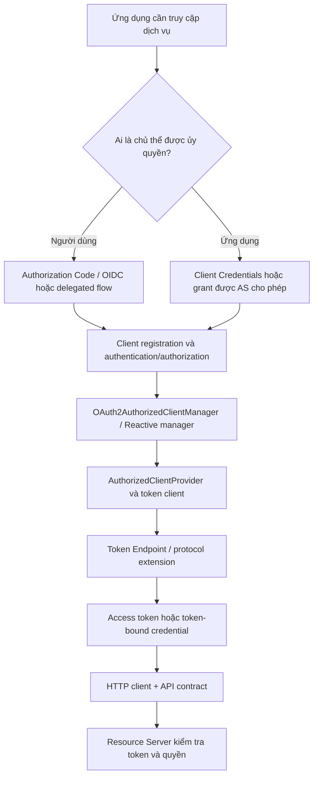
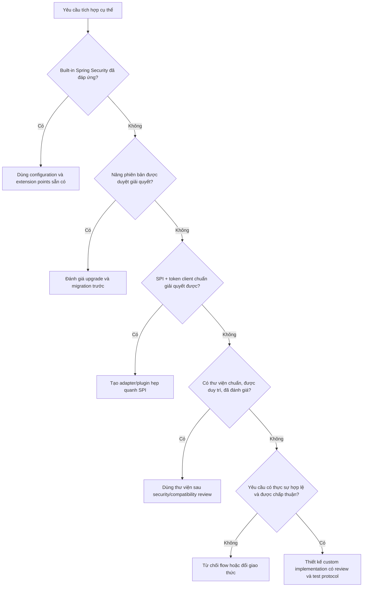
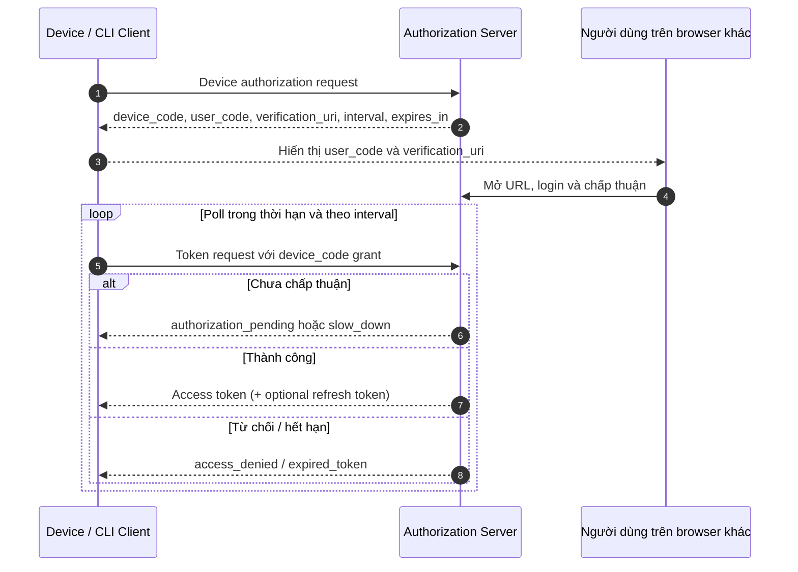

# 22.8. Điều kiện lựa chọn thư viện bổ sung cho flow ngoài phạm vi hỗ trợ

Trong module **Spring Security OAuth 2.0 OIDC Client**, các bài học về Authorization Code, OIDC Login, refresh token, Client Manager, Servlet và Reactive giúp xây phần lớn ứng dụng đăng nhập và gọi API thông dụng. Nhưng trong những hệ thống tích hợp lớn, đôi khi Authorization Server (AS) hoặc đối tác yêu cầu một cơ chế **không được hỗ trợ đầy đủ bởi phiên bản Spring Security mà dự án đang sử dụng**.

Ví dụ: đăng nhập trên thiết bị không có trình duyệt thích hợp, đổi một token đã có lấy token cho API khác, xác thực bằng JWT assertion theo một profile riêng, sử dụng proof-of-possession hoặc những yêu cầu bảo mật cao của hệ sinh thái ngân hàng. Khi đó, đội phát triển thường đứng trước ba lựa chọn: **dùng khả năng có sẵn của Spring Security**, **tự mở rộng qua extension point**, hoặc **thêm một thư viện/SDK chuyên dụng**.

Bài này không khuyến khích cài thư viện ngay khi gặp một từ khóa mới. Mục tiêu là xây **khung quyết định có thể kiểm chứng** để chọn giải pháp hợp chuẩn, bảo mật, tương thích và còn được duy trì. Đối tượng chính là **Spring Boot 3.x / Spring Security 6.x**, cả **Servlet** và **WebFlux/Reactive**. Ở các phiên bản Spring Security mới hơn, một số grant/extension đã có hỗ trợ sẵn; phải xác nhận tài liệu và Javadoc **đúng phiên bản đang triển khai**, không dựa vào danh sách “chưa hỗ trợ” viết ở thời điểm khác.

> **Nguyên tắc trung tâm:** Chỉ thêm thư viện khi đã chứng minh có một khoảng trống chức năng cụ thể, có tiêu chuẩn giao thức hoặc contract nhà cung cấp rõ ràng, không có lựa chọn đơn giản hơn trong framework hiện có, và thư viện vượt qua các điều kiện về bảo mật, tương thích, vận hành và bảo trì.

## 1. Kết quả cần đạt

Sau bài học, bạn có thể:

1. Phân biệt **OAuth2 authorization grant** với **OIDC authentication flow**, **client authentication method**, **token format** và **protocol extension**.
2. Phân loại một yêu cầu thành: được Spring hỗ trợ trực tiếp, có thể cấu hình qua SPI, cần SDK chuyên dụng, hoặc không nên triển khai.
3. Kiểm tra yêu cầu của AS/OP theo RFC, OpenID specification và phiên bản framework thay vì suy đoán.
4. Dùng một ma trận đánh giá **phù hợp giao thức, phạm vi tích hợp, security maintenance, dependency risk, reactive behavior, testing và vận hành**.
5. Thiết kế một lớp adapter để không để SDK bên ngoài lan vào controller, authentication/session hoặc tầng nghiệp vụ.
6. Hiểu ranh giới của các extension point như `OAuth2AuthorizedClientProvider`, `ReactiveOAuth2AuthorizedClientProvider` và access-token response client.
7. Xác định điều kiện an toàn đặc biệt của device authorization, token exchange, JWT bearer, CIBA, DPoP, mTLS, PAR/JAR/JARM và các flow độc quyền.
8. Kiểm thử trường hợp thành công, protocol error, replay, token mix-up, concurrency, secret handling và downgrade.
9. Chuẩn bị kế hoạch nâng cấp, thay SDK và rollback mà không làm mất khả năng kiểm soát token.

## 2. “Flow ngoài phạm vi hỗ trợ” nghĩa chính xác là gì?

Cụm từ này có thể che giấu nhiều vấn đề khác nhau:

- **Framework chưa cung cấp implementation cấp token** theo grant mà AS yêu cầu.
- **Framework có hỗ trợ grant**, nhưng thiếu một tùy chọn profile hoặc request parameter của AS.
- **Client có thể lấy token**, nhưng thiếu khả năng gắn proof-of-possession cho request tới Resource Server.
- **OIDC login có sẵn**, nhưng đối tác yêu cầu một quy trình back-channel hoặc profile conformance bổ sung.
- **Hỗ trợ đã có trong phiên bản Spring mới hơn**, nhưng dự án chưa nâng cấp.
- **AS yêu cầu một protocol độc quyền**, không phải OAuth2/OIDC chuẩn.
- Yêu cầu thực chất là **Resource Server** hoặc **Authorization Server** responsibility, không phải OAuth2 Client.

Bước đầu tiên luôn là **xác định chính xác khoảng trống ở tầng nào**. Không tìm một dependency theo tên thương mại nếu chưa biết mình đang thiếu grant, HTTP client, token verifier, JOSE signing hay business delegation.

### 2.1. Sơ đồ phân lớp



Một extension của Token Endpoint không tự thay thế toàn bộ Spring Security login filters. Một SDK JWT cũng không tự trở thành `OAuth2AuthorizedClientRepository`. Ngược lại, một Resource Server có `JwtDecoder` chỉ xác minh access token đi vào, **không có nghĩa OAuth2 Client đã biết cách xin token mới theo grant mở rộng**.

### 2.2. Bộ câu hỏi truy nguồn yêu cầu

Trước khi tìm thư viện, ghi lại:

| Câu hỏi | Bằng chứng cần có |
| --- | --- |
| Ai yêu cầu flow? | Tài liệu phiên bản của AS/OP hoặc hợp đồng tích hợp |
| Tên protocol/grant chính xác? | `grant_type`, RFC/profile, endpoint và message schema |
| Chủ thể của token là ai? | End user, client application, actor/on-behalf-of, device |
| Client là public hay confidential? | Phương thức client authentication, khả năng giữ secret/khóa |
| Bên phát hành là ai? | Trusted issuer/AS, metadata, authorization policy |
| Token dành cho tài nguyên nào? | Audience, `resource`, scope, `authorization_details` |
| Token cần dùng ở đâu? | Servlet request, WebFlux pipeline, batch hoặc device |
| Framework đang dùng version nào? | Spring Boot, Spring Security, Spring Framework, Java |
| AS hỗ trợ cách tiêu chuẩn nào trước? | Discovery, profile, conformance statement, sandbox |
| Có bắt buộc extension không? | Không thể thay bằng supported flow theo yêu cầu bảo mật/nghiệp vụ |

Nếu chỉ có câu “đối tác dùng SSO đặc biệt” mà chưa có endpoint, grant type và security contract, **chưa đủ điều kiện lựa chọn thư viện**.

## 3. Phân biệt grant, profile và protocol extension

Nhiều sai quyết định bắt đầu từ việc gọi tất cả là “flow OAuth2 mới”.

| Cơ chế | Vai trò thực sự | Dấu hiệu giao thức | Có tự động là grant mới? |
| --- | --- | --- | --- |
| Authorization Code + PKCE | Browser/user authorization | `response_type=code`, PKCE parameters, token exchange bằng code | Không, grant thông dụng |
| Client Credentials | Token cho client application | `grant_type=client_credentials` | Grant chuẩn |
| Refresh Token | Cấp token mới bằng refresh token | `grant_type=refresh_token` | Grant chuẩn |
| Device Authorization (RFC 8628) | User authorize trên thiết bị khác, client polling | Device Authorization Endpoint; `urn:ietf:params:oauth:grant-type:device_code` | Có grant liên quan |
| Token Exchange (RFC 8693) | Đổi token có ngữ cảnh subject/actor/audience | `urn:ietf:params:oauth:grant-type:token-exchange` | Có grant mở rộng |
| JWT Bearer Authorization Grant (RFC 7523) | Dùng JWT assertion làm authorization grant | `urn:ietf:params:oauth:grant-type:jwt-bearer` | Có grant mở rộng |
| `private_key_jwt` | Xác thực client với AS bằng JWT | `client_assertion_type` và `client_assertion` | **Không** phải grant riêng |
| OIDC CIBA | Backchannel authentication của user | CIBA Authentication Request, `auth_req_id`, polling/ping/push | Profile/flow chuyên biệt |
| DPoP (RFC 9449) | Sender-constrain token và chứng minh sở hữu khóa | `DPoP` proof JWT, `jkt`, `ath` trong ngữ cảnh | **Không** phải authorization grant |
| mTLS (RFC 8705) | Client authentication hoặc ràng buộc token với cert | TLS client certificate và policy AS/RS | **Không** phải grant mới |
| PAR (RFC 9126) | Đẩy authorization request tới AS trước browser redirect | `request_uri` và PAR endpoint | **Không** phải grant |
| JAR (RFC 9101) / JARM | Request object / JWT-secured authorization response | Signed request object/JWT response | Không mặc định là grant |
| RAR (RFC 9396) | Biểu diễn quyền chi tiết bằng `authorization_details` | Structured authorization details | Không phải grant |
| SAML 2.0 | Federation protocol riêng | SAML assertions, bindings và metadata | **Không** phải OAuth2 grant |

Một thư viện thực hiện **JOSE/JWT** chỉ giải quyết ký/giải mã/kiểm tra thông điệp mật mã; nó không tự hoàn thành `state` correlation, consent, token exchange, principal mapping, authorization policy hoặc persistence.

### 3.1. “Không hỗ trợ” phải có điều kiện phiên bản

Spring Security được phát triển liên tục. Một extension có thể được bổ sung ở các phiên bản sau hoặc được cung cấp dưới một API khác; một vendor SDK có thể ngừng được khuyến nghị khi framework hỗ trợ chuẩn.

Vì vậy, trong hồ sơ chọn thư viện phải có:

```text
Spring Boot version         = <version triển khai>
Spring Security version     = <version triển khai>
Web stack                   = Servlet hoặc Reactive
Required protocol / profile = <RFC + phiên bản + profile>
Required operation          = <endpoint + parameters + semantics>
Built-in capability check   = <Javadoc/reference theo version>
Decision date               = <ngày đánh giá>
```

Tài liệu “Spring không hỗ trợ grant X” mà không ghi version **không phải bằng chứng có thể duy trì**.

## 4. Thứ tự ưu tiên khi giải quyết một flow ngoài chuẩn thông dụng

Nên đi từ **ít thay đổi cấu trúc nhất** đến **nhiều quyền kiểm soát tự triển khai nhất**.



### 4.1. Lựa chọn A — Giữ nguyên Spring Security

Phù hợp khi vấn đề được giải bằng:

- `ClientRegistration` và provider metadata.
- Grant đã có trong `OAuth2AuthorizedClientProviderBuilder` hoặc reactive builder.
- Tùy biến authorization request resolver/parameters.
- Cấu hình token response client, HTTP client, TLS hoặc client authentication.
- `OAuth2AuthorizedClientService` / repository phù hợp với token lifecycle.
- Bật PKCE hoặc thiết lập policy theo client type.
- Tách user login và machine-to-machine thành registrations riêng.

Đây là lựa chọn mặc định vì ít gây thêm rủi ro supply chain và integration.

### 4.2. Lựa chọn B — Nâng Spring Security

Cần đánh giá nâng cấp nếu:

- Phiên bản mới có extension cần dùng theo Javadoc và tests.
- Bộ thư viện hiện tại đã gần hết support.
- Có security fixes quan trọng hoặc cải thiện client/token handling.
- Việc nâng cấp không phá những ứng dụng/filters khác.

Không nâng theo cảm tính. Kiểm tra Spring Boot dependency management, Spring Framework, Java baseline, Jakarta APIs, WebFlux/Servlet, và API changes bằng kiểm thử ứng dụng thực tế.

### 4.3. Lựa chọn C — Extension point của Spring + adapter nhỏ

Lựa chọn này hợp lý khi core login/token lifecycle vẫn đúng nhưng cần thay **một bước cụ thể** như định dạng token request hoặc grant-specific provider.

Mục tiêu là giữ:

```text
Controller / Business Service
          |
          v
Spring OAuth2 Authorized Client Manager
          |
          v
Well-defined custom provider / token response client
          |
          v
Adapter dùng chuẩn protocol hoặc thư viện chuyên dụng
          |
          v
Trusted Authorization Server
```

Không thay toàn bộ security chain bằng một OAuth2 implementation thứ hai chỉ vì một tham số token endpoint khác.

### 4.4. Lựa chọn D — Thư viện/SDK bên thứ ba

Chỉ chọn khi yêu cầu có độ phức tạp đáng kể, ví dụ:

- Chữ ký JOSE, DPoP proof, nonce replay protection.
- CIBA với polling/ping/push/correlation.
- Token Exchange profile có thêm constraints và validation.
- Vendor-specific device authentication rất khác grant thông dụng.
- FAPI profile đòi nhiều thông điệp được ký hoặc sender-constrained tokens.
- Key management/HSM integration mà tự viết là rủi ro lớn.

Ưu tiên SDK có **API đủ hẹp để dùng như adapter** thay vì thư viện buộc thay framework authentication/session/HTTP client hiện tại.

### 4.5. Lựa chọn E — Tự triển khai protocol

Đây là **phương án cuối**, chỉ hợp lý khi:

- Không có hỗ trợ sẵn và SDK phù hợp.
- Có RFC/profile/contract đầy đủ, sandbox và test vectors.
- Đội có năng lực bảo mật protocol và cryptography integration.
- Có review độc lập, kế hoạch threat modeling và bảo trì dài hạn.
- Có ngân sách cho key rotation, incident response và compatibility testing.

Không tự viết thuật toán mật mã, JWT signature verifier hoặc PKCE generator mới từ đầu khi đã có thư viện đáng tin cậy.

## 5. Điều kiện bắt buộc trước khi thêm bất kỳ dependency nào

Đây là các **cổng loại trừ**, không phải điểm cộng có thể bù bằng việc API dễ sử dụng.

| Cổng bắt buộc | Yêu cầu | Nếu không đáp ứng |
| --- | --- | --- |
| Protocol rõ ràng | RFC/profile/version hoặc tài liệu vendor có test vectors | Chưa chọn thư viện; yêu cầu lại contract |
| AS/OP thực sự hỗ trợ | Endpoint, scopes, client registration policy xác nhận | Không cài SDK chỉ dựa trên marketing |
| Token trust boundary | Issuer, audience, subject/actor, client identity xác định | Không phát hành/gửi token |
| Không suy yếu bảo mật | Không tắt TLS, state, PKCE, nonce, signature validation | Loại phương án |
| Secret/key protection | Client secrets, private keys, refresh tokens được bảo vệ | Loại hoặc thiết kế lại |
| Bản vá và hỗ trợ | Không có lỗ hổng nghiêm trọng chưa có mitigation; vẫn maintain được | Loại hoặc đặt exception có thời hạn được phê duyệt |
| Tương thích runtime | Spring/Java/Jakarta/Reactor/HTTP client phù hợp | Không thêm vào production |
| Có test thực tế | Sandbox và các trường hợp lỗi/replay khả thi | Chưa triển khai production |
| Chấp nhận được về pháp lý | License, phân phối, export/compliance phù hợp | Không đưa vào artifact |
| Có owner vận hành | Team chịu trách nhiệm upgrade, alerts và rollback | Không nhận dependency |

**Không “chấp nhận rủi ro” một cách im lặng** bằng cách tắt security validation hoặc bỏ qua CVE để kịp một deadline tích hợp. Rủi ro ngoại lệ phải được đánh giá, phê duyệt và có hạn xử lý.

## 6. Ma trận chấm điểm sau khi qua cổng bắt buộc

Nếu có hai hoặc ba phương án đều đáp ứng cổng, có thể chấm điểm tương đối theo nhu cầu dự án.

| Tiêu chí | Trọng số tham khảo | Cách đánh giá |
| --- | ---: | --- |
| Đúng chuẩn và interoperable | 25% | RFC/profile, test vectors, OP conformance |
| Bảo mật và chu kỳ vá | 20% | Security advisories, update cadence, trust/key handling |
| Khớp kiến trúc Spring | 15% | SPI, manager, repository, SecurityContext, Bean lifecycle |
| Tương thích Servlet/Reactive | 10% | Không block event-loop, HTTP client/TLS/config |
| Chất lượng test và tài liệu | 10% | Integration tests, negative cases, examples có version |
| Dependency/supply chain | 10% | Transitives, SBOM, license, signature/provenance |
| Khả năng vận hành/bảo trì | 10% | Metrics, failure classification, owner, migration strategy |

Công thức nếu chấm các tiêu chí trên thang 0–5:

```text
Tổng điểm = Σ (trọng số_i × điểm_i / 5)
```

Đây là **một mô hình hỗ trợ quyết định**, không phải quy định bắt buộc từ Spring hoặc OAuth. Không dùng tổng điểm cao để bỏ qua cổng bảo mật. Cần ghi lại cả **lý do chọn** và **lý do loại** từng phương án.

### 6.1. Phiếu quyết định rút gọn

```yaml
decision:
  operation: "Exchange delegated token for a downstream API"
  standard: "RFC 8693 + provider profile"
  environment:
    webStack: "WebFlux"
    springSecurityVersion: "<actual-version>"
    javaVersion: "<actual-version>"
  builtInEvaluation:
    supportedForCurrentVersion: "<yes/no/partial>"
    evidence: "<official documentation or API reference>"
  selectedApproach: "<built-in | upgrade | SPI-adapter | vetted-library>"
  chosenDependency:
    coordinates: "<group:artifact:version, if any>"
    license: "<SPDX identifier>"
    owner: "<team>"
  securityControls:
    - "trusted issuer and audience"
    - "subject/actor delegation policy"
    - "key and secret management"
    - "bounded retry and no token logging"
  tests:
    - "successful exchange"
    - "invalid subject token"
    - "wrong audience"
    - "replay / token substitution"
  rollback: "<feature flag and previous supported grant>"
```

Mẫu là tài liệu quyết định, không phải một file cấu hình Spring tự hiểu.

## 7. Ví dụ 1 — Đừng cài thư viện khi `client_credentials` đã đáp ứng

Giả sử backend gọi Inventory API bằng danh tính ứng dụng, không liên quan người dùng. Nếu AS hỗ trợ `grant_type=client_credentials`, đây thường là use case có sẵn trong Spring Security OAuth2 Client.

### 7.1. Cấu hình registration

```yaml
spring:
  security:
    oauth2:
      client:
        registration:
          inventory-service:
            provider: trusted-inventory-as
            client-id: ${INVENTORY_CLIENT_ID}
            client-secret: ${INVENTORY_CLIENT_SECRET}
            client-authentication-method: client_secret_basic
            authorization-grant-type: client_credentials
            scope:
              - inventory.read
        provider:
          trusted-inventory-as:
            token-uri: ${INVENTORY_TOKEN_URI}
```

`inventory.read` chỉ là scope giả định. Phải được AS cấp và Resource Server kiểm tra theo policy thực tế.

### 7.2. Manager cho backend không có HTTP request

```java
import org.springframework.context.annotation.Bean;
import org.springframework.context.annotation.Configuration;
import org.springframework.security.oauth2.client.AuthorizedClientServiceOAuth2AuthorizedClientManager;
import org.springframework.security.oauth2.client.OAuth2AuthorizedClientManager;
import org.springframework.security.oauth2.client.OAuth2AuthorizedClientProvider;
import org.springframework.security.oauth2.client.OAuth2AuthorizedClientProviderBuilder;
import org.springframework.security.oauth2.client.OAuth2AuthorizedClientService;
import org.springframework.security.oauth2.client.registration.ClientRegistrationRepository;

@Configuration
public class InventoryClientManagerConfig {

    @Bean("inventoryClientManager")
    OAuth2AuthorizedClientManager inventoryClientManager(
            ClientRegistrationRepository registrations,
            OAuth2AuthorizedClientService service) {

        OAuth2AuthorizedClientProvider provider =
                OAuth2AuthorizedClientProviderBuilder.builder()
                        .clientCredentials()
                        .build();

        var manager =
                new AuthorizedClientServiceOAuth2AuthorizedClientManager(
                        registrations, service);

        manager.setAuthorizedClientProvider(provider);
        return manager;
    }
}
```

### 7.3. Lấy token theo nhu cầu

```java
import org.springframework.beans.factory.annotation.Qualifier;
import org.springframework.security.oauth2.client.OAuth2AuthorizeRequest;
import org.springframework.security.oauth2.client.OAuth2AuthorizedClient;
import org.springframework.security.oauth2.client.OAuth2AuthorizedClientManager;
import org.springframework.stereotype.Service;

@Service
public class InventoryTokenAdapter {

    private final OAuth2AuthorizedClientManager manager;

    public InventoryTokenAdapter(
            @Qualifier("inventoryClientManager")
            OAuth2AuthorizedClientManager manager) {
        this.manager = manager;
    }

    public OAuth2AuthorizedClient authorize() {
        OAuth2AuthorizeRequest request = OAuth2AuthorizeRequest
                .withClientRegistrationId("inventory-service")
                .principal("inventory-worker")
                .build();

        OAuth2AuthorizedClient client = manager.authorize(request);
        if (client == null) {
            throw new IllegalStateException(
                    "Inventory client authorization unavailable");
        }
        return client;
    }
}
```

Đây là một giải pháp **không cần SDK grant bổ sung**. `principal("inventory-worker")` chỉ là khóa quản lý authorized client của workload; không tạo một OIDC end-user identity hay thêm scopes.

Nếu mục tiêu thực chất là **gọi API thay mặt user**, `client_credentials` có thể không đúng mô hình quyền. Khi đó phải đánh giá delegation/token exchange, chứ không cố đổi principal string thành user ID.

## 8. Ví dụ 2 — Token Exchange theo RFC 8693

**OAuth 2.0 Token Exchange (RFC 8693)** cho phép một client trao đổi token hiện có theo policy của AS, chẳng hạn để lấy token có audience dành cho downstream API.

Ví dụ request khái niệm:

```http
POST /oauth2/token HTTP/1.1
Host: auth.example.com
Content-Type: application/x-www-form-urlencoded
Authorization: Basic <client-authentication>

grant_type=urn:ietf:params:oauth:grant-type:token-exchange&
subject_token=<TOKEN_ISSUED_TO_CALLER>&
subject_token_type=urn:ietf:params:oauth:token-type:access_token&
audience=https%3A%2F%2Finventory-api.example.com
```

Token request còn có thể gồm `requested_token_type`, `actor_token`, `actor_token_type`, `resource` hoặc `scope` tùy profile và chính sách AS. **Không phải mọi AS hỗ trợ tất cả parameters; không phải mọi AS cho phép exchange từ token của một issuer bất kỳ.**

### 8.1. Điều kiện để cân nhắc thư viện

Thư viện hoặc extension phải xử lý đúng:

- `grant_type` và encoding của parameters theo RFC/profile.
- Client authentication phù hợp (secret, private key JWT, mTLS…).
- Giá trị `subject_token` thực sự đến từ một luồng được tin cậy.
- `subject_token_type` đúng kiểu token.
- `actor_token`/delegation semantics khi được yêu cầu.
- Audience/resource phải nằm trong allowlist server-side.
- Scopes được AS cấp không vượt ngoài quyền của subject/client.
- Response token type, expiry, issued token type và error codes.
- Log/redaction vì body chứa bearer token nhạy cảm.
- Khi refresh/reauthorize, nguồn subject token còn hiệu lực và policy còn cho phép.

**Không coi token exchange là “ép bất kỳ token nào thành admin token”.** AS phải thực thi trust và delegation policy; client không được dùng token exchange để làm privilege escalation.

### 8.2. Kiểm tra hỗ trợ hiện có trước

Trước khi viết plugin cho RFC 8693:

1. Xem reference/Javadoc phiên bản Spring Security đang dùng.
2. Xem `OAuth2AuthorizedClientProviderBuilder`, reactive counterpart và token exchange provider/client API nếu có.
3. Kiểm tra hỗ trợ ở **Servlet và Reactive** có ngang nhau hay không.
4. Xác nhận các parameters/profile của AS có thể tùy biến mà không sửa protocol state machine.
5. Nếu vẫn thiếu, chọn adapter hẹp chỉ cho grant/extension cần thiết.

**Không đưa ra một kết luận vĩnh viễn rằng Spring Security không hỗ trợ Token Exchange**; trạng thái hỗ trợ thay đổi theo phiên bản và API.

### 8.3. Boundary của adapter

```text
Business Service
      |
      v
TokenExchangePort.exchange(request)
      |
      +-- kiểm tra registration/policy
      +-- kiểm tra subject token provenance
      +-- chuẩn hóa token response
      |
      v
Spring provider nếu có / trusted SDK nếu cần
      |
      v
Trusted Token Endpoint
      |
      v
Token cho đúng audience
```

Adapter phải **giữ nội dung token ở backend** và chỉ chuyển token tới API đã phê duyệt. Không để client HTTP tự nhập `audience` hoặc `token-uri` tùy ý rồi dùng client credentials của hệ thống.

### 8.4. Ví dụ contract không lệ thuộc SDK

```java
import reactor.core.publisher.Mono;

// Port của ứng dụng, không phải class có sẵn của Spring Security.
public interface DelegatedTokenExchangePort {

    Mono<ExchangedAccessToken> exchange(
            TrustedExchangeRequest request);

    record TrustedExchangeRequest(
            String registrationId,
            String internalSubjectReference,
            String approvedAudience) {}

    record ExchangedAccessToken(
            String tokenValue,
            String tokenType,
            java.time.Instant expiresAt) {}
}
```

Đây là **hợp đồng kiến trúc**; implementation phải lấy subject token từ kho tin cậy bằng `internalSubjectReference`, kiểm tra ownership/delegation và không nhận raw subject token hoặc token endpoint từ HTTP input bên ngoài. Trong production, giảm phạm vi truy cập `tokenValue` bằng cách giữ nó bên trong HTTP adapter khi có thể.

Lợi ích: nếu sau này Spring Security hỗ trợ profile này trực tiếp, bạn có thể thay implementation của port mà **không sửa controller và policy nghiệp vụ**.

## 9. Ví dụ 3 — Device Authorization Grant (RFC 8628)

Device Authorization dành cho client chạy trên thiết bị có giao diện nhập hạn chế hoặc không tiện login tại chính thiết bị: TV, CLI, thiết bị IoT có chính sách hỗ trợ, v.v.

Luồng tổng quát:



### 9.1. Điều kiện thư viện bắt buộc

Một thư viện Device Authorization đáng dùng phải có:

- Hỗ trợ Device Authorization Endpoint và token polling grant theo RFC 8628.
- Tuân thủ `interval` từ AS; xử lý `slow_down` bằng tăng khoảng polling.
- Giới hạn bởi `expires_in` và deadline; có cancellation.
- Không log `device_code`, access/refresh token hoặc secrets.
- Chỉ hiển thị `user_code` và `verification_uri` ở đúng bề mặt UX; không gửi credential nhạy cảm qua third-party analytics.
- Chống brute force/social engineering theo kiến trúc OP.
- Không block Reactor event-loop bằng `Thread.sleep(...)`.
- Tương thích public/confidential client policy của AS.
- Không chạy device flow như một cách thay thế tùy tiện cho browser `oauth2Login()` đang có.

### 9.2. Reactive polling và scheduler

Trong WebFlux hoặc CLI reactive, polling nên dùng **non-blocking delay** thay vì vòng lặp blocking. Ví dụ mô hình:

```java
// PSEUDOCODE: deviceTokenClient và response model
// là thành phần ứng dụng/thư viện được chọn.
Mono<TokenResponse> pollDeviceCode(DeviceAuthorizationContext ctx) {
    return Mono.defer(() -> deviceTokenClient.poll(ctx))
            .onErrorResume(AuthorizationPending.class,
                    ex -> Mono.delay(ctx.currentInterval())
                              .then(pollDeviceCode(ctx)))
            .onErrorResume(SlowDown.class,
                    ex -> Mono.delay(ctx.increasedInterval())
                              .then(pollDeviceCode(ctx)))
            .timeout(ctx.remainingLifetime());
}
```

Đây không phải mã hoàn chỉnh để copy chạy: `AuthorizationPending`, `SlowDown`, `DeviceAuthorizationContext` và `deviceTokenClient` là abstraction giả định. Production cần **hạn chế recursion/retries**, cancellation, timeout monotonic, tôn trọng polling interval và xử lý lỗi AS chi tiết. Ví dụ chỉ minh họa lý do cần chọn SDK/adapter hiểu **state machine**, không chỉ một HTTP POST đơn lẻ.

## 10. Ví dụ 4 — JWT Bearer Grant và `private_key_jwt` không giống nhau

Cả hai có thể gửi một JWT đến Token Endpoint, nhưng khác trách nhiệm.

### 10.1. JWT Bearer Authorization Grant — RFC 7523

Grant type:

```text
urn:ietf:params:oauth:grant-type:jwt-bearer
```

Client dùng một JWT assertion đã được tạo và được AS tin cậy làm authorization grant. AS xác minh issuer, subject, audience, thời hạn, chữ ký và policy tương ứng.

### 10.2. JWT Client Authentication — `private_key_jwt`

Một client confidential có thể xác thực tới Token Endpoint bằng JWT assertion:

```text
client_assertion_type =
  urn:ietf:params:oauth:client-assertion-type:jwt-bearer

client_assertion = <signed-client-assertion>
```

Đây là **client authentication method**, có thể dùng đồng thời với `authorization_code`, `client_credentials` hoặc một grant khác. Nó **không** đồng nghĩa đang chạy JWT bearer authorization grant.

| Phân biệt | JWT Bearer Grant | `private_key_jwt` |
| --- | --- | --- |
| Mục đích | Dùng assertion làm authorization grant | Chứng minh danh tính client ở Token Endpoint |
| `grant_type` | JWT bearer URN | Grant vẫn là authorization_code/client_credentials/... |
| Thành phần được kiểm tra | Assertion subject/issuer/audience và grant policy | Client assertion, key và client auth policy |
| Tại sao có rủi ro? | Nhầm subject/delegation hoặc assertion replay | Lộ private key, sai `aud`/`jti`/clock, replay |
| Có thể cần thư viện nào? | JOSE signing + grant adapter/profile | JOSE signing/client auth integration |

### 10.3. Tiêu chí bảo mật cho thư viện JWT assertion

Cần có:

- Thuật toán ký **được AS chấp thuận và allowlisted**, không tin `alg` tự do từ input không tin cậy.
- Quản lý khóa qua keystore/HSM/KMS nếu policy yêu cầu.
- `iss`/`sub`/`aud` đúng profile; `aud` thường ràng buộc Token Endpoint hoặc issuer theo hợp đồng.
- `exp` ngắn hạn, `iat`/`nbf` phù hợp, clock skew có giới hạn.
- `jti` độc nhất khi profile yêu cầu replay protection.
- Rotation `kid`/JWKS và khả năng revoke key.
- Không ghi raw assertion/private key vào log.
- Kiểm thử negative cases: sai chữ ký, sai audience, hết hạn, reused assertion.

Một thư viện JWT tiện dụng **chưa đủ** nếu không có kiến trúc token request, persistence, authorization policy và provider-specific semantics đúng.

## 11. DPoP và mTLS: điều kiện chọn thư viện nghiêm ngặt hơn

**DPoP (RFC 9449)** và **OAuth 2.0 Mutual-TLS (RFC 8705)** là các cơ chế liên quan sender-constrained access tokens. Một HTTP request có thể cần bằng chứng cryptographic gắn với private key/certificate.

### 11.1. Vì sao không thể chỉ gắn thêm một header?

Với DPoP, proof JWT có thể gắn với HTTP method và target URI thông qua `htm`, `htu`, thời gian và `jti`; với truy cập Resource Server có thể cần `ath`. AS/RS có thể yêu cầu server-provided nonce. Token có thể được ràng buộc với key thumbprint.

Nếu adapter:

- Tái sử dụng proof `jti`.
- Ký cho URI sai vì proxy/rewrite.
- Không cập nhật nonce.
- Dùng nhầm private key giữa sessions/clients.
- Forward token qua host khác.
- Cache proof/token không đúng phạm vi.

thì request có thể bị từ chối hoặc phá security model.

### 11.2. Điều kiện chọn thư viện DPoP

Thư viện cần cho thấy nó xử lý:

1. Sinh và bảo vệ key material.
2. Tạo proof đúng `htm`, `htu`, timestamp và `jti`.
3. `ath` khi dùng access token trong context yêu cầu.
4. Nonce challenges và bounded retry **không replay nghiệp vụ tùy tiện**.
5. Thực hiện proof ở **cả token request và API request** nếu profile yêu cầu.
6. Đồng bộ proof key với confirmation claim/binding của token.
7. Không đưa private key hoặc raw token vào browser/log trừ kiến trúc public client được thẩm định.
8. Tương thích HTTP stack của ứng dụng, redirect policy và proxies.

DPoP **không phải một grant type**; nếu framework hiện có extension phù hợp, nên ưu tiên hơn việc tự ký proof trong controller.

### 11.3. Điều kiện chọn thư viện mTLS

Với mTLS-bound tokens, cần kiểm tra:

- Client certificate được gắn trên đúng connection.
- AS và Resource Server đều có chính sách binding phù hợp.
- Trust store, key store, certificate chain và rotation.
- Load balancer/proxy có terminate TLS không và điều đó ảnh hưởng binding thế nào.
- HTTP connection pooling không làm lẫn client identities.
- Khả năng vận hành trong container/Kubernetes/service mesh.
- Không bypass certificate validation chỉ để chạy được sandbox.

Đừng chọn SDK chỉ vì có tùy chọn “SSL enabled”. Phải chứng minh **mTLS client auth và token binding** theo profile thật, gồm cả môi trường production.

## 12. PAR, JAR, JARM, RAR và CIBA: chọn theo profile trọn vẹn

Một hệ thống có thể yêu cầu tổ hợp:

```text
Authorization Code + PKCE
        +
PAR (pushed authorization request)
        +
JAR (signed request object)
        +
JARM (secured authorization response)
        +
RAR (structured authorization details)
```

Các phần này **không nhất thiết thay `authorization_code` bằng grant mới**. Nếu chọn một thư viện “OAuth2 client khác” chỉ vì thiếu PAR, ứng dụng có thể tạo **hai state machines đăng nhập cạnh tranh**.

### 12.1. Các câu hỏi kiểm tra

| Extension | Câu hỏi cần hỏi khi chọn SDK |
| --- | --- |
| PAR | SDK có gửi request an toàn đến PAR endpoint, xử lý `request_uri` và expiry không? |
| JAR | Có ký request object theo profile, quản lý key/alg/claims không? |
| JARM | Có xác minh JWT authorization response, issuer/audience/state/replay không? |
| RAR | Có validate/serialize `authorization_details` theo schema AS yêu cầu không? |
| CIBA | Có xử lý `auth_req_id`, notification/polling mode, binding message và user consent đúng không? |
| FAPI profile | Có conformance tests và phù hợp security profile yêu cầu không? |

Một SDK hỗ trợ “OIDC” chung chung không chứng minh nó hỗ trợ **profile ngân hàng cụ thể**. Cần tài liệu profile, test vectors/conformance và thỏa thuận với AS.

### 12.2. Không tự tắt `state`/`nonce` vì flow có JWT được ký

Một JARM/JAR request hoặc response có chữ ký không tự miễn trừ tất cả các yêu cầu correlation/session/user interaction của flow. Vẫn cần tuân theo profile và các cơ chế chống mix-up, CSRF, replay được thiết kế.

## 13. Extension point của Spring Security: giới hạn tích hợp

Một thư viện bổ sung nên đặt sau interface ổn định, tránh gọi thẳng nó từ tất cả controllers.

### 13.1. Trong Servlet

Các extension points đáng tìm hiểu gồm:

- `OAuth2AuthorizedClientProvider`: chọn xử lý authorization/reauthorization dựa trên `OAuth2AuthorizationContext`.
- `OAuth2AuthorizedClientManager`: điều phối registration, principal, provider và authorized client persistence.
- Token response client cho grant tương ứng: đóng gói HTTP Token Endpoint request/response.
- `OAuth2AuthorizationSuccessHandler` / failure handler: lưu/xóa/quan sát authorization state theo policy.
- `ClientRegistrationRepository`: cung cấp cấu hình client.
- `OAuth2AuthorizedClientService` hoặc repository: lưu token đúng vòng đời.

**Không phải extension nào cũng cần dùng cùng lúc.** Nếu chỉ sửa một parameter của request, ưu tiên extension nhỏ hơn thay vì tự viết lại manager.

### 13.2. Mẫu custom provider có kiểm soát

Ví dụ bên dưới **minh họa cách ghép provider**, không hiện thực toàn bộ Token Exchange protocol:

```java
import org.springframework.context.annotation.Bean;
import org.springframework.context.annotation.Configuration;
import org.springframework.security.oauth2.client.DelegatingOAuth2AuthorizedClientProvider;
import org.springframework.security.oauth2.client.OAuth2AuthorizedClient;
import org.springframework.security.oauth2.client.OAuth2AuthorizedClientProvider;
import org.springframework.security.oauth2.client.OAuth2AuthorizedClientProviderBuilder;
import org.springframework.security.oauth2.client.OAuth2AuthorizationContext;

// Port ứng dụng: implementation cần xử lý protocol, security,
// token response và lifecycle đúng theo provider.
interface ExtensionGrantAdapter {
    OAuth2AuthorizedClient authorize(
            OAuth2AuthorizationContext context);
}

@Configuration
class ExtensionProviderConfig {

    private static final String TOKEN_EXCHANGE =
            "urn:ietf:params:oauth:grant-type:token-exchange";

    @Bean
    OAuth2AuthorizedClientProvider composedProvider(
            ExtensionGrantAdapter adapter) {

        OAuth2AuthorizedClientProvider standard =
                OAuth2AuthorizedClientProviderBuilder.builder()
                        .authorizationCode()
                        .refreshToken()
                        .clientCredentials()
                        .build();

        OAuth2AuthorizedClientProvider extension =
                context -> {
                    String grant =
                            context.getClientRegistration()
                                    .getAuthorizationGrantType()
                                    .getValue();

                    if (!TOKEN_EXCHANGE.equals(grant)) {
                        return null; // Provider không hỗ trợ grant.
                    }
                    return adapter.authorize(context);
                };

        return new DelegatingOAuth2AuthorizedClientProvider(
                standard, extension);
    }
}
```

Trong triển khai thật:

- Phải có bean `ExtensionGrantAdapter` được kiểm chứng, không chỉ interface.
- Cần gắn `composedProvider` vào manager phù hợp với application context.
- `OAuth2AuthorizationContext` và `OAuth2AuthorizeRequest` phải mang subject token/actor/claims theo **contract đã thẩm định**, không chứa dữ liệu người dùng chưa được xác minh.
- Adapter phải xây response `OAuth2AuthorizedClient` đúng registration/principal, không trả nhầm token cũ.
- Token persistence và failure handling phải được đánh giá riêng.
- Nếu Spring Security version đã có provider chuẩn cho grant này, **dùng provider chuẩn**, không duy trì bản copy custom.

Mẫu làm rõ một ranh giới: provider quyết định **có hỗ trợ grant không**; token request adapter chịu trách nhiệm protocol, còn manager vẫn điều phối authorized client lifecycle.

### 13.3. Trong WebFlux/Reactive

API tương ứng là:

```java
ReactiveOAuth2AuthorizedClientProvider
```

với kết quả reactive:

```java
Mono<OAuth2AuthorizedClient>
```

Một provider không hỗ trợ grant nên biểu diễn trạng thái không áp dụng theo contract (thường là `Mono.empty()`), chứ không block event-loop để gọi một HTTP SDK đồng bộ.

Pseudocode:

```java
// PSEUDOCODE: reactiveExtensionAdapter là port tự triển khai.
ReactiveOAuth2AuthorizedClientProvider extension = context -> {
    if (!isSupportedGrant(context)) {
        return Mono.empty();
    }

    return reactiveExtensionAdapter.authorize(context);
};
```

Nếu chỉ có **SDK blocking**, các lựa chọn cần đánh giá:

1. Tìm SDK có reactive/non-blocking HTTP implementation phù hợp.
2. Tách việc gọi SDK blocking vào bounded scheduler trong adapter, kèm timeout/concurrency limits.
3. Đưa tác vụ vào một worker service riêng nếu latency hoặc I/O lớn.
4. Đánh giá lại có cần reactive ở boundary đó hay không.

Không bọc `blockingSdk.exchange(...)` trong `Mono.just(...)` rồi coi đó là non-blocking; lệnh blocking đã chạy trước khi Mono được tạo.

### 13.4. Không trộn manager Servlet với WebFlux

| Thành phần | Servlet | Reactive |
| --- | --- | --- |
| Manager | `OAuth2AuthorizedClientManager` | `ReactiveOAuth2AuthorizedClientManager` |
| Provider | `OAuth2AuthorizedClientProvider` | `ReactiveOAuth2AuthorizedClientProvider` |
| Registration repository | `ClientRegistrationRepository` | `ReactiveClientRegistrationRepository` |
| Authorized client service | `OAuth2AuthorizedClientService` | `ReactiveOAuth2AuthorizedClientService` |
| HTTP context | Servlet request/response | `ServerWebExchange` và Reactor Context |
| Outbound HTTP client phổ biến | `RestClient` | `WebClient` |

SDK bên thứ ba chỉ hỗ trợ Servlet filters hoặc chỉ mang các API `javax.servlet.*` có thể không phù hợp ứng dụng **Spring Boot 3/Jakarta hoặc WebFlux**. Đừng bỏ qua compatibility chỉ vì dependency được tải thành công.

## 14. Tiêu chí tương thích kỹ thuật của dependency

Một thư viện có thể đúng RFC nhưng không phù hợp runtime.

### 14.1. Spring Boot 3 / Spring 6 / Java

Cần xác minh:

- Java minimum và target bytecode.
- `jakarta.*` hay `javax.*` API nếu thư viện chạm Servlet.
- Có tương thích Spring Security version quản lý dependency không.
- Tự tạo Spring Security filters/beans gây bean collision không.
- Có sử dụng APIs đã bị remove/deprecate không.
- Có dựa vào lớp nội bộ của framework mà version mới sẽ thay đổi không.
- Tương thích Jakarta JSON/validation/servlet nếu có.

**Tải được JAR không đủ để kết luận runtime tương thích.** Lỗi `NoSuchMethodError`, `ClassNotFoundException` và bean conflicts thường chỉ xuất hiện khi chạy integration tests.

### 14.2. Dependency convergence

Một SDK có thể kéo thêm HTTP client, Jackson, JOSE library, Bouncy Castle hoặc Reactor/Netty versions. Nếu chúng xung đột với Spring Boot dependency management, có nguy cơ:

- Thay thuật toán/behavior của JWT signing/verifying.
- Lỗi serialization token response.
- Breaking changes ở HTTP client/TLS.
- Trùng phiên bản crypto provider.
- CVE qua transitive dependencies.

Sử dụng Gradle/Maven dependency insight, dependency convergence và SBOM để kiểm tra. **Không ép toàn bộ Spring dependency versions chỉ để một SDK cũ chạy** nếu chưa hiểu tác động bảo mật.

Ví dụ lệnh để đội dự án chạy trong quy trình kiểm thử (bài này không thực thi):

```bash
./gradlew dependencies --configuration runtimeClasspath
./gradlew dependencyInsight --dependency spring-security-oauth2-client --configuration runtimeClasspath
./gradlew dependencyInsight --dependency nimbus-jose-jwt --configuration runtimeClasspath
```

Trên Windows, dùng wrapper `gradlew.bat` phù hợp. Tên dependency cụ thể cần được điều chỉnh theo SDK thực tế.

### 14.3. Servlet vs Reactive runtime

Một SDK dùng `RestTemplate` hoặc đồng bộ TLS có thể phù hợp với service Servlet quy mô nhỏ, nhưng block event loop của WebFlux nếu gọi trực tiếp trong reactive pipeline.

Trong WebFlux phải kiểm tra:

- Có API trả `Mono`/`Flux` hay cách tích hợp bất đồng bộ thực sự không.
- Cancellation và timeout có được truyền xuống HTTP request không.
- Connection pooling, TLS, backpressure và thread use.
- Có block callback event loop bằng crypto/HSM I/O hoặc HTTP I/O không.
- Có giới hạn concurrency để tránh cạn scheduler threads khi bắt buộc dùng blocking SDK không.

Một thư viện chỉ tự ghi “reactive-ready” trên README **chưa đủ bằng chứng**; cần test behavior trong runtime đã chọn.

## 15. Bảo mật supply chain và khả năng duy trì

Các tiêu chí kỹ thuật phải đi kèm nguồn gốc và quy trình vá lỗi.

### 15.1. Kiểm tra nguồn gốc artifact

Ưu tiên:

- Repository chính thức và release provenance rõ ràng.
- Artifact coordinates xác minh được.
- Phiên bản được phát hành và có release notes.
- License đáp ứng policy.
- Có SBOM hoặc có thể tạo SBOM đáng tin cậy.
- Có lịch sử xử lý security advisories.
- Có security policy hoặc kênh báo lỗ hổng.
- Có maintainer/team chịu trách nhiệm.
- Không yêu cầu tải JAR ngẫu nhiên từ forum/drive cá nhân.

Một thư viện ít maintenance chưa chắc lỗi, nhưng **mức kiểm soát và ownership phải tăng** theo độ nhạy cảm của flow.

### 15.2. Khi thấy CVE cần làm gì?

Không chỉ đếm số lượng vulnerabilities. Cần xác định:

1. CVE ảnh hưởng module/phiên bản nào.
2. Có trong dependency graph runtime hay chỉ test scope.
3. Code path có được dùng ở flow này không.
4. Có bản vá hoặc mitigation được vendor công bố không.
5. Rủi ro khai thác trong kiến trúc hiện tại.
6. Deadline nâng cấp và owner thực hiện.

Không tắt TLS/JWT validation hoặc chấp nhận artifact bị exploit công khai chỉ vì nó “đã dùng ở dự án cũ”.

### 15.3. Tránh “SDK bí mật trong công ty”

Nếu thư viện nội bộ được fork từ một OAuth client cũ:

- Ai đồng bộ upstream security patches?
- Ai kiểm tra thay đổi chuẩn RFC?
- Có regression tests cho token request/responses không?
- Có kiểm soát key/secret logging và dependency vulnerability không?
- Có kế hoạch thay thế fork bằng upstream khi hỗ trợ chính thức xuất hiện không?

Nếu không có người chịu trách nhiệm dài hạn, fork có thể trở thành rủi ro lớn hơn một adapter nhỏ.

## 16. Ranh giới bảo mật bắt buộc ở runtime

### 16.1. Không chọn issuer/token endpoint từ input chưa tin cậy

Anti-pattern:

```java
// KHÔNG DÙNG: người dùng tự chọn issuer và token endpoint.
String tokenUri = httpRequest.getParameter("tokenUri");
String clientId = httpRequest.getParameter("clientId");
thirdPartyOAuthSdk.requestToken(tokenUri, clientId);
```

Điều này có thể tạo **SSRF**, rò client credentials, confused deputy hoặc trộn các môi trường/tenants.

Thay bằng:

```text
Authenticated/approved tenant + requested operation
             |
             v
Server-side policy and allowlist
             |
             v
Approved ClientRegistration / TokenEndpoint
             |
             v
Specific extension adapter
```

Nếu cần dynamic registration, việc thêm issuer phải thông qua **quy trình enrollment được kiểm duyệt** và metadata validation; không thể cho browser đăng nhập bằng arbitrary issuer ngay lập tức.

### 16.2. Principal và subject token phải có nguồn gốc tin cậy

Với token exchange, JWT bearer và on-behalf-of flows:

- `subject_token` không được lấy tùy tiện từ một user khác.
- Caller phải có quyền yêu cầu delegation thay mặt subject.
- Scope/audience phải được giới hạn bởi server policy.
- Token issuer, subject, actor và client binding phải đúng hợp đồng.
- Multi-tenant mapping không dựa duy nhất vào email hoặc query `tenantId`.
- Khi user revoked consent/logout hoặc account bị disable, chính sách background tokens cần được xem xét lại.

**Không biến `principal("admin")` trong `OAuth2AuthorizeRequest` thành quyền admin tại AS**; principal name có vai trò trong authorized client state, không tự nâng cấp grant.

### 16.3. Key và secret management

Một SDK chấp nhận private key hoặc refresh token phải đáp ứng:

- Secrets lấy từ secret store/environment, không commit source.
- Private key được bảo vệ và rotate theo policy.
- Không log token, client secret, private key, signed assertion hoặc cookie.
- Kênh HTTPS/TLS có verify đúng.
- Không lưu sensitive data vào query string.
- Không forward Bearer/DPoP/cert credential sang host ngoài allowlist.
- Backup và session/database stores được bảo vệ.
- Có revoke/cleanup khi user disconnect hoặc credential compromise.

### 16.4. Không làm yếu chuẩn chỉ để tương thích provider

Những thay đổi đáng ngờ cần bị loại ngay:

- `trustAllCertificates` hoặc tắt hostname verification.
- Bỏ kiểm tra JWT signature, issuer, audience, expiry.
- Bỏ `state`, PKCE, nonce hoặc correlation checks theo flow.
- Dùng OAuth implicit flow/ROPC chỉ vì SDK cũ hỗ trợ.
- Dùng access token từ API A để gọi API B không đúng audience.
- Cho user điều khiển `redirect_uri` sang domain bên ngoài.
- Trả raw tokens cho browser trong kiến trúc server-side.

Nếu AS yêu cầu một profile không an toàn, cần thương lượng thay bằng profile phù hợp thay vì cài thư viện để “lách” bảo mật.

## 17. Một nguyên tắc quan trọng: không hồi sinh flow lỗi thời

Một số thư viện OAuth2 cũ quảng cáo hỗ trợ **Implicit Flow** hoặc **Resource Owner Password Credentials (Password Grant)** như một tính năng hấp dẫn.

Trong thiết kế hiện đại, hai hướng này có những vấn đề bảo mật đáng kể; OAuth 2.0 Security Best Current Practice (RFC 9700) khuyến nghị tránh hoặc không sử dụng chúng cho ứng dụng mới. Thay thế thích hợp thường là:

- Authorization Code + PKCE cho ứng dụng có tương tác với user.
- Client Credentials cho machine-to-machine.
- Device Authorization cho thiết bị có hạn chế input phù hợp.
- Delegation/Token Exchange chuẩn khi AS thực sự cho phép và cần.
- OIDC Login cho xác thực user; không dùng raw password flow để thay xác thực tại OP.

**Không chọn thư viện chỉ vì nó làm được một grant mà tổ chức đã loại khỏi security policy**. “Có API” khác hoàn toàn “nên dùng”.

## 18. Lỗi giao thức và chính sách retry

Mỗi extension có mô hình lỗi riêng. Một adapter tốt phải phân biệt được **lỗi authorization**, **lỗi client authentication**, **lỗi mạng**, **lỗi authorization policy** và **lỗi business API**.

| Lỗi/tình huống | Ý nghĩa khả dĩ | Ứng xử phù hợp |
| --- | --- | --- |
| `invalid_client` | Client authentication sai, key/secret/method không hợp lệ | Sửa registration và secret; không retry vô hạn |
| `unauthorized_client` | Client không được phép dùng grant/profile | Xác nhận quyền tại AS, không tự đổi grant |
| `unsupported_grant_type` | AS không hỗ trợ grant đang gửi | Kiểm tra capability, dừng integration |
| `invalid_grant` | Assertion/device code/refresh token không hợp lệ, expired, replay hoặc policy lỗi | Phân loại theo grant, tránh dùng lại credential cũ |
| `invalid_scope` | Scope không được phép | Xem approved scopes và consent |
| `access_denied` | User từ chối hoặc policy chặn | Không cố ép consent hoặc chuyển sang user khác |
| `authorization_pending` | Device flow chưa được user chấp thuận | Poll theo interval/deadline |
| `slow_down` | Device polling quá nhanh | Tăng khoảng polling đúng chuẩn |
| `expired_token` | Device code/credential không còn hợp lệ | Kết thúc flow, khởi tạo lại theo UX |
| `401 invalid_token` từ Resource Server | API từ chối access token | Không mặc định refresh và replay mọi request |
| `403 insufficient_scope` | API thiếu quyền | Không retry bằng cùng scopes vô hạn |
| Network timeout lúc token exchange/refresh | Kết quả có thể không rõ | Cân nhắc replay/reuse semantics của grant |
| OP trả response thiếu trường bắt buộc | Không đúng contract | Từ chối, không lưu token partial |
| Response signature/claim không hợp lệ | Có thể giả mạo/mix-up hoặc cấu hình sai | Từ chối, điều tra trust boundary |

### 18.1. Retry cần gắn với state machine

Với Device Flow, `authorization_pending` là trạng thái có thể tiếp tục polling theo `interval`. Với refresh token rotation, retry cùng RT sau timeout không rõ kết quả có thể kích hoạt reuse detection. Với JWT assertion có `jti` dùng một lần, gửi lại assertion cũ có thể bị từ chối vì replay.

Vì vậy **không dùng một retry middleware chung cho mọi token endpoint requests** chỉ dựa trên 5xx/timeout. Cần profile-specific error/replay semantics.

### 18.2. API request khác token request

`GET /orders` tới Resource Server và `POST /token` tới AS có ranh giới khác nhau. Gặp 401 khi gọi API không có nghĩa mọi token request sẽ sửa được, nhất là khi audience sai. Một POST thay đổi nghiệp vụ có thể không replay được dù client đã có token mới.

Library tốt cần cung cấp lỗi có cấu trúc để application policy quyết định, không tự retry các nghiệp vụ không idempotent.

## 19. Kiểm thử cần có trước khi triển khai thư viện

Không chỉ kiểm tra “nhận được HTTP 200 và có `access_token`”. Một bộ kiểm thử có ý nghĩa phải chứng minh **protocol compliance và isolation**.

### 19.1. Ma trận kiểm thử

| Nhóm | Kịch bản | Điều cần xác nhận |
| --- | --- | --- |
| Positive | Grant thành công với parameters đúng | Token đúng type, audience, scope, expiry |
| Discovery | Metadata hợp lệ và issuer khớp | Không tải arbitrary endpoints |
| Client auth | Secret/private_key_jwt/mTLS đúng | AS xác thực client theo policy |
| Wrong issuer | JWT/token từ issuer khác | Bị từ chối |
| Wrong audience | Token cho API khác | Không gửi sang downstream sai |
| Wrong subject | Actor/subject không được delegate | Không exchange |
| Wrong scope | Xin scope vượt quyền | AS/policy từ chối |
| Replay | Device code/assertion/jti/RT dùng lại | Hành vi theo chuẩn; không lộ quyền |
| Expiry | Access/refresh/device token hết hạn | Recovery đúng flow |
| Clock skew | Đồng hồ lệch trong giới hạn và vượt giới hạn | Không chấp nhận token hết hạn tùy tiện |
| Concurrent requests | Hai callers cùng cần token | Không mất token mới/corrupt state |
| Negative response | 400 OAuth error có cấu trúc | Adapter phân loại đúng |
| Timeout | Không rõ server đã xử lý chưa | Không retry unsafe grant mù |
| Key rotation | `kid`/JWKS/client key thay đổi | Không tắt signature validation |
| TLS failure | Chứng chỉ/hostname sai | Không fallback insecure |
| SSRF | Caller đưa URL/issuer lạ | Không gọi host lạ |
| Logging | Token/secret/DPoP proof xuất hiện trong request | Không bị in vào log/tracing |
| Reactive nonblocking | SDK I/O chậm | Không block event-loop |
| Session/account | User A logout, B login | Không lấy token A |
| Multi-tenant | Registration của tenant khác | Policy ngăn cross-tenant use |
| Upgrade | Nâng Spring/SDK | Contract tests vẫn pass |
| Rollback | Tắt extension | Không để tokens/credentials sai loại được dùng |

### 19.2. Unit tests và protocol integration tests khác nhau

- **Unit test adapter:** request mapping, error normalization, caller policy, no secret logging.
- **Provider tests:** provider chọn đúng grant, trả empty/null khi không áp dụng, manager lưu authorized client.
- **Contract tests:** AS sandbox/test double nhận đúng protocol fields.
- **Security tests:** issuer/audience/subject, proof verification, replay, key/nonce/PKCE/state.
- **Concurrency tests:** refresh token rotation, lock/CAS/storage phiên bản.
- **End-to-end tests:** UI/device/CLI → Authorization Server → Token Endpoint → Resource Server.
- **Upgrade tests:** library mới không phá Servlet/Reactive integration và session lifecycle.

Chỉ mock `OAuth2AuthorizedClientManager` trả một token giả **không chứng minh** extension thật đã tuân thủ giao thức.

### 19.3. Không dùng production tokens trong test

Tạo fixture token/keys riêng, OP sandbox hoặc test double. Không ghi token thật vào test snapshots; nếu cần chẩn đoán, log **registration ID, grant type, request correlation ID không nhạy cảm và mã lỗi đã chuẩn hóa**.

## 20. Observability và vận hành

Một thư viện tốt cần đủ visibility mà không làm lộ credential.

### 20.1. Metadata được phép ghi

```text
event=oauth2_extension_authorize
grant=token-exchange
registrationId=inventory-delegated
issuerAlias=trusted-as
outcome=success
durationMs=123
correlationId=non-sensitive-id
```

Không ghi:

- Raw access, refresh, subject, actor hoặc issued token.
- JWT assertion và `private_key_jwt` raw.
- Client secret, key material hoặc mTLS private key.
- `Authorization`/`DPoP` headers.
- Device code, session cookie hoặc authorization code.
- Token Endpoint request/response body.
- Raw user identifiers trong metric labels.

### 20.2. Metrics nên có

| Metric | Ý nghĩa |
| --- | --- |
| Authorize attempts/success/fail theo grant | Đo độ ổn định extension |
| OAuth2 errors phân loại | Phân biệt unsupported grant, invalid client, invalid grant |
| Token endpoint latency | Theo dõi AS/HTTP client |
| Device polling interval và slow_down | Kiểm soát tần suất |
| Token exchange rejection theo audience | Phát hiện config/policy sai |
| JWT assertion signing errors | Key/HSM/clock problems |
| DPoP nonce challenges | Chẩn đoán proof/key mismatch |
| mTLS handshake failures | Certificate/trust/proxy problems |
| Retry budget exhausted | Phát hiện retry storm |
| Security policy deny | Theo dõi token substitution/downgrade attempts |
| Dependency/SDK version | Quản lý rollout và rollback |
| Reauthorization-required | Đo ảnh hưởng user khi token không phục hồi |

Không tạo metric label bằng JWT subject/email/refresh token/URI tùy ý: dễ lộ dữ liệu và làm cardinality quá cao.

## 21. Kế hoạch migration và rollback

Một thư viện bổ sung cho authentication/token thường trở thành **critical dependency**. Trước production, phải có cách:

1. Bật/tắt feature theo environment, tenant hoặc registration.
2. Khóa phiên bản dependency trong dependency management.
3. Triển khai canary/sandbox với AS thật của đối tác.
4. Gắn monitoring cụ thể cho grant/profile mới.
5. Phát hiện schema/token response changes khi vendor nâng API.
6. Chuyển sang provider built-in khi Spring Security hỗ trợ đủ.
7. Xử lý dữ liệu authorized clients do phiên bản cũ lưu.
8. Thu hồi/reconnect tokens nếu key format hoặc client identity thay đổi.
9. Rollback mà không tắt TLS/validation hoặc dùng credential sai trust boundary.
10. Chỉ định owner và lịch review dependency định kỳ.

### 21.1. Đừng trói business service vào class SDK

Anti-pattern:

```java
// Service nghiệp vụ trực tiếp dùng SDK và token endpoint specifics:
class InvoiceService {
    VendorSpecificJwtBearerClient sdk;
    VendorSpecificTokenResponse callInvoiceApi(...);
}
```

Nếu SDK thay đổi, business logic, HTTP contract và persistence đều bị kéo theo. Tốt hơn:

```text
InvoiceService
    |
    v
TrustedInvoiceApiGateway
    |
    v
OAuth2TokenAcquisitionPort
    |
    v
SdkTokenExchangeAdapter (thay thế được)
    |
    v
Authorization Server
```

Tầng business chỉ biết **quyền và API nghiệp vụ**; tầng adapter biết **grant/token details**. Đừng để SDK tự chạm session/database ngoài chính sách đã thiết kế.

### 21.2. Feature flag không phải security bypass

Nếu tắt extension, ứng dụng nên **fail closed** cho hoạt động cần extension đó hoặc quay về một grant **được security policy chấp thuận**. Không fallback từ signed request/DPoP/mTLS sang Bearer token không ràng buộc chỉ để request thành công.

## 22. Bốn tình huống quyết định thực tế

### Tình huống A — API nội bộ cần quyền ứng dụng

**Yêu cầu:** Backend định kỳ đọc danh sách hàng tồn kho; AS cấp `client_credentials`.

**Quyết định:** Dùng Spring OAuth2 Client Manager + `clientCredentials()`. Không thêm thư viện grant.

**Lý do:** Không có khoảng trống giao thức. Thêm SDK sẽ tạo thêm dependency, secret handling và code paths nhưng không thêm giá trị.

### Tình huống B — Microservice B cần token thay mặt user để gọi API C

**Yêu cầu:** AS hỗ trợ RFC 8693 với audience `api-c` và subject token từ frontend/middle tier.

**Quyết định:** Kiểm tra Spring Security version và extension point/token-exchange support. Nếu đủ, dùng framework; nếu không, chọn adapter/SDK được đánh giá theo RFC 8693 và profile AS.

**Điều kiện đặc biệt:** Subject/actor/audience trust policy rõ ràng; không để B gửi token của user khác hoặc yêu cầu scopes vượt quyền.

### Tình huống C — CLI đăng nhập bằng mã thiết bị

**Yêu cầu:** CLI không thể chạy local browser redirect đáng tin cậy; AS hỗ trợ RFC 8628.

**Quyết định:** Dùng Device Authorization implementation phù hợp platform và AS, ưu tiên official/supportable library. Kiểm tra polling interval, `slow_down`, expiry, cancellation, token storage an toàn và UX chống phishing.

**Không làm:** Sử dụng Password Grant hoặc lưu username/password của user trong CLI chỉ vì dễ hơn.

### Tình huống D — Đối tác yêu cầu DPoP + PAR + signed request

**Yêu cầu:** Profile tài chính yêu cầu nhiều extension bảo mật cùng lúc.

**Quyết định:** Không chọn thư viện chỉ có thể gửi `grant_type`. Cần SDK hoặc tổ hợp components có **conformance evidence** cho đúng profile, key lifecycle, proof generation, nonce, redirect safety và failure semantics. Ưu tiên vendor-supported integration đã được tổ chức bảo mật phê duyệt.

**Không làm:** Tắt proof/nonce check khi bị lỗi môi trường test.

## 23. Troubleshooting sau khi tích hợp

| Triệu chứng | Khả năng nguyên nhân | Cách xử lý |
| --- | --- | --- |
| `unsupported_grant_type` | Grant không được AS bật hoặc request sai | Xác nhận server capability, grant URI và client policy |
| `unauthorized_client` | Client chưa được phép dùng extension | Cấu hình client tại AS, không đổi grant bừa |
| `invalid_client` | Secret/private_key_jwt/mTLS sai | Kiểm tra authentication method, key/cert và token endpoint |
| JWT assertion rejected | `aud`, `iss`, `sub`, `exp`, `jti`, signature sai | Test vectors, clock skew, key rotation |
| Device flow poll mãi | Không xử lý `authorization_pending`/`slow_down` hoặc expiry | Bounded polling, cancellation và UI feedback |
| Token exchange có AT nhưng API 401 | Audience/issuer/token type sai | Kiểm tra response và Resource Server contract |
| DPoP proof invalid | `htm`/`htu`/`ath`/nonce/key mismatch | Kiểm tra proof generation và HTTP redirect/proxy |
| mTLS chạy local nhưng fail production | Cert chain, client auth, proxy terminate TLS | Kiểm tra trust boundary, service mesh và cert rotation |
| WebFlux latency tăng đột biến | SDK đồng bộ chặn event loop | Chuyển reactive client hoặc isolate blocking I/O |
| Startup `NoSuchMethodError` | Xung đột transitives/Spring version | Dependency convergence và compatibility matrix |
| Login lặp/không có session | SDK tự thêm filters/callback xử lý cạnh Spring | Giữ một OAuth2 login flow và một state repository |
| Token lưu nhầm user | Principal key/tenant mapping sai | Validate subject/actor/registration và storage partition |
| Refresh token bị mất | SDK lưu token riêng hoặc rotation chưa cập nhật | Đồng bộ authorized client lifecycle, atomic persistence |
| Sau upgrade không deserialize session | Thay model/serializer/schema | Migration tests, không log raw session |
| Sau rollback request không còn bảo mật sender-constrained | Fallback không giữ profile | Fail closed, chỉ cho phép paths được duyệt |
| Thư viện không vá CVE | Ownership/supply chain yếu | Nâng hoặc thay; exception được duyệt có thời hạn |

### 23.1. Thứ tự điều tra

1. Xác định lỗi ở client configuration, Token Endpoint, OP browser flow hay Resource Server.
2. Ghi nhận grant/profile, registration ID và phiên bản SDK/framework.
3. Kiểm tra protocol parameters và AS client policy từ tài liệu đáng tin cậy.
4. Kiểm tra issuer, audience, subject/actor, scopes và client authentication.
5. Xem TLS/mTLS/JWT/DPoP proof theo cơ chế đang dùng.
6. Kiểm tra có blocking I/O, timeout hoặc retry storm không.
7. Xác minh authorized client persistence và token rotation nếu có.
8. Kiểm tra logging không làm lộ token/credential.
9. So sánh test fixture với AS sandbox/profile conformance.
10. Chọn sửa cấu hình, nâng SDK, dùng built-in hoặc tắt tính năng theo policy; không hạ mức bảo mật để né lỗi.

## 24. Bài tập thực hành và câu hỏi thảo luận

**Bài 1 — Có thực sự thiếu thư viện không?** Backend gọi API bằng danh tính ứng dụng, AS cho phép `client_credentials`. Một thành viên đề xuất thêm thư viện OAuth2 khác để “tự lấy token”.

> Nên dùng `OAuth2AuthorizedClientManager`/provider đã hỗ trợ grant. Chỉ thêm SDK nếu có khoảng trống cụ thể như client authentication profile chưa được hỗ trợ.

**Bài 2 — Grant hay client authentication?** AS yêu cầu `private_key_jwt` khi client gọi Token Endpoint bằng `client_credentials`.

> `private_key_jwt` là phương thức xác thực client; grant vẫn là `client_credentials`. Kiểm tra Spring/client authentication extension trước khi tìm “JWT bearer grant library”.

**Bài 3 — Token Exchange.** Service B có token của user A và muốn lấy token cho API C. B có thể tự ghi `audience=api-c` rồi chắc chắn có quyền không?

> Không. AS kiểm tra subject/client/actor và delegation policy. Library phải giới hạn nguồn subject token và audience theo trust policy phía server.

**Bài 4 — Device Authorization.** AS trả `slow_down`. Một implementation chỉ retry mỗi 1 giây không đổi.

> Không tuân thủ polling contract, có thể bị rate-limit. Cần tôn trọng `interval` và tăng khoảng poll theo `slow_down`, có deadline/cancellation.

**Bài 5 — JWT assertion.** SDK tạo JWT không có `jti` dù profile yêu cầu chống replay.

> Chưa đáp ứng điều kiện protocol/security. Cần key/claim handling và replay protection đúng profile, không chỉ có chữ ký hợp lệ.

**Bài 6 — WebFlux.** SDK gọi HTTP đồng bộ trong `Mono.just(sdk.requestToken())`.

> Lời gọi blocking đã chạy trước khi Mono được tạo; điều này không làm I/O thành non-blocking. Cần reactive API hoặc isolation có giới hạn.

**Bài 7 — DPoP.** Adapter tạo proof `htu` dựa trên URL nội bộ trước reverse proxy, còn API nhận URL công khai khác.

> Proof có thể không hợp lệ. Phải hiểu canonical URI/trusted proxy, profile và cách SDK xây `htu`.

**Bài 8 — mTLS.** QA đề xuất tắt certificate verification để vượt lỗi handshake ở production.

> Không được. Điều tra CA chain, client cert, trust store, key rotation, ingress/proxy và AS configuration.

**Bài 9 — Thư viện lỗi thời.** Một SDK cũ kéo `javax.servlet.*` và Spring Security version khác vào Spring Boot 3.

> Không coi artifact build thành công là đủ. Kiểm tra Jakarta migration, transitive dependencies, CVEs và runtime tests; ưu tiên phiên bản tương thích hoặc adapter khác.

**Bài 10 — Open redirect.** Ứng dụng cho browser truyền `redirect_uri` bất kỳ để bắt đầu OIDC login.

> Vi phạm trust boundary. Redirect URI phải thuộc client registration được quản lý và đăng ký tại OP; `returnTo` nghiệp vụ phải được validate riêng.

**Bài 11 — Chọn provider.** User gửi `issuer=https://unknown.example` và ứng dụng tải discovery metadata rồi lấy token.

> Rủi ro SSRF/provider confusion và credential leakage. Cần allowlist và quy trình issuer enrollment tin cậy.

**Bài 12 — Test.** Unit test mock SDK trả HTTP 200 và token giả. Có đủ chấp nhận production không?

> Không. Cần negative/security tests, AS contract, issuer/audience, replay, concurrency, logging và version compatibility.

**Bài 13 — Scoring.** SDK A được 95/100 nhưng cần tắt JWT signature validation; SDK B được 78/100 và tuân thủ toàn bộ security gates.

> SDK A phải bị loại ngay bởi điều kiện bắt buộc. Điểm cao không bù được vi phạm bảo mật nền tảng.

**Bài 14 — Rollback.** Feature yêu cầu DPoP; khi SDK lỗi, app fallback sang Bearer token không bound.

> Không phù hợp nếu profile bắt buộc sender-constrained token. Rollback phải fail closed hoặc dùng cơ chế khác đã được phê duyệt tương đương.

**Bài 15 — Spring nâng cấp.** Sau một đợt nâng phiên bản, framework đã có provider hỗ trợ extension từng dùng custom SDK.

> Đánh giá chuyển sang built-in, giữ contract tests và port boundary để giảm code cần duy trì; không tiếp tục fork chỉ vì “đang chạy được”.

## 25. Mẫu quyết định cuối cùng

Trước khi merge một dependency mới, có thể ghi lại kết quả bằng một bản tóm tắt ngắn:

| Mục | Quyết định mẫu |
| --- | --- |
| Nhu cầu | Token Exchange cho delegated user access tới API cụ thể |
| Bằng chứng | RFC 8693 và AS profile, sandbox đã xác minh |
| Framework | Đã đối chiếu tài liệu đúng Spring Security version |
| Khoảng trống | Parameter/behavior chưa thể cấu hình bằng built-in ở version hiện tại |
| Phương án | Adapter hẹp quanh provider/token client và thư viện được thẩm định |
| Trust policy | Approved issuer, subject, actor, audience, scopes |
| Dữ liệu nhạy cảm | Không log/serialize raw tokens; secret manager và TLS |
| Phù hợp reactive/servlet | SDK không block request event loop; manager/repository đúng stack |
| Kiểm thử | Positive, negative, replay, concurrency, sandbox, upgrade |
| Vận hành | Metrics, alert, owner, rollout/canary |
| Rollback | Feature flag fail-closed; không downgrade bảo mật |
| Ngày review lại | Khi nâng Spring, thay AS profile hoặc có security advisory |

### Checklist cuối

- [ ] Đã xác nhận đây là **grant/extension thật sự cần** chứ không phải cấu hình thiếu.
- [ ] Đã xác minh khả năng **built-in của đúng Spring Security version**.
- [ ] Đã xác nhận **AS/OP hỗ trợ protocol/profile** bằng tài liệu và sandbox.
- [ ] Đã phân biệt **grant, client authentication, proof-of-possession và OIDC login**.
- [ ] Đã kiểm tra **issuer, audience, subject/actor, scope, state, nonce, PKCE** theo flow.
- [ ] Đã kiểm tra **supply chain, CVEs, license, transitive dependencies và maintainer**.
- [ ] Đã xác minh **Java/Jakarta/Spring/Servlet/Reactive compatibility**.
- [ ] Đã thiết kế **port/adapter** để không khóa business layer vào SDK.
- [ ] Đã thiết kế **persistence, refresh/replay, logout và failure handling** phù hợp.
- [ ] Đã có **contract, security và negative tests** với token/keys giả.
- [ ] Đã có **observability không lộ credential** và người chịu trách nhiệm vận hành.
- [ ] Đã có **kế hoạch migration/rollback** không hạ mức bảo mật.

## 26. Tổng kết

```text
Yêu cầu flow mới từ đối tác/AS
               |
               v
Xác định chủ thể, grant, profile, security requirements
               |
               v
Kiểm tra built-in Spring theo version và đúng stack
               |
         +-----+------+
         |            |
       Đủ           Chưa đủ
         |            |
         v            v
  Dùng built-in   Có thể nâng version/SPI?
                      |
                +-----+------+
                |            |
               Có           Không
                |            |
                v            v
             Adapter     Đánh giá SDK bên ngoài
             tối thiểu        |
                              v
                    Security + compatibility gates
                              |
                       +------+------+
                       |             |
                      Trượt         Đạt
                       |             |
                       v             v
                   Không dùng    Contract/security
                   hoặc đàm phán  + integration tests
                   đổi flow             |
                                        v
                              Rollout, observe, maintain
                                        |
                                        v
                              Review khi framework/AS đổi
```

**Những nguyên tắc quan trọng nhất:**

1. **Không cài thư viện chỉ vì tên flow nghe mới.** Xác định đúng protocol layer và khả năng framework theo phiên bản.
2. **Không trộn authorization grant với client authentication hay sender-constrained token.** `private_key_jwt`, DPoP, mTLS và PAR không phải grant mới.
3. **Ưu tiên built-in → nâng version → SPI/adapter nhỏ → SDK đã thẩm định → custom protocol cuối cùng.**
4. **Security gates là bắt buộc**, không thể dùng điểm số, deadline hoặc marketing để bỏ qua.
5. **Token trust boundary phải rõ:** issuer, audience, subject, actor, scopes, client identity, key/nonce và storage.
6. **Servlet và Reactive khác contract.** Đừng đặt blocking SDK trực tiếp trong WebFlux event-loop hoặc dùng sai manager/repository.
7. **Không thay toàn bộ Spring OAuth2 Login chỉ để thêm một grant extension.** Giữ session, token lifecycle và provider orchestration ổn định.
8. **Protocol errors/retry phụ thuộc flow**, nhất là device polling, token replay và refresh token rotation.
9. **SDK là dependency bảo mật có vòng đời**, cần owner, vulnerability monitoring, tests, canary và rollback.
10. **Thiết kế adapter thay thế được** để sẵn sàng dùng native Spring Security support khi được bổ sung.

### Tài liệu tham khảo

- [Spring Security Reference — OAuth 2.0 Client (Servlet)](https://docs.spring.io/spring-security/reference/servlet/oauth2/client/index.html).
- [Spring Security Reference — OAuth 2.0 Client (Reactive)](https://docs.spring.io/spring-security/reference/reactive/oauth2/client/index.html).
- [Spring Security Reference — OAuth 2.0 Login](https://docs.spring.io/spring-security/reference/servlet/oauth2/login/index.html).
- [Spring Security API — OAuth2AuthorizedClientProvider](https://docs.spring.io/spring-security/site/docs/current/api/org/springframework/security/oauth2/client/OAuth2AuthorizedClientProvider.html).
- [Spring Security API — ReactiveOAuth2AuthorizedClientProvider](https://docs.spring.io/spring-security/site/docs/current/api/org/springframework/security/oauth2/client/ReactiveOAuth2AuthorizedClientProvider.html).
- [Spring Security API — OAuth2AuthorizedClientManager](https://docs.spring.io/spring-security/site/docs/current/api/org/springframework/security/oauth2/client/OAuth2AuthorizedClientManager.html).
- [RFC 6749 — OAuth 2.0 Authorization Framework](https://www.rfc-editor.org/rfc/rfc6749).
- [RFC 9700 — Best Current Practice for OAuth 2.0 Security](https://www.rfc-editor.org/rfc/rfc9700).
- [RFC 8628 — OAuth 2.0 Device Authorization Grant](https://www.rfc-editor.org/rfc/rfc8628).
- [RFC 8693 — OAuth 2.0 Token Exchange](https://www.rfc-editor.org/rfc/rfc8693).
- [RFC 7523 — JWT Profile for OAuth 2.0 Client Authentication and Authorization Grants](https://www.rfc-editor.org/rfc/rfc7523).
- [RFC 9449 — OAuth 2.0 Demonstrating Proof of Possession (DPoP)](https://www.rfc-editor.org/rfc/rfc9449).
- [RFC 8705 — OAuth 2.0 Mutual-TLS Client Authentication and Certificate-Bound Access Tokens](https://www.rfc-editor.org/rfc/rfc8705).
- [RFC 9126 — OAuth 2.0 Pushed Authorization Requests](https://www.rfc-editor.org/rfc/rfc9126).
- [RFC 9101 — OAuth 2.0 JWT-Secured Authorization Request (JAR)](https://www.rfc-editor.org/rfc/rfc9101).
- [RFC 9396 — OAuth 2.0 Rich Authorization Requests](https://www.rfc-editor.org/rfc/rfc9396).
- [OpenID Connect Core 1.0](https://openid.net/specs/openid-connect-core-1_0.html).
- [OpenID Connect CIBA Core](https://openid.net/specs/openid-client-initiated-backchannel-authentication-core-1_0.html).
- [OpenID Foundation — Conformance Tests](https://openid.net/certification/).
- [OWASP OAuth 2.0 Cheat Sheet](https://cheatsheetseries.owasp.org/cheatsheets/OAuth2_Cheat_Sheet.html).
- [OWASP Software Component Verification Standard](https://owasp.org/www-project-software-component-verification-standard/).
- [OpenSSF Scorecard](https://securityscorecards.dev/).
