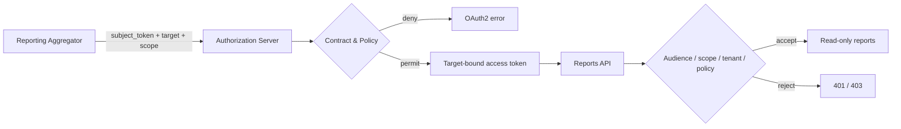
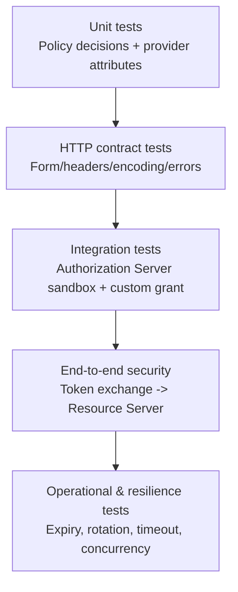

# 22.9. Kiểm thử hợp đồng và giới hạn quyền của grant mở rộng

## 1. Vì sao grant mở rộng cần được kiểm thử như một ranh giới bảo mật?

Trong **Spring Security OAuth 2.0/OIDC Client**, các grant quen thuộc như `authorization_code`, `refresh_token` và `client_credentials` đã có những quy tắc giao thức và tích hợp tương đối rõ ràng. Tuy nhiên, nhiều hệ thống doanh nghiệp cần **OAuth 2.0 extension grants** để trao đổi credential hoặc xin token theo một ngữ cảnh đặc thù:

- Một service cần đổi token của người dùng thành token dành riêng cho API downstream (*Token Exchange*).
- Một client gửi JWT assertion để xin access token (*JWT Bearer Assertion Grant*).
- Một thiết bị không có browser thuận tiện cần *Device Authorization Grant*.
- Một hệ thống tích hợp sử dụng grant URI riêng do Authorization Server công bố.

**Grant mở rộng không có nghĩa là được bỏ qua các ranh giới quyền.** Ngược lại, chính những đường trao đổi credential giữa các chủ thể, tenants và APIs mới dễ tạo ra lỗi *confused deputy*, token substitution, audience confusion, privilege escalation và cross-tenant access.

Vì vậy kiểm thử phải có **hai mục tiêu độc lập nhưng liên quan**:

1. **Kiểm thử hợp đồng giao thức và tích hợp (contract testing):** Spring OAuth2 Client gửi đúng `grant_type`, tham số, client authentication, encoding và endpoint; đọc đúng token response/error; lưu và sử dụng token theo vòng đời xác định.
2. **Kiểm thử giới hạn quyền (authorization boundary testing):** Authorization Server chỉ cấp token cho chủ thể, tài nguyên, audience, scopes, tenant, actor và thời hạn **đã được cho phép**; Resource Server từ chối token dùng sai mục đích.

Một token response `200 OK` **không chứng minh** việc cấp quyền an toàn. Có thể endpoint trả token đúng JSON schema nhưng token dành cho sai API, chứa scope quá rộng, bị cấp cho một tenant khác hoặc có lifetime vượt chính sách.

> **Nguyên tắc:** Mỗi grant mở rộng phải có hợp đồng đầu vào/đầu ra rõ ràng, chính sách quyền có thể kiểm chứng và bộ kiểm thử **negative cases** không ít quan trọng hơn happy path. Những điều client tự kiểm tra chỉ là phòng vệ bổ sung; **Authorization Server và Resource Server vẫn phải cưỡng chế chính sách độc lập**.

### 1.1. Phạm vi bài học

Bài tập trung vào:

- Đặc điểm của OAuth 2.0 Extension Grants theo **RFC 6749, Section 4.5**.
- Ví dụ xuyên suốt: **OAuth 2.0 Token Exchange — RFC 8693**.
- Cách kiểm thử **Spring Security OAuth2 Client** khi cài provider/token-response client mở rộng, với cả Servlet và Reactive.
- Contract tests, integration tests, security tests, tests về lifecycle và một số case vận hành.
- Những ràng buộc thực tế về `resource`, `audience`, `scope`, `subject_token`, `actor_token`, principal, client authentication, replay và đa tenant.

Bài **không** hướng dẫn lách chính sách của Authorization Server hay thiết kế một grant cấp token tùy ý từ đầu vào thiếu xác minh. Các ví dụ token là **giá trị giả trong môi trường kiểm thử**, không phải credential thật.

### 1.2. Kiến thức nền cần phân biệt

| Thuật ngữ | Ý nghĩa | Ai chịu trách nhiệm chính? |
| --- | --- | --- |
| **Grant type** | Cơ chế mà OAuth2 Client dùng để xin token | OAuth2 Client và Authorization Server |
| **Extension grant** | Grant được nhận dạng bằng URI và tham số được định nghĩa trong một đặc tả/hợp đồng | Provider/grant implementation và Authorization Server |
| **Client authentication** | Cách client chứng minh danh tính tại Token Endpoint | Authorization Server xác minh; client cấu hình credential |
| **Access token** | Credential để gọi Resource Server | Authorization Server phát hành; Resource Server kiểm tra |
| **Subject token** | Token đầu vào đại diện cho subject trong Token Exchange | Authorization Server xác minh kiểu, nguồn và quyền |
| **Actor token** | Token đầu vào tùy chọn mô tả actor hành động thay subject | Authorization Server xác minh actor/delegation policy |
| **Scope** | Tập quyền hoặc khả năng được yêu cầu/cấp | Authorization Server cấp; Resource Server cưỡng chế |
| **Audience/resource** | Đối tượng nhận token hoặc API đích theo hợp đồng | Authorization Server ràng buộc; Resource Server xác minh |
| **Authorized client** | `ClientRegistration` + principal + token được cấp ở phía Spring | `OAuth2AuthorizedClientService`/Repository/Manager |

## 2. OAuth2 extension grant được định danh và gửi như thế nào?

RFC 6749 định nghĩa extension grant qua một giá trị **`grant_type` là URI tuyệt đối**:

```text
grant_type=urn:ietf:params:oauth:grant-type:token-exchange
```

Đây không phải tên Java class, tên Spring bean hoặc chuỗi mà client có thể tự chọn bất kỳ rồi mặc định Authorization Server chấp nhận. URI xác định **một hợp đồng giao thức** mà các bên phải cùng hỗ trợ.

Một Token Request thường có cấu trúc:

```http
POST /oauth2/token HTTP/1.1
Host: auth.example.com
Authorization: Basic <redacted-client-credentials>
Content-Type: application/x-www-form-urlencoded
Accept: application/json

grant_type=<absolute-uri>&parameter1=...&parameter2=...
```

Các yêu cầu quan trọng:

- **HTTPS** và xác minh certificate/hostname cho Token Endpoint.
- Client authentication theo cách đã đăng ký, ví dụ `client_secret_basic`, `private_key_jwt` hoặc mTLS.
- Form body `application/x-www-form-urlencoded`, không tự chuyển thành JSON trừ khi **hợp đồng provider nêu rõ** một giao thức riêng.
- `grant_type` và những tham số bắt buộc phải đúng chính tả, kiểu và encoding.
- Token response/errors được xử lý theo OAuth 2.0 và đặc tả mở rộng.
- Client không gửi subject/actor token đến một endpoint thiếu tin cậy hoặc logging system.
- `ClientRegistration` mô tả grant; nó không tự làm Spring Security có sẵn provider cho **mọi** extension URI.

### 2.1. Một vài ví dụ extension grants

| Grant | Giá trị/đặc điểm | Lưu ý về quyền |
| --- | --- | --- |
| **Token Exchange (RFC 8693)** | `urn:ietf:params:oauth:grant-type:token-exchange` | Chính sách subject/actor, target audience/resource và scopes |
| **JWT Bearer Assertion Grant (RFC 7523)** | `urn:ietf:params:oauth:grant-type:jwt-bearer` | Chữ ký, issuer, audience, expiry, replay của assertion |
| **SAML 2.0 Bearer Assertion Grant (RFC 7522)** | `urn:ietf:params:oauth:grant-type:saml2-bearer` | Xác minh XML signature, issuer, subject, audience và replay |
| **Device Code Grant (RFC 8628)** | `urn:ietf:params:oauth:grant-type:device_code` | Liên kết device code với user approval, polling interval và expiry |
| **Custom private grant URI** | URI mà hai bên đã thỏa thuận | Contract, authorization policy và compatibility phải đặc tả rõ |

**Không suy ra** rằng một extension grant hiện diện trong RFC là Spring Security Client phiên bản đang dùng có tích hợp auto-configuration hoàn chỉnh. Đối với grant chưa có provider mặc định, cần viết/tích hợp extension qua **custom authorized-client provider** và **token response client** đúng stack.

## 3. Ví dụ xuyên suốt: Token Exchange có ràng buộc quyền

Giả sử một hệ thống có:

```text
Browser User
    ↓ đăng nhập OIDC
Portal API
    ↓ gửi access token của user để gọi một gateway nội bộ
Reporting Aggregator
    ↓ muốn token chỉ dành cho Reports API
Authorization Server
    ↓ cấp access token mới được ràng buộc
Reports API (Resource Server)
```

`Reporting Aggregator` đóng vai trò OAuth2 Client thực hiện **Token Exchange** với Authorization Server.

**Yêu cầu nghiệp vụ giả định:**

- Subject token phải hợp lệ và đại diện cho user thuộc tenant `T1`.
- Client `reporting-aggregator` được cấp phép thực hiện Token Exchange.
- Target resource được cho phép là `https://reports-api.example.com`.
- Token đầu ra chỉ có quyền tương đương `reports.read`, không có `reports.admin`.
- Nếu actor token được sử dụng, actor phải được phép hành động thay subject trong tenant tương ứng.
- Không cấp token vượt giới hạn thời hạn, scope, resource và policy của user/client.
- Token đầu ra phải được Reports API xác minh **audience, issuer, thời hạn và scopes**.

### 3.1. Ba bảo vệ độc lập



Hệ thống không nên chỉ trông đợi API có chặn hay không. Authorization Server phải **không cấp** những token trái policy; Resource Server vẫn phải **không chấp nhận** token không đúng target/quyền.

### 3.2. Ba loại danh tính không được gộp

- **Client identity:** OAuth2 Client `reporting-aggregator` xác thực với Authorization Server.
- **Subject identity:** người dùng hoặc thực thể được đại diện bởi `subject_token`.
- **Actor identity:** service/actor thực hiện hành động, có thể được thể hiện qua `actor_token` hoặc identity được AS ràng buộc theo chính sách.

Chúng có thể liên quan nhưng **không phải cùng một principal**. Không được lấy `client_id` làm user ID; không được chỉ dựa vào `sub` của một JWT chưa kiểm tra chữ ký; và không được cho rằng bất kỳ caller nào giữ được subject token cũng tự động có quyền impersonation/delegation.

## 4. HTTP contract của RFC 8693 Token Exchange

Một request Token Exchange tiêu biểu, form fields mô tả trước khi URL-encode:

```text
POST https://auth.example.com/oauth2/token

grant_type=urn:ietf:params:oauth:grant-type:token-exchange
subject_token=FAKE_USER_ACCESS_TOKEN
subject_token_type=urn:ietf:params:oauth:token-type:access_token
resource=https://reports-api.example.com
scope=reports.read
requested_token_type=urn:ietf:params:oauth:token-type:access_token
```

Trong đó:

| Parameter | Ý nghĩa | Kiểm thử nên khẳng định |
| --- | --- | --- |
| `grant_type` | URI của Token Exchange | Chính xác, không viết tắt `token_exchange` |
| `subject_token` | Token nguồn cần trao đổi | Có, không rỗng, được bảo vệ khỏi logs |
| `subject_token_type` | Kiểu token nguồn | Khớp kiểu thực, AS kiểm tra được |
| `resource` | Target resource URI theo RFC 8707/8693 | Chỉ được chọn trong allowlist/policy |
| `audience` | Audience identifier theo hợp đồng | Được validate và gắn đúng vào token đầu ra |
| `scope` | Quyền yêu cầu ở target | Không cấp vượt quyền đã được ủy quyền/policy |
| `requested_token_type` | Kiểu token đầu ra mong muốn | Chỉ chấp nhận loại token AS hỗ trợ |
| `actor_token` | Actor token tùy chọn | Chỉ chấp nhận khi policy hỗ trợ delegation |
| `actor_token_type` | Kiểu actor token | Phải hiện diện/phù hợp khi actor token được gửi |

Với `resource` và `audience`, RFC 8693 có cho phép các giá trị tham số lặp trong request phù hợp chuẩn. Tuy nhiên, **số lượng targets càng lớn không đồng nghĩa quyền được mở rộng**. Authorization Server phải kiểm soát tổ hợp targets/scopes và có thể từ chối bằng lỗi `invalid_target` khi target request không chấp nhận được.

### 4.1. Request form sau encoding

Trên mạng, URI grant type và resource được form-encode:

```http
POST /oauth2/token HTTP/1.1
Host: auth.example.com
Authorization: Basic <redacted>
Content-Type: application/x-www-form-urlencoded

grant_type=urn%3Aietf%3Aparams%3Aoauth%3Agrant-type%3Atoken-exchange&subject_token=FAKE_USER_ACCESS_TOKEN&subject_token_type=urn%3Aietf%3Aparams%3Aoauth%3Atoken-type%3Aaccess_token&resource=https%3A%2F%2Freports-api.example.com&scope=reports.read
```

**Kiểm thử nên xác minh các form parameters sau khi decode**, không phụ thuộc cứng vào thứ tự trường hoặc kiểu encoding khoảng trắng (`+` và `%20`) nếu hai cách là tương đương theo form contract.

Không dùng raw string concatenation để build body trong production khi có `subject_token` chứa ký tự đặc biệt. Dùng `MultiValueMap`, FormHttpMessageConverter hoặc HTTP client phù hợp để encode chính xác.

### 4.2. Response thành công

Một response minh họa:

```json
{
  "access_token": "FAKE_REPORTS_ACCESS_TOKEN",
  "issued_token_type": "urn:ietf:params:oauth:token-type:access_token",
  "token_type": "Bearer",
  "expires_in": 300,
  "scope": "reports.read"
}
```

Với RFC 8693, `issued_token_type` là trường đáng chú ý phân biệt **kiểu token được phát hành**, còn `token_type` mô tả cách dùng token ở Resource Server (ví dụ `Bearer`).

Contract tests cần kiểm tra:

- `access_token` tồn tại và được coi là credential.
- `issued_token_type` phù hợp grant/target và kiểu yêu cầu.
- `token_type` được hỗ trợ.
- `expires_in` hợp lệ theo chính sách; không chấp nhận thời hạn bất thường.
- `scope` được phản ánh theo semantics provider nếu response có field này.
- Phần mềm không tự giả định token phải là JWT: token cũng có thể opaque.
- Không mặc định có `refresh_token`; Token Exchange **không hứa** tạo refresh token cho mọi policy.
- Unknown additional response fields được xử lý theo hợp đồng/compatibility policy, không sử dụng để lén nâng quyền.

### 4.3. Response từ chối

Ví dụ Authorization Server không chấp nhận target:

```http
HTTP/1.1 400 Bad Request
Content-Type: application/json
Cache-Control: no-store
Pragma: no-cache

{
  "error": "invalid_target",
  "error_description": "Requested target is not permitted"
}
```

`invalid_target` là error code bổ sung của RFC 8693 cho target không thể chấp nhận theo request/policy. Các lỗi OAuth2 khác như `invalid_request`, `invalid_scope`, `unauthorized_client`, `invalid_client` và `invalid_grant` cũng có thể xuất hiện tùy validation/hợp đồng cụ thể.

**Không trả raw subject token, actor token hay client secret trong `error_description`.** Response có thể được application log/observability ghi lại nếu không được kiểm soát.

## 5. Định nghĩa một hợp đồng có thể kiểm thử

Trước khi viết JUnit, cần lập một **contract specification** gồm ba lớp.

### 5.1. Hợp đồng request

| Khía cạnh | Điều kiện cần mô tả | Ví dụ kiểm thử |
| --- | --- | --- |
| Endpoint | HTTPS Token Endpoint chính thức | Không gọi nhầm `/authorize` hoặc API business |
| Method/content type | `POST` + `application/x-www-form-urlencoded` | Thiếu/sai header → bị từ chối |
| Grant URI | Giá trị tuyệt đối, đúng đặc tả | URI không nhận diện → `unsupported_grant_type` |
| Client authentication | Method được đăng ký | Sai secret/mTLS/assertion → `invalid_client` |
| Subject token | Đúng kiểu, hợp lệ, còn hiệu lực | Expired/revoked/wrong issuer → deny |
| Actor token | Kiểm tra khi được dùng | Actor không được ủy quyền → deny |
| `resource`/`audience` | Target được phép theo client, subject, tenant | Foreign target → `invalid_target` |
| Scope | Quyền tương ứng được phép | `reports.admin` ngoài policy → deny/không cấp |
| Token type | Input/output type được hỗ trợ | Mismatch → error |
| Replay/concurrency | Quy tắc về reuse nếu áp dụng | One-time assertion reuse bị từ chối |
| Logging | Không lộ credentials | Logs/traces không chứa raw tokens |

### 5.2. Hợp đồng response

| Khía cạnh | Điều kiện | Ca đối nghịch |
| --- | --- | --- |
| `access_token` | Có trong response cấp token thành công | Thiếu hoặc blank |
| `issued_token_type` | Hợp lệ với extension grant | Unsupported token type |
| `token_type` | Phù hợp cách sử dụng của client | Token type không hỗ trợ |
| `expires_in` | Không vượt policy; hợp lệ về kiểu | Âm, 0 nếu contract không cho, cực lớn |
| `scope` | Quyền phát hành được làm rõ | Cấp scope vượt quyền |
| `aud` / target binding | Token sử dụng cho resource đã duyệt | Token được API khác chấp nhận |
| Token subject/actor semantics | Không nhầm actor với subject | Impersonation không được phép |
| Error response | Đúng OAuth2 status/error code, không leak | HTTP 200 mang body lỗi mơ hồ |
| Cache headers | Tránh caching credential theo chuẩn | Shared caches lưu response token |
| Correlation | Có trace/correlation metadata an toàn | Logging token và PII thô |

### 5.3. Hợp đồng authorization policy

Cần định nghĩa **ai có thể đổi token nào, thành token nào, cho API nào, với quyền gì**. Một bản ma trận thực tế nên chỉ rõ:

- **Client:** client ID nào được phép dùng grant.
- **Subject:** loại token/issuer/tenant/user nào được chấp nhận.
- **Actor:** service nào được phép hành động thay subject nếu delegation được hỗ trợ.
- **Target:** resource/audience được phép.
- **Scope/capability:** quyền mà token đầu ra có thể thể hiện.
- **Constraints:** token lifetime, proof-of-possession, session/device risk, consent, quota.
- **Outcome:** allow với quyền cụ thể, hoặc deny với error code/policy reason.

Không chỉ ghi “scope output là giao của scope input và scope requested” nếu hệ thống đang **ánh xạ scopes giữa hai APIs khác namespace**. Ví dụ `orders.read` ở nguồn có thể được AS ánh xạ thành `reporting.read` ở đích theo policy rõ ràng; tên scope khác nhau nhưng ý nghĩa được ủy quyền vẫn bị giới hạn. Điều bắt buộc là **không có sự mở rộng quyền không được phê duyệt**.

## 6. Threat model: những đường nâng quyền phải được kiểm thử

### 6.1. Confused deputy

Một service có quyền cao gọi Reports API có thể bị một client quyền thấp nhờ đổi token để truy cập báo cáo của người khác.

Kiểm thử:

1. Client A chỉ có quyền `reports.read` cho tenant T1.
2. A gửi subject token của User T1.
3. A yêu cầu token với target Reports API tenant T2 và scope `reports.admin`.
4. AS phải từ chối hoặc không cấp capability ngoài chính sách.
5. Reports API cũng phải từ chối token không hợp lệ cho tài nguyên T2.

**Không có quyền Admin chỉ vì service đóng vai trò proxy hoặc có thể gọi Token Endpoint.**

### 6.2. Cross-tenant token exchange

Nếu client/subject thuộc tenant T1, grant request chỉ định audience/resource của T2.

Contract có thể yêu cầu:

```text
clientTenant == subjectTenant == resourceTenant
```

hoặc một ma trận **trust relationship được cấu hình tường minh** nếu hệ thống hỗ trợ cross-tenant delegation. Mặc định nên **deny** khi không có quan hệ được phê duyệt.

Không dùng một `principalName` chung như `system` cho user tokens nhiều tenant rồi cho authorized-client store tái sử dụng token T1 trong request T2.

### 6.3. Subject-token substitution

Attacker gửi:

- Token hết hạn.
- JWT ký bằng key của issuer khác.
- ID Token OIDC thay access token nhưng khai báo `subject_token_type` là access token.
- Token không có audience/trust phù hợp cho AS nhận exchange.
- Token bị revoked.
- Token do client/tenant không được phép.

AS phải xác minh **loại token thật, issuer, signature/introspection, validity, trust policy và binding**. Client-side validation không thay thế việc này.

### 6.4. Actor-token substitution

Nếu grant có `actor_token`:

- Actor token phải được xác minh theo kiểu đã khai báo.
- Actor phải được phép thực hiện thao tác thay subject/đại diện.
- Output token phải phản ánh actor/subject semantics theo provider contract nếu hợp đồng yêu cầu.
- Không lấy một string `actor_id` do client tự gửi làm bằng chứng phân quyền nếu chưa chứng minh danh tính actor.

### 6.5. Audience confusion và token laundering

Một token nguồn chỉ dành cho API A không tự có quyền đổi thành token cho API B. Authorization Server phải có chính sách cho phép exchange; Resource Server B kiểm tra token đích dành cho mình.

Kiểm thử:

```text
Token for Inventory API -> call Reports API trực tiếp: DENY.
Token for Inventory API -> exchange for Reports API không có policy: DENY.
Token for Reports API -> call Reports API với đúng scope/tenant: ALLOW.
```

**Cùng issuer hoặc cùng khóa ký** không đồng nghĩa token có thể được dùng tại mọi Resource Server.

### 6.6. Replay và quyền sử dụng lại

Một số extension grants dùng **JWT/SAML assertions** có thể cần kiểm tra `jti`, nonce hoặc one-time-use semantics để ngăn replay; trong khi **RFC 8693 Token Exchange không mặc định yêu cầu mọi subject token chỉ được exchange một lần**. Phải kiểm thử theo hợp đồng của từng grant, không áp quy tắc replay của JWT assertion lên mọi access token.

Với proof-of-possession/mTLS/DPoP, phải kiểm tra ràng buộc khóa/certificate và các hạn chế tương ứng; không chỉ kiểm tra signature JWT một cách chung chung.

## 7. Ma trận kiểm thử quyền: happy path và deny path

Một bảng test matrix ví dụ cho **Reporting Token Exchange**:

| ID | Client/subject | Target | Requested scope | Kết quả kỳ vọng |
| --- | --- | --- | --- | --- |
| P01 | Client được phép + subject T1 hợp lệ | Reports T1 | `reports.read` | Allow, token đúng target |
| P02 | Subject hợp lệ, requested scope hẹp hơn | Reports T1 | `reports.read` | Allow theo policy |
| N01 | Client chưa được cấp extension grant | Reports T1 | `reports.read` | Deny, `unauthorized_client` hoặc lỗi hợp đồng |
| N02 | Client secret sai | Reports T1 | `reports.read` | Deny `invalid_client` |
| N03 | Subject token hết hạn | Reports T1 | `reports.read` | Deny, không tạo token |
| N04 | Subject token từ issuer không tin cậy | Reports T1 | `reports.read` | Deny |
| N05 | Token loại không khớp khai báo | Reports T1 | `reports.read` | Deny |
| N06 | Subject tenant T1, target T2 | Reports T2 | `reports.read` | Deny theo tenant policy |
| N07 | Client chỉ được read | Reports T1 | `reports.admin` | Deny/không cấp admin |
| N08 | Unknown/foreign `resource` | External API | `reports.read` | Deny `invalid_target` |
| N09 | Actor không được ủy quyền | Reports T1 | `reports.read` | Deny |
| N10 | Subject bị revoke | Reports T1 | `reports.read` | Deny |
| N11 | Unsupported `requested_token_type` | Reports T1 | `reports.read` | Deny |
| N12 | Token request thiếu `subject_token` | Reports T1 | `reports.read` | Deny `invalid_request` |
| N13 | Thêm target thứ hai không được phép | Reports + Billing | `reports.read` | Deny tổ hợp targets |
| N14 | Token cấp cho Reports được gửi Billing | Billing API | Bất kỳ | Billing từ chối `401/403` theo policy |
| N15 | Token read gọi admin endpoint | Reports `/admin` | `reports.read` | Reports từ chối `403` |
| N16 | Token expired được gửi API | Reports API | `reports.read` | API từ chối `401 invalid_token` |
| N17 | Grant request vượt max TTL | Reports T1 | `reports.read` | Không cấp token vượt policy |
| N18 | Một assertion one-time bị replay | Reports T1 | `reports.read` | Deny nếu grant policy có replay prevention |

Mỗi test nên ghi rõ:

```text
Given: client, subject, actor, tenant, resource, scope, token type
When:  gửi grant request / gọi Resource Server
Then:  HTTP status + OAuth2 error/capabilities + persistence effects
And:   không lộ credential, không thay đổi quyền ngoài dự kiến
```

Đừng biến ma trận thành “mọi request sai đều phải trả cùng một OAuth2 error code”. **Mã lỗi cụ thể phụ thuộc đặc tả và provider contract**; điều không được thay đổi là **không cấp quyền vượt policy** và phản hồi không làm lộ bí mật.

## 8. Tổ chức kiểm thử theo nhiều lớp



### 8.1. Unit tests: nhanh và tập trung chính sách

Kiểm thử logic như:

- Grant có được client phép sử dụng hay không.
- Client/subject/actor/tenant binding.
- Target allowlist và scope mapping.
- Token lifetime ceiling.
- Loại token được chấp nhận.
- Không dùng `default allow` khi thiếu dữ liệu.
- Quyền không bị mở rộng khi input thay đổi bất lợi.

Các test này nên **deterministic**, không cần network và không log token thật.

### 8.2. HTTP contract tests: Spring OAuth2 Client gửi đúng gói tin

Kiểm thử:

- POST đúng Token Endpoint, đúng form content type.
- `grant_type` URI đầy đủ.
- Các trường RFC bắt buộc.
- Encoding và client authentication.
- Không đưa secret/subject token vào query URL.
- Token response được parse và mapping lỗi đúng.
- Không tự retry những lỗi không thể khắc phục bằng retry.

Một mock HTTP server có thể kiểm tra **client transport contract** mà không dùng Authorization Server thật.

### 8.3. Integration tests: Authorization Server có thật hoặc sandbox

Dùng một IdP/Authorization Server **test instance** đã bật đúng extension grant để kiểm thử:

- Allowed grant types, client authentication, scopes/targets.
- Signature/introspection và policy từ chối token nguồn giả.
- Mapping actor/subject và cross-tenant denial.
- Error responses tương thích contract.
- Token thời hạn ngắn, revocation, rotation nếu có.

Không sử dụng client secrets production hoặc tokens của người dùng thật để chạy CI.

### 8.4. End-to-end tests: Resource Server từ chối token sai đích

Một grant request thành công **vẫn chưa đủ**. Phải dùng token mới để gọi target API và thử cả các API không được phép:

```text
Exchange token cho Reports API -> GET Reports allowed endpoint -> 2xx.
Cùng token -> Billing API -> reject.
Cùng token -> Reports admin endpoint -> 403.
Expired token -> Reports API -> 401.
Token không có tenant entitlement -> target tenant khác -> reject.
```

Cách kiểm thử này xác minh **quyền thực tế** chứ không chỉ xét tên scopes trong JSON response.

### 8.5. Resilience/operational tests

Kiểm thử token endpoint timeout/503/429, TLS failure, rotation/revocation, concurrent requests, retries, token cache separation, logging và cleanup. Không cần biến tất cả thành unit tests nếu cần environment/container thực, nhưng nên có tiêu chí kiểm thử rõ và tự động hóa được mức phù hợp.

## 9. Spring Security có hỗ trợ extension grant tự động không?

Trong Spring Security OAuth2 Client, `ClientRegistration` có thể mô tả một grant riêng:

```java
AuthorizationGrantType TOKEN_EXCHANGE =
    new AuthorizationGrantType(
        "urn:ietf:params:oauth:grant-type:token-exchange");
```

Và registration có thể được tạo tường minh:

```java
ClientRegistration registration =
    ClientRegistration.withRegistrationId("reports-token-exchange")
        .clientId("reporting-aggregator")
        .clientSecret(secretFromSecureConfiguration)
        .clientAuthenticationMethod(
            ClientAuthenticationMethod.CLIENT_SECRET_BASIC)
        .authorizationGrantType(TOKEN_EXCHANGE)
        .tokenUri("https://auth.example.com/oauth2/token")
        .scope("reports.read")
        .clientName("Reports Token Exchange")
        .build();
```

Ở đây `secretFromSecureConfiguration` chỉ là biến được inject từ nguồn cấu hình an toàn; đoạn code lược bớt `import` và setup.

**Điều quan trọng:** `new AuthorizationGrantType(...)` chỉ giúp biểu diễn một grant. Để manager thực sự gọi Token Endpoint với parameters của RFC 8693, phải có **`OAuth2AuthorizedClientProvider` tùy chỉnh** hoặc implementation token exchange được phiên bản đang dùng hỗ trợ.

Nếu chỉ đặt YAML:

```yaml
spring:
  security:
    oauth2:
      client:
        registration:
          reports-token-exchange:
            provider: company-auth
            client-id: ${REPORTING_CLIENT_ID}
            client-secret: ${REPORTING_CLIENT_SECRET}
            authorization-grant-type: urn:ietf:params:oauth:grant-type:token-exchange
        provider:
          company-auth:
            token-uri: https://auth.example.com/oauth2/token
```

thì **không được suy luận** rằng Spring Security đã tự động biết cách tạo `subject_token`, `actor_token`, target fields, validate response hoặc enforce tenant policy. Mức độ hỗ trợ built-in phụ thuộc phiên bản; phải kiểm tra có provider tương ứng hoặc thực hiện tích hợp tùy chỉnh.

### 9.1. Chỗ mở rộng trên Servlet/non-reactive

Với các grant chưa được hỗ trợ mặc định, một implementation thường gồm:

```java
OAuth2AuthorizedClientProvider
OAuth2AccessTokenResponseClient<CustomGrantRequest>
OAuth2AuthorizedClientManager
OAuth2AuthorizedClientService
```

Provider nhận `OAuth2AuthorizationContext`, xác định grant type và điều kiện cho phép, dựng request phù hợp, gọi Token Endpoint qua `OAuth2AccessTokenResponseClient`, tạo `OAuth2AuthorizedClient` và để manager đảm nhiệm lifecycle/persistence.

### 9.2. Chỗ mở rộng trên WebFlux/Reactive

Tương ứng:

```java
ReactiveOAuth2AuthorizedClientProvider
ReactiveOAuth2AccessTokenResponseClient<CustomGrantRequest>
ReactiveOAuth2AuthorizedClientManager
ReactiveOAuth2AuthorizedClientService
```

Phải compose bằng `Mono`/`Flux`, không `.block()` bên trong reactor pipeline.

**Không nhầm provider hỗ trợ grant với policy của Authorization Server.** Spring OAuth2 Client là phía *xin token*; việc cưỡng chế grant, scope, audience và impersonation/delegation là trách nhiệm authoritative của AS và Resource Server.

## 10. Testing seam: tách transport, provider và policy

Một thiết kế dễ kiểm thử nên tách:

```text
Business Gateway
    ↓
Custom OAuth2AuthorizedClientProvider
    ↓
Token Exchange Request Factory
    ↓
Token Exchange Transport / Response Client
    ↓
Authorization Server
```

Trong đó:

- **Request Factory:** tạo danh sách form parameters, validate các input cần thiết và chọn target từ cấu hình tin cậy.
- **Transport/Response Client:** gửi HTTP request, thực hiện client authentication và parse response/error.
- **Authorized-client Provider:** quyết định khi nào custom grant áp dụng, gọi transport và chuyển response thành `OAuth2AuthorizedClient`.
- **Manager/Store:** lưu/tải/xóa authorized client theo registration + principal/context.
- **AS/Resource Server:** enforce security policy cuối cùng.

Nhờ vậy contract test có thể mock Token Endpoint, provider test có thể dùng fake transport, còn security test chạy với một Authorization Server sandbox để xác minh policy.

### 10.1. Attributes của authorization context không phải nguồn tin cậy mặc định

Một custom provider có thể đọc attributes:

```java
OAuth2AuthorizationContext context
```

như `subject_token`, `resource`, `actor_token` được đưa vào từ application code.

**Không nhận `resource`, `requested_scope` hoặc `subject_token` thô từ một HTTP request của user rồi xem là đã được phép.** Trước khi gọi provider, gateway phải nhận dạng authenticated caller, tenant, API đích và yêu cầu nghiệp vụ. AS phải xác minh độc lập những claims và quyền trong token nguồn.

Ví dụ về **hợp đồng nội bộ** cho provider:

```java
record ExchangeIntent(
    String registrationId,
    String subjectToken,
    URI targetResource,
    Set<String> requestedScopes,
    String tenantId
) {}
```

Đây là DTO do ứng dụng định nghĩa, **không phải Spring Security class có sẵn**. Nếu cần actor context, có thể bổ sung kiểu token và proof tương ứng; không chỉ gắn một trường actor ID vào DTO rồi coi đó là bằng chứng delegation.

## 11. Ví dụ code: HTTP contract test bằng Spring Test

Để kiểm thử việc mã hóa/gửi form request, có thể dùng **`MockRestServiceServer`** với `RestClient` (Spring Framework 6.1+) mà không gọi mạng thật.

### 11.1. Dependency phục vụ test

```gradle
dependencies {
    implementation 'org.springframework.boot:spring-boot-starter-oauth2-client'
    implementation 'org.springframework.boot:spring-boot-starter-web'

    testImplementation 'org.springframework.boot:spring-boot-starter-test'
}
```

Đoạn này dùng Java/Spring Test minh họa contract ở tầng HTTP. Trong WebFlux, có thể áp dụng ý tưởng tương tự bằng một fake HTTP endpoint/reactive client connector hoặc test server để kiểm tra `ReactiveOAuth2AccessTokenResponseClient`. Các API mocking cụ thể có thể khác tùy phiên bản và transport.

### 11.2. Một transport tối giản để làm test fixture

Lớp bên dưới **chỉ minh họa encoding và HTTP contract**. Nó không phải một `OAuth2AuthorizedClientProvider` production đầy đủ: chưa có parsing token có kiểm soát, failure policy, audience validation, timeouts hay tích hợp manager.

```java
final class ExampleTokenExchangeTransport {

    static final String TOKEN_EXCHANGE =
        "urn:ietf:params:oauth:grant-type:token-exchange";

    static final String ACCESS_TOKEN_TYPE =
        "urn:ietf:params:oauth:token-type:access_token";

    private final RestClient restClient;
    private final String clientId;
    private final String clientSecret;

    ExampleTokenExchangeTransport(
            RestClient restClient,
            String clientId,
            String clientSecret) {
        this.restClient = restClient;
        this.clientId = clientId;
        this.clientSecret = clientSecret;
    }

    String exchangeForReports(String subjectToken) {
        var form = new LinkedMultiValueMap<String, String>();

        form.add("grant_type", TOKEN_EXCHANGE);
        form.add("subject_token", subjectToken);
        form.add("subject_token_type", ACCESS_TOKEN_TYPE);
        form.add("requested_token_type", ACCESS_TOKEN_TYPE);
        form.add("resource", "https://reports-api.example.com");
        form.add("scope", "reports.read");

        return restClient.post()
            .uri("/oauth2/token")
            .headers(headers ->
                headers.setBasicAuth(clientId, clientSecret))
            .contentType(MediaType.APPLICATION_FORM_URLENCODED)
            .body(form)
            .retrieve()
            .body(String.class);
    }
}
```

Vì sao ví dụ có value cố định `https://reports-api.example.com`? Để minh họa **target ràng buộc bởi gateway/contract**, không có parameter URL do user tự chọn.

Trong production:

- Đưa client ID/secret vào secret manager/config bảo vệ.
- Có token response DTO/parser kiểm tra `issued_token_type`, `token_type`, `expires_in`, scopes.
- Xử lý OAuth2 error response đúng contract (không chỉ dùng `HttpClientErrorException`).
- Áp dụng timeouts, TLS, proxy, retry policy, client auth method theo provider.
- Không trả raw JSON token response lên controller hoặc logs.
- Không đưa token nguồn vào URI/query, metric labels hay exception messages.

### 11.3. JUnit test khẳng định request

```java
class ExampleTokenExchangeTransportTest {

    @Test
    void sendsRfc8693FormToExpectedTokenEndpoint() {
        RestClient.Builder builder = RestClient.builder()
            .baseUrl("https://auth.example.test");

        MockRestServiceServer mock =
            MockRestServiceServer.bindTo(builder).build();

        mock.expect(requestTo(
                "https://auth.example.test/oauth2/token"))
            .andExpect(method(HttpMethod.POST))
            .andExpect(header(
                HttpHeaders.CONTENT_TYPE,
                startsWith("application/x-www-form-urlencoded")))
            .andExpect(header(
                HttpHeaders.AUTHORIZATION,
                startsWith("Basic ")))
            .andExpect(content().string(containsString(
                "grant_type=urn%3Aietf%3Aparams%3Aoauth" +
                "%3Agrant-type%3Atoken-exchange")))
            .andExpect(content().string(containsString(
                "subject_token_type=urn%3Aietf%3Aparams" +
                "%3Aoauth%3Atoken-type%3Aaccess_token")))
            .andExpect(content().string(containsString(
                "subject_token=FAKE_SUBJECT_TOKEN")))
            .andExpect(content().string(containsString(
                "scope=reports.read")))
            .andRespond(withSuccess(
                """
                {
                  "access_token": "FAKE_ISSUED_TOKEN",
                  "issued_token_type":
                    "urn:ietf:params:oauth:token-type:access_token",
                  "token_type": "Bearer",
                  "expires_in": 300,
                  "scope": "reports.read"
                }
                """,
                MediaType.APPLICATION_JSON));

        ExampleTokenExchangeTransport transport =
            new ExampleTokenExchangeTransport(
                builder.build(),
                "test-client",
                "test-secret");

        String response =
            transport.exchangeForReports("FAKE_SUBJECT_TOKEN");

        assertNotNull(response);
        assertTrue(response.contains("issued_token_type"));
        mock.verify();
    }
}
```

Ví dụ cần những static imports thông dụng từ JUnit 5, Hamcrest và `MockRestRequestMatchers`/`MockRestResponseCreators`:

```java
import static org.junit.jupiter.api.Assertions.*;
import static org.hamcrest.Matchers.*;
import static org.springframework.test.web.client.match.MockRestRequestMatchers.*;
import static org.springframework.test.web.client.response.MockRestResponseCreators.*;
```

Và các class `RestClient`, `MockRestServiceServer`, `HttpHeaders`, `HttpMethod`, `MediaType`, `LinkedMultiValueMap`, `@Test`. Ví dụ dùng **text blocks của Java 17+**.

**Lưu ý về test:** đây là một **fixture hợp đồng đầu ra** chứ chưa phải toàn bộ security suite. Các assertions `containsString` cho thấy các parameters quan trọng có mặt; bộ test production cần **parse form** để khẳng định không trùng tham số trái contract, không có unknown fields, không gửi secret trong body, đúng resource và kiểm tra client authentication method thực sự. Không so sánh toàn bộ form body theo thứ tự key nếu thứ tự không phải contract.

### 11.4. Negative HTTP contract test: `invalid_target`

Mock Authorization Server từ chối target không được phép:

```java
@Test
void rejectsInvalidTargetWithoutTreatingErrorAsToken() {
    RestClient.Builder builder = RestClient.builder()
        .baseUrl("https://auth.example.test");

    MockRestServiceServer mock =
        MockRestServiceServer.bindTo(builder).build();

    mock.expect(requestTo(
            "https://auth.example.test/oauth2/token"))
        .andExpect(method(HttpMethod.POST))
        .andRespond(withStatus(HttpStatus.BAD_REQUEST)
            .contentType(MediaType.APPLICATION_JSON)
            .body("""
                {
                  "error": "invalid_target",
                  "error_description": "Target not permitted"
                }
                """));

    var transport = new ExampleTokenExchangeTransport(
        builder.build(), "test-client", "test-secret");

    HttpClientErrorException ex = assertThrows(
        HttpClientErrorException.class,
        () -> transport.exchangeForReports("FAKE_SUBJECT_TOKEN"));

    assertEquals(HttpStatus.BAD_REQUEST, ex.getStatusCode());
    assertTrue(ex.getResponseBodyAsString()
        .contains("\"error\": \"invalid_target\""));

    mock.verify();
}
```

Trong Spring Security integration thực tế, adapter/token response client nên chuyển lỗi hợp đồng này thành **OAuth2 error/exception có mã phù hợp**. Test này chỉ xác minh transport **không coi lỗi 400 là access token thành công**.

**Không ghi token response thật trong stack trace/report**. Dùng giá trị giả và log sanitized error code.

### 11.5. Kiểm thử encoding đúng với dấu đặc biệt

Một subject token thường là JWT/opaque token nhưng có thể chứa ký tự cần form-encoding. Nên có contract case với test token giả:

```text
subjectToken = "FAKE+TOKEN/with=chars"
```

Expected **decoded form value** phải đúng y nguyên string ban đầu. Dùng Mock HTTP request hoặc server test để parse form, không tự nối:

```java
"subject_token=" + subjectToken
```

vào form body. Dấu `+` trong URL-encoded form có semantics dấu cách nếu không encode đúng; đây là lý do test **decode round-trip** có ích.

## 12. Unit test quyền theo một policy minh họa

Để tránh trộn validation và HTTP transport, giả sử ứng dụng có policy **nội bộ** giới hạn một Token Exchange request. Đây là *defense in depth*, không thay thế policy của Authorization Server.

```java
record ExchangePolicyInput(
    String clientId,
    String subjectTenant,
    String callerTenant,
    URI target,
    Set<String> requestedScopes,
    Set<String> subjectAllowedScopes,
    Set<String> clientAllowedScopes
) {}

final class ExampleExchangePolicy {

    private static final URI REPORTS =
        URI.create("https://reports-api.example.com");

    boolean allowed(ExchangePolicyInput input) {
        return "reporting-aggregator".equals(input.clientId())
            && Objects.equals(
                input.subjectTenant(), input.callerTenant())
            && REPORTS.equals(input.target())
            && input.subjectAllowedScopes()
                .containsAll(input.requestedScopes())
            && input.clientAllowedScopes()
                .containsAll(input.requestedScopes());
    }
}
```

**Giới hạn của policy ví dụ:** nó giả định source/target sử dụng **cùng tên scope** và không mô hình hóa actor, consent, token proof, risk signals hoặc resource-specific role mapping. Trong thực tế, Authorization Server có thể dùng policy engine/entitlements khác, và AS **phải xác minh độc lập** các thông tin đầu vào, không tin strings do client tự khai.

### 12.1. JUnit test quyền cơ bản

```java
class ExampleExchangePolicyTest {

    private final ExampleExchangePolicy policy =
        new ExampleExchangePolicy();

    private ExchangePolicyInput input(
            String subjectTenant,
            String callerTenant,
            URI target,
            Set<String> requested) {

        return new ExchangePolicyInput(
            "reporting-aggregator",
            subjectTenant,
            callerTenant,
            target,
            requested,
            Set.of("reports.read"),
            Set.of("reports.read")
        );
    }

    @Test
    void allowsLeastPrivilegeForMatchingTenant() {
        var intent = input(
            "T1",
            "T1",
            URI.create("https://reports-api.example.com"),
            Set.of("reports.read"));

        assertTrue(policy.allowed(intent));
    }

    @Test
    void rejectsCrossTenant() {
        var intent = input(
            "T1",
            "T2",
            URI.create("https://reports-api.example.com"),
            Set.of("reports.read"));

        assertFalse(policy.allowed(intent));
    }

    @Test
    void rejectsPrivilegeEscalation() {
        var intent = input(
            "T1",
            "T1",
            URI.create("https://reports-api.example.com"),
            Set.of("reports.admin"));

        assertFalse(policy.allowed(intent));
    }

    @Test
    void rejectsForeignResource() {
        var intent = input(
            "T1",
            "T1",
            URI.create("https://billing-api.example.com"),
            Set.of("reports.read"));

        assertFalse(policy.allowed(intent));
    }
}
```

Những unit tests trên chứng minh **logic policy minh họa**. Chúng **không** chứng minh Authorization Server thật sẽ từ chối các request trái policy. Cần integration tests tới AS test instance và E2E tới Resource Server để xác minh enforcement.

### 12.2. Kiểm thử tính đơn điệu của quyền (authorization monotonicity)

Một property hữu ích:

> Khi yêu cầu nhiều capability hơn mà không có authorization mới, kết quả không được mở quyền ngoài giới hạn đã cho.

Ví dụ nếu T1 được `reports.read`:

```text
request reports.read                -> ALLOW
request reports.admin               -> DENY
request reports.read + reports.admin -> DENY
```

Tùy contract, AS có thể cấp subset thay vì từ chối toàn bộ. Test phải khẳng định **quyền thực tế được cấp không vượt policy**, không nhất thiết buộc mọi Authorization Server phải chọn cùng một error response.

Các biến thể cần thử:

- Thêm một audience thứ hai.
- Thêm một tenant hoặc actor khác.
- Tăng requested lifetime.
- Đổi `subject_token_type`.
- Đổi client identity.
- Đổi `requested_token_type` sang loại không hỗ trợ.

Một extension grant an toàn không nên trở thành một con đường tăng quyền đơn giản bằng cách thêm field vào form.

## 13. Contract tests cho `OAuth2AuthorizedClientProvider` tùy chỉnh

Custom grant provider trong Spring Security phải thực hiện trách nhiệm **tạo hoặc không tạo authorized client** đúng ngữ cảnh.

Với Servlet/non-reactive:

```java
OAuth2AuthorizedClientProvider
OAuth2AuthorizationContext
OAuth2AuthorizedClient
OAuth2AccessTokenResponseClient<CustomGrantRequest>
```

Với Reactive:

```java
ReactiveOAuth2AuthorizedClientProvider
OAuth2AuthorizationContext
Mono<OAuth2AuthorizedClient>
ReactiveOAuth2AccessTokenResponseClient<CustomGrantRequest>
```

`CustomGrantRequest` là kiểu **do ứng dụng tự định nghĩa** nếu grant chưa có request class chính thức trong phiên bản Spring Security. Không nhầm một pseudotype minh họa với built-in API.

### 13.1. Những trường hợp provider phải được kiểm thử

| Test | Ngữ cảnh | Kết quả kỳ vọng |
| --- | --- | --- |
| Grant type không phải extension URI | `client_credentials` registration | Custom provider không xử lý |
| Thiếu subject token | Không có token nguồn | Fail theo contract, không gửi Token Request |
| Token source không thuộc caller/tenant | Ngữ cảnh không hợp lệ | Deny trước request nếu client xác định được; AS vẫn validate |
| Target chưa được allowlist | API ngoài policy | Không gửi credential sang target không tin cậy |
| Token Endpoint trả success | Response đúng schema | Tạo `OAuth2AuthorizedClient` đúng registration/principal |
| Token response thiếu required field | `issued_token_type`/access token thiếu | Lỗi, không lưu client hỏng |
| Token type không được hỗ trợ | Output là loại không chấp nhận | Deny, không gửi sai token tới API |
| Token Endpoint trả OAuth2 error | `invalid_target` | Propagate/map error, không coi là success |
| Access token còn hạn theo cache policy | Authorized client hiện có | Không re-exchange quá thường xuyên nếu policy cho phép reuse |
| Token gần hết hạn | Authorized client cần cấp lại | Có thể reauthorize theo policy rõ ràng |
| Multiple principals | Same registration, user khác | Không trộn token giữa principals |
| Multiple tenants | Same client, tenant khác | Không reuse token sai tenant |
| Cancellation | Reactor subscription cancelled | Không leak resource hoặc ghi kết quả không mong muốn |

**Quan trọng:** với Token Exchange, không phải lúc nào cũng có thể an toàn cache theo **chỉ `(registrationId, principalName)`**. Nếu cùng principal có thể exchange nhiều subject tokens/audiences/actor contexts, cần mở rộng chiến lược key/storage hoặc không reuse chéo các requests.

`OAuth2AuthorizedClientService` API chung tra theo registration/principal; nó **không tự phân biệt mọi subject/audience/resource/tenant của extension grant**. Nếu cần các ngữ cảnh khác nhau đồng thời, dùng registrations/principals đã được ràng buộc an toàn hoặc thiết kế custom store/manager strategy phù hợp.

### 13.2. Không dùng refresh provider như “generic exchange”

Một `RefreshTokenOAuth2AuthorizedClientProvider` chỉ gửi `grant_type=refresh_token` với refresh token hợp lệ theo chuẩn, còn extension provider gửi `grant_type` URI với parameters đặc thù.

Không làm:

```text
subject_token -> gắn vào refresh_token parameter -> gọi refresh provider
```

Đây là sai giao thức và có thể khiến token nguồn bị xử lý sai/ghi log bởi một nhánh bảo mật không dành cho nó.

### 13.3. Test lifecycle do manager điều phối

Provider có thể trả `OAuth2AuthorizedClient` thành công, nhưng manager/service không lưu đúng. Test cần bao phủ:

1. Client registration được chọn đúng.
2. Request attributes mang đúng subject/actor/target theo policy.
3. Provider thực hiện grant đúng.
4. Response token được parse.
5. Manager success handler lưu authorized client đúng key/context.
6. Lần gọi tiếp theo không reuse token cho target/subject/tenant khác.
7. Failure handler không xóa nhầm authorized client khác.
8. Cleanup và revocation được tách biệt.
9. Không tự động cấp refresh token khi extension contract không hỗ trợ.

## 14. Reactive contract tests: xác minh non-blocking và ngữ cảnh

Với WebFlux, extension provider thường trả `Mono<OAuth2AuthorizedClient>`. Có thể test bằng Reactor Test:

```gradle
dependencies {
    testImplementation 'io.projectreactor:reactor-test'
}
```

Ví dụ pseudocode với `StepVerifier`:

```java
Mono<OAuth2AuthorizedClient> result =
    customReactiveProvider.authorize(authorizationContext);

StepVerifier.create(result)
    .assertNext(client -> {
        assertEquals(
            "reports-token-exchange",
            client.getClientRegistration().getRegistrationId());
        assertNotNull(client.getAccessToken());
        assertEquals(
            expectedPrincipalName,
            client.getPrincipalName());
    })
    .verifyComplete();
```

Trong đoạn trên, `customReactiveProvider`, `authorizationContext` và `expectedPrincipalName` là **test fixtures do ứng dụng dựng**, không phải beans có sẵn. Mục tiêu là minh họa contract của một reactive provider. Unit tests thực tế cần fake `ReactiveOAuth2AccessTokenResponseClient` để tránh network và kiểm tra các parameters đã gửi.

### 14.1. Test error signals

Ví dụ:

```java
StepVerifier.create(
        customReactiveProvider.authorize(invalidContext))
    .expectErrorMatches(error ->
        error instanceof OAuth2AuthorizationException)
    .verify();
```

Tùy hợp đồng, custom provider có thể `Mono.empty()` nếu **không áp dụng** cho grant hiện tại, hoặc `Mono.error(...)` nếu grant đúng nhưng request **không hợp lệ**. Cần phân biệt hai trường hợp để manager/provider chain không che một authorization error thật.

### 14.2. Không `.block()` trong reactive provider

Một custom implementation sai dễ viết:

```java
OAuth2AccessTokenResponse response =
    reactiveTokenClient.getTokenResponse(request).block();
```

Việc `.block()` bên trong WebFlux event loop có thể gây lỗi hoặc giảm throughput. Thay bằng `map`/`flatMap`:

```java
Mono<OAuth2AuthorizedClient> authorized =
    reactiveTokenClient.getTokenResponse(customGrantRequest)
        .map(response -> toAuthorizedClient(
            context,
            response));
```

`toAuthorizedClient(...)` là **hàm mapping do ứng dụng tự viết**, cần kiểm tra token response, principal và registration đúng contract.

### 14.3. Test concurrency và cache boundaries

Dùng fake HTTP server để mô phỏng nhiều subscribers/requests:

- Cùng principal/cùng target: policy có thể cho phép reuse token.
- Cùng principal/khác target: **không** được reuse target-bound token sai API.
- Cùng target/khác tenant: **không** dùng chung token.
- Cùng target/cùng user nhưng khác actor: kiểm tra actor authorization.
- Một request thất bại sau khi request khác đã cập nhật token: failure handler không nên xóa nhầm token mới nếu store/version policy yêu cầu.

Reactive code non-blocking không tự bảo đảm **single-flight**, atomic refresh hoặc transactional token store. Cần thiết kế concurrency policy ở layer phù hợp.

## 15. Kiểm thử giới hạn quyền tại Authorization Server

Đây là lớp kiểm thử không thể thay bằng unit test của client.

### 15.1. Client chưa được phép grant

Given:

```text
client_id = unapproved-client
grant_type = urn:ietf:params:oauth:grant-type:token-exchange
```

When gửi token request với subject token test hợp lệ.

Then:

- AS không cấp access token.
- Error OAuth2 tương thích, thường `unauthorized_client` theo chính sách.
- Không tạo token/ủy quyền trong storage.
- Không làm lộ lý do nội bộ/sensitive client info.

### 15.2. Scope nâng quyền

Given:

```text
subject capability = reports.read
client policy       = reports.read
requested scope     = reports.admin
```

Then AS phải từ chối hoặc cấp **chỉ quyền phù hợp**, tuyệt đối không phát token admin không được phê duyệt.

Khi test dùng JWT token output, có thể kiểm tra claims đã ký trong **test environment**. Nhưng nhớ rằng Resource Server mới quyết định final authorization; **không coi một trường claim có tên `scope` là toàn bộ quyền nghiệp vụ** nếu ứng dụng còn có policy khác.

### 15.3. Audience/resource ngoài allowlist

Given:

```text
resource = https://unapproved-api.example.com
```

Then AS từ chối target, ví dụ `invalid_target` nếu contract áp dụng. Không nên chỉ cấp token không có audience rồi để bất kỳ API nào tự nhận.

### 15.4. Subject/actor không được ủy quyền

Given:

```text
subject = User A / Tenant T1
actor   = Service B chưa được phép đại diện
```

Then AS từ chối. Không chấp nhận một `actor_token` ký hợp lệ nhưng actor không có quyền delegation.

### 15.5. Token source không đúng trust

Thử:

- Subject token ký bằng test issuer không được tin.
- Subject token hết hạn.
- Subject token revoked theo introspection.
- Token có audience dành cho API khác khi policy không cho exchange từ nguồn đó.
- Token type mismatch.
- Token bị sửa claim hoặc signature.
- Claim `sub` thuộc user khác với context đã xác thực.
- Token nguồn đã được cấp trong một tenant khác.

AS phải validate token source theo hợp đồng trước khi ra token đích. Không dùng thư viện decode JWT mà không verify để xây subject identity.

## 16. Kiểm thử Resource Server: token chỉ dùng được đúng nơi

Một bộ test E2E tối thiểu:

### Case 1: Được phép đọc reports

```http
GET /reports/me HTTP/1.1
Host: reports-api.example.com
Authorization: Bearer <issued-for-reports>
```

Expected: HTTP `200` (hoặc status nghiệp vụ thành công), dữ liệu chỉ thuộc quyền/tenant hợp lệ.

### Case 2: Sai audience

Dùng chính token Reports để gọi Billing:

```http
GET /invoices HTTP/1.1
Host: billing-api.example.com
Authorization: Bearer <issued-for-reports>
```

Expected: Billing API từ chối theo Bearer/token validation policy, thường `401` hoặc một lỗi phù hợp; **không** cho truy cập chỉ vì token được AS tin cậy ký.

### Case 3: Thiếu scope

Token Reports chỉ có `reports.read` gọi:

```http
DELETE /reports/42 HTTP/1.1
Host: reports-api.example.com
Authorization: Bearer <read-only-token>
```

Expected: từ chối, thường `403 insufficient_scope`/policy denial. Không chỉ kiểm tra response code; test thêm **dữ liệu không bị xóa**.

### Case 4: Sai tenant

Token Reports của tenant T1 gọi endpoint truy cập report T2.

Expected: từ chối hoặc chỉ trả dữ liệu tenant T1 theo policy. Không suy ra scope `reports.read` cho phép đọc tất cả tenants.

### Case 5: Subject đã bị disable/revoke

Nếu Resource Server policy yêu cầu revocation hoặc kiểm tra account trạng thái active, test user bị khóa không được tiếp tục truy cập theo khoảng thời gian/consistency cam kết. Với JWT self-contained, revocation có thể không có hiệu lực tức thì nếu không có cơ chế khác; **contract phải ghi rõ kỳ vọng**.

**Kết quả E2E là bằng chứng quyền thực tế**, không chỉ việc Token Endpoint phát JSON có vẻ đúng.

## 17. Kiểm thử bảo mật client authentication tại Token Endpoint

Grant mở rộng vẫn phải thực hiện client authentication đúng policy. Với confidential client:

- Client ID/secret hoặc private key/certificate phải được AS xác minh.
- Client auth method phải trùng với method đã đăng ký.
- Secret đã rotate/revoked phải bị từ chối.
- Không cho phép `client_secret_post` như fallback tùy tiện khi IdP chỉ chấp nhận `client_secret_basic`.
- Không bỏ mTLS/JWT proof chỉ vì subject token hợp lệ.
- Không ghi client credential ở URL query, logs hoặc error body.

### 17.1. Test HTTP Basic/form body

Với `client_secret_basic`:

```http
Authorization: Basic <redacted>
```

Với `client_secret_post` nếu provider cho phép:

```text
client_id=<id>&client_secret=<secret>
```

Contract test phải chứng minh **chỉ phương thức đúng được sử dụng**. Nếu dùng mTLS hoặc `private_key_jwt`, kiểm thử key/cert rotation và assertion validation theo tiêu chuẩn provider.

**Không coi base64 là mã hóa bảo mật**. Token Endpoint phải dùng TLS và kiểm tra certificate/hostname.

### 17.2. Test `private_key_jwt`

Khi dùng JWT client assertion, các kiểm tra có thể gồm:

- Chữ ký và thuật toán được đăng ký/cho phép.
- `iss`/`sub` phù hợp client identity theo contract.
- `aud` là Token Endpoint hoặc audience đã định nghĩa.
- `exp`, `iat`, `nbf` hợp lệ.
- `jti`/replay prevention theo policy.
- Key ID/rotation và unknown key bị từ chối.

Đừng đánh đồng JWT **làm client authentication** với JWT **được dùng làm subject token trong extension grant**. Chúng phục vụ hai bước chứng minh khác nhau.

## 18. Authorization Server Metadata và versioning hợp đồng

Khi provider hỗ trợ OAuth2 Authorization Server Metadata (RFC 8414) hoặc OpenID Connect Discovery, có thể có thông tin về Token Endpoint và grants được hỗ trợ.

Nhưng **metadata nói grant được hỗ trợ không đảm bảo một client cụ thể được quyền dùng grant đó**. `grant_types_supported` là một khả năng của server; allowed grants của client vẫn phải được đăng ký và cưỡng chế.

### 18.1. Thay đổi hợp đồng có thể phá client

Những breaking changes thường gặp:

- Đổi grant URI.
- Đổi required form fields.
- Đổi token type và `issued_token_type`.
- Đổi schema/semantics của actor/subject claims.
- Đổi allowed audiences/resources.
- Đổi client authentication method.
- Thay chính sách scope mapping.
- Thay expiry/rotation behavior.
- Đổi error code hoặc HTTP status mà client phụ thuộc.
- Bật proof-of-possession bắt buộc cho token đã từng là Bearer.

Vì vậy nên có một **contract test suite chạy trong CI** theo từng version môi trường AS/client, kèm tài liệu versioning, migration, compatibility window và negative cases.

### 18.2. Provider-specific fields

Nếu provider định nghĩa tham số như:

```text
requested_tenant
delegation_reason
requested_actor_context
```

thì:

- Tên, kiểu, required/optional, encoding, allowed values phải được mô tả.
- Không tự tin giá trị do client gửi nếu đó là thông tin quyền.
- Authorization Server phải derive/verify identity và tenant từ credentials đáng tin.
- Tham số không được biến thành “cấp quyền admin” chỉ vì có string `role=admin`.
- Unknown fields có thể bị từ chối theo contract; nếu hỗ trợ forward compatibility, phải kiểm soát tác động bảo mật.

**Không sao chép form fields của một IdP sang IdP khác** nếu không có hợp đồng chung.

## 19. Error contract: phải kiểm thử cả đường thất bại

Một bảng lỗi phổ biến:

| Lỗi | Nguồn | Ý nghĩa/hướng xử lý |
| --- | --- | --- |
| `invalid_request` | Token Endpoint | Thiếu/sai/duplicate fields theo contract |
| `unsupported_grant_type` | Token Endpoint | AS không hỗ trợ grant URI này |
| `unauthorized_client` | Token Endpoint | Client không được phép grant |
| `invalid_client` | Token Endpoint | Client authentication thất bại |
| `invalid_scope` | Token Endpoint | Requested scopes không được phép |
| `invalid_target` | Token Exchange AS | Resource/audience không chấp nhận được |
| `invalid_grant` | Token Endpoint | Grant/credential không hợp lệ theo ngữ cảnh |
| `server_error`/5xx | Token Endpoint | Lỗi server, cần backoff/observability |
| `invalid_token` | Resource Server | Bearer token không được API chấp nhận |
| `insufficient_scope` | Resource Server | Token thiếu quyền cho API operation |
| Timeout/TLS error | Network | Không phải bằng chứng token invalid |
| 429 | AS hoặc API | Rate limit, cần policy retry phù hợp |

Một số error codes là phần chuẩn của OAuth2, một số đặc thù extension; **mã lỗi chính xác trong từng negative test phải được chốt với Authorization Server contract**.

### 19.1. Không retry mọi lỗi

Không nên:

```text
catch any exception -> exchange token lại -> gửi API lại -> lặp vô hạn
```

Vì có thể:

- Client secret sai (`invalid_client`).
- Scope không được phê duyệt (`invalid_scope`).
- Resource không được cho phép (`invalid_target`).
- Token source bị revoke.
- Token output sai audience.
- API không có quyền (`insufficient_scope`).
- Một POST đã có side effect.

Các lỗi này không được giải quyết bằng cách xin token liên tục.

### 19.2. Retry khi nào?

Có thể cân nhắc retry có giới hạn cho network timeout hoặc một số 5xx/429 nếu contract cho phép, có backoff/jitter và tổng deadline.

Nhưng với **Token Exchange**, mỗi retry có thể tiêu tốn quota hoặc tạo token mới. Với **one-time assertions**, retry bằng cùng assertion có thể bị từ chối theo replay policy. Với **POST downstream có side effect**, retry có thể tạo dữ liệu trùng; cần idempotency key và cách xác minh operation status.

### 19.3. 401/403 khác lỗi Token Endpoint

Một token exchange thành công nhưng Resource Server trả `401` là lỗi **sau khi đã có token**. Không coi nó là lỗi `invalid_client` của Token Endpoint. Nếu API trả `403 insufficient_scope`, phải giải quyết authorization policy, không âm thầm xin grant nhiều quyền hơn.

## 20. Bảo vệ tokens, PII và dữ liệu kiểm thử

Contract tests thường ghi HTTP request/response để so sánh. Đây cũng là nơi secrets dễ bị lộ.

### 20.1. Nguyên tắc dữ liệu test

- Chỉ dùng **synthetic test identities** và fake tokens trong unit/HTTP mock tests.
- Với integration/e2e sandbox, dùng test users/tenants và client credentials được cách ly khỏi production.
- Không commit raw access token, refresh token, subject/actor token, mTLS private key hoặc client secret thật vào source.
- Không chụp/sao chép HTTP authorization headers thực vào ticket, snapshot hay logs.
- Không dùng production accounts làm negative tests (đặc biệt các bài test đổi tenant/revoke).
- Reset token state, sessions và test data theo chính sách sandbox.
- Nếu có token replay tests, dùng assertions thử nghiệm với hạn ngắn và cô lập.
- Không lưu full JWT claim payload nếu chứa PII; chỉ assert những trường cần thiết trong test.

### 20.2. Mock data cần tránh gây ảo tưởng

Một test token có payload JSON `{"scope":"reports.admin"}` chưa chứng minh gì nếu không ký/validate và không đi qua AS policy. Khi cần kiểm tra issuer/audience/expiry, dùng **test issuer/test JWKS** hoặc token stub đã được Resource Server test configuration xác minh theo cách có kiểm soát.

Không cấu hình Resource Server production `permitAll()` hoặc vô hiệu hóa signature validation chỉ để cho E2E test dễ chạy.

### 20.3. Tính chất log và observability

Những sự kiện hữu ích:

```text
registrationId=reports-token-exchange
grantType=token-exchange
clientKind=confidential
sourceIssuer=trusted-idp
targetResource=reports-api
requestedScopeClass=read-only
result=invalid_target
latencyMs=...
```

Không log:

```text
subject_token=<raw-token>
actor_token=<raw-token>
access_token=<raw-token>
client_secret=<raw-secret>
Authorization: Basic ...
Authorization: Bearer ...
Cookie: SESSION=...
```

Các event/metric names ở đây là **gợi ý thiết kế**, không phải các metric được Spring Security mặc định phát hành. Không dùng raw subject/email/token value làm metric label có cardinality lớn.

## 21. Kiểm thử token lifecycle, retention và thu hồi

Một extension grant thường sản sinh token có thể được lưu/cached bởi OAuth2 Client. Cần kiểm thử:

1. Token còn hạn được dùng lại **chỉ khi** registration/principal/subject/target binding vẫn đúng.
2. Token hết hạn không được gửi tới API nếu manager có thể cấp token đúng.
3. Token bị revoke không tiếp tục được dùng sau khi hệ thống phát hiện theo policy.
4. Unauthorized client error không làm mất token của user/client khác.
5. Logout user không xóa token service-to-service không liên quan.
6. Local `removeAuthorizedClient` **không tương đương** revocation ở Authorization Server.
7. Multi-pod/shared-store behavior đúng kỳ vọng.
8. Token exchange không tạo refresh token khi policy không cho.
9. Token lifespan không vượt maximum của AS/target policy.
10. Nếu output có refresh token, refresh grant phải được cho phép theo contract độc lập.

### 21.1. Cẩn trọng khi cache target-bound tokens

Không nên lưu một token exchange output vào `(registrationId, principalName)` rồi sử dụng cho **mọi** target nếu target binding không nằm trong storage key.

Ví dụ nguy hiểm:

```text
Authorized client key:
    (token-exchange, service)

Request A:
    subject=User1, resource=Reports, tenant=T1
    -> save token Reports/User1

Request B:
    subject=User2, resource=Billing, tenant=T2
    -> load cùng key
    -> gửi token User1/Reports tới Billing
```

Đây là **token mix-up/cross-context reuse**. Một custom grant implementation phải quyết định representation và storage key phù hợp:

- Có thể tách registration theo downstream/target.
- Có thể dùng principal key được derive an toàn từ subject/actor/tenant context.
- Có thể sử dụng custom token store có key gồm subject, actor, tenant, target và policy version.
- Có thể tránh reuse trong một số security contexts.
- Phải cân nhắc quyền truy cập/cách xóa khi user logout hoặc token source bị revoke.

**Không dùng raw subject token làm cache key/log label**; có thể dùng secure fingerprint/opaque ID theo chính sách và không coi fingerprint là bằng chứng authorization.

### 21.2. Mất token qua restart khác với bị thu hồi

Với `InMemoryOAuth2AuthorizedClientService` hoặc reactive equivalent:

- JVM restart → mất local authorized client.
- Token ở AS/Resource Server không mặc nhiên bị revoke.
- Request tiếp theo có thể làm grant mới nếu có đủ điều kiện.
- Refresh token không còn trong RAM có thể khiến user cần login/consent lại.

Nếu token cần bền vững nhiều pods, thiết kế JDBC/shared storage tương ứng, bảo vệ credentials và concurrency. Không dùng in-memory như một cách “revoke toàn cluster” chỉ bằng restart pod.

## 22. Kiểm thử concurrency, token rotation và eventual consistency

### 22.1. Concurrent exchange

Hai requests đổi cùng subject token:

```text
Request X: subject=User1, target=Reports, scope=read.
Request Y: subject=User1, target=Reports, scope=read.
```

Tùy provider, exchange có thể được cho phép nhiều lần hoặc bị giới hạn. Contract phải chỉ rõ rate limit/reuse/idempotency semantics; không suy ra Token Exchange là one-time use như authorization code.

### 22.2. Concurrent refresh

Nếu extension grant cấp refresh token và AS dùng rotation:

```text
Token đầu vào: A1/R1
Request X: refresh R1 -> A2/R2
Request Y: refresh R1 -> invalid_grant
```

Cần test manager/store không ghi đè R2 bằng R1, không xóa nhầm record mới khi request Y thất bại và không retry vô hạn R1.

### 22.3. Failure handler đến muộn

Một request gửi token cũ A đến API, API chậm trả `401 invalid_token`. Trong lúc đó một request khác đã tạo token B và save.

Nếu handler xóa theo `(registrationId, principalName)` mà không so sánh version, nó có thể **xóa luôn B**. Kiểm thử concurrent failure với fake HTTP server và versioned store nếu production policy yêu cầu conditional removal.

### 22.4. Eventual consistency của revocation

Nếu AS revoke token nhưng Resource Server dùng cached JWT key/claims hoặc introspection cache, một số API có thể tiếp tục chấp nhận token trong khoảng thời gian giới hạn. Security contract phải ghi rõ:

- Thời gian tối đa chấp nhận revocation lag.
- Có yêu cầu immediate revocation hay không.
- Expiry maximum.
- Cache invalidation/introspection policy.
- Test nên đợi/quan sát theo SLA, không hứa revoke tức thì nếu hạ tầng không hỗ trợ.

## 23. Những lỗi test design thường gặp

**Lỗi 1 — Chỉ có happy-path `200 OK`.**  
Chưa kiểm thử nâng quyền, tenant isolation, audience, actor, token source invalid hoặc Resource Server enforcement.

**Lỗi 2 — Mock Token Endpoint trả đúng JSON là cho rằng AS an toàn.**  
Mock chỉ chứng minh client gửi/đọc HTTP đúng. AS policy cần integration tests thật/sandbox.

**Lỗi 3 — Chỉ kiểm tra token có scope string mong đợi.**  
Scope names không đủ để chứng minh effective permissions. Resource Server còn kiểm tra audience, tenant, role và domain-specific policy.

**Lỗi 4 — Dùng subject token do browser gửi mà không validate.**  
Client không được tự tin raw token nguồn; AS phải verify, và gateway phải ràng buộc source token với authenticated caller/context theo threat model.

**Lỗi 5 — Nhầm OIDC ID Token thành access token.**  
ID Token xác thực user cho OIDC Client, không được mặc nhiên dùng như subject token type `access_token` hoặc gửi trực tiếp tới Resource Server.

**Lỗi 6 — Chỉ đặt `authorization-grant-type` URI trong YAML.**  
Custom grant còn cần provider/token client implementation nếu framework chưa hỗ trợ.

**Lỗi 7 — Lưu mọi exchanged token dưới một principal chung.**  
Có nguy cơ cross-user/cross-tenant/target token mix-up.

**Lỗi 8 — Xóa toàn bộ authorized-client store sau một 401.**  
Lỗi một target/registration không chứng minh token khác invalid. Xóa đúng key/context khi policy cho phép.

**Lỗi 9 — Retry mọi `invalid_target` và `insufficient_scope`.**  
Đó là lỗi quyền/chính sách, không thể chữa bằng lặp token request.

**Lỗi 10 — Dùng production credentials trong CI.**  
Có nguy cơ phát tán token/secret và ảnh hưởng account thật.

**Lỗi 11 — Kiểm thử mock JWT bằng cách bỏ signature validation cả production.**  
Test cấu hình phải tách biệt; security validation trong production không được yếu đi vì convenience.

**Lỗi 12 — Test dựa trên `Thread.sleep(...)` để chờ token hết hạn.**  
Dễ flaky; khi kiểm thử expiry ưu tiên controllable clock, deterministic token lifetime và sandbox fixtures.

## 24. Checklist contract trước khi triển khai

### 24.1. Giao thức

- [ ] Grant URI được version/định nghĩa chính xác.
- [ ] Token Endpoint, client authentication và TLS được cấu hình đúng.
- [ ] Request body/form fields và encoding được kiểm thử.
- [ ] Token response schema và error codes đã được chốt.
- [ ] Unknown/duplicate fields có policy nhất quán.
- [ ] Timeouts/retries không làm lộ credential hoặc gây token storm.
- [ ] Spring provider/manager thực sự hỗ trợ extension grant.
- [ ] Không có nhầm lẫn với `refresh_token` hoặc OIDC Login.

### 24.2. Giới hạn quyền

- [ ] Allowed clients/grants được kiểm tra server-side.
- [ ] Subject token issuer/type/validity/revocation được kiểm tra.
- [ ] Actor identity/delegation được xác minh nếu áp dụng.
- [ ] Resource/audience allowlist và tenant isolation được cưỡng chế.
- [ ] Scope/capability mapping không cấp quyền vượt policy.
- [ ] Token output có expiry/token type/target binding phù hợp.
- [ ] Resource Server xác minh independent audience/scopes/tenant.
- [ ] Cross-tenant, impersonation, replay và confused deputy cases có tests.
- [ ] Có policy cho multi-target requests và lifetime ceiling.

### 24.3. Vòng đời & vận hành

- [ ] Token store key không mix user/actor/target contexts.
- [ ] Manager success/failure handlers lưu/xóa đúng authorized client.
- [ ] Concurrency/rotation có giải pháp phù hợp.
- [ ] Local removal khác token revocation được tài liệu hóa.
- [ ] Test secrets được cách ly; logs/traces đã redacted.
- [ ] CI chạy contract/unit; sandbox/e2e tests được lên lịch phù hợp.
- [ ] Có kế hoạch contract versioning, rotation và rollback.

Checklist là **công cụ thiết kế**, không phải bằng chứng hệ thống đã an toàn. Cần chạy tests để ghi nhận kết quả thực tế.

## 25. Tình huống thực hành

### Tình huống A — Một service muốn lấy token admin từ user read-only

**Given:** subject token chỉ có quyền đọc, client được cấp extension grant nhưng không có quyền admin.

**When:** request `scope=reports.admin`.

**Then:** AS phải từ chối hoặc chỉ cấp quyền được phép; Resource Server phải từ chối admin endpoint. Nếu chỉ kiểm tra `200` từ Token Endpoint thì bỏ sót lỗi nâng quyền.

### Tình huống B — Token Exchange tới một audience khác

**Given:** token nguồn từ inventory workflow.

**When:** caller yêu cầu `resource=https://billing-api.example.com`.

**Then:** nếu không có delegation/trust policy cho Billing, AS từ chối `invalid_target` hoặc lỗi tương ứng. Billing API cũng không chấp nhận token chỉ dành Inventory.

### Tình huống C — JWT Bearer Assertion bị replay

**Given:** một assertion chứa `jti` và thời hạn ngắn dùng làm grant theo hợp đồng yêu cầu one-time-use.

**When:** gửi assertion hai lần.

**Then:** lần thứ hai bị từ chối theo replay policy; không chấp nhận chỉ vì chữ ký vẫn hợp lệ. Lưu ý đây là yêu cầu của assertion grant/policy cụ thể, **không áp dụng máy móc cho mọi Token Exchange**.

### Tình huống D — Cùng user, khác tenants

**Given:** User A được phép ở tenant T1 nhưng không có quyền tại T2.

**When:** client xin target token cho T2.

**Then:** AS từ chối hoặc giới hạn token cho T1; Resource Server không trả dữ liệu T2. Kiểm tra cả `subjectTenant`, client/actor identity và effective entitlements.

### Tình huống E — Custom provider trả authorized client đúng nhưng cache sai

**Given:** một custom store chỉ dùng `(registrationId, service)` làm key.

**When:** request mới đổi một subject token khác tới resource khác.

**Then:** không được reuse exchanged token cũ. Phải thiết kế cache key/context binding phù hợp hoặc tắt reuse trong tình huống đó.

### Tình huống F — Token Endpoint trả 429

**Given:** Authorization Server rate limit, Resource Server chưa nhận request.

**Then:** retry có giới hạn theo `Retry-After`/backoff nếu contract cho phép; không coi đó là token invalid hoặc tự nâng scope để thử lại.

### Tình huống G — Cấp token thành công nhưng Reports API trả 403

**Given:** AS trả access token với `scope=reports.read`.

**When:** gọi `DELETE /reports/42`.

**Then:** API từ chối; đây là enforcement tốt. Không tự đổi grant request sang `reports.admin` chỉ vì API trả 403.

### Tình huống H — Client bí mật bị rotate

**Given:** Token Endpoint bắt đầu yêu cầu client credential mới.

**When:** integration test dùng secret đã bị thu hồi.

**Then:** `invalid_client`; không có access token. Test phải chứng minh secret không có trong log/error response.

### Tình huống I — Một extension grant yêu cầu mTLS

**Given:** client có certificate A đã đăng ký.

**When:** request không có client certificate hoặc dùng certificate B không được phê duyệt.

**Then:** TLS/client authentication thất bại; có token nguồn hợp lệ vẫn không được vượt bước này.

### Tình huống J — Client Reactive gặp `Mono.empty()`

**Given:** provider chain không có custom extension provider cho grant URI.

**When:** manager được yêu cầu authorize custom registration.

**Then:** không thể giả định framework tự xin token; cần cấu hình custom Reactive provider và xử lý kết quả rỗng/lỗi theo contract, không `.block()` hay tự gọi HTTP ngoài manager một cách thiếu kiểm soát.

## 26. Câu hỏi ôn tập

**1. Vì sao OAuth2 extension grant dùng URI làm `grant_type`?**

RFC 6749 Section 4.5 quy định extension grant được định danh bằng URI tuyệt đối để phân biệt rõ giao thức và tránh xung đột tên riêng.

**2. Đặt một URI custom vào `ClientRegistration` có tự tạo token request đầy đủ không?**

Không. Với grant chưa được hỗ trợ mặc định, cần provider/token response client phù hợp.

**3. Contract test và authorization test khác nhau ở đâu?**

Contract test xác minh client/AS nói chuyện đúng HTTP/schema/parameters. Authorization test xác minh AS/Resource Server **không cấp hoặc chấp nhận quyền vượt policy**.

**4. Token Endpoint trả `200` đã đủ chứng minh grant an toàn chưa?**

Chưa. Phải kiểm tra token type, scopes, target, tenant, expiry và effective access ở Resource Server.

**5. `subject_token` có phải access token đầu ra không?**

Không. Nó là token **nguồn** dùng làm input của Token Exchange. Output token là một credential mới theo contract.

**6. `actor_token` có phải client authentication không?**

Không mặc định. Actor token mô tả actor trong Token Exchange; client vẫn phải xác thực với Token Endpoint bằng phương thức đã đăng ký.

**7. `resource` và `audience` ảnh hưởng điều gì?**

Chúng giúp xác định target/token audience. AS phải giới hạn targets; Resource Server phải xác minh token được cấp cho mình.

**8. Một scope string khác tên có luôn là nâng quyền không?**

Không. Có thể có policy mapping giữa các APIs. Quan trọng là effective capability không vượt ủy quyền, không phải phép so sánh tên scope máy móc.

**9. `issued_token_type` và `token_type` khác nhau ở đâu?**

`issued_token_type` chỉ kiểu token được cấp trong Token Exchange, còn `token_type` chỉ cách dùng token theo OAuth2, ví dụ `Bearer`.

**10. Khi nào Authorization Server trả `invalid_target`?**

Theo RFC 8693, khi target (`resource`/`audience`) được yêu cầu không thể được chấp nhận theo policy/contract.

**11. Scope `reports.read` có đủ để gọi mọi dữ liệu report của mọi tenant không?**

Không. Resource Server còn cần kiểm tra tenant/ownership/business authorization và audience.

**12. Vì sao phải test tokens được gửi tới API đích sai?**

Để chứng minh audience/resource binding được Resource Server thực thi và tránh token reuse ngoài intended recipient.

**13. Unit test client policy có thay thế integration test của AS không?**

Không. AS là nơi authoritative enforcement; client-side guard chỉ là defense in depth.

**14. Vì sao không dùng raw token làm storage key hoặc log label?**

Token là credential nhạy cảm. Việc đưa vào key/log/metrics có thể gây lộ dữ liệu và tăng cardinality.

**15. `OAuth2AuthorizedClientService` mặc định có key gì?**

Theo cặp registration ID và principal name; custom grant có nhiều subjects/targets có thể cần strategy bổ sung để không mix tokens.

**16. Khi nào cần kiểm tra token replay?**

Khi grant/credential type và provider policy yêu cầu, ví dụ JWT/SAML assertions với one-time-use semantics; không áp dụng máy móc cho mọi subject token.

**17. `invalid_client` khác `invalid_token` thế nào?**

`invalid_client` thường do Token Endpoint không xác thực được OAuth2 Client; `invalid_token` thường là lỗi Bearer token tại Resource Server.

**18. Có nên retry liên tục `invalid_target` hoặc `insufficient_scope` không?**

Không. Đây là lỗi quyền/hợp đồng, retry không làm policy thay đổi.

**19. Khi nào cần test refresh token rotation?**

Khi grant/Authorization Server thực sự cấp refresh token có rotation; không giả định mọi Token Exchange cấp refresh token.

**20. Reactive provider có nên gọi `.block()` để dùng token response client không?**

Không. Nên compose qua `Mono`, `map`, `flatMap` và test error/cancellation signals.

**21. Khi nào nên kiểm tra `grant_types_supported` của AS?**

Khi tích hợp provider hỗ trợ discovery/metadata. Tuy nhiên đây không phải bằng chứng client cụ thể được cấp quyền sử dụng grant.

**22. Client và Resource Server nên chia nhau trách nhiệm kiểm soát gì?**

Client phải không gửi credential sai đích; AS kiểm tra quyền cấp token; Resource Server xác minh token và effective access trước khi trả dữ liệu.

## 27. Tài liệu tham khảo

- [RFC 6749 — OAuth 2.0 Authorization Framework, Section 4.5: Extension Grants](https://www.rfc-editor.org/rfc/rfc6749#section-4.5)
- [RFC 8693 — OAuth 2.0 Token Exchange](https://www.rfc-editor.org/rfc/rfc8693)
- [RFC 8707 — Resource Indicators for OAuth 2.0](https://www.rfc-editor.org/rfc/rfc8707)
- [RFC 7523 — JWT Profile for OAuth 2.0 Client Authentication and Authorization Grants](https://www.rfc-editor.org/rfc/rfc7523)
- [RFC 7522 — SAML 2.0 Profile for OAuth 2.0 Client Authentication and Authorization Grants](https://www.rfc-editor.org/rfc/rfc7522)
- [RFC 8628 — OAuth 2.0 Device Authorization Grant](https://www.rfc-editor.org/rfc/rfc8628)
- [RFC 8414 — OAuth 2.0 Authorization Server Metadata](https://www.rfc-editor.org/rfc/rfc8414)
- [RFC 7662 — OAuth 2.0 Token Introspection](https://www.rfc-editor.org/rfc/rfc7662)
- [RFC 7009 — OAuth 2.0 Token Revocation](https://www.rfc-editor.org/rfc/rfc7009)
- [RFC 6750 — OAuth 2.0 Bearer Token Usage](https://www.rfc-editor.org/rfc/rfc6750)
- [RFC 9068 — JWT Profile for OAuth 2.0 Access Tokens](https://www.rfc-editor.org/rfc/rfc9068)
- [RFC 9700 — Best Current Practice for OAuth 2.0 Security](https://www.rfc-editor.org/rfc/rfc9700)
- [Spring Security Reference — OAuth 2.0 Client (Servlet)](https://docs.spring.io/spring-security/reference/servlet/oauth2/client/index.html)
- [Spring Security Reference — OAuth 2.0 Client (Reactive)](https://docs.spring.io/spring-security/reference/reactive/oauth2/client/index.html)
- [Spring Security API — OAuth2AuthorizedClientProvider](https://docs.spring.io/spring-security/reference/api/java/org/springframework/security/oauth2/client/OAuth2AuthorizedClientProvider.html)
- [Spring Security API — ReactiveOAuth2AuthorizedClientProvider](https://docs.spring.io/spring-security/reference/api/java/org/springframework/security/oauth2/client/ReactiveOAuth2AuthorizedClientProvider.html)
- [Spring Framework Reference — MockRestServiceServer](https://docs.spring.io/spring-framework/reference/testing/spring-mvc-test-client.html)
- [Spring Framework Reference — RestClient](https://docs.spring.io/spring-framework/reference/integration/rest-clients.html)

**Ghi nhớ:** **Kiểm thử grant mở rộng phải chứng minh cả *đúng hợp đồng* lẫn *không vượt giới hạn quyền*.** Đúng `grant_type` URI, token request/response và client authentication chỉ là bước đầu. Phải có ma trận kiểm thử **subject/actor/tenant/resource/audience/scope/token type**, các ca từ chối, integration tests với Authorization Server và E2E tests tại Resource Server. Với Spring Security, custom grant cần provider/token response client thực sự hỗ trợ; lưu/cache phải ràng buộc đúng principal và target. Không coi `200 OK`, tên scope, token đã ký hoặc unit test phía client là bằng chứng đủ để cho phép delegation hoặc impersonation.
