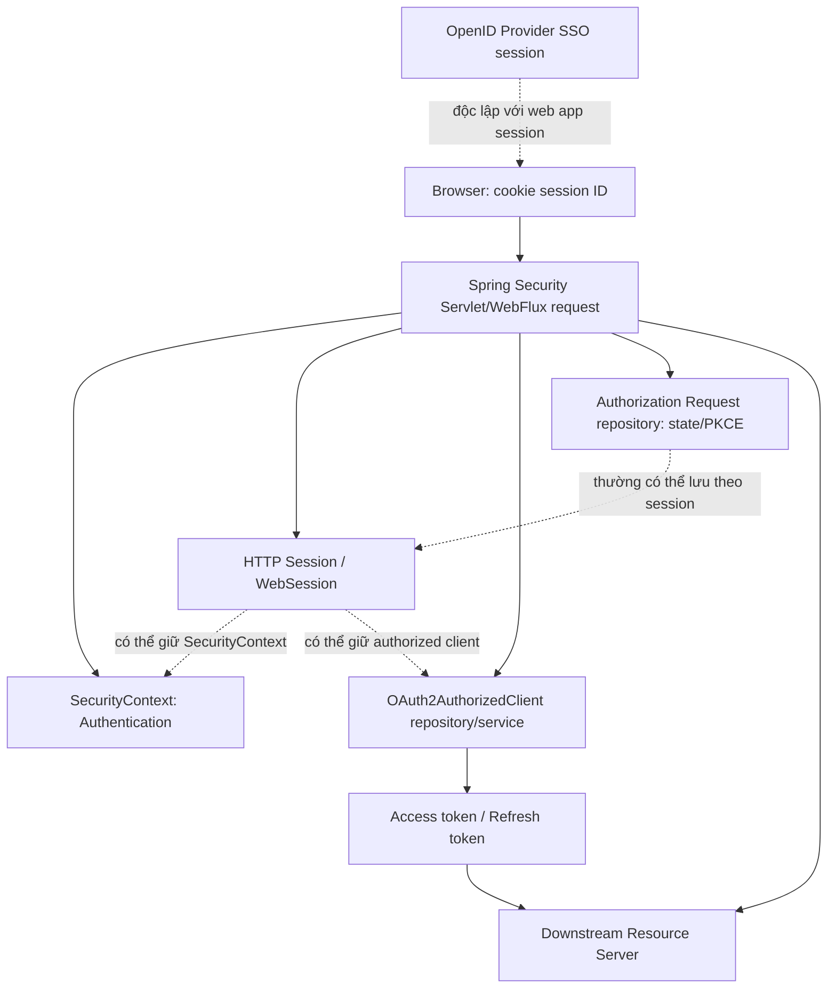
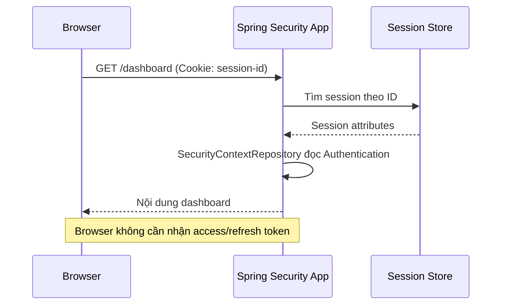
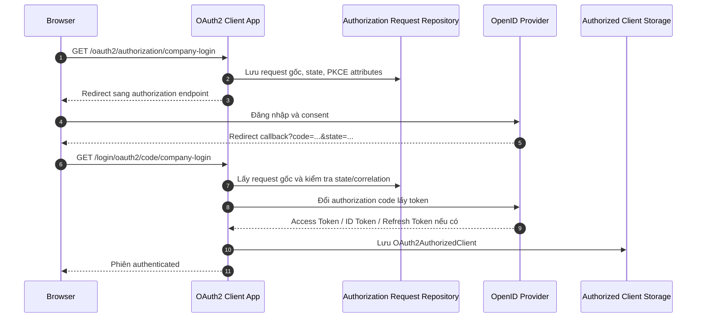
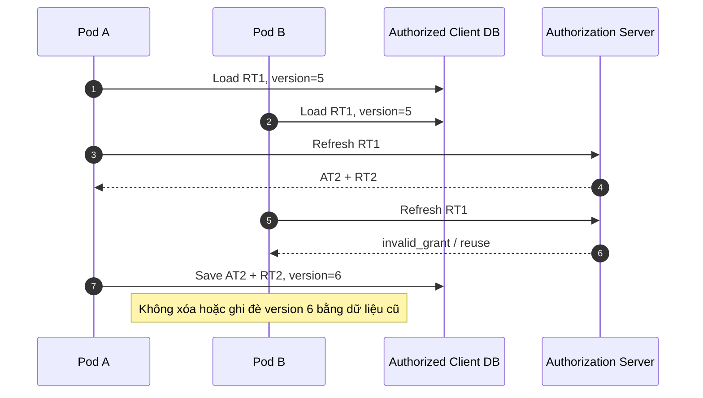
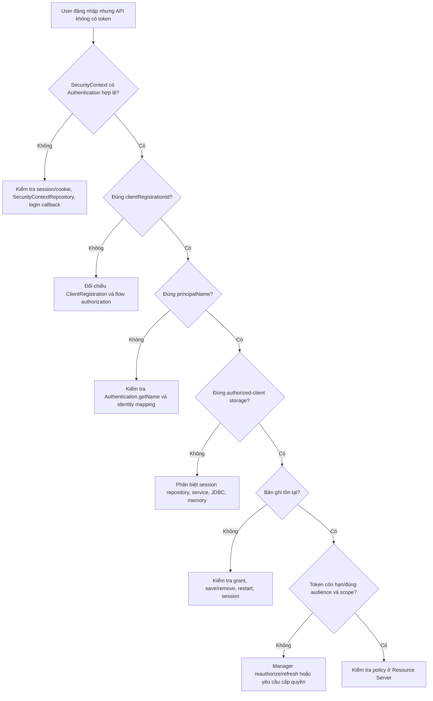

# 23.1. Phân chia dữ liệu giữa SecurityContext, session và authorized client

Trong **Spring Security OAuth 2.0 / OpenID Connect (OIDC) Client**, đăng nhập thành công thường làm xuất hiện nhiều loại trạng thái cùng lúc: ứng dụng biết **ai đang đăng nhập**, trình duyệt có **phiên HTTP**, và backend có thể giữ **access token/refresh token** để gọi API. Nếu gom tất cả vào một khái niệm “session đăng nhập”, ta dễ gặp những vấn đề khó chẩn đoán: người dùng vẫn đăng nhập nhưng API không có token, xóa session mà token vẫn tồn tại trong database, token hết hạn nhưng user vẫn authenticated, hoặc access token của người này bị sử dụng nhầm cho người khác.

Bài học này xác định ranh giới rõ ràng giữa ba thành phần trung tâm:

1. **`SecurityContext`**: trạng thái bảo mật của một lần xử lý, quan trọng nhất là `Authentication` mô tả principal và authorities.
2. **Session**: cơ chế duy trì trạng thái HTTP qua nhiều request của browser, thường dùng cookie session ID và kho session phía server. Session là **nơi có thể lưu một số dữ liệu bảo mật**, chứ không phải bản thân `SecurityContext`.
3. **`OAuth2AuthorizedClient`**: bản ghi về một `ClientRegistration` đã được cấp quyền cho một principal, chứa access token và có thể có refresh token, được truy xuất qua repository/service riêng.

Ngoài ra còn có **authorization request tạm thời** (`state`, PKCE, nonce context), **ID Token/UserInfo**, **session tại OpenID Provider** và **token được Resource Server chấp nhận**. Chúng liên quan nhưng không thể hoán đổi.

> Quy tắc thiết kế: **biết người dùng là ai không đồng nghĩa có access token**, và **có access token không đồng nghĩa người dùng đang có một web session hợp lệ hoặc được phép thực hiện mọi nghiệp vụ**.

## 1. Mục tiêu học tập

Sau bài này, bạn có thể:

- Giải thích `SecurityContext`, `Authentication`, `SecurityContextRepository` và `SecurityContextHolder`.
- Phân biệt HTTP session ID trong cookie với dữ liệu session ở server.
- Biết `OAuth2AuthorizedClientRepository` và `OAuth2AuthorizedClientService` lưu loại dữ liệu nào, theo những khóa nào.
- Hiểu vì sao `OAuth2AuthenticationToken` không phải nơi đọc access token để gọi API.
- Mô tả state đi qua Authorization Code Flow/OIDC Login, callback, API call, refresh và logout.
- Chọn mô hình storage phù hợp cho Spring MVC Servlet, WebFlux Reactive, nhiều instances hoặc background jobs.
- Giải thích token expiry, session expiry, logout, revocation và OP SSO session là những sự kiện khác nhau.
- Phân tích lỗi “đã đăng nhập nhưng không có token”, “mất phiên sau deploy”, “token vẫn có tác dụng sau logout”.
- Thiết kế an toàn: CSRF, cookie/session fixation, mã hóa token, tenant isolation, cleanup và concurrency.

## 2. Bức tranh tổng thể: những nơi chứa trạng thái



Sơ đồ diễn tả **mối liên hệ logic**, không áp đặt một implementation. Cả `SecurityContext` và authorized client **có thể** được lưu vào cùng một HTTP session nhưng thường ở những attribute/kho khác nhau. Chúng cũng có thể được lưu **khác nơi**: chẳng hạn `SecurityContext` theo session Redis, còn authorized client trong JDBC.

### 2.1. Bảng phân biệt nhanh

| Câu hỏi | Thành phần chịu trách nhiệm chính |
|---|---|
| “Request này đã được xác thực là ai?” | `SecurityContext` → `Authentication` |
| “Người dùng có `ROLE_ADMIN` hoặc `REPORT_READ` không?” | `Authentication.getAuthorities()` và chính sách authorization |
| “Browser lần sau có thể tiếp tục phiên hiện tại không?” | Cookie session ID, server session và `SecurityContextRepository` |
| “Lần redirect tới OP trước callback đã tạo `state` nào?” | `OAuth2AuthorizationRequestRepository` hoặc Reactive `ServerAuthorizationRequestRepository` |
| “Có access token của registration X cho principal Y không?” | `OAuth2AuthorizedClientRepository` / `OAuth2AuthorizedClientService` |
| “Token đã hết hạn, ai quyết định refresh hoặc authorize lại?” | `OAuth2AuthorizedClientManager` và provider |
| “Token này có được phép gọi Reports API không?” | Resource Server: chữ ký/introspection, issuer, audience, scope và chính sách đối tượng |
| “User đã logout khỏi OP chưa?” | OP session, giao thức OIDC Logout và chính sách provider |

### 2.2. Một ví dụ quan trọng

Alice đăng nhập thành công bằng registration `company-login`. Một request sau đó có thể có:

```text
SecurityContext:
  Authentication.name       = employee-42
  Authentication.authorities = [OIDC_USER, SCOPE_openid, ...]
  Authentication.authenticated = true

HTTP Session:
  session-id                = [opaque identifier]
  security-context         = [dữ liệu do repository quản lý]
  authorization-request    = [chỉ khi còn flow đang diễn ra]
  authorized-client-data   = [có hoặc không, tùy repository]

OAuth2AuthorizedClientService:
  (registrationId=company-login, principalName=employee-42)
    -> accessToken = [bí mật]
    -> refreshToken = [bí mật nếu được cấp]
```

Đây là mô hình minh họa, **không phải những key attribute mặc định cần hardcode** trong code ứng dụng. Mỗi repository có cách lưu và kiểu dữ liệu riêng.

## 3. SecurityContext: danh tính và quyền của request

Trong Spring Security, `SecurityContext` là container giữ `Authentication` của ngữ cảnh bảo mật:

```text
SecurityContext
  └── Authentication
        ├── principal
        ├── name
        ├── authorities
        ├── authenticated
        ├── credentials (tùy authentication type)
        └── details (tùy implementation)
```

Trong OAuth2 Login Servlet, `Authentication` sau login thường là `OAuth2AuthenticationToken`; với OIDC, principal thường là `OidcUser`. `OidcUser` có thể cho phép truy cập ID Token/UserInfo và claims đã được xác minh theo flow.

### 3.1. SecurityContext trả lời câu hỏi nào?

Một controller Servlet:

```java
import org.springframework.security.core.Authentication;
import org.springframework.web.bind.annotation.GetMapping;
import org.springframework.web.bind.annotation.RestController;

@RestController
class CurrentIdentityController {

    @GetMapping("/me")
    Identity me(Authentication authentication) {
        return new Identity(
                authentication.getName(),
                authentication.isAuthenticated(),
                authentication.getAuthorities().stream()
                        .map(authority -> authority.getAuthority())
                        .toList());
    }

    record Identity(
            String principalName,
            boolean authenticated,
            java.util.List<String> authorities) {}
}
```

Ví dụ chỉ phản hồi tên/authority được phép công bố theo chính sách của ứng dụng. Trong production, cần giới hạn endpoint, tránh lộ claims/roles nhạy cảm và xử lý anonymous authentication đúng cách.

Khi một request đã authenticated, ứng dụng có thể dùng `hasAuthority(...)`, `hasRole(...)`, `@PreAuthorize` hoặc policy nghiệp vụ để ra quyết định. **Không nên dùng “có access token trong database” làm bằng chứng duy nhất cho user authentication**.

### 3.2. Authentication có chứa access token không?

`OAuth2AuthenticationToken` có thông tin `principal`, `authorities` và `authorizedClientRegistrationId`. Nó **không phải** `OAuth2AuthorizedClient` và không phải API chuẩn để lấy access token cần gửi tới downstream API.

Ví dụ:

```java
import org.springframework.security.oauth2.client.authentication
        .OAuth2AuthenticationToken;

if (authentication instanceof OAuth2AuthenticationToken oauth2) {
    String registrationId = oauth2.getAuthorizedClientRegistrationId();
    String principalName = oauth2.getName();

    // Hai giá trị trên giúp định vị authorized client,
    // không phải chính access token.
}
```

Nếu cần access token cho API, hãy dùng `OAuth2AuthorizedClientRepository`, `OAuth2AuthorizedClientService`, `@RegisteredOAuth2AuthorizedClient` hoặc `OAuth2AuthorizedClientManager` phù hợp với flow, không cast principal rồi kỳ vọng có `getAccessToken()`.

### 3.3. OIDC ID Token khác access token

OIDC `OidcUser` có thể giữ `OidcIdToken` đã được framework xác minh; ID Token phục vụ **xác thực danh tính tại client**. Access token dành cho **Resource Server** phù hợp với audience và scopes.

| Dữ liệu | Dùng để làm gì? | Có nên gửi tới API downstream? |
|---|---|---|
| `Authentication.getName()` | Tên principal trong ứng dụng | Không phải bearer credential |
| `OidcUser.getIdToken()` | Thông tin xác thực OIDC của user | Không dùng thay access token |
| `OAuth2AuthorizedClient.getAccessToken()` | Credential để gọi API được phép | Có, chỉ tới đúng Resource Server |
| `OAuth2AuthorizedClient.getRefreshToken()` | Xin access token mới tại token endpoint | Không gửi tới Resource Server |

Ngay cả khi `OidcUser` không chứa access token, **SecurityContext vẫn có thể chứa dữ liệu nhạy cảm**, đặc biệt là ID Token/claims. Không serialize toàn bộ `SecurityContext` thành JSON response hoặc ghi vào log.

### 3.4. SecurityContext tồn tại trong request như thế nào?

Ở Servlet, `SecurityContextHolder` thường đưa `SecurityContext` vào luồng xử lý hiện tại qua chiến lược lưu trữ ngữ cảnh. Spring Security dùng filter và `SecurityContextRepository` để nạp/lưu ngữ cảnh giữa các request khi cấu hình stateful.

Không tự:

```java
// Sai khi dùng như một kho lưu phiên/toàn cục:
static SecurityContext GLOBAL_CONTEXT;
```

Việc dùng biến static/shared làm ngữ cảnh có thể khiến principal của request này rò sang request khác. Trong luồng async, thread-local còn có thể thay đổi; cần cơ chế propagation được Spring Security hỗ trợ.

## 4. HTTP Session: cơ chế duy trì trạng thái qua các request

Một HTTP session là một vùng trạng thái server-side gắn với browser thông qua một session identifier. Browser thường giữ **cookie phiên** (ví dụ `JSESSIONID` với Servlet) và gửi nó ở những request tiếp theo. Cookie thông thường mang **ID của session**, không chứa toàn bộ SecurityContext hoặc refresh token.



Một session có thể lưu giỏ hàng, flash messages, CSRF-related state, SecurityContext hoặc authorized-client data; mỗi thành phần phải có **owner và lifecycle** rõ ràng.

### 4.1. Session không phải authentication

Một session có thể tồn tại khi:

- User **chưa đăng nhập** (anonymous session được tạo phục vụ một flow cần state).
- User **đã đăng nhập**, SecurityContext được lưu.
- User vừa **logout**, session bị vô hiệu hoặc xoay ID nhưng browser/OP còn những trạng thái khác.
- Application restart và session store còn nhưng một số dữ liệu token nằm trong memory đã mất.

Vì vậy: **có session ≠ đã authenticated**; và **có authenticated request ≠ bắt buộc có session**. Bearer token Resource Server với chính sách stateless có thể xác thực mỗi request mà không tạo session web.

### 4.2. SecurityContextRepository chịu trách nhiệm gắn kết

Ở Servlet, abstraction `SecurityContextRepository` tải và lưu `SecurityContext` giữa request và persistence. Những implementation thường gặp gồm:

- `HttpSessionSecurityContextRepository`: dùng HTTP session.
- `RequestAttributeSecurityContextRepository`: giữ ngữ cảnh trong phạm vi request và một số dispatch.
- `DelegatingSecurityContextRepository`: kết hợp nhiều repositories theo thứ tự được cấu hình.
- `NullSecurityContextRepository`: không lưu ngữ cảnh giữa các request.

Trong các cấu hình Spring Security hiện đại, một default có thể là `DelegatingSecurityContextRepository` kết hợp request attributes và HTTP session. **Đừng tự kết luận mọi Spring Boot version đều dùng một repository duy nhất**; cần xem security filter chain/auto-configuration thực tế.

### 4.3. Ví dụ cấu hình session theo nhu cầu

```java
import org.springframework.context.annotation.Bean;
import org.springframework.security.config.annotation.web.builders.HttpSecurity;
import org.springframework.security.config.http.SessionCreationPolicy;
import org.springframework.security.web.SecurityFilterChain;

@Bean
SecurityFilterChain appSecurity(HttpSecurity http) throws Exception {
    return http
            .authorizeHttpRequests(auth -> auth
                    .requestMatchers("/", "/error").permitAll()
                    .anyRequest().authenticated())
            .sessionManagement(session ->
                    session.sessionCreationPolicy(
                            SessionCreationPolicy.IF_REQUIRED))
            .oauth2Login(oauth2 -> {})
            .build();
}
```

`IF_REQUIRED` cho phép tạo session khi cần. Nó không có nghĩa mỗi request sẽ bắt buộc tạo session; chi tiết phụ thuộc flow. Trong OIDC Authorization Code Flow phía browser, session thường hữu ích để giữ request `state` trước callback và SecurityContext sau login.

### 4.4. STATELESS không đơn giản là “OAuth2 Login không cần session”

`SessionCreationPolicy.STATELESS` chỉ hướng Spring Security không tạo hoặc dùng `HttpSession` cho `SecurityContext` theo chính sách tương ứng. Nó **không tự thay thế tất cả nơi lưu `OAuth2AuthorizationRequest`** và không làm authorization-code redirect/callback không còn cần correlation.

Nếu muốn một kiến trúc login không dùng session truyền thống, cần thiết kế **toàn bộ** việc lưu state/nonce/PKCE, callback correlation, SecurityContext, cookies hoặc token-based login theo ranh giới bảo mật; không chỉ thay một enum và giả định flow sẽ vẫn hoạt động.

## 5. OAuth2AuthorizedClient: quyền được cấp và token

`OAuth2AuthorizedClient` lưu thông tin của một OAuth2 client registration **đã được cấp quyền** cho một principal:

```text
OAuth2AuthorizedClient
  ├── ClientRegistration
  │     ├── registrationId = "company-login"
  │     ├── clientId = "portal-web-prod"
  │     ├── grantType = authorization_code
  │     └── provider/tokenUri/scopes/...
  ├── principalName = "employee-42"
  ├── OAuth2AccessToken
  │     ├── tokenValue = [bí mật]
  │     ├── issuedAt / expiresAt
  │     └── scopes
  └── OAuth2RefreshToken (nếu được cấp)
        ├── tokenValue = [bí mật]
        └── issuedAt
```

Nó không phải bản ghi “người dùng đang online”; token có thể còn tồn tại sau khi web session bị xóa, hoặc có thể hết hạn khi user vẫn đăng nhập.

### 5.1. Cặp khóa (registration ID, principal name)

`OAuth2AuthorizedClientService` dùng cặp:

```text
(clientRegistrationId, principalName)
```

Ví dụ:

| `clientRegistrationId` | `principalName` | Dữ liệu |
|---|---|---|
| `company-login` | `alice` | Token được cấp cho Alice với Corporate OP |
| `company-login` | `bob` | Token của Bob với Corporate OP |
| `reports-api` | `alice` | Token riêng của Alice cho Reports API |
| `inventory-service` | `service:inventory-job` | Token `client_credentials` của service |

Chỉ lưu theo `registrationId` dễ làm token của Alice/Bob ghi đè nhau. Chỉ lưu theo `principalName` làm token của hai provider hoặc hai registration bị lẫn.

### 5.2. Registration ID khác client ID

- `registrationId` là tên nội bộ trong cấu hình ứng dụng, ví dụ `company-login`.
- `clientId` do Authorization Server cấp, ví dụ `portal-web-prod`.
- `principalName` liên quan đến danh tính mà client được lưu cho, ví dụ `employee-42`.
- `sessionId` là định danh phiên browser; **không nằm trong cặp khóa service mặc định**.

Một principal có thể có nhiều authorized clients; một registration cũng có thể có authorized clients của nhiều principals. Không xem `clientId` hoặc session ID là chìa khóa thay thế cặp này.

### 5.3. Repository và service có khác nhau?

Ở Servlet:

```java
OAuth2AuthorizedClientService.loadAuthorizedClient(
        clientRegistrationId, principalName);
```

Trong khi repository dùng:

```java
OAuth2AuthorizedClientRepository.loadAuthorizedClient(
        clientRegistrationId, authentication, httpServletRequest);
```

| Đặc điểm | `OAuth2AuthorizedClientService` | `OAuth2AuthorizedClientRepository` |
|---|---|---|
| Vai trò | Truy cập storage authorized client theo principal | Truy cập authorized client theo ngữ cảnh HTTP request |
| Tham số lookup | Registration ID + principal name (String) | Registration ID + Authentication + HttpServletRequest |
| Dùng trong background job | Phù hợp | Cần HTTP context tương ứng |
| Ví dụ implementation | `InMemoryOAuth2AuthorizedClientService`, `JdbcOAuth2AuthorizedClientService` | `HttpSessionOAuth2AuthorizedClientRepository`, `AuthenticatedPrincipalOAuth2AuthorizedClientRepository` |
| Dữ liệu có bắt buộc nằm trong HTTP session không? | Không | Không; tùy repository |

`AuthenticatedPrincipalOAuth2AuthorizedClientRepository` có thể delegate việc lưu authorized client của authenticated principal cho một `OAuth2AuthorizedClientService`; một số cấu hình dùng `HttpSessionOAuth2AuthorizedClientRepository` cho trường hợp anonymous. Vì vậy việc cùng có “repository” không bảo đảm token nằm trong session, và việc có session không bảo đảm đọc được token qua service bạn đang inject.

### 5.4. Token được refresh bởi thành phần nào?

`OAuth2AuthorizedClientManager` phối hợp với `OAuth2AuthorizedClientProvider` để authorize hoặc reauthorize theo grant:

```text
Application / WebClient
        |
        v
OAuth2AuthorizedClientManager
        |
        +--> load authorized client từ repository/service
        |
        +--> kiểm tra grant/expiration và chọn provider
        |
        +--> gọi token endpoint nếu cần và được phép
        |
        +--> lưu authorized client mới theo đúng storage
        |
        v
OAuth2AuthorizedClient dùng để gọi API
```

**`loadAuthorizedClient(...)` chỉ đọc**, không phải lời hứa token còn hạn hoặc có đúng audience/scope. Với `client_credentials`, manager có thể xin token mới trực tiếp; với `authorization_code`, việc cấp quyền ban đầu cần browser và callback, không thể tự tạo code từ một batch job.

## 6. Một kho tạm nữa: OAuth2AuthorizationRequest

Authorization Code Flow cần giữ một `OAuth2AuthorizationRequest` **trước khi** client có token.



Trong Servlet, `HttpSessionOAuth2AuthorizationRequestRepository` là triển khai thường gặp để giữ request gốc trong HTTP session. Trong WebFlux có `WebSessionOAuth2ServerAuthorizationRequestRepository`. Đây là dữ liệu **có vòng đời ngắn, trước callback**, không phải authorized client storage.

### 6.1. Hai chữ “request” không giống nhau

| Loại | Thời điểm | Dữ liệu |
|---|---|---|
| `OAuth2AuthorizationRequest` | Tạo trước redirect sang OP | `client_id`, `scope`, `redirect_uri`, `state`, PKCE/nonce context |
| `OAuth2AuthorizeRequest` | Code application gọi `OAuth2AuthorizedClientManager.authorize(...)` | Registration/principal/attributes để manager chọn authorized client hoặc grant |
| `OAuth2AuthorizedClient` | Sau khi Authorization Server cấp quyền | Access token, refresh token và thông tin registration/principal |

Không dùng `OAuth2AuthorizationRequestRepository` làm kho token dài hạn. Nếu mất request gốc, callback có thể báo `invalid_state`; nếu mất authorized client sau login, API call có thể không tìm được token. Hai lỗi khác nhau.

### 6.2. Vì sao state, nonce, PKCE liên quan tới session?

Spring Security cần liên kết callback với lần login do browser **thực sự khởi động**. `state` được sinh khó đoán và so sánh sau callback; PKCE `code_verifier` phải tương ứng với `code_challenge` đã gửi; OIDC `nonce` giúp liên kết ID Token với request theo cơ chế chuẩn.

Khi tự thay đổi cấu hình session/repository:

- Không tự hardcode `state` hoặc `nonce`.
- Không đưa `code_verifier` vào authorization URL, log hoặc browser storage không an toàn.
- Không chuyển request state giữa người dùng hoặc tenant.
- Không làm session bị hủy trước callback do một custom login handler sai.
- Không bỏ qua correlation chỉ vì “provider đã trả code hợp lệ”.

### 6.3. Vòng đời authorization request

```text
T0: Request bắt đầu login -> lưu state/correlation
T1: Redirect OP -> browser ở ngoài ứng dụng
T2: Callback tới app -> tải và kiểm tra request gốc
T3: Trao đổi code và xác thực -> xóa/hoàn tất request tạm
T4: Authorized client và Authentication đã được tạo/lưu
```

Đôi khi session timeout giữa T1 và T2 gây login failure dù credentials ở OP đúng. Đó không phải lỗi do access token hết hạn.

## 7. Bảng quyết định: dữ liệu nên đặt ở đâu?

| Dữ liệu | Nơi phù hợp | Không nên |
|---|---|---|
| User principal và GrantedAuthorities hiện tại | `Authentication` trong `SecurityContext` | Một biến static toàn cục hoặc frontend claim không xác minh |
| Session ID | Cookie bảo vệ + session store | Dùng như OAuth2 client secret hoặc access token |
| Server-side flash message, UI state ngắn hạn | HTTP session nếu cần | Nhét vào access token hay SecurityContext |
| State/PKCE/nonce context trước callback | `OAuth2AuthorizationRequestRepository` | Tự lưu bằng URL không bảo vệ |
| Access token dùng gọi downstream API | `OAuth2AuthorizedClient` qua repository/service | ID Token, `Authentication.details`, localStorage browser của BFF |
| Refresh token | Authorized client storage được bảo vệ | Cookie/browser JS, log hoặc query string |
| Client secret/private key | Secret manager, cấu hình bảo vệ | SecurityContext hoặc session của user |
| OIDC ID Token đã xác minh | `OidcUser`/authentication context nếu flow phù hợp | Gửi thay access token sang API |
| Tenant/resource permissions | Server-side policy và nguồn dữ liệu quyền nghiệp vụ | Chỉ tin vào tên tenant của browser hoặc scope tự khai |
| Audit lịch sử | Audit/event store chuyên dụng | SecurityContext hoặc OAuth2AuthorizedClient như database audit |
| Token revocation state | Authorization Server/token service, theo cơ chế hỗ trợ | Giả định chỉ xóa local session là đủ |

**Phân chia dữ liệu không chỉ là chọn database**, mà còn là quyết định mỗi dữ liệu được sinh ở đâu, ai được đọc, được lưu bao lâu và bị xóa khi sự kiện nào xảy ra.

## 8. Vòng đời khác nhau: login, API call, token expiry, session expiry

### 8.1. Đăng nhập thành công

Trong một OIDC Servlet login điển hình:

1. Browser khởi động Authorization Code Flow.
2. Authorization Request được lưu để kiểm tra callback.
3. OP trả authorization code và state.
4. Client đổi code lấy token, xác minh ID Token và tạo `OidcUser`/`Authentication`.
5. `SecurityContext` của người dùng được lưu qua `SecurityContextRepository` theo chính sách.
6. `OAuth2AuthorizedClient` được lưu qua repository/service phù hợp.
7. Browser tiếp tục dùng cookie session để gửi các request tới app.

Các bước 5 và 6 là **hai thao tác lưu khác nhau** dù có thể cùng dựa trên HTTP session.

### 8.2. Access token hết hạn

```text
Browser session còn sống
SecurityContext còn Authentication của Alice
Access Token của Reports API đã hết hạn
Refresh Token có thể còn hiệu lực
```

Điều này hoàn toàn có thể xảy ra. Client manager có thể refresh access token nếu flow và provider cho phép. **Không bắt buộc user bị logout** chỉ vì access token API hết hạn.

Nếu refresh token cũng không hợp lệ, có thể cần user reauthorize; đó là hành động khác với việc đọc `Authentication` ở request hiện tại.

### 8.3. Web session hết hạn

```text
Browser session timeout
SecurityContext qua session không còn
Authorized client trong JDBC có thể vẫn tồn tại
```

Nếu user vào lại ứng dụng, Spring Security có thể coi họ chưa đăng nhập dù token database còn tồn tại theo principal name. **Không được tự cấp lại web login chỉ vì biết khóa principal có authorized client**. Authentication của request phải được xác minh lại theo flow được phép.

Ngược lại, một session có thể còn nhưng authorized client trong memory đã mất sau restart. User vẫn authenticated mà API không có token.

### 8.4. OP SSO session hết hạn

Session đăng nhập tại OP **độc lập** với session ứng dụng. OP có thể hết SSO session trong khi ứng dụng vẫn có `SecurityContext` và token hợp lệ; hoặc OP SSO còn hiệu lực sau khi ứng dụng logout.

Điều này giải thích vì sao người dùng logout khỏi Portal rồi bấm Login có thể vào lại rất nhanh do OP vẫn giữ SSO session. Nếu cần Single Logout, phải xem xét OIDC logout flow chứ không chỉ xóa ứng dụng session.

## 9. Ma trận các sự kiện và tác động

| Sự kiện | SecurityContext | HTTP session | Authorized client | OP / API |
|---|---|---|---|---|
| OIDC login thành công | Có authenticated principal | Thường được dùng để duy trì web login | Thường lưu authorized client của registration đã cấp quyền | OP đã hoàn tất auth/consent |
| Access token hết hạn | Có thể không đổi | Có thể không đổi | Token cũ có expiresAt; manager có thể refresh | API có thể trả 401 nếu dùng token hết hạn |
| Refresh token bị từ chối `invalid_grant` | Có thể vẫn còn authenticated | Có thể vẫn tồn tại | Có thể bị xóa/đánh dấu không hợp lệ theo failure handler | Cần authorize lại tùy flow |
| Browser session timeout | SecurityContext session-backed không còn | Không còn/đổi ID | JDBC service có thể vẫn giữ token | OP SSO có thể còn |
| Ứng dụng logout | Thường clear SecurityContext | Thường invalidate session theo logout handlers | Không mặc nhiên bị revoke/xóa ở mọi storage | OP SSO và access token có thể còn |
| Remove authorized client local | Không bắt buộc đổi | Có thể còn | Bản ghi tương ứng bị xóa khỏi store được gọi | Token đã phát hành có thể vẫn hợp lệ |
| OP revoke refresh token | Web authentication có thể còn | Có thể còn | Bản ghi local có thể còn nhưng refresh fail | OP từ chối refresh |
| Redis/JDBC store mất kết nối | Có thể vẫn có principal từ session | Tùy session store | Load/save có thể lỗi | Không nên coi outage là “token không tồn tại” |
| Rolling restart | Phụ thuộc session persistence | Phụ thuộc session store | In-memory mất, JDBC có thể còn | Không tự thay đổi token đã cấp |

Bảng này mô tả các tình huống **có thể xảy ra**, không phải mọi cấu hình luôn có đúng một kết quả. Repo/handler/session policy cụ thể quyết định dữ liệu nào còn tồn tại.

## 10. Cấu hình Spring MVC: SecurityContext và authorized client

### 10.1. Đăng nhập OIDC trên Servlet

`application.yml`:

```yaml
spring:
  security:
    oauth2:
      client:
        registration:
          company-login:
            provider: company
            client-id: "${COMPANY_CLIENT_ID}"
            client-secret: "${COMPANY_CLIENT_SECRET}"
            client-authentication-method: client_secret_basic
            authorization-grant-type: authorization_code
            redirect-uri: "{baseUrl}/login/oauth2/code/{registrationId}"
            scope:
              - openid
              - profile
              - email
              - reports.read
        provider:
          company:
            issuer-uri: "https://idp.example.org/realms/company"
```

`reports.read` là scope ví dụ, chỉ hoạt động nếu provider thực sự hỗ trợ và cấp. Không mặc định OIDC Login với `openid` khiến access token được mọi API chấp nhận.

Security chain:

```java
import org.springframework.context.annotation.Bean;
import org.springframework.security.config.Customizer;
import org.springframework.security.config.annotation.web.builders.HttpSecurity;
import org.springframework.security.web.SecurityFilterChain;

@Bean
SecurityFilterChain securityFilterChain(HttpSecurity http) throws Exception {
    return http
            .authorizeHttpRequests(authorize -> authorize
                    .requestMatchers("/", "/error").permitAll()
                    .anyRequest().authenticated())
            .oauth2Login(Customizer.withDefaults())
            .build();
}
```

Sau login, controller có thể nhận `Authentication` của user. Để lấy token cho API, cần một authorized client phù hợp.

### 10.2. SecurityContext không thay thế authorized client lookup

```java
import org.springframework.security.core.Authentication;
import org.springframework.security.oauth2.client.OAuth2AuthorizedClient;
import org.springframework.security.oauth2.client.OAuth2AuthorizedClientService;
import org.springframework.web.bind.annotation.GetMapping;
import org.springframework.web.bind.annotation.RestController;

@RestController
class SessionStateController {

    private final OAuth2AuthorizedClientService clientService;

    SessionStateController(OAuth2AuthorizedClientService clientService) {
        this.clientService = clientService;
    }

    @GetMapping("/internal/session-state")
    State state(Authentication authentication) {
        OAuth2AuthorizedClient client =
                clientService.loadAuthorizedClient(
                        "company-login", authentication.getName());

        return new State(
                authentication.getName(),
                client != null,
                client != null
                        ? client.getAccessToken().getExpiresAt()
                        : null);
    }

    record State(
            String principal,
            boolean authorizedClientPresent,
            java.time.Instant accessExpiresAt) {}
}
```

Ví dụ chỉ dùng để quan sát nội bộ; **không trả token value**. Việc client lookup trong `OAuth2AuthorizedClientService` có kết quả hay không phụ thuộc **repository/storage mà login thực sự dùng**. Nếu authorized client được lưu trong `HttpSessionOAuth2AuthorizedClientRepository` riêng, service có thể trả `null` dù login thành công.

### 10.3. Lookup trong HTTP request qua repository

```java
import jakarta.servlet.http.HttpServletRequest;
import org.springframework.security.core.Authentication;
import org.springframework.security.oauth2.client.OAuth2AuthorizedClient;
import org.springframework.security.oauth2.client.web
        .OAuth2AuthorizedClientRepository;

OAuth2AuthorizedClient client =
        authorizedClientRepository.loadAuthorizedClient(
                "company-login",
                authentication,
                httpServletRequest);
```

Repository nhận `HttpServletRequest` để có thể quyết định lưu ở session hoặc delegate tới service tùy implementation.

**Đừng dùng request parameter `principalName` để tra token user khác**; principal của browser request phải được lấy từ `Authentication` đã xác thực.

### 10.4. Dùng @RegisteredOAuth2AuthorizedClient

Spring Security hỗ trợ lấy authorized client trong Servlet controller:

```java
import org.springframework.security.oauth2.client.OAuth2AuthorizedClient;
import org.springframework.security.oauth2.client.annotation
        .RegisteredOAuth2AuthorizedClient;
import org.springframework.web.bind.annotation.GetMapping;
import org.springframework.web.bind.annotation.RestController;

@RestController
class ReportsController {

    @GetMapping("/reports/client-status")
    String status(
            @RegisteredOAuth2AuthorizedClient("company-login")
            OAuth2AuthorizedClient authorizedClient) {

        return "registration="
                + authorizedClient.getClientRegistration().getRegistrationId();
    }
}
```

Đây là đoạn minh họa resolution khi authorized client phù hợp. Nó **không bảo đảm token còn hiệu lực, có audience của Reports API hoặc được phép xem mọi báo cáo**; các yêu cầu đó cần manager/provider và Resource Server authorization.

## 11. Đưa token vào API đúng cách

Một ứng dụng web gọi downstream API thay mặt user nên dùng integration OAuth2 Client với `WebClient`/`RestClient`, hoặc manager để lấy authorized client phù hợp.

Ví dụ **sau khi đã resolve authorized client hợp lệ**:

```java
import org.springframework.web.reactive.function.client.WebClient;

WebClient api = WebClient.builder()
        .baseUrl("https://reports-api.example.org")
        .build();

Mono<String> reports = api.get()
        .uri("/v1/reports")
        .headers(headers -> headers.setBearerAuth(
                authorizedClient.getAccessToken().getTokenValue()))
        .retrieve()
        .bodyToMono(String.class);
```

`authorizedClient` phải do application nhận từ repository/manager phù hợp với authenticated principal, không từ input browser. URL cố định do server kiểm soát, tránh **SSRF/bearer token leakage** sang host do attacker chọn.

Không gửi `OidcIdToken.getTokenValue()` thay access token. API phải kiểm tra access token bằng cách xác minh JWT hoặc introspection theo cấu hình, issuer, audience, thời hạn, scope và policy nghiệp vụ.

## 12. Tùy chỉnh SecurityContextRepository: những lưu ý

Trong một số ứng dụng cần thay cách lưu `SecurityContext`, Spring Security cho phép chỉ định repository. Ví dụ Servlet muốn dùng HTTP session:

```java
import org.springframework.security.web.context.HttpSessionSecurityContextRepository;

HttpSessionSecurityContextRepository securityContextRepository =
        new HttpSessionSecurityContextRepository();

http.securityContext(context ->
        context.securityContextRepository(securityContextRepository));
```

Đây là một **trích đoạn cấu hình**, cần đặt trong SecurityFilterChain thích hợp. Việc thay repository phải xét default strategy, filter chain ordering và behavior save context trong phiên bản Spring Security đang dùng.

### 12.1. Khi tự xác thực một người dùng

Trong Spring Security 6, những flow tự viết có thể cần **lưu SecurityContext tường minh** bằng `SecurityContextRepository.saveContext(...)` nếu filter config không tự lưu sau khi bạn thay Authentication. Chỉ gọi:

```java
SecurityContextHolder.getContext().setAuthentication(authentication);
```

trong một đoạn code tùy chỉnh **không nhất thiết duy trì login qua request tiếp theo**. Nếu dùng `SecurityContextHolderFilter` với explicit save semantics, cần lưu ngữ cảnh theo contract của repository đã cấu hình. Với flow `oauth2Login()` do framework quản lý, không nên viết lại success handler chỉ để tự save nếu không có nhu cầu cụ thể.

### 12.2. Stateless API không nên dùng web login session làm nguồn duy nhất

Một ứng dụng vừa có API bearer-token stateless vừa có trang web OIDC stateful có thể cần **nhiều SecurityFilterChain** với matcher/SessionCreationPolicy khác nhau:

```text
/api/**  -> Resource Server, bearer token, request-level Authentication
/web/**  -> OAuth2 Login, session SecurityContext, authorized client
```

Phân chia filter chains cần được cấu hình đúng thứ tự và matcher. Không bật một global `STATELESS` rồi kỳ vọng OAuth2 Login callback vẫn hoạt động mà không có repository giữ state/PKCE.

## 13. Phân chia trong Spring WebFlux Reactive

Ở WebFlux, không dùng `HttpServletRequest` hoặc `SecurityContextHolder` thread-local làm nguồn duy nhất cho mọi async callback. Spring Security Reactive sử dụng `ReactiveSecurityContextHolder` và context propagation dựa trên Reactor.

### 13.1. Reactive SecurityContext

Ví dụ đọc principal:

```java
import org.springframework.security.core.Authentication;
import org.springframework.security.core.context.ReactiveSecurityContextHolder;
import reactor.core.publisher.Mono;

Mono<String> currentName =
        ReactiveSecurityContextHolder.getContext()
                .map(context -> context.getAuthentication())
                .map(Authentication::getName);
```

Hoặc trong WebFlux controller/handler, dùng `Principal`/`Authentication` được framework truyền theo contract. Đừng tự gọi `block()` để đọc Reactive SecurityContext trong event loop.

### 13.2. Session và repository Reactive

Các thành phần:

| Servlet | Reactive |
|---|---|
| `HttpSession` | `WebSession` |
| `SecurityContextRepository` | `ServerSecurityContextRepository` |
| `HttpSessionSecurityContextRepository` | `WebSessionServerSecurityContextRepository` |
| `OAuth2AuthorizedClientService` | `ReactiveOAuth2AuthorizedClientService` |
| `OAuth2AuthorizedClientRepository` | `ServerOAuth2AuthorizedClientRepository` |
| `HttpSessionOAuth2AuthorizationRequestRepository` | `WebSessionOAuth2ServerAuthorizationRequestRepository` |
| `OAuth2AuthorizedClientManager` | `ReactiveOAuth2AuthorizedClientManager` |

`WebSession` trong Reactive được truy cập qua `ServerWebExchange` và `Mono`; không nên kết hợp servlet session object với WebFlux session repository.

### 13.3. WebSession và authorized client có thể lưu khác nơi

Một WebFlux app có thể:

```text
ReactiveSecurityContextHolder
    -> Authentication của request

WebSessionServerSecurityContextRepository
    -> lưu SecurityContext trong WebSession

WebSessionServerOAuth2AuthorizedClientRepository
    -> lưu authorized client trong WebSession

HOẶC

AuthenticatedPrincipalServerOAuth2AuthorizedClientRepository
    -> delegate tới ReactiveOAuth2AuthorizedClientService
    -> R2DBC/Redis store của ứng dụng
```

Tùy repository mà token có thể cùng nằm trong WebSession hoặc ở một data store khác. Không suy luận rằng inject `ReactiveOAuth2AuthorizedClientService` sẽ đọc được token đã lưu riêng vào WebSession.

### 13.4. Ví dụ Reactive service load authorized client

```java
import org.springframework.security.oauth2.client.OAuth2AuthorizedClient;
import org.springframework.security.oauth2.client
        .ReactiveOAuth2AuthorizedClientService;
import reactor.core.publisher.Mono;

final class ReactiveClientLookup {

    private final ReactiveOAuth2AuthorizedClientService store;

    ReactiveClientLookup(ReactiveOAuth2AuthorizedClientService store) {
        this.store = store;
    }

    Mono<OAuth2AuthorizedClient> find(
            String registrationId, String principalName) {

        return store.<OAuth2AuthorizedClient>loadAuthorizedClient(
                registrationId, principalName);
    }
}
```

`Mono.empty()` thường nghĩa là không tìm thấy bản ghi. `Mono.error()` mới thể hiện storage lỗi; không dùng `onErrorResume(e -> Mono.empty())` vô điều kiện để biến database outage thành “user chưa cấp quyền”.

### 13.5. Tránh blocking storage trên event loop

Không bọc JDBC synchronous bằng:

```java
// KHÔNG NÊN trong reactive event loop:
Mono.just(jdbcService.loadAuthorizedClient(registrationId, name));
```

Vì JDBC call đã chạy ngay, nó có thể block event loop. Nếu muốn persistence Reactive, cân nhắc `R2DBC`, `ReactiveRedisTemplate` hoặc custom reactive adapter. Khi buộc dùng DAO blocking, cần cô lập bằng scheduler được quản lý và đánh giá tải.

## 14. Service manager khác web manager

Manager quyết định **khi nào dùng token hiện có, refresh hoặc authorize lại**. Nó không thay cho repository/storage.

| Ngữ cảnh | Manager phù hợp | Nơi lưu thường được sử dụng |
|---|---|---|
| Servlet HTTP request | `DefaultOAuth2AuthorizedClientManager` | `OAuth2AuthorizedClientRepository` |
| Servlet background/service | `AuthorizedClientServiceOAuth2AuthorizedClientManager` | `OAuth2AuthorizedClientService` |
| WebFlux HTTP request | `DefaultReactiveOAuth2AuthorizedClientManager` | `ServerOAuth2AuthorizedClientRepository` |
| Reactive background/service | `AuthorizedClientServiceReactiveOAuth2AuthorizedClientManager` | `ReactiveOAuth2AuthorizedClientService` |

### 14.1. Vì sao background job không nên lệ thuộc HTTP session?

Một job `client_credentials` không có user browser, không có `HttpServletRequest` và thường không có `WebSession`. Hãy dùng service manager với một principal logic ổn định:

```java
import org.springframework.security.oauth2.client.OAuth2AuthorizeRequest;

OAuth2AuthorizeRequest request =
        OAuth2AuthorizeRequest
                .withClientRegistrationId("inventory-service")
                .principal("service:nightly-import")
                .build();

OAuth2AuthorizedClient client = serviceManager.authorize(request);
```

Đây là ví dụ của **Servlet/synchronous** service manager. Ở Reactive, `manager.authorize(request)` trả `Mono<OAuth2AuthorizedClient>`. Không dùng principal name ngẫu nhiên theo `job-run-id` nếu muốn tái sử dụng authorized client ổn định.

### 14.2. Service token không phải user session

Token `client_credentials` đại diện cho client/service và quyền đã được provider cấp. Nó **không xác thực Alice**. Nếu Alice bấm nút ở browser khiến backend chạy một job dùng token mạnh, backend vẫn phải kiểm tra Alice có quyền kích hoạt job.

Không lưu service token vào `SecurityContext` của Alice chỉ vì request đó đã khởi động job. Hai miền quyền cần tách riêng.

## 15. Câu hỏi “lưu ở session hay database?” cần trả lời thế nào?

Không có đáp án duy nhất. Xác định **loại dữ liệu, vòng đời, bảo mật, khả năng phục hồi** trước khi chọn storage.

### 15.1. Mô hình A: Web app đơn instance, session-centric

```text
Browser cookie -> HttpSession
                  |
                  +-- SecurityContext
                  +-- OAuth2AuthorizationRequest (khi đang login)
                  +-- OAuth2AuthorizedClient (nếu repository chọn session)
```

Ưu điểm: đơn giản; trạng thái gắn với phiên browser. Nhược điểm: restart/scale-out có thể mất trạng thái nếu không có session persistence; session có thể chứa refresh token bí mật và phải được bảo vệ.

### 15.2. Mô hình B: SecurityContext ở session, token ở database

```text
Browser cookie -> HttpSession / Spring Session
                  |
                  +-- SecurityContext
                  +-- AuthorizationRequest tạm

OAuth2AuthorizedClientService -> JDBC encrypted token store
                                 (registrationId, principalName)
```

Ưu điểm: token bền vững và có thể dùng chung giữa replicas theo identity; có chiến lược retention riêng. Nhược điểm: token có thể **còn sau khi session hết hạn**, nên logout/cleanup/revocation và quyền đọc token cần được thiết kế riêng.

### 15.3. Mô hình C: Reactive WebSession và Reactive token store

```text
Browser -> WebSession/Spring Session Reactive
             |
             +-- SecurityContext
             +-- Authorization Request

ReactiveOAuth2AuthorizedClientService
  -> R2DBC / Reactive Redis, encrypted token
```

Ứng dụng WebFlux có nhiều instances phải đồng bộ hoặc chia sẻ session và token storage theo nhu cầu. “Dùng Redis” không tự giải quyết mọi vấn đề: expiry/eviction, concurrency, encryption keys và session cookie policy vẫn quan trọng.

### 15.4. Mô hình D: API stateless chỉ xác minh bearer token

```text
Client -> Authorization: Bearer <access-token> -> Resource Server
                                                   |
                                                   +-- request Authentication
                                                   +-- JWT/introspection + policy
                                                   +-- không cần web login session
```

Đây là **OAuth2 Resource Server** hơn là OAuth2 Login Client. Không nên nhầm request-level SecurityContext của bearer token với authorized client storage của ứng dụng làm OAuth2 Client.

## 16. Nhiều instances: session và token phải có chiến lược nhất quán

Một hệ thống có ba pods:

```text
                Load Balancer
                 /    |    \
              Pod A  Pod B  Pod C
                 \    |    /
             Shared Session Store
                 \    |    /
           Authorized Client Store
```

Có ít nhất **hai loại trạng thái cần đánh giá độc lập**:

1. **Phiên/authentication**: callback có tìm lại authorization request/`state` không? Request tiếp theo có tải đúng SecurityContext không?
2. **Authorized client/token**: một pod đã refresh AT/RT thì pod khác có đọc được token mới không? Có bị ghi đè bởi refresh đồng thời không?

Sticky sessions có thể giảm khả năng request tới pod khác, nhưng không bảo đảm chống pod crash hoặc rolling deployments. Dùng shared session store có thể giải quyết khả năng tải SecurityContext/request state, nhưng **không tự bảo đảm kho authorized client đang ở memory riêng được chia sẻ**.

### 16.1. Spring Session là gì trong bức tranh này?

Spring Session có thể thay cách persistence của `HttpSession`/`WebSession` bằng Redis hoặc kho hỗ trợ khác. Khi đã tích hợp đúng, dữ liệu **được lưu trong session** có thể tồn tại ngoài memory của một pod.

Nhưng:

- Nếu authorized client ở `JdbcOAuth2AuthorizedClientService`, nó không tự trở thành một session attribute.
- Nếu authorized client ở `InMemoryOAuth2AuthorizedClientService`, shared Spring Session không tự di chuyển nó sang Redis.
- Nếu SecurityContext/custom principal serialization thay đổi giữa deployments, session deserialization có thể gặp vấn đề.
- Nếu session store và token store tách nhau, phải xác định consistency, backup, retention và cleanup của từng kho.

### 16.2. Refresh token rotation và ghi đè



Với rotation, cả **retry HTTP** và **concurrent requests** có thể gửi lại RT cũ. Kho lưu nên hỗ trợ versioning/CAS hoặc single-flight theo `(registrationId, principalName)` khi yêu cầu. Failure handler không được xóa nhầm token mới khi một request cũ nhận `invalid_grant`.

## 17. Session fixation, cookie, CSRF và các ranh giới khác

### 17.1. Session fixation protection

Khi một user chuyển từ anonymous sang authenticated, ứng dụng nên bảo vệ khỏi **session fixation**. Spring Security cung cấp cơ chế session fixation protection trong cấu hình phù hợp, ví dụ đổi session ID khi xác thực. Không tự giữ nguyên một session ID do attacker kiểm soát chỉ để “không mất dữ liệu”.

Tuy nhiên, khi session ID thay đổi, dữ liệu cần thiết cho callback/authorized client phải được framework/repository xử lý đúng. Nếu tự viết session management, kiểm tra việc chuyển ngữ cảnh và trạng thái login cẩn thận.

### 17.2. Cookie bảo mật

Cookie phiên nên được cấu hình theo môi trường:

| Thuộc tính | Mục đích |
|---|---|
| `Secure` | Chỉ gửi cookie qua HTTPS |
| `HttpOnly` | Hạn chế JavaScript đọc cookie |
| `SameSite` | Giảm một số rủi ro cross-site request trong giới hạn của trình duyệt |
| `Path` / `Domain` | Giới hạn phạm vi cookie |
| Session ID rotation | Giảm nguy cơ session fixation |
| Session timeout | Giới hạn thời gian giữ trạng thái |

`SameSite` cần xét OAuth2/OIDC **top-level redirect và callback**. Một cấu hình quá chặt có thể làm cookie session không được gửi khi callback qua browser, dẫn tới mất `state`. Không vô hiệu các biện pháp CSRF chỉ vì cookie bị chặn; hãy thiết kế SameSite/redirect flow phù hợp trình duyệt và contract.

### 17.3. CSRF khác OAuth2 state

- **`state`** giúp liên kết OAuth2 authorization request với callback, bảo vệ ranh giới authorization flow.
- **CSRF token/protection của ứng dụng web** chống cross-site request gây thay đổi trạng thái tại các endpoint ứng dụng.

Hai cơ chế bổ sung nhau, **không thay thế nhau**. Có OAuth2 `state` không có nghĩa có thể tắt CSRF cho mọi POST cập nhật dữ liệu khi web app sử dụng cookie session authentication.

### 17.4. Không đưa token vào cookie tùy ý

Với Backend-for-Frontend (BFF), browser thường chỉ cần một **session cookie**, còn token được giữ server-side. Nếu đưa access/refresh token vào cookie hoặc localStorage, threat model thay đổi đáng kể: XSS, cookie scope, CSRF, replay, key rotation và việc logout cần thiết kế khác.

Không tự “tối ưu” bằng cách serialize `OAuth2AuthorizedClient` thành cookie rõ nội dung rồi base64 encode. Base64 **không phải mã hóa**, và refresh token là credential cần bảo vệ.

## 18. Logout: ba việc khác nhau

Khi một người dùng nhấn “Đăng xuất”, cần phân biệt:

1. **Local logout**: kết thúc Authentication/SecurityContext và session ứng dụng.
2. **Authorized client cleanup/revocation**: xóa token local và yêu cầu provider thu hồi token nếu hỗ trợ/phù hợp.
3. **OIDC OP logout**: kết thúc hoặc điều phối SSO session tại OpenID Provider theo OIDC logout flow.

Không có quy tắc rằng gọi một API bất kỳ trong ba nhóm **tự động thực hiện đầy đủ cả ba**.

### 18.1. Local logout

Trong Servlet, cấu hình Spring Security logout thường có handler để clear SecurityContext và invalidate session theo chính sách. Ví dụ:

```java
http.logout(logout -> logout
        .logoutUrl("/logout")
        .invalidateHttpSession(true)
        .clearAuthentication(true));
```

Đây là **trích đoạn cấu hình**, cần đặt trong chain phù hợp. Với cookie-session web app, POST logout/CSRF phải được thiết kế đúng; không mặc định user chỉ cần GET `/logout` ở mọi phiên bản và cấu hình.

### 18.2. Xóa authorized client local

```java
authorizedClientService.removeAuthorizedClient(
        "company-login",
        authentication.getName());
```

Lệnh này xóa bản ghi của service được gọi. Nếu token thực tế nằm trong session repository khác, phải cleanup đúng nơi lưu. Nếu một user có nhiều registrations, xóa một cặp khóa **không nhất thiết xóa** các authorized clients khác.

**Cẩn thận thứ tự logout:** nếu đã clear Authentication/session trước khi lấy registration/principal cần cleanup, bạn có thể mất thông tin để xóa đúng token. Hãy thiết kế handler theo thứ tự có kiểm soát và tránh để exception leak token.

### 18.3. Token revocation tại Authorization Server

Nếu provider hỗ trợ token revocation (ví dụ RFC 7009), backend có thể gọi endpoint tương ứng theo client authentication/contract để thu hồi refresh hoặc access token. Việc này là thao tác riêng, có lỗi mạng và policy riêng.

Ngay cả khi xóa local token, access token JWT đã phát hành có thể tiếp tục được Resource Server chấp nhận tới lúc hết hạn, nếu API không dùng introspection/revocation list hoặc cơ chế từ chối khác. Vì vậy local logout không nên được quảng bá thành “đã vô hiệu ngay toàn bộ API token trên thế giới”.

### 18.4. OIDC Provider logout

Spring Security hỗ trợ OIDC Client-Initiated Logout cho môi trường phù hợp, ví dụ `OidcClientInitiatedLogoutSuccessHandler` ở Servlet. Nó liên quan tới `end_session_endpoint` và luồng logout tại OP, tùy provider/discovery và cấu hình.

**OP logout khác token revocation**; đăng xuất khỏi SSO session tại OP không bảo đảm mọi access/refresh token đã cấp bị revoke ngay. Một số hệ thống còn có front-channel/back-channel logout; mỗi giải pháp có giả định và yêu cầu triển khai riêng.

### 18.5. Ma trận logout

| Hành động | User authenticated ở Portal? | Authorized client local? | OP SSO session? |
|---|---|---|---|
| Chỉ clear SecurityContext | Có thể trở thành anonymous request tiếp theo | Có thể còn | Có thể còn |
| Invalidate HTTP session | Thường không còn web login session-backed | Tùy authorized-client storage | Có thể còn |
| Remove authorized client service | Không nhất thiết thay đổi | Bản ghi tương ứng bị xóa | Không nhất thiết thay đổi |
| Revoke refresh token ở OP | SecurityContext có thể còn đến khi app xử lý | Bản ghi local có thể còn nhưng refresh fail | Tùy provider |
| OIDC RP-initiated logout | Local logout cần được phối hợp đúng | Không tự bảo đảm đã xóa/revoke | OP có thể kết thúc SSO session |

## 19. Thời hạn: session timeout, token expiry và idle timeout

Trong vận hành, cần cấu hình ít nhất ba loại thời gian:

| Đồng hồ/thời hạn | Ảnh hưởng | Ai quyết định |
|---|---|---|
| HTTP session idle timeout | Bao lâu không hoạt động thì web session không còn | Ứng dụng/session store |
| Access token `expiresAt` | Khi token không còn nên được API chấp nhận | Authorization Server/token semantics |
| Refresh token expiry/rotation/idle policy | Có thể xin access token mới trong bao lâu | Authorization Server |
| OP SSO session timeout | Khi người dùng cần xác thực lại ở OP | OP/identity provider |
| Consent/grant revocation | Có còn quyền dùng OAuth2 grant không | OP/Authorization Server và user/admin |

Một tình huống:

```text
Browser session:      30 phút idle timeout
Access token:         10 phút
Refresh token:        8 giờ theo policy provider
OP SSO session:       2 giờ
```

Đây là **ví dụ giả định**, không phải Spring defaults. Trong 30 phút hoạt động, access token có thể được refresh nhiều lần mà web session vẫn sống. Sau 30 phút không hoạt động, web session có thể hết nhưng refresh token JDBC còn tồn tại; ứng dụng vẫn phải yêu cầu authentication hợp lệ cho request mới.

### 19.1. Không “gia hạn” token bằng cách sửa timestamp local

Khi một access token hết hạn, không sửa `expiresAt` của `OAuth2AuthorizedClient` hoặc database để giữ user online. Resource Server có thể tự kiểm tra `exp` và từ chối token. Quy trình đúng là reauthorize/refresh theo grant và policy, hoặc yêu cầu login lại khi cần.

### 19.2. Refresh token rotation và retention

Một authorized client có access token hết hạn nhưng refresh token còn hợp lệ có thể cần được giữ để refresh. Không đặt Redis TTL của toàn bộ bản ghi bằng `accessToken.expiresAt` một cách máy móc, vì sẽ xóa mất refresh token vẫn dùng được.

Ngược lại, không lưu refresh token vô hạn. Retention cần dựa trên provider policy, user consent, privacy, cleanup và business requirements.

## 20. Bảo vệ dữ liệu ở nơi lưu

### 20.1. SecurityContext cũng có dữ liệu nhạy cảm

`Authentication` có thể chứa principal và authorities, `OidcUser` có thể mang ID Token và claims cá nhân. Khi SecurityContext được serialize vào session store:

- Giới hạn người có quyền đọc session store.
- Bảo vệ bản sao lưu, diagnostic dumps và replication.
- Không ghi nguyên SecurityContext hoặc serialized principal vào log.
- Xem xét tương thích serialization khi thay Spring Security, model principal hoặc class loader.
- Hạn chế session persistence với các đối tượng không cần thiết hoặc non-serializable.

Không hiểu rằng “token ở database riêng nên SecurityContext hoàn toàn vô hại”.

### 20.2. Authorized client chứa access/refresh tokens

Token storage cần:

- Encryption at rest và encryption-in-transit theo kiến trúc.
- Credential store IAM/ACL chặt chẽ, không cho ứng dụng khác đọc tùy ý.
- Quản lý key rotation, backup, audit access, TTL và cleanup.
- Không để plaintext token trong analytics, exception, logs, tracing hay browser.
- Chống ghi đè khi nhiều instances refresh đồng thời.
- Xử lý dữ liệu rác khi principal name hoặc registration thay đổi.

Đặc biệt, **refresh token** có thể có giá trị lâu dài hơn access token; việc lộ nó có thể cho phép tiếp tục xin token mới đến khi bị thu hồi/hết hạn.

### 20.3. Tài khoản dịch vụ và principal riêng

Với `client_credentials`, nên đặt principal logic ổn định:

```text
(inventory-service, service:nightly-import)
```

Đừng dùng user web session principal cho mọi background token nếu mục tiêu là token của service; cũng đừng dùng cùng một service principal cho những ứng dụng/tenant cần cách ly thật sự.

Chỉ phân vùng khóa storage không tạo ra tenant permission trên token. Authorization Server và Resource Server vẫn phải hiểu client identity, audience, scope và quy tắc dữ liệu.

## 21. Debug: “đã đăng nhập nhưng không có access token”

Một tình huống hay gặp:

```text
SecurityContext.authentication != null
Authentication.isAuthenticated() = true
OAuth2AuthorizedClientService.loadAuthorizedClient(...) = null
```

Đừng kết luận ngay login đã sai. Có nhiều nguyên nhân:

1. Authorized client được lưu bằng **HTTP session repository**, không phải service đang đọc.
2. Đọc sai `registrationId`: user login bằng `company-login` nhưng code load `reports-api`.
3. `principalName` lúc load khác lúc save do OIDC name attribute thay đổi.
4. Có nhiều replicas với in-memory authorized client service.
5. Authorized client đã bị remove hoặc user chưa cấp quyền cho registration đó.
6. Token storage/database unavailable nhưng exception bị che thành `null`/empty.
7. Service manager và web manager dùng storage khác nhau.
8. Flow đăng nhập chỉ tạo Authentication, không cấp token API đích do provider/registration khác.

### 21.1. Quy trình điều tra theo tầng



Điều tra **không yêu cầu log token value**. Có thể log registration ID, storage type, correlation ID, boolean record exists, thời hạn token và loại lỗi phù hợp policy.

### 21.2. “Mất login sau callback”

Nếu callback thành công nhưng request sau trở lại anonymous:

- Kiểm tra cookie session đã được browser gửi lại chưa.
- Kiểm tra reverse proxy, `Secure`, `SameSite`, domain/path và HTTPS.
- Kiểm tra `SecurityContextRepository` và explicit save semantics nếu có custom authentication.
- Kiểm tra session persistence và pod routing.
- Kiểm tra handler có vô tình invalidate session hoặc clear context không.

Không sửa bằng cách lưu raw ID Token vào cookie và bỏ session mà chưa thiết kế một cơ chế xác thực khác an toàn.

### 21.3. “Logout rồi token vẫn còn trong DB”

Đây có thể là hệ quả bình thường nếu:

- logout chỉ invalidate HTTP session;
- authorized client được lưu trong `JdbcOAuth2AuthorizedClientService`;
- không có custom logout handler xóa authorized client;
- token chưa được revoke tại provider.

Hãy điều chỉnh **cleanup/revocation policy** thay vì kỳ vọng mặc định session logout xóa dữ liệu ở mọi kho.

### 21.4. “Session còn nhưng API 401”

SecurityContext và session có thể hoàn toàn hợp lệ; 401 xảy ra vì access token:

- đã hết hạn hoặc bị thu hồi;
- sai audience, issuer hoặc token type;
- không còn quyền/scope;
- được gửi tới sai API;
- không được refresh đúng lúc.

Sửa ở phía authorized client manager, routing hoặc API validation, không tự động invalidate SecurityContext cho mọi lỗi API.

## 22. Lưu ý đặc biệt về multi-tenant

Trong hệ thống nhiều tenant, các câu hỏi “user nào?” và “token nào?” cần gắn với **identity và quyền đã xác minh**:

```text
OIDC identity:
  issuer = https://idp.example.org/realms/company
  sub    = employee-42

Local identity:
  userId = local-user-123
  tenantMemberships = [tenant-north]

Authorized client:
  (company-login, local-user-123) -> token

Business request:
  requestedTenant = tenant-north
  server policy   = validate user membership + token rights
```

`sub` của OIDC cần xét trong ngữ cảnh `issuer`. Email/username có thể thay đổi hoặc trùng giữa providers; không tự gộp principal chỉ vì hai ID Token có cùng email.

Nếu access token được cấp cho API/tenant cụ thể, cần bảo đảm storage và API routing không dùng nhầm token ở tenant khác. **Chỉ chọn đúng authorized client key không thay thế authorization theo đối tượng** tại API.

### 22.1. Không cho browser chọn principalName để đọc token

Ví dụ **không an toàn**:

```java
// KHÔNG DÙNG:
@GetMapping("/proxy-token")
String token(@RequestParam String principalName) {
    OAuth2AuthorizedClient client =
            service.loadAuthorizedClient("company-login", principalName);
    return client.getAccessToken().getTokenValue();
}
```

Đoạn này có nguy cơ tiết lộ token của người khác và không nên tồn tại trong ứng dụng thật. Principal phải lấy từ Authentication đã xác thực và policy; token nên được giữ ở backend và chỉ gửi tới Resource Server đúng đích.

## 23. Unit test và integration test cho từng lớp

| Điều cần kiểm tra | Test ở tầng nào? | Kỳ vọng |
|---|---|---|
| User đăng nhập thành công | Security filter chain / login integration | `Authentication` được tạo và request kế tiếp có identity phù hợp |
| Session ID duy trì/ngắt đúng vòng đời | Session integration | Login, idle timeout, logout và cookie behavior như policy |
| OAuth2 callback đối chiếu state | Authorization Request repository | State không đoán được, callback chỉ chấp nhận request tương ứng |
| Authorized client save/load | Service/repository unit test | Khóa kép phân biệt registrations và principals |
| Refresh token rotation | Manager/storage integration | Token mới lưu đúng, không ghi đè token mới bằng bản ghi cũ |
| Logout local | Logout integration | SecurityContext/session được clear/invalidate đúng |
| Authorized client cleanup | Storage + logout handler integration | Xóa đúng bản ghi, không xóa token user khác |
| Provider revocation | Integration với mock OP/token endpoint | Gửi revocation nếu policy yêu cầu; xử lý lỗi có kiểm soát |
| Nhiều replicas | Distributed integration | SecurityContext/request state và token có thể được tìm theo storage strategy |
| Downstream API | Resource Server integration | Token sai issuer/audience/scope bị từ chối |

### 23.1. Kiểm tra authentication bằng MockMvc

Với Servlet controller `/me`, có thể test quyền truy cập:

```java
import static org.springframework.security.test.web.servlet.request
        .SecurityMockMvcRequestPostProcessors.user;
import static org.springframework.test.web.servlet.request.MockMvcRequestBuilders.get;
import static org.springframework.test.web.servlet.result.MockMvcResultMatchers.status;

mockMvc.perform(get("/me").with(user("alice").roles("USER")))
        .andExpect(status().isOk());
```

Test này chỉ xác nhận **authentication của request** do mock được gắn vào; nó không chứng minh có OAuth2 authorized client thật, token thật hoặc session persistence qua nhiều requests.

### 23.2. Kiểm tra authorized client lưu theo khóa

```java
OAuth2AuthorizedClient aliceClient =
        clientService.loadAuthorizedClient(
                "company-login", "alice");

OAuth2AuthorizedClient bobClient =
        clientService.loadAuthorizedClient(
                "company-login", "bob");

// Trong unit test, giả lập hai bản ghi/token khác nhau.
// Không được suy ra Alice và Bob dùng cùng bearer token.
```

Nếu test dùng in-memory service, mỗi test nên tạo store độc lập hoặc cleanup để tránh dữ liệu token giả rò giữa test cases.

### 23.3. Kiểm tra WebFlux request

Với WebFlux, `WebTestClient` có thể kiểm tra route yêu cầu authentication và cookie/session flow; `StepVerifier` giúp test `ReactiveOAuth2AuthorizedClientService` trả `Mono`:

```java
StepVerifier.create(
        reactiveService.<OAuth2AuthorizedClient>loadAuthorizedClient(
                "company-login", "alice"))
        .expectNextMatches(client ->
                "alice".equals(client.getPrincipalName()))
        .verifyComplete();
```

Đoạn test giả định đã import `StepVerifier` và có authorized client test được lưu trước đó. Không dùng `block()` trong application code chỉ để “cho giống Servlet”.

### 23.4. Test case có giá trị nhất: state không cùng vòng đời

Giả lập:

1. Alice đăng nhập, ứng dụng có SecurityContext và authorized client.
2. Token API hết hạn nhưng session còn: manager có thể refresh hoặc phản hồi phù hợp.
3. Session timeout nhưng token JDBC còn: request mới **không tự được authenticated**.
4. Xóa authorized client trong service: web session **không tự logout**.
5. Local logout: JDBC token có thể còn nếu không cleanup; test phải kiểm chứng policy mong muốn.
6. Restart pod: in-memory authorized clients mất; persistent store vẫn có thể giữ.
7. User Alice/Bob cùng đăng nhập: không được tra nhầm token theo cùng registration.
8. Callback về pod khác: authorization request repository/session architecture phải hỗ trợ.
9. Provider revoke refresh token: SecurityContext không tự mất; API call/refresh phải xử lý.
10. API nhận token sai audience: từ chối dù client selection/session đúng.

Những test này kiểm chứng đúng sự **tách biệt trách nhiệm**, thay vì chỉ test happy path login.

## 24. Những lỗi thiết kế cần tránh

1. Coi **`SecurityContext` và HTTP session là cùng một đối tượng**.
2. Coi **`Authentication` là nơi lưu access token** và tìm `getAccessToken()` trên `OAuth2AuthenticationToken`.
3. Coi **`OidcIdToken` là access token** gửi tới downstream API.
4. Coi **user còn session đồng nghĩa access token còn hạn**.
5. Coi **token còn trong JDBC đồng nghĩa user vẫn authenticated**.
6. Coi **logout local là đã revoke mọi token và logout khỏi OP**.
7. Chỉ dùng một key `registrationId` cho mọi người, làm authorized clients ghi đè.
8. Cho browser truyền principal name để load token bất kỳ.
9. Lẫn lộn `OAuth2AuthorizationRequestRepository` với `OAuth2AuthorizedClientRepository`.
10. Dùng `SessionCreationPolicy.STATELESS` mà không thiết kế lại OAuth2 callback correlation.
11. Cho rằng shared HTTP session tự chia sẻ cả `InMemoryOAuth2AuthorizedClientService`.
12. Dùng `@Async`/Reactor scheduler rồi giả định `SecurityContextHolder` thread-local luôn có.
13. Serialize token/ID Token/refresh token vào frontend hoặc log để debug.
14. Dùng email/username có thể đổi làm principal name mà không có migration.
15. Coi session timeout, refresh token expiry và OP SSO timeout là một thời hạn duy nhất.
16. Xóa authorized client trước khi tính toán đúng principal/registration lúc logout.
17. Retry refresh token đã rotation hoặc mất response mà không xét outcome unknown.
18. Dùng token `client_credentials` của service để bỏ qua quyền của user kích hoạt công việc.
19. Xóa session/token mọi lần API trả 403 mà không chẩn đoán object-level policy.
20. Dùng `Redis/JDBC` nhưng bỏ qua mã hóa, backup, TTL, concurrency và key rotation.

## 25. Tình huống tổng hợp: Portal, Reports API và Inventory Job

Giả sử một doanh nghiệp có:

- **Portal Spring MVC**: nhân viên đăng nhập bằng OIDC `company-login`.
- **Reports API**: nhận access token người dùng với scope `reports.read`.
- **Inventory Job**: chạy hằng đêm dùng `inventory-service` / `client_credentials`.
- **Ba application instances**: session dùng Spring Session Redis, authorized clients dùng JDBC được bảo vệ.

```text
Browser (cookie session ID)
         |
         v
      Portal
         |
         +-- SecurityContextRepository
         |       -> Redis Session
         |       -> Authentication(name=employee-42)
         |
         +-- OAuth2AuthorizationRequestRepository
         |       -> state/PKCE tạm trong session (khi login)
         |
         +-- OAuth2AuthorizedClientService
                 -> JDBC encrypted token storage
                 -> (company-login, employee-42) -> AT/RT
                         |
                         v
                      Reports API

Inventory Scheduler
         |
         +-- AuthorizedClientServiceOAuth2AuthorizedClientManager
                 -> (inventory-service, service:nightly-import)
                         |
                         v
                      Inventory API
```

Các quy tắc:

1. Nhân viên được xác thực bằng SecurityContext/session, không bằng việc kho JDBC có một token mang tên giống họ.
2. Reports API được gọi bằng access token phù hợp; ID Token không được gửi thay thế.
3. Token API hết hạn không nhất thiết làm session Portal hết hạn.
4. Khi người dùng logout, session local phải kết thúc; token storage cleanup/revocation phải được xử lý theo chính sách riêng.
5. Inventory Job dùng service principal ổn định và không phụ thuộc vào browser session.
6. Một request sang pod khác vẫn cần tìm đúng session và authorized client; hai storage có yêu cầu nhất quán khác nhau.
7. Token được mã hóa ở JDBC và giới hạn quyền truy cập; SecurityContext trong Redis cũng cần được bảo vệ.
8. Authorization ở Reports/Inventory API kiểm tra audience, scope, tenant và quyền tài nguyên; một bản ghi authorized client có tồn tại không thay thế các kiểm tra này.

### 25.1. Checklist thiết kế trước production

| Câu hỏi | Quyết định cần rõ ràng |
|---|---|
| Ai giữ Authentication cho HTTP request? | SecurityContextRepository và security filter chain |
| Session được lưu ở đâu và bao lâu? | HttpSession/WebSession, Redis/JDBC, cookie policy |
| Ai lưu Authorization Request trước callback? | Authorization Request repository, state/PKCE lifecycle |
| Ai lưu OAuth2AuthorizedClient sau login? | Repository/service cụ thể, mapping principal |
| Token có bền vững qua restart không? | InMemory/session/JDBC/Redis |
| App có nhiều instances không? | Shared session, shared token store, consistency |
| Access token hết hạn thì ai refresh? | Authorized client manager/provider |
| Refresh token rotation có concurrency policy không? | Single-flight/CAS/versioning/failure handler |
| Logout có xóa session, token và OP session không? | Ba workflow được xác định riêng |
| Dữ liệu có bị lộ trong log/cookie/backup không? | Redaction, encryption, IAM/ACL, key rotation |
| Tenant identity được ràng buộc thế nào? | (`iss`, `sub`) → local ID, resource policy |
| API có kiểm tra audience/scope/object-level access không? | Resource Server configuration và business authorization |

## 26. Câu hỏi ôn tập

1. `SecurityContext` chứa gì, và tại sao nó không đồng nghĩa HTTP session?
2. Vì sao `OAuth2AuthenticationToken` thường không phải nơi lấy access token để gọi API?
3. `OidcIdToken` và `OAuth2AccessToken` phục vụ những mục đích gì khác nhau?
4. HTTP session cookie thường chứa dữ liệu gì, và các dữ liệu server-side được lấy ra như thế nào?
5. `SecurityContextRepository` có trách nhiệm gì trong request lifecycle?
6. `OAuth2AuthorizedClientRepository` khác `OAuth2AuthorizedClientService` ở tham số và ngữ cảnh ra sao?
7. Cặp khóa chính của authorized client service là gì, và tại sao cần cả hai thành phần?
8. `OAuth2AuthorizationRequestRepository` lưu dữ liệu ở giai đoạn nào, khác authorized client storage thế nào?
9. Tại sao có session vẫn có thể là anonymous? Có Authentication đã xác thực có nhất thiết cần session không?
10. Nếu access token hết hạn nhưng web session vẫn còn, hệ thống nên làm gì?
11. Nếu web session hết hạn nhưng authorized client còn trong JDBC, user có được tự động authenticated lại không?
12. Vì sao OP SSO session khác Portal session, và điều này ảnh hưởng logout ra sao?
13. Xóa authorized client bằng service đã thu hồi token tại Authorization Server chưa?
14. Tại sao shared Spring Session Redis không tự giải quyết việc token lưu trong InMemory service ở pod khác?
15. `SecurityContextHolder` thread-local có giới hạn gì với async Servlet và WebFlux?
16. Khi nào nên chọn `AuthorizedClientServiceOAuth2AuthorizedClientManager` thay cho web manager?
17. Vì sao cần versioning/single-flight nếu provider dùng refresh token rotation?
18. Để debug “login thành công nhưng không có token”, nên kiểm tra những tầng nào?
19. Vì sao dùng `client_credentials` cho job nền không tạo danh tính người dùng cuối?
20. Những dữ liệu nào tuyệt đối không nên log hoặc đưa vào response browser?
21. Session fixation, OAuth2 `state` và CSRF token khác nhau thế nào?
22. Redis TTL dựa trên access token expiration có thể làm mất dữ liệu nào?
23. Một multi-tenant BFF cần ràng buộc `issuer`, `sub`, principal và registration thế nào?
24. Khi local logout thành công, cần hành động bổ sung nào nếu business yêu cầu thu hồi token ngay?

## Tài liệu tham khảo

- [Spring Security Reference — SecurityContextHolder (Servlet)](https://docs.spring.io/spring-security/reference/servlet/authentication/architecture.html)
- [Spring Security Reference — SecurityContext Repository (Servlet)](https://docs.spring.io/spring-security/reference/servlet/authentication/persistence.html)
- [Spring Security Reference — Session Management (Servlet)](https://docs.spring.io/spring-security/reference/servlet/authentication/session-management.html)
- [Spring Security Reference — OAuth2 Login](https://docs.spring.io/spring-security/reference/servlet/oauth2/login/index.html)
- [Spring Security Reference — OAuth2 Client Core Model](https://docs.spring.io/spring-security/reference/servlet/oauth2/client/core.html)
- [Spring Security Reference — OAuth2 Client Authorized Clients](https://docs.spring.io/spring-security/reference/servlet/oauth2/client/authorized-clients.html)
- [Spring Security Reference — Reactive SecurityContext](https://docs.spring.io/spring-security/reference/reactive/authentication/index.html)
- [Spring Security Reference — Reactive OAuth2 Client](https://docs.spring.io/spring-security/reference/reactive/oauth2/client/index.html)
- [Spring Security API — OAuth2AuthorizedClient](https://docs.spring.io/spring-security/reference/api/java/org/springframework/security/oauth2/client/OAuth2AuthorizedClient.html)
- [Spring Security API — OAuth2AuthorizedClientService](https://docs.spring.io/spring-security/reference/api/java/org/springframework/security/oauth2/client/OAuth2AuthorizedClientService.html)
- [Spring Security API — OAuth2AuthorizedClientRepository](https://docs.spring.io/spring-security/reference/api/java/org/springframework/security/oauth2/client/web/OAuth2AuthorizedClientRepository.html)
- [Spring Security API — SecurityContextRepository](https://docs.spring.io/spring-security/reference/api/java/org/springframework/security/web/context/SecurityContextRepository.html)
- [Spring Security API — ReactiveOAuth2AuthorizedClientService](https://docs.spring.io/spring-security/reference/api/java/org/springframework/security/oauth2/client/ReactiveOAuth2AuthorizedClientService.html)
- [Spring Security API — ServerOAuth2AuthorizedClientRepository](https://docs.spring.io/spring-security/reference/api/java/org/springframework/security/oauth2/client/web/server/ServerOAuth2AuthorizedClientRepository.html)
- [Spring Session Reference](https://docs.spring.io/spring-session/reference/)
- [RFC 6749 — OAuth 2.0 Authorization Framework](https://datatracker.ietf.org/doc/html/rfc6749)
- [RFC 7009 — OAuth 2.0 Token Revocation](https://datatracker.ietf.org/doc/html/rfc7009)
- [RFC 9700 — OAuth 2.0 Security Best Current Practice](https://www.rfc-editor.org/rfc/rfc9700.html)
- [OpenID Connect Core 1.0](https://openid.net/specs/openid-connect-core-1_0.html)
