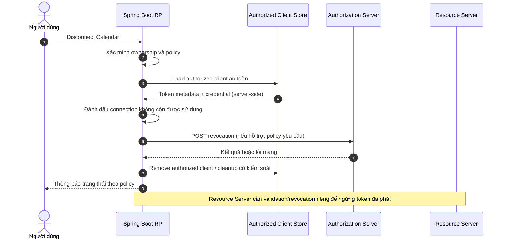
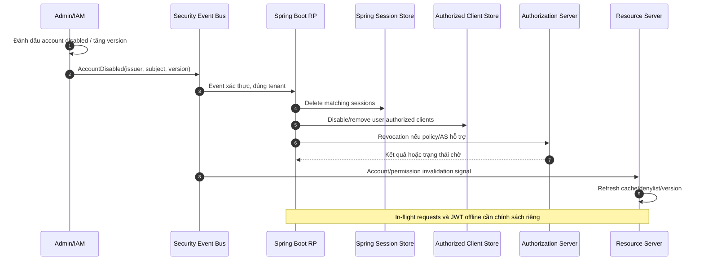

# 23.5. Vòng đời dữ liệu khi logout, tài khoản bị khóa hoặc thu hồi quyền

> **Module:** Spring Security OAuth 2.0 OIDC Client  
> **Chương:** 23. Lưu token và phiên  
> **Trọng tâm:** Thiết kế vòng đời dữ liệu OAuth 2.0/OIDC Client trong Spring Security khi người dùng đăng xuất, tài khoản bị vô hiệu hóa, quyền bị thay đổi hoặc một ủy quyền tích hợp API bị thu hồi. Phân biệt rõ phiên đăng nhập, authorized client, access token, refresh token, phiên SSO tại OpenID Provider và hiệu lực phân quyền tại Resource Server.

Khi người dùng nhấn nút **Đăng xuất**, nhiều ứng dụng Spring Boot chỉ gọi `/logout` rồi cho rằng mọi thứ đã kết thúc. Tuy nhiên, hệ thống thực tế có thể còn lưu `OAuth2AuthorizedClient` trong JDBC, chứa access token và refresh token; OpenID Provider (OP) có thể vẫn giữ phiên SSO; và Resource Server có thể tiếp tục chấp nhận access token đã được cấp cho đến khi token hết hạn hoặc nhận được tín hiệu thu hồi.

Tình huống ngược lại cũng xảy ra: quản trị viên **khóa tài khoản** tại Identity Provider, nhưng một phiên `HttpSession` cũ vẫn tồn tại ở ứng dụng Spring Security. Hoặc người dùng bị gỡ quyền `ADMIN`, trong khi `Authentication.getAuthorities()` trong session vẫn giữ authorities được tính từ lần login trước. Trong cả hai trường hợp, việc “token còn hạn” không chứng minh quyền truy cập vẫn được phép.

Vì thế, vòng đời dữ liệu không thể được giải quyết chỉ bằng một lệnh xóa session hay một lời gọi `removeAuthorizedClient(...)`. Ứng dụng cần chính sách cho từng sự kiện, các kho dữ liệu liên quan, độ trễ thu hồi được chấp nhận, cơ chế đồng bộ giữa các instances và hành vi của Resource Server.

**Nguyên tắc cốt lõi:** **logout, khóa tài khoản và thu hồi quyền là những sự kiện nghiệp vụ/bảo mật khác nhau**. Chúng có thể dẫn đến các hành động chồng lấn, nhưng không mặc nhiên cùng xóa các dữ liệu hoặc vô hiệu hóa mọi credential.

---

## 1. Mục tiêu học tập

Sau bài học, bạn có thể:

1. Liệt kê những dữ liệu liên quan đến đăng nhập và OAuth2 Client: `SecurityContext`, `HttpSession`, cookie phiên, `OAuth2AuthorizedClient`, access token, refresh token, ID token, session SSO và thông tin phân quyền.
2. Phân biệt **local logout**, **RP-Initiated Logout**, **OIDC Back-Channel Logout**, **disconnect một API**, **khóa tài khoản** và **thu hồi quyền**.
3. Hiểu điều gì xảy ra khi Spring Security mặc định xử lý logout trên Servlet stack, và điều gì **không tự động** xảy ra.
4. Phân biệt `OAuth2AuthorizedClientRepository` lưu theo HTTP request/session với `OAuth2AuthorizedClientService` lưu theo registration ID và principal name.
5. Xác định vì sao xóa local authorized client không đồng nghĩa thu hồi token tại Authorization Server.
6. Giải thích RFC 7009 Token Revocation, các giới hạn khi Resource Server xác minh JWT offline và độ trễ của introspection cache.
7. Thiết kế vô hiệu hóa phiên đang hoạt động khi tài khoản bị khóa mà không chỉ chặn lần đăng nhập tiếp theo.
8. Xử lý quyền bị thu hồi trong khi `Authentication` hoặc JWT claims vẫn chứa authorities cũ.
9. Thiết kế luồng revoke/cleanup có khả năng retry, chống xử lý sự kiện trùng và tránh lộ token.
10. Sử dụng `LogoutHandler`, `OidcClientInitiatedLogoutSuccessHandler`, `OAuth2AuthorizedClientService` và Spring Session theo đúng vai trò.
11. Thiết lập chính sách retention, audit và data minimization cho credentials nhạy cảm.
12. Xây ma trận kiểm thử bao quát nhiều thiết bị, nhiều instances, session còn sống, token còn hạn và tín hiệu thu hồi đến chậm.

## 2. Bản đồ các dữ liệu phải quản lý

Một ứng dụng Spring Security OIDC Client không chỉ có một “token” hay một “phiên”.

| Dữ liệu | Chủ thể quản lý | Mục đích | Nơi thường lưu | Cơ chế kết thúc |
|---|---|---|---|---|
| `HttpSession` của ứng dụng | Relying Party (RP) / Servlet container / Spring Session | Duy trì phiên web | Memory, Redis, JDBC... | Timeout, logout, session invalidation |
| Session cookie, ví dụ `JSESSIONID` | Browser và RP | Tham chiếu session | Cookie browser | Xóa cookie, hết hạn, không còn session server |
| `SecurityContext` | Spring Security RP | Lưu Authentication/authorities đã xác thực | Session hoặc repository theo cấu hình | Logout, clear context, session invalidation |
| `OAuth2AuthenticationToken` | Spring Security RP | Đại diện principal đăng nhập qua OAuth2/OIDC | SecurityContext | Phụ thuộc vòng đời Authentication/session |
| `OAuth2AuthorizedClient` | OAuth2 Client RP | Lưu Client registration, access token và refresh token nếu có | HTTP session, service in-memory/JDBC/custom | Remove, cleanup, reauthorization lifecycle |
| Access token | Authorization Server (AS), RP, Resource Server (RS) | Gọi API | Authorized client và ở request HTTP tới RS | Hết hạn, revocation/policy tại AS/RS |
| Refresh token | AS và RP Client | Xin access token mới | Authorized client storage bảo vệ | Hết hạn, rotation, revoke, xóa local |
| ID token | OP và RP | Kết quả xác thực người dùng trong OIDC | User principal/authorized login state theo implementation | Hết hạn ID token, nhưng không tự xóa session |
| SSO session của OP | OpenID Provider | Duy trì xác thực tại OP | Cookie/phiên phía OP | End-session, OP timeout, global logout |
| Consent/authorization grant | AS/OP | Ghi nhận Client được phép truy cập phạm vi nào | Kho quyền phía AS | User/admin revokes consent, policy update |
| Roles/permissions nghiệp vụ | Hệ thống IAM/app/RS | Quyết định thao tác được phép | DB, PDP, JWT claims, session authorities, cache | Thay quyền, xóa cache, revalidation |
| Audit/security events | RP/AS/RS | Truy vết theo chính sách | Event log/SIEM | Retention và xóa theo chính sách |

Các hàng trong bảng có thể tồn tại **đồng thời** nhưng có lifecycle riêng. Xóa một hàng không nhất thiết xóa những hàng còn lại.

### 2.1. Ví dụ một lần login và một kết nối API

```text
Browser
├── Cookie RP: JSESSIONID = abc
└── Cookie OP: SSO_SESSION = xyz  (miền khác)

Spring Boot RP
├── HttpSession abc
│   └── SecurityContext
│       └── OAuth2AuthenticationToken
│           ├── registrationId = corporate-login
│           └── principalName = user-734
└── OAuth2AuthorizedClientService (JDBC)
    ├── (corporate-login, user-734) -> access/refresh token A
    └── (calendar-api, user-734)    -> access/refresh token B

Authorization Server / OP
├── SSO session xyz
├── Authorization grant của corporate-login
└── Authorization grant cho calendar-api

Resource Server
├── Calendar API xác minh access token B
└── Reports API dùng token/permissions khác
```

Nếu browser logout khỏi RP:

- Session `abc` có thể bị hủy.
- Cookie RP có thể bị xóa.
- Record JDBC `calendar-api` **có thể vẫn còn**.
- SSO session `xyz` tại OP **có thể vẫn còn**.
- Access token B đã phát **có thể vẫn được RS chấp nhận**.

Điều này không nhất thiết là lỗi framework: nó phản ánh những kho dữ liệu và chính sách khác nhau. Vấn đề là **sản phẩm có yêu cầu hành vi nào, và ứng dụng đã triển khai đúng chưa**.

## 3. Ba câu hỏi phải trả lời khi một sự kiện xảy ra

Với mỗi sự kiện bảo mật, hãy hỏi:

**Câu hỏi 1 — Ai không được phép truy cập?**

- Chỉ browser/session hiện tại?
- Mọi thiết bị của cùng người dùng?
- Một integration/Client registration nhất định?
- Toàn bộ tài khoản?
- Một tenant, một workspace hoặc một quyền như `REPORT_EXPORT`?

**Câu hỏi 2 — Hành vi nào phải dừng?**

- Không cho mở trang RP?
- Không cho tiếp tục gọi API bằng token đã cấp?
- Không cho refresh token để xin token mới?
- Không cho OIDC Login mới?
- Không cho background worker tiếp tục truy cập offline?
- Không cho thao tác nghiệp vụ nhạy cảm dù session vẫn còn?

**Câu hỏi 3 — Dữ liệu nào phải bị vô hiệu hóa hoặc xóa?**

- `HttpSession`/SecurityContext?
- Authorized client ở HTTP session?
- Authorized client ở JDBC?
- Refresh token/grant tại AS?
- SSO session ở OP?
- Caches, JWT denylist, session indexes?
- Dữ liệu cá nhân và audit theo retention policy?

Nếu không nêu rõ ba câu hỏi này, yêu cầu “khóa user” thường bị triển khai thành một thay đổi `enabled=false` trong database nhưng những access paths khác vẫn hoạt động.

## 4. Phân loại sự kiện và kỳ vọng

| Sự kiện | Mục tiêu thường gặp | Không được mặc định |
|---|---|---|
| User bấm **Logout thiết bị này** | Ngừng authenticated RP session hiện tại | Token của mọi integration/thiết bị tự revoked |
| User bấm **Logout tất cả thiết bị** | Vô hiệu hóa mọi RP sessions thuộc user, có thể cả OP sessions theo chính sách | Một lệnh `session.invalidate()` đủ cho cluster |
| User bấm **Ngắt kết nối Calendar** | Ngừng dùng authorization/token của registration Calendar | Phải logout khỏi ứng dụng RP |
| User rút consent ở OP | Ngừng authorization đã cấp cho Client | RP chắc chắn nhận sự kiện ngay |
| Admin **khóa tài khoản** | Ngăn login và những truy cập hiện hữu theo policy | Sessions/JWT đã cấp tự biết trạng thái account |
| Admin **thu hồi ROLE_ADMIN** | Không cho thao tác yêu cầu role đó | Authorities trong session/JWT tự được cập nhật |
| Mật khẩu bị reset vì nghi compromise | Có thể buộc reauthentication/revoke sessions và tokens theo security policy | Mọi password reset đều có semantics giống nhau |
| Token bị thu hồi riêng lẻ | Ngừng sử dụng credential được xác định | OP SSO session hoặc RP session tự kết thúc |
| OP gửi Back-Channel Logout | RP kết thúc sessions liên quan theo Logout Token | Tự revoke mọi OAuth2 access tokens ở mọi RS |

Bảng thể hiện **kỳ vọng cần thiết kế**, không phải behavior mặc định duy nhất của Spring Security hoặc mọi OP.

## 5. Local logout trong Spring Security Servlet

Với Spring Security Servlet, đăng xuất web thường được xử lý bởi các thành phần logout ở security filter chain. Khi sử dụng cấu hình mặc định phù hợp, logout có thể:

- Lấy `Authentication` hiện tại.
- Làm sạch `SecurityContext`.
- Invalidate `HttpSession` theo logout handler.
- Xóa một số cookie liên quan khi được cấu hình/phù hợp.
- Chuyển hướng hoặc trả phản hồi logout success.

Trong cấu hình bật CSRF thông thường, logout nên được thực hiện bằng **POST** có CSRF token hợp lệ; không chủ động tạo endpoint GET có side effect logout mà bỏ qua bảo vệ CSRF.

### 5.1. Local logout không phải token revocation

Một cấu hình tối thiểu:

```java
import org.springframework.context.annotation.Bean;
import org.springframework.context.annotation.Configuration;
import org.springframework.security.config.Customizer;
import org.springframework.security.config.annotation.web.builders.HttpSecurity;
import org.springframework.security.web.SecurityFilterChain;

@Configuration
class WebSecurityConfig {

    @Bean
    SecurityFilterChain securityFilterChain(HttpSecurity http)
            throws Exception {

        return http
            .authorizeHttpRequests(auth -> auth
                .requestMatchers("/", "/error").permitAll()
                .anyRequest().authenticated()
            )
            .oauth2Login(Customizer.withDefaults())
            .logout(logout -> logout.logoutSuccessUrl("/"))
            .build();
    }
}
```

Khi user logout, request mới tới một endpoint yêu cầu authentication phải chịu chính sách đăng nhập của RP. Tuy nhiên, code trên **không bảo đảm**:

- Xóa mọi `OAuth2AuthorizedClient` trong JDBC.
- Gọi RFC 7009 Token Revocation Endpoint.
- Đăng xuất OP SSO session.
- Thu hồi access token JWT đã phát cho RS.
- Xóa session trên mọi thiết bị.
- Cập nhật mọi application permissions cache.

Muốn những hành vi đó phải khai báo **chính sách và integrations riêng**.

### 5.2. SecurityContext và session

`Authentication` được giữ trong `SecurityContext`. Nếu session bị invalidate, RP không còn lấy Authentication của session đó trong request mới. Nhưng những request đã được bắt đầu trước khi logout có thể vẫn đang chạy.

Không tuyên bố “logout chấm dứt tức thời mọi tác vụ đã khởi chạy”. Với các nghiệp vụ quan trọng, cần authorization check gần thời điểm commit hoặc cơ chế hủy tác vụ phù hợp.

## 6. Xóa cookie khác xóa session server-side

Một cookie chứa session ID không phải bản ghi session.

| Hành động | Tác dụng | Giới hạn |
|---|---|---|
| `HttpSession.invalidate()` | Vô hiệu hóa session hiện tại phía server | Không tự revoke token ở AS |
| Xóa cookie `JSESSIONID` | Browser không còn gửi cookie đó | Không tự xóa mọi session record ở cluster |
| Xóa toàn bộ site cookies bằng browser directive | Dọn một số state ở origin theo browser | Không thể xóa cookies của OP ở domain khác |
| Spring Session `deleteById` | Xóa record session cụ thể từ shared store | In-flight request có thể vẫn hoàn thành; indexes cần đúng |
| Xóa `SecurityContext` | Loại bỏ Authentication từ context hiện tại | Không động chạm trực tiếp tới JDBC authorized clients |

Nếu dùng `Clear-Site-Data` cho browser sau logout, cần hiểu phạm vi origin và hỗ trợ của trình duyệt; không dùng directive xóa toàn bộ storage một cách tùy tiện nếu ứng dụng có dữ liệu người dùng cần lưu hợp lệ.

### 6.1. Một thiết bị hay mọi thiết bị?

Logout mặc định từ browser thường nhắm session hiện tại. Tính năng “logout everywhere” cần có cách tìm và xóa **mọi session của cùng principal** trong shared session store, đồng thời xử lý cache và delay.

Nếu dùng HTTP session in-memory riêng từng node, không thể chỉ vào một node rồi xóa mọi session của user trên tất cả pods. Cần shared session store hoặc cơ chế phân phối invalidation.

## 7. RP-Initiated Logout: đăng xuất tại OP

Với OpenID Connect, RP có thể sử dụng **RP-Initiated Logout** nếu OP hỗ trợ. Trong Spring Security Servlet có `OidcClientInitiatedLogoutSuccessHandler` để bắt đầu redirect tới OP end-session endpoint theo metadata.

Ví dụ:

```java
import org.springframework.context.annotation.Bean;
import org.springframework.security.oauth2.client.registration.ClientRegistrationRepository;
import org.springframework.security.oauth2.client.oidc.web.logout.OidcClientInitiatedLogoutSuccessHandler;
import org.springframework.security.web.authentication.logout.LogoutSuccessHandler;

@Bean
LogoutSuccessHandler oidcLogoutSuccessHandler(
        ClientRegistrationRepository registrations) {

    OidcClientInitiatedLogoutSuccessHandler handler =
        new OidcClientInitiatedLogoutSuccessHandler(registrations);

    handler.setPostLogoutRedirectUri("{baseUrl}/");
    return handler;
}
```

Gắn handler vào `SecurityFilterChain`:

```java
.logout(logout ->
    logout.logoutSuccessHandler(oidcLogoutSuccessHandler)
)
```

Đây là **cấu hình thay thế** `logoutSuccessUrl("/")` ở mục trước, không khai báo cả hai rồi kỳ vọng cùng điều khiển final redirect.

### 7.1. Những điều phải kiểm tra

- OP có công bố/hỗ trợ end-session endpoint không?
- URI chuyển hướng sau logout đã được OP cho phép/đăng ký chưa?
- Browser có thực hiện redirect đến OP không?
- ID Token hint, state và tham số logout có đúng hợp đồng OP không?
- RP session có được invalidate trước/đúng lúc xử lý không?
- Khi OP logout thất bại hoặc user đóng tab, trạng thái RP được xử lý thế nào?

Không tự ghép một end-session URL bất kỳ rồi chuyển browser tới đó mà chưa xác minh metadata/trust boundary.

### 7.2. Logout OP không tự thu hồi mọi access token

Một OP có thể kết thúc phiên SSO của browser nhưng API access token đang còn hạn vẫn tồn tại. Đây là **hai cơ chế khác nhau**:

- End-session: xử lý phiên xác thực ở OP.
- Token revocation: yêu cầu AS thu hồi credential/grant.
- Session invalidation tại RP: xử lý phiên web của RP.
- Resource Server validation: quyết định chấp nhận token trong một request cụ thể.

Cần phối hợp các cơ chế nếu yêu cầu sản phẩm là “đăng xuất và ngừng mọi quyền truy cập”.

## 8. OIDC Back-Channel Logout: OP thông báo cho RP

**Back-Channel Logout** là một cơ chế OIDC trong đó OP gửi thông điệp logout tới RP thông qua back channel. Nó hữu ích khi user logout tại OP hoặc một ứng dụng khác và OP muốn thông báo cho các RP liên quan.

Thông điệp có thể chứa **Logout Token** với các claims theo chuẩn, ví dụ:

- `iss`: OP phát hành.
- `aud`: RP/Client nhận.
- `iat`: thời điểm phát hành.
- `jti`: định danh chống xử lý token trùng.
- `events`: xác định sự kiện back-channel logout.
- `sid` và/hoặc `sub` theo yêu cầu chuẩn/cấu hình.

Logout Token không phải ID token và cũng không phải access token API. RP phải xác minh chữ ký/issuer/audience, loại sự kiện, thời hạn/replay policy và liên kết session.

### 8.1. Tác động đến session

Sau khi xử lý một Logout Token hợp lệ, RP cần xác định **session nào** liên quan rồi invalidate theo policy:

```text
OP logout event
    |
    v
Verify Logout Token
    |
    v
Map (issuer, sid/sub, client) -> RP sessions
    |
    v
Invalidate matching sessions
    |
    v
Do not automatically assume API token revocation
```

Chỉ nhận một JSON/JWT mang tên “logout” không đủ để xóa sessions. Nếu không kiểm tra nguồn gửi và tính hợp lệ, kẻ tấn công có thể tạo logout giả để làm gián đoạn tài khoản người khác.

### 8.2. Logout Token đến chậm hoặc bị gửi lại

Event delivery có thể không ngay lập tức; sự kiện còn có thể bị gửi trùng. Thiết kế cần idempotency dựa trên `jti`/issuer và chính sách replay. Không dựa vào thứ tự “session luôn bị xóa trước khi browser gửi request tiếp theo” nếu chưa có bảo đảm hệ thống.

Spring Security có hỗ trợ OIDC logout ở một số phiên bản/cấu hình; cú pháp bật back-channel cần đối chiếu đúng phiên bản Spring Security và metadata OP trước khi dùng trong production.

## 9. Lưu OAuth2AuthorizedClient: HTTP session và service JDBC khác nhau

Spring Security Servlet có hai abstraction quan trọng:

**`OAuth2AuthorizedClientRepository`**

- Gắn với `HttpServletRequest`, `HttpServletResponse` và `Authentication`.
- Có thể lưu dữ liệu theo HTTP session hoặc ủy nhiệm cho service.

**`OAuth2AuthorizedClientService`**

- Lưu/đọc/xóa authorized client theo registration ID và principal name.
- Không bắt buộc có HTTP request.
- Có implementation in-memory hoặc JDBC.

Ví dụ:

```text
Web Login
   |
   v
OAuth2AuthorizedClientRepository
   ├── HttpSessionOAuth2AuthorizedClientRepository
   │      └── HttpSession
   └── AuthenticatedPrincipalOAuth2AuthorizedClientRepository
          └── OAuth2AuthorizedClientService
                ├── InMemory
                └── JdbcOAuth2AuthorizedClientService
```

### 9.1. Logout có xóa authorized client không?

**Tùy nơi dữ liệu đang được lưu.**

- Nếu authorized client nằm trong chính HTTP session bị invalidate, dữ liệu đó có thể mất theo session.
- Nếu nằm trong `JdbcOAuth2AuthorizedClientService`, record vẫn có thể tồn tại sau logout.
- Nếu dùng một repository/service tự viết, hành vi phụ thuộc implementation và handler.
- Nếu background job sử dụng cùng JDBC service, job có thể vẫn truy xuất token sau khi browser đã logout.

Không đặt policy quan trọng dựa trên suy đoán “framework sẽ tự xóa hết” khi cấu hình storage đã tùy biến.

### 9.2. Quyết định theo ngữ nghĩa integration

Có hai mô hình sản phẩm khác nhau:

**Mô hình A — API connection sống cùng phiên web.**

Khi logout, có thể cần xóa authorized client gắn với phiên, nếu nghiệp vụ/consent yêu cầu. Token không được tiếp tục dùng offline.

**Mô hình B — User kết nối một dịch vụ ngoài để đồng bộ dữ liệu lâu dài.**

Khi logout khỏi website, integration có thể tiếp tục hoạt động dựa trên **ủy quyền offline hợp lệ**. Nút “Ngắt kết nối dịch vụ” mới xóa/revoke authorization đó.

Cả hai có thể hợp lý nếu được giải thích rõ cho user và có cơ chế revocation/consent phù hợp. Không âm thầm giữ token lâu dài khi sản phẩm hứa rằng logout sẽ ngừng mọi truy cập.

## 10. Các method service và giới hạn xóa dữ liệu

`OAuth2AuthorizedClientService` có hợp đồng cốt lõi:

```java
<T extends OAuth2AuthorizedClient> T loadAuthorizedClient(
    String clientRegistrationId, String principalName);

void saveAuthorizedClient(
    OAuth2AuthorizedClient authorizedClient,
    Authentication principal);

void removeAuthorizedClient(
    String clientRegistrationId, String principalName);
```

Ví dụ ngắt kết nối một registration:

```java
authorizedClientService.removeAuthorizedClient(
    "calendar-api",
    authentication.getName()
);
```

Thao tác này **chỉ xóa local record theo key** trong service đã được tiêm.

### 10.1. Không có removeAllByPrincipal() trong interface chuẩn

Nếu muốn “xóa mọi authorized clients của user”, `OAuth2AuthorizedClientService` không cung cấp một method chuẩn để liệt kê và xóa toàn bộ registrations theo principal.

Các phương án:

- Ứng dụng biết danh sách registrations được phép, xóa từng cặp registration/principal.
- Có một bảng index ownership riêng cho authorized client records.
- Viết custom store/admin service hỗ trợ query/delete theo principal và tenant.
- Thiết kế storage theo namespace/tenant có thể cleanup an toàn.
- Nếu trực tiếp thao tác JDBC, áp migration/schema và transaction rules của store, tránh làm lệch dữ liệu Spring Security đang dùng.

**Không giả lập `removeAllByPrincipal(...)` như một method có sẵn của interface** rồi coi code sẽ compile.

### 10.2. Principal name phải đáng tin

Không cho người gọi HTTP nhập `principalName=someoneElse` rồi tự chọn authorized client để xóa/đọc. Cần lấy principal từ Authentication đã được xác thực hoặc một admin event được phân quyền rõ.

Trong multi-tenant hoặc multi-issuer, cần dùng khóa namespace ổn định, ví dụ mapping nội bộ dựa trên `(issuer, subject)`. Email chưa xác minh hoặc email dễ đổi không phải khóa an toàn mặc định để tìm token storage.

## 11. Tùy chỉnh logout để xóa một authorized client ở service

Nếu sản phẩm quy định logout local **phải xóa** một integration cụ thể đang được lưu bằng `OAuth2AuthorizedClientService`, có thể gắn custom `LogoutHandler`.

Ví dụ minh họa:

```java
import org.springframework.context.annotation.Bean;
import org.springframework.security.oauth2.client.OAuth2AuthorizedClientService;
import org.springframework.security.config.Customizer;
import org.springframework.security.config.annotation.web.builders.HttpSecurity;
import org.springframework.security.web.SecurityFilterChain;

@Bean
SecurityFilterChain securityFilterChain(
        HttpSecurity http,
        OAuth2AuthorizedClientService authorizedClients) throws Exception {

    return http
        .authorizeHttpRequests(auth -> auth
            .anyRequest().authenticated()
        )
        .oauth2Login(Customizer.withDefaults())
        .logout(logout -> logout
            .addLogoutHandler((request, response, authentication) -> {
                if (authentication != null) {
                    authorizedClients.removeAuthorizedClient(
                        "calendar-api",
                        authentication.getName()
                    );
                }
            })
            .logoutSuccessUrl("/")
        )
        .build();
}
```

**Giới hạn rõ ràng của ví dụ:**

- Chỉ xóa `calendar-api` của principal hiện tại **trong service được cấu hình**.
- Không tự revoke refresh token tại OP/AS.
- Không xóa các registrations khác.
- Không tự xóa bản ghi trong repository chỉ lưu HTTP session nếu service không phải nơi lưu thực tế.
- Đây là lựa chọn policy; **không phải khuyến nghị luôn xóa mọi integration khi logout**.

### 11.1. Khi cần cả revocation và xóa local

Đừng thực hiện Token Endpoint network call kéo dài ngay trong `LogoutHandler` mà không có timeout/failure policy. Logout HTTP phải có hành vi đáng tin và không để credentials trong log.

Một luồng production có thể có nghiệp vụ “Disconnect” riêng:

1. Xác minh chủ sở hữu integration.
2. Đọc authorized client từ đúng storage.
3. Xác định refresh token cần revoke nếu AS hỗ trợ.
4. Gọi revocation qua client được bảo vệ hoặc tạo công việc an toàn, có deadline.
5. Xóa local record/đánh dấu disconnected theo policy.
6. Chặn việc backend tiếp tục sử dụng kết nối đó trong thời gian chờ remote revoke.
7. Ghi audit metadata, không ghi token value.

Cần thiết kế thứ tự và handling khi network fail. Không xóa token material quá sớm rồi phát hiện không còn cách thực hiện remote revocation, trừ khi sản phẩm chấp nhận local-only disconnect.

## 12. RFC 7009: Token Revocation là thao tác khác

**RFC 7009 — OAuth 2.0 Token Revocation** định nghĩa việc Client yêu cầu AS thu hồi token.

Request minh họa:

```http
POST /oauth2/revoke HTTP/1.1
Host: login.example.test
Authorization: Basic <redacted-client-credentials>
Content-Type: application/x-www-form-urlencoded

token=<redacted-refresh-token>&token_type_hint=refresh_token
```

Điểm chính:

- Client gửi token cần thu hồi tới **revocation endpoint mà AS cung cấp**.
- Client authentication phải phù hợp với registration.
- `token_type_hint` chỉ là gợi ý, không phải bảo đảm; AS có thể tự xác định loại token.
- Theo chuẩn, successful response có thể không tiết lộ token trước đó đã hợp lệ hay chưa, nhằm tránh token probing.
- Một AS có thể thu hồi liên quan access tokens/authorization grant tùy policy.
- Không phải mọi OP đều hỗ trợ cùng một endpoint hoặc cùng semantics revocation.

### 12.1. Xóa local token không tương đương revoke ở AS

```java
authorizedClientService.removeAuthorizedClient(registrationId, principalName);
```

là thao tác local. RFC 7009 là HTTP call tới AS. Hai việc có thể được phối hợp, nhưng không thay thế nhau.

### 12.2. Revoke refresh token rồi còn access token JWT thì sao?

AS có thể từ chối mọi lần refresh tiếp theo, nhưng một access token JWT đã phát vẫn có thể được Resource Server chấp nhận cho tới `exp` nếu RS chỉ kiểm tra chữ ký/issuer/audience/expiry **offline**.

Độ trễ vô hiệu hóa token phụ thuộc:

- Token format (JWT hoặc opaque).
- Resource Server có introspection/denylist/version check hay không.
- AS có cung cấp push/continuous access signals hay không.
- Cache TTL của RS/introspection.
- API authorization layer có kiểm tra account status ở mỗi request hay không.
- Access token lifetime và clock skew.

Vì vậy, “AS trả 200 cho revoke” không tự bảo đảm mọi API ngừng chấp nhận một JWT đã cấp **ngay tại thời điểm đó**.

## 13. Thứ tự revocation, local cleanup và failure handling

Một luồng “Ngắt kết nối” có hai hệ thống khác nhau:



Đây là một **trình tự khái niệm**, không phải cam kết distributed transaction. Giữa RP, AS và RS không có transaction ACID chung.

### 13.1. Nếu AS không kết nối được?

Bạn phải chọn policy:

- **Local disconnect ngay:** đánh dấu connection disabled, không để các jobs dùng token nữa; remote revocation sẽ thử lại an toàn theo thiết kế. Cần bảo vệ token material tạm dùng cho retry, tránh lưu credential trong queue plaintext.
- **Fail và cho phép user thử lại:** không tuyên bố remote revoke thành công khi chưa xác nhận; có thể vẫn chặn local use.
- **Synchronous revoke rồi xóa:** có thể phù hợp khi AS tin cậy và latency thấp, nhưng phải có timeout rõ và xử lý lỗi.

Không báo “đã thu hồi trên mọi thiết bị” nếu mới chỉ xóa record local.

### 13.2. Nếu xóa record trước khi gọi revoke?

Nếu bản sao token duy nhất bị xóa, bạn có thể không còn `tokenValue` để gửi tới revocation endpoint. Nếu thiết kế phải revoke, cần tính tới thứ tự hoặc một workflow bảo vệ token bằng storage tạm có lifecycle ngắn, mã hóa và quyền truy cập tối thiểu.

**Không lưu refresh token plaintext trong event bus, audit log hoặc dead-letter queue** để thuận tiện retry.

### 13.3. Tính idempotent của disconnect

Người dùng có thể click “Disconnect” hai lần hoặc hệ thống gửi lại message. Kết quả cuối mong muốn là **connection disabled, không còn được dùng**. Không khôi phục token cũ chỉ vì một retry event đến chậm.

## 14. Khóa tài khoản: không chỉ chặn lần login mới

Một tài khoản có thể bị khóa vì:

- Admin vô hiệu hóa user.
- User báo mất thiết bị hoặc tài khoản bị compromise.
- Nhân sự rời tổ chức.
- Hệ thống phát hiện dấu hiệu chiếm quyền.
- Chính sách tenant không cho user tiếp tục truy cập.
- OP báo account disabled.

Yêu cầu thường mạnh hơn local logout: **mọi phiên hiện hữu và mọi đường truy cập thuộc tài khoản đó cần được xem xét**.

### 14.1. Các lớp cần kiểm soát

1. **Đăng nhập mới:** kiểm tra user có còn được đăng nhập vào RP không.
2. **Phiên hiện hữu:** invalidate các sessions tương ứng, không chờ user logout.
3. **Authorized clients:** chặn việc dùng token/grant của account đã khóa theo policy.
4. **Refresh tokens:** revoke nếu có thể và nếu yêu cầu, hoặc đảm bảo AS không cấp thêm.
5. **Resource Servers:** kiểm tra access token/authorization gần thời điểm sử dụng, đặc biệt cho API nhạy cảm.
6. **Background jobs:** ngừng truy cập offline thay mặt user.
7. **Caches:** xóa/invalidate decision caches liên quan.
8. **Audit:** lưu ai/quy trình nào đã khóa và kết quả các bước mà không chứa token.

### 14.2. Khóa account tại OP có tự xóa RP session không?

**Không có bảo đảm chung.** RP có thể đã tạo `Authentication` từ một OIDC login trước đó và duy trì trong session. Khi OP khóa tài khoản, RP chỉ biết nếu có cơ chế nhận event, back-channel logout, token revalidation hoặc kiểm tra account status riêng.

Ngay cả khi OP từ chối refresh token mới, request vào RP **không cần gọi API** vẫn có thể được đáp ứng từ session cũ nếu RP không kiểm tra trạng thái account.

Đối với hệ thống yêu cầu khóa tài khoản có hiệu lực nhanh, cần phối hợp **session invalidation + runtime authorization check**, không chỉ trông chờ token hết hạn.

### 14.3. Tránh nhầm UserDetailsService với OAuth2 Login

Nếu ứng dụng sử dụng OIDC Login thay vì form login, việc đặt `UserDetails.enabled=false` trong một bảng local **không chắc** đã được toàn bộ OIDC authentication pipeline hay session hiện hữu tham chiếu. Cần gắn kiểm tra account status vào login/authorization logic phù hợp.

## 15. Chặn đăng nhập OIDC mới của tài khoản đã khóa

Một cách là bọc `OidcUserService` bằng logic tra account state sau khi OIDC protocol đã được xử lý:

```java
import org.springframework.context.annotation.Bean;
import org.springframework.security.oauth2.client.oidc.userinfo.OidcUserRequest;
import org.springframework.security.oauth2.client.oidc.userinfo.OidcUserService;
import org.springframework.security.oauth2.client.userinfo.OAuth2UserService;
import org.springframework.security.oauth2.core.OAuth2AuthenticationException;
import org.springframework.security.oauth2.core.OAuth2Error;
import org.springframework.security.oauth2.core.oidc.user.OidcUser;

@Bean
OAuth2UserService<OidcUserRequest, OidcUser> checkedOidcUsers(
        AccountAccessService accounts) {

    OidcUserService delegate = new OidcUserService();

    return request -> {
        OidcUser oidc = delegate.loadUser(request);

        String issuer = oidc.getIdToken().getIssuer().toString();
        String subject = oidc.getSubject();

        if (!accounts.isLoginAllowed(issuer, subject)) {
            throw new OAuth2AuthenticationException(
                new OAuth2Error("account_disabled")
            );
        }

        return oidc;
    };
}
```

Trong đó `AccountAccessService` là abstraction nghiệp vụ **do ứng dụng định nghĩa**, truy vấn nguồn tin cậy theo cặp `(issuer, subject)`. Ví dụ này giả định Spring Security Servlet với database/API đồng bộ; nếu dùng WebFlux, cần phiên bản reactive user service và reactive lookup thay cho việc block event loop.

Gắn service vào OAuth2 Login:

```java
.oauth2Login(login -> login
    .userInfoEndpoint(userInfo ->
        userInfo.oidcUserService(checkedOidcUsers)
    )
)
```

Đây là snippet cấu hình thay thế `oauth2Login(Customizer.withDefaults())`, không nên dán thêm như một method bên ngoài SecurityFilterChain.

### 15.1. Ranh giới của cách làm này

- Nó có thể từ chối **OIDC Login mới** nếu account đã khóa.
- Nó **không tự tìm và xóa mọi session cũ** đang hoạt động.
- Nó **không tự revoke JWT access tokens** ở AS.
- Nó **không tự chặn background jobs** đang sử dụng refresh token của user.
- Nguồn accounts phải đáng tin, có timeout và failure policy phù hợp.
- Không dùng email chưa xác minh làm khóa khóa tài khoản giữa issuers.

### 15.2. Account status lookup lỗi nên làm gì?

Nếu user account state là điều kiện bắt buộc để truy cập, error thường nên dẫn tới **fail closed** hoặc một trạng thái chưa thể xác minh, không mặc nhiên đăng nhập thành công như account active.

Tuy vậy, chính sách retry, degraded mode và thông báo UX phải được thiết kế để không gây quá tải source of truth trong sự cố.

## 16. Invalidate mọi phiên của một user với Spring Session

Đối với ứng dụng nhiều instances, Spring Session có thể cung cấp shared session store và một cơ chế index theo principal. Interface `FindByIndexNameSessionRepository` có khả năng tìm sessions theo principal name khi index được thiết lập.

Ví dụ ý tưởng cho một service quản trị:

```java
import org.springframework.session.FindByIndexNameSessionRepository;
import org.springframework.session.Session;
import org.springframework.stereotype.Service;

@Service
class UserSessionRevoker {

    private final FindByIndexNameSessionRepository<? extends Session> sessions;

    UserSessionRevoker(
            FindByIndexNameSessionRepository<? extends Session> sessions) {
        this.sessions = sessions;
    }

    void revokeAllLocalSessions(String principalName) {
        sessions.findByPrincipalName(principalName)
            .keySet()
            .forEach(sessions::deleteById);
    }
}
```

**Điều kiện trước khi dùng:**

- Đã cấu hình Spring Session implementation hỗ trợ tìm theo principal và lưu đúng index.
- `principalName` khớp với cách Spring Security lưu/ánh xạ principal trong session.
- Admin event đã được xác thực và cho phép thực hiện operation.
- Có cơ chế xử lý nhiều users/tenants và theo dõi kết quả invalidation.
- Hiểu rằng request đang xử lý trong memory có thể vẫn hoàn thành sau khi record session bị xóa.

### 16.1. Vì sao không chỉ invalidate session hiện tại?

`request.getSession().invalidate()` chỉ tác động đến session được chỉ bởi request hiện tại. Với admin khóa một user khác đang đăng nhập ở nhiều thiết bị, không có một `HttpServletRequest` đại diện cho tất cả sessions cần xóa.

Cần tìm sessions theo principal hoặc một index/session ownership registry mà ứng dụng duy trì đáng tin.

### 16.2. Principal index có thể chưa đủ phân biệt tenant

Nếu cùng tên `alex` xuất hiện ở hai issuers/tenants nhưng repository index chỉ có `alex`, một lệnh xóa theo principal name có thể ảnh hưởng sai người hoặc bỏ sót session.

Nên xác định mapping identity nội bộ ổn định, ví dụ gắn user ID từ cặp `(issuer, sub)` và áp vào principal/session index theo chính sách. Nếu đổi chiến lược principal name, cần kế hoạch migration/invalidation các sessions và token records cũ.

## 17. “Khóa ngay lập tức” và giới hạn của session invalidation

Ngay cả khi xóa session record từ Redis/JDBC:

- Một request đã qua bước authentication trước khi invalidation có thể đang tiếp tục xử lý.
- WebSocket/streaming connections cần chính sách riêng nếu tồn tại.
- Các jobs nền có thể đã bắt đầu và không dùng session.
- Resource Server khác có thể vẫn chấp nhận access token.
- Caches cục bộ có thể chưa nhận invalidation.

Do đó, với thao tác cực kỳ nhạy cảm, cần kiểm tra **account status hoặc authorization version gần thời điểm commit**, thay vì chỉ dựa vào session đã được xác thực từ đầu request.

Ví dụ:

```text
Request A bắt đầu lúc 10:00:00; SecurityContext đã xác thực
Admin khóa user lúc 10:00:01; session record bị xóa
Request A hoàn tất ghi dữ liệu lúc 10:00:03
```

Session invalidation không tự rollback một transaction đã được bắt đầu. Business layer phải có chính sách đảm bảo phù hợp nếu sản phẩm hứa việc khóa có hiệu lực ngay với mọi transaction.

### 17.1. Có thể dùng authorization version

Một phương án là lưu `authorizationVersion` hoặc `accountVersion` trong nguồn dữ liệu đáng tin:

- Khi đổi quyền hoặc khóa user, tăng version.
- Session/token hoặc cache lưu version được dùng khi tạo quyết định.
- API nhạy cảm so sánh với version mới nhất.
- Nếu version stale, từ chối/reload authorities/reauthenticate theo policy.

Đây là **mô hình thiết kế ứng dụng**, không phải một claim OIDC mặc định hay property Spring Security có sẵn.

## 18. Thu hồi role hoặc permission: khác khóa tài khoản

Giả sử user vẫn được phép login nhưng mất `ROLE_ADMIN`.

Không phải lúc nào cũng nên logout toàn bộ user. Có thể cần:

- Cho user tiếp tục sử dụng các chức năng thông thường.
- Chặn endpoint/admin operation ngay theo policy.
- Làm mới/invalidate authorities trong session.
- Cập nhật policy decision cache.
- Không tự giả định access token JWT đang có `roles=["ADMIN"]` đã thay đổi.
- Với thao tác rủi ro cao, yêu cầu reauthentication hoặc re-authorization nếu policy đòi.

### 18.1. Authentication authorities có thể cũ

`Authentication.getAuthorities()` trong `SecurityContext` có thể được tính khi login rồi giữ trong session:

```java
Authentication authentication = ...;
Collection<? extends GrantedAuthority> authorities =
    authentication.getAuthorities();
```

Nếu admin xóa quyền sau thời điểm login, collection này **không tự sửa**. Cả `@PreAuthorize("hasRole('ADMIN')")` lẫn URL rules dùng authorities cũ có thể tiếp tục cho phép nếu không có cơ chế revalidation.

### 18.2. JWT claims cũng có thể cũ

Một JWT access token đã ký với claim `roles` hoặc `scope` là một ảnh chụp authorization tại lúc phát token theo policy AS. Không thể sửa payload của token đã phát bằng cách thay role trong database.

Các biện pháp:

- Access token lifetime đủ ngắn so với yêu cầu freshness.
- Introspection/token revocation hoặc denylist nếu có.
- Runtime authorization call tới nguồn tin cậy cho thao tác nhạy cảm.
- Authorization version/last-change checks.
- Session invalidation hoặc tái dựng Authentication khi cần.
- Cơ chế đồng bộ quyền AS/RS có event/caching policy rõ.

**Token refresh không tự bảo đảm cập nhật `Authentication.getAuthorities()` trong RP session**.

## 19. Quyền nghiệp vụ và delegated scopes không đồng nghĩa

Có hai lớp:

**OAuth2 scopes / application roles tại AS/RS**

Ví dụ token được cấp `reports.read` hoặc `reports.export`. RS kiểm tra scopes/app roles theo contract.

**Permissions nội bộ tại RP**

Ví dụ user được phép xuất báo cáo cho tenant A nhưng không được xuất tenant B.

Thu hồi một permission nội bộ có thể cần tác động đến authorization layer ngay, ngay cả khi token còn scope `reports.export`. Ngược lại, thu hồi consent ở AS có thể không xóa record role trong RP database.

### 19.1. Không dùng scope refresh như cơ chế cập nhật quyền

Khi AS phát access token mới, claims/scopes có thể thay đổi theo policy, nhưng không có bảo đảm Spring Security tự thay mọi authorities của session đã đăng nhập. Nếu yêu cầu quyền được cập nhật tức thời, phải thiết kế riêng.

### 19.2. Tránh biến 403 thành “refresh vô hạn”

Khi RS trả 403, nguyên nhân thường là thiếu quyền. Xóa authorized client rồi liên tục xin token mới có thể không thay đổi policy và gây token request storm.

Phân biệt:

- 401 do token không được chấp nhận: cân nhắc loại lỗi/reauthorization đúng.
- 403 do thiếu quyền: thông báo/điều chỉnh permission, không tự cấp quyền cao hơn.

## 20. User rút consent tại OpenID Provider

Một người dùng có thể vào trang quản lý tài khoản của OP và thu hồi quyền của một ứng dụng.

Hệ quả có thể gồm:

- Refresh token không còn được AS chấp nhận.
- Lần refresh tiếp theo trả `invalid_grant` hoặc lỗi tương ứng.
- Access token hiện có vẫn còn thời hạn tùy validation/revocation policy.
- RP không tự nhận sự kiện nếu OP không cung cấp signal/webhook phù hợp.
- Local JDBC record có thể vẫn còn dù authorization tại AS đã bị thu hồi.

### 20.1. RP nên làm gì?

1. Có cơ chế quan sát và phân loại refresh failures.
2. Nếu authorization không còn hợp lệ, đánh dấu integration disconnected/requires reauthorization.
3. Xóa authorized client local theo policy, tránh retry refresh token cũ mãi.
4. Dừng background jobs phụ thuộc authorization đó.
5. Khi user quay lại, yêu cầu đi qua authorization flow mới nếu họ muốn kết nối lại.
6. Không làm “fallback” sang machine Client có quyền cao để tiếp tục thay user.

### 20.2. Không tuyên bố thu hồi ngay nếu chỉ phát hiện ở lần refresh sau

Với hệ thống không có push events, RP có thể phát hiện consent revoked **trễ**. Nếu business requirement đòi tức thời, phải sử dụng khả năng của AS/OP hoặc authorization controls ở RS và xác định SLA thu hồi thực tế.

## 21. Access token, refresh token và ID token: thu hồi gì?

| Credential | Dùng cho | Có thể tiếp tục dùng sau local logout? | Cần cơ chế quản lý |
|---|---|---|---|
| Access token | Gọi Resource Server | Có thể, đến khi hết hạn hoặc RS từ chối | TTL, revocation/denylist/introspection, audience và scopes |
| Refresh token | Xin access token mới | Có thể nếu AS vẫn chấp nhận và Client giữ token | Rotation, revocation, storage, offline access policy |
| ID token | Xác thực danh tính tại OIDC Client khi phát hành/kiểm tra | Bản token còn trong dữ liệu, nhưng không phải session credential phổ quát | Kiểm tra OIDC, dữ liệu tối thiểu, retention |
| Session cookie RP | Tham chiếu HTTP session | Cookie có thể còn nhưng session đã hủy thì không xác thực | HttpOnly/Secure/SameSite, invalidation |
| SSO cookie OP | Giữ phiên OP | Có thể nếu chỉ local logout RP | OP end-session/logout protocols |

**Không gửi ID token như Bearer access token** tới Resource Server thông thường. Không dùng refresh token để dựng lại RP Authentication như một cách tránh đăng nhập lại khi session hết hạn.

### 21.1. Refresh token rotation và race

Nếu hai workers cùng dùng refresh token cũ R1, AS có thể cho request đầu tiên đổi sang R2, request thứ hai bị từ chối vì reuse. Sự kiện account lock/consent revoked có thể xảy ra đúng lúc refresh đang chạy; phải tránh ghi token mới vào storage sau khi đã đánh dấu connection disabled.

Cần phối hợp concurrency và **state/version checks** khi lưu authorized clients, nhất là trong môi trường nhiều instances.

## 22. JWT offline, opaque tokens và độ trễ thu hồi

### 22.1. JWT offline validation

Resource Server có thể xác minh JWT bằng public key và các claims như:

- `iss`;
- `aud`;
- `exp`/`nbf`;
- scopes/app roles;
- loại token và policy bổ sung.

Nếu không gọi AS hoặc nguồn account status, RS có thể không biết account vừa bị khóa hoặc token vừa bị revoke. Token vẫn có thể được chấp nhận tới khi hết hạn.

### 22.2. Opaque token/introspection

Với opaque token, RS thường gọi introspection endpoint hoặc một cơ chế validation của AS. AS có thể trả trạng thái token đang active hay không. Nhưng:

- RS có thể cache introspection response.
- Network failure có thể tạo degraded behavior khác nhau.
- “active=true” không thay thế kiểm tra quyền đối với resource cụ thể.
- TTL của cache quyết định một phần độ trễ phát hiện revocation.

### 22.3. Không có “thu hồi tức thời” miễn phí

Nếu sản phẩm yêu cầu khóa account có hiệu lực trong vài giây tại mọi API, thiết kế có thể cần:

- Push authorization/session events.
- Per-request account checks ở API trọng yếu.
- Denylist/authorization version.
- Token introspection với cache TTL thích hợp.
- Short-lived JWT kết hợp policy không dùng lại refresh.
- Cơ chế continuous access hoặc provider-specific signals nếu có.

Mỗi giải pháp có trade-off giữa latency, availability, consistency, chi phí và bảo mật.

## 23. Chuỗi sự kiện: khóa tài khoản trong hệ thống nhiều services



Sơ đồ là **mô hình orchestration**, không phải chức năng tự động của một bean Spring Security duy nhất.

### 23.1. Event phải đáng tin

Để tránh một message giả gây logout/khóa user hàng loạt:

- Xác thực nguồn phát event.
- Kiểm tra chữ ký hoặc quyền publish trên event bus.
- Xác thực tenant/issuer/subject/loại event.
- Không tin raw user ID từ một request không có quyền quản trị.
- Kiểm soát replay, version và event id.
- Audit hành động và xử lý dữ liệu nhạy cảm.

### 23.2. Eventual consistency phải được định lượng

Một sự kiện có thể đến RP trước RS hoặc ngược lại. Đừng nói “khóa user sẽ lập tức chặn mọi nơi” nếu pipeline chỉ bảo đảm eventual delivery.

Xác định SLO/SLA thu hồi: ví dụ khi nào session phải bị xóa, khi nào RS sẽ từ chối, khi nào AS từ chối refresh. Đo độ trễ thực tế bằng metrics/trace đã che dữ liệu nhạy cảm.

## 24. Xử lý event trùng và sai thứ tự

Giả sử:

```text
Event #101: AccountDisabled(user-734)
Event #102: AccountEnabled(user-734)
Event #101 được gửi lại sau #102
```

Nếu worker áp event #101 trễ mà không kiểm tra version, nó có thể vô hiệu hóa tài khoản vừa được mở lại. Cần một cơ chế:

- Event ID để phát hiện duplicates.
- Account version/sequence để tránh overwrite trạng thái mới bằng trạng thái cũ.
- Persisted state of account tại source of truth.
- Idempotent operations: xóa session hai lần không gây khôi phục.
- Retry và dead-letter policy, không lưu token plaintext trong queue.
- Không coi delivery order trên một topic là bảo đảm toàn cluster nếu không có contract.

### 24.1. “Xóa” phải không bị đảo ngược bởi attempt cũ

Race:

1. Worker A đọc authorized client và bắt đầu refresh.
2. Admin revoke connection, worker B đánh dấu disabled rồi xóa record.
3. Worker A nhận access token mới và lưu lại authorized client.
4. Connection bị **hồi sinh** nếu không có check.

Một thiết kế tốt cần kiểm tra connection state/version trước khi save và chặn writes từ attempts được bắt đầu trước revocation. Đây là vấn đề ngoài phạm vi của basic `OAuth2AuthorizedClientService` interface và có thể cần custom storage/coordination layer.

## 25. Đồng bộ với background jobs

Một số integrations tiếp tục chạy khi user không mở browser:

- Import lịch định kỳ.
- Đồng bộ email hoặc tài liệu.
- Batch export theo authorization offline.
- Lấy dữ liệu CRM.
- Event consumer thực hiện thay một user.

Khi account bị khóa hoặc consent revoked, worker có thể vẫn giữ authorized client trong memory. Do đó:

1. Mỗi job phải kiểm tra connection/account state trước khi bắt đầu hoặc gần thời điểm side effect.
2. Đừng cache token/authorization decision mãi mãi.
3. Đừng suy “refresh token còn dùng được” nghĩa user vẫn có quyền.
4. Nếu account bị khóa, stop/suspend job theo policy.
5. Nếu consent bị revoked, không fallback sang quyền machine Client rộng hơn.
6. Nếu một in-flight job đã bắt đầu, áp kiểm tra state/version khi commit hoặc publish kết quả nếu cần.

### 25.1. Client Credentials khác delegated user token

Một `client_credentials` token của service không tự thuộc user đang đăng nhập. Khóa một user không nhất thiết phải revoke mọi machine tokens của tổ chức.

Ngược lại, dùng machine token để tiếp tục truy cập dữ liệu của user đã bị khóa có thể là vi phạm policy dù token machine vẫn hợp lệ. Đây là quyết định **authorization nghiệp vụ**, không chỉ token type.

## 26. Dữ liệu nào được giữ lại sau khi quyền bị thu hồi?

“Xóa token” và “xóa dữ liệu người dùng” không phải cùng yêu cầu.

| Loại dữ liệu | Sau logout local | Sau disconnect integration | Sau account deletion/offboarding |
|---|---|---|---|
| RP session | Thường invalidate session mục tiêu | Thường có thể giữ session | Thường phải revoke theo policy |
| Authorized client | Theo loại storage/policy | Xóa/disable đúng registration | Cleanup theo phạm vi user/tenant |
| Token value | Không trả về browser; có thể còn trong storage | Revoke + xóa local khi được quy định | Không giữ credential không còn mục đích |
| User profile cache | Có thể giữ theo TTL/policy | Phụ thuộc nguồn dữ liệu | Xóa/anonymize theo policy |
| Account settings | Giữ | Giữ | Có chính sách xóa/retention riêng |
| Audit/security event | Có thể giữ metadata tối thiểu | Có thể ghi event disconnect | Retention theo nghĩa vụ và chính sách |
| API data đã đồng bộ | Không nhất thiết xóa | Phụ thuộc consent/hợp đồng dữ liệu | Xử lý theo quyền sở hữu, retention và mục đích |
| Backups | Không tự biến mất tức thì | Theo backup retention | Cần kế hoạch retention/restoration an toàn |

### 26.1. Không hứa xóa toàn bộ bản sao ngay lập tức

Thao tác xóa active database không tự xóa:

- Snapshots;
- Redis replicas;
- Backups;
- Audit logs;
- Crash dumps;
- Traces;
- Event archives;
- Cache ở RS hoặc dịch vụ bên thứ ba.

Chính sách dữ liệu phải nói rõ retention, bảo vệ bản sao, xóa khi backup hết thời hạn và tránh “hồi sinh” credential đã revoked sau khi restore.

### 26.2. Không lưu token trong audit để “có bằng chứng”

Audit chỉ cần metadata không nhạy cảm, ví dụ:

```text
event=integration_disconnected
registrationId=calendar-api
internalSubjectId=user-734
actorType=end_user
outcome=local_removed
remoteRevocationStatus=pending
correlationId=evt-1023
tokenValue=[never-log]
```

Nếu cần lưu event để retry revocation, phải dùng storage bảo mật chuyên biệt và thời hạn tối thiểu, không dùng log plaintext.

## 27. Phân quyền truy cập kho token

`JdbcOAuth2AuthorizedClientService` có thể lưu token values trong database. Chỉ cần một SQL SELECT trái phép cũng có thể làm lộ bearer credentials.

Những biện pháp cơ bản:

- Tách quyền đọc/ghi DB theo principle of least privilege.
- TLS khi kết nối database qua mạng.
- Mã hóa at rest và cân nhắc mã hóa token values ở application layer theo threat model.
- Hạn chế backup/dump và quản lý encryption keys.
- Không hiển thị `OAuth2AuthorizedClient` ở response HTTP.
- Không đưa raw token vào exception messages.
- Đảm bảo principal-registration-tenant ownership khi load/remove.
- Xóa các authorized client records bị orphan theo chính sách, nhưng tránh xóa nhầm khi account mapping chưa chắc chắn.

### 27.1. Token storage service không tự enforce ownership

Method:

```java
authorizedClientService.loadAuthorizedClient(
    registrationId,
    principalName
);
```

nhận khóa do caller truyền. Nếu endpoint cho phép user tùy chọn `principalName`, service không tự biết caller có quyền đọc token của principal đó. Controller/service phải suy principal từ Authentication đã xác minh hoặc admin context có thẩm quyền.

### 27.2. Multi-issuer và multi-tenant

Hai issuers có thể cùng phát `sub="42"`. Nếu hệ thống dùng khóa `"42"` chung trong token store/session index mà không phân biệt issuer, có nguy cơ:

- Xóa nhầm token của người khác.
- Không tìm thấy sessions cần revoke.
- Dùng authorized client sai tenant.
- Phát quyền cho tài khoản không tương ứng.

Cần dùng identity mapping có namespace và duy trì tính nhất quán giữa login, session index, authorized-client key, audit event và job owner.

## 28. Quản lý caches và dữ liệu đã phát hành

Khi quyền thay đổi, dữ liệu có thể tồn tại trong:

- `SecurityContext`/session của RP.
- JWT claims tại client/RS.
- Authorization result cache của backend.
- `@Cacheable` cho role/permissions.
- Introspection cache của Resource Server.
- Browser/UI cache (chỉ là hiển thị, không được tin để enforce).
- API Gateway authorization cache.
- Worker memory.

Chỉ xóa cache ở một lớp là chưa đủ nếu lớp khác vẫn tin quyết định cũ.

### 28.1. UI ẩn nút không phải security

Sau khi ROLE_ADMIN bị thu hồi, frontend có thể ẩn nút admin. Nhưng API vẫn phải kiểm tra quyền server-side cho mỗi thao tác; browser có thể tự gửi HTTP request dù UI đã ẩn.

### 28.2. Khi nào cần re-fetch permissions?

Tùy mức rủi ro:

- Quyền ít nhạy cảm: cache ngắn + event invalidation có thể phù hợp.
- Quyền cao: revalidation trước operation hoặc policy decision engine.
- Giao dịch tài chính/đổi security settings: kiểm tra authorization ở thời điểm gần commit; có thể yêu cầu step-up authentication.
- Account locked: ưu tiên deny ở các entry points chính trong thời gian thu hồi lan truyền.

Không có TTL duy nhất phù hợp cho mọi chức năng.

## 29. Lỗi mạng và bất khả thi của distributed transaction

Luồng revoke/cleanup có thể gặp:

- AS timeout nhưng đã thu hồi token.
- RP xóa database token nhưng chưa gửi revocation.
- Token revocation thành công nhưng xóa local record thất bại.
- Session store tạm mất kết nối.
- Event bus gửi lại account lock.
- Worker tiếp tục một refresh từ trước khi connection bị disable.
- RS chưa nhận invalidation nhưng access JWT còn hạn.

### 29.1. Thiết kế theo trạng thái, không theo một boolean

Một integration có thể có trạng thái:

```text
CONNECTED
   |
   v
DISCONNECT_REQUESTED
   |
   v
LOCALLY_DISABLED
   |
   +--> REVOCATION_PENDING
   |       |
   |       +--> REVOCATION_CONFIRMED
   |       +--> REMOTE_RESULT_UNKNOWN
   |
   v
CLEANED_UP
```

Đây là mô hình minh họa. Tên và ordering tùy sản phẩm. Điều quan trọng: **chặn local use** sau khi disconnect được chấp nhận, kể cả khi remote revoke đang pending.

### 29.2. Khi remote result unknown

Nếu AS timeout sau khi nhận request, không thể khẳng định revoke đã thất bại hoặc thành công. RFC 7009 có những semantics hỗ trợ idempotent revocation, nhưng implementation và network reliability vẫn cần policy.

Có thể retry có giới hạn theo đặc tả/provider, đồng thời giữ connection ở trạng thái disabled. Không tự khôi phục account/token chỉ để “đợi AS”.

## 30. Bảng quyết định theo sự kiện

| Sự kiện | RP sessions | Authorized client local | AS/OP action | RS/API action |
|---|---|---|---|---|
| Logout thiết bị hiện tại | Invalidate session hiện tại | Tùy policy (session store hay JDBC) | OP end-session nếu user chọn SSO logout | Thường không đổi trừ policy |
| Logout mọi thiết bị | Invalidate mọi RP sessions user | Xem policy offline connections | Có thể yêu cầu OP global logout và revoke tokens nếu supported | Revalidation/denylist nếu cần hiệu lực nhanh |
| Disconnect Calendar | Có thể giữ session | Disable/remove `calendar-api` | Revoke refresh token/grant theo provider | Không tiếp tục dùng token Calendar |
| Khóa tài khoản | Revoke mọi user sessions | Disable/revoke user-delegated clients theo policy | AS/OP disable/revoke nếu tích hợp | Account-deny check, token invalidation/claim freshness |
| Thu hồi ROLE_ADMIN | Có thể giữ session nhưng cần thay authorities/decision | Không bắt buộc xóa mọi tokens | Cập nhật app permissions/AS roles nếu liên quan | Từ chối admin operations ngay theo SLA |
| OP gửi Back-Channel Logout | Invalidate sessions matching event | Không mặc nhiên xóa JDBC tokens | OP đã khởi tạo event | Theo policy riêng |
| User rút consent tại AS | Không nhất thiết logout RP | Xóa/disable connection khi phát hiện | AS revoke authorization | Token handling theo AS/RS |
| Xóa tài khoản | Revoke sessions | Xóa/disable credentials | Revoke/cleanup theo provider | Từ chối mọi accesses của principal |
| Refresh token invalid_grant | Session có thể vẫn tồn tại | Cleanup authorized client/reauthorize state | AS đã từ chối grant | Dừng background access khi authorization mất hiệu lực |

Đây là **ma trận thiết kế tham khảo**; cần cụ thể hóa bằng yêu cầu sản phẩm, chính sách IAM và đặc tính AS/OP/RS thực tế.

## 31. Logging và quan sát vòng đời

Để kiểm tra hệ thống có thực sự thu hồi quyền đúng thời hạn, nên có metrics:

| Metric/event | Ý nghĩa |
|---|---|
| `security.account_disabled.events` | Số sự kiện khóa tài khoản nhận được |
| `security.session_revocations` | Số sessions bị xóa/invalidate |
| `security.session_revocation_latency` | Độ trễ từ sự kiện tới kết quả session store |
| `oauth2.authorized_client_removals` | Số authorized clients bị local cleanup |
| `oauth2.remote_revocation_attempts` | Số lần gọi AS revocation endpoint |
| `oauth2.remote_revocation_failures` | Lỗi remote revoke theo loại |
| `oauth2.refresh.invalid_grant` | Refresh bị từ chối, có thể do revoke/rotation |
| `security.permission_cache_invalidations` | Cache authorization đã được invalidate |
| `security.revocation_end_to_end_latency` | Thời gian RS/RP thật sự chặn access theo SLA |
| `security.stale_session_access_denied` | Các requests bị từ chối do account/version đã thay |

Các tên này là **metric do ứng dụng thiết kế minh họa**, không phải metric mặc định có sẵn trong Spring Security.

### 31.1. Truy vết mà không lộ PII/token

Nên dùng correlation ID, event ID, registration ID và opaque internal user ID đã được kiểm soát. Không ghi access token/refresh token/ID token, Client secret, session cookie hoặc raw authorization headers.

Cần giới hạn ai có thể xem audit logs, vì dù không có token, sự kiện khóa tài khoản và metadata IAM cũng nhạy cảm.

## 32. Lab A — Logout local nhưng JDBC token còn

**Mục tiêu:** quan sát hai storage độc lập.

**Chuẩn bị:** Spring Boot Servlet OIDC Client, Spring Security, JDBC authorized client service, OP test và một registration `calendar-api` dùng test tokens.

**Các bước:**

1. Đăng nhập OIDC và xác nhận endpoint `/me` có Authentication.
2. Kết nối Calendar để có authorized client được lưu trong JDBC service.
3. Ghi nhận **sự tồn tại của record**, không in token values.
4. Gọi POST `/logout` hợp lệ.
5. Thử vào `/me`: browser không còn Authentication cũ theo policy.
6. Kiểm tra JDBC service: authorized client có thể vẫn còn.
7. Xây/kiểm tra policy cleanup cho tính năng “Disconnect Calendar”.
8. Xác minh local logout không tự chứng minh remote token đã revoke.

**Kết quả mong đợi:** HTTP session và JDBC authorized client có lifecycle riêng; muốn xóa cả hai phải có thiết kế rõ.

## 33. Lab B — Logout tại OP và RP-Initiated Logout

**Mục tiêu:** phân biệt RP session với OP SSO session.

**Các bước:**

1. Đăng nhập qua test OP và quan sát phiên RP/OP.
2. Thử local logout RP, rồi mở lại đường login; nếu OP SSO còn hợp lệ, login mới có thể diễn ra nhanh.
3. Cấu hình `OidcClientInitiatedLogoutSuccessHandler` và post logout redirect URI được phép.
4. Thực hiện RP-Initiated Logout với test OP hỗ trợ.
5. Quan sát end-session redirect và kết quả SSO session.
6. Kiểm tra một access token đã phát có bị RS từ chối ngay hay không; không giả định.
7. Nếu cần, thêm revocation riêng trong test.
8. Ghi nhận semantics của OP theo tài liệu/version cụ thể.

**Kết quả mong đợi:** OP logout, RP local logout và token revocation là các cơ chế riêng.

## 34. Lab C — Khóa tài khoản có nhiều thiết bị

**Mục tiêu:** thực hiện invalidation mọi sessions được index cho một user.

**Chuẩn bị:** Spring Session shared store, ít nhất hai browser sessions của cùng principal, account state service test.

**Các bước:**

1. Đăng nhập cùng user ở hai trình duyệt khác nhau.
2. Xác nhận cả hai sessions tồn tại trong store.
3. Phát một sự kiện `AccountDisabled` có nguồn xác thực.
4. Dùng principal mapping để tìm và xóa các sessions.
5. Thử request tiếp theo từ cả hai browsers: phải bị từ chối theo policy.
6. Thử OIDC login mới; account checker phải từ chối.
7. Đưa một request tới thời điểm gần khi khóa để đánh giá in-flight race.
8. Kiểm tra kết quả trong nhiều instances nếu triển khai cluster test.

**Kết quả mong đợi:** thay đổi account state thôi chưa đủ; cần invalidation sessions và policy runtime phù hợp.

## 35. Lab D — Thu hồi role trong session còn sống

**Mục tiêu:** phát hiện authorities bị stale.

**Các bước:**

1. Đăng nhập user test có `ROLE_ADMIN`.
2. Xác nhận endpoint admin cho phép.
3. Trong nguồn quyền nội bộ, thu hồi `ROLE_ADMIN`.
4. Chưa invalidate/refresh session, kiểm tra behavior cũ để hiểu vấn đề.
5. Bật cơ chế permission revalidation hoặc session invalidation theo policy.
6. Gọi lại endpoint admin, kỳ vọng 403 hoặc authentication flow phù hợp.
7. Đảm bảo endpoint thông thường vẫn có thể hoạt động nếu user không bị khóa.
8. Với JWT-based RS, kiểm tra độ trễ của claim cache/expiry riêng.

**Kết quả mong đợi:** role change không tự thay `Authentication.getAuthorities()` hoặc JWT đã phát; phải có chính sách freshness.

## 36. Lab E — Consent revoked và refresh token

**Mục tiêu:** hiểu phát hiện authorization mất hiệu lực.

**Chuẩn bị:** test OP/AS có khả năng revoke grant hoặc refresh token, một authorized client đã lưu.

**Các bước:**

1. Hoàn tất Authorization Code/OIDC Login và lấy refresh token trong lab nếu AS cấp.
2. Lưu authorized client ở nơi được bảo vệ.
3. Thu hồi consent/grant từ phía OP test.
4. Khi access token cần refresh, gọi manager/provider.
5. Quan sát lỗi AS theo contract (có thể `invalid_grant`).
6. Không retry refresh token cũ vô hạn.
7. Đánh dấu integration disconnected, xóa local record theo policy.
8. Trình bày UX yêu cầu user authorize lại nếu họ muốn kết nối.

**Kết quả mong đợi:** local record có thể tồn tại sau remote revoke nhưng không còn khả năng dùng để xin token mới.

## 37. Lab F — JWT offline vẫn có thể sống sau revoke

**Mục tiêu:** kiểm chứng độ trễ token invalidation tại Resource Server.

**Chuẩn bị:** test AS phát JWT access token ngắn hạn, test RS xác minh offline, account policy mock.

**Các bước:**

1. Cấp một access token có audience/scopes hợp lệ.
2. Gọi RS và xác nhận request thành công.
3. Tại AS, revoke refresh token hoặc disable account.
4. Gọi RS với access token cũ khi nó chưa hết hạn.
5. Quan sát behavior của RS offline validation.
6. Bổ sung runtime account deny check, introspection hoặc denylist nếu kiến trúc yêu cầu.
7. Gọi lại RS và so sánh độ trễ tới lúc bị chặn.
8. Không bỏ kiểm tra signature/issuer/audience để thử “revoke dễ hơn”.

**Kết quả mong đợi:** revoke tại AS không nhất thiết làm JWT đã phát bị RS offline từ chối ngay; cần thiết kế validation/authorization phù hợp.

## 38. Lab G — Không để refresh hồi sinh một connection đã disconnect

**Mục tiêu:** kiểm thử race giữa revoke và token refresh.

**Các bước:**

1. Worker A load authorized client và bắt đầu refresh token.
2. Giữ response ở mock AS.
3. Worker B xử lý “Disconnect” và đánh dấu connection disabled/version tăng.
4. Worker B xóa local authorized client theo policy.
5. Thả response refresh cho Worker A.
6. Kiểm tra Worker A **không được** save token mới làm connection lại thành CONNECTED.
7. Nếu save bị từ chối, token mới phải được xử lý cleanup/revocation phù hợp.
8. Lặp test với event bị gửi lại hoặc đến sai thứ tự.

**Kết quả mong đợi:** trạng thái connection bị thu hồi không bị ghi đè bởi một authorization attempt cũ.

## 39. Ma trận kiểm thử tự động

| Test | Thiết lập | Kỳ vọng |
|---|---|---|
| Local logout current session | RP có HttpSession và OAuth2AuthenticationToken | Request sau không còn authenticated session |
| Cookie removed, session still in store | Xóa cookie browser | Browser không truy cập session cũ; store cần retention policy riêng |
| JDBC authorized client remains after logout | Token ở service JDBC | Không nhầm local logout với token cleanup |
| Disconnect specific registration | User có hai integrations | Chỉ registration mục tiêu bị disable/remove |
| Logout all devices | Hai sessions của cùng principal | Cả hai bị invalidated bằng shared session index |
| Wrong tenant/issuer | Hai users trùng subject | Không xóa/đọc nhầm session/token |
| OIDC RP-initiated logout | OP hỗ trợ end-session | Redirect và local logout theo policy |
| Back-channel invalid token | Giả mạo Logout Token | Bị từ chối, không xóa session |
| Back-channel duplicate | Cùng jti gửi lại | Idempotent, không gây state corruption |
| Account disabled before new login | OP xác thực nhưng app account disabled | Login bị từ chối |
| Account disabled with existing session | Session còn active | Bị invalidated/deny theo SLA |
| Role revoked | Authorities cũ còn trong session | Runtime policy chặn protected operation |
| Refresh after consent revoke | AS từ chối grant | Không retry vô hạn; cleanup/reconnect state |
| JWT offline after revoke | Token cũ còn hạn | Behavior phù hợp RS validation policy, đo lag |
| Revocation endpoint timeout | Kết quả không xác định | Local connection disabled, remote retry/reconcile |
| Refresh save race | Revoke xen giữa load và save | Không hồi sinh connection đã disabled |
| Backup restore | Token records cũ trong bản restore | Không tái sử dụng credentials đã revoked |
| OP logout but RP session remains | Không có logout propagation | Phát hiện gap và đánh giá back-channel/policy |
| Background worker still running | Token cached sau account disable | Job bị chặn bằng account/connection state |
| 403 due to missing role | Token còn hạn | Không retry/revoke grant không cần thiết |

Các bài test cần kiểm tra **contract do ứng dụng cam kết**, không giả định AS, OP hoặc Spring Security tự xử lý mọi bước.

## 40. Chẩn đoán lỗi thường gặp

| Hiện tượng | Nguyên nhân có thể | Hướng xử lý |
|---|---|---|
| Logout xong bấm Login lại vào ngay | OP SSO session vẫn còn | Phân biệt local logout với RP-Initiated Logout |
| Logout rồi backend job vẫn gọi Calendar | Authorized client JDBC vẫn còn/offline access | Kiểm tra disconnect policy, worker gate và revocation |
| Admin khóa user nhưng trang RP vẫn mở | Session cũ còn SecurityContext | Invalidate sessions và runtime account check |
| Admin bỏ ROLE_ADMIN nhưng endpoint vẫn cho phép | Session authorities stale | Refresh/revalidate permissions hoặc invalidate session |
| Token revoked nhưng API vẫn cho phép | JWT offline còn hạn hoặc introspection cache | Xem RS validation và freshness SLA |
| `removeAuthorizedClient` không xóa dữ liệu | Token thực tế lưu HTTP session repository khác service | Xác định storage/repository đang dùng |
| Không biết xóa tất cả authorized clients | Service interface không có removeAll | Dùng index/registration list/custom storage |
| Back-channel logout không xóa session | Không map đúng sid/sub/issuer hoặc session index | Kiểm tra correlation và validation |
| “Logout all devices” chỉ tác động một node | Sessions in-memory riêng | Shared Spring Session hoặc invalidation bus |
| Refresh token invalid_grant sau revoke | Grant đã bị thu hồi | Dừng retry và yêu cầu reauthorization nếu cần |
| Revocation trả 200 nhưng API vẫn nhận token | Token lifecycle/RS policy khác | Kiểm tra access token TTL/introspection/denylist |
| Remote revoke timeout | Không biết AS đã xử lý chưa | Local disable và reconcile/retry có giới hạn |
| Disconnect rồi token lại xuất hiện | In-flight refresh/save đè trạng thái | State/version check, concurrency handling |
| Xóa nhầm session của tenant khác | Key principal không có issuer/tenant namespace | Sửa identity mapping và index |
| Backup restore làm connection cũ sống lại | Restored token records không có revoke state | Reconciliation và version/revocation checks |
| Đăng nhập OIDC vẫn được dù DB user disabled | OAuth2 Login không dùng local UserDetailsService | Gắn account check vào login pipeline |
| API 403 nhưng code cứ refresh | Nhầm thiếu permission với token expiry | Kiểm tra authorization policy thay vì retry |

## 41. Các hiểu lầm phải tránh

| Hiểu lầm | Cách hiểu đúng |
|---|---|
| “Logout xóa mọi OAuth2 token.” | Local logout chủ yếu xử lý RP session; token storage/revocation độc lập. |
| “Xóa cookie là đã xóa session server-side.” | Cookie và session record là hai dữ liệu khác nhau. |
| “OIDC end-session là RFC 7009 revocation.” | End-session và token revocation có mục đích khác nhau. |
| “Xóa JDBC authorized client nghĩa API không còn nhận token.” | RS có thể vẫn chấp nhận token đã phát. |
| “Khóa account tại OP sẽ ngay lập tức xóa mọi RP session.” | Cần back-channel/events, session invalidation hoặc revalidation. |
| “UserDetails.enabled=false chặn mọi OIDC Login mặc định.” | OIDC login có flow riêng; phải wiring account check phù hợp. |
| “Thu hồi role sẽ tự sửa JWT đang tồn tại.” | JWT đã ký không tự thay; cần runtime policy hoặc revoke/expiry. |
| “Refresh token bị revoked thì JWT access token chắc chắn bị từ chối tức thì.” | Tùy AS/RS/token validation. |
| “Một `HttpSession.invalidate()` xóa mọi sessions của user.” | Chỉ phiên hiện tại; toàn thiết bị cần shared index/coordination. |
| “Có back-channel logout là mọi API token đã revoked.” | Back-channel logout chủ yếu báo phiên đăng nhập; API token xử lý riêng. |
| “Gọi `removeAuthorizedClient` sẽ xóa cả registration của users khác.” | Method xóa theo registration ID và principal name. |
| “OAuth2AuthorizedClientService tự phân quyền owner của token.” | Caller phải bảo đảm principal/tenant được phép truy cập. |
| “Token còn hạn nghĩa tài khoản chưa khóa.” | Token validity và account status khác nhau. |
| “Refresh token thất bại thì tự động logout mọi sessions.” | Phải chọn policy riêng; lỗi token có thể chỉ ảnh hưởng integration. |
| “Event bus deliver đúng một lần, đúng thứ tự.” | Cần idempotency, versioning và xử lý delivery uncertainty. |
| “Một transaction DB đủ rollback token revocation trên AS.” | Không có distributed transaction mặc định giữa RP và AS. |
| “Xóa active DB row sẽ xóa mọi bản sao trong backup/log.” | Cần retention và data lifecycle riêng. |

## 42. Câu hỏi tự kiểm tra

**Câu 1.** Người dùng POST `/logout` tại RP. Tại sao refresh token trong `JdbcOAuth2AuthorizedClientService` có thể vẫn tồn tại?

*Gợi ý:* authorized client service có storage và lifecycle riêng với HTTP session.

**Câu 2.** Khi Spring Security dùng `OidcClientInitiatedLogoutSuccessHandler`, cơ chế nào ở OP được khởi tạo?

*Gợi ý:* RP-Initiated Logout qua end-session endpoint, không phải mặc nhiên RFC 7009.

**Câu 3.** Xóa `JSESSIONID` trong browser có thu hồi JWT access token đã phát cho API không?

*Gợi ý:* không; Resource Server xử lý token validity riêng.

**Câu 4.** Account disabled ở OP nhưng RP session còn. Vì sao user có thể tiếp tục mở trang?

*Gợi ý:* RP dùng Authentication cũ trong session nếu không có propagation/revalidation.

**Câu 5.** Có thể dùng `OAuth2AuthorizedClientService.removeAllByPrincipal(...)` mặc định không?

*Gợi ý:* không; interface chuẩn chỉ có method xóa theo registration ID + principal name.

**Câu 6.** Nếu JWT đã ký chứa `ROLE_ADMIN`, việc xóa role trong DB có tự sửa JWT không?

*Gợi ý:* không; cần policy kiểm tra quyền/claim freshness.

**Câu 7.** Khi AS đã revoke refresh token, tại sao Resource Server offline vẫn có thể nhận access JWT?

*Gợi ý:* chữ ký/issuer/expiry hợp lệ và RS không nhận thông tin revocation tức thời.

**Câu 8.** Muốn logout tất cả thiết bị, cần loại session repository hoặc index nào?

*Gợi ý:* shared session store với index có thể tìm sessions theo principal.

**Câu 9.** Nếu một background worker refresh token sau khi integration đã disconnect rồi ghi lại authorized client, lỗi gì xảy ra?

*Gợi ý:* credential/connection bị hồi sinh bởi race; cần version/state check.

**Câu 10.** Khi RFC 7009 revocation endpoint timeout, có thể kết luận token chưa revoked không?

*Gợi ý:* không; kết quả network không chắc chắn.

**Câu 11.** Một admin event `AccountDisabled` bị gửi lại sau `AccountEnabled`, hệ thống cần dữ liệu gì?

*Gợi ý:* event/account version, idempotency và source of truth.

**Câu 12.** Tại sao không nên lưu refresh token trong dead-letter queue để retry revoke?

*Gợi ý:* queue/audit không phải token vault; token là bearer credential nhạy cảm.

**Câu 13.** “Disconnect Calendar” có cần bắt người dùng logout khỏi toàn bộ website không?

*Gợi ý:* không mặc định; integration authorization và RP login session khác nhau.

**Câu 14.** Nếu RS trả 403 sau khi thu hồi permission, retry refresh token có thể giải quyết tự động không?

*Gợi ý:* thường không; thiếu quyền là policy decision.

**Câu 15.** Làm sao ngăn user vừa bị khóa tiếp tục hoàn thành transaction đã bắt đầu?

*Gợi ý:* authorization/account revalidation gần thời điểm commit hoặc cơ chế transaction cancellation theo policy, không chỉ invalidate session.

## 43. Hướng thiết kế tổng hợp

Một hệ thống có yêu cầu rõ ràng thường phân chia trách nhiệm:

```text
Browser / RP login
  ├── Spring Security oauth2Login()
  ├── SecurityContext + HttpSession / Spring Session
  ├── Local logout + OIDC logout policy
  └── Account/role revalidation

OAuth2 authorized clients
  ├── OAuth2AuthorizedClientRepository (request/session)
  ├── OAuth2AuthorizedClientService (in-memory/JDBC/custom)
  ├── Connection state + ownership + tenant mapping
  └── Refresh/revoke/cleanup lifecycle

Identity / Authorization Server
  ├── OP SSO session
  ├── User account status
  ├── Consent/grant records
  ├── Token issuance/refresh/rotation
  └── Revocation + logout notifications nếu hỗ trợ

Resource Servers
  ├── Signature/introspection + issuer/audience/expiry
  ├── Scope/app role checks
  ├── Runtime authorization/tenant checks
  └── Revocation/denylist/version freshness theo SLA

Cross-cutting
  ├── Security event bus, idempotency/version
  ├── Spring Session shared storage
  ├── Token vault/encryption and retention
  ├── Metrics, audit, incident response
  └── Idempotent cleanup/reconciliation workflows
```

### 43.1. Không cố “giải quyết tất cả” trong một LogoutHandler

Một handler có thể xóa local authorized client của user hiện tại, nhưng không có khả năng tự:

- tìm mọi phiên trong cluster;
- quản lý OP SSO session ở domain khác;
- revoke mọi token ở nhiều AS;
- chặn JWT tại mọi RS;
- dừng mọi job nền;
- sửa mọi business permission cache.

Các trách nhiệm này nên được tổ chức thành **các service/event workflows có contract rõ**, dùng LogoutHandler như một trigger trong số nhiều triggers.

### 43.2. Ưu tiên chính sách thu hồi có thể đo lường

Một thiết kế có thể được đánh giá qua các câu hỏi:

1. Khi account bị khóa, mất bao lâu để RP từ chối request mới?
2. Khi quyền bị thu hồi, API nhạy cảm còn chấp nhận quyền cũ bao lâu?
3. Token offline trong JDBC có bị xóa/revoke theo chính sách không?
4. Một integration đã disconnect có thể bị refresh attempt cũ làm sống lại không?
5. Những instances nào chịu trách nhiệm dọn sessions và stores?
6. Nếu AS hoặc event bus outage, trạng thái cuối có được reconcile không?
7. User/admin có thể thấy remote revocation đang chờ hay thất bại không?
8. Dữ liệu trong backups/audit có retention và quyền truy cập phù hợp không?

Câu trả lời cần xuất phát từ sản phẩm, threat model và hợp đồng AS/RS — không dựa vào giả định rằng tên một method Spring Security đã bao hàm mọi tác động.

## 44. Tài liệu tham khảo

- [Spring Security Reference — Logout](https://docs.spring.io/spring-security/reference/servlet/authentication/logout.html): local logout, handlers, cookies, security context.
- [Spring Security Reference — OAuth 2.0 Login](https://docs.spring.io/spring-security/reference/servlet/oauth2/login/index.html): OAuth2/OIDC Login và Authentication.
- [Spring Security Reference — OAuth 2.0 Client](https://docs.spring.io/spring-security/reference/servlet/oauth2/client/index.html): authorized client, repositories, services và token lifecycle.
- [Spring Security Reference — Authorized Clients](https://docs.spring.io/spring-security/reference/servlet/oauth2/client/authorized-clients.html): sử dụng và quản lý OAuth2AuthorizedClient.
- [Spring Security Reference — Session Management](https://docs.spring.io/spring-security/reference/servlet/authentication/session-management.html): session persistence, expiration và security strategies.
- [Spring Security API — OAuth2AuthorizedClientService](https://docs.spring.io/spring-security/reference/api/java/org/springframework/security/oauth2/client/OAuth2AuthorizedClientService.html): `load/save/removeAuthorizedClient`.
- [Spring Security API — OidcClientInitiatedLogoutSuccessHandler](https://docs.spring.io/spring-security/reference/api/java/org/springframework/security/oauth2/client/oidc/web/logout/OidcClientInitiatedLogoutSuccessHandler.html): OIDC RP-Initiated Logout.
- [Spring Session Reference](https://docs.spring.io/spring-session/reference/): shared session storage và quản lý session theo principal.
- [Spring Session API — FindByIndexNameSessionRepository](https://docs.spring.io/spring-session/docs/current/api/org/springframework/session/FindByIndexNameSessionRepository.html): tìm sessions theo principal index.
- [OpenID Connect Core 1.0](https://openid.net/specs/openid-connect-core-1_0.html): ID Token, UserInfo, subject và authentication semantics.
- [OpenID Connect RP-Initiated Logout 1.0](https://openid.net/specs/openid-connect-rpinitiated-1_0.html): RP yêu cầu OP kết thúc SSO session.
- [OpenID Connect Back-Channel Logout 1.0](https://openid.net/specs/openid-connect-backchannel-1_0.html): Logout Token và thông báo logout tới RP.
- [RFC 7009 — OAuth 2.0 Token Revocation](https://www.rfc-editor.org/rfc/rfc7009): token revocation endpoint.
- [RFC 7662 — OAuth 2.0 Token Introspection](https://www.rfc-editor.org/rfc/rfc7662): kiểm tra trạng thái token tại AS.
- [RFC 6749 — OAuth 2.0 Authorization Framework](https://www.rfc-editor.org/rfc/rfc6749): access token, refresh token và authorization grants.
- [RFC 9700 — OAuth 2.0 Security Best Current Practice](https://www.rfc-editor.org/rfc/rfc9700): quản lý token, refresh token rotation, chống replay và security posture.

**Kết luận:** **Đăng xuất, khóa tài khoản và thu hồi quyền không phải một hành động xóa dữ liệu duy nhất.** Trong Spring Security OAuth2/OIDC Client, phải tách vòng đời `SecurityContext/HttpSession`, authorized client storage, access/refresh tokens, OP SSO session và authorization tại Resource Server. Local logout chỉ trực tiếp xử lý phiên RP theo cấu hình; xóa authorized client chỉ xóa local record; revocation cần AS và còn có thể chịu độ trễ tại RS. Khi tài khoản bị khóa hoặc role thay đổi, cần chặn cả **login mới lẫn sessions/tokens hiện hữu** theo chính sách, sử dụng session invalidation, permission freshness, token lifecycle, event versioning và race-safe cleanup. Thiết kế tốt là thiết kế có ranh giới rõ, trạng thái có thể quan sát và SLA thu hồi được kiểm chứng — không dựa vào việc refresh token hết hạn hay chờ user tự logout.
