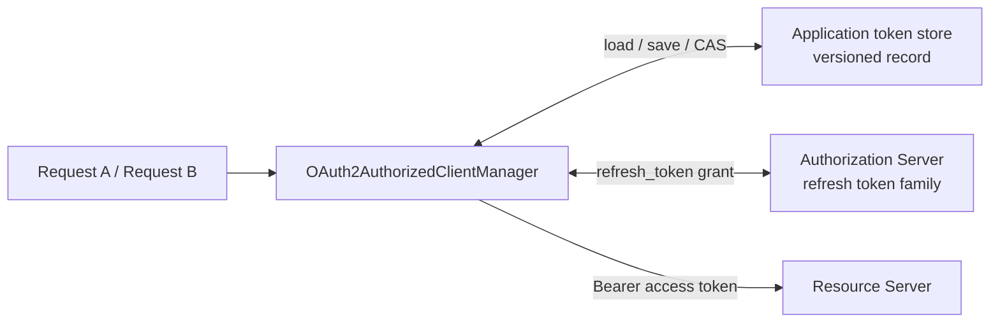
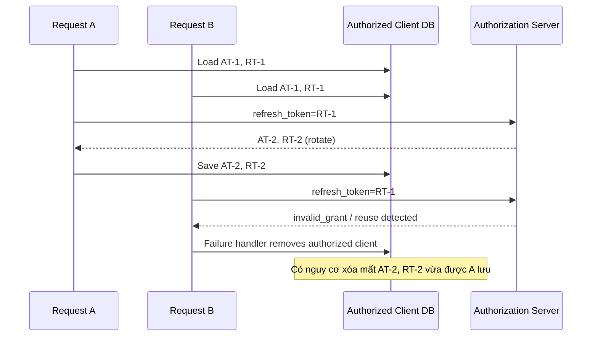
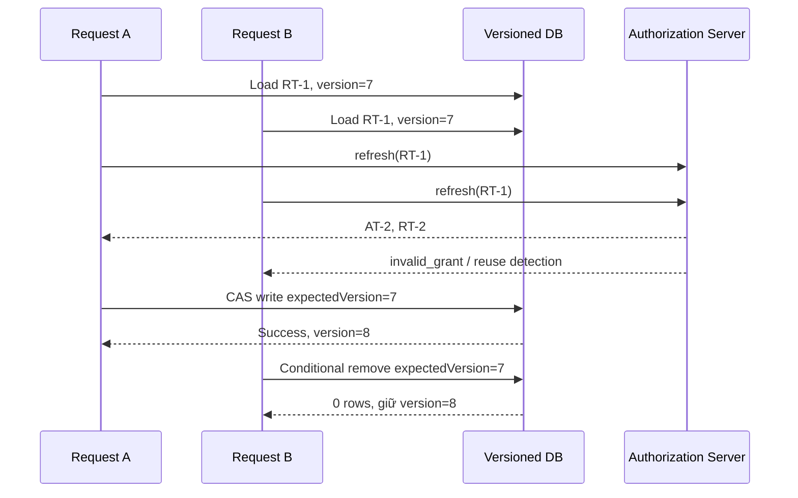
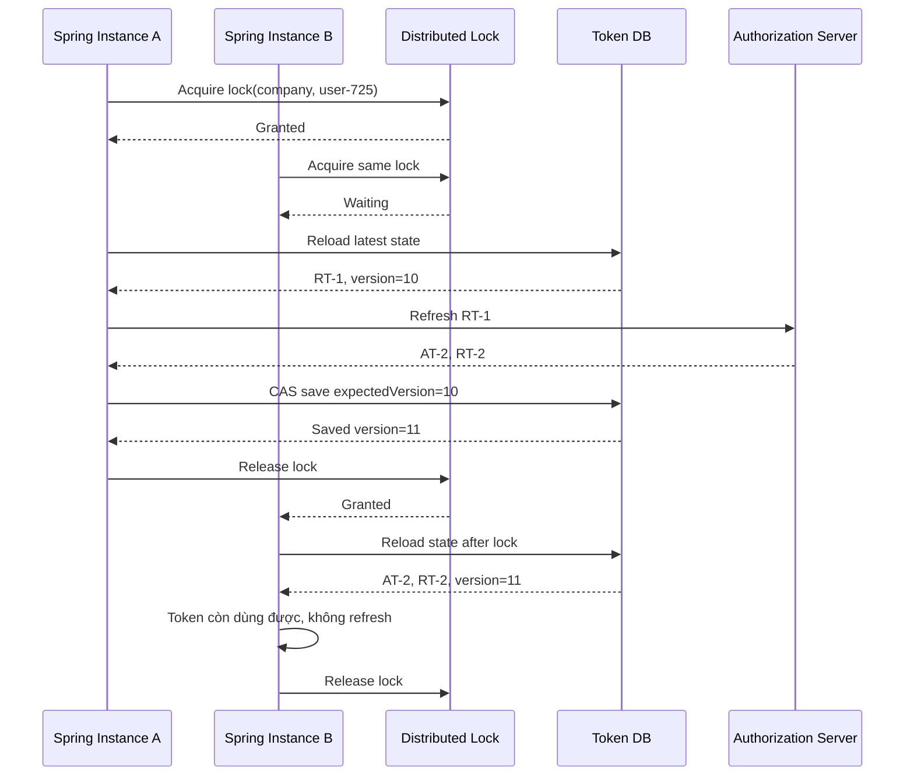
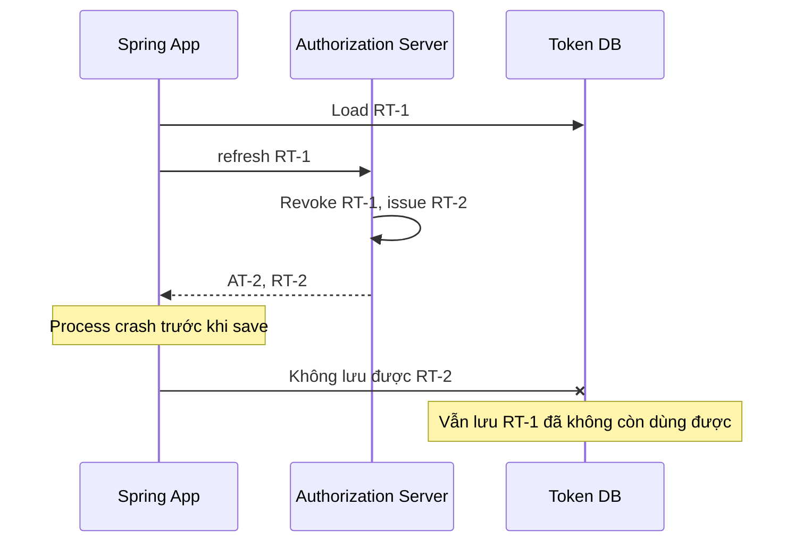
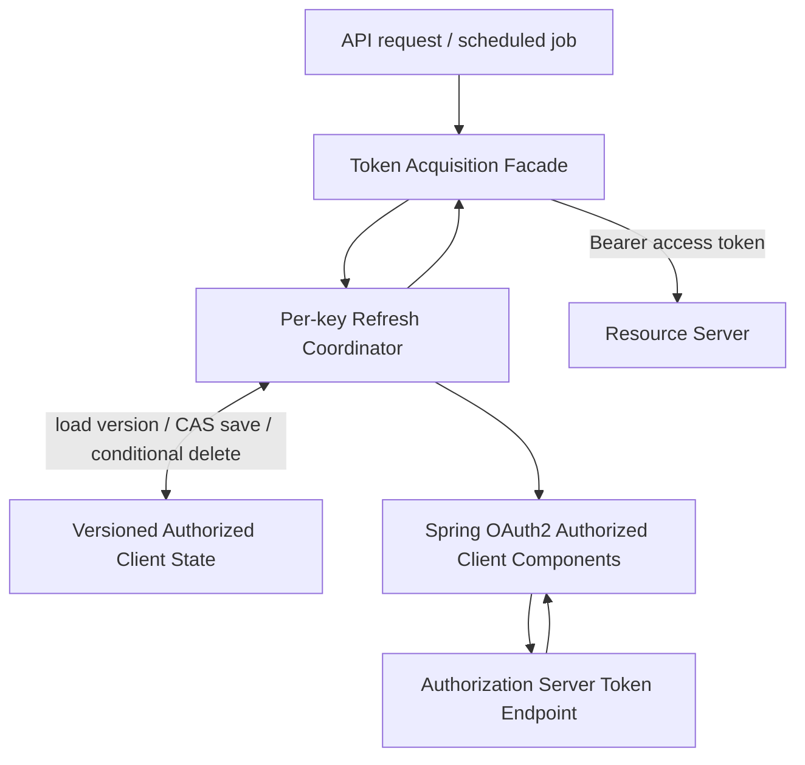

# 23.8. Giao dịch, optimistic locking và cập nhật token đồng thời

Trong **Spring Security OAuth 2.0/OIDC Client**, một `OAuth2AuthorizedClient` thường gắn với **client registration**, **principal** và các token đang được sử dụng: access token, refresh token nếu có, thời điểm cấp/hết hạn và scopes. Khi access token hết hạn, `OAuth2AuthorizedClientManager` có thể phối hợp với provider `refreshToken()` để lấy token mới từ Authorization Server rồi cập nhật authorized client.

Với một người dùng, một request và một ứng dụng chạy trên một instance, luồng này thường đơn giản. Tuy nhiên, trong hệ thống thực tế có:

- Nhiều browser tabs gửi requests đồng thời.
- Nhiều threads cùng xử lý token cho một principal.
- Nhiều application instances chia sẻ database hoặc Redis.
- Scheduled jobs dùng cùng một authorized client.
- Refresh token rotation, khiến refresh token cũ không được dùng lại.
- Lỗi network, timeout, restart hoặc crash giữa lúc AS cấp token và lúc database lưu token.
- Failure handler xóa token sau một lỗi `invalid_grant`, đôi khi xảy ra **sau khi request khác đã lưu token mới hợp lệ**.

Khi đó, thao tác tưởng chừng đơn giản “đọc → refresh → ghi” trở thành một bài toán về **concurrency, consistency và security boundaries**.

Bài này tập trung vào ba nguyên tắc:

1. **Giao dịch database** giữ dữ liệu local nhất quán, nhưng **không tạo được giao dịch nguyên tử xuyên Token Endpoint của Authorization Server**.
2. **Optimistic locking/CAS** ngăn một request cũ ghi đè kết quả mới, nhưng **không tự ngăn hai request cùng gửi refresh token cũ đến AS**.
3. Với **refresh token rotation**, thường cần điều phối cả **trước khi thực hiện refresh**, cùng cơ chế lưu token có version và xử lý lỗi/xóa có điều kiện.

Mục tiêu là thiết kế hệ thống không làm mất refresh token mới, không dùng nhầm token của principal khác, không tạo vòng lặp refresh và không xóa authorized client còn hợp lệ vì một kết quả cũ.

---

## 1. Authorized client là đơn vị trạng thái cần bảo vệ

### 1.1. Các đối tượng Spring Security liên quan

Một `OAuth2AuthorizedClient` đại diện cho sự ủy quyền của một OAuth client trong một ngữ cảnh principal cụ thể.

```text
OAuth2AuthorizedClient
├── ClientRegistration
│   ├── registrationId = company
│   ├── clientId = portal-web-prod
│   ├── grantType = authorization_code
│   └── provider details
├── principalName = user-725
├── OAuth2AccessToken
│   ├── tokenValue = AT-1
│   ├── issuedAt = ...
│   ├── expiresAt = ...
│   └── scopes = [orders.read]
└── OAuth2RefreshToken
    ├── tokenValue = RT-1
    └── issuedAt = ...
```

Các abstraction quan trọng:

| Thành phần | Vai trò | Liên quan concurrency |
|---|---|---|
| `ClientRegistrationRepository` | Tra cấu hình OAuth client | Không phải kho token của user |
| `OAuth2AuthorizedClient` | Trạng thái token gắn với registration/principal | Cần thay như một trạng thái nhất quán |
| `OAuth2AuthorizedClientRepository` | Lưu/nạp client trong Servlet request context | Có thể dựa vào HTTP session hoặc service |
| `OAuth2AuthorizedClientService` | Lưu/nạp client theo registration và principal, độc lập Servlet request | Điểm tích hợp persistence và locking |
| `OAuth2AuthorizedClientManager` | Điều phối authorization, refresh, success/failure | Có thể có nhiều caller cùng authorize |
| `OAuth2AuthorizedClientProvider` | Thực hiện grant phù hợp, chẳng hạn refresh token | Có thể gọi Token Endpoint đồng thời |
| `OAuth2AuthorizationSuccessHandler` | Xử lý kết quả cấp lại token thành công | Phải lưu version mới đúng cách |
| `OAuth2AuthorizationFailureHandler` | Xử lý authorization error | Tránh xóa nhầm record vừa được request khác cập nhật |

### 1.2. Khóa logic của authorized client

Đối với một service-based store, khóa thường có dạng:

```text
(client_registration_id, principal_name)
```

Ví dụ:

```text
(company, user-725) -> AT-A, RT-A
(company, user-813) -> AT-B, RT-B
```

Không được dùng duy nhất `registrationId=company` làm cache key cho token ủy quyền theo user. Nếu không, token của user A có thể bị gửi đi trong request của user B.

Trong một hệ thống multi-tenant hoặc multi-audience, khóa logic có thể cần **thêm ranh giới** ngoài hai trường trên, hoặc mỗi ngữ cảnh phải có registration/principal khác nhau. Không tự gộp token có scope/resource/tenant khác nhau chỉ vì cùng client ID.

### 1.3. Token mới là một trạng thái thống nhất

Một lần refresh rotation có thể tạo:

```text
Trước refresh:
  access_token  = AT-1
  refresh_token = RT-1
  access_exp    = T1

Sau refresh:
  access_token  = AT-2
  refresh_token = RT-2
  access_exp    = T2
```

Nên cập nhật tất cả trường liên quan thành **một thay đổi logic nhất quán**. Không lưu `AT-2` nhưng giữ `RT-1` nếu AS đã rotate, cũng không chỉ lưu `RT-2` rồi để expiry metadata của AT cũ.

## 2. Hai tầng nhất quán không thể trộn làm một

Bài toán có ít nhất hai hệ thống sở hữu trạng thái:

1. **Authorization Server (AS)** quyết định refresh token nào còn hợp lệ, đã bị rotate/revoked hay chưa, và access token nào được cấp.
2. **Ứng dụng Spring** lưu authorized client để tái sử dụng token và biết credential tiếp theo.



**Database transaction chỉ bao phủ những thay đổi trong database tham gia transaction.** HTTP request đến Token Endpoint không tham gia cùng transaction database thông thường.

Vì thế, ngay cả khi application dùng:

```java
@Transactional
public void refreshSomething() {
    // ...
}
```

thì annotation này **không biến** request HTTPS tới AS thành phần của một atomic transaction chung.

Đây là nền tảng để hiểu vì sao optimistic locking, distributed coordination và recovery strategy đều có vai trò riêng.

## 3. Race condition cơ bản: hai request cùng refresh

Giả sử AT-1 đã hết hạn, RT-1 còn hợp lệ. Hai request đến gần như cùng lúc.



Những điều có thể xảy ra:

- Request A thành công; RT-1 bị AS vô hiệu hóa, RT-2 trở thành refresh token mới.
- Request B gửi RT-1 cũ và nhận `invalid_grant`.
- Failure handler của B xóa authorized client bằng registration ID + principal name.
- Record mới của A bị xóa, dù **RT-2 hoàn toàn hợp lệ**.

Đây là một dạng **stale delete**.

Một biến thể khác: nếu AS cho phép một khoảng thời gian reuse hoặc không rotate nghiêm ngặt, A và B có thể đều nhận token mới. Nếu B ghi cuối, kết quả của A có thể bị ghi đè, dẫn đến **lost update** hoặc giữ refresh token không còn là token mới nhất theo policy AS.

### 3.1. Vì sao lỗi chỉ xảy ra khi tải cao?

Một user chỉ có một request mỗi lần có thể không gặp race. Nhưng khi mở trang dashboard:

```text
GET /api/profile
GET /api/orders
GET /api/notifications
GET /api/permissions
```

bốn API calls có thể cùng cần access token. Khi token gần hết hạn, cả bốn đi qua authorized client manager. Nếu storage không có coordination, nhiều luồng có thể quyết định refresh gần cùng thời điểm.

Điều tương tự xảy ra khi:

- Browser mở nhiều tabs.
- Nhiều consumers cùng xử lý một tài khoản.
- Kubernetes chạy nhiều replicas.
- Load balancer chuyển request giữa các nodes.
- Background job và web request chia sẻ authorized client.

## 4. Nhận diện các dạng lỗi đồng thời

| Mẫu lỗi | Điều xảy ra | Hậu quả |
|---|---|---|
| **Lost update** | Request B ghi token cũ/phiên bản khác sau A | Token mới hợp lệ bị thay thế |
| **Duplicate refresh** | A/B cùng gọi AS bằng RT-1 | `invalid_grant`, replay detection, tăng tải |
| **Stale delete** | Failure handler B xóa record mới A vừa ghi | User mất quyền refresh, phải đăng nhập lại |
| **Stale read** | B đọc cache/session copy chưa cập nhật | Tiếp tục dùng RT cũ |
| **Partial update** | AT mới và RT mới lưu ở các bước riêng | Trạng thái token không khớp |
| **Lost response** | AS đã rotate nhưng client bị timeout | App không biết RT mới |
| **Crash window** | AS cấp RT-2 nhưng app crash trước khi commit | DB còn RT-1 đã vô hiệu |
| **Token cache stampede** | Hàng loạt requests đồng loạt refresh | AS bị quá tải/rate limit |
| **Cross-principal mix-up** | Token bị lưu/tra bằng key quá rộng | Rò rỉ quyền giữa users/tenants |
| **ABA problem** | Token state từng đổi rồi quay về giá trị nhìn giống cũ | So sánh token string đơn giản không đủ nhận biết version |

Không phải tất cả lỗi đều được giải quyết bằng **một loại lock**. Cần chọn biện pháp phù hợp với từng cơ chế thất bại.

## 5. Giao dịch database làm được gì?

### 5.1. Atomicity của bản ghi token

Khi đã có response chứa AT-2 và RT-2, lưu một bản ghi token như một thay đổi nguyên tử:

```sql
UPDATE oauth_authorized_client_state
SET access_token_ciphertext  = :new_access_token,
    refresh_token_ciphertext = :new_refresh_token,
    access_expires_at        = :new_expiry,
    granted_scopes           = :new_scopes,
    updated_at               = CURRENT_TIMESTAMP
WHERE registration_id = :registration_id
  AND principal_name  = :principal_name;
```

Đây là SQL minh họa cho **schema custom**, không phải tên bảng bắt buộc của Spring Security.

Một câu `UPDATE` trên một row trong một database giao dịch thường bảo đảm các cột thay đổi **cùng được commit hoặc cùng rollback**. Điều đó tốt hơn việc viết access token rồi refresh token trong hai lệnh không được quản lý transaction.

### 5.2. Transaction không bảo đảm logic “đọc rồi ghi” đúng

Ví dụ:

```text
Transaction A: read version 3
Transaction B: read version 3
Transaction A: update token -> version 4
Transaction B: update token -> version 4 hoặc ghi đè
```

Ở isolation level phổ biến, việc cả hai transactions đều đọc cùng trạng thái và sau đó cùng ghi có thể gây lost update nếu application không có version check hoặc locking thích hợp.

**`@Transactional` một mình không đồng nghĩa chống lost update.** Nó đảm bảo ranh giới transaction theo cấu hình, không tự áp đặt quy tắc một stale writer phải thất bại.

### 5.3. Không giữ DB transaction mở xuyên HTTP Token Endpoint khi không cần

Một cách dễ nghĩ tới:

```java
@Transactional
public Token refresh() {
    var record = tokenRepository.lockForUpdate(key);
    var response = callAuthorizationServer(record.refreshToken());
    tokenRepository.save(response);
    return response;
}
```

Cách này có thể sử dụng pessimistic lock để tuần tự hóa trong DB, nhưng nếu HTTP request mất vài giây, DB transaction/connection/row lock có thể bị giữ suốt thời gian đó.

Hậu quả:

- Giữ kết nối DB lâu.
- Tăng lock contention và timeout.
- Dễ nghẽn connection pool dưới tải.
- Phụ thuộc độ trễ mạng/AS.
- Nếu process crash, transaction rollback nhưng AS đã rotate refresh token.

Có hệ thống chọn cách này khi tải thấp và giới hạn timeout rõ, nhưng nó **không phải giải pháp mặc định phù hợp mọi quy mô**, và không xóa được khoảng hở giữa AS và DB.

## 6. Optimistic locking là gì?

**Optimistic locking** giả định phần lớn cập nhật không xung đột. Thay vì giữ lock trong suốt thời gian làm việc, mỗi record có **version**. Khi ghi, writer phải chứng minh record vẫn ở version đã đọc.

### 6.1. Trạng thái có version

```text
Key:
  registration_id = company
  principal_name = user-725

Token state:
  access_token = AT-1
  refresh_token = RT-1
  version = 17
```

Request A đọc version 17, request B cũng đọc version 17.

Khi A ghi:

```text
UPDATE ... WHERE version=17
-> affected rows = 1
-> record version=18
```

Khi B ghi:

```text
UPDATE ... WHERE version=17
-> affected rows = 0
-> stale writer detected
```

**B không được tự ghi đè version 18**.

### 6.2. Compare-and-swap (CAS) bằng SQL

```sql
UPDATE oauth_authorized_client_state
SET access_token_ciphertext  = :new_access_token,
    refresh_token_ciphertext = :new_refresh_token,
    access_expires_at        = :new_expiry,
    granted_scopes           = :new_scopes,
    version                  = version + 1,
    updated_at               = CURRENT_TIMESTAMP
WHERE registration_id = :registration_id
  AND principal_name  = :principal_name
  AND version         = :expected_version;
```

Application kiểm tra **số row đã cập nhật**:

- `1`: CAS thành công.
- `0`: record không tồn tại hoặc version không khớp; **có conflict**, cần nạp lại và áp dụng policy.
- Lỗi DB: xử lý như persistence failure, không coi là refresh đã lưu thành công.

### 6.3. Vì sao dùng version thay vì so token value?

So sánh raw refresh token trong `WHERE` có những bất lợi:

- Refresh token là secret.
- Mã hóa randomized có thể khiến ciphertext thay đổi dù plaintext giống nhau.
- Một token value hiển thị giống cũ không chứng minh record không từng thay đổi.
- Cần phân biệt row đã được thay đổi bởi một request khác.

Version là metadata phù hợp để kiểm soát thứ tự cập nhật. Có thể bổ sung **token fingerprint** dạng HMAC nếu cần so sánh trạng thái an toàn, nhưng không log token raw hoặc dùng hash yếu như công khai một phần secret.

## 7. Schema custom dành cho optimistic concurrency

Một ví dụ PostgreSQL:

```sql
CREATE TABLE oauth_authorized_client_state (
    registration_id         VARCHAR(100) NOT NULL,
    principal_name          VARCHAR(255) NOT NULL,
    access_token_ciphertext BYTEA NOT NULL,
    refresh_token_ciphertext BYTEA,
    access_issued_at        TIMESTAMPTZ,
    access_expires_at       TIMESTAMPTZ,
    refresh_issued_at       TIMESTAMPTZ,
    granted_scopes          TEXT,
    version                 BIGINT NOT NULL DEFAULT 0,
    updated_at              TIMESTAMPTZ NOT NULL DEFAULT NOW(),

    CONSTRAINT pk_oauth_authorized_client_state
      PRIMARY KEY (registration_id, principal_name)
);
```

**Đây là schema minh họa tự thiết kế.** Không dùng nó như drop-in migration thay cho schema chính thức của `JdbcOAuth2AuthorizedClientService`. Khi tùy biến storage, phải triển khai serialization, encryption, deserialization, schema migration và xử lý version chính xác.

### 7.1. Primary key để làm gì?

Khóa chính ngăn có hai rows đồng thời cho cùng cặp:

```text
(registration_id, principal_name)
```

Điều này không thay version. Khóa chính ngăn **duplicate identity rows**, còn version giúp phát hiện **stale update trên một row đã tồn tại**.

### 7.2. Vì sao lưu ciphertext?

Access token và refresh token là bearer credentials, không nên lưu plaintext nếu threat model yêu cầu mã hóa-at-rest ở tầng ứng dụng.

Cần cân nhắc:

- KMS/HSM hoặc secret manager chứa encryption keys.
- Encryption authenticated (AEAD) và key rotation.
- Không lưu encryption key trong cùng DB theo cách khiến DB compromise lấy được tất cả.
- Quyền đọc/ghi token tối thiểu.
- Backup/snapshot, replication, retention và cleanup.
- Không trả ciphertext/metadata token ra API công khai.

Mã hóa-at-rest của disk vẫn hữu ích nhưng không luôn bảo vệ khỏi một DB reader có quyền SELECT và thấy plaintext qua tầng ứng dụng; cần xác định threat model cụ thể.

### 7.3. Không quên index và kích thước row

Token values có thể dài. Nếu lưu JWT lớn và nhiều metadata, row size/serialization ảnh hưởng performance. Chỉ dùng những columns cần thiết và index đúng theo các truy vấn thường gặp.

Không index raw token value hoặc toàn bộ JWT chỉ để tìm debugging correlation.

## 8. Ví dụ CAS với JdbcTemplate

Đây là đoạn code minh họa **cốt lõi của custom token persistence**, không phải implementation đầy đủ của `OAuth2AuthorizedClientService`.

```java
import org.springframework.jdbc.core.JdbcTemplate;
import org.springframework.stereotype.Repository;

import java.sql.Timestamp;
import java.time.Instant;

@Repository
public class VersionedTokenStateRepository {

    private final JdbcTemplate jdbc;

    public VersionedTokenStateRepository(JdbcTemplate jdbc) {
        this.jdbc = jdbc;
    }

    public boolean updateIfVersionMatches(
            String registrationId,
            String principalName,
            long expectedVersion,
            byte[] encryptedAccessToken,
            byte[] encryptedRefreshToken,
            Instant expiresAt,
            String grantedScopes) {

        int changed = jdbc.update("""
            UPDATE oauth_authorized_client_state
               SET access_token_ciphertext  = ?,
                   refresh_token_ciphertext = ?,
                   access_expires_at        = ?,
                   granted_scopes           = ?,
                   version                  = version + 1,
                   updated_at               = CURRENT_TIMESTAMP
             WHERE registration_id = ?
               AND principal_name  = ?
               AND version         = ?
            """,
            encryptedAccessToken,
            encryptedRefreshToken,
            Timestamp.from(expiresAt),
            grantedScopes,
            registrationId,
            principalName,
            expectedVersion
        );

        return changed == 1;
    }
}
```

Mã sử dụng Java text blocks, giả định phiên bản Java phù hợp, SQL/dialect và mapper tương thích. Trong production:

- Giá trị `encryptedAccessToken`, `encryptedRefreshToken` phải được tạo từ encryption component an toàn.
- Không để caller tùy ý gán token của principal khác.
- Không tự thêm scopes không được cấp vào `grantedScopes`.
- Phải xử lý cả trường hợp refresh token không có, row bị xóa và SQL exceptions.
- Transaction boundary nên được xác định ở service khi có nhiều tác vụ DB đi cùng.
- Nếu trả `false`, caller không được coi như save đã thành công.

### 8.1. Xử lý CAS thất bại

```java
boolean saved = repository.updateIfVersionMatches(
    key.registrationId(),
    key.principalName(),
    state.version(),
    encryptedNewAccess,
    encryptedNewRefresh,
    newExpiresAt,
    grantedScopes
);

if (!saved) {
    throw new ConcurrentTokenUpdateException(
        "Authorized client was updated concurrently");
}
```

`ConcurrentTokenUpdateException` và `key/state` trong ví dụ là types do ứng dụng định nghĩa.

Sau conflict, thường cần **reload trạng thái mới** trước khi quyết định:

- Có token hợp lệ khác đã được request khác lưu?
- Record vừa bị xóa vì logout/revocation?
- Subject đã bị disable?
- Có cần retry operation hay trả lại lỗi?

Không viết một vòng lặp CAS vô hạn. Và không luôn retry refresh với assertion/refresh token cũ sau conflict.

## 9. @Version với JPA/Hibernate

Nếu application dùng JPA cho persistence đồng bộ, optimistic locking có thể thực hiện bằng `@Version`:

```java
import jakarta.persistence.Column;
import jakarta.persistence.Entity;
import jakarta.persistence.Id;
import jakarta.persistence.Table;
import jakarta.persistence.Version;

@Entity
@Table(name = "oauth_client_state")
public class OAuthClientStateEntity {

    @Id
    private String storageKey;

    @Column(nullable = false)
    private String registrationId;

    @Column(nullable = false)
    private String principalName;

    @Column(nullable = false)
    private byte[] encryptedAccessToken;

    private byte[] encryptedRefreshToken;

    @Version
    @Column(nullable = false)
    private long version;

    protected OAuthClientStateEntity() {
        // JPA
    }

    // Constructors, getters và nghiệp vụ cập nhật được lược bớt.
}
```

`storageKey` là khóa duy nhất ổn định được xây từ identity an toàn; ví dụ thực tế cần thiết kế encoding/uniqueness để tránh collision, không nối chuỗi mơ hồ bằng delimiter có thể xuất hiện trong principal.

Khi hai transactions cùng sửa một entity dựa trên version cũ, ORM thường phát hiện conflict và ném exception tương ứng, chẳng hạn `OptimisticLockException` hoặc Spring `ObjectOptimisticLockingFailureException`.

### 9.1. @Transactional và @Version là hai trách nhiệm khác nhau

```java
@Transactional
public void persistTokenUpdate(...) {
    // Nạp entity + cập nhật fields + commit.
    // @Version giúp phát hiện stale update.
}
```

- `@Transactional` xác định transaction boundary.
- `@Version` giúp phát hiện concurrent update vào cùng entity.
- Không cái nào tự ngăn hai Token Endpoint requests đã được gửi song song.
- Một optimistic lock exception cần được xử lý **bằng reload/policy**, không ghi đè retry vô điều kiện.

### 9.2. Không lấy JPA entity làm OAuth2AuthorizedClient trực tiếp

`OAuth2AuthorizedClient` không phải JPA entity có `@Version` sẵn. Khi có custom entity:

```text
JPA versioned entity
    |
    v
Encrypted token state + metadata
    |
    v
Mapper
    |
    v
OAuth2AuthorizedClient
```

Cần thiết kế cách giữ **version snapshot** đi kèm quá trình authorize để khi save có expected version.

Nếu convert entity sang `OAuth2AuthorizedClient` rồi bỏ metadata version, một `saveAuthorizedClient(client, principal)` đơn thuần **không biết request đã đọc version bao nhiêu**. Thêm `@Version` vào một entity chưa giải quyết được nếu integration làm mất version giữa load và save.

## 10. Default Spring JDBC service có optimistic locking tự động không?

Spring Security cung cấp `JdbcOAuth2AuthorizedClientService` cho việc lưu authorized clients trong JDBC store (khi phiên bản/constructor tương ứng có sẵn). Implementation này tiện cho việc:

- Lưu/nạp authorized client.
- Gắn token với registration ID và principal name.
- Cung cấp persistent storage thay cho in-memory.

Tuy nhiên, **không nên mặc định coi việc dùng `JdbcOAuth2AuthorizedClientService` là đã có optimistic locking hoặc distributed refresh coordination**. Schema/reference implementation của Spring Security không tự biến mọi refresh vào một giao dịch phân tán và không cung cấp lock cho từng refresh token family chỉ vì dùng JDBC.

Với yêu cầu rotation chặt và concurrency cao, cần kiểm tra **đúng phiên bản implementation và schema đang dùng**, rồi bổ sung custom storage/coordinator nếu cần.

### 10.1. Các tầng trách nhiệm

```text
OAuth2AuthorizedClientManager
  -> Provider decides to refresh
  -> Token endpoint HTTP request
  -> Success handler saves authorized client
  -> OAuth2AuthorizedClientService persistence

CUSTOM REQUIREMENTS:
  -> Versioned state
  -> CAS
  -> Conditional delete
  -> Coordination before token endpoint
  -> Recovery after ambiguous failure
```

Không “bật optimistic locking” bằng cách thêm một cột `version` vào schema mà không sửa code load/update và failure handling. Nếu service mặc định không biết version column, cột mới **không có hiệu lực logic**.

## 11. Optimistic locking không ngăn gửi refresh token hai lần

Đây là giới hạn quan trọng nhất.



CAS giúp **tránh stale delete/overwrite** trong DB, nhưng request B vẫn đã gửi RT-1 cũ cho AS.

Tùy AS, reuse detection có thể:

- Chỉ từ chối lần dùng token cũ.
- Thu hồi cả refresh token family.
- Đòi user authorization lại.
- Gắn cờ security incident.

Nếu AS thu hồi cả token family khi phát hiện reuse, **ngay cả RT-2 đã được A lưu có thể không còn hợp lệ**. CAS không giải quyết được hậu quả ở phía AS.

Vì vậy, với strict refresh token rotation, cần xem xét **single-flight/serialization trước Token Endpoint call**.

## 12. Single-flight refresh trong một JVM

**Single-flight** nghĩa là với cùng một authorized client key, chỉ một request thực hiện refresh; các requests khác chờ và dùng kết quả sau đó.

```text
(key = company, user-725)
   Request A ----> Refresh coordinator ----> AS refresh RT-1
   Request B ----> Wait on same refresh
   Request C ----> Wait on same refresh
                                    |
                                    v
                         AT-2 / RT-2 saved once
                                    |
                          A, B, C receive result
```

### 12.1. Khóa theo đúng identity key

Khóa nên ít nhất phân biệt:

```text
(clientRegistrationId, principalName)
```

Nếu có tenant/resource dimension thật sự tách token, phải bổ sung ranh giới đó.

Không dùng một global lock duy nhất cho tất cả users, vì user A refresh token sẽ làm user B không liên quan cũng phải chờ.

### 12.2. Mô hình lock theo key

Pseudo code:

```java
TokenState refreshWithLocalLock(TokenKey key) {
    Lock lock = localLockRegistry.get(key);
    lock.lock();

    try {
        TokenState state = tokenRepository.load(key);

        if (!needsRefresh(state)) {
            return state; // Double-check sau khi lấy lock.
        }

        TokenResponse response =
            authorizationServer.refresh(state.refreshToken());

        return tokenRepository.saveNewStateAtomically(
            key, state.version(), response);
    } finally {
        lock.unlock();
    }
}
```

Đây là **pseudocode kiến trúc**, không phải Java class chạy ngay. Phần quan trọng:

- Acquire lock đúng key.
- **Reload và kiểm tra lại** trạng thái **sau khi** có lock.
- Chỉ refresh khi vẫn cần.
- Persist đúng version.
- Release lock trong `finally`.
- Giới hạn thời gian chờ, xử lý interruption và cleanup lock registry.

### 12.3. Giới hạn của JVM-local lock

Nếu chạy:

```text
Instance A -> LocalLockRegistry A
Instance B -> LocalLockRegistry B
```

thì cùng user trên hai instances vẫn có thể refresh đồng thời. Local lock chỉ giải quyết concurrency **trong một process**.

Nếu ứng dụng có nhiều replicas, cần coordination dùng chung hoặc kiến trúc phân vùng quyền sở hữu refresh theo key.

## 13. Distributed lock có giải quyết hết không?

Một distributed lock trên Redis/DB/ZooKeeper hoặc hệ thống coordination khác có thể giới hạn số instances cùng thực hiện refresh cho một key.



Điểm khác với optimistic lock thuần là request B **chưa gửi RT-1 tới AS** trước khi thấy trạng thái mới.

### 13.1. Khóa phải có TTL và ownership

Nếu instance A crash, lock không thể tồn tại vĩnh viễn. Thông thường cần:

- Lease/TTL đủ theo timeout của Token Endpoint.
- Ownership token để release đúng lock đã acquire.
- Timeout khi chờ lock.
- Xử lý lock service outage.
- Refresh/check lock validity khi công việc dài.
- Metrics để nhận biết lock contention.

Không thiết kế lock bằng một Redis key không TTL hoặc cho mọi instance xóa key bất kỳ.

### 13.2. Vì sao lease expiry vẫn có race?

Giả sử A lấy lock 10 giây nhưng bị pause 15 giây; lock hết hạn và B được cấp lock. A tỉnh lại và tiếp tục gọi AS hoặc ghi DB.

```text
A: obtains lease 101
A: stalls
lease expires
B: obtains lease 102
B: refresh / save
A: resumes with stale lease 101
```

Do vậy, distributed lock có **lease expiry** nhưng không có fencing/version validation vẫn có thể cho stale writer chạy tiếp.

### 13.3. Fencing token và CAS

Một cách giảm rủi ro ghi stale:

```text
lease A -> fencingToken=101
lease B -> fencingToken=102

DB accepts state update only if writer's fencing token
is compatible with latest recorded ownership/version.
```

**Fencing giúp bảo vệ storage**, nhưng nếu A đã gửi stale RT-1 tới AS trước khi bị chặn ở DB, fencing không tự đảo ngược token reuse tại AS. Thiết kế phải kiểm soát **thời điểm bắt đầu Token Endpoint call** và semantics của lease.

Không hứa rằng distributed lock bất kỳ bảo đảm exactly-once refresh trong mọi failure scenario. Network partition, lease expiry và process pauses vẫn cần được xử lý.

## 14. Chọn giữa optimistic lock, pessimistic lock và distributed coordination

| Biện pháp | Ngăn lost update local? | Ngăn hai requests cùng gọi AS? | Phạm vi | Đánh đổi |
|---|---|---|---|---|
| **Optimistic locking/CAS** | Có, nếu dùng đúng | **Không** | Shared DB | Phải xử lý conflict và version |
| **JVM per-key lock** | Giảm race trong node; vẫn nên CAS | Có trong **một JVM** | Một process | Không hiệu quả cross-node |
| **DB row lock `FOR UPDATE`** | Có trong transaction | Có thể, nếu giữ lock qua HTTP call | Các nodes dùng chung DB | Giữ connection/lock lâu |
| **Distributed lock/lease** | Cần CAS/fencing đi kèm | Có thể hạn chế cross-node | Các instances | Complexity, lease expiry, failure recovery |
| **Partition/owner per key** | Phụ thuộc storage | Giảm nhiều nguồn cùng refresh | Worker architecture | Ownership/failover routing |
| **Token reuse grace policy của AS** | Không | Không | AS behavior | Phụ thuộc security tradeoff và nhà cung cấp |
| **Nâng access token TTL** | Không | Giảm frequency | AS policy | Tăng thời gian token có thể bị lạm dụng |

Không có một giải pháp duy nhất. Với app nhỏ và AS rotation mềm, CAS + default manager có thể đáp ứng. Với strict rotation, nhiều nodes và quyền nhạy cảm, cần coordination/recovery chặt hơn.

## 15. Giao dịch và Token Endpoint: giới hạn không thể “rollback”

### 15.1. Bất đối xứng giữa AS và DB

Luồng:

```text
1. App đọc RT-1.
2. App gửi refresh(RT-1).
3. AS vô hiệu RT-1, cấp RT-2.
4. App nhận RT-2.
5. App ghi RT-2 vào DB.
```

Nếu lỗi xảy ra **giữa bước 3 và 5**, app có thể không có RT-2 trong durable storage.

Ví dụ:



Database transaction không thể yêu cầu AS “rollback việc rotate RT-1” khi process bị crash.

### 15.2. Không có exactly-once dễ dàng

HTTP request có thể gặp:

- Timeout **trước** khi AS nhận request.
- Timeout **sau** khi AS nhận nhưng chưa xử lý.
- Timeout **sau** khi AS đã rotate token nhưng response chưa về app.
- Response về app nhưng crash trước khi DB commit.

Từ phía app, một timeout không đủ để biết chắc AS có xử lý token grant hay chưa.

Vì vậy, **không retry ngay cùng RT-1** nếu AS có replay detection nghiêm ngặt. Cần phân loại lỗi và policy khôi phục.

### 15.3. Recovery strategy

Những biện pháp giảm thiểu:

- Dùng refresh token TTL/rotation policy và client auth phù hợp.
- Kiểm soát timeout rõ ràng ở Token Endpoint client.
- Giảm công việc giữa nhận token response và durable save.
- Ưu tiên commit token state mới trước các bước phụ như log/audit.
- Sau ambiguous failure, đánh dấu trạng thái nghi ngờ hoặc buộc re-authorization nếu không thể xác định token mới.
- Nếu AS cung cấp API/contract phục hồi hợp lệ, sử dụng theo thỏa thuận; không tự phát minh endpoint.
- Tách side-effect external của AS ra khỏi transaction DB và thừa nhận giới hạn distributed consistency.

Đôi khi **re-login/re-authorize** là phương án đúng nhất sau khi refresh token family không thể khôi phục. Không cố sử dụng lại RT cũ vô hạn chỉ để tránh user login.

## 16. State machine gợi ý cho token lifecycle

Thay vì chỉ lưu token values, hệ thống có yêu cầu cao có thể có thêm metadata trạng thái:

```text
READY
  |
  | token near expiry
  v
REFRESHING (owner/lease, version)
  |
  +-- success --> READY (new tokens, version+1)
  |
  +-- AS invalid_grant --> REAUTH_REQUIRED
  |
  +-- ambiguous timeout --> UNKNOWN / REAUTH_REQUIRED
  |
  +-- owner crash --> stale lease recovery
```

Đây là **mô hình ứng dụng tùy biến**, không phải state machine có sẵn trong `OAuth2AuthorizedClient`.

### 16.1. Vì sao state REFRESHING có ích?

Nếu có một row biểu thị refresh owner:

```text
registration = company
principal = user-725
version = 27
status = REFRESHING
owner = instance-A
leaseUntil = 2026-11-16T03:45:00Z
```

request B có thể biết A đang refresh và chờ/nạp lại thay vì cũng gửi RT-1.

### 16.2. Nhưng không được tin REFRESHING mãi mãi

Nếu A crash:

- Lease có thể hết hạn.
- B cần xác định đã có commit token mới chưa.
- Nếu AS đã rotate nhưng token mới không được lưu, việc retry RT cũ có thể gây replay.
- Có trường hợp buộc re-authorization, không thể tự chữa từ DB.

Một state machine rõ ràng giúp ghi nhận failure mode, nhưng không thay được hợp đồng giữa app và AS.

## 17. Conditional delete: không xóa token mới vì lỗi của request cũ

### 17.1. Vấn đề với removeAuthorizedClient đơn giản

`OAuth2AuthorizedClientService` có phương thức:

```java
void removeAuthorizedClient(
    String clientRegistrationId,
    String principalName
);
```

API này không nhận `expectedVersion`. Nếu request B đã đọc version 7 nhưng request A vừa lưu version 8, B gọi remove theo key có thể xóa version 8 nếu implementation xóa không điều kiện.

Một số cấu hình manager/failure handler của Spring Security có hành vi loại bỏ authorized client khi gặp `invalid_grant`. Hành vi chính xác phụ thuộc phiên bản, manager và failure handler đã cấu hình.

Trong hệ thống concurrent rotation, cần đánh giá **stale delete** chứ không chỉ stale update.

### 17.2. SQL xóa có điều kiện

```sql
DELETE FROM oauth_authorized_client_state
 WHERE registration_id = :registration_id
   AND principal_name  = :principal_name
   AND version         = :expected_version;
```

Kết quả:

- `1 row`: xóa đúng phiên bản bị lỗi (nếu policy cho phép).
- `0 rows`: một request khác đã cập nhật/xóa record; **không xóa phiên bản mới**.

### 17.3. Code JdbcTemplate minh họa

```java
public boolean removeIfVersionMatches(
        String registrationId,
        String principalName,
        long expectedVersion) {

    int removed = jdbc.update("""
        DELETE FROM oauth_authorized_client_state
         WHERE registration_id = ?
           AND principal_name  = ?
           AND version         = ?
        """,
        registrationId,
        principalName,
        expectedVersion
    );

    return removed == 1;
}
```

Giả định phương thức nằm trong repository có `JdbcTemplate jdbc` từ ví dụ trước.

**Lưu ý:** chỉ dùng conditional delete nếu failure policy thực sự cho phép xóa. Với lỗi mạng tạm thời, không nên xóa token ngay. Với `invalid_grant`, cần phân biệt token thực sự bị thu hồi, token stale sau rotation và race với một bản mới.

### 17.4. Không gắn current version tùy tiện cho failure handler

Nếu failure handler chỉ biết principal/registration mà không biết **request đã sử dụng version nào**, nó không thể tự tạo expected version chính xác.

Cần một đường truyền context tin cậy như:

```text
load authorized state -> capture version=7
refresh using state v7
success/failure result retains observed version=7
conditional save/delete against version=7
```

Đừng gọi `loadLatestVersion()` rồi xóa theo version vừa đọc; như vậy vẫn có thể xóa phiên bản mới của request khác.

## 18. Tích hợp version với OAuth2AuthorizedClientManager

### 18.1. Vấn đề abstraction

`OAuth2AuthorizedClient` giữ registration, principal và tokens, **không có trường version persistence mặc định**.

`OAuth2AuthorizedClientService.saveAuthorizedClient(...)` cũng chỉ nhận authorized client và Authentication, không nhận expected version.

Vì vậy, nếu muốn CAS end-to-end, cần một thiết kế tích hợp chủ động:

- Một **versioned token state repository/service** riêng.
- Một **refresh coordinator** nạp cả token và version.
- Một **authorized client manager/provider/failure handler tùy biến** hoặc wrapper phù hợp.
- Một cách ghi/đọc version snapshot xuyên cả vòng đời.
- Tách rõ Spring default behavior với custom behavior.

### 18.2. Mô hình kiến trúc



Một số hệ thống chọn dùng manager mặc định **bên trong** facade nhưng tùy biến success/failure handler; hệ thống khác triển khai một token acquisition service riêng cho grant liên quan rotation.

Dù chọn cách nào, cần đảm bảo **chỉ một thành phần có quyền cập nhật token state cho key đó tại một thời điểm** hoặc CAS được thực thi nhất quán.

### 18.3. Không chỉ bọc saveAuthorizedClient bằng @Transactional

Ví dụ này **chưa đủ**:

```java
@Transactional
public void saveAuthorizedClient(
        OAuth2AuthorizedClient client,
        Authentication principal) {
    jdbcService.saveAuthorizedClient(client, principal);
}
```

Vì:

- Không có expected version.
- Hai requests đã có thể gọi AS trước khi save.
- Một failure handler khác có thể remove không điều kiện.
- Transaction chỉ bảo vệ thao tác local của method.
- Không tự giải quyết network timeout/rotation.

Nó có thể hữu ích để bảo đảm các thao tác DB cùng commit, nhưng không phải coordination solution.

## 19. Quan hệ giữa optimistic locking và token refresh retry

Sau CAS conflict, logic đúng **không phải**:

```java
while (!repository.save(newTokens)) {
    // Retry save liên tục bằng cùng kết quả cũ.
}
```

Điều đó có thể khiến stale token update được ghi đè khi cố tình dùng version mới mà không đánh giá trạng thái.

Một quy trình hợp lý hơn:

1. CAS thất bại.
2. Nạp trạng thái latest từ database.
3. Kiểm tra latest token có hợp lệ/đúng principal/scope/resource không.
4. Nếu latest dùng được, **dùng latest**, không ghi lại kết quả cũ.
5. Nếu latest bị xóa hoặc đánh dấu reauth, xử lý đúng policy.
6. Nếu cần refresh tiếp, phải phối hợp và sử dụng **latest refresh token** hợp lệ, không token cũ.
7. Giới hạn số lần retry và tránh gây vòng lặp.

### 19.1. Stale successful response vẫn là vấn đề

Nếu A và B cùng gửi RT-1, AS có thể trả hai bộ tokens tùy policy:

```text
A -> AT-2/RT-2
B -> AT-3/RT-3
```

Nếu B thắng CAS lưu RT-3, A không được ghi đè RT-2 chỉ vì request A đến muộn. Nhưng nếu chính sách AS là token family rotation có thứ tự phức tạp, việc hai exchanges xảy ra đã có thể khiến một hoặc cả hai refresh tokens không hợp lệ.

Vì vậy, **phòng duplicate refresh trước Token Endpoint call** vẫn quan trọng hơn chỉ xử lý CAS conflict sau đó.

## 20. Multi-instance và session-based authorized client storage

### 20.1. Session store cũng có thể bị lost update

Không phải chỉ JDBC service mới gặp concurrency. Nếu OAuth authorized client được lưu trong `HttpSessionOAuth2AuthorizedClientRepository`, nhiều requests của cùng session có thể:

- Nạp hai bản trạng thái session gần cùng thời điểm.
- Cùng thực hiện refresh.
- Cập nhật hai session snapshots khác nhau.
- Persist snapshot cuối, ghi đè authorized client mới của snapshot trước.

Điều này phụ thuộc session implementation, serialization và lưu trữ. **Không mặc định HTTP session giải quyết mọi concurrency**.

### 20.2. Sticky session không loại bỏ race

Load balancer affinity có thể đưa requests cùng browser tới một node, nhưng:

- Nhiều tabs vẫn tạo concurrent requests trong node.
- Request timeout/retry có thể chồng nhau.
- Node failover thay đổi nơi xử lý.
- Background jobs có thể dùng cùng authorized client từ service store.
- Distributed session store có semantics update riêng.

Nếu dùng session storage và strict rotation, cần kiểm tra khả năng concurrent updates/atomic compare-and-set của session framework hoặc xây coordinator ở tầng token acquisition.

### 20.3. Chọn storage theo vòng đời

| Nhu cầu | Lựa chọn có thể phù hợp |
|---|---|
| Demo/single-node | `InMemoryOAuth2AuthorizedClientService` hoặc session repository |
| Servlet BFF, token sống trong phiên | HTTP session repository với chính sách concurrency |
| User delegated offline access | Persistent service store với quản lý consent/revocation |
| Nhiều instances và strict rotation | Shared versioned store + cross-node coordinator |
| Workload Client Credentials | Service manager/cache theo workload, thường không có refresh token |
| Reactive WebFlux | Reactive authorized client abstractions và DB/cache non-blocking |

Không chọn database persistent chỉ vì “lưu token lâu hơn tiện”. Refresh token persistence tạo thêm trách nhiệm bảo mật, retention và quyền truy cập.

## 21. Phân biệt Refresh Token Grant với Client Credentials

### 21.1. Refresh Token Grant

Với Authorization Code/OIDC Login:

```text
AT-1 expired
RT-1 exists
  -> POST /token grant_type=refresh_token
  -> AT-2, optionally RT-2
```

AS có thể rotate/revoke RT-1; concurrency là vấn đề quan trọng.

### 21.2. Client Credentials Grant

Với workload không có End-User:

```text
AT-1 expired
  -> POST /token grant_type=client_credentials
  -> AT-2
```

Thông thường không có refresh token. Hai requests cùng xin access tokens có thể tăng tải AS nhưng **không nhất thiết kích hoạt refresh token reuse detection** như trường hợp rotation.

Tuy vậy, vẫn cần caching/single-flight để:

- Giảm token endpoint rate limit.
- Giữ latency ổn định.
- Tránh redundant token issuance.
- Không trộn tokens giữa workloads/scopes/audiences.

**Đừng áp dụng một policy “invalid_grant ⇒ delete user refresh token” cho Client Credentials** mà không phân biệt loại grant và lỗi thực sự.

## 22. Gắn với Spring Security failure handler

### 22.1. Vì sao failure handler dễ gây bất ngờ?

Một số cấu hình Spring Security manager có default failure behavior loại bỏ authorized client cho những OAuth errors nhất định như `invalid_grant`. Điều đó hợp lý khi refresh token thực sự đã bị vô hiệu hóa và không có update đồng thời.

Nhưng trong race:

```text
A refresh RT-1 -> save RT-2 (version 11)
B refresh RT-1 -> invalid_grant
B failure handler -> remove(company, user-725)
```

việc remove không điều kiện có thể xóa version 11.

### 22.2. Failure policy có nhận thức version

Một handler tùy biến cần biết **token state version mà failed request đã dùng**, rồi:

```text
if error = invalid_grant:
    removeIfVersionMatches(key, expectedVersion)
    if no row deleted:
        reload latest
        do not delete current newer state
else if error is transient:
    retain valid persisted state
    return/report retryable failure
```

Nhưng vẫn phải xem xét trường hợp AS revoke cả token family vì reuse detection: “latest DB record tồn tại” chưa chắc “latest refresh token vẫn hợp lệ”. Có thể cần chuyển trạng thái sang **REAUTH_REQUIRED** sau khi có bằng chứng AS đã thu hồi family.

Không tự giả định mọi `invalid_grant` chỉ là một cuộc đua vô hại.

### 22.3. Handler không được tiết lộ secrets

Khi log failure:

```text
event=oauth2_token_refresh_failed
registrationId=company
principalKey=<internal-id>
observedVersion=10
errorCode=invalid_grant
concurrentUpdateDetected=true
correlationId=<non-secret-id>
```

Không log `refresh_token`, raw token response, client secret hay full `OAuth2AuthorizedClient` object.

## 23. Transaction isolation levels có thay optimistic locking được không?

Database cung cấp các isolation levels như READ COMMITTED, REPEATABLE READ, SERIALIZABLE; hiệu lực cụ thể phụ thuộc DB engine.

### 23.1. READ COMMITTED

Trong nhiều hệ thống, READ COMMITTED đủ cho các update có version check rõ ràng. Nhưng chỉ dùng READ COMMITTED với logic đọc rồi ghi không CAS có thể gây lost update.

### 23.2. REPEATABLE READ

Giúp ổn định góc nhìn trong transaction theo semantics DB, nhưng không đảm bảo mọi race external I/O/Token Endpoint được giải quyết. Một transaction có thể bị serialization conflict hoặc có hành vi khóa khác tùy engine.

### 23.3. SERIALIZABLE

Có thể phát hiện những anomaly database và yêu cầu retry transaction. Tuy nhiên:

- Tăng contention và transaction aborts.
- Không đưa HTTP Token Endpoint vào cùng atomicity.
- Retry toàn bộ business transaction có thể **gửi lại refresh token cũ**, nguy hiểm.
- Không thay distributed coordination/recovery policy.

**Không nâng isolation lên SERIALIZABLE rồi retry cả hàm refresh HTTP** mà không cân nhắc side effects đã xảy ra tại AS.

## 24. @Transactional trong một refresh workflow

Để tránh giữ DB connection qua network call, một thiết kế có thể tách:

```text
Short transaction 1:
  load version and/or claim refresh ownership

External network:
  call Token Endpoint

Short transaction 2:
  CAS commit new tokens, clear ownership
```

Điều kiện để thiết kế này an toàn:

- Claim ownership atomic và có lease/fencing.
- Request khác không tự gửi RT cũ khi ownership chưa được giải phóng.
- Sau response, commit token state mới ngay khi có thể.
- Nếu transaction 2 thất bại, có recovery policy.
- Nếu process crash, lease có thể được thu hồi nhưng token state có thể ambiguous.

Transaction ngắn giảm áp lực database, nhưng đòi state machine/coordinator được thiết kế đúng. Không chỉ tách transaction rồi bỏ toàn bộ locking.

### 24.1. Spring transaction proxy lưu ý

Khi dùng Spring `@Transactional`, transaction chỉ có hiệu lực nếu invocation đi qua proxy hoặc cơ chế transaction management được cấu hình đúng. Một method tự gọi method khác trong cùng object (`self-invocation`) thường không đi qua Spring proxy transaction interceptor.

Đừng dựa vào annotation ở một method private hoặc self-call để cho rằng token write đã nằm trong transaction.

### 24.2. Checked exceptions và rollback

Rollback rules phụ thuộc Spring transaction configuration. Khi thao tác token state thất bại, cần đảm bảo transaction rollback đúng, không để row ở trạng thái partial; cân nhắc exception type hoặc explicit rollback rules.

Không bắt persistence error rồi trả success nếu token chưa được durable commit.

## 25. Reactive stack: transaction và locking không giống Servlet

Trong WebFlux, Spring Security sử dụng:

- `ReactiveOAuth2AuthorizedClientManager`.
- `ServerOAuth2AuthorizedClientRepository`.
- `ReactiveOAuth2AuthorizedClientService`.

Nếu dùng R2DBC cho token storage, transaction thường được quản lý bằng **ReactiveTransactionManager** và Reactor Context, không phải cơ chế JDBC ThreadLocal truyền thống.

### 25.1. Ví dụ ReactiveTransactionalOperator

```java
import org.springframework.transaction.reactive.TransactionalOperator;
import reactor.core.publisher.Mono;

public final class ReactiveTokenStateService {

    private final ReactiveTokenStateRepository repository;
    private final TransactionalOperator transactions;

    public ReactiveTokenStateService(
            ReactiveTokenStateRepository repository,
            TransactionalOperator transactions) {
        this.repository = repository;
        this.transactions = transactions;
    }

    public Mono<Boolean> saveWithCas(
            TokenKey key,
            long expectedVersion,
            EncryptedTokenState next) {

        return repository.updateIfVersionMatches(
                key, expectedVersion, next)
            .map(affectedRows -> affectedRows == 1)
            .as(transactions::transactional);
    }
}
```

`TokenKey`, `EncryptedTokenState` và `ReactiveTokenStateRepository` là types ứng dụng giả định; repository cần dùng reactive DB client và phát kết quả affected rows.

### 25.2. Không gọi JDBC trực tiếp trên event loop

Không làm:

```java
return Mono.just(jdbcTemplate.update(sql, args));
```

Lệnh JDBC đã thực thi đồng bộ trước khi Mono được tạo.

Nếu buộc phải dùng JDBC legacy, có thể bọc `Mono.fromCallable(...).subscribeOn(Schedulers.boundedElastic())`, nhưng vẫn cần DB transaction và lock semantics phù hợp. Cách này không tự biến JDBC thành reactive I/O.

### 25.3. Không block() để “đợi transaction commit”

```java
// Không đúng trong reactive event loop.
boolean saved = reactiveRepository.saveWithCas(...).block();
```

Thay bằng composition:

```java
return reactiveRepository.saveWithCas(...)
    .flatMap(saved -> {
        if (!saved) {
            return Mono.error(new ConcurrentTokenUpdateException());
        }
        return Mono.just(saved);
    });
```

Không tự subscribe để lưu token “về sau” trong khi đã trả access token cho caller. Nếu app phát API request bằng token mới nhưng chưa durable-save refresh token, crash window có thể lớn hơn.

## 26. Những tình huống lỗi thực tế cần phân biệt

### 26.1. AS đã rotate nhưng DB save thất bại

Triệu chứng:

```text
POST /token -> 200, RT-2 issued
DB update -> timeout / deadlock / unavailable
```

Không thể đơn giản rollback AS. Cần coi đây là một lỗi nghiêm trọng của token persistence, xử lý recovery hoặc re-authorization theo policy.

### 26.2. CAS thất bại nhưng DB có token mới hợp lệ

```text
CAS expectedVersion=12 -> 0 rows
Reload -> version=13, AT-3 valid, RT-3 present
```

Có thể dùng token latest thay vì overwrite bằng response cũ, nhưng phải xem AS có thể đã phát hiện reuse và revoke family hay không.

### 26.3. Retry Token Endpoint vì network timeout

Timeout không chứng minh AS chưa xử lý. Retry cùng refresh token có thể gây reuse detection. Giới hạn retry và phân biệt lỗi transient có thể an toàn với lỗi grant/token-family.

### 26.4. Logout xảy ra trong lúc refresh

```text
A refresh starts
B user logs out and removes authorized client
A refresh completes and saves token after logout
```

Nếu A thực hiện **upsert vô điều kiện**, token có thể bị “hồi sinh” sau logout.

Cần version/tombstone/revocation generation hoặc cơ chế ownership/state để **không cho stale refresh tạo lại record đã bị logout**.

### 26.5. Account bị khóa khi refresh đang chạy

Nếu app có chính sách account disabled/consent revoked, refresh success từ AS không tự cho phép bỏ qua local account policy. Phải có check/status version phù hợp trước khi lưu hoặc sử dụng token mới.

### 26.6. Client secret rotation giữa các nodes

Một node dùng secret cũ, node khác secret mới. Token Endpoint có thể trả `invalid_client` trên node cũ. Đây không phải refresh-token concurrency thuần; cần đồng bộ secret rollout và key rotation.

### 26.7. Principal key đổi khi nâng cấp

Nếu `principalName` trước là email, sau là user ID, app có thể không tìm thấy authorized client cũ và tạo record khác. Đây là vấn đề identity mapping/migration, không thể chữa bằng optimistic locking.

### 26.8. Session copy ghi đè persistent store

Nếu login sử dụng HTTP session repository nhưng API manager dùng JDBC service riêng, hai nguồn có thể không đồng bộ. Xác định source of truth trước khi thêm lock.

## 27. Logout, revoke và tombstone

### 27.1. Xóa record khác revoke tại Authorization Server

`OAuth2AuthorizedClientService.removeAuthorizedClient(...)` thường loại bỏ authorized client local. Nó **không tự đảm bảo AS revoke refresh token hoặc access token**.

Nếu yêu cầu thu hồi token tại AS, cần dùng cơ chế được AS hỗ trợ, chẳng hạn OAuth 2.0 Token Revocation (RFC 7009), với client authentication và policy riêng.

### 27.2. Tombstone để chặn stale save

Một thiết kế custom có thể không xóa record ngay, mà tăng generation và đánh dấu:

```text
state = REVOKED
version = 24
generation = 4
```

Sau logout, stale request từng đọc generation 3 **không thể CAS save** lại thành READY vì generation/version đã đổi.

Tombstone có thể cần TTL/cleanup. Nó là **mô hình persistence tùy biến**, không phải thuộc tính sẵn trong `OAuth2AuthorizedClient`.

### 27.3. Nếu app xóa record hoàn toàn

Với hard delete, stale request có thể cố **insert lại** cùng key sau refresh. Nếu code dùng upsert vô điều kiện, logout có thể bị đảo ngược.

Vì vậy, cần có account/authorization generation, tombstone, consent status hoặc cơ chế ngăn reinsertion khi user đã thu hồi quyền. Không chỉ dựa vào `UPDATE WHERE version` nếu code có fallback “không có row ⇒ INSERT” mà không kiểm tra authorization state.

## 28. Transactional outbox và audit sự kiện

Token lifecycle thường có audit:

```text
TOKEN_REFRESH_SUCCEEDED
TOKEN_REFRESH_FAILED
AUTHORIZED_CLIENT_REMOVED
CONSENT_REVOKED
REAUTH_REQUIRED
```

Nếu audit là yêu cầu bắt buộc, một **transactional outbox** trong cùng database với token state có thể giúp ghi:

```text
BEGIN;
  CAS update authorized client;
  INSERT outbox event (no secrets);
COMMIT;
```

Sau đó một worker xuất sự kiện đến message broker.

**Giới hạn:** outbox chỉ bảo đảm atomicity giữa những thay đổi **cùng database transaction**. Nó không làm request refresh đến AS trở thành atomic. Nó cũng không cho phép log access/refresh token raw vào event payload.

### 28.1. Audit không nên cản trở durable token update tùy tiện

Nếu app nhận RT-2 rồi gọi audit HTTP đồng bộ **trước khi lưu RT-2**, một audit timeout có thể làm mất cơ hội persist token mới.

Thông thường nên ưu tiên durable token update trước side effects phụ, hoặc gộp metadata audit vào transaction DB mà không đưa secret vào logs/events.

## 29. Testing các kịch bản concurrency

Không cần test code ở STEP 4 của bài học; trong hệ thống production, phải thiết kế các bài kiểm thử concurrency có kiểm soát.

### 29.1. Hai requests cùng token hết hạn

Dùng một fake Authorization Server/token response client có behavior rõ:

```text
Initial DB: AT-1 expired, RT-1, version 5

Request A loads v5
Request B loads v5

Expected:
  no stale overwrite
  no stale delete
  token state has AT-new/RT-new
  number of Token Endpoint calls fits coordination policy
```

### 29.2. Kiểm thử rotation nghiêm ngặt

Fake AS:

```text
refresh(RT-1) first call -> AT-2, RT-2
refresh(RT-1) second call -> invalid_grant and/or family revoked
```

Không chỉ assert database version tăng; phải kiểm tra **số lần gọi refresh** và tình trạng refresh token family.

### 29.3. CAS conflict

```text
A reads version 7
B writes version 8
A attempts UPDATE ... WHERE version=7
Expected affected rows=0
A reloads or reports concurrent update
```

Không được lặng lẽ coi affected rows 0 là save thành công.

### 29.4. Failure handler sau successful update

```text
A: refresh succeeds and saves version 8
B: receives invalid_grant for version 7
Expected: B cannot delete version 8 without proper policy
```

Nếu AS thực sự đã revoke family, logic cần đánh dấu state/re-auth phù hợp thay vì chỉ giữ version 8 rồi cho rằng token chắc chắn còn tốt.

### 29.5. Process crash windows

Mô phỏng:

- Crash trước khi gửi Token Endpoint request.
- Crash sau khi AS xử lý nhưng trước HTTP response.
- Crash sau response nhưng trước CAS commit.
- Crash sau commit nhưng trước release distributed lock.
- Distributed lock lease hết hạn giữa request.
- Network partition giữa app và DB.

Với mỗi tình huống, xác định rõ **trạng thái nào có thể phục hồi** và trường hợp nào phải user re-authorization.

### 29.6. Logout trong khi refresh

Dùng coordination barrier:

```text
A loads authorization generation 10
B logout -> generation 11 / revoked
A receives RT-2
A save expectedGeneration 10 -> rejected
```

Không cho stale refresh resurrect authorized client sau logout.

## 30. Observability: theo dõi conflict mà không lộ token

Những metrics hữu ích:

```text
oauth2_refresh_requests_total{
  registration_id="company",
  outcome="success"
}

oauth2_refresh_requests_total{
  registration_id="company",
  outcome="invalid_grant"
}

oauth2_token_state_cas_conflicts_total{
  registration_id="company"
}

oauth2_refresh_lock_wait_seconds{
  registration_id="company"
}

oauth2_authorized_client_reauth_required_total{
  registration_id="company"
}
```

Đây là tên metric minh họa. Tùy Micrometer/observability stack, cần thiết kế cardinality hợp lý.

### 30.1. Đừng đưa principalName vào metric label cardinality cao

Nếu hàng triệu users, label:

```text
principal_name="user-725"
```

có thể gây cardinality explosion và làm lộ dữ liệu định danh. Dùng aggregation theo registration/provider/environment hoặc các low-cardinality dimensions phù hợp. Nếu cần trace một user, dùng audit/correlation được bảo vệ riêng.

### 30.2. Không log token value

Tránh:

```text
refresh_token=RT-1
access_token=AT-2
Authorization: Basic <secret>
Authorization: Bearer <token>
```

Có thể log:

```text
event=authorized_client_cas_conflict
registrationId=company
observedVersion=7
currentVersion=8
outcome=reloaded_new_state
correlationId=...
```

Ngay cả logs metadata vẫn cần giới hạn quyền truy cập và retention.

### 30.3. Dấu hiệu cần cảnh báo

- `invalid_grant` tăng mạnh sau khi scale replicas.
- Token Endpoint calls tăng đột biến so với API requests.
- CAS conflicts tăng nhưng application không có retry/reload policy.
- Lock wait time tăng, nhiều requests timeout.
- Người dùng phải đăng nhập lại bất thường sau rotation.
- Một node có tỉ lệ token errors khác nodes còn lại.
- Token persistence failures sau khi AS đã cấp token.
- Authorized client records “sống lại” sau logout.

## 31. Security boundaries không được đánh đổi vì concurrency

Một thiết kế khóa tốt không cứu được một hệ thống gửi/nhận token sai chủ thể.

### 31.1. Key theo principal đáng tin

Principal phải đến từ authentication/authorization context đáng tin cậy. Không lấy `principalName` từ query parameter tự do rồi tra token của người khác.

### 31.2. Scope và audience

Ngay cả khi token state mới nhất được lưu đúng version, access token vẫn phải phù hợp với Resource Server:

```text
issuer valid
AND audience matches API
AND token not expired/revoked
AND scope includes required operation
AND user/tenant/object permission allows action
```

Concurrency control không thay API authorization.

### 31.3. Không đưa refresh token ra browser

Với Spring MVC/BFF confidential client, refresh token nên được giữ server-side trong storage có kiểm soát. Browser có thể sử dụng session cookie được bảo vệ, không cần nhận refresh token để xử lý race.

### 31.4. Access token và refresh token phải được mã hóa/bảo vệ

DB optimistic locking không thay encryption-at-rest, key management, least privilege, backup controls, TLS và secrets redaction.

### 31.5. Không tự retry authorization code

Authorization Code Flow có authorization code thường dùng một lần. Bài toán optimistic locking ở token storage không phải lý do gửi lại code cũ để “chữa” refresh token failures.

## 32. Quy trình thiết kế token persistence trong production

Một lộ trình triển khai có thể theo thứ tự:

1. **Xác định grant và token rotation policy.** Authorization Code + Refresh Token, Client Credentials, hay grant mở rộng? AS có one-time refresh token/reuse detection không?
2. **Chọn authorized client storage.** HTTP session, `OAuth2AuthorizedClientService` JDBC, Redis hoặc custom store.
3. **Xác định identity key.** Registration + principal, và tenant/resource dimensions nếu cần.
4. **Có transaction atomic cho token state chưa?** AT/RT/expiry/scopes phải được lưu nhất quán.
5. **Có version hoặc CAS chưa?** Không để stale writer ghi đè.
6. **Có conditional delete chưa?** Failure handler không xóa version mới của request khác.
7. **Có coordination trước refresh chưa?** Với strict rotation, single-flight/per-key lock hoặc cơ chế phù hợp.
8. **Có nhiều instances không?** JVM-local lock không giải quyết cross-node.
9. **Có lease/fencing policy không?** Lock timeout, process pause và ownership cần được xác định.
10. **Có recovery cho crash window không?** AS cấp RT mới nhưng app chưa lưu không thể rollback đơn giản.
11. **Có phân biệt transient failure và invalid grant không?** Không retry vô hạn cùng RT.
12. **Logout/revocation có thể race với refresh không?** Cần version/generation/tombstone.
13. **Có tích hợp đúng Spring abstractions không?** Manager/provider/success/failure handlers phải dùng cùng source of truth.
14. **Có bảo vệ token secrets không?** Encryption, KMS, RBAC, backup, logging redaction.
15. **Có metrics và concurrency tests không?** Xem số token endpoint calls, conflicts, stale deletes và re-auth rates.

## 33. Phân biệt những lời khuyên thường bị hiểu sai

| Quan niệm sai | Điều đúng cần nhớ |
|---|---|
| “Thêm `@Transactional` là hết race.” | Transaction không tự cung cấp optimistic locking và không bao phủ AS HTTP call. |
| “Có cột `version` là đã khóa optimistic.” | Code phải **đọc expected version** và `UPDATE ... WHERE version = expected`. |
| “CAS ngăn refresh token reuse.” | CAS chỉ bảo vệ local storage; hai request vẫn có thể gọi AS bằng cùng RT. |
| “Một Redis distributed lock là exactly-once.” | Lease expiry, network partition, process pause và crash vẫn có thể tạo race. |
| “Sau `invalid_grant` cứ xóa authorized client.” | Stale failure có thể xóa token mới; cần version-aware policy. |
| “Retry refresh token mãi sẽ có lúc được.” | Refresh token cũ đã rotate có thể bị AS từ chối và kích hoạt reuse detection. |
| “Có HTTP session thì token update tuần tự.” | Concurrent tabs/requests/session snapshots vẫn có thể xung đột. |
| “`JdbcOAuth2AuthorizedClientService` tự giải quyết toàn bộ concurrency.” | Phải kiểm tra version thực tế; default persistence không phải distributed coordinator. |
| “Có refresh response thành công là token đã an toàn.” | Nếu chưa durable-save, crash có thể làm mất RT mới. |
| “Logout đã xóa record nên stale request không thể lưu lại.” | Upsert vô điều kiện có thể resurrect token; cần generation/tombstone policy. |
| “Đẩy toàn bộ refresh vào SERIALIZABLE là đủ.” | External Token Endpoint không nằm trong DB transaction; retry có side effects. |
| “Token cache chỉ cần client ID.” | User-delegated tokens phải tách theo principal và các ranh giới phù hợp. |

## 34. Ví dụ quyết định thiết kế cho ba quy mô

### 34.1. Ứng dụng học tập hoặc một instance nhỏ

Có thể bắt đầu bằng:

- `OAuth2AuthorizedClientManager` + service/repository chuẩn.
- In-memory/session storage phù hợp với lifecycle.
- Một per-key mutex trong process nếu provider rotation nghiêm ngặt.
- Đọc lại trạng thái sau khi lock.
- Bảo vệ tokens và xử lý logout/error rõ ràng.

Giới hạn: process restart mất cache, và nếu scale lên nhiều nodes thì mutex local không còn đủ.

### 34.2. BFF nhiều replicas, dùng OIDC Refresh Token Rotation

Thường cần xem xét:

- Shared persistent authorized client store.
- Versioned state, CAS và conditional delete.
- Per-key distributed refresh coordination hoặc kiến trúc single-owner.
- Explicit timeout, lease và fencing/recovery policy.
- Session/identity binding và logout generation.
- Metrics về invalid_grant, contention, re-auth.
- Không retry blindly khi AS có strict reuse detection.

### 34.3. Backend workload chỉ dùng Client Credentials

Thông thường:

- `AuthorizedClientServiceOAuth2AuthorizedClientManager`.
- Stable service principal.
- `clientCredentials()` provider.
- Token caching/single-flight để tránh thừa token issuance.
- Tách registrations/scopes/audiences theo workload.
- Không giả định có refresh token rotation.

Cùng bài toán quản trị concurrency nhưng **mức độ rủi ro và failure semantics khác** với user refresh tokens.

## 35. Kết luận

Trong Spring Security OAuth2/OIDC Client, **token persistence là một phần của giao thức bảo mật**, không chỉ là việc lưu vài chuỗi vào database.

Khi nhiều request đồng thời cần refresh, phải kiểm soát cả:

- **Trạng thái local:** token values, scopes, expiry, principal binding, version.
- **Thao tác external:** refresh token grant tại Authorization Server.
- **Thứ tự cập nhật:** stale writer không được ghi đè token mới.
- **Thứ tự xóa:** stale failure không được xóa bản mới hợp lệ.
- **Lỗi không thể rollback:** AS rotate token nhưng app crash hoặc mất response.
- **Quyền và vòng đời:** logout, account disable, consent revocation và tenant isolation.

**Optimistic locking** (thường là `@Version` hoặc SQL CAS) là công cụ rất quan trọng để phát hiện stale writes. **Database transaction** giữ các thay đổi local nhất quán. Nhưng với **strict refresh token rotation**, muốn ngăn token cũ bị gửi hai lần tới AS còn cần **điều phối refresh trước khi gọi Token Endpoint**, cùng một chiến lược recovery khi network hoặc process thất bại.

Thiết kế tốt không hứa “exactly-once” không có căn cứ. Nó định nghĩa rõ **điều gì được đảm bảo ở DB, điều gì thuộc AS, điều gì cần retry, và lúc nào phải yêu cầu người dùng authorization lại**.

## 36. Tài liệu tham khảo

- [Spring Security — OAuth 2.0 Client](https://docs.spring.io/spring-security/reference/servlet/oauth2/client/index.html): `OAuth2AuthorizedClientManager`, providers và authorized client persistence.
- [Spring Security — OAuth 2.0 Client Core Interfaces](https://docs.spring.io/spring-security/reference/servlet/oauth2/client/core.html): repositories, services và manager lifecycle.
- [Spring Security — OAuth2AuthorizedClientService API](https://docs.spring.io/spring-security/site/docs/current/api/org/springframework/security/oauth2/client/OAuth2AuthorizedClientService.html): load/save/remove authorized client.
- [Spring Security — DefaultOAuth2AuthorizedClientManager API](https://docs.spring.io/spring-security/site/docs/current/api/org/springframework/security/oauth2/client/web/DefaultOAuth2AuthorizedClientManager.html): authorization success/failure handling.
- [Spring Security — AuthorizedClientServiceOAuth2AuthorizedClientManager API](https://docs.spring.io/spring-security/site/docs/current/api/org/springframework/security/oauth2/client/AuthorizedClientServiceOAuth2AuthorizedClientManager.html): authorized client management ngoài Servlet request.
- [Spring Security — Reactive OAuth 2.0 Client](https://docs.spring.io/spring-security/reference/reactive/oauth2/client/index.html): reactive authorized clients và token lifecycle.
- [Spring Framework — Transaction Management](https://docs.spring.io/spring-framework/reference/data-access/transaction.html): declarative transactions, isolation và proxy semantics.
- [Spring Data JPA — Locking](https://docs.spring.io/spring-data/jpa/reference/jpa/locking.html): locking và interaction với JPA.
- [Jakarta Persistence — Version](https://jakarta.ee/specifications/persistence/): optimistic locking trong JPA.
- [RFC 6749 — OAuth 2.0 Authorization Framework](https://www.rfc-editor.org/rfc/rfc6749): refresh token grant và Token Endpoint.
- [RFC 9700 — Best Current Practice for OAuth 2.0 Security](https://www.rfc-editor.org/rfc/rfc9700): refresh token rotation, replay detection và bảo vệ OAuth credentials.
- [RFC 7009 — OAuth 2.0 Token Revocation](https://www.rfc-editor.org/rfc/rfc7009): thu hồi tokens tại Authorization Server.
- [RFC 9126 — Pushed Authorization Requests](https://www.rfc-editor.org/rfc/rfc9126): bổ sung kiến thức về bảo vệ authorization request; không thay token persistence concurrency.
