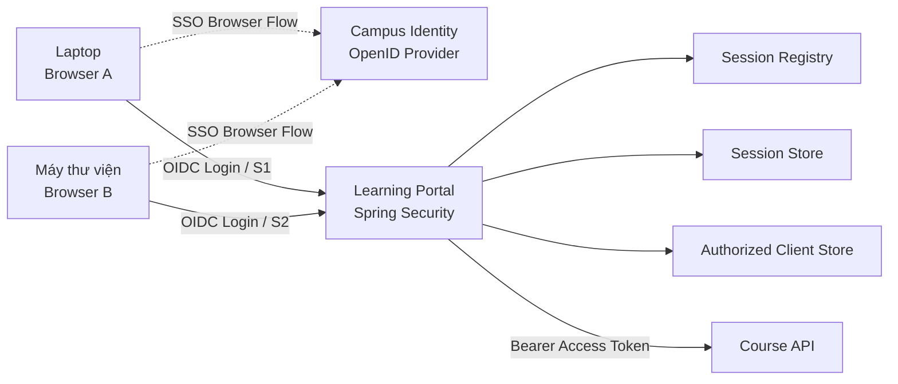
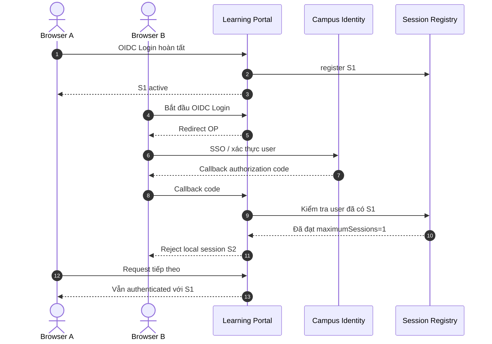
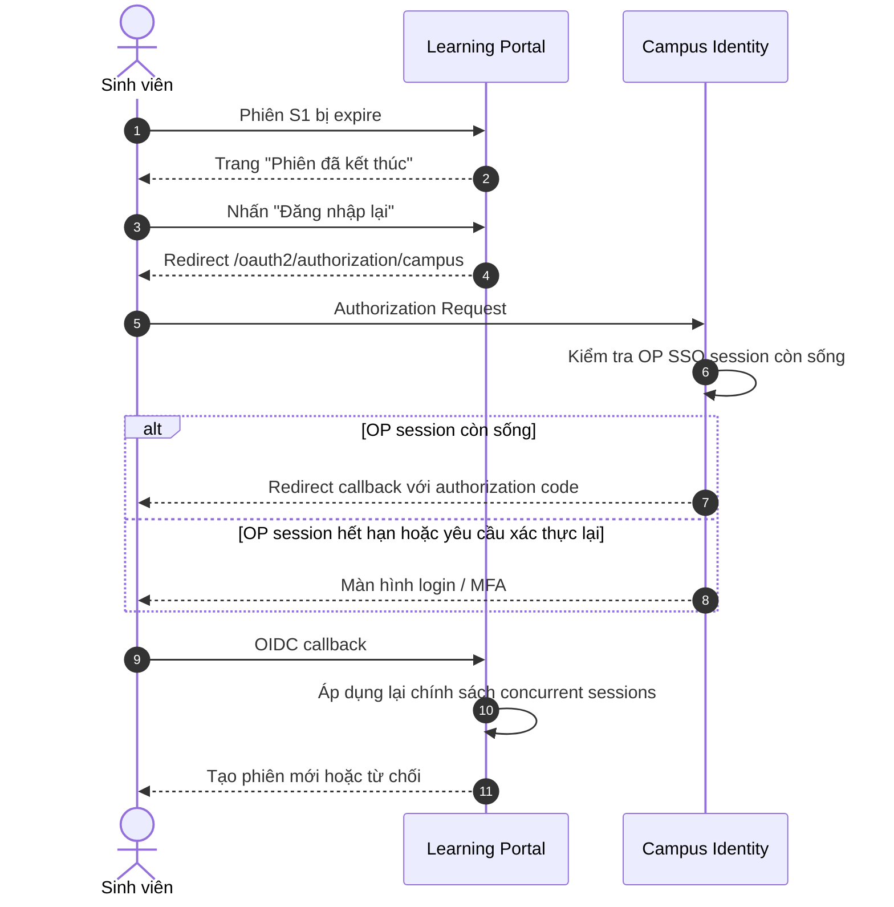

# 23.9. Giới hạn số phiên và xử lý đăng nhập lại

## Mục tiêu bài học

Sau bài này, bạn có thể:

- Giải thích **phiên đăng nhập (session)** là gì trong ứng dụng Spring Security OAuth 2.0/OIDC Client và phân biệt phiên của ứng dụng với phiên SSO ở OpenID Provider (OP).
- Phân biệt **giới hạn số phiên đồng thời** với thời gian timeout, chính sách nhớ đăng nhập, số thiết bị và thời hạn Access Token/Refresh Token.
- Cấu hình Spring Security **Servlet** để mỗi người dùng chỉ giữ một hoặc vài phiên bằng `maximumSessions(...)`, lựa chọn **hết hạn phiên cũ** hoặc **từ chối lần đăng nhập mới**.
- Hiểu vai trò của `SessionRegistry`, `SessionRegistryImpl`, `HttpSessionEventPublisher`, `ConcurrentSessionFilter` và chiến lược kiểm tra số phiên.
- Hiểu cách **WebFlux/Reactive** giới hạn phiên bằng `ReactiveSessionRegistry`, `SessionLimit`, `ServerMaximumSessionsExceededHandler` ở các phiên bản Spring Security hỗ trợ.
- Thiết kế UX cho trường hợp **đăng nhập lại trên thiết bị khác**, phiên bị thay thế, phiên tự hết hạn và OAuth2/OIDC callback thất bại.
- Giải thích vì sao **xóa session tại Relying Party không có nghĩa logout ở OP**, và vì sao OP còn SSO session có thể khiến lần “đăng nhập lại” gần như tức thì.
- Chọn cách xử lý `OAuth2AuthorizedClient` khi session bị hết hạn, bị vô hiệu hóa hoặc người dùng đăng xuất; hiểu khác biệt giữa token lưu trong session và token lưu trong service/database.
- Triển khai giới hạn phiên trong hệ thống nhiều instance với **Spring Session**, tránh nhầm lẫn khi registry chỉ sống trong một JVM.
- Xây dựng các trường hợp kiểm thử đăng nhập lần hai, refresh token, logout và concurrency mà không để lộ session ID, token hoặc client secret.

---

## 1. Bối cảnh: sinh viên đăng nhập ở hai nơi

Giả sử **Learning Portal** là ứng dụng Spring Boot sử dụng Campus Identity để đăng nhập qua OpenID Connect.

Buổi sáng:

```text
09:00
  Browser trên laptop đăng nhập Campus Identity
  -> Learning Portal tạo session S1
  -> Sinh viên xem khóa học
```

Đến trưa:

```text
12:00
  Browser trên máy tính thư viện đăng nhập cùng tài khoản
  -> Learning Portal tạo session S2
```

Nếu chính sách hệ thống chỉ cho phép **một phiên hoạt động trên mỗi người dùng**, phải chọn một trong hai cách xử lý:

1. **Ưu tiên đăng nhập mới:** cho S2 hoạt động và làm phiên S1 hết hiệu lực.
2. **Ưu tiên phiên đang hoạt động:** giữ S1 và **từ chối** tạo phiên đăng nhập S2.

Đây là bài toán **Concurrent Session Control** trong Spring Security, không phải một tính năng mặc định của OAuth2 Access Token.

> **Định nghĩa thực dụng:** giới hạn số phiên là chính sách áp dụng lên những **phiên đăng nhập cục bộ mà ứng dụng quản lý**. Nó không tự động giới hạn mọi ứng dụng khác dùng chung OP, không tự thu hồi token ở Authorization Server và cũng không luôn đồng nghĩa giới hạn số thiết bị vật lý.

### 1.1. Các thành phần trong bức tranh



`REG`, `STORE` và `TOK` có thể cùng nằm trong bộ nhớ ở môi trường nhỏ nhưng là **ba vai trò logic khác nhau**:

- **Session registry:** biết người dùng nào đang có những session nào để áp dụng giới hạn.
- **Session store:** lưu dữ liệu phiên web, `SecurityContext` và trạng thái theo framework.
- **Authorized-client store:** lưu OAuth2 Access Token/Refresh Token gắn với registration và principal.

Nếu chỉ xem một trong ba, rất dễ kết luận sai rằng “user đã logout hoàn toàn” hoặc “mọi token đã bị thu hồi”.

## 2. Phân biệt những vòng đời dễ nhầm

| Đối tượng | Tạo khi nào? | Dùng để làm gì? | Hết hạn/xóa có tác động gì? |
| --- | --- | --- | --- |
| **RP session** | Sau đăng nhập hợp lệ vào Learning Portal | Duy trì Authentication ở ứng dụng | User không còn phiên cục bộ đó |
| **OP/SSO session** | Khi Campus Identity xác thực user | Cho phép SSO giữa các ứng dụng | Có thể phải xác thực lại tại OP |
| **ID Token** | Trong OIDC authentication response | Thông tin xác thực user dành cho RP | Không đồng nghĩa RP session sẽ tự kết thúc đúng lúc ID Token hết hạn |
| **Access Token** | Khi Client được cấp quyền gọi API | Gửi đến Resource Server | API có thể từ chối token hết hạn/thu hồi |
| **Refresh Token** | Khi Authorization Server cấp theo chính sách | Xin Access Token mới | Mất hiệu lực thì có thể cần authorization lại |
| **Session cookie** | Browser nhận cookie như `JSESSIONID` hoặc `SESSION` | Mang định danh phiên đến RP | Mất cookie có thể khiến browser không tìm lại phiên |
| **SessionRegistry entry** | Khi cơ chế concurrent control ghi nhận session | Đếm/quản lý phiên theo principal | Entry cũ phải được dọn đúng để tránh chặn đăng nhập sai |

### 2.1. Session timeout khác số phiên tối đa

Ví dụ:

```text
maxSessions = 1
sessionTimeout = 30 phút không hoạt động
```

Giới hạn số phiên trả lời:

```text
Một user có thể giữ bao nhiêu phiên đăng nhập đồng thời?
```

Timeout trả lời:

```text
Một phiên không hoạt động bao lâu thì hết hạn?
```

Một session có thể bị đánh dấu hết hạn do **đăng nhập lần hai** dù nó mới được tạo vài giây trước. Ngược lại, một session có thể tự timeout khi không có đăng nhập nào khác.

### 2.2. Một thiết bị không bằng một session

Một laptop có thể mở:

- Hai tab cùng trình duyệt, thường dùng chung cookie/session.
- Hai browser khác nhau, có thể tạo hai session.
- Browser thường và cửa sổ private/incognito, có thể tạo các session khác.
- Nhiều browser profile với cookie tách biệt.

Do đó `maximumSessions(1)` là **một session tối đa**, không phải “một thiết bị vật lý tối đa” và cũng không phải “một tab tối đa”.

### 2.3. JWT Access Token không trở thành session chỉ vì có `sub`

Một API Resource Server xác thực bằng:

```http
Authorization: Bearer <access-token>
```

có thể chạy **stateless**. Nếu API không duy trì login session, `maximumSessions(...)` ở web application **không tự giới hạn số Bearer JWT đang lưu hành**.

Muốn giới hạn số phiên/token stateless, cần chính sách riêng tại Authorization Server, token store/introspection, revocation, token binding hoặc hệ thống tracking phù hợp. Không gắn SessionRegistry của RP rồi coi mọi Access Token đã được kiểm soát.

## 3. Hai chính sách khi vượt giới hạn

Giả sử giới hạn `1`.

### 3.1. Chính sách A — Đăng nhập mới thắng

```text
09:00 Browser A -> login -> S1 active
12:00 Browser B -> login -> S2 active
     Spring Security đánh dấu S1 expired
12:01 Browser A -> request tiếp theo -> không còn authenticated
     Browser B -> vẫn hoạt động
```

Cơ chế Servlet mặc định khi cấu hình `maximumSessions(1)` là **expire phiên hoạt động cũ**, thường ưu tiên phiên ít được sử dụng gần đây nhất.

Điều quan trọng: phiên S1 thường bị **đánh dấu expired** trong registry; việc kiểm tra và phản hồi của browser A xảy ra khi request của S1 đi qua filter kiểm tra tiếp theo. Đừng hiểu rằng server có thể lập tức xóa mọi dữ liệu đang hiển thị trên tab A mà không có request mới.

### 3.2. Chính sách B — Phiên cũ thắng

```text
09:00 Browser A -> login -> S1 active
12:00 Browser B -> OIDC login hoàn tất tại OP
     RP phát hiện giới hạn đã đạt
     RP từ chối tạo phiên authenticated S2
12:01 Browser A -> vẫn hoạt động
```

Ở Servlet DSL, lựa chọn này là:

```java
.maxSessionsPreventsLogin(true)
```

Không có nghĩa OP không xác thực được người dùng. OP có thể đã hoàn tất phần xác thực/SSO và trả authorization code, nhưng **Relying Party** từ chối cấp phiên cục bộ mới do chính sách.

### 3.3. Bảng so sánh

| Tiêu chí | Đăng nhập mới thắng | Phiên cũ thắng |
| --- | --- | --- |
| Browser A có S1 | S1 bị expire khi B đăng nhập | S1 giữ nguyên |
| Browser B xin S2 | Được tạo session | Bị từ chối khi vượt giới hạn |
| Trải nghiệm nếu quên logout ở máy cũ | Dễ tiếp tục dùng máy mới | Có thể bị khóa đến khi S1 timeout/logout |
| Nhu cầu hỗ trợ | Giải thích lý do A mất phiên | Có cách thu hồi phiên cũ an toàn |
| Rủi ro thiết kế | Nếu không có cảnh báo, A thấy bị đăng xuất bất ngờ | Người dùng có thể không tự thoát nếu mất thiết bị cũ |
| OP SSO session | Không tự mất | Không tự mất |
| Token revocation | Không tự bảo đảm | Không tự bảo đảm |

**Không có lựa chọn đúng cho mọi sản phẩm.** Ứng dụng ngân hàng, cổng học tập hoặc hệ thống quản trị có thể chọn chính sách khác nhau dựa trên threat model và trải nghiệm mong muốn.

## 4. Spring Security Servlet: kiến trúc Concurrent Session Control

Đối với Spring MVC/Servlet, các thành phần thường gặp:

| Thành phần | Trách nhiệm |
| --- | --- |
| `HttpSecurity` | Khai báo SecurityFilterChain và chính sách session |
| `SessionRegistry` | Liệt kê, ghi nhận và tra cứu session của principal |
| `SessionRegistryImpl` | Implementation in-memory mặc định trong nhiều cấu hình |
| `ConcurrentSessionControlAuthenticationStrategy` | Kiểm tra số phiên khi Authentication thành công |
| `RegisterSessionAuthenticationStrategy` | Đăng ký session mới trong registry |
| `ChangeSessionIdAuthenticationStrategy` | Chống session fixation khi authentication thành công |
| `CompositeSessionAuthenticationStrategy` | Ghép các chiến lược quản lý phiên |
| `ConcurrentSessionFilter` | Phát hiện session đã expired khi request tiếp theo tới |
| `SessionInformationExpiredStrategy` | Quyết định phản hồi cho session bị expire |
| `HttpSessionEventPublisher` | Chuyển sự kiện lifecycle session để registry được dọn |
| `OAuth2LoginAuthenticationFilter` | Xử lý callback OAuth2/OIDC Login trên Servlet |

Các tên trên mô tả **vai trò của hệ thống**; chi tiết wiring có thể thay đổi theo đời Spring Security. Đặc biệt từ Spring Security 6, các authentication mechanisms thường tự gọi `SessionAuthenticationStrategy` thay vì dựa mặc định vào `SessionManagementFilter` chạy mỗi request.

### 4.1. Tại sao SessionRegistry quan trọng?

Nếu user A có S1 và S2, ứng dụng cần biết:

```text
principal A -> [S1, S2]
```

Khi S3 được tạo, strategy so số session còn hoạt động với giới hạn để quyết định expire phiên cũ hay reject phiên mới.

Nếu registry chỉ nằm trên instance X trong khi user B login qua instance Y, Y có thể **không biết** S1 trên X đang tồn tại. Đây là lý do hệ thống nhiều node cần quan tâm đến shared session storage và registry nhất quán.

### 4.2. SessionInformation không tự là HTTP session

Một entry SessionRegistry có thể chứa:

```text
sessionId
principal
lastRequest
expiredFlag
```

Cơ chế liên quan phải dùng session ID để nhận diện session web. Việc gọi `SessionInformation.expireNow()` về bản chất **đánh dấu session expired trong registry**; không nên khẳng định nó đã lập tức gọi `HttpSession.invalidate()` cho mọi browser trước request kế tiếp.

## 5. Cấu hình Servlet: chỉ cho một phiên, đăng nhập mới thắng

Ví dụ Spring Security Servlet với OAuth2/OIDC Login:

```java
@Configuration
@EnableWebSecurity
class WebSecurityConfiguration {

    @Bean
    SecurityFilterChain securityFilterChain(HttpSecurity http)
            throws Exception {

        http
            .authorizeHttpRequests(auth -> auth
                .requestMatchers(
                    "/", "/error",
                    "/session/expired",
                    "/assets/**"
                ).permitAll()
                .anyRequest().authenticated()
            )
            .oauth2Login(Customizer.withDefaults())
            .sessionManagement(session -> session
                .sessionFixation(fixation ->
                    fixation.changeSessionId()
                )
                .maximumSessions(1)
                .expiredUrl("/session/expired")
            );

        return http.build();
    }

    @Bean
    HttpSessionEventPublisher httpSessionEventPublisher() {
        return new HttpSessionEventPublisher();
    }
}
```

Ví dụ hướng tới Spring Security Servlet hiện đại, có Spring MVC/OAuth2 Client starter và `ClientRegistration` hợp lệ. Các imports được lược bỏ để tập trung chính sách. Nếu ứng dụng đã có `HttpSessionEventPublisher` hoặc SecurityFilterChain tương ứng, không khai báo trùng.

Điểm cốt lõi:

```java
.maximumSessions(1)
```

nghĩa là **mỗi principal chỉ giữ tối đa một phiên** theo registry đang sử dụng.

```java
.expiredUrl("/session/expired")
```

chỉ định nơi browser có session **bị expire do concurrent session control** được chuyển đến khi request tiếp theo tới.

`/session/expired` phải có quyền truy cập không cần login, nếu không sẽ tạo redirect loop.

### 5.1. Session fixation protection không phải giới hạn phiên

```java
.sessionFixation(fixation -> fixation.changeSessionId())
```

được dùng để đổi session ID khi Authentication thành công, giảm session fixation risk. Đây là cơ chế **khác** với `maximumSessions`.

Trong Servlet 3.1+ các phiên bản Spring Security phổ biến đã có default session fixation protection; dòng trên giúp nêu rõ trách nhiệm, không phải bắt buộc cho mọi ứng dụng.

### 5.2. `HttpSessionEventPublisher` làm gì?

Bean:

```java
@Bean
HttpSessionEventPublisher httpSessionEventPublisher() {
    return new HttpSessionEventPublisher();
}
```

giúp Spring Security nhận biết sự kiện tạo/hủy HTTP session do container phát ra và cập nhật registry. Nếu session hết hạn ở container mà registry không được dọn đúng, ứng dụng có thể vẫn tưởng user đang giữ một session hoạt động.

Nếu tích hợp Spring Session, cần xem **cơ chế event và registry tương ứng của Spring Session**, tránh dùng nhiều cơ chế cập nhật state mâu thuẫn.

### 5.3. OIDC registration tối thiểu

Ví dụ `application.yml`:

```yaml
spring:
  security:
    oauth2:
      client:
        registration:
          campus:
            provider: campus
            client-id: ${CAMPUS_CLIENT_ID}
            client-secret: ${CAMPUS_CLIENT_SECRET}
            authorization-grant-type: authorization_code
            client-authentication-method: client_secret_basic
            redirect-uri: "{baseUrl}/login/oauth2/code/{registrationId}"
            scope:
              - openid
              - profile
              - email
              - courses.read
        provider:
          campus:
            issuer-uri: https://login.example.org/realms/campus
```

Đây là cấu hình OIDC Login, không phải configuration giới hạn session của OP.

### 5.4. Đường dẫn login/callback khác đường expired

```text
Bắt đầu OIDC Login:
  /oauth2/authorization/campus

Callback:
  /login/oauth2/code/campus

Trang session bị thay thế:
  /session/expired
```

Không cấu hình `/session/expired` thành redirect ngay lập tức tới `/oauth2/authorization/campus` nếu UX cần thông báo lý do bị đăng xuất; OP SSO vẫn có thể tồn tại và lần login lại ngay có thể khiến **phiên khác bị expire tiếp**.

## 6. Servlet: giữ phiên cũ và chặn đăng nhập mới

Nếu chính sách là một session hoạt động và người đăng nhập lần hai bị từ chối:

```java
@Bean
SecurityFilterChain securityFilterChain(HttpSecurity http)
        throws Exception {

    http
        .authorizeHttpRequests(auth -> auth
            .requestMatchers(
                "/", "/error", "/login",
                "/login/session-limit", "/assets/**"
            ).permitAll()
            .anyRequest().authenticated()
        )
        .oauth2Login(oauth2 -> oauth2
            .failureUrl("/login/session-limit")
        )
        .sessionManagement(session -> session
            .maximumSessions(1)
            .maxSessionsPreventsLogin(true)
        );

    return http.build();
}
```

`failureUrl(...)` trong ví dụ là chính sách UX minh họa. Trong ứng dụng thật, phải phân biệt **session-limit authentication failure** với các lỗi OIDC khác như `invalid_state`, `invalid_client` hoặc timeout Token Endpoint. Không nên gán cùng một thông báo “đã đăng nhập ở nơi khác” cho mọi lỗi OAuth2.

### 6.1. Quy tắc khi B đăng nhập



Một câu hỏi nghiệp vụ quan trọng: nếu sinh viên đã mất máy A thì có cách nào thu hồi S1?

Có thể cung cấp **quản lý phiên đăng nhập** sau khi xác thực bổ sung (step-up MFA/reauthentication ở OP), để người dùng chủ động chấm dứt phiên cũ, thay vì buộc chờ timeout.

### 6.2. Login bị từ chối ở RP không phải login bị từ chối ở OP

OP có thể đã xác thực user thành công, nhưng RP không tạo session mới. Đây là **từ chối phiên cục bộ**, không phải một khẳng định rằng credentials của user sai hoặc OP gặp lỗi.

Nếu giao diện viết “Sai mật khẩu” sẽ gây hiểu nhầm. Nên thông báo:

> Tài khoản đang có phiên hoạt động tại nơi khác. Hãy đăng xuất ở phiên cũ, chờ phiên hết hạn hoặc dùng tính năng quản lý phiên nếu được cung cấp.

Không hiển thị Session ID, IP đầy đủ, User-Agent fingerprint hay vị trí chính xác của phiên khác cho người dùng chưa được xác thực đầy đủ.

## 7. Trang thông báo phiên bị hết hạn

Một controller Servlet có thể trả trang đơn giản:

```java
@Controller
class SessionNoticeController {

    @GetMapping("/session/expired")
    String expired() {
        return "session-expired";
    }

    @GetMapping("/login/session-limit")
    String tooManySessions() {
        return "session-limit";
    }
}
```

Trang giao diện nên nêu rõ trường hợp:

```text
Phiên đăng nhập đã kết thúc vì tài khoản được đăng nhập
tại một trình duyệt hoặc thiết bị khác.

Bạn có thể đăng nhập lại nếu đây là hoạt động của mình.
Nếu không nhận ra hoạt động đó, hãy kiểm tra bảo mật tài khoản.
```

### 7.1. Không tự động đăng nhập lại vô hạn

Một thiết kế dễ gây vòng lặp:

```text
S1 expired
  -> /session/expired
    -> redirect trực tiếp OP
      -> OP còn SSO session
        -> tạo S3
          -> expire S2
            -> S2 lại redirect OP
```

Kết quả là hai browser có thể liên tục đá session của nhau.

Một cách tốt hơn:

- Trang hết phiên hiển thị **nguyên nhân và lựa chọn**.
- Người dùng nhấn nút đăng nhập lại có chủ đích.
- Ứng dụng xác định chính sách cho hai phiên tranh chấp.
- Nếu hoạt động bất thường, đưa lựa chọn bảo mật như đăng xuất các phiên khác hoặc liên hệ quản trị.
- Tránh tự redirect về OP liên tục trên mọi request 401 của frontend.

### 7.2. Phân biệt `expiredUrl` và `invalidSessionUrl`

- **`expiredUrl`**: URL được dùng cho session bị đánh dấu hết hạn bởi **Concurrent Session Control**.
- **`invalidSessionUrl`**: xử lý khi request mang một session ID không hợp lệ, ví dụ vì session đã timeout hoặc cookie cũ.

Hai tình huống này không đồng nhất. Trong những phiên bản Spring Security mới, `SessionManagementFilter` không được bật mặc định; một số hook cấu hình invalid session thuộc flow cũ có thể không hoạt động như dự kiến. Hãy đối chiếu version và test hành vi thay vì giả định cấu hình `invalidSessionUrl(...)` sẽ bắt mọi trường hợp.

### 7.3. Cookie cũ và redirect loop

Browser có thể tiếp tục gửi cookie session cũ sau session timeout. Nếu handler luôn chuyển vào `/login` và `/login` lại redirect về trang cần login mà không xử lý trạng thái cookie đúng, người dùng có thể gặp loop.

Cần kiểm tra:

- Đường public dành cho trang thông báo.
- Xóa cookie đúng tên/path/domain khi cần.
- Sử dụng quy trình session invalidation chuẩn.
- Không bỏ qua CSRF/cookie security để chữa loop.
- Phân biệt một redirect do missing authentication với redirect do session-expired logic.

## 8. OIDC SSO: RP session khác OP session

Với OIDC, có ít nhất hai hệ thống quản lý phiên:

```text
Browser
  | cookie cho learning.example.org
  v
Learning Portal (RP Session)

Browser
  | cookie khác cho login.example.org
  v
Campus Identity (OP Session)
```

Nếu RP expire S1, trình duyệt có thể vẫn còn phiên SSO ở Campus Identity. Khi user nhấn **Đăng nhập lại**, OP có thể cấp authorization code sau SSO mà **không cần nhập mật khẩu lần nữa**.

Đó không nhất thiết là lỗi Spring Security; nó là hành vi của SSO.

### 8.1. Sơ đồ logout và đăng nhập lại



**Quan trọng:** kiểm tra maximum sessions ở RP phải chạy **mỗi lần RP tạo phiên đăng nhập mới**, không chỉ khi OP yêu cầu user nhập mật khẩu.

### 8.2. Có nên tự động logout khỏi OP khi session cũ bị expire?

Không nhất thiết. Một người có thể đang dùng Campus Identity SSO cho nhiều hệ thống khác. Logout ở OP có thể kết thúc SSO của những ứng dụng liên quan, gây tác động rộng hơn mong đợi.

Nếu yêu cầu bảo mật cần chấm dứt OP session, hãy cân nhắc **OIDC RP-Initiated Logout** hoặc cơ chế OP hỗ trợ và thông báo tác động cho người dùng. Không gọi OP logout vô điều kiện cho mọi session-expired event chỉ để tiện UX.

### 8.3. `prompt=login`, `max_age` và đăng nhập lại

OIDC cho phép client yêu cầu cách xác thực:

```text
prompt=login
max_age=0
```

Những tham số có thể yêu cầu OP thực hiện lại xác thực theo đặc tả/chính sách OP, thay vì dựa thuần vào SSO session hiện có.

Tuy nhiên:

- Đây là **tham số cho một Authorization Request**, không phải flag tùy ý gắn lên mọi URL.
- Không dùng nó để bỏ qua kiểm tra giới hạn phiên RP.
- Cần cân nhắc MFA/step-up và UX.
- Không hứa rằng mọi OP sẽ có giao diện y hệt nhau; hành vi cụ thể phụ thuộc hợp đồng provider.
- Spring Security cần custom authorization request resolver/cấu hình theo phiên bản nếu muốn thêm tham số cho từng luồng.

### 8.4. Cần tránh “logout rồi login lại” tự động khi nghi ngờ chiếm đoạt tài khoản

Nếu phiên bị thay thế bất thường, một số sản phẩm nên dừng tại trang cảnh báo và yêu cầu user xác nhận, kiểm tra thiết bị hoặc thực hiện step-up authentication. Một redirect tự động đến OP có thể che giấu dấu hiệu có đăng nhập từ nơi khác.

## 9. Logout cục bộ, logout ở OP và token revocation

| Hành động | Tác động chính | Không tự bảo đảm |
| --- | --- | --- |
| `HttpSession.invalidate()` | Vô hiệu hóa một RP session | OP SSO session bị xóa |
| SessionRegistry đánh dấu expired | Phiên sẽ bị chặn khi được kiểm tra tiếp | Mọi Access Token đã bị thu hồi |
| Spring Security local logout | Xóa Authentication/SecurityContext và session theo cấu hình | Tất cả client registrations/token grants bị revoke ở OP |
| OIDC RP-Initiated Logout | Yêu cầu OP kết thúc OP session theo khả năng hỗ trợ | Mọi API Access Token tức thời vô hiệu hóa |
| Token Revocation Endpoint | Yêu cầu AS revoke token/grant theo chuẩn/chính sách | Browser/session của RP tự bị xóa |
| OIDC Back-Channel Logout | OP gửi Logout Token để RP chấm dứt những phiên liên quan | Mọi client khác trên internet bị logout nếu không được thông báo riêng |

### 9.1. Servlet: RP-Initiated Logout nếu OP hỗ trợ

Một ví dụ ở Spring Security Servlet:

```java
@Bean
SecurityFilterChain filterChain(
        HttpSecurity http,
        ClientRegistrationRepository registrations) throws Exception {

    OidcClientInitiatedLogoutSuccessHandler oidcLogout =
        new OidcClientInitiatedLogoutSuccessHandler(registrations);

    oidcLogout.setPostLogoutRedirectUri("{baseUrl}/logged-out");

    http
        .authorizeHttpRequests(auth -> auth
            .requestMatchers("/", "/logged-out").permitAll()
            .anyRequest().authenticated()
        )
        .oauth2Login(Customizer.withDefaults())
        .logout(logout -> logout
            .logoutSuccessHandler(oidcLogout)
        );

    return http.build();
}
```

Đoạn code **minh họa RP-initiated logout**, không phải lời khuyên gắn handler này vào mọi sự kiện `maximumSessions` vượt giới hạn.

OP phải hỗ trợ endpoint/tham số phù hợp. CSRF protection nên được giữ cho logout request; ở ứng dụng web mặc định, logout thay đổi trạng thái thường được thực hiện bằng POST.

### 9.2. OP Back-Channel Logout là cơ chế khác

OP có thể phát **Logout Token** đến RP để yêu cầu chấm dứt phiên theo `sid`/`sub` và các claim xác thực. Đây là **OIDC Back-Channel Logout** khi provider và Spring Security version hỗ trợ.

Nó có thể giúp đồng bộ khi người dùng logout tại OP hoặc OP thu hồi session. Nhưng không nên nhầm:

```text
RP concurrent-session limit
```

với:

```text
OP-issued Logout Token
```

Spring Security có các thành phần `OidcSessionRegistry`, `OidcBackChannelLogoutHandler` ở các phiên bản phù hợp; khi dùng Spring Session cookie tên `SESSION` thay `JSESSIONID`, cần xem cấu hình tương ứng của back-channel handler.

### 9.3. Tự xóa token ở client không làm Access Token trở nên vô hiệu trên API

Nếu Resource Server xác minh JWT offline và token chưa hết hạn, Access Token vẫn có thể được chấp nhận đến khi hết hạn hoặc đến khi cơ chế revocation/denylist của hệ thống tác động.

Do đó không viết trong tài liệu hoặc UI rằng “mọi Access Token đã được thu hồi” chỉ dựa trên việc RP xóa HTTP session.

## 10. Giới hạn session có ảnh hưởng gì đến OAuth2AuthorizedClient?

Spring Security OAuth2 Client quản lý `OAuth2AuthorizedClient` tách khỏi SessionRegistry.

Một authorized client có dạng:

```text
registrationId = campus
principalName  = student-7e04
accessToken    = AT1
refreshToken   = RT1
```

Nhưng **nơi lưu** phụ thuộc repository/service:

1. `HttpSessionOAuth2AuthorizedClientRepository`: lưu trong session Servlet.
2. `AuthenticatedPrincipalOAuth2AuthorizedClientRepository`: có thể dùng `OAuth2AuthorizedClientService` cho principal đã authenticated.
3. `JdbcOAuth2AuthorizedClientService`: lưu qua database, không tự phụ thuộc tuổi thọ session.
4. Tùy biến repository/service theo nghiệp vụ.

### 10.1. Token lưu theo HTTP session

```text
S1:
  SecurityContext A
  OAuth2AuthorizedClient A/campus -> AT1/RT1

S2:
  SecurityContext A
  OAuth2AuthorizedClient A/campus -> AT2/RT2
```

Nếu state chỉ nằm trong S1, việc session S1 bị invalidate có thể khiến authorized client đó không còn truy cập được.

Điều đó **không đồng nghĩa** RT1 đã được thu hồi ở OP.

### 10.2. Token lưu trong service/database

```text
DB:
  (registration=campus, principalName=A) -> AT2/RT2

Browser A Session S1 -> A
Browser B Session S2 -> A
```

Nếu S1 bị expire nhưng record DB còn, S2 hoặc một thành phần server khác có thể truy cập authorized client theo cùng principal key, tùy chính sách và quyền truy cập.

Đây là điểm rất quan trọng:

> **Giới hạn một RP session không tự bảo đảm một refresh token chỉ tồn tại trong đúng session đó** nếu authorized-client store đang sử dụng khóa theo principal và tách khỏi phiên.

Nếu yêu cầu “đăng nhập mới thu hồi mọi token của thiết bị cũ”, hệ thống cần thiết kế token binding/authorization persistence và revocation phù hợp, chứ không chỉ bật `maximumSessions(1)`.

### 10.3. Khi hai phiên dùng chung refresh token

Nếu một service store chia sẻ:

```text
A/campus -> AT1/RT1
```

hai browser có thể đồng thời refresh khi Access Token hết hạn. Refresh-token rotation có thể làm một request thành công RT2, request khác dùng RT1 bị `invalid_grant`.

Session limit có thể giảm số session song song, nhưng không hoàn toàn loại race vì:

- Request cũ có thể vẫn đang chạy lúc session bị expire.
- Có nhiều tab trong cùng session.
- Background jobs có thể dùng cùng principal/store.
- Có nhiều node hoặc retry đồng thời.

Cần concurrency control ở token store, ví dụ single-flight refresh, locking, compare-and-swap khi lưu/xóa state.

## 11. SessionRegistryImpl: vì sao “cùng một user” đôi khi lại không được nhận ra?

`SessionRegistryImpl` thường duy trì mapping từ **principal object** đến session IDs. Độ ổn định của equality/hash code của principal ảnh hưởng đến khả năng nhận diện các session cùng user.

Ví dụ một custom principal:

```java
public final class PortalUserPrincipal implements Serializable {
    private final String stableUserId;

    // equals() và hashCode() nên dựa trên identity ổn định,
    // không dựa trên Access Token, refresh token hoặc thời điểm login.
}
```

Nếu mỗi lần OIDC Login tạo principal khác nhau mà `equals()`/`hashCode()` không nhất quán, registry có thể xem cùng một người dùng như hai principal khác nhau, làm giới hạn phiên không hoạt động như mong muốn.

### 11.1. Không dùng email làm định danh bất biến vô điều kiện

Email có thể đổi, chưa được verified hoặc trùng trong những môi trường identity khác nhau.

Với OIDC, một khóa danh tính đáng tin cậy thường dựa trên:

```text
issuer + subject
```

Ví dụ:

```text
https://login.example.org/realms/campus
+
student-7e04
```

Hai OP có cùng `sub` string không nhất thiết là cùng người. Nếu tổ chức liên kết nhiều OP vào cùng tài khoản nội bộ, cần bảng mapping tin cậy và chính sách rõ ràng.

### 11.2. Không dùng Access Token trong equals/hashCode

Token có thể thay đổi sau refresh:

```text
AT1 -> AT2
```

Nếu equality của principal phụ thuộc token, SessionRegistry có thể khó tìm lại user khi token xoay, dù danh tính không thay đổi.

### 11.3. Tùy biến khóa nhận diện cần chính sách tenant

Một user nội bộ có thể thuộc nhiều tenant hoặc roles. Hãy quyết định giới hạn phiên được tính:

```text
trên toàn bộ tài khoản nội bộ
```

hay:

```text
riêng từng tenant/organization
```

và áp dụng thống nhất ở SessionRegistry, SSO mapping, logout, audit. Không dùng principal name tùy tiện do HTTP query parameter cung cấp làm identity key.

## 12. Hệ thống nhiều instance: SessionRegistry phải biết phiên ở mọi node

Một triển khai:

```text
         Load Balancer
          /        \
       Pod A       Pod B
       S1          S2
       Registry A  Registry B
```

Nếu mỗi pod có `SessionRegistryImpl` riêng, Pod B có thể không biết user đã có S1 trên Pod A. Vì vậy `maximumSessions(1)` có thể **không thực thi toàn cụm** như mong đợi.

### 12.1. Spring Session và shared session store

Spring Session có thể lưu HTTP session trong Redis hoặc database để chia sẻ giữa các node. Riêng Concurrent Session Control trên Servlet còn cần registry nhìn thấy các phiên qua cluster.

Một cách được Spring Session hỗ trợ là:

```java
SpringSessionBackedSessionRegistry<S>
```

với một `FindByIndexNameSessionRepository<S>` phù hợp.

Ví dụ cấu hình khái niệm trong Spring Security Servlet:

```java
@Bean
SpringSessionBackedSessionRegistry<? extends Session> sessionRegistry(
        FindByIndexNameSessionRepository<? extends Session> sessions) {

    // Cú pháp generic thực tế có thể cần một method type
    // khớp với bean repository do Spring Session cung cấp.
    return new SpringSessionBackedSessionRegistry(sessions);
}
```

Đoạn trên chỉ trình bày ý tưởng; để có ví dụ kiểu generic Java đơn giản hơn, thường khai báo:

```java
@Bean
<S extends Session> SpringSessionBackedSessionRegistry<S>
sessionRegistry(FindByIndexNameSessionRepository<S> sessions) {
    return new SpringSessionBackedSessionRegistry<>(sessions);
}
```

`Session` ở đây là `org.springframework.session.Session`, không phải Servlet `HttpSession` hoặc `SessionInformation`.

Sử dụng trong SecurityFilterChain:

```java
@Bean
SecurityFilterChain securityFilterChain(
        HttpSecurity http,
        SessionRegistry sessionRegistry) throws Exception {

    http
        .oauth2Login(Customizer.withDefaults())
        .sessionManagement(session -> session
            .maximumSessions(1)
            .sessionRegistry(sessionRegistry)
        );

    return http.build();
}
```

Đối với code thật, cần thêm `authorizeHttpRequests`, logout/CSRF/expired UX phù hợp và tất cả bean Spring Session tương ứng.

### 12.2. Lưu session tập trung không tự chứng minh mọi điều kiện đã atomic

Ngay cả khi registry và storage dùng chung, hai đăng nhập đến gần như đồng thời có thể tạo race nếu hệ thống custom chưa dùng locking/atomic limit enforcement.

Cần kiểm thử **multi-node concurrent login** thật, không chỉ chạy test một JVM. Ngoài ra:

- Session expiry events phải được xử lý và dọn registry.
- Distributed cache/database phải sẵn sàng.
- Index principal/session phải đúng.
- Principal equality và serialization phải ổn định.
- Logout/invalidate từ node A phải được quan sát đúng ở node B.
- Không xem sticky session là thay thế hoàn toàn cho shared registry khi yêu cầu bảo đảm toàn cụm.

### 12.3. SpringSessionBackedSessionRegistry có giới hạn

Implementation Spring Session có thể không hỗ trợ đầy đủ `getAllPrincipals()` như `SessionRegistryImpl`, tùy hợp đồng của store. Không thiết kế dashboard admin dựa vào việc liệt kê mọi principal qua API đó mà không kiểm tra khả năng thực tế.

## 13. WebFlux Reactive: hỗ trợ giới hạn phiên bằng DSL riêng

Spring Security Reactive có cơ chế concurrent session control từ **dòng 6.3 trở đi**. Ở các phiên bản hỗ trợ, cấu hình dùng:

```java
SecurityWebFilterChain
ServerHttpSecurity
ReactiveSessionRegistry
SessionLimit
```

không dùng `SessionRegistryImpl`/`HttpSessionEventPublisher` của Servlet.

Một ví dụ WebFlux:

```java
@Configuration
@EnableWebFluxSecurity
class ReactiveSecurityConfiguration {

    @Bean
    SecurityWebFilterChain securityWebFilterChain(
            ServerHttpSecurity http) {

        return http
            .authorizeExchange(exchanges -> exchanges
                .pathMatchers(
                    "/", "/error", "/session/expired"
                ).permitAll()
                .anyExchange().authenticated()
            )
            .oauth2Login(Customizer.withDefaults())
            .sessionManagement(sessions -> sessions
                .concurrentSessions(concurrency -> concurrency
                    .maximumSessions(SessionLimit.of(1))
                )
            )
            .build();
    }

    @Bean
    ReactiveSessionRegistry reactiveSessionRegistry() {
        return new InMemoryReactiveSessionRegistry();
    }
}
```

Điểm cần nắm:

- `SessionLimit.of(1)` áp dụng giới hạn một phiên cho user.
- `InMemoryReactiveSessionRegistry` **không được chia sẻ giữa nhiều instance**.
- Cơ chế tích hợp với **authentication success** ở WebFlux.
- Mặc định khi vượt giới hạn, một hoặc nhiều phiên ít hoạt động gần đây có thể bị expire/invalidate.

Import/package cụ thể phải theo phiên bản Spring Security đang dùng; không trộn classes của `org.springframework.security.web.server` với Servlet session strategy.

### 13.1. Giới hạn động theo Authentication

Một số user có thể được phép có hai phiên, còn user thường một phiên:

```java
private SessionLimit maxSessions() {
    return authentication -> {
        boolean admin = authentication.getAuthorities().stream()
            .anyMatch(authority ->
                authority.getAuthority().equals("ROLE_ADMIN")
            );

        return Mono.just(admin ? 2 : 1);
    };
}
```

Gắn vào DSL:

```java
.sessionManagement(sessions -> sessions
    .concurrentSessions(concurrency -> concurrency
        .maximumSessions(maxSessions())
    )
)
```

Khi cần không giới hạn phiên cho một nhóm theo policy, có thể dùng `SessionLimit.UNLIMITED` hoặc một `SessionLimit` trả `Mono.empty()` theo API Reactive.

**Không** đọc raw client-provided role từ query string để quyết định limit; Authentication và authorities phải được xác thực theo chính sách.

### 13.2. Từ chối đăng nhập mới trong WebFlux

Đối với WebFlux, cần thay chiến lược vượt giới hạn:

```java
.sessionManagement(sessions -> sessions
    .concurrentSessions(concurrency -> concurrency
        .maximumSessions(SessionLimit.of(1))
        .maximumSessionsExceededHandler(
            new PreventLoginServerMaximumSessionsExceededHandler()
        )
    )
)
```

`PreventLoginServerMaximumSessionsExceededHandler` phát lỗi khi user đã đạt giới hạn, thay vì expire phiên ít hoạt động. Tùy login mechanism, cần cấu hình UX/authentication failure handling tương ứng.

**Lưu ý phiên bản:** tên class chính xác gồm chữ `Server` (`PreventLoginServerMaximumSessionsExceededHandler`), thuộc package `org.springframework.security.web.server.authentication`. Một số ví dụ web documentation dùng tên rút gọn không khớp Javadoc; kiểm tra class từ version thực tế khi copy.

### 13.3. WebFlux và custom authentication success handler

Reactive concurrent session control được gắn vào các success handlers của authentication mechanism, bao gồm OAuth2 Login trong cấu hình hỗ trợ. Nếu ứng dụng thay **toàn bộ** `ServerAuthenticationSuccessHandler` của OAuth2 Login/Form Login, có thể làm mất việc đăng ký/kiểm tra session của concurrent-control mechanism.

Một bộ xử lý WebFlux có các thành phần:

```text
ConcurrentSessionControlServerAuthenticationSuccessHandler
RegisterSessionServerAuthenticationSuccessHandler
```

Khi thêm success behavior tùy biến, cần **kết hợp với các handler mặc định** thay vì thay thế không điều kiện. Phải kiểm thử đăng nhập lần hai sau mỗi thay đổi success handler.

### 13.4. ReactiveSessionRegistry và Spring Session

Đối với hệ thống WebFlux nhiều instance, `InMemoryReactiveSessionRegistry` chỉ là ví dụ cho một JVM. Spring Session ở các phiên bản tương ứng có thể cung cấp:

```java
SpringSessionBackedReactiveSessionRegistry
```

dựa trên `ReactiveSessionRepository`/`ReactiveFindByIndexNameSessionRepository`, khi hạ tầng hỗ trợ.

Đừng dùng `SpringSessionBackedSessionRegistry` của Servlet thay cho Reactive registry. Cần kiểm tra API và dependency version, đặc biệt khi triển khai Redis/R2DBC session store và khả năng index theo principal.

## 14. Giới hạn phiên khi OAuth2 Login có `state`, `nonce` và PKCE

OIDC Authorization Code Flow có các dữ liệu ràng buộc giao dịch:

```text
state
nonce
PKCE code_verifier / code_challenge
OAuth2AuthorizationRequest
```

Một số cơ chế lưu authorization request tạm trong HTTP session hoặc WebSession.

Giả sử browser A bắt đầu login:

```text
1. RP tạo authorization request + state
2. Browser redirect OP
3. Session tạm bị xóa/timeout giữa chừng
4. OP redirect callback code + state
5. RP không còn state để đối chiếu
```

Login có thể thất bại dù Client ID/secret đúng, vì giao dịch không còn được liên kết an toàn.

### 14.1. Không bỏ qua `state` để chữa lỗi callback

Nếu lỗi:

```text
authorization_request_not_found
invalid_state
```

hãy kiểm tra:

- Session/cookie sống qua redirect OP hay không.
- Cookie `SameSite`, `Secure`, `Path`, reverse proxy scheme.
- Lưu authorization request có nhất quán giữa các node không.
- Thời gian chờ callback và timeout.
- Có cơ chế xóa session cũ tại thời điểm login không.

Không tắt state/nonce validation để cho callback cũ “đăng nhập được”.

### 14.2. Session fixation khi login

Sau một lần OIDC Login thành công, Spring Security có cơ chế chống session fixation theo stack/phiên bản. Nếu ứng dụng tự viết filter tạo session, phải bảo đảm strategy liên quan được gọi đúng; nếu không có thể xảy ra việc session ID cũ được giữ sau authentication.

Một thay đổi session ID do fixation protection **không phải** hành vi “người dùng vừa mở thêm một session trên thiết bị khác”. Registry cần theo dõi lifecycle một cách nhất quán.

### 14.3. Multiple tabs ở cùng browser

Hai tab cùng dùng session cookie:

```text
Tab 1: request /oauth2/authorization/campus
Tab 2: request /oauth2/authorization/campus
```

Nếu đồng thời tạo nhiều authorization requests, repository cần ràng buộc `state` đúng từng flow. Một login callback không được chấp nhận nếu state khác hoặc đã bị xóa.

`maximumSessions(1)` không phải cơ chế giải quyết multi-tab authorization-state races; đó là một vấn đề riêng của OAuth2 authorization request repository/cookies.

## 15. Khi người dùng “đăng nhập lại” ngay trên cùng trình duyệt

Một yêu cầu thường gặp:

> User đang có session S1, muốn xác thực lại để đổi tài khoản hoặc làm thao tác nhạy cảm.

Có ít nhất ba tình huống:

1. **Re-login cùng user** trong cùng browser session.
2. **Switch account** sang user khác.
3. **Step-up authentication** như MFA hoặc `max_age=0` nhưng không nhất thiết muốn tạo phiên cục bộ thứ hai.

Không thể chỉ dựa vào `maximumSessions` để phân biệt chúng. Một re-login cùng browser có thể làm thay đổi session ID vì fixation strategy, còn step-up có thể sử dụng Authentication hiện có và chính sách mới.

### 15.1. Đổi tài khoản đăng nhập

Một ứng dụng có nút “Đăng nhập bằng tài khoản khác” nên chủ động xử lý phiên cục bộ hiện tại, rồi thực hiện luồng OIDC mới. Nếu OP SSO vẫn giữ tài khoản cũ, có thể cần account chooser hoặc prompt phù hợp do OP hỗ trợ.

Không dùng lại token/authorized client của user A sau khi SecurityContext đã chuyển sang user B.

### 15.2. Tái xác thực khi cần quyền cao hơn

Nếu người dùng làm tác vụ nhạy cảm, `maximumSessions(1)` không thay thế kiểm tra:

```text
auth_time
acr / amr
max_age
MFA status
```

OIDC có thể giúp diễn đạt yêu cầu recent authentication, nhưng phải cấu hình/validate theo contract OP. Tạo một local session mới không chứng minh người dùng vừa hoàn tất MFA.

## 16. Các yêu cầu bảo mật khi phiên bị thay thế

Nếu browser A bất ngờ nhận thông báo phiên đã bị thay thế, có thể là:

- Người dùng tự login trên browser khác.
- Một browser session cũ bị restore/reused.
- Session registry bị stale hoặc principal key không ổn định.
- Có người khác đã đăng nhập bằng tài khoản bị lộ credentials/SSO.
- Có lỗi đồng bộ session giữa các pod.

**Không được khẳng định ngay có xâm nhập** chỉ dựa vào một event. Nhưng UX nên hỗ trợ người dùng hành động an toàn:

- Xem thông báo rõ, không lộ thông tin nhạy cảm của session còn lại.
- Có đường vào hỗ trợ hoặc quản lý phiên sau xác thực mạnh.
- Có thể đổi mật khẩu/MFA/revoke OP sessions khi tình huống yêu cầu.
- Không đưa session ID, refresh token hoặc client secret vào thông báo.
- Cảnh báo user nếu hoạt động không do họ thực hiện.

### 16.1. Những việc session limit không thay thế

Session limit **không thay thế**:

```text
MFA / passkeys
CSRF protection
Session fixation protection
Secure + HttpOnly cookies
Rate limiting đăng nhập
Token validation
Access token audience/scope checks
Refresh token rotation management
Device risk detection
OP-side session policy
```

Một RP session bị expire không khiến một Access Token đã bị đánh cắp tự hết hạn ngay nếu token còn được Resource Server chấp nhận.

### 16.2. Giữ CSRF protection cho logout

Với browser-based RP session, logout là thao tác thay đổi trạng thái. Không nên biến `GET /logout?user=...` thành endpoint công khai xóa session của người khác.

Thường dùng POST kèm CSRF token/defense theo stack, và bảo vệ endpoint quản lý phiên bằng Authentication + authorization phù hợp.

## 17. “Đăng xuất các phiên khác” cần thiết kế riêng

Có trường hợp người dùng muốn đăng nhập vào browser B nhưng vẫn giữ chính sách một session. Có thể cung cấp tính năng:

```text
Xác minh lại danh tính
  -> Liệt kê các session của chính tài khoản
    -> Chọn vô hiệu hóa session khác
      -> Tạo/giữ session hiện tại
```

Để làm an toàn:

1. Xác thực user và có thể yêu cầu step-up MFA.
2. Chỉ cho phép xem/chấm dứt session thuộc tài khoản đã xác minh.
3. Không nhận arbitrary principal name từ client rồi thao tác session đó.
4. Áp dụng audit, rate limit và kiểm soát race.
5. Nếu token lưu ngoài session, áp dụng thêm chính sách xóa/revoke grants phù hợp.
6. Khi triển khai nhiều node, phải thao tác shared session registry/store.
7. Có UX phòng chống tự khóa tất cả các session khi user không còn phương thức đăng nhập.

### 17.1. Servlet: ý tưởng SessionRegistry

Có thể tra cứu session theo principal:

```java
List<SessionInformation> sessions =
    sessionRegistry.getAllSessions(principal, false);
```

Đối với session cần expire:

```java
sessionInformation.expireNow();
```

Tuy nhiên, các lệnh trên **không tự tạo một workflow "logout mọi thiết bị" hoàn chỉnh**. Việc lấy đúng principal object, cập nhật registry/shared store, session invalidation thực tế, quyền người gọi và sự kiện cleanup đều cần được thiết kế.

Không expose một endpoint:

```java
@GetMapping("/expire-all")
```

nhận `username` bất kỳ và gọi `expireNow()` mà không có xác thực/authorization.

### 17.2. Reactive: thao tác thông qua ReactiveSessionRegistry

Trong WebFlux, `ReactiveSessionRegistry` có thể được dùng để lấy các session của user, invalidate và xóa khỏi `WebSessionStore` theo mô hình reactive.

Ví dụ cấu trúc:

```java
public Mono<Void> invalidateSessions(String username) {
    return reactiveSessionRegistry.getAllSessions(username)
        .flatMap(session ->
            session.invalidate().thenReturn(session)
        )
        .flatMap(session ->
            webSessionStore.removeSession(session.getSessionId())
        )
        .then();
}
```

Đây là ví dụ về **service nội bộ đã được phân quyền**, không phải HTTP endpoint cho phép người dùng gửi tùy ý `username`. Dữ liệu principal name cần được lấy từ identity đáng tin cậy, không lấy trực tiếp từ query param chưa được kiểm soát.

## 18. Kiểm thử Servlet: đăng nhập lần hai thay thế lần đầu

Một test cấu hình `maximumSessions(1)` có thể dùng `MockMvc` và Spring Security Test. Với form login, test ngắn:

```java
@SpringBootTest
@AutoConfigureMockMvc
class ConcurrentSessionTests {

    @Autowired
    MockMvc mvc;

    @Test
    void secondLoginExpiresFirstSession() throws Exception {

        MvcResult first = mvc.perform(
                formLogin().user("student").password("password")
            )
            .andExpect(authenticated())
            .andReturn();

        MockHttpSession firstSession =
            (MockHttpSession) first.getRequest().getSession();

        mvc.perform(get("/private").session(firstSession))
            .andExpect(authenticated());

        mvc.perform(
                formLogin().user("student").password("password")
            )
            .andExpect(authenticated());

        mvc.perform(get("/private").session(firstSession))
            .andExpect(unauthenticated());
    }
}
```

Đây là bài test mô hình cơ chế session cho **form login**, không chứng minh toàn bộ OIDC Authorization Code Flow đã được kiểm thử. Nếu ứng dụng chỉ dùng OAuth2 Login và không bật form login, hãy chuyển sang integration test OIDC provider/test fixture phù hợp.

### 18.1. Với OIDC Login cần test flow thật

Một test đầy đủ nên dựng:

```text
Browser A:
  authorization request
  callback code/state
  valid ID Token
  session S1 created

Browser B:
  authorization request
  callback code/state
  same stable OIDC identity
  session S2 created/rejected

Check:
  S1/S2 state theo policy
```

`oauth2Login()` trong `MockMvc` Spring Security Test giúp mô phỏng Authentication ở mức test nhưng **không mặc nhiên chạy toàn bộ browser redirect, token exchange, ID Token verification và session strategy như production**. Cần integration tests có OP giả/được kiểm soát cho yêu cầu quan trọng.

### 18.2. Test chính sách ngăn login mới

Với `maxSessionsPreventsLogin(true)`:

```text
Given:
  S1 đã login
When:
  browser B login cùng principal
Then:
  B không có authenticated session
  S1 vẫn authenticated
```

Test phải kiểm tra **cả hai browser**, vì chỉ assert B bị reject chưa chứng minh S1 không bị expire nhầm.

### 18.3. Test trang expired

Với chính sách đăng nhập mới thắng:

```text
Given S1 active
When S2 thành công
Then S1 request tiếp theo:
  không còn access protected content
  được phản hồi/redirect đến trang expired phù hợp
```

Trang `/session/expired` phải public. Không cho request với S1 expired tiếp tục lấy protected data vì một controller sử dụng cache hoặc `SecurityContext` stale.

## 19. Kiểm thử WebFlux

Nếu ứng dụng dùng WebFlux, cần `WebTestClient` hoặc integration test tương ứng để kiểm tra reactive session semantics.

Các case:

| Case | Kỳ vọng |
| --- | --- |
| User A login S1, user A login S2, limit 1 | S1 bị invalidate/expired theo default |
| `PreventLoginServerMaximumSessionsExceededHandler` | S2 bị từ chối, S1 còn active |
| Hai OIDC users khác nhau | Không ảnh hưởng session của nhau |
| Same `sub` nhưng issuer khác | Không trộn identity khi không có link tài khoản tin cậy |
| Custom `ServerAuthenticationSuccessHandler` | Không vô tình tắt concurrent control |
| WebSession timeout | Registry được dọn theo lifecycle |
| OP SSO vẫn tồn tại | RP re-login có thể không yêu cầu nhập mật khẩu |
| InMemoryReactiveSessionRegistry nhiều pod | Không coi đã giới hạn toàn cụm |
| Shared reactive registry | Invalidation visible qua mọi node |
| Session bị expire | Không tiếp tục dùng authorized client của session bị chặn |

### 19.1. Test mock OIDC principal có giới hạn

`SecurityMockServerConfigurers.mockOidcLogin()` rất hữu ích để test controller và security authorization. Nhưng nó **không thay thế** việc kiểm thử OAuth2 Login callback, đăng ký `ReactiveSessionRegistry`, giới hạn phiên khi authentication success thực tế và OP SSO logout.

### 19.2. Test khi OP vẫn có SSO cookie

Có thể mô phỏng:

```text
Browser B hoàn tất RP Logout
Browser B truy cập /oauth2/authorization/campus
OP SSO vẫn tồn tại
OP trả callback nhanh không cần nhập mật khẩu
```

Kỳ vọng: RP áp dụng lại session limit; không tạo vòng redirect vô hạn khi A/B đăng nhập luân phiên.

## 20. API/frontend: trả 401 hay redirect?

Một trang HTML truyền thống có thể redirect user đến trang đăng nhập khi session hết. Nhưng một SPA hoặc JavaScript gọi:

```http
GET /api/my-courses
Accept: application/json
```

nếu nhận `302` đến OP, HTTP client có thể follow redirect và thấy HTML login thay vì JSON, hoặc gặp CORS.

Hãy phân biệt chính sách:

| Đường truy cập | Phản hồi khi phiên không hợp lệ |
| --- | --- |
| Browser navigation tới trang web | Redirect login/expired page với UX rõ ràng |
| API/XHR/fetch | HTTP 401 hoặc error JSON có code nội bộ |
| API thiếu quyền dù đã authenticated | HTTP 403 |
| OIDC login callback lỗi | Hiển thị authentication error có thể phục hồi |
| Session do concurrent control expire | Có thể trả mã ứng dụng `SESSION_REPLACED` nhưng không lộ thông tin người khác |

Một error JSON minh họa:

```json
{
  "error": "SESSION_EXPIRED",
  "message": "Phiên đăng nhập không còn hợp lệ.",
  "loginUrl": "/oauth2/authorization/campus"
}
```

Đây là hợp đồng **ứng dụng tự định nghĩa**, không phải OAuth2 error response chuẩn. Không trả Access Token hoặc Session ID trong JSON.

### 20.1. Tránh vòng lặp refresh API

Frontend có thể triển khai:

```text
401 -> cố làm mới giao diện một lần / hiển thị login
```

Không nên:

```text
401 -> tự redirect login liên tục
     -> OP SSO auto-login
     -> RP lại expire session
     -> 401 -> lặp vô hạn
```

Nên có điều khiển số lần retry và thông báo để user chọn hành động.

### 20.2. Không phân biệt mọi 401 bằng một logic

Một 401 từ **Course API Resource Server** có thể do Access Token sai/hết hạn; trong khi 401 từ **Learning Portal** có thể do browser session mất hiệu lực.

Nếu proxy qua backend/BFF, cần map lỗi cho frontend theo đúng nguồn để không tự logout toàn bộ RP session chỉ vì một Token Endpoint hoặc Resource Server gặp sự cố tạm thời.

## 21. Những lỗi phổ biến và hướng xử lý

| Hiện tượng | Nguyên nhân có thể | Cách xử lý |
| --- | --- | --- |
| `maximumSessions(1)` không chặn phiên mới | Registry không nhất quán, principal equality sai, filter custom | Kiểm tra `SessionRegistry`, authentication strategy, principal mapping |
| User logout rồi vẫn bị coi là có phiên | Session destroy event không đến registry | Kiểm tra `HttpSessionEventPublisher` và session lifecycle |
| S1 chưa mất ngay khi S2 login | S1 được mark expired, chờ request tiếp theo | Test request của S1 qua concurrent session filter |
| Bị logout liên tục giữa hai browser | Chính sách đăng nhập mới thắng và auto-login | Thiết kế trang expired, tránh tự redirect OP |
| Bị từ chối login dù máy cũ đã đóng | Session S1 chưa timeout hoặc registry còn stale | Cleanup session, provide secure session management |
| OIDC Login thành công tại OP nhưng RP báo lỗi | `maxSessionsPreventsLogin(true)` tại RP | UX phân biệt concurrency với sai credentials |
| OP không hỏi mật khẩu khi RP đã logout | OP SSO session vẫn sống | Thiết kế RP-Initiated Logout hoặc reauth theo nhu cầu |
| `invalid_state` khi callback | OAuth2 authorization request session mất | Kiểm tra session/cookie/timeout/multi-node |
| Cùng user có nhiều phiên ở hai pod | In-memory registry riêng | Shared session registry và integration |
| Cookie hết hạn nhưng redirect loop | Invalid session handling/expired handler sai | Public expired route và cookie clearing phù hợp |
| Mất token trong session khi phiên hết hạn | Authorized client lưu theo session | Thiết kế vòng đời token/re-authorization |
| DB vẫn có refresh token sau logout | Authorized client service tách khỏi session | Cleanup/revocation policy |
| API vẫn chấp nhận Access Token sau RP logout | JWT token chưa bị revoke | Định nghĩa Token Revocation/RS validation policy |
| Browser A và B cùng refresh RT1 | Shared token store và rotation race | Single-flight/locking/CAS |
| Session limit “mỗi user” không áp dụng OIDC | Custom principal equality hoặc authentication success strategy | Kiểm tra principal & OIDC integration |
| WebFlux không có class SessionLimit | Spring Security quá cũ hoặc sai imports | Dùng version Reactive hỗ trợ concurrent sessions |
| WebFlux custom success handler bỏ qua session registry | Handler thay toàn bộ built-in handler list | Kết hợp các handlers cần thiết |
| Session timeout quá dài | Registry thấy phiên cũ dù user bỏ thiết bị | Chính sách inactivity timeout phù hợp |
| Session timeout quá ngắn | User phải login liên tục | Cân đối UX/bảo mật, không kéo dài refresh token tùy tiện |
| Thao tác expire-all xóa token user khác | Endpoint không kiểm tra ownership | Yêu cầu xác thực mạnh và authorization |
| Nhiều tab dùng chung một session | Không phải bug `maximumSessions` | Giải thích session khác thiết bị/tab |
| Form login test pass nhưng OIDC test fail | Hai authentication flows khác nhau | Test OIDC callback và OP SSO riêng |

### 21.1. Quy trình chẩn đoán theo lớp

1. **Stack:** Servlet hay WebFlux? Spring Security version?
2. **Authentication:** `oauth2Login()` đã tạo Authentication đúng principal chưa?
3. **Identity:** cùng user có thực sự cùng identity key không?
4. **Session Registry:** đếm được bao nhiêu session và ở những node nào?
5. **Session Store:** session cũ đã expire/invalidate/timeout chưa?
6. **Concurrency Policy:** đăng nhập mới thắng hay chặn đăng nhập mới?
7. **User Experience:** `expiredUrl`/failure handler có tạo redirect loop không?
8. **OIDC:** OP còn SSO session? Callback state/nonce có đúng không?
9. **Authorized Client Store:** token nằm trong session hay database theo principal?
10. **Security:** cleanup/revocation, CSRF, cookie flags và logging đã phù hợp chưa?

Không chữa lỗi giới hạn session bằng cách tắt OIDC `state`/`nonce` hoặc JWT token validation.

## 22. Lựa chọn chính sách theo nghiệp vụ

Giả sử tổ chức có các yêu cầu:

| Nghiệp vụ | Chính sách có thể cân nhắc | Cần chú ý |
| --- | --- | --- |
| Cổng học tập phổ thông | 1–3 session, cho login mới thắng | UX khi học trên nhiều thiết bị |
| Thi cử/đánh giá trực tuyến | Một phiên đang hoạt động và workflow chuyển phiên rõ ràng | Không nhầm session với chống gian lận/thiết bị |
| Hệ thống quản trị nhạy cảm | Giới hạn chặt, MFA, cảnh báo đăng nhập mới | Admin cần recovery khi mất thiết bị |
| Hỗ trợ kỹ thuật | Một vài phiên tùy role | Không dùng roles từ claim chưa xác minh |
| Shared lab/kiosk | Timeout ngắn, logout/clear browser sau ca dùng | OP SSO cookie cũng cần quản lý |
| API server-to-server | Session limit ở RP thường không liên quan | Dùng client_credentials/token policy riêng |

Đừng xem `maximumSessions(1)` là một biện pháp chống chia sẻ tài khoản hoàn chỉnh. Các hệ thống có thể cần device registration, attestation, risk scoring, user education, audit và chính sách bảo mật khác — nhưng các cơ chế ấy phải tôn trọng quyền riêng tư và được thiết kế riêng.

## 23. Bài tập thực hành

### Bài tập 1 — Đăng nhập mới thắng

**Bài toán:** Giới hạn một session. User có S1 rồi login ở browser B.

**Câu hỏi:** S1 và S2 ra sao với mặc định Concurrent Session Control?

**Đáp án:** S2 được phép login, S1 bị đánh dấu expired; request tiếp theo của S1 bị xử lý theo expired-session strategy.

### Bài tập 2 — Giữ phiên cũ

**Bài toán:** Không muốn một login mới đá browser đang hoạt động.

**Đáp án Servlet:**

```java
.sessionManagement(session -> session
    .maximumSessions(1)
    .maxSessionsPreventsLogin(true)
)
```

Cần UX đăng nhập thất bại và cách thu hồi phiên cũ khi user không còn dùng được thiết bị.

### Bài tập 3 — Nêu vai trò HttpSessionEventPublisher

**Đáp án:** chuyển session lifecycle events để registry có thể cập nhật/dọn state, tránh tính session đã hủy là còn hoạt động.

### Bài tập 4 — Hai tabs trên cùng Chrome

**Câu hỏi:** Một user mở hai tab trong cùng browser, session limit một. Có phải hai session?

**Đáp án:** Thường không; nếu hai tab chia sẻ cùng session cookie, đó vẫn là một session.

### Bài tập 5 — RP logout nhưng OP còn SSO

**Câu hỏi:** Vì sao click “Đăng nhập lại” không bị hỏi mật khẩu?

**Đáp án:** OP vẫn có SSO session. RP session timeout/logout không tự xóa OP session.

### Bài tập 6 — WebFlux một phiên

**Đáp án gợi ý:**

```java
.sessionManagement(sessions -> sessions
    .concurrentSessions(concurrency -> concurrency
        .maximumSessions(SessionLimit.of(1))
    )
)
```

Cần `ReactiveSessionRegistry` phù hợp; ví dụ nhỏ có `InMemoryReactiveSessionRegistry`.

### Bài tập 7 — WebFlux chặn login mới

**Đáp án gợi ý:**

```java
.maximumSessionsExceededHandler(
    new PreventLoginServerMaximumSessionsExceededHandler()
)
```

Đặt trong concurrentSessions configuration, và xử lý lỗi Authentication cho đúng UX.

### Bài tập 8 — Hai pod

**Bài toán:** Pod A có S1, Pod B có S2, cả hai registry in-memory. Vì sao không giới hạn đúng một session?

**Đáp án:** Mỗi node chỉ thấy state của chính mình. Cần shared registry/session storage và kiểm thử toàn cụm.

### Bài tập 9 — Token vẫn ở database sau logout

**Câu hỏi:** `maximumSessions(1)` có tự xóa `JdbcOAuth2AuthorizedClientService` không?

**Đáp án:** Không mặc nhiên. Authorized-client service có vòng đời khác HTTP session, cần cleanup/revoke policy riêng.

### Bài tập 10 — OIDC callback bị invalid_state

**Câu hỏi:** Có nên bỏ kiểm tra `state` để login hoạt động?

**Đáp án:** Không. Phải kiểm tra session/cookie/authorization request persistence và callback flow.

### Bài tập 11 — Session đã expire nhưng API JWT vẫn 200

**Câu hỏi:** Đây có mâu thuẫn không?

**Đáp án:** Không nhất thiết. RP session đã mất nhưng JWT Access Token ở Resource Server có thể còn hiệu lực. Hai vòng đời khác nhau.

### Bài tập 12 — User thấy session bị thay thế bất ngờ

**Câu hỏi:** Nên hiển thị Session ID của browser B và IP đầy đủ để user kiểm tra không?

**Đáp án:** Không. Cung cấp thông báo an toàn và workflow xác minh/thu hồi phù hợp, giới hạn thông tin tiết lộ.

## 24. Câu hỏi tự kiểm tra

**1. Giới hạn số phiên trong Spring Security là giới hạn gì?**

> Số phiên đăng nhập cục bộ mà RP cho một principal giữ đồng thời, theo registry và chính sách được cấu hình.

**2. `maximumSessions(1)` có nghĩa một thiết bị không?**

> Không. Nhiều tab/browsers/profiles trên một thiết bị có thể dùng một hoặc nhiều session.

**3. Khi dùng mặc định và login lần hai, session nào bị expire?**

> Thường session cũ/ít sử dụng gần đây bị expire, còn phiên mới được phép.

**4. Cách ngăn login mới ở Servlet?**

> `maxSessionsPreventsLogin(true)` kết hợp `maximumSessions(...)`.

**5. Vì sao `HttpSessionEventPublisher` quan trọng?**

> Giúp cập nhật registry khi session bị hủy hoặc hết hạn theo lifecycle.

**6. SessionRegistryImpl có phù hợp mặc định cho cluster không?**

> Không đủ nếu mỗi node có registry in-memory riêng. Cần shared registry/store, ví dụ tích hợp Spring Session.

**7. `expiredUrl` khác `invalidSessionUrl` thế nào?**

> `expiredUrl` liên quan concurrent-session expiry; `invalidSessionUrl` liên quan session ID không hợp lệ, và hành vi tùy version/filter configuration.

**8. RP session bị xóa có tự logout OP không?**

> Không. OP SSO session là một vòng đời khác.

**9. Khi OP còn SSO, lần login lại có cần nhập mật khẩu không?**

> Có thể không. OP có thể trả authorization response nhờ SSO còn hiệu lực.

**10. `maximumSessions(1)` có revoke Access Token JWT không?**

> Không mặc nhiên.

**11. Token lưu bằng JDBC service có tự bị xóa khi HTTP session expire không?**

> Không nhất thiết. Nó có thể sống theo principal và persistence policy riêng.

**12. Spring Security Reactive dùng registry nào?**

> `ReactiveSessionRegistry`, ví dụ `InMemoryReactiveSessionRegistry` trong một JVM.

**13. Tên handler để từ chối session mới ở Reactive?**

> `PreventLoginServerMaximumSessionsExceededHandler` trong WebFlux concurrent sessions configuration.

**14. Vì sao phải giữ authentication success handlers khi customize Reactive login?**

> Nếu thay toàn bộ danh sách handlers, có thể làm mất phần kiểm tra/đăng ký concurrent sessions.

**15. Cùng `sub` ở hai OP có chắc chắn là cùng user không?**

> Không. OIDC subject cần hiểu trong ngữ cảnh issuer, thường dùng `(iss, sub)`.

**16. Một session bị expire có ngăn được request đang chạy ở background không?**

> Không bảo đảm mọi tác vụ đang chạy sẽ bị hủy tức thời. Cần kiểm soát authorization/tokens và lifecycle của tác vụ riêng.

**17. `max_age=0` có phải giới hạn session không?**

> Không. Đây là tham số OIDC liên quan yêu cầu recent authentication tại OP, không phải số session của RP.

**18. Có nên tự động redirect về OP vô hạn sau expired event không?**

> Không. Có thể tạo vòng lặp đăng nhập lại và đá phiên giữa các browser.

---

## Ghi nhớ

**Giới hạn số phiên trong Spring Security OAuth 2.0/OIDC Client** là chính sách quản lý **RP session**, không phải cơ chế thu hồi mọi token và không tự kết thúc **OP SSO session**. Trên **Servlet**, cấu hình `maximumSessions(...)` với `SessionRegistry` và `HttpSessionEventPublisher`; chọn cho **đăng nhập mới thay thế phiên cũ** hoặc dùng `maxSessionsPreventsLogin(true)` để **giữ phiên cũ và từ chối lần đăng nhập mới**. Trên **WebFlux/Reactive**, sử dụng `SessionLimit`, `ReactiveSessionRegistry` và `ServerMaximumSessionsExceededHandler` ở phiên bản hỗ trợ. Trong hệ thống nhiều node, triển khai shared registry/session store phù hợp và kiểm tra principal identity nhất quán. Khi user cần đăng nhập lại, thiết kế UX không gây redirect loop, giữ đầy đủ `state`/`nonce`/PKCE của OIDC và quyết định rõ local logout, OP logout cùng **vòng đời OAuth2AuthorizedClient/Refresh Token**. Mỗi lần chặn hoặc thay thế session phải được kiểm thử cùng chính sách bảo mật, quyền riêng tư và phân quyền API.

## Tài liệu tham khảo

- [Spring Security — Servlet Authentication Persistence and Session Management](https://docs.spring.io/spring-security/reference/servlet/authentication/session-management.html): SessionRegistry, `maximumSessions`, `maxSessionsPreventsLogin` và session events.
- [Spring Security — Reactive Concurrent Sessions Control](https://docs.spring.io/spring-security/reference/reactive/authentication/concurrent-sessions-control.html): `SessionLimit`, `ReactiveSessionRegistry`, các handlers vượt giới hạn và lưu ý OP sessions.
- [Spring Security — Servlet OIDC Logout](https://docs.spring.io/spring-security/reference/servlet/oauth2/login/logout.html): local logout, RP-Initiated Logout và Back-Channel Logout.
- [Spring Security — Reactive OIDC Logout](https://docs.spring.io/spring-security/reference/reactive/oauth2/login/logout.html): logout trong WebFlux/OIDC.
- [Spring Session — Spring Security Concurrent Session Control](https://docs.spring.io/spring-session/reference/spring-security.html): tích hợp `SpringSessionBackedSessionRegistry` trong cluster.
- [Spring Session — Providing ReactiveSessionRegistry](https://docs.spring.io/spring-session/reference/configuration/common.html): `SpringSessionBackedReactiveSessionRegistry` và shared session store.
- [Spring Security — ConcurrentSessionControlAuthenticationStrategy API](https://docs.spring.io/spring-security/reference/api/java/org/springframework/security/web/authentication/session/ConcurrentSessionControlAuthenticationStrategy.html): chiến lược giới hạn phiên Servlet.
- [Spring Security — PreventLoginServerMaximumSessionsExceededHandler API](https://docs.spring.io/spring-security/reference/api/java/org/springframework/security/web/server/authentication/PreventLoginServerMaximumSessionsExceededHandler.html): chiến lược ngăn đăng nhập mới trong Reactive.
- [OpenID Connect Core 1.0](https://openid.net/specs/openid-connect-core-1_0.html): xác thực End-User, Authorization Request và các tham số như `prompt`, `max_age`.
- [OpenID Connect RP-Initiated Logout](https://openid.net/specs/openid-connect-rpinitiated-1_0.html): logout phiên OP do RP khởi xướng.
