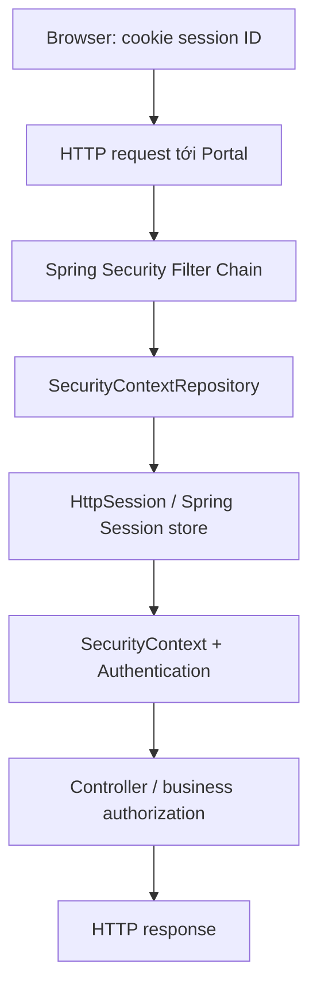
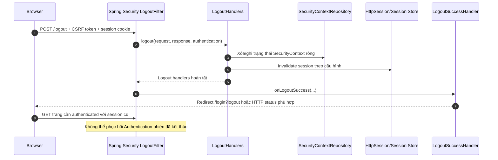
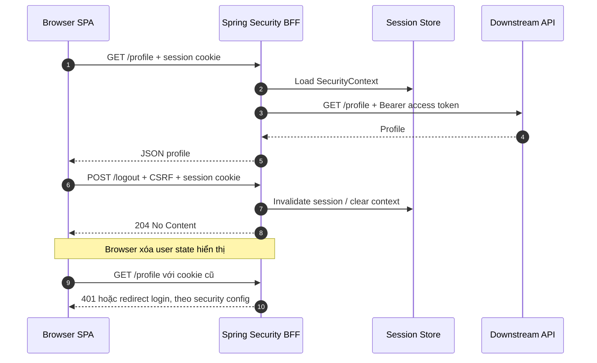
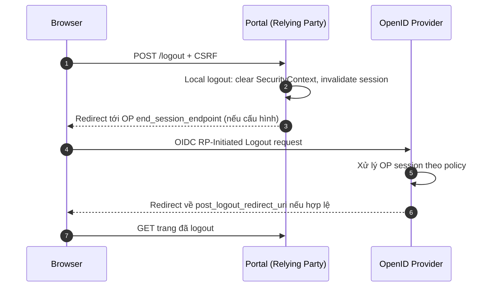
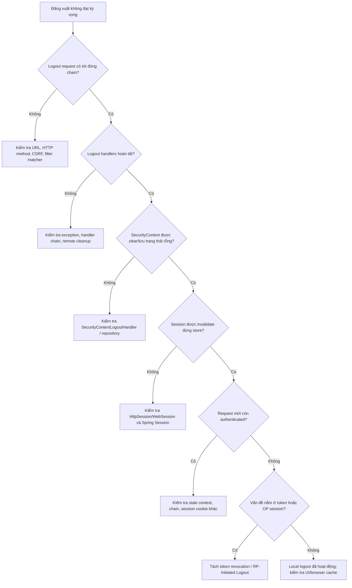

# 24.1. Đăng xuất ứng dụng và xóa SecurityContext, session

Trong ứng dụng dùng **Spring Security OAuth 2.0 / OpenID Connect (OIDC) Client**, người dùng thường đăng nhập bằng cách chuyển hướng sang OpenID Provider (OP), nhận authorization code rồi hoàn tất OIDC Login tại backend. Sau khi đăng nhập thành công, ứng dụng có `Authentication` và có thể duy trì phiên bằng HTTP session hoặc WebSession. Khi người dùng nhấn **Đăng xuất**, một thao tác quan trọng nhất phải thực hiện là **local logout**: kết thúc trạng thái xác thực tại chính ứng dụng, xóa `SecurityContext` đang gắn với request và vô hiệu hóa session phù hợp.

Tuy nhiên, đăng xuất ứng dụng **không đồng nghĩa** với đăng xuất khỏi OpenID Provider, thu hồi access token, xóa mọi refresh token trong database hoặc chấm dứt mọi phiên trên mọi thiết bị. Đây là những vòng đời khác nhau. Bài học này tập trung vào **24.1. Đăng xuất ứng dụng và xóa SecurityContext, session**; đồng thời chỉ ra ranh giới cần phối hợp với OIDC RP-Initiated Logout và token revocation ở những bước khác.

> **Nguyên tắc:** Local logout thành công nghĩa là browser không thể tiếp tục sử dụng **phiên xác thực hiện tại của ứng dụng** để gọi các trang/API yêu cầu login. Nó **không tự chứng minh** mọi token đã cấp đều bị vô hiệu ở Authorization Server hoặc user đã logout khỏi OP.

## 1. Mục tiêu học tập

Sau bài này, bạn có thể:

1. Giải thích sự khác nhau giữa local logout, OIDC logout tại OP và OAuth2 token revocation.
2. Hiểu `SecurityContext`, `SecurityContextHolder`, `Authentication`, `SecurityContextRepository` và `HttpSession`/`WebSession` tham gia logout ra sao.
3. Phân tích thứ tự xử lý của `LogoutFilter`, `LogoutHandler` và `LogoutSuccessHandler` trong Spring Security Servlet.
4. Cấu hình logout URL, yêu cầu POST với CSRF, xóa authentication, vô hiệu session, cookie và chuyển hướng sau logout.
5. Biết khi nào cần custom logout handler để dọn dữ liệu ứng dụng mà không làm mất bảo vệ mặc định.
6. Thực hiện local logout trong Spring WebFlux với `ServerHttpSecurity` và Reactive logout handlers.
7. Phân biệt xóa session với xóa `OAuth2AuthorizedClient` và thu hồi token tại provider.
8. Tránh các lỗi logout ở hệ thống nhiều replicas, reverse proxy, SPA/BFF và multi-tenant.
9. Viết kiểm thử xác nhận request sau logout không còn authenticated, chứ không chỉ kiểm tra HTTP 302.

## 2. Ba loại “đăng xuất” không được đánh đồng

| Hành động | Vùng tác động | Kết quả kỳ vọng |
|---|---|---|
| **Local application logout** | `SecurityContext`, HTTP session/WebSession và trạng thái đăng nhập trong chính ứng dụng | Request tiếp theo không được tiếp tục dùng authentication của session cũ |
| **OIDC RP-Initiated Logout** | SSO session tại OpenID Provider, qua endpoint/protocol được OP hỗ trợ | OP xử lý yêu cầu kết thúc phiên SSO theo chính sách |
| **OAuth2 token revocation** | Access/refresh token tại Authorization Server, nếu endpoint/contract hỗ trợ | Provider thu hồi token được yêu cầu; hiệu quả với API phụ thuộc loại token và cơ chế xác minh |

Ví dụ:

```text
Browser đăng nhập vào Portal bằng Corporate OP
  |
  +-- Portal có SecurityContext của Alice
  +-- Browser có cookie session của Portal
  +-- Portal có OAuth2AuthorizedClient (AT/RT)
  +-- Corporate OP có SSO session riêng
```

Khi Alice logout tại **Portal**, ứng dụng có thể xóa `SecurityContext` và session của Portal, nhưng Corporate OP **vẫn còn** SSO session. Nếu Alice nhấn Login lần nữa, OP có thể đăng nhập lại rất nhanh mà không yêu cầu nhập mật khẩu. Đây có thể là hành vi SSO bình thường, **không phải bằng chứng local logout thất bại**.

Ngược lại, nếu Portal chỉ xóa authorized client token trong database nhưng vẫn giữ `SecurityContext`/session, Alice vẫn có thể truy cập những màn hình yêu cầu authenticated user, dù các API downstream có thể không còn access token.

### 2.1. Ma trận phạm vi

| Sự kiện | SecurityContext của Portal | HTTP session Portal | Authorized client/token store | OP SSO session |
|---|---|---|---|---|
| Local logout mặc định, session-backed | Xóa/không tiếp tục sử dụng cho request mới | Thường invalidate | **Không bảo đảm** xóa ở mọi store | Không tự kết thúc |
| Xóa `OAuth2AuthorizedClient` khỏi service | Không mặc nhiên thay đổi | Không mặc nhiên thay đổi | Bản ghi tương ứng bị xóa | Không tự kết thúc |
| OIDC logout tại OP | Cần phối hợp local logout | Cần phối hợp local logout | Không tự bảo đảm thu hồi token | OP xử lý theo giao thức |
| Token bị revoke ở AS | Có thể vẫn đang authenticated | Có thể còn | Bản ghi local có thể còn nhưng token không dùng được | Tùy chính sách OP |
| Browser xóa cookie session của Portal | Request mới không có session ID cũ | Session server-side có thể vẫn tồn tại đến lúc timeout nếu chưa invalidate | Không tự thay đổi | Không tự thay đổi |

Không nên xây UX ghi “Đã đăng xuất khỏi tất cả thiết bị và mọi dịch vụ” nếu chỉ chạy local logout.

## 3. SecurityContext và HTTP session liên quan thế nào?

`SecurityContext` giữ `Authentication`, ví dụ `OAuth2AuthenticationToken` với `OidcUser` làm principal trong OIDC Login:

```text
SecurityContext
  └─ Authentication (OAuth2AuthenticationToken)
       ├─ principal (OidcUser)
       ├─ authorities
       ├─ authenticated = true
       └─ authorizedClientRegistrationId = company-login
```

Trong Spring MVC, `SecurityContextHolder` thường đưa context của request hiện tại vào đúng execution context, mặc định liên quan thread-local. `SecurityContextRepository` quyết định cách tải/lưu context giữa các requests. Trong một web app có session, implementation thường có thể sử dụng `HttpSessionSecurityContextRepository` hoặc repository kết hợp.

Browser giữ cookie phiên, ví dụ `JSESSIONID`; server dùng ID để tìm session và những thuộc tính mà ứng dụng/security framework đã lưu. Cookie thông thường **không phải** một JSON chứa toàn bộ `Authentication` hoặc access token.



Local logout phải làm cho **request tiếp theo không phục hồi được authentication cũ** qua repository/session, không chỉ đặt một biến Java thành `null` trong controller hiện tại.

### 3.1. Vì sao clearContext() chưa đủ?

Ví dụ:

```java
SecurityContextHolder.clearContext();
```

Lệnh này xóa context gắn với execution context **hiện tại**. Nó không nhất thiết:

- Vô hiệu hóa `HttpSession` trên server.
- Xóa `SecurityContext` đã lưu trong `SecurityContextRepository`.
- Xóa cookie session trong browser.
- Xóa `OAuth2AuthorizedClient` ở JDBC/Redis.
- Gọi OP logout endpoint.

Nếu application tự viết “logout controller” chỉ gọi `clearContext()`, một request kế tiếp có thể tải lại Authentication từ session/repository tùy cấu hình. Cách thông thường là để **Spring Security logout pipeline** đảm nhiệm việc này.

### 3.2. Vì sao invalidateSession() chưa đủ?

`request.getSession().invalidate()` kết thúc một session cụ thể, nhưng nếu custom security flow còn context trong repository khác, hoặc tự giữ Authentication tại một nơi không phù hợp, bạn vẫn cần thực hiện đúng cleanup security context.

Ngoài ra, nếu Session ID được giữ trong cookie browser, chỉ invalidate session ở server không nhất thiết làm cookie **biến mất khỏi trình duyệt**. Cookie có thể còn tới lúc hết hạn, nhưng ID cũ không được phép phục hồi phiên đã vô hiệu.

### 3.3. Authentication trong OIDC không phải OAuth2AuthorizedClient

`OAuth2AuthenticationToken` xác định user login, principal và registration; `OAuth2AuthorizedClient` chứa access token/refresh token cho registration và principal. Chúng có thể được lưu ở những repository khác nhau.

```text
SecurityContext
   -> Authentication(name=employee-42)

OAuth2AuthorizedClientService
   -> (company-login, employee-42)
      -> access_token, refresh_token
```

Xóa SecurityContext **không tự xóa bản ghi JDBC** của authorized client. Việc dùng token ở ngoài ứng dụng sau logout phụ thuộc API/AS, không bị vô hiệu chỉ bởi việc Portal bỏ lưu Authentication.

## 4. Servlet logout pipeline của Spring Security

Với Spring MVC/Servlet, Spring Security có `LogoutFilter` trong filter chain. Khi HTTP request khớp logout request matcher, filter chạy các `LogoutHandler` đã cấu hình, sau đó gọi `LogoutSuccessHandler`.



**`LogoutHandler` và `LogoutSuccessHandler` có trách nhiệm khác nhau.**

| Thành phần | Nhiệm vụ |
|---|---|
| `LogoutFilter` | Nhận diện HTTP request logout, gọi các thành phần xử lý |
| `LogoutHandler` | Làm sạch security context/session và dữ liệu ứng dụng cần cleanup |
| `SecurityContextLogoutHandler` | Xóa authentication/context và invalidate HTTP session theo thiết lập |
| `CookieClearingLogoutHandler` | Phát Set-Cookie để xóa các cookie được chỉ định |
| `CsrfLogoutHandler` | Dọn CSRF token state khi được cấu hình |
| `LogoutSuccessHandler` | Quyết định response sau logout: redirect, trạng thái HTTP hoặc OIDC redirect |

Các implementation/handler mặc định có thể thay đổi theo phiên bản và cấu hình Spring Security, nhưng mô hình **logout handlers → logout success response** là nền tảng.

### 4.1. Vì sao nên dùng logout DSL?

Đừng ưu tiên viết:

```java
// Không nên thay thế logout pipeline bằng endpoint xóa context thủ công.
@PostMapping("/logout")
String logout() {
    SecurityContextHolder.clearContext();
    return "redirect:/login";
}
```

Với Spring Security, `/logout` thường đã được filter xử lý; endpoint MVC trên có thể không được gọi. Nếu nó được gọi vì bạn đã đổi matcher/bỏ filter, nó cũng dễ bỏ sót invalidation và repository cleanup. Thay vì “tạo logout controller”, hãy **cấu hình `HttpSecurity.logout(...)`**.

## 5. Cấu hình local logout cơ bản với Spring MVC

Ví dụ một ứng dụng OIDC Login:

```yaml
spring:
  security:
    oauth2:
      client:
        registration:
          company-login:
            provider: corporate
            client-id: "${OIDC_CLIENT_ID}"
            client-secret: "${OIDC_CLIENT_SECRET}"
            client-authentication-method: client_secret_basic
            authorization-grant-type: authorization_code
            redirect-uri: "{baseUrl}/login/oauth2/code/{registrationId}"
            scope: [openid, profile, email]
        provider:
          corporate:
            issuer-uri: "https://idp.example.org/realms/company"
```

Ví dụ SecurityFilterChain:

```java
import org.springframework.context.annotation.Bean;
import org.springframework.context.annotation.Configuration;
import org.springframework.security.config.Customizer;
import org.springframework.security.config.annotation.web.builders.HttpSecurity;
import org.springframework.security.web.SecurityFilterChain;

@Configuration
class SecurityConfig {

    @Bean
    SecurityFilterChain securityFilterChain(HttpSecurity http)
            throws Exception {
        return http
                .authorizeHttpRequests(authorize -> authorize
                        .requestMatchers("/", "/login", "/error")
                        .permitAll()
                        .anyRequest().authenticated())
                .oauth2Login(Customizer.withDefaults())
                .logout(logout -> logout
                        .logoutUrl("/logout")
                        .logoutSuccessUrl("/login?logout")
                        .invalidateHttpSession(true)
                        .clearAuthentication(true))
                .build();
    }
}
```

Ý nghĩa:

- `logoutUrl("/logout")`: định nghĩa endpoint được Spring Security filter nhận diện.
- `logoutSuccessUrl("/login?logout")`: chuyển hướng trở về trang/đường dẫn thông báo sau local logout.
- `invalidateHttpSession(true)`: yêu cầu hủy HTTP session hiện tại khi logout.
- `clearAuthentication(true)`: clear Authentication từ security context.

`invalidateHttpSession` và `clearAuthentication` thường đã là hành vi mặc định phù hợp của `SecurityContextLogoutHandler`; viết tường minh ở đây để minh họa trách nhiệm.

Lưu ý: `/login?logout` là **trang local logout success**, không phải OP end-session endpoint. Đoạn code này **không gọi RP-Initiated Logout**.

### 5.1. Khi CSRF được bật, logout thường là POST

Trong web app dùng cookie session, Spring Security bảo vệ các thao tác thay đổi trạng thái bằng CSRF. Khi CSRF được bật, yêu cầu logout mặc định thường là **POST `/logout`** (có CSRF token hợp lệ), không phải một link GET có thể kích hoạt bởi website ngoài.

Ví dụ HTML form với Thymeleaf (khi tích hợp CSRF token vào template):

```html
<form th:action="@{/logout}" method="post">
  <button type="submit">Đăng xuất</button>
</form>
```

Trong ứng dụng có Thymeleaf/Spring Security integration, CSRF hidden field có thể được thêm theo cơ chế tích hợp. Nếu dùng template engine khác, client cần gửi CSRF token theo đúng cấu hình `CsrfTokenRepository`. **Không giả định mọi HTML form tự có CSRF token** nếu không có integration tương ứng.

Một HTML form tĩnh có thể thêm hidden input:

```html
<form action="/logout" method="post">
  <input type="hidden" name="_csrf" value="SERVER_GENERATED_CSRF_TOKEN" />
  <button type="submit">Đăng xuất</button>
</form>
```

Giá trị trên là placeholder; production phải lấy token hợp lệ do server phát, **không hardcode**.

### 5.2. Vì sao không bật GET logout tùy tiện?

GET là thao tác mà browser, crawler hoặc trang bên ngoài có thể kích hoạt thông qua link/image/redirect. Nếu GET `/logout` kết thúc phiên mà không cần CSRF, một website khác có thể ép user bị đăng xuất.

Vì vậy:

- Dùng POST + CSRF cho local logout của cookie-session web app.
- Không cấu hình matcher logout GET chỉ để làm một link tiện lợi mà không xét CSRF.
- Với SPA/BFF, frontend có thể gửi `fetch("/logout", {method:"POST", headers:{...CSRF...}})`; phải đồng bộ cách nhận CSRF token và cookie policy.
- Việc vô hiệu CSRF toàn cục để “logout hoạt động” có thể mở rủi ro ở các endpoint POST/PUT/DELETE khác.

### 5.3. Trang GET /logout có thể là trang xác nhận

Trong một số cấu hình Spring Security, GET `/logout` hiển thị trang xác nhận/form logout (thay vì thực hiện logout ngay), còn thao tác kết thúc phiên diễn ra sau POST. Đây là chi tiết phụ thuộc default login page/CSRF và phiên bản. Đừng viết test khẳng định “GET /logout luôn hủy session”; hãy kiểm tra **request thực sự kích hoạt logout** trong cấu hình đang dùng.

## 6. SecurityContextLogoutHandler: nội dung được dọn

`SecurityContextLogoutHandler` là implementation quan trọng của Servlet logout. Nó có thể:

1. Invalidate `HttpSession` nếu được cấu hình.
2. Xóa `Authentication` khỏi `SecurityContext`.
3. Clear context hiện tại khỏi `SecurityContextHolder`.
4. Phối hợp `SecurityContextRepository` để bảo đảm không nạp lại context cũ theo contract/phiên bản.

Ví dụ sử dụng khi tự xây một endpoint đặc biệt (không phải cách mặc định khuyến nghị):

```java
import jakarta.servlet.http.HttpServletRequest;
import jakarta.servlet.http.HttpServletResponse;
import org.springframework.security.core.Authentication;
import org.springframework.security.web.authentication.logout
        .SecurityContextLogoutHandler;

void terminateLocalSession(
        HttpServletRequest request,
        HttpServletResponse response,
        Authentication authentication) {

    SecurityContextLogoutHandler handler =
            new SecurityContextLogoutHandler();

    handler.setInvalidateHttpSession(true);
    handler.setClearAuthentication(true);
    handler.logout(request, response, authentication);
}
```

Đây chỉ là ví dụ API; nếu `LogoutFilter` mặc định đã chạy, **không cần gọi lại handler** trong controller. Một endpoint logout thủ công còn phải xử lý CSRF, logout success response, repository configuration, session cookies và hành vi các logout handlers khác.

### 6.1. SecurityContextRepository và explicit-save

Trong Spring Security 6, những flow **tự xác thực** có thể cần `SecurityContextRepository.saveContext(...)` tường minh nếu chạy với `SecurityContextHolderFilter`/explicit-save semantics. Đăng xuất cũng phải tôn trọng repository đã cấu hình.

Điểm cần tránh:

```java
// Không bảo đảm trạng thái được xóa khỏi persistence:
SecurityContextHolder.getContext().setAuthentication(null);
```

Đoạn này chỉ thay đổi object hiện có. Khi có custom repository hoặc custom authentication pipeline, phải kiểm tra việc lưu/xóa context đúng contract. Dùng `LogoutFilter` và `SecurityContextLogoutHandler` đã được cấu hình là lựa chọn an toàn hơn việc tự thao tác thread-local.

### 6.2. Không xóa Authentication quá sớm khi cần OIDC Logout

Nếu trong tương lai ứng dụng thêm OIDC RP-Initiated Logout, `LogoutSuccessHandler` có thể cần biết **OidcUser/ID Token** của người vừa đăng xuất để tạo request đến OP. Trong luồng `LogoutFilter`, original `Authentication` được truyền cho các handler và success handler.

Nếu custom code tự ghi đè/xóa biến authentication từ đầu rồi mới tìm ID Token, handler OP logout có thể thiếu dữ liệu. Hãy giữ **original Authentication chỉ trong phạm vi xử lý logout được phép**, để framework hoàn tất protocol; tuyệt đối không đưa ID Token/refresh token vào response hoặc log.

## 7. Xóa cookie session: phân biệt browser và server

`invalidateHttpSession(true)` hủy session phía server, còn trình duyệt có thể vẫn giữ cookie session ID cũ. Sau đó server phải từ chối phục hồi authentication từ ID đã vô hiệu.

Nếu muốn hướng dẫn browser xóa cookie:

```java
.logout(logout -> logout
        .invalidateHttpSession(true)
        .clearAuthentication(true)
        .deleteCookies("JSESSIONID")
        .logoutSuccessUrl("/login?logout"))
```

`deleteCookies("JSESSIONID")` tạo thao tác xóa cookie theo hỗ trợ của Spring Security. Tuy nhiên, việc browser xóa thành công phụ thuộc **cookie name, domain, path, Secure và proxy/session resolver configuration**. Nếu cookie đang dùng tên khác, hoặc đã phát từ path/domain khác, việc gửi một Set-Cookie để xóa `JSESSIONID` không nhất thiết xóa đúng cookie cũ.

### 7.1. Cookie không phải session store

```text
Browser:
  Cookie: JSESSIONID=opaque-id

Server:
  Session store[opaque-id]
      -> SecurityContext
      -> other session attributes
```

Xóa cookie browser nhưng **không** hủy session server-side có thể để lại một phiên chưa hết hạn cho tới timeout. Ngược lại, hủy session server-side có thể bảo vệ authentication ngay cả khi browser còn gửi ID cũ.

**Ưu tiên kết thúc trạng thái phía server**, rồi đồng bộ cookie cleanup khi có yêu cầu UX/bảo mật.

### 7.2. Cookie của Authorization Server là miền khác

Portal có thể phát cookie cho `portal.example.org`; Corporate OP phát cookie cho `idp.example.org`. Portal **không thể tùy ý xóa cookie thuộc domain của OP**. Để kết thúc SSO session tại OP, phải dùng OIDC logout protocol/endpoint được provider hỗ trợ.

Không cố gửi `Set-Cookie` cho một domain mà ứng dụng không có quyền quản lý để “xóa OP session”.

### 7.3. Reverse proxy, HTTPS và SameSite

Khi browser dùng `https://portal.example.org` nhưng backend chạy HTTP sau proxy, cần xử lý forwarded headers từ proxy **đáng tin** để redirect URL/cookie settings đúng.

| Thuộc tính | Tác dụng |
|---|---|
| `Secure` | Cookie chỉ được gửi qua HTTPS |
| `HttpOnly` | JavaScript không đọc được cookie |
| `SameSite` | Giới hạn một số hành vi cross-site của cookie |
| `Path`/`Domain` | Giới hạn phạm vi cookie và điều kiện xóa |
| Idle timeout | Kết thúc session sau khoảng không hoạt động |

Đặt `SameSite` quá chặt có thể tác động tới OIDC callback tuỳ browser và flow. Đặt quá lỏng có thể tăng rủi ro CSRF. Cần cân bằng theo kiến trúc redirect, không tắt toàn bộ CSRF hoặc cookie protection chỉ để giải quyết một lần callback thất bại.

### 7.4. Clear-Site-Data là biện pháp bổ sung

HTTP header `Clear-Site-Data` có thể yêu cầu browser xóa một số dữ liệu của origin/site, ví dụ cookies hoặc storage tùy browser hỗ trợ. Nó **không thay thế** việc invalidate session trên server và có thể ảnh hưởng dữ liệu của những ứng dụng khác cùng origin/site.

Chỉ dùng sau khi xác định phạm vi ảnh hưởng, cách browser hỗ trợ và yêu cầu sản phẩm. Không bật “xóa mọi cookies/storage” cho toàn bộ domain doanh nghiệp một cách tùy tiện.

## 8. LogoutSuccessHandler: response sau khi kết thúc phiên

Sau khi các `LogoutHandler` chạy, `LogoutSuccessHandler` quyết định phản hồi cho browser:

```java
.logout(logout -> logout
        .logoutSuccessUrl("/login?logout"))
```

Đối với trang web truyền thống, redirect về `/login?logout` có thể là lựa chọn phù hợp. Đối với API/BFF dùng SPA, phía frontend có thể mong HTTP `204 No Content` thay vì bị redirect trả HTML.

### 8.1. Trả HTTP 204 cho SPA/BFF

```java
import org.springframework.http.HttpStatus;
import org.springframework.security.web.authentication.logout
        .HttpStatusReturningLogoutSuccessHandler;

http.logout(logout -> logout
        .logoutUrl("/logout")
        .invalidateHttpSession(true)
        .clearAuthentication(true)
        .logoutSuccessHandler(
                new HttpStatusReturningLogoutSuccessHandler(
                        HttpStatus.NO_CONTENT)));
```

Đây là **phương án thay thế** cho redirect success URL; không dùng cả hai kết quả response trái ngược cho cùng endpoint. `204` cho biết request logout local đã xử lý theo pipeline, **không chứng minh refresh token đã revoke hoặc OP session đã kết thúc**.

### 8.2. Trang success phải truy cập được khi anonymous

Nếu redirect tới `/goodbye` nhưng `/goodbye` yêu cầu authenticated, browser có thể bị chuyển tiếp tới trang đăng nhập, tạo cảm giác “logout không thành công”. Cấu hình permit:

```java
.authorizeHttpRequests(authorize -> authorize
        .requestMatchers("/", "/login", "/goodbye", "/error")
        .permitAll()
        .anyRequest().authenticated())
```

Không đánh giá logout chỉ qua việc UI hiện trang goodbye. Kiểm tra request vào endpoint protected **sau khi logout**.

## 9. Thêm custom LogoutHandler khi có dữ liệu ứng dụng cần cleanup

Một hệ thống có thể giữ những trạng thái ngoài `SecurityContext`:

- Giỏ hàng hoặc draft tạm không nên giữ sau logout.
- Token lưu trong `OAuth2AuthorizedClientService`.
- Cache theo principal/session.
- WebSocket subscription gắn với user session.
- Dữ liệu chọn tenant hoặc account tạm thời.

Với Servlet `HttpSecurity`, có thể thêm `LogoutHandler` của ứng dụng bằng `addLogoutHandler(...)`, đồng thời để framework giữ những cleanup mặc định:

```java
import org.springframework.security.web.authentication.logout.LogoutHandler;

LogoutHandler applicationCleanup =
        (request, response, authentication) -> {
            if (authentication != null) {
                String principalName = authentication.getName();
                // Chỉ xóa dữ liệu ứng dụng được phép của principal.
                auditLogoutIntent(principalName);
            }
        };

http.logout(logout -> logout
        .addLogoutHandler(applicationCleanup)
        .invalidateHttpSession(true)
        .clearAuthentication(true)
        .logoutSuccessUrl("/login?logout"));
```

`auditLogoutIntent(...)` là phương thức ứng dụng cần triển khai; không phải API Spring Security. Cần thiết kế audit không ghi token/PII quá mức và tránh exception ảnh hưởng logout.

**Không tự gọi `SecurityContextLogoutHandler` lần hai** trong custom handler nếu default logout cleanup đã được cấu hình. Nếu thay toàn bộ handler chain, phải bảo toàn các nhiệm vụ session/context/CSRF/cookie cần thiết.

### 9.1. Cleanup authorized client nếu business yêu cầu

Giả sử ứng dụng muốn xóa token của registration `company-login` khỏi `OAuth2AuthorizedClientService` khi user logout:

```java
import org.springframework.security.oauth2.client
        .OAuth2AuthorizedClientService;
import org.springframework.security.web.authentication.logout.LogoutHandler;

LogoutHandler removeCompanyClient(
        OAuth2AuthorizedClientService clientService) {

    return (request, response, authentication) -> {
        if (authentication != null) {
            clientService.removeAuthorizedClient(
                    "company-login", authentication.getName());
        }
    };
}
```

Gắn vào chain bằng:

```java
http.logout(logout -> logout
        .addLogoutHandler(removeCompanyClient(clientService))
        .invalidateHttpSession(true)
        .clearAuthentication(true));
```

Ví dụ này chỉ đúng khi `OAuth2AuthorizedClientService` được dùng thực sự để lưu authorized client của registration đó. Nếu token nằm trong `HttpSessionOAuth2AuthorizedClientRepository`, việc invalidate session có thể dọn dữ liệu session; gọi service không liên quan sẽ không có tác dụng.

### 9.2. Xóa token local không tự thu hồi token tại OP

```text
Portal DB:
  DELETE (company-login, alice)

Authorization Server:
  Access Token cũ có thể vẫn còn hợp lệ
  Refresh Token cũ có thể vẫn còn hợp lệ
```

`removeAuthorizedClient(...)` là thao tác **local storage**. Nếu business yêu cầu vô hiệu token phía provider, cần cơ chế OAuth2 Token Revocation (RFC 7009) hoặc provider-specific API được hỗ trợ, cùng kiểm soát lỗi và thứ tự cleanup. Đây là bước **riêng** với local logout.

### 9.3. LogoutHandler không phải nơi tốt để gọi network chậm tùy ý

Servlet `LogoutHandler.logout(...)` là API đồng bộ. Nếu gọi hàng loạt remote APIs để “dọn sạch mọi hệ thống” và chúng timeout, logout của người dùng có thể treo hoặc thất bại.

Thực tế cần:

- Xác định cleanup nào bắt buộc/nhanh tại logout boundary.
- Không làm mất bảo vệ local logout vì hệ thống downstream đang lỗi.
- Có timeout/bounded retries và audit khi giao tiếp provider nếu bắt buộc.
- Có cơ chế job/event đáng tin khi cần cleanup bất đồng bộ, nhưng không quảng bá hoàn tất revocation cho đến khi nó thực sự được xác nhận.
- Không log refresh token hoặc gửi nó qua event queue không được bảo vệ.

**Không nuốt mọi exception** nếu điều đó che giấu một yêu cầu pháp lý/bảo mật bắt buộc phải xác nhận. Đồng thời tránh để sự cố hệ thống ngoài làm user không thể kết thúc **local session**.

## 10. Thứ tự logout và dữ liệu cần thiết

Một sai lầm dễ gặp là xóa SecurityContext trước khi lấy thông tin cần để cleanup:

```text
Clear Authentication
   -> authentication = null
   -> không tìm được principalName
   -> không biết xóa authorized client nào
```

Spring Security logout pipeline nhận **original Authentication** và truyền nó qua các handler/success handler. Nên viết cleanup dựa trên tham số `authentication` được truyền, không tự đọc `SecurityContextHolder` sau khi context đã clear.

Ví dụ:

```java
(request, response, authentication) -> {
    if (authentication == null) {
        return;
    }
    String name = authentication.getName();
    // Dọn đúng dữ liệu liên quan name trong store đã xác minh.
};
```

Khi phát triển OIDC RP-Initiated Logout, có thể cần `OidcUser.getIdToken()` để tạo `id_token_hint` theo spec/provider. Dữ liệu đó chỉ nên được dùng trong luồng logout đã xác thực và thông qua handler phù hợp, không lấy từ query parameter của browser.

## 11. Session fixation và concurrent sessions

Session fixation protection thường có vai trò **đổi session ID khi chuyển từ anonymous sang authenticated**. Khi logout, việc invalidate session đảm bảo session cũ không còn khả năng phục hồi SecurityContext.

Một user có thể có nhiều phiên:

```text
Alice:
  Browser A -> Portal session S1
  Browser B -> Portal session S2
  Mobile    -> Session/token khác
```

Local logout từ browser A thường kết thúc **S1**, không bảo đảm S2 cũng bị vô hiệu. Nếu sản phẩm yêu cầu “đăng xuất khỏi mọi thiết bị”, cần cơ chế **global session invalidation** và phối hợp token revocation/OP sessions theo kiến trúc, không chỉ `invalidateHttpSession(true)` trên request hiện tại.

### 11.1. SessionRegistry không tự xử lý mọi OAuth2 token

Spring Security có những thành phần quản lý concurrent sessions (tùy Servlet/Reactive và cấu hình). Chúng có thể giúp quản trị phiên authenticated, nhưng **không đồng nghĩa** truy cập được mọi refresh token trong service store hay revoke chúng ở provider.

Khi yêu cầu logout-all:

1. Xác định các session IDs của user theo nguồn đáng tin.
2. Invalidate đúng sessions trong store hỗ trợ.
3. Dọn authorized client records theo chính sách và khóa chủ thể.
4. Nếu bắt buộc, thực hiện provider token revocation/OP logout.
5. Kiểm tra các thiết bị/client không dùng cookie session (mobile, native app, API keys) riêng.

Không cho browser gửi user ID tùy ý để bắt logout sessions của tài khoản khác.

## 12. Nhiều ứng dụng và nhiều Spring Security FilterChains

Ứng dụng có thể vừa là:

- **OIDC Login Client** cho `/web/**`, dùng cookie session.
- **OAuth2 Resource Server** cho `/api/**`, xác thực bearer token mỗi request.
- **OAuth2 Client** dùng `client_credentials` để gọi API khác.

Những loại Authentication này có vòng đời khác nhau:

```text
/web/**:
  Browser cookie -> SecurityContext từ HttpSession
  POST /logout -> kết thúc local web session

/api/**:
  Authorization: Bearer <access-token>
  -> xác thực access token trên từng request
  -> logout web không tự vô hiệu bearer token

Background worker:
  client_credentials -> service access token
  -> không có browser session cần logout
```

Nếu cấu hình nhiều `SecurityFilterChain` với matchers/order riêng, phải đảm bảo **`/logout` đi qua chain có logout filter đúng**. Nếu request logout bị matcher của API stateless bắt trước, hành vi có thể là 401/404 hoặc không có cleanup theo mong đợi.

### 12.1. Không dùng logout browser cho client_credentials

`client_credentials` đại diện cho application/service, thường không có `OidcUser` và không duy trì HTTP session user. Khi cần ngừng service token, phải quản lý client registration, authorized client storage, client credentials rotation/revocation, không gửi HTTP POST `/logout` giả lập một browser session.

### 12.2. Không xóa tất cả service tokens vì một user logout

Giả sử Portal vừa lưu user token `(company-login,alice)`, vừa lưu service token `(inventory-service,service:nightly-import)`. Logout Alice **không nên** xóa token service toàn cục nếu job hằng đêm vẫn đang được cấp quyền và hoạt động độc lập.

Tách rõ token của user và service bằng registration/principal và storage policy; custom logout handler chỉ dọn đúng phạm vi được sở hữu.

## 13. Mẫu BFF: frontend chỉ giữ session cookie

Với Backend-for-Frontend (BFF), browser có thể không nhìn thấy access/refresh token. Backend giữ token và dùng `HttpSession` để quản lý login.



**Không gửi refresh token về browser** để nó tự revocation/cập nhật token nếu thiết kế BFF có chủ đích giữ token server-side.

### 13.1. Frontend cần xử lý gì sau HTTP 204?

- Xóa dữ liệu profile/UI cache có gắn danh tính user.
- Dừng các request hoặc subscription cần authentication.
- Điều hướng về màn hình public/login.
- Không kỳ vọng `204` có body JSON chứa token.
- Không giữ một “isLoggedIn=true” flag làm nguồn chứng minh authentication.

Backend mới là nơi quyết định session cũ còn hợp lệ hay không. Frontend xóa local UI state chỉ là dọn hiển thị, không thay thế local logout phía server.

### 13.2. Hạn chế cache dữ liệu cá nhân ở browser

Ngay cả khi session đã kết thúc, browser có thể giữ trang vừa xem, query cache, service worker cache hoặc history. Với dữ liệu nhạy cảm, cần kiểm soát HTTP cache headers và chính sách xóa dữ liệu của frontend. Không mặc định browser xóa mọi cache chỉ khi server invalidate session.

## 14. Logout với Spring WebFlux / Reactive Security

Trong Spring WebFlux, `ServerHttpSecurity` tạo `SecurityWebFilterChain`. Trạng thái bảo mật được truyền qua Reactor context, thường truy cập qua `ReactiveSecurityContextHolder`. WebSession là abstraction phiên tương ứng, không phải `jakarta.servlet.http.HttpSession`.

Các API chủ chốt:

| Servlet | Reactive WebFlux |
|---|---|
| `HttpSecurity.logout(...)` | `ServerHttpSecurity.logout(...)` |
| `LogoutFilter` | `LogoutWebFilter` |
| `LogoutHandler` | `ServerLogoutHandler` |
| `SecurityContextLogoutHandler` | `SecurityContextServerLogoutHandler` |
| `LogoutSuccessHandler` | `ServerLogoutSuccessHandler` |
| `HttpSession` | `WebSession` |
| `SecurityContextRepository` | `ServerSecurityContextRepository` |
| `SecurityContextHolder` | `ReactiveSecurityContextHolder` |

**Không lấy ví dụ Servlet rồi thay mỗi tên class.** Trong Reactive, các handler phải trả `Mono<Void>` và tôn trọng flow không blocking.

### 14.1. Cấu hình local logout Reactive

```java
import org.springframework.context.annotation.Bean;
import org.springframework.context.annotation.Configuration;
import org.springframework.security.config.annotation.web.reactive
        .EnableWebFluxSecurity;
import org.springframework.security.config.web.server.ServerHttpSecurity;
import org.springframework.security.web.server.SecurityWebFilterChain;

@Configuration
@EnableWebFluxSecurity
class ReactiveLogoutSecurityConfig {

    @Bean
    SecurityWebFilterChain securityWebFilterChain(
            ServerHttpSecurity http) {

        return http
                .authorizeExchange(exchanges -> exchanges
                        .pathMatchers("/", "/login", "/goodbye", "/error")
                        .permitAll()
                        .anyExchange().authenticated())
                .oauth2Login(oauth2 -> {})
                .logout(logout -> logout.logoutUrl("/logout"))
                .build();
    }
}
```

Đây là cấu hình local logout tối thiểu; Spring Security dùng Reactive logout filter/handler theo default của phiên bản. Nếu yêu cầu **invalidate toàn bộ WebSession** chứ không chỉ clear SecurityContext, cần kiểm tra và cấu hình `WebSession` lifecycle rõ ràng như ví dụ tiếp theo.

### 14.2. Kết hợp clear SecurityContext và invalidate WebSession

Một `ServerLogoutHandler` custom có thể phối hợp handler context của framework với invalidation của WebSession. Ví dụ:

```java
import org.springframework.security.web.server.authentication.logout
        .SecurityContextServerLogoutHandler;
import org.springframework.security.web.server.authentication.logout
        .ServerLogoutHandler;
import org.springframework.web.server.WebSession;

SecurityContextServerLogoutHandler clearContext =
        new SecurityContextServerLogoutHandler();

ServerLogoutHandler clearContextAndSession =
        (exchange, authentication) ->
                clearContext.logout(exchange, authentication)
                        .then(exchange.getExchange()
                                .getSession()
                                .flatMap(WebSession::invalidate));

http.logout(logout -> logout
        .logoutUrl("/logout")
        .logoutHandler(clearContextAndSession));
```

Đây là **trích đoạn cấu hình bên trong SecurityWebFilterChain**, không phải một đoạn Java độc lập. Khi custom logout handler, phải bảo toàn cleanup mà default handler đang làm, giữ chính sách CSRF và response success phù hợp. Nếu ứng dụng dùng custom `ServerSecurityContextRepository`, cần đảm bảo `SecurityContextServerLogoutHandler` được cấu hình để làm việc với **đúng repository** đó, thay vì mặc định khác.

### 14.3. Không block Reactor event loop

Không viết:

```java
// KHÔNG NÊN trong Reactive logout handler:
clientService.removeAuthorizedClient(...).block();
```

Nếu cần dọn `ReactiveOAuth2AuthorizedClientService`, hãy compose bằng `then(...)` hoặc `Mono.when(...)` theo hợp đồng. Xóa token từ Redis/R2DBC nên dùng API Reactive, không chặn thread.

Ví dụ logic minh họa:

```java
ServerLogoutHandler cleanup =
        (exchange, authentication) -> {
            if (authentication == null) {
                return Mono.empty();
            }

            return reactiveClientService.removeAuthorizedClient(
                    "company-login", authentication.getName());
        };
```

Đoạn này cần import `Mono` và inject `reactiveClientService` thích hợp; nếu dùng `logoutHandler(cleanup)` thay default, **phải kết hợp** với handler xóa SecurityContext/session. Chỉ xóa authorized client mà quên security context **không phải local logout đầy đủ**.

### 14.4. ServerLogoutSuccessHandler

Reactive logout cũng tách handler cleanup với response sau logout. Tùy phiên bản/framework, có thể dùng `RedirectServerLogoutSuccessHandler` để điều hướng hoặc implement `ServerLogoutSuccessHandler` trả status cho SPA.

Ví dụ thiết kế response JSON/HTTP 204:

```java
import org.springframework.http.HttpStatus;
import org.springframework.security.web.server.authentication.logout
        .ServerLogoutSuccessHandler;
import reactor.core.publisher.Mono;

ServerLogoutSuccessHandler noContent = (exchange, authentication) -> {
    exchange.getExchange().getResponse()
            .setStatusCode(HttpStatus.NO_CONTENT);
    return exchange.getExchange().getResponse().setComplete();
};

http.logout(logout -> logout
        .logoutUrl("/logout")
        .logoutSuccessHandler(noContent));
```

Đây là trích đoạn cho Reactive security configuration; phối hợp với logout handler phù hợp ở trên. Đừng trả 204 trước khi các cleanup bắt buộc đã hoàn thành hoặc thổi phồng ý nghĩa 204 thành OP logout/token revocation.

## 15. Logout và OAuth2AuthorizedClientRepository

Một trong những nhầm lẫn lớn nhất của OIDC Client là giả định `SecurityContext` và `OAuth2AuthorizedClient` cùng được lưu/xóa tự động.

Ở Servlet:

| Storage | Dữ liệu thường lưu | Logout local ảnh hưởng thế nào? |
|---|---|---|
| `HttpSessionSecurityContextRepository` | Authentication/SecurityContext | Session invalidation thường xóa dữ liệu này |
| `HttpSessionOAuth2AuthorizationRequestRepository` | OAuth2 Authorization Request trước callback | Khi session invalidate, request tạm trong đó không còn |
| `HttpSessionOAuth2AuthorizedClientRepository` | Authorized clients lưu trong HTTP session | Khi session thực sự chứa dữ liệu đó và bị hủy, dữ liệu không còn qua session |
| `InMemoryOAuth2AuthorizedClientService` | Authorized clients trong JVM theo cặp key | Không tự xóa theo browser session |
| `JdbcOAuth2AuthorizedClientService` | Authorized clients trong database | Không tự xóa theo browser session |
| Custom service (Redis/KMS/DB) | Dữ liệu theo implementation | Cần cleanup policy riêng |

Trong WebFlux cũng có sự phân biệt tương tự giữa `WebSessionServerOAuth2AuthorizedClientRepository` và `ReactiveOAuth2AuthorizedClientService`.

### 15.1. Ví dụ user đã logout nhưng token vẫn trong JDBC

```text
T0: Alice login thành công
    HttpSession S1 -> SecurityContext(Alice)
    JDBC          -> (company-login, Alice) -> AT1/RT1

T1: Alice POST /logout
    HttpSession S1 -> invalidated
    SecurityContext -> cleared
    JDBC          -> (company-login, Alice) -> AT1/RT1 (có thể còn)

T2: Browser GET /private
    Không còn Authentication từ S1
    -> redirect login / 401 theo security policy
```

Lần GET `/private` không được authenticated dù token JDBC vẫn còn, vì **token storage không phải bằng chứng login**. Nếu application khác có quyền đọc token đó, nó có thể vẫn dùng token tới khi hết hạn/revoke; đây là vấn đề cleanup/authorization riêng.

### 15.2. Remove local khác token revocation

`OAuth2AuthorizedClientService.removeAuthorizedClient(registrationId, principalName)`:

- Chỉ xóa bản ghi từ service được gọi.
- Không gọi `end_session_endpoint` của OP.
- Không mặc định gửi RFC 7009 revocation request.
- Không bảo đảm access token JWT đã phát hành ngừng được API chấp nhận.
- Không tự logout mọi browser sessions của principal.

Muốn “logout toàn diện”, phải thiết kế các bước bổ sung theo yêu cầu sản phẩm và provider.

### 15.3. Khi provider dùng refresh token rotation

Nếu một request đang refresh token `RT1` trong khi user logout:

```text
Request A: refresh RT1 -> RT2
Request B: logout -> remove authorized client
Request A: save AT2/RT2 sau khi logout
```

Một race có thể khiến authorized client **được ghi trở lại** sau khi logout. Nếu yêu cầu “logout phải cắt quyền dùng token đã lưu”, cần concurrency control, versioning/tombstone, cancellation và cleanup policy phù hợp để ngăn stale refresh/write sau logout.

Không chỉ thêm một lệnh remove mà mặc định đã loại bỏ mọi luồng refresh đang chạy ở các instances khác.

## 16. OIDC RP-Initiated Logout ở ranh giới bài học

Khi cần logout khỏi OP, Spring Security Servlet có `OidcClientInitiatedLogoutSuccessHandler` để tạo luồng chuyển hướng đến end-session endpoint khi OP hỗ trợ metadata/protocol tương ứng. Nhưng đây là bước **phối hợp với local logout**, không phải thay thế việc xóa `SecurityContext`.

Sơ đồ:



Chỉ thực hiện RP-Initiated Logout khi provider hỗ trợ, URI redirect đã được đăng ký và ứng dụng có strategy cho `id_token_hint`/`state`/callback phù hợp. Nếu OP không có end-session endpoint hoặc logout chỉ là local, không tự nối URL provider từ browser input.

### 16.1. Vì sao logout OP không tự revoke API token?

Một OP có thể chấm dứt browser SSO session nhưng access token vẫn là JWT tự xác minh được Resource Server chấp nhận cho tới `exp`. Một hệ thống khác có thể dùng introspection/revocation để từ chối ngay. Kết quả phụ thuộc provider và API policy.

Vì vậy, đừng kiểm chứng local logout bằng việc “token cũ đã trả 401 ở API chưa”; đó là kiểm thử **token invalidation**, không phải kiểm thử `SecurityContext`/session.

## 17. Logout trên hệ thống nhiều instances

Một deployment có load balancer và Spring Session Redis:

```text
                  Browser
                    |
                Load Balancer
                  /  |  \
               Pod A B  C
                  \  |  /
                Session Store
                    |
               SecurityContext

        AuthorizedClient DB (tách riêng)
```

Nếu user POST logout vào pod B, ứng dụng phải invalidate **đúng session** trong store chia sẻ. Request tiếp theo vào pod C không được tải lại Authentication từ session ID cũ.

### 17.1. Sticky session không thay cho invalidation

Sticky sessions có thể giữ một browser gắn với pod A, nhưng nếu pod A chết hoặc load balancer đổi route, state in-memory có thể mất. Shared Spring Session giúp giữ state qua pods khi cấu hình đúng, song logout phải thực hiện invalidation qua chính session infrastructure đó.

Nếu custom code chỉ clear một thread-local SecurityContext trên pod B mà không cập nhật session store, pod C vẫn có thể phục hồi context cũ.

### 17.2. Concurrent request đang chạy khi logout

Giả sử:

```text
Request A: bắt đầu khi session S1 còn authenticated
Request B: POST /logout, invalidate S1
Request A: đã có Authentication trong request context, vẫn đang xử lý
```

Local logout thường bảo đảm **những request mới không dùng lại session**, nhưng không nhất thiết dừng ngay mọi request đã được authorize trước thời điểm logout. Với thao tác đặc biệt nhạy cảm, ứng dụng có thể cần kiểm tra trạng thái session/account tại commit boundary hoặc có cơ chế revocation/versioning riêng.

Đừng quảng bá local logout là transaction toàn hệ thống có thể đảo ngược mọi thao tác đang chạy.

### 17.3. Browser nhiều tabs

Nhiều tabs cùng dùng một session cookie. Khi logout ở tab A, các request tiếp theo từ tab B thường không còn authenticated, nhưng UI tab B có thể vẫn hiển thị dữ liệu cached cho tới lần kiểm tra trạng thái tiếp theo.

Frontend có thể cập nhật UI qua event/broadcast hoặc xử lý response 401/redirect; tuy nhiên, đồng bộ UI tabs không thay thế backend invalidation.

## 18. Các vấn đề bảo mật thường gặp khi logout

| Rủi ro | Vì sao xảy ra | Cách phòng tránh |
|---|---|---|
| Logout CSRF | GET/logout endpoint có thể bị website ngoài kích hoạt | POST + CSRF trong cookie-session web app |
| Session fixation | Session ID attacker kiểm soát được giữ qua authentication | Session fixation protection khi login; invalidate lúc logout |
| Stale SecurityContext | Chỉ clear thread-local, repository còn context | Dùng LogoutFilter/handler và repository đúng |
| Cookie không xóa | Sai tên, path/domain/Secure config | Đối chiếu Set-Cookie/session resolver; server invalidation vẫn bắt buộc |
| Open redirect | `logoutSuccessUrl`/returnUrl do browser quyết định | Allowlist URI/relative path; không redirect tùy ý |
| Token leak | Log ID Token/access token hoặc gửi về frontend | Redaction, BFF lưu token phía server |
| Incomplete logout | Chỉ xóa token store, session còn authenticated | Tách và thực hiện local logout rõ ràng |
| Overbroad cleanup | Logout user xóa service token toàn cục | Giới hạn theo registration/principal/tenant |
| Race refresh/logout | RT mới được lưu sau khi record bị xóa | Version/CAS/tombstone hoặc cơ chế đồng bộ |
| Login/logout loop | Success URL lại yêu cầu authenticated hoặc OP SSO tự đăng nhập | Permit public success page; phân biệt local và OP SSO |
| Logout-all giả | Chỉ invalidate session của một browser nhưng hiển thị “mọi thiết bị” | Phối hợp session registry/global invalidation đúng thiết kế |
| Custom handler ném lỗi | Cleanup không liên quan làm local logout không hoàn tất | Quy định error handling và tách trách nhiệm bắt buộc/không bắt buộc |

### 18.1. Không dùng returnUrl không kiểm soát

Ví dụ nguy hiểm:

```text
POST /logout?returnUrl=https://attacker.example/phishing
```

Nếu success handler redirect tới URL bất kỳ, attacker có thể lợi dụng domain uy tín của Portal làm điểm chuyển hướng. Chỉ redirect tới relative path trong allowlist hoặc URI đã đăng ký/được kiểm tra chặt.

### 18.2. Không log token trong logout handler

Những giá trị **không nên log**:

- Access token, refresh token, ID Token nguyên văn.
- `Authorization` header, session cookie value.
- Client secret/private key, authorization code, PKCE verifier.
- Toàn bộ serialized `Authentication`/`SecurityContext` nếu chứa claims nhạy cảm.
- Query string của OP logout request nếu có `id_token_hint` và dữ liệu nhận diện.

Log an toàn hơn:

```text
event=local_logout
registrationId=company-login
sessionInvalidated=true
securityContextCleared=true
authorizedClientCleanup=not-configured
correlationId=server-generated
```

Các trường trên là ví dụ log do ứng dụng tự thiết kế, không phải metrics/fields mặc định của Spring. Hạn chế principal identifiers/PII theo policy và không dùng session ID nguyên văn làm metric label.

## 19. Chẩn đoán lỗi local logout

| Triệu chứng | Nguyên nhân có thể | Điều cần kiểm tra |
|---|---|---|
| POST `/logout` trả 403 | Thiếu/sai CSRF token | Cách form/SPA gửi CSRF, cookie và `CsrfTokenRepository` |
| GET `/logout` không kết thúc phiên | GET chỉ hiển thị confirmation hoặc matcher chỉ chấp nhận POST | Gửi đúng phương thức và test logout matcher |
| Logout trả 302 nhưng vào protected page vẫn authenticated | Custom handler không clear/save context, session cũ còn trong store | SecurityContextRepository, `LogoutFilter`, session invalidation |
| Logout success lại chuyển tới login tự động | Success page cần authenticated hoặc OP SSO còn | Permit page public, phân biệt OP session |
| Cookie `JSESSIONID` còn trên browser | Chưa gửi xóa cookie hoặc cookie path/domain không khớp | Cookie name, path/domain, response headers |
| Cookie biến mất nhưng app vẫn có session trên server | Chỉ xóa cookie browser, không invalidate store | `invalidateHttpSession(true)` và session persistence |
| User logout nhưng token JDBC còn | Authorized client lưu ngoài HTTP session | Thiết kế cleanup riêng nếu cần |
| User logout nhưng OP vẫn nhớ tài khoản | Chỉ local logout, chưa RP-Initiated Logout | end-session endpoint và provider contract |
| User logout nhưng API chấp nhận token cũ | Local logout không revoke access token | Token revocation/introspection/expiry API |
| Logout ở pod A nhưng pod B vẫn authenticated | Không dùng chung session store, invalidation không propagate | Spring Session config, load balancer và repository |
| Logout làm hỏng background job | Custom handler xóa token `client_credentials` toàn cục | Cleanup scope theo principal/registration |
| WebFlux logout nhưng WebSession vẫn tồn tại | Chỉ clear security context, chưa invalidate session theo yêu cầu | Reactive `ServerLogoutHandler` và WebSession lifecycle |
| Logout handler không chạy | URL đi qua security chain khác hoặc CSRF chặn trước | `SecurityFilterChain` matchers, order và request method |
| OIDC logout không tìm được ID Token | Authentication đã bị custom code xóa hoặc user không phải OIDC | Original authentication, OP metadata và handler |
| Browser vẫn hiển thị tên user sau logout | Frontend cache/UI state chưa clear | BFF response, SPA state và protected API status |

### 19.1. Quy trình chẩn đoán



Đừng sửa lỗi “OP vẫn còn SSO” bằng cách tự xóa `SecurityContext` thêm nhiều lần. Và đừng sửa lỗi “token JWT còn được API chấp nhận” bằng cách xóa browser cookie lặp lại; đó là các tầng khác nhau.

## 20. Kiểm thử Servlet logout bằng MockMvc

Kiểm thử quan trọng nhất là **request sau logout không còn authenticated**.

Một setup test với `spring-security-test` có thể dùng `MockMvc`, `formLogin`/`oauth2Login` test helpers hoặc một session đã được xác thực giả. Đừng dùng client secret/OP thật chỉ để test local session invalidation.

### 20.1. Test đăng xuất với CSRF

Ví dụ với session test:

```java
import org.junit.jupiter.api.Test;
import org.springframework.mock.web.MockHttpSession;
import org.springframework.test.web.servlet.MockMvc;

import static org.springframework.security.test.web.servlet.request
        .SecurityMockMvcRequestPostProcessors.csrf;
import static org.springframework.test.web.servlet.request
        .MockMvcRequestBuilders.post;
import static org.springframework.test.web.servlet.result
        .MockMvcResultMatchers.status;

class LogoutIntegrationTest {

    private MockMvc mvc; // Inject bằng @Autowired trong test thực tế.

    @Test
    void logoutAcceptsPostWithCsrf() throws Exception {
        MockHttpSession session = new MockHttpSession();
        mvc.perform(post("/logout")
                    .session(session)
                    .with(csrf()))
                .andExpect(status().is3xxRedirection());
    }
}
```

Đây là **minh họa cấu trúc test**, cần một Spring test context/`MockMvc` được cấu hình với security filter chain. Trong test thật phải inject `MockMvc`, tạo một **authenticated session** và kiểm chứng trạng thái sau logout; ví dụ ở trên chỉ xác nhận request POST có CSRF được tiếp nhận theo cấu hình redirect.

### 20.2. Test không có CSRF không được logout

```java
mvc.perform(post("/logout").session(authenticatedSession))
        .andExpect(status().isForbidden());
```

Kỳ vọng 403 phù hợp nếu CSRF đang bật và request thiếu token hợp lệ. `authenticatedSession` là fixture của test, không phải một object tự động do Spring tạo.

### 20.3. Test session invalidation

Một test integration cần tạo authenticated session, gửi logout với CSRF, sau đó dùng chính session/cookie cũ:

```text
1. Login -> session S1, protected GET /private trả 200
2. POST /logout với S1 + CSRF -> logout success
3. GET /private với S1 cũ
4. Kỳ vọng không còn authenticated:
     redirect tới login hoặc 401 theo chain
```

`MockHttpSession.isInvalid()` hoặc session state trong test có thể hỗ trợ kiểm chứng invalidation, nhưng nên kiểm thử **behavior của protected endpoint** thay vì chỉ một flag nội bộ.

Không khẳng định request sau logout luôn trả 401: trong web app form/OIDC login, Spring Security có thể trả **302 redirect tới login**. Chọn kỳ vọng đúng theo entry point/security chain.

### 20.4. Test logout không đồng nghĩa token revocation

Trong test local logout, không cần thật sự gọi OP end-session/revocation endpoint. Ngược lại, khi kiểm thử một tính năng “logout toàn diện”, phải mock riêng provider và assert revocation/OP logout theo contract. Một test chỉ xác nhận 302 `/login?logout` chưa đủ chứng minh các bước đó đã xảy ra.

## 21. Kiểm thử Reactive logout với WebTestClient

Trong WebFlux, dùng `WebTestClient` với security configuration và WebSession test:

```java
import org.junit.jupiter.api.Test;
import org.springframework.beans.factory.annotation.Autowired;
import org.springframework.test.web.reactive.server.WebTestClient;

class ReactiveLogoutTest {

    @Autowired
    WebTestClient webTestClient;

    @Test
    void unauthenticatedRequestToPrivateIsRejected() {
        webTestClient.get()
                .uri("/private")
                .exchange()
                .expectStatus().is3xxRedirection();
    }
}
```

Ví dụ trên chỉ minh họa **security entry point** khi chưa đăng nhập, giả định ứng dụng redirect tới trang login. Nó chưa tạo session hay thực hiện logout, nên một integration test đầy đủ cần:

1. Tạo Authentication trong WebSession theo cơ chế test hoặc OIDC login mock.
2. Gọi endpoint protected và xác nhận đang authenticated.
3. POST logout với CSRF token/cookie hợp lệ.
4. Kiểm tra response success theo handler đã cấu hình.
5. Dùng WebSession/cookie cũ gọi endpoint protected và xác nhận bị từ chối/redirect.
6. Với handler custom invalidate WebSession, kiểm tra session store không còn phục hồi SecurityContext.

Nếu cấu hình custom `ServerLogoutSuccessHandler` trả 204, test sẽ kỳ vọng 204 thay vì 302. Test phải dựa vào **contract ứng dụng**, không một mã HTTP cứng áp dụng cho mọi cấu hình.

### 21.1. Test nhiều phiên

```text
Browser A (session A), browser B (session B) đều là Alice
  -> POST /logout tại A
  -> session A không còn authenticated
  -> session B có thể vẫn authenticated nếu không bật global logout
```

Đây là expected behavior của local logout thông thường. Nếu ứng dụng công bố “logout tất cả thiết bị”, hãy bổ sung test session B cũng bị vô hiệu và token state được xử lý phù hợp.

### 21.2. Test nhiều instances

Với Spring Session Redis hoặc shared store, integration test có thể tạo session trên instance A, gọi logout ở B, rồi kiểm tra protected endpoint trên C. Test cần bảo đảm routing/store giống production và không dùng in-memory session riêng vô tình.

## 22. Tình huống tổng hợp: Portal OIDC + Reports API + nhiều tabs

Giả sử doanh nghiệp có:

- Portal Spring MVC đăng nhập OIDC qua `company-login`.
- Cookie session server-side lưu `SecurityContext`.
- `JdbcOAuth2AuthorizedClientService` giữ AT/RT cho Reports API.
- Trang SPA có nhiều tabs cùng sử dụng session.
- OP có SSO session độc lập.

```text
User Alice
  |
  +-- Tab A -> POST /logout + CSRF
  |             |
  |             +-- LogoutFilter
  |             +-- SecurityContextLogoutHandler
  |             +-- Invalidate Portal session
  |             +-- Optional: cleanup authorized client trong JDBC
  |             +-- LogoutSuccessHandler -> 204/redirect
  |
  +-- Tab B -> GET /reports sau logout
                |
                +-- session cũ không còn authentication
                +-- 401 hoặc redirect login

OP SSO session:
  Có thể vẫn còn; cần RP-Initiated Logout nếu muốn kết thúc

Reports API access token:
  Có thể vẫn còn hạn; cần revocation khi business yêu cầu
```

Các nguyên tắc vận hành:

1. **Local logout** phải xảy ra bằng handler/framework đã cấu hình, không chỉ bằng JavaScript xóa tên user khỏi UI.
2. Browser cũ không được tiếp tục authenticated qua session đã invalidated.
3. Dọn authorized client phải xác định **đúng storage** (JDBC hay session) và đúng registration/principal.
4. Không làm logout của Alice xóa token client credentials của background job.
5. Nếu multi-tab UI còn dữ liệu cached, frontend tự xóa/reload mà không coi đó là nguồn authentication.
6. Nếu OP SSO còn, lần login tiếp theo có thể thành công nhanh; muốn kết thúc OP session phải dùng giao thức hỗ trợ.
7. Nếu API vẫn chấp nhận access token cũ, đó là vấn đề **token lifecycle/revocation** riêng.
8. Với nhiều pods và refresh token rotation, phải tránh stale write sau logout và đảm bảo session invalidation được chia sẻ.

## 23. Checklist triển khai production

| Câu hỏi | Quyết định cần có |
|---|---|
| Logout URL nào và HTTP method nào? | Ví dụ POST `/logout` với CSRF khi dùng cookie session |
| SecurityFilterChain nào xử lý logout? | Matchers/order đúng cho web routes |
| Ai clear SecurityContext? | LogoutFilter và SecurityContextLogoutHandler hoặc Reactive equivalent |
| Ai invalidate session? | HttpSession/WebSession theo repository/session store thực tế |
| Cookie có được xóa đúng không? | Name, Path, Domain, Secure và proxy |
| Response sau logout là redirect hay 204? | UX web truyền thống hoặc SPA/BFF |
| Trang logout success có public không? | Cho phép anonymous truy cập |
| Authorized client nằm ở đâu? | HTTP session, JDBC, Redis, custom storage |
| Có cần cleanup token local không? | Theo registration/principal và data retention |
| Có cần revoke token tại AS không? | Token revocation contract, timing/error handling |
| Có cần logout tại OP không? | OIDC end-session endpoint và redirect flow |
| Có nhiều tabs/thiết bị không? | Local session vs global logout semantics |
| Có nhiều pods không? | Shared session invalidation và token concurrency |
| Có custom logout handler không? | Không xóa nhầm dữ liệu, không tắt cleanup mặc định |
| Có log token/cookie không? | Redaction, giới hạn audit data |
| Kiểm thử điều gì? | Protected request sau logout, CSRF, session, storage và OP riêng |

## 24. Những sai lầm thường gặp

1. **Coi `SecurityContextHolder.clearContext()` là logout đầy đủ** dù session/repository còn authentication.
2. **Chỉ xóa cookie browser** mà không invalidate session server-side.
3. **Chỉ xóa authorized client trong DB** nhưng vẫn để user authenticated trong `SecurityContext`.
4. **Coi local logout là OIDC OP logout** dù chưa gọi end-session endpoint.
5. **Coi OP logout là token revocation** dù access token có thể còn hiệu lực.
6. **Dùng GET logout không bảo vệ** trong web app cookie-session, gây logout CSRF.
7. **Tắt CSRF toàn bộ ứng dụng** để POST logout hoạt động.
8. **Tạo `@PostMapping("/logout")`** rồi bỏ qua hoặc làm trùng `LogoutFilter`.
9. **Tự override logout handler** khiến SecurityContext/session cleanup mặc định không còn.
10. **Đọc principal từ `SecurityContextHolder` sau khi đã clear**, không còn dữ liệu để cleanup đúng token.
11. **Gửi returnUrl từ browser trực tiếp vào redirect** mà không allowlist.
12. **Xóa sai cookie name/path/domain**, khiến browser còn session ID ngoài dự định.
13. **Cho rằng một local logout tự kết thúc mọi thiết bị**, trong khi user có nhiều sessions.
14. **Dùng service token client_credentials như token user** và xóa nhầm khi user logout.
15. **Log ID Token/access/refresh token** để kiểm tra logout.
16. **Xóa token khỏi store nhưng không xét refresh đang chạy**, cho phép stale write làm xuất hiện token mới sau logout.
17. **Chặn event loop WebFlux** bằng `block()` trong Reactive logout handler.
18. **Để logout success page yêu cầu authenticated**, dẫn tới redirect loop.
19. **Kiểm thử chỉ thấy HTTP 302/204 rồi tuyên bố logout an toàn**, không kiểm tra request protected tiếp theo.
20. **Không kiểm tra hiệu ứng với Spring Session/multi-instance**, để phiên cũ được phục hồi ở pod khác.

## 25. Câu hỏi ôn tập

1. Local logout khác OIDC RP-Initiated Logout và OAuth2 token revocation như thế nào?
2. Vì sao `SecurityContextHolder.clearContext()` có thể chưa đủ để đăng xuất một browser session?
3. `SecurityContextLogoutHandler` thực hiện những nhiệm vụ gì trong Servlet?
4. `LogoutHandler` khác `LogoutSuccessHandler` ở thời điểm và trách nhiệm ra sao?
5. Tại sao `POST /logout` với CSRF thường phù hợp hơn `GET /logout` ở ứng dụng dùng cookie session?
6. `invalidateHttpSession(true)` và `deleteCookies("JSESSIONID")` khác nhau như thế nào?
7. Một cookie session ID đã bị invalidate có thể vẫn xuất hiện trong browser không? Điều gì đảm bảo nó không tái đăng nhập?
8. Vì sao user đã logout khỏi Portal nhưng OP có thể tự động đăng nhập lại ở lần tiếp theo?
9. Tại sao local logout không đồng nghĩa xóa `OAuth2AuthorizedClient` trong JDBC?
10. `removeAuthorizedClient(...)` có làm access token JWT cũ bị API từ chối ngay không?
11. Trong logout có OIDC `id_token_hint`, vì sao phải giữ original `Authentication` cho success handler phù hợp?
12. Với WebFlux, `ServerLogoutHandler` và `WebSession.invalidate()` khác Servlet API ra sao?
13. Vì sao không nên `block()` trong Reactive logout handler?
14. Nếu có nhiều `SecurityFilterChain`, lỗi matcher nào có thể khiến logout handler không chạy?
15. Nếu user có hai browser sessions, local logout ở browser A có tự invalid browser B không?
16. Nếu một request đang refresh token lúc user logout, race nào có thể làm token được ghi trở lại?
17. Khi logout trong SPA/BFF trả HTTP 204, frontend và backend mỗi bên phải làm gì?
18. Làm sao kiểm thử rằng session cũ không còn được dùng để vào protected endpoint?
19. Những sự cố cookie/proxy nào có thể gây hiện tượng đăng xuất rồi vẫn thấy session hoạt động?
20. Khi nào cần bổ sung OP logout hoặc token revocation ngoài local logout?

## Tài liệu tham khảo

- [Spring Security Reference — Logout (Servlet)](https://docs.spring.io/spring-security/reference/servlet/authentication/logout.html)
- [Spring Security Reference — SecurityContext Persistence (Servlet)](https://docs.spring.io/spring-security/reference/servlet/authentication/persistence.html)
- [Spring Security Reference — Session Management (Servlet)](https://docs.spring.io/spring-security/reference/servlet/authentication/session-management.html)
- [Spring Security Reference — CSRF (Servlet)](https://docs.spring.io/spring-security/reference/servlet/exploits/csrf.html)
- [Spring Security Reference — OAuth2 Login (Servlet)](https://docs.spring.io/spring-security/reference/servlet/oauth2/login/index.html)
- [Spring Security Reference — OIDC Logout (Servlet)](https://docs.spring.io/spring-security/reference/servlet/oauth2/login/logout.html)
- [Spring Security Reference — Reactive Logout](https://docs.spring.io/spring-security/reference/reactive/authentication/logout.html)
- [Spring Security Reference — Reactive OAuth2 Login](https://docs.spring.io/spring-security/reference/reactive/oauth2/login/index.html)
- [Spring Security API — SecurityContextLogoutHandler](https://docs.spring.io/spring-security/reference/api/java/org/springframework/security/web/authentication/logout/SecurityContextLogoutHandler.html)
- [Spring Security API — LogoutFilter](https://docs.spring.io/spring-security/reference/api/java/org/springframework/security/web/authentication/logout/LogoutFilter.html)
- [Spring Security API — LogoutSuccessHandler](https://docs.spring.io/spring-security/reference/api/java/org/springframework/security/web/authentication/logout/LogoutSuccessHandler.html)
- [Spring Security API — OidcClientInitiatedLogoutSuccessHandler](https://docs.spring.io/spring-security/reference/api/java/org/springframework/security/oauth2/client/oidc/web/logout/OidcClientInitiatedLogoutSuccessHandler.html)
- [Spring Security API — SecurityContextServerLogoutHandler](https://docs.spring.io/spring-security/reference/api/java/org/springframework/security/web/server/authentication/logout/SecurityContextServerLogoutHandler.html)
- [Spring Security API — ServerLogoutHandler](https://docs.spring.io/spring-security/reference/api/java/org/springframework/security/web/server/authentication/logout/ServerLogoutHandler.html)
- [Spring Security API — WebSession](https://docs.spring.io/spring-framework/docs/current/javadoc-api/org/springframework/web/server/WebSession.html)
- [Spring Session Reference](https://docs.spring.io/spring-session/reference/)
- [RFC 7009 — OAuth 2.0 Token Revocation](https://datatracker.ietf.org/doc/html/rfc7009)
- [OpenID Connect RP-Initiated Logout 1.0](https://openid.net/specs/openid-connect-rpinitiated-1_0.html)
- [RFC 9700 — OAuth 2.0 Security Best Current Practice](https://www.rfc-editor.org/rfc/rfc9700.html)
