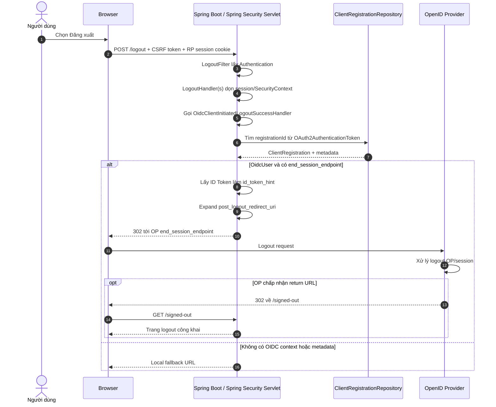

# 24.2. OidcClientInitiatedLogoutSuccessHandler trên Servlet

Khi người dùng đăng nhập bằng OpenID Connect (OIDC) vào một ứng dụng Spring Security OAuth 2.0 Client, **đăng xuất khỏi ứng dụng** không nhất thiết đồng nghĩa **đăng xuất khỏi OpenID Provider (OP)**. Sau khi Spring Security xóa HTTP session của ứng dụng, phiên đăng nhập một lần (SSO) tại OP vẫn có thể còn hoạt động. Nếu người dùng đăng nhập lại, OP có thể xác thực họ ngay mà không hỏi lại mật khẩu.

Trên **Spring MVC/Servlet**, class **`OidcClientInitiatedLogoutSuccessHandler`** cho phép ứng dụng (Relying Party, RP) khởi phát **OIDC RP-Initiated Logout**: sau khi logout cục bộ, trình duyệt được redirect sang `end_session_endpoint` của OP với **`id_token_hint`** và tùy chọn **`post_logout_redirect_uri`**.

Ví dụ tối giản:

```java
OidcClientInitiatedLogoutSuccessHandler handler =
    new OidcClientInitiatedLogoutSuccessHandler(clientRegistrationRepository);

handler.setPostLogoutRedirectUri("{baseUrl}/signed-out");

http.logout(logout ->
    logout.logoutSuccessHandler(handler));
```

Đây là một `LogoutSuccessHandler`, không phải nơi tự tạo access token, không phải API revoke refresh token và không phải một LogoutHandler thay thế việc dọn session.

Bài học thuộc chương **24. Đăng xuất OIDC**, trình bày từ khái niệm giao thức, source dữ liệu Spring Security sử dụng, cấu hình Java hoàn chỉnh, CSRF, local fallback, nhiều provider, reverse proxy, cookie, bảo mật và cách xử lý lỗi thường gặp.

> **Phạm vi:** Java 17+, Spring Boot 3.x, Spring Security 6.x, **Servlet `HttpSecurity`**. API và ví dụ chính đối chiếu Spring Security 6.5; với 7.x hoặc OP cụ thể cần kiểm tra phiên bản. Domain `example.test` trong bài chỉ là minh họa.

---

## 1. Ba phạm vi đăng xuất cần phân biệt

### 1.1. Local logout

Khi browser gửi một yêu cầu logout hợp lệ tới ứng dụng, Spring Security có thể:

- Vô hiệu hóa HTTP session của RP;
- Xóa `SecurityContext` và Authentication;
- Xóa CSRF token hoặc remember-me state theo cấu hình;
- Redirect về một URL cục bộ, thường là `/login?logout`.

Ví dụ:

```text
Browser --> POST https://app.example.test/logout
Spring Security --> invalidate HttpSession
                --> clear SecurityContext
                --> redirect /login?logout

OP session at id.example.test:
                --> có thể vẫn còn
```

Do đó, local logout đúng vẫn có thể dẫn đến **SSO login lại không hỏi mật khẩu**.

### 1.2. RP-Initiated Logout

RP yêu cầu OP kết thúc phiên SSO bằng cách **đưa User Agent tới logout endpoint của OP**. OP có thể xử lý session cookie của chính nó, hỏi người dùng xác nhận, hoặc điều hướng về RP.

```text
Browser --> POST /logout tại RP
RP      --> local session cleanup
RP      --> 302 Location: https://id.example.test/.../logout?...
Browser --> GET OP logout endpoint
OP      --> logout session theo policy
OP      --> tùy chọn redirect về https://app.example.test/signed-out
```

Việc OP có thật sự kết thúc phiên, có yêu cầu xác nhận và có redirect về không **thuộc chính sách OP**, không phải điều handler có thể bảo đảm tuyệt đối.

### 1.3. Thu hồi token và logout các ứng dụng khác

RP-Initiated Logout **không tự động** thực hiện:
- OAuth2 token revocation cho mọi access/refresh token;
- Xóa mọi `OAuth2AuthorizedClient` trong database độc lập;
- Logout mọi thiết bị và mọi RP khác;
- Xác nhận chắc chắn token tự chứa (JWT) ngừng hoạt động tại mọi Resource Server.

Nếu hệ thống cần chức năng **Ngắt kết nối**, **Thu hồi quyền**, hoặc **Đăng xuất trên tất cả thiết bị**, phải thiết kế và sử dụng những cơ chế riêng mà OP/API hỗ trợ.

| Việc cần thực hiện | Cơ chế chính | Chủ thể quyết định |
| --- | --- | --- |
| Dọn session của ứng dụng | `LogoutFilter` và `LogoutHandler` | Spring Security / RP |
| Yêu cầu OP logout qua browser | **`OidcClientInitiatedLogoutSuccessHandler`** | RP gửi yêu cầu; OP xử lý |
| OP yêu cầu RP logout | OIDC Back-Channel Logout / Logout Token | OP và RP |
| Thu hồi credential | Revocation endpoint và token policy | Authorization Server |
| Chặn access token tại API | Token validation/revocation policy | Resource Server |

## 2. Các bên tham gia

Một hệ thống minh họa:

| Thành phần | Địa chỉ/định danh |
| --- | --- |
| Relying Party (ứng dụng Spring Boot) | `https://app.example.test` |
| RP logout endpoint | `POST /logout` |
| OpenID Provider issuer | `https://id.example.test/realms/company` |
| OP `end_session_endpoint` | `https://id.example.test/realms/company/protocol/openid-connect/logout` |
| Trang RP sau logout | `https://app.example.test/signed-out` |

**Ba URI khác nhau**:
1. `/logout`: browser yêu cầu **RP** logout local.
2. `end_session_endpoint`: browser đi tới **OP** để yêu cầu kết thúc session OP.
3. `post_logout_redirect_uri`: URI **RP** mà OP có thể đưa browser về.

URI `/login/oauth2/code/{registrationId}` là **authorization-code callback** của login, **không** phải post-logout return URI.

## 3. Sơ đồ luồng chuẩn



**Thứ tự xử lý** quan trọng: `LogoutHandler` chạy trước `LogoutSuccessHandler`. Tuy `SecurityContext` được dọn, Spring Security vẫn truyền đối tượng **Authentication gốc** vào `onLogoutSuccess`; handler cần nó để lấy ID Token.

## 4. Cấu trúc OidcClientInitiatedLogoutSuccessHandler

Class Servlet:

```java
import org.springframework.security.oauth2.client.oidc.web.logout.OidcClientInitiatedLogoutSuccessHandler;
```

Nó kế thừa `SimpleUrlLogoutSuccessHandler` và implement `LogoutSuccessHandler`. Constructor:

```java
new OidcClientInitiatedLogoutSuccessHandler(
    ClientRegistrationRepository clientRegistrationRepository)
```

`ClientRegistrationRepository` là kho **cấu hình OAuth2/OIDC clients**, không phải nơi lưu token hoặc session. Handler tìm `ClientRegistration` khớp với đăng nhập hiện tại.

### 4.1. Điều kiện để có OP logout redirect

Theo implementation Spring Security 6.x, handler cần:

1. `Authentication` thuộc loại **`OAuth2AuthenticationToken`**.
2. Principal là **`OidcUser`** và cung cấp ID Token.
3. Có `ClientRegistration` theo `getAuthorizedClientRegistrationId()`.
4. Metadata của registration có **`end_session_endpoint`**.

Khi đủ điều kiện, handler xây URL OP logout. Khi thiếu điều kiện, handler có thể sử dụng **fallback** inherited từ `SimpleUrlLogoutSuccessHandler`.

### 4.2. Vì sao phải là OidcUser?

`OAuth2User` trong OAuth2 login thuần không nhất thiết có ID Token. Với OIDC Login, principal thường là `OidcUser`, có:

```java
OidcUser user = (OidcUser) authentication.getPrincipal();
String idToken = user.getIdToken().getTokenValue();
```

**Đoạn code này chỉ để giải thích nguồn ID Token**, không phải lời khuyên ghi token vào log hoặc trả ra JSON. Dùng access token hoặc refresh token thay cho ID Token là sai ngữ nghĩa.

### 4.3. Auth được chọn bằng cách nào?

```text
OAuth2AuthenticationToken
  principal: OidcUser
  authorizedClientRegistrationId: "company"
              |
              v
ClientRegistrationRepository.findByRegistrationId("company")
              |
              v
ProviderDetails.configurationMetadata["end_session_endpoint"]
```

Việc handler lấy đúng registration theo Authentication tránh trường hợp tự chọn nhầm OP và đưa ID Token của OP A sang logout endpoint OP B.

### 4.4. Local fallback

Nếu user chưa đăng nhập, login bằng form hoặc không có metadata logout, handler không tự tạo một URI OP giả. Với fallback:

```java
handler.setDefaultTargetUrl("/signed-out");
```

`setDefaultTargetUrl` thuộc class cha `SimpleUrlLogoutSuccessHandler`. **Nó khác với `setPostLogoutRedirectUri`**.

## 5. Hiểu các tham số RP-Initiated Logout

Theo **OpenID Connect RP-Initiated Logout 1.0**:

| Tham số | Chức năng | Lưu ý |
| --- | --- | --- |
| **`id_token_hint`** | ID Token OP đã cấp, giúp gợi ý user/session cần logout | Khuyến nghị; handler lấy từ `OidcUser` |
| **`post_logout_redirect_uri`** | RP muốn OP đưa browser về URI này sau logout | Tùy chọn, phải được OP cho phép/đăng ký |
| `state` | Correlation tùy chọn giữa request logout và return redirect | Chuẩn hỗ trợ, **không tự giả định handler cơ bản đã quản lý state** |
| `logout_hint` | Gợi ý về session/user theo chính sách OP | Không được mọi OP hỗ trợ giống nhau |
| `client_id` | Định danh client trong các trường hợp OP cần | Không phải parameter mặc định mà mọi handler/version đều gửi |

### 5.1. id_token_hint từ đâu?

OP đã cấp ID Token trong OIDC login. Handler dùng giá trị đó làm hint trong OP logout request:

```http
HTTP/1.1 302 Found
Location: https://id.example.test/logout?id_token_hint=<redacted>&post_logout_redirect_uri=https%3A%2F%2Fapp.example.test%2Fsigned-out
```

Tham số có thể được encode trong redirect URL. **Không in nguyên `Location` hoặc `id_token_hint`** ra log, ticket hay trình debug công khai: ID Token là credential chứa thông tin xác thực/danh tính, có thể bị ghi ở browser history/reverse-proxy logs.

### 5.2. post_logout_redirect_uri có tác dụng gì?

Nó là **địa chỉ quay về RP**, không phải nơi OP logout. Ví dụ:

```text
https://app.example.test/signed-out
```

OP phải xác nhận URI này được phép. Không nên nghĩ mọi OP đều redirect về nếu client tự gửi một URI tùy ý. RP-Initiated Logout spec yêu cầu URI khớp một giá trị đã đăng ký hoặc cơ chế registration tương ứng.

### 5.3. state không tự có từ handler

Trong Authorization Code Login, `state` giúp liên hệ login callback với authorization request. RP-Initiated Logout cũng định nghĩa `state` tùy chọn, nhưng là **giao dịch khác**.

`OidcClientInitiatedLogoutSuccessHandler` cơ bản **không phải một framework lưu và kiểm tra logout-callback state đầy đủ**. Nếu ứng dụng cần xác minh return state cho một quy trình nhạy cảm, phải thiết kế correlation, storage, expiry và validation rõ ràng.

### 5.4. post-logout return không bảo đảm logout toàn cục

Việc user quay về `/signed-out` không chứng minh mọi access token, refresh token, OP session trên thiết bị khác hoặc ứng dụng khác đã bị revoke. Nó là **đường điều hướng browser**, không phải một xác nhận global revocation.

---

## 6. Spring Boot 3.x dependencies

```xml
<dependencies>
    <dependency>
        <groupId>org.springframework.boot</groupId>
        <artifactId>spring-boot-starter-web</artifactId>
    </dependency>
    <dependency>
        <groupId>org.springframework.boot</groupId>
        <artifactId>spring-boot-starter-security</artifactId>
    </dependency>
    <dependency>
        <groupId>org.springframework.boot</groupId>
        <artifactId>spring-boot-starter-oauth2-client</artifactId>
    </dependency>
</dependencies>
```

Trong bài này, `HttpSecurity`, `SecurityFilterChain` và handler thuộc **Servlet**. Không dùng `OidcClientInitiatedServerLogoutSuccessHandler` của WebFlux.

## 7. Cấu hình OIDC ClientRegistration

```yaml
spring:
  security:
    oauth2:
      client:
        registration:
          company:
            provider: company
            client-id: ${OIDC_CLIENT_ID}
            client-secret: ${OIDC_CLIENT_SECRET}
            authorization-grant-type: authorization_code
            redirect-uri: "{baseUrl}/login/oauth2/code/{registrationId}"
            scope:
              - openid
              - profile
              - email
        provider:
          company:
            issuer-uri: https://id.example.test/realms/company
```

Giải thích:
- `openid` yêu cầu OIDC authentication/ID Token.
- `issuer-uri` cho phép discovery những endpoints và metadata provider.
- `redirect-uri` là **login callback**, không phải `post_logout_redirect_uri`.
- `end_session_endpoint` phải được provider hỗ trợ và công bố hoặc cấu hình theo hợp đồng; nó **không tự sinh** từ login redirect URI.
- Client secret phải lưu ở môi trường/secrets manager backend, không commit vào mã nguồn.

### 7.1. Discovery metadata

OIDC Discovery thường được truy cập dựa trên issuer và `.well-known/openid-configuration`. OP có thể trả:

```json
{
  "issuer": "https://id.example.test/realms/company",
  "authorization_endpoint": "https://id.example.test/realms/company/protocol/openid-connect/auth",
  "token_endpoint": "https://id.example.test/realms/company/protocol/openid-connect/token",
  "jwks_uri": "https://id.example.test/realms/company/protocol/openid-connect/certs",
  "end_session_endpoint": "https://id.example.test/realms/company/protocol/openid-connect/logout"
}
```

Các URL là ví dụ. **Không đoán `end_session_endpoint` bằng cách nối `/logout`** nếu OP không công bố hoặc không hỗ trợ.

### 7.2. Kiểm tra metadata bằng API Java

Một đoạn quan sát (không log token):

```java
import org.springframework.security.oauth2.client.registration.ClientRegistration;
import org.springframework.security.oauth2.client.registration.ClientRegistrationRepository;

ClientRegistration registration = repository.findByRegistrationId("company");

Object endpoint = registration.getProviderDetails()
    .getConfigurationMetadata()
    .get("end_session_endpoint");

// Kiểm tra có/không, không đưa raw ID Token hay session vào log.
boolean logoutSupported = endpoint != null;
```

Đoạn này không thể hiện đầy đủ null checking; nếu registration không tồn tại phải xử lý rõ. Cũng cần xác minh URL HTTPS và issuer tin cậy trước khi chấp nhận provider mới trong multi-tenant system.

---

## 8. SecurityFilterChain hoàn chỉnh trên Servlet

```java
package example.security;

import org.springframework.context.annotation.Bean;
import org.springframework.context.annotation.Configuration;
import org.springframework.security.config.Customizer;
import org.springframework.security.config.annotation.web.builders.HttpSecurity;
import org.springframework.security.oauth2.client.oidc.web.logout.OidcClientInitiatedLogoutSuccessHandler;
import org.springframework.security.oauth2.client.registration.ClientRegistrationRepository;
import org.springframework.security.web.SecurityFilterChain;
import org.springframework.security.web.authentication.logout.LogoutSuccessHandler;

@Configuration
class OidcLogoutConfiguration {

    @Bean
    SecurityFilterChain securityFilterChain(
            HttpSecurity http,
            ClientRegistrationRepository registrations) throws Exception {

        return http
            .authorizeHttpRequests(authorize -> authorize
                .requestMatchers("/", "/signed-out", "/error").permitAll()
                .anyRequest().authenticated())
            .oauth2Login(Customizer.withDefaults())
            .logout(logout -> logout
                .logoutUrl("/logout")
                .logoutSuccessHandler(oidcLogoutSuccessHandler(registrations)))
            .build();
    }

    private LogoutSuccessHandler oidcLogoutSuccessHandler(
            ClientRegistrationRepository registrations) {

        OidcClientInitiatedLogoutSuccessHandler handler =
            new OidcClientInitiatedLogoutSuccessHandler(registrations);

        // URL RP mong OP redirect về.
        handler.setPostLogoutRedirectUri("{baseUrl}/signed-out");

        // Fallback nếu không phải OIDC login hoặc không có OP endpoint.
        handler.setDefaultTargetUrl("/signed-out");

        return handler;
    }
}
```

**Quan trọng:**
1. `oauth2Login()` xác thực user qua OIDC.
2. `logout()` thiết lập Servlet `LogoutFilter` và logout success behavior.
3. `logoutSuccessHandler(...)` chỉ quyết định việc sau local cleanup, không thay local logout handlers.
4. `setPostLogoutRedirectUri` định nghĩa địa chỉ RP gửi cho OP để quay lại.
5. `setDefaultTargetUrl` định nghĩa fallback local.
6. `/signed-out` phải **công khai** để người dùng vừa logout không lập tức bị chuyển sang login.

### 8.1. Trang sau logout

```java
import org.springframework.stereotype.Controller;
import org.springframework.web.bind.annotation.GetMapping;

@Controller
class SignedOutPageController {

    @GetMapping("/signed-out")
    String signedOut() {
        return "signed-out";
    }
}
```

Ví dụ trên cần template `signed-out.html` hoặc view resolver tương ứng. Có thể dùng controller trả nội dung HTML/JSON khác nếu giao diện không dùng Thymeleaf.

### 8.2. Tại sao không dùng /login/oauth2/code/company làm return URL?

Đó là callback của **Authorization Code Flow**, chờ `code` và `state`. OIDC post-logout return có ngữ nghĩa khác, không nên đưa browser đến endpoint login callback để tránh lỗi callback/correlation.

---

## 9. LogoutFilter, LogoutHandler và LogoutSuccessHandler

Spring Security xử lý local logout theo pipeline:

```text
POST /logout (CSRF hợp lệ)
        |
        v
LogoutFilter
        |
        +-- SecurityContextLogoutHandler
        |     -> invalidateHttpSession (thường bật)
        |     -> clear SecurityContext
        +-- CsrfLogoutHandler
        +-- RememberMe/other LogoutHandlers (nếu có)
        +-- LogoutSuccessEvent (tùy cấu hình)
        |
        v
LogoutSuccessHandler
        |
        +-- OidcClientInitiatedLogoutSuccessHandler
               -> OP redirect hoặc fallback local
```

### 9.1. Auth gốc vẫn được truyền cho success handler

Mặc dù local SecurityContext đã bị dọn, `LogoutFilter` vẫn giữ `Authentication` tại thời điểm bắt đầu logout và chuyển nó vào:

```java
void onLogoutSuccess(
    HttpServletRequest request,
    HttpServletResponse response,
    Authentication authentication);
```

Handler có thể lấy `OidcUser` và ID Token từ Authentication được truyền vào. **Đừng tự viết MVC controller logout rồi xóa Authentication trước khi gọi handler với null**.

### 9.2. Nếu muốn thêm cleanup

Có thể dùng:

```java
.logout(logout -> logout
    .invalidateHttpSession(true)
    .deleteCookies("JSESSIONID")
    .logoutSuccessHandler(oidcHandler))
```

`oidcHandler` là instance từ bean/DI đã cấu hình. Nếu dùng **Spring Session**, cookie có thể có tên `SESSION` thay vì `JSESSIONID`. Xóa cookie đúng tên/Path/Domain là việc riêng; **invalidate session phía server** mới làm session ID cũ không còn phiên đăng nhập.

### 9.3. LogoutHandler có phải nơi redirect không?

Thông thường **không**. LogoutHandler dành cho cleanup, còn `LogoutSuccessHandler` quyết định redirect hoặc response status. Không chuyển `OidcClientInitiatedLogoutSuccessHandler` thành LogoutHandler tùy tiện.

## 10. Đảm bảo CSRF an toàn khi người dùng nhấn Logout

Trong Servlet app dùng CSRF protection mặc định, **POST /logout** có CSRF token là hướng chuẩn. `GET /logout` khi CSRF đang bật thường chỉ hiển thị trang xác nhận.

### 10.1. Ví dụ form Thymeleaf

```html
<form th:action="@{/logout}" method="post">
    <input type="hidden"
           th:name="${_csrf.parameterName}"
           th:value="${_csrf.token}" />
    <button type="submit">Đăng xuất</button>
</form>
```

Tùy tích hợp MVC/Thymeleaf, CSRF hidden field có thể được framework chèn tự động vào form POST; nếu vậy không cần thêm field trùng. Điều quan trọng là browser gửi **một token CSRF hợp lệ** cùng request logout.

### 10.2. Vì sao không tạo link GET trực tiếp?

```html
<!-- Không nên dùng GET như hành động logout có side-effect. -->
<a href="/logout">Đăng xuất</a>
```

Với CSRF bật, GET thông thường là trang confirmation. Tắt CSRF chỉ để GET logout gây nguy cơ logout CSRF và thay đổi mô hình bảo vệ toàn ứng dụng.

### 10.3. SPA/AJAX gọi /logout

Nếu frontend gọi `fetch("/logout")` và nhận redirect cross-origin tới OP, **fetch không giống top-level browser navigation**. CORS hoặc redirect policy có thể khiến tab không thực sự đi đến OP logout.

Với RP-Initiated Logout qua user agent, cách thuận tiện thường là **submit một form POST bằng browser** hoặc thiết kế một flow frontend định hướng điều hướng browser rõ ràng. Không dựa vào một AJAX call nền để khẳng định OP SSO session đã được kết thúc.

## 11. post_logout_redirect_uri và URI template

Handler hỗ trợ:

| URI template variable | Ý nghĩa |
| --- | --- |
| `{baseScheme}` | Scheme của public request, thường `https` |
| `{baseHost}` | Host của RP |
| `{basePort}` | Port (nếu có) |
| `{basePath}` | Context path |
| **`{baseUrl}`** | `{baseScheme}://{baseHost}{basePort}{basePath}` |

Ví dụ:

```java
handler.setPostLogoutRedirectUri("{baseUrl}/signed-out");
```

Nếu RP ở `https://app.example.test` và context path rỗng, URI thành:

```text
https://app.example.test/signed-out
```

Nếu context path là `/portal`:

```text
https://app.example.test/portal/signed-out
```

### 11.1. URI này không phải URL của OP

`post_logout_redirect_uri` thuộc RP. Còn `end_session_endpoint` thuộc OP. Hai giá trị được handler đưa vào redirect request tới OP theo quy tắc encoding.

### 11.2. Đăng ký return URL tại OP

Trong OP console, tùy nhà cung cấp, có thể có field **Allowed post-logout redirect URI**. Ví dụ:

```text
https://app.example.test/signed-out
https://staging.example.test/signed-out
```

URI thực tế handler gửi phải khớp **URI được OP cho phép**, có thể so sánh chính xác scheme/host/port/path/query/trailing slash.

**Không trộn danh sách này với Authorization Code redirect URIs** như `/login/oauth2/code/company`.

### 11.3. URI cố định nếu không muốn phụ thuộc request host

```java
handler.setPostLogoutRedirectUri(
    "https://app.example.test/signed-out");
```

Cách này có thể đơn giản hơn nếu public origin cố định. Đưa giá trị vào externalized config cho từng environment; không hardcode URI production vào staging.

### 11.4. Fallback khác post logout redirect

```java
handler.setPostLogoutRedirectUri("{baseUrl}/signed-out");
handler.setDefaultTargetUrl("/signed-out");
```

- Dòng một: **gửi cho OP** một return URL nếu thực hiện RP-Initiated Logout.
- Dòng hai: **redirect cục bộ** khi handler không tạo được OP logout target.

Nếu người dùng chỉ nhìn thấy trang `/signed-out`, chưa thể suy ra browser đã đến OP. Cần quan sát đường redirect một cách an toàn.

---

## 12. Reverse proxy và public origin

Ví dụ triển khai:

```text
Browser:    https://app.example.test
Ingress:    TLS termination
Spring app: http://app-service:8080
```

Nếu `{baseUrl}` được xây từ internal request, OP có thể nhận:

```text
http://app-service:8080/signed-out
```

thay vì:

```text
https://app.example.test/signed-out
```

Khi dùng reverse proxy tin cậy, có thể cấu hình:

```yaml
server:
  forward-headers-strategy: framework
```

**Chỉ tin Forwarded/X-Forwarded-* do proxy được quản trị thiết lập.** Proxy phải xóa hoặc ghi đè các headers do người dùng bên ngoài tự gửi; nếu không, public base URL có thể bị ảnh hưởng bởi dữ liệu không đáng tin.

### 12.1. Checklist đường mạng

- Browser thật truy cập `https`;
- OP issuer URI và `end_session_endpoint` là các URL tin cậy;
- Proxy chuyển đúng `Host`, scheme, port và context path;
- URI được tạo khớp allowlist của OP;
- Return URL truy cập được công khai, không cần Authentication;
- Không log toàn bộ logout Location chứa `id_token_hint`.

### 12.2. HTTP localhost

Một số OP chấp nhận HTTP localhost cho môi trường dev; số khác yêu cầu HTTPS cho post-logout URI. Không tắt HTTPS/TLS validation trong production để “sửa” mismatch của local. Tạo registration/local profile phù hợp provider policy.

## 13. Nhiều OIDC ClientRegistrations

Một ứng dụng có thể sử dụng hai OP:

```yaml
spring:
  security:
    oauth2:
      client:
        registration:
          company:
            provider: company
            client-id: ${COMPANY_CLIENT_ID}
            client-secret: ${COMPANY_CLIENT_SECRET}
            scope: [openid, profile]
          partner:
            provider: partner
            client-id: ${PARTNER_CLIENT_ID}
            client-secret: ${PARTNER_CLIENT_SECRET}
            scope: [openid, profile]
        provider:
          company:
            issuer-uri: https://id.company.example.test/realm
          partner:
            issuer-uri: https://id.partner.example.test/tenant
```

Khi user login bằng `partner`, `OAuth2AuthenticationToken.getAuthorizedClientRegistrationId()` trả registration phù hợp. Handler lấy **metadata logout của partner**, không lấy OP đầu tiên trong file.

### 13.1. Không chọn logout endpoint từ query parameter

Sai:

```java
String opLogoutUrl = request.getParameter("logoutUrl");
response.sendRedirect(opLogoutUrl + "?id_token_hint=" + idToken);
```

Rủi ro gồm token leakage tới origin do attacker điều khiển, open redirect và login/logout confusion. Logout endpoint phải đến từ metadata/registration đã được tin cậy.

### 13.2. Nhiều authorized clients không đồng nghĩa nhiều OP sessions sẽ được logout

Một user có thể login bằng `company` nhưng đã cấp quyền cho `calendar-api` và `crm-api`. Handler xử lý login Authentication hiện tại; nó không tự revoke hai authorized clients hoặc logout các providers khác.

## 14. Không có end_session_endpoint

Một số providers không hỗ trợ RP-Initiated Logout hoặc không công bố metadata. Khi đó handler không thể tạo URL logout OIDC từ `end_session_endpoint` và có thể fallback.

Không nên tự đoán:

```text
issuer + "/logout"
issuer + "/protocol/openid-connect/logout"
authorization_endpoint.replace("/authorize", "/logout")
```

Những cách nối chuỗi này không đúng cho mọi OP. Phải kiểm tra **OIDC Discovery / tài liệu provider** và chính sách cấu hình client.

### 14.1. Không có ID Token

OAuth2 Login thuần có thể trả access token nhưng không có ID Token. Trong trường hợp đó principal không phải `OidcUser`, nên handler OIDC không có `id_token_hint`. Không dùng access token làm ID Token giả để “ép” logout.

### 14.2. Form Login cũng là fallback

Nếu app hỗ trợ cả `formLogin()` và `oauth2Login()`, việc form user logout local là hợp lý. Dùng fallback URL chung `/signed-out` nhưng không hiển thị xác nhận OP logout khi không thực hiện OP redirect.

---

## 15. Session cookie của RP và OP là độc lập

```text
app.example.test:
    JSESSIONID hoặc SESSION (RP cookie)

id.example.test:
    SSO cookie của OP
```

Khi RP invalidate session, browser có thể vẫn giữ cookie OP. RP không thể xóa trực tiếp host-only cookie của domain OP chỉ bằng một `Set-Cookie` từ domain app. OP cần được truy cập qua browser để xử lý session OP.

### 15.1. HttpSession invalidate không tự xóa mọi token

Một `OAuth2AuthorizedClient` lưu trong HTTP session có thể biến mất khi session bị invalidate. Nhưng nếu sử dụng persistent `OAuth2AuthorizedClientService` (ví dụ DB), record token có thể vẫn tồn tại.

Việc dọn token store phải theo **registration/principal** và policy. Không xóa token user khác, không tự gọi token revocation endpoint khi chưa có yêu cầu nghiệp vụ/authorization tương ứng.

### 15.2. Access token có thể vẫn hoạt động sau logout

Resource Server có thể chấp nhận access token còn hiệu lực đến khi hết hạn nếu không có revocation check. Vì thế:
- Local logout không tự thu hồi access token;
- RP-Initiated Logout không phải token revocation;
- Expiry, introspection, revocation và API access policy thuộc vòng đời token riêng.

### 15.3. Cẩn trọng khi xóa cookie

```java
.logout(logout -> logout
    .invalidateHttpSession(true)
    .deleteCookies("JSESSIONID")
    .logoutSuccessHandler(handler))
```

Với Spring Session có thể dùng cookie `SESSION`. Cookie deletion phải khớp tên/Path/Domain và không thay thế server-side invalidation.

## 16. GET redirect và POST tới OP

Theo Spring Security 6.5, handler mặc định redirect browser bằng **HTTP GET** tới OP logout endpoint. Khi cần gửi OP logout theo phương thức POST và OP hỗ trợ, Spring Security có hướng dẫn cấu hình redirect strategy thích hợp như `FormPostRedirectStrategy`.

**Tách hai POST:**
- **POST /logout tại RP**: yêu cầu local logout, cần CSRF token với session-based CSRF protection.
- **Form POST tới OP logout endpoint**: yêu cầu RP-Initiated Logout theo response mode mà OP hỗ trợ, không dùng CSRF token của RP.

GET có thể đưa `id_token_hint` vào URL; POST giảm rủi ro lộ qua query nhưng không tự làm ID Token vô hại. Chỉ đổi redirect strategy khi phiên bản Spring Security và OP thực sự hỗ trợ, giữ bảo vệ TLS/headers/logs phù hợp.

## 17. Logout success URL không phải bằng chứng OP logout

Giả sử browser thấy:

```text
https://app.example.test/signed-out
```

Có ít nhất hai khả năng:
1. RP đã redirect tới OP, OP xử lý rồi trả browser về.
2. Handler không có OIDC context/metadata và sử dụng local fallback tới cùng trang.

Ngay cả trường hợp một, không có bảo đảm mọi session/tokens ở mọi thiết bị đã bị revoke.

Nếu sản phẩm cần analytics, hãy ghi nhận **nguồn điều hướng** ở nơi handler quyết định (`rp_initiated_redirect` hay `local_fallback`) với dữ liệu an toàn, không dựa vào query parameter do caller tự khai báo.

### 17.1. Trang /signed-out phải public

Sai:

```java
.authorizeHttpRequests(auth -> auth
    .anyRequest().authenticated())
```

nếu trang return không được ngoại lệ. Sau logout, nó có thể bị đưa tới login lại rồi OP SSO tạo login loop.

Đúng:

```java
.authorizeHttpRequests(auth -> auth
    .requestMatchers("/signed-out", "/", "/error").permitAll()
    .anyRequest().authenticated())
```

Không biến **mọi** endpoint thành permitAll chỉ để trang signed-out hoạt động.

## 18. Phân biệt với OIDC Back-Channel Logout

**RP-Initiated Logout**: RP bắt đầu bằng browser redirect tới OP.

**Back-channel Logout**: OP gửi một **Logout Token** tới RP endpoint, và RP xác minh token để kết thúc session liên quan.

```text
RP-Initiated:
  User -> RP POST /logout
  RP -> Browser -> OP logout endpoint

Back-channel:
  OP -> RP POST /logout/connect/back-channel/{registrationId}
  RP -> validate Logout Token -> invalidate matching RP sessions
```

Hai component trên Servlet:

| Chức năng | Class/API |
| --- | --- |
| RP phát yêu cầu logout tới OP | `OidcClientInitiatedLogoutSuccessHandler` |
| OP phát yêu cầu logout tới RP | `OidcBackChannelLogoutHandler` / `oidcLogout().backChannel()` |
| Xóa SecurityContext/HttpSession | `SecurityContextLogoutHandler` |
| Redirect local sau logout | `SimpleUrlLogoutSuccessHandler` |

Chỉ cấu hình Back-channel khi OP và nghiệp vụ cần hỗ trợ. RP-Initiated handler không tự bật callback Back-channel hay xử lý `sid`/`sub` từ Logout Token.

## 19. Logging và bảo mật

Một sự kiện observability hợp lý:

```json
{
  "event": "oidc_rp_initiated_logout",
  "registration_id": "company",
  "mode": "op_redirect",
  "end_session_endpoint_present": true,
  "post_logout_redirect_configured": true,
  "trace_id": "internal-id"
}
```

Đây là schema ví dụ **do ứng dụng tự định nghĩa**, không phải Spring Security tự tạo.

Nên tránh ghi:
- `id_token_hint` và raw ID Token;
- Full `Location` chứa ID Token;
- HTTP session cookie và CSRF token;
- Access token/refresh token và Authorization header;
- Toàn bộ `OidcUser` claims;
- Provider error strings hoặc URL query chứa dữ liệu cá nhân.

Có thể ghi có kiểm soát:
- Registration ID từ cấu hình;
- OP logout metadata có/không;
- Redirect mode theo category;
- HTTP status category;
- Trace ID nội bộ (không phải token).

### 19.1. Không để OP issuer do user nhập

Cho client tự chọn `issuerUri` và tin metadata của một URL bất kỳ có thể làm RP gửi ID Token hint tới endpoint do attacker kiểm soát. Chỉ dùng issuer/client registration từ nguồn đáng tin, với cơ chế tenant onboarding/allowlist và security review phù hợp.

### 19.2. Không ghi raw URL vào exception

Khi debug 302/Location, URL có thể bao gồm `id_token_hint`. Nên mask/redact trước khi xuất log, ticket hoặc telemetry. Việc ID Token xuất hiện trong URL không làm nó trở thành dữ liệu công khai vô hại.

---

## 20. Các tình huống lỗi thường gặp

| Triệu chứng | Nguyên nhân khả dĩ | Hướng xử lý |
| --- | --- | --- |
| Chỉ thấy `/login?logout` | Không có OIDC context hoặc thiếu OP metadata | Xem principal/registration/`end_session_endpoint` |
| Chỉ thấy fallback `/signed-out` | Handler không tạo OP target | Phân biệt local fallback với OP redirect |
| GET /logout ra confirmation page | CSRF đang bật | Dùng POST + CSRF token |
| POST /logout trả 403 | Thiếu/sai CSRF token | Xem form, session và CSRF repository |
| Logout không redirect OP | Chưa đăng ký handler trong `logoutSuccessHandler` | Kiểm tra SecurityFilterChain xử lý route |
| OP báo invalid post_logout_redirect_uri | Return URI chưa allowlist hoặc khác path/scheme | Sửa OP registration và public URL |
| `{baseUrl}` thành `http://app-service:8080` | Reverse proxy / forwarded headers sai | Cấu hình public scheme/host từ trusted proxy |
| OP logout rồi quay lại bị login ngay | `/signed-out` bị bảo vệ | `permitAll()` cho trang return |
| RP session hết nhưng OP vẫn SSO | OP redirect không xảy ra hoặc OP policy khác | Xem browser navigation và OP session |
| OP logout nhưng không return RP | OP từ chối URI, user đóng tab hoặc không hỗ trợ | Không coi redirect về là bắt buộc |
| Login bằng form không redirect OP | Principal không phải `OidcUser` | Fallback local hợp lý |
| OAuth2 thuần không logout OP | Không có ID Token/OIDC principal | Không dùng access token thay ID Token |
| Login lại không cần mật khẩu | OP SSO session chưa kết thúc | Kiểm tra OP session, không kết luận local logout lỗi |
| Token trong DB vẫn còn sau logout | Persistent authorized-client service | Thiết kế removal/revocation riêng |
| API vẫn chấp nhận token sau logout | Access token chưa expire/revoke | Token lifetime/RS revocation policy |
| Redirect GET bị log ID Token | Query chứa `id_token_hint` | Redact logs, cân nhắc POST nếu hỗ trợ |
| Logout sai provider | Mapping registration sai hoặc custom URL | Dựa vào Authentication + trusted registration |
| Spring Session cookie vẫn thấy | Cookie name/Path/Domain hoặc browser cache | Kiểm tra session invalidation và đúng cookie |
| API logout thực hiện trong fetch không chuyển tab | CORS/browser redirect semantics | Form POST / top-level navigation |
| Multiple sessions vẫn tồn tại | RP-Initiated không đồng nghĩa global logout | Cần OP session policy/Back-channel/revocation |
| Không có `end_session_endpoint` | OP không công bố metadata logout | Kiểm tra provider docs, không đoán URL |

## 21. Quy trình điều tra một lỗi logout

1. Xác nhận user **đăng nhập bằng OIDC**, có `OidcUser`.
2. Xác nhận `OAuth2AuthenticationToken.getAuthorizedClientRegistrationId()` phù hợp.
3. Kiểm tra `ClientRegistrationRepository` có registration đó.
4. Xác nhận provider discovery metadata có `end_session_endpoint`.
5. Xác nhận browser gửi **POST /logout** với CSRF token hợp lệ.
6. Xác nhận Servlet `LogoutFilter` và các logout handlers đã dọn local session.
7. Xác nhận `OidcClientInitiatedLogoutSuccessHandler` thực sự được gắn vào filter chain.
8. Xem redirect **đã che token**: đi tới OP hay fallback local?
9. Nếu đi OP, xác nhận `post_logout_redirect_uri` đúng public URL và được OP allowlist.
10. Xác nhận browser thật đến OP; không chỉ thấy AJAX fetch hoàn thành.
11. Quan sát OP session policy: logout, confirm dialog, return redirect.
12. Kiểm tra `/signed-out` được `permitAll()` và không auto-login.
13. Nếu cần revoke token, xử lý qua workflow riêng, không coi handler đã làm.
14. Với nhiều providers hoặc tenants, xác nhận issuer và ID Token được gửi đúng OP.

Đây là các bước nghiên cứu/kiểm tra dành cho người học, không phải yêu cầu chạy QA content hoặc test của dự án trong bước viết tài liệu.

## 22. Bài thực hành tình huống

### A. Local logout nhưng SSO còn

Alice logout Portal, sau đó login lại và lập tức vào Dashboard.

**Giải thích:** Local session của Portal có thể đã được xóa đúng, trong khi SSO session của OP vẫn còn. Cấu hình RP-Initiated Logout nếu cần logout ở OP.

### B. Thiếu `end_session_endpoint`

OIDC Discovery cung cấp token và authorize endpoints nhưng không có logout endpoint.

**Hướng xử lý:** Handler có thể fallback local; kiểm tra OP có hỗ trợ RP-Initiated Logout hay không. Không nối tùy ý `/logout` vào issuer.

### C. OP từ chối return URL

Provider đã đăng ký `https://app.example.test/signed-out` nhưng handler gửi `http://localhost:8080/signed-out`.

**Hướng xử lý:** Sửa public origin và registration của OP; không tắt CSRF hoặc signature validation để khắc phục.

### D. Người dùng form login

Một người dùng đăng nhập local username/password và nhấn logout; handler không redirect OP.

**Giải thích:** Authentication không phải `OAuth2AuthenticationToken` có `OidcUser`. Fallback local là hợp lý.

### E. Trang return gây login loop

Sau logout, OP redirect về `/signed-out` nhưng trang này yêu cầu Authentication và Spring Security lập tức bắt đầu OAuth2 Login.

**Hướng xử lý:** Mở public path `/signed-out` và tránh gọi API có redirect login tự động từ trang này.

### F. Nhiều OP

User login qua `partner` nhưng developer hardcode logout endpoint của `company`.

**Rủi ro:** Gửi ID Token tới OP sai hoặc logout thất bại. Dùng registration ID từ Authentication để tìm đúng metadata.

### G. Access token vẫn gọi API được

RP và OP đã logout nhưng một access token JWT cũ vẫn chưa hết hạn.

**Giải thích:** RP-Initiated Logout không phải revocation và Resource Server có thể không theo dõi OP session. Thiết kế token lifetime/revocation riêng.

### H. Xóa session trước khi gọi custom handler

Custom controller đặt `SecurityContextHolder.clearContext()@@ rồi gọi `onLogoutSuccess(..., null)@@.

**Rủi ro:** Không còn Authentication/ID Token hint. Dùng LogoutFilter chuẩn để truyền auth gốc cho handler.

### I. Browser fetch() không đi tới OP

UI gửi `fetch("/logout", { method: "POST" })`; CORS chặn redirect tới OP.

**Hướng xử lý:** Dùng form POST hoặc browser navigation phù hợp, không mặc định fetch kích hoạt top-level redirect.

### J. Yêu cầu state cho logout callback

Sản phẩm muốn xác nhận callback về từ OP thuộc logout flow đã khởi động.

**Giải thích:** RP-Initiated Logout chuẩn có tham số state tùy chọn, nhưng handler cơ bản không phải hệ thống lưu/validate logout state đầy đủ. Cần xây cơ chế tương quan riêng nếu nghiệp vụ yêu cầu.

### K. Thu hồi toàn bộ phiên của user

Business yêu cầu một nút “Logout khỏi tất cả thiết bị” chỉ bằng handler này.

**Giải thích:** Handler chủ yếu yêu cầu OP logout qua browser hiện tại. Không hứa global logout; cần OP admin/session APIs hoặc cơ chế phù hợp và authorization.

### L. Cookie Spring Session

Một deployment dùng Spring Session Redis với cookie `SESSION`. Config `deleteCookies("JSESSIONID")` không xóa cookie thực.

**Hướng xử lý:** Cấu hình đúng tên cookie/path/domain; đảm bảo server-side session invalidation và các session store đang được sử dụng.

### M. Đăng xuất bằng GET link

Developer dùng `<a href="/logout">` và tắt CSRF vì GET chỉ hiện confirmation.

**Hướng xử lý:** Không tắt CSRF vì lý do này. Dùng POST form gửi CSRF token như khuyến nghị.

### N. Token hint bị ghi vào logs

Proxy ghi full 302 `Location` chứa `id_token_hint`.

**Hướng xử lý:** Redact các trường nhạy cảm trong location/query logs, hạn chế dữ liệu analytics, xem lại phương thức GET/POST theo OP compatibility.

---

## 23. Câu hỏi tự kiểm tra

**Câu 1.** Package Servlet của handler là gì?

> `org.springframework.security.oauth2.client.oidc.web.logout.OidcClientInitiatedLogoutSuccessHandler`.

**Câu 2.** Class này là LogoutHandler hay LogoutSuccessHandler?

> Là **`LogoutSuccessHandler`**. LogoutHandlers dọn local session trước; handler quyết định redirect sau đó.

**Câu 3.** Constructor nhận gì?

> `ClientRegistrationRepository`, dùng để lấy registration/provider metadata.

**Câu 4.** Điều kiện quan trọng để handler redirect OP là gì?

> Authentication OIDC phù hợp, principal `OidcUser`, registration tồn tại và có `end_session_endpoint`.

**Câu 5.** `id_token_hint` đến từ token nào?

> **ID Token** của `OidcUser`, không phải access token/refresh token.

**Câu 6.** `setPostLogoutRedirectUri` khác `setDefaultTargetUrl` thế nào?

> Cái đầu đặt URI OP có thể redirect **về RP**; cái sau đặt **fallback local** nếu handler không có OP logout target.

**Câu 7.** `{baseUrl}` được suy ra từ đâu?

> Scheme, host, port và context path của public Servlet request, có thể bị ảnh hưởng bởi forwarded headers từ trusted proxy.

**Câu 8.** Vì sao OP không được redirect tới URI bất kỳ?

> Để tránh open redirect/phishing; post-logout return URI phải được đăng ký/cho phép theo RP-Initiated Logout spec.

**Câu 9.** Nên gọi local logout bằng HTTP method nào khi CSRF bật?

> **POST** với CSRF token hợp lệ; GET thường hiển thị confirmation.

**Câu 10.** Handler có tự revoke refresh token không?

> **Không.** Token revocation là trách nhiệm riêng.

**Câu 11.** Handler có tự logout mọi thiết bị không?

> Không bảo đảm. Kết quả OP session và global logout theo OP policy.

**Câu 12.** Khi login bằng OAuth2 không có ID Token thì sao?

> Không thể mặc định sử dụng OIDC RP-Initiated Logout; handler thường fallback local.

**Câu 13.** Vì sao `/signed-out` nên công khai?

> Sau logout Authentication đã bị xóa; nếu trang yêu cầu login sẽ gây redirect/relogin loop.

**Câu 14.** `state` của OIDC logout có giống `state` của login không?

> Cả hai liên quan correlation nhưng là giao dịch khác nhau. Handler cơ bản không nên bị coi là đã tự tạo và validate logout state.

**Câu 15.** Vì sao không log full logout redirect Location?

> Nó có thể chứa ID Token trong `id_token_hint`.

**Câu 16.** Handler có thay thế Back-channel Logout không?

> Không. Back-channel là OP gửi Logout Token tới RP, là luồng khác.

**Câu 17.** Khi handler fallback local, có nên ghi nhận OP logout thành công không?

> Không, vì không có bảo đảm browser đã đến OP.

**Câu 18.** Với nhiều OP, làm sao chọn đúng logout endpoint?

> Dựa vào `getAuthorizedClientRegistrationId()` từ Authentication và trusted `ClientRegistrationRepository`.

## 24. Sơ đồ kết luận

```text
User click "Đăng xuất"
           |
           v
Browser POST /logout + CSRF
           |
           v
Spring Security LogoutFilter
           |
           +-- LogoutHandler(s):
           |     invalidate RP HttpSession
           |     clear SecurityContext
           |
           v
OidcClientInitiatedLogoutSuccessHandler
           |
           +-- OAuth2AuthenticationToken + OidcUser?
           +-- ClientRegistration đúng?
           +-- end_session_endpoint có?
           |
           +-- YES:
           |      |
           |      +-- id_token_hint = original OIDC ID Token
           |      +-- post_logout_redirect_uri (nếu cấu hình)
           |      |
           |      v
           |    302 tới OP logout endpoint
           |      |
           |      v
           |    OP xử lý SSO session
           |      |
           |      +-- Return URL được OP cho phép -> /signed-out
           |      +-- Không redirect về -> RP vẫn local-logged-out
           |
           +-- NO:
                  |
                  v
                Local fallback /signed-out
```

**Những điểm cốt lõi:**

1. **`OidcClientInitiatedLogoutSuccessHandler`** là RP-Initiated Logout success handler cho **Servlet**.
2. Nó tìm **`end_session_endpoint`** từ provider metadata và **ID Token hint** từ `OidcUser`.
3. **Local logout xảy ra trước redirect**; OP logout phụ thuộc browser và OP policy.
4. **`post_logout_redirect_uri`** cần trùng allowlist tại OP; **`{baseUrl}`** phải dựa trên public origin đúng.
5. **POST /logout cần CSRF token** khi CSRF bật; không tắt CSRF để thực hiện GET logout.
6. Handler có **fallback local** khi OIDC context/metadata không đủ; không được coi fallback là OP logout thành công.
7. **RP-Initiated Logout, Back-channel Logout và token revocation khác nhau**; handler không tự xóa mọi phiên/tokens.
8. **Không log ID Token, location chứa `id_token_hint` hoặc raw session cookies**.
9. Với multi-provider, **registration và OP endpoint phải đến từ Authentication + cấu hình tin cậy**, không từ user input.

### Tài liệu tham khảo chính thức

- [Spring Security 6.5 — OIDC Logout trên Servlet](https://docs.spring.io/spring-security/reference/6.5/servlet/oauth2/login/logout.html)
- [Spring Security 6.5 — Handling Logouts trên Servlet](https://docs.spring.io/spring-security/reference/6.5/servlet/authentication/logout.html)
- [Spring Security API — OidcClientInitiatedLogoutSuccessHandler](https://docs.spring.io/spring-security/reference/6.5/api/java/org/springframework/security/oauth2/client/oidc/web/logout/OidcClientInitiatedLogoutSuccessHandler.html)
- [Spring Security API — LogoutSuccessHandler](https://docs.spring.io/spring-security/reference/6.5/api/java/org/springframework/security/web/authentication/logout/LogoutSuccessHandler.html)
- [Spring Security source — OidcClientInitiatedLogoutSuccessHandler](https://github.com/spring-projects/spring-security/blob/main/oauth2/oauth2-client/src/main/java/org/springframework/security/oauth2/client/oidc/web/logout/OidcClientInitiatedLogoutSuccessHandler.java)
- [OpenID Connect RP-Initiated Logout 1.0 — Final](https://openid.net/specs/openid-connect-rpinitiated-1_0-final.html)
- [OpenID Connect Discovery 1.0](https://openid.net/specs/openid-connect-discovery-1_0.html)
- [OpenID Connect Back-Channel Logout 1.0](https://openid.net/specs/openid-connect-backchannel-1_0.html)
