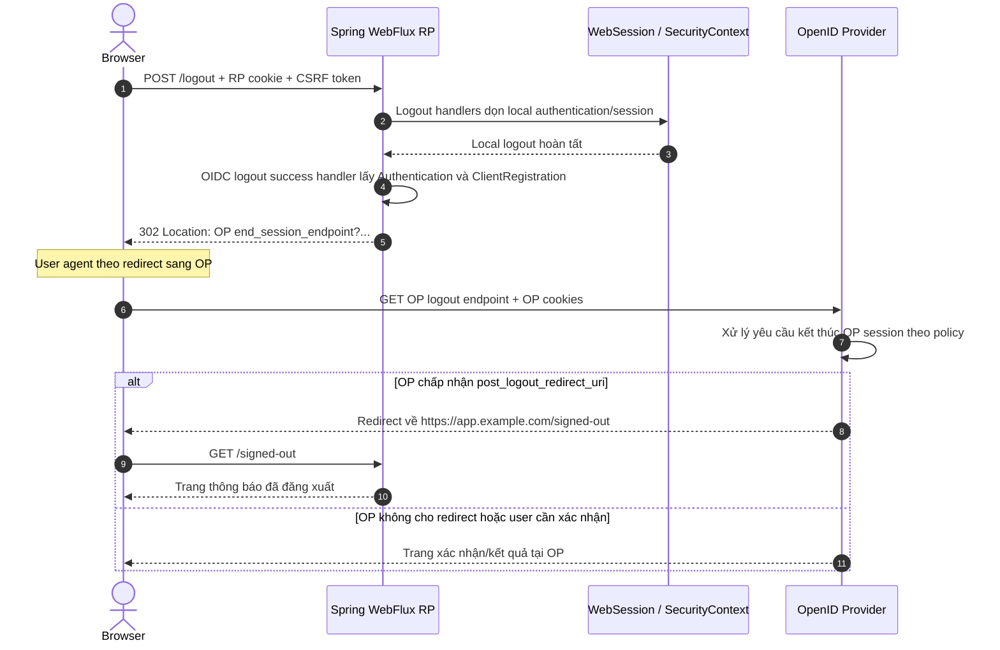

# 24.3. OidcClientInitiatedServerLogoutSuccessHandler trên Reactive

Một ứng dụng **Spring Security OAuth 2.0 / OpenID Connect (OIDC) Client** chạy bằng **Spring WebFlux** có thể cho người dùng đăng nhập qua OpenID Provider (OP), lưu phiên ứng dụng trong `WebSession` và truy cập những tài nguyên đã được cấp quyền. Tuy nhiên, khi người dùng chọn **Đăng xuất**, việc xóa phiên của ứng dụng **không đương nhiên kết thúc phiên Single Sign-On (SSO) tại OP**.

Nếu chỉ đăng xuất cục bộ, người dùng có thể quay lại màn hình đăng nhập, nhấn nút đăng nhập qua cùng OP và được xác thực ngay lập tức vì **cookie SSO của OP vẫn còn hiệu lực**. Để chủ động yêu cầu OP kết thúc phiên, Spring Security reactive cung cấp:

**`OidcClientInitiatedServerLogoutSuccessHandler`**

Lớp này hỗ trợ **OIDC RP-Initiated Logout**: ứng dụng đóng vai trò **Relying Party (RP)**, xử lý local logout rồi chuyển **trình duyệt** đến logout endpoint của OP. Sau khi OP xử lý, trình duyệt có thể được chuyển về một địa chỉ đã đăng ký của ứng dụng.

Bài học giải thích cơ chế và triển khai trên **Spring Boot 3.x, Spring Security 6.x, WebFlux và Reactor**; đồng thời phân biệt local logout, RP-Initiated Logout, Back-Channel Logout, token revocation, bảo vệ CSRF, cấu hình redirect qua reverse proxy, chạy nhiều instances và kiểm thử.

> **Điểm cần nhớ:** `OidcClientInitiatedServerLogoutSuccessHandler` là **ServerLogoutSuccessHandler dùng để điều hướng user agent tới OP**, không phải HTTP client dùng refresh token hoặc một endpoint tự động thu hồi toàn bộ token và phiên SSO trên mọi thiết bị.

Các địa chỉ và ID trong ví dụ chỉ có mục đích minh họa. Cần kiểm tra metadata, URI và chính sách thực tế của OP đang tích hợp.

## 1. Vì sao ứng dụng OIDC cần hai tầng đăng xuất?

Trong kiến trúc OIDC thông thường, **hai miền phiên** có thể tồn tại đồng thời:

1. **Phiên tại Relying Party (RP):** Spring WebFlux ứng dụng dùng `WebSession` và `SecurityContext` để biết browser hiện đang có Authentication nào.
2. **Phiên tại OpenID Provider (OP):** trình duyệt có cookie/SSO session thuộc domain của nhà cung cấp danh tính, ví dụ SSO doanh nghiệp.

```text
Browser
  |
  +-- Cookie cho app.example.com
  |      |
  |      +--> Spring WebFlux / WebSession / SecurityContext
  |                     |
  |                     +--> User đã login vào ứng dụng
  |
  +-- Cookie cho login.example-idp.com
         |
         +--> Phiên SSO tại OpenID Provider
                        |
                        +--> User có thể vẫn đăng nhập tại OP
```

Xóa `WebSession` của ứng dụng **không xóa được cookie phiên thuộc domain của OP** bằng một HTTP response từ domain khác. Trình duyệt phải đến OP (hoặc OP phải chủ động thực hiện một cơ chế logout được hỗ trợ) để giải quyết phía OP.

### 1.1. Ba tình huống logout không giống nhau

| Tình huống | Ai khởi xướng? | Kết quả mong muốn | Cơ chế liên quan |
| --- | --- | --- | --- |
| **Local Logout** | User tại ứng dụng | Xóa SecurityContext/phiên ứng dụng | `logout()`, `ServerLogoutHandler` |
| **RP-Initiated Logout** | User tại ứng dụng, RP chuyển browser tới OP | Đăng xuất RP và yêu cầu OP kết thúc SSO session | `OidcClientInitiatedServerLogoutSuccessHandler` |
| **OP-Initiated / Back-Channel Logout** | OP | OP thông báo RP chấm dứt các phiên liên quan | OIDC Logout Token và endpoint riêng, nếu được hỗ trợ |

Ngoài ra còn có **OAuth 2.0 Token Revocation (RFC 7009)**. Việc thu hồi access/refresh token qua revocation endpoint **khác** với RP-Initiated Logout. Một OP có thể hỗ trợ một số cơ chế nhưng không hỗ trợ tất cả.

### 1.2. Tại sao local logout chưa giải quyết trải nghiệm SSO?

Ví dụ:

```text
09:00  User đăng nhập ứng dụng qua OP.
09:10  User nhấn Đăng xuất.
09:10  RP xóa SecurityContext.
09:11  User vào /oauth2/authorization/company.
09:11  OP vẫn có phiên SSO -> cấp authorization response mới.
09:11  User được login lại không cần nhập mật khẩu.
```

Điều này **không nhất thiết là lỗi của Spring Security**. RP đã làm local logout nhưng chưa yêu cầu OP kết thúc phiên SSO. Khi sản phẩm muốn “Đăng xuất cả SSO”, cần xác nhận OP hỗ trợ RP-Initiated Logout và cấu hình success handler tương ứng.

## 2. Vai trò của `OidcClientInitiatedServerLogoutSuccessHandler`

Trong Spring Security reactive, lớp có tên đầy đủ:

```java
org.springframework.security.oauth2.client.oidc.web.server.logout
        .OidcClientInitiatedServerLogoutSuccessHandler
```

Nó triển khai interface:

```java
org.springframework.security.web.server.authentication.logout
        .ServerLogoutSuccessHandler
```

Contract cơ bản của success handler:

```java
Mono<Void> onLogoutSuccess(
        WebFilterExchange exchange,
        Authentication authentication);
```

`WebFilterExchange` đại diện các đối tượng của web security filter flow; `Authentication` là thông tin xác thực liên quan logout mà Spring chuyển vào handler. Kết quả là `Mono<Void>` để hoàn tất xử lý phản hồi reactive.

**Không gọi `onLogoutSuccess(...)` thủ công từ controller** để thay login/logout filters. Hãy gắn handler trong cấu hình `ServerHttpSecurity.logout(...)` để Spring điều phối thứ tự logout phù hợp.

### 2.1. Constructor quan trọng

```java
new OidcClientInitiatedServerLogoutSuccessHandler(
        reactiveClientRegistrationRepository);
```

Đối số là **`ReactiveClientRegistrationRepository`**, không phải `ClientRegistrationRepository` kiểu Servlet.

Từ registration của OP, handler có thể xác định **`end_session_endpoint`** trong provider configuration metadata. Khi người dùng đã đăng nhập qua một registration OIDC phù hợp, handler sử dụng dữ liệu login/ID Token và metadata để xây logout request.

### 2.2. Các phương thức cấu hình chính

| API | Công dụng |
| --- | --- |
| `setPostLogoutRedirectUri(String)` | Mẫu URI muốn OP đưa trình duyệt về sau logout |
| `setLogoutSuccessUrl(URI)` | URL fallback khi người dùng không thuộc một OIDC login phù hợp |
| `setRedirectStrategy(ServerRedirectStrategy)` | Tùy biến cách phản hồi redirect; kiểm tra phiên bản hỗ trợ |
| `onLogoutSuccess(...)` | Xử lý reactive khi local logout đã hoàn thành |
| `setRedirectUriResolver(...)` | Tùy chỉnh giải quyết redirect URI ở các phiên bản hỗ trợ (API xuất hiện muộn hơn) |

Trong phần thực hành cơ bản, chỉ cần constructor và `setPostLogoutRedirectUri(...)`. Không nhất thiết phải tùy biến redirect strategy, error handling và discovery nếu OP hỗ trợ flow chuẩn.

### 2.3. Phân biệt với lớp Servlet

| Servlet | Reactive/WebFlux |
| --- | --- |
| `OidcClientInitiatedLogoutSuccessHandler` | **`OidcClientInitiatedServerLogoutSuccessHandler`** |
| `ClientRegistrationRepository` | **`ReactiveClientRegistrationRepository`** |
| `HttpSecurity` | **`ServerHttpSecurity`** |
| `SecurityFilterChain` | **`SecurityWebFilterChain`** |
| `LogoutSuccessHandler` | **`ServerLogoutSuccessHandler`** |
| `HttpServletRequest/Response` | **`ServerWebExchange/WebFilterExchange`** |
| `HttpSession` | **`WebSession`** |

Trong một ứng dụng WebFlux, không copy cấu hình Servlet rồi chỉ đổi tên class: repository, security chain và callback handler phải thuộc cùng reactive stack.

## 3. OIDC RP-Initiated Logout: luồng đầy đủ

Giả sử user đã đăng nhập RP qua OP của công ty:

- RP: `https://app.example.com`
- OP issuer: `https://id.example.com/realms/company`
- OIDC registration ID: `company`
- OP logout endpoint: `https://id.example.com/realms/company/protocol/openid-connect/logout` (ví dụ, không áp dụng mọi OP)
- Post-logout redirect của RP: `https://app.example.com/signed-out`



**Hai yêu cầu HTTP khác nhau:**

1. Browser gửi **POST** đến `/logout` của ứng dụng với CSRF token để thực hiện local logout.
2. Sau local logout, browser thường theo redirect **GET** đến `end_session_endpoint` của OP.

Không nhầm việc Spring yêu cầu POST ở `/logout` với việc handler dùng GET khi redirect đến OP. Chúng có **mục đích và security boundary khác nhau**.

### 3.1. Request đến OP gồm tham số nào?

Một ví dụ URL đã lược bỏ/ẩn token thật:

```text
https://id.example.com/.../logout
  ?id_token_hint=<OIDC_ID_TOKEN>
  &post_logout_redirect_uri=https%3A%2F%2Fapp.example.com%2Fsigned-out
```

Trong giao thức RP-Initiated Logout, các tham số thường gặp:

| Tham số | Ý nghĩa | Lưu ý |
| --- | --- | --- |
| `id_token_hint` | ID Token trước đó được OP phát cho RP, giúp OP nhận biết session/identity | Chứa dữ liệu nhạy cảm; chỉ gửi đến đúng OP |
| `post_logout_redirect_uri` | URI OP có thể redirect về khi hoàn thành logout | Phải được OP cho phép/đăng ký |
| `state` | Giá trị RP có thể dùng để liên kết response redirect khi profile hỗ trợ | Chỉ đưa vào nếu implementation thực sự tạo và kiểm tra nó |
| `client_id` | Có thể cần trong một số trường hợp theo RP-Initiated Logout spec/OP | Không tự phát sinh nếu provider không yêu cầu |
| `logout_hint` | Gợi ý OP về phiên/người dùng trong profile có hỗ trợ | Không dùng làm bằng chứng xác thực |
| `ui_locales` | Gợi ý ngôn ngữ giao diện của OP | Tùy chọn theo spec/provider |

**Không khẳng định handler mặc định tự gửi tất cả các tham số trên.** Các ví dụ của Spring chủ yếu dùng ID Token hint và post-logout redirect; các tham số bổ sung phụ thuộc API/phiên bản và khả năng tùy biến của OP.

### 3.2. ID Token là hint, không phải refresh token

Khi OIDC login thành công, `OidcUser` có `OidcIdToken` do OP cấp. Handler có thể dùng ID Token làm `id_token_hint` để OP liên kết logout request.

Không dùng:

- Access token gửi như `id_token_hint`.
- Refresh token gửi trong URL logout.
- Session ID của RP thay ID Token.
- User email chưa xác minh làm chứng cứ cho OP logout.

Vì `id_token_hint` có thể xuất hiện trong URL/redirect, cần đặc biệt kiểm soát access logs, browser history, proxy, tracing và referrer leakage. Không in nguyên `Location` chứa token vào production logs.

### 3.3. OP có bắt buộc kết thúc phiên ngay không?

Không. Tùy chính sách OP:

- Có thể đăng xuất ngay.
- Có thể hiển thị màn hình xác nhận.
- Có thể yêu cầu điều kiện thêm.
- Có thể từ chối post-logout redirect chưa đăng ký.
- Có thể chỉ kết thúc một phiên OP cụ thể.
- Có thể không logout hoàn toàn upstream federated IdP.

**RP gửi yêu cầu logout, không có quyền bảo đảm mọi browser/session/device khác đã logout.** Nếu sản phẩm yêu cầu global sign-out, cần đánh giá các cơ chế OP-Initiated/Back-Channel Logout và session management của từng nhà cung cấp.

## 4. Điều kiện cần trước khi cấu hình handler

Để luồng hoạt động đúng, tối thiểu cần:

1. **Ứng dụng WebFlux** thực sự dùng reactive Spring Security.
2. Đã cấu hình `oauth2Login()` để user xác thực OIDC.
3. Có **`ReactiveClientRegistrationRepository`** với registration ID đúng.
4. Registration có grant `authorization_code`, scope `openid` và metadata OIDC tương ứng.
5. OP công bố hoặc được cấu hình đáng tin cậy **`end_session_endpoint`**.
6. Người dùng logout khi ứng dụng còn có **OIDC Authentication** để handler có ngữ cảnh phù hợp.
7. URI sau logout được OP cho phép/đăng ký.
8. Local logout endpoint có CSRF protection và UI gửi đúng HTTP method.
9. HTTPS, browser cookies và reverse proxy đúng cấu hình.
10. Route hiển thị trang sau logout **truy cập được mà không cần đăng nhập lại**.

Nếu OP không công bố `end_session_endpoint`, ứng dụng có thể chỉ thực hiện local logout/fallback. Không tự đoán URL logout hoặc tắt validation khi chưa có hợp đồng provider.

## 5. Cấu hình Spring Boot WebFlux và OIDC Provider

### 5.1. Dependencies Maven

```xml
<dependencies>
    <dependency>
        <groupId>org.springframework.boot</groupId>
        <artifactId>spring-boot-starter-webflux</artifactId>
    </dependency>
    <dependency>
        <groupId>org.springframework.boot</groupId>
        <artifactId>spring-boot-starter-oauth2-client</artifactId>
    </dependency>
</dependencies>
```

### 5.2. Dependencies Gradle

```groovy
dependencies {
    implementation 'org.springframework.boot:spring-boot-starter-webflux'
    implementation 'org.springframework.boot:spring-boot-starter-oauth2-client'
}
```

Trong Spring Boot 3, tránh thêm `spring-boot-starter-web` nếu ứng dụng chỉ định dùng WebFlux; việc có Spring MVC trên classpath có thể khiến Boot chọn Servlet web application type theo cơ chế tự động nhận diện.

### 5.3. `application.yml`

```yaml
spring:
  security:
    oauth2:
      client:
        registration:
          company:
            provider: company-oidc
            client-id: ${COMPANY_OIDC_CLIENT_ID}
            client-secret: ${COMPANY_OIDC_CLIENT_SECRET}
            client-authentication-method: client_secret_basic
            authorization-grant-type: authorization_code
            scope:
              - openid
              - profile
              - email
            redirect-uri: "{baseUrl}/login/oauth2/code/{registrationId}"

        provider:
          company-oidc:
            issuer-uri: ${COMPANY_OIDC_ISSUER_URI}
```

Các biến môi trường/secret manager phải cung cấp giá trị thực. Không commit client secret vào repository, không tự log toàn bộ client registration.

`issuer-uri` giúp Spring tải **OIDC Discovery Metadata** khi provider hỗ trợ, qua đó xác định authorization/token/JWKS endpoints và metadata khác. Khi metadata có `end_session_endpoint`, handler có thể dùng endpoint đã được OP công bố.

**Lưu ý:** khai báo `issuer-uri` không buộc OP phải hỗ trợ RP-Initiated Logout; nếu metadata không có `end_session_endpoint`, handler không thể tự tạo khả năng đó.

### 5.4. `application.properties` tương đương

```properties
spring.security.oauth2.client.registration.company.provider=company-oidc
spring.security.oauth2.client.registration.company.client-id=${COMPANY_OIDC_CLIENT_ID}
spring.security.oauth2.client.registration.company.client-secret=${COMPANY_OIDC_CLIENT_SECRET}
spring.security.oauth2.client.registration.company.client-authentication-method=client_secret_basic
spring.security.oauth2.client.registration.company.authorization-grant-type=authorization_code
spring.security.oauth2.client.registration.company.scope=openid,profile,email
spring.security.oauth2.client.registration.company.redirect-uri={baseUrl}/login/oauth2/code/{registrationId}
spring.security.oauth2.client.provider.company-oidc.issuer-uri=${COMPANY_OIDC_ISSUER_URI}
```

Sử dụng một định dạng theo convention dự án. Không định nghĩa token endpoint bằng URL do browser chọn; issuer và metadata phải thuộc danh sách OP được ứng dụng tin cậy.

## 6. Triển khai handler trong `SecurityWebFilterChain`

Đây là ví dụ cấu hình cơ bản phù hợp Spring Security reactive:

```java
import org.springframework.context.annotation.Bean;
import org.springframework.context.annotation.Configuration;
import org.springframework.security.config.Customizer;
import org.springframework.security.config.web.server.ServerHttpSecurity;
import org.springframework.security.oauth2.client.oidc.web.server.logout
        .OidcClientInitiatedServerLogoutSuccessHandler;
import org.springframework.security.oauth2.client.registration
        .ReactiveClientRegistrationRepository;
import org.springframework.security.web.server.SecurityWebFilterChain;
import org.springframework.security.web.server.authentication.logout
        .ServerLogoutSuccessHandler;

@Configuration
public class OidcReactiveLogoutSecurityConfig {

    @Bean
    SecurityWebFilterChain springSecurityFilterChain(
            ServerHttpSecurity http,
            ReactiveClientRegistrationRepository registrations) {

        return http
                .authorizeExchange(exchanges -> exchanges
                        .pathMatchers(
                                "/", "/login", "/error",
                                "/signed-out", "/assets/**")
                            .permitAll()
                        .anyExchange()
                            .authenticated())
                .oauth2Login(Customizer.withDefaults())
                .logout(logout -> logout
                        .logoutSuccessHandler(
                                oidcLogoutSuccessHandler(registrations)))
                .build();
    }

    private ServerLogoutSuccessHandler oidcLogoutSuccessHandler(
            ReactiveClientRegistrationRepository registrations) {

        OidcClientInitiatedServerLogoutSuccessHandler handler =
                new OidcClientInitiatedServerLogoutSuccessHandler(
                        registrations);

        handler.setPostLogoutRedirectUri("{baseUrl}/signed-out");
        return handler;
    }
}
```

Giải thích:

- `.oauth2Login(...)` kích hoạt OAuth2/OIDC browser login.
- `.logout(...)` giữ đường xử lý logout trong Spring Security.
- `.logoutSuccessHandler(...)` đặt handler điều hướng đến OP **sau** khi local logout handler hoàn thành.
- `ReactiveClientRegistrationRepository` cung cấp thông tin OP từ registration.
- `{baseUrl}/signed-out` là URL mà RP muốn OP redirect browser quay lại.
- `/signed-out` được `permitAll`, tránh ngay lập tức buộc browser bắt đầu lại login.

**Một bản ghi nhớ:** Đây là **`SecurityWebFilterChain`**. Không sử dụng `OidcClientInitiatedLogoutSuccessHandler` (Servlet) hoặc `ClientRegistrationRepository` trong cấu hình reactive.

### 6.1. Vì sao không tạo `@PostMapping("/logout")`?

Nếu bạn tự viết controller:

```java
@PostMapping("/logout")
Mono<Void> logout() {
    // Tự xóa vài cookie rồi trả về.
}
```

bạn có thể bỏ qua logout filters, context repository, CSRF, security handlers và token/session cleanup. **Nên dùng `ServerHttpSecurity.logout()`**, chỉ custom `ServerLogoutSuccessHandler` khi cần.

Nếu yêu cầu sản phẩm buộc có một endpoint riêng, phải đảm bảo toàn bộ security logout chain vẫn chạy. Đừng thay thế nó bằng một controller tự redirect thủ công đến OP.

### 6.2. Cấu hình URI sau logout

```java
handler.setPostLogoutRedirectUri("{baseUrl}/signed-out");
```

Các template variables được Javadoc của handler hỗ trợ:

| Placeholder | Ý nghĩa |
| --- | --- |
| `{baseScheme}` | Scheme công khai, ví dụ `https` |
| `{baseHost}` | Host công khai, ví dụ `app.example.com` |
| `{basePort}` | Port khi cần |
| `{basePath}` | Context/base path của ứng dụng |
| `{baseUrl}` | `{baseScheme}://{baseHost}{basePort}{basePath}` |

Vì vậy `{baseUrl}/signed-out` thường phù hợp hơn việc hardcode host cho các môi trường dev/staging/prod. Tuy nhiên, chỉ dùng template khi **public scheme/host/port đã được xác định đúng từ các headers đáng tin cậy**. Hãy kiểm tra slash nếu ứng dụng có base path đặc biệt.

### 6.3. URI này phải được OP cho phép

Nhiều OP yêu cầu đăng ký chính xác `post_logout_redirect_uri` trong phần quản lý OIDC client. Ví dụ:

```text
https://app.example.com/signed-out
```

Không nhầm với Authorization Code callback:

```text
https://app.example.com/login/oauth2/code/company
```

Đây là **hai URI dùng cho hai giai đoạn khác nhau**, thường phải cấu hình riêng tại OP.

### 6.4. Trang sau logout

`/signed-out` là một route công khai và nên hiển thị nội dung không phụ thuộc Authentication. Với functional endpoint đơn giản:

```java
import org.springframework.http.MediaType;
import org.springframework.context.annotation.Bean;
import org.springframework.context.annotation.Configuration;
import org.springframework.web.reactive.function.server.RouterFunction;
import org.springframework.web.reactive.function.server.ServerResponse;

import static org.springframework.web.reactive.function.server
        .RequestPredicates.GET;
import static org.springframework.web.reactive.function.server
        .RouterFunctions.route;

@Configuration
public class SignedOutRoutes {

    @Bean
    RouterFunction<ServerResponse> signedOutRoute() {
        return route(GET("/signed-out"), request ->
                ServerResponse.ok()
                        .contentType(MediaType.TEXT_PLAIN)
                        .bodyValue("Bạn đã rời khỏi ứng dụng."));
    }
}
```

Thông báo nên được hiểu là **local logout hoàn thành và trình duyệt đã quay lại theo flow**; nếu sản phẩm cần bảo đảm logout OP, không khẳng định tất cả thiết bị/OP sessions đã kết thúc chỉ vì trình duyệt đến route này.

## 7. Cách kích hoạt logout từ browser: POST và CSRF

Spring Security WebFlux theo mặc định yêu cầu **POST đến `/logout`** và CSRF token hợp lệ. Đây là thiết kế quan trọng để ngăn một website độc hại làm người dùng bị logout chỉ bằng cách tải một ảnh hoặc liên kết GET.

```text
Browser page (có CSRF token)
          |
          v
POST /logout
          |
          v
LogoutWebFilter + ServerLogoutHandler
          |
          v
OidcClientInitiatedServerLogoutSuccessHandler
          |
          v
Redirect tới OP logout endpoint
```

### 7.1. Ví dụ form Thymeleaf cho WebFlux

Nếu ứng dụng dùng Thymeleaf và đã expose `CsrfToken` trong model/request attribute theo cấu hình, có thể hiển thị:

```html
<form th:action="@{/logout}" method="post">
  <button type="submit">Đăng xuất</button>
  <input type="hidden"
         th:name="${_csrf.parameterName}"
         th:value="${_csrf.token}" />
</form>
```

**Lưu ý:** các biểu thức `_csrf` cần được Spring Security WebFlux/Thymeleaf tích hợp và đưa vào model đúng cách. Không hardcode một CSRF token hoặc chép giá trị từ môi trường khác. Khi dùng một template engine khác, tạo field/header theo `CsrfToken` mà server cấp.

### 7.2. SPA gửi logout qua Fetch

Một frontend SPA có thể gửi:

```javascript
// PSEUDOCODE: csrfToken phải được cấp từ ứng dụng bằng cơ chế
// bảo vệ phù hợp, không lấy từ một chuỗi hardcode.
await fetch("/logout", {
  method: "POST",
  credentials: "same-origin",
  headers: {
    "X-CSRF-TOKEN": csrfToken
  }
});
```

Nhưng nếu gọi `fetch` để nhận **302 sang OP ở origin khác**, browser không nhất thiết điều hướng top-level page như mong muốn; CORS và redirect của Fetch không thay thế browser navigation. Với RP-Initiated Logout qua user agent, một **HTML form POST thông thường** dễ đúng flow hơn.

Nếu SPA cần logout qua API, hãy thiết kế rõ chiến lược browser navigation và CSRF, không tắt bảo mật hoặc dựa vào `fetch` tự đổi location của trang.

### 7.3. Tại sao không dùng liên kết GET tới `/logout`?

```html
<!-- Không phải cách kích hoạt logout mặc định an toàn -->
<a href="/logout">Logout</a>
```

Trên WebFlux, logout filter mặc định xử lý POST có CSRF; GET có thể không logout hoặc trả một trang khác tùy cấu hình. Đừng đổi logout matcher để GET cũng xóa session chỉ nhằm đáp ứng một nút link. Nếu muốn UI giống liên kết, dùng một button/form có semantics POST.

### 7.4. CSRF của RP khác trạng thái OP logout

- **CSRF token** bảo vệ yêu cầu `POST /logout` ở chính ứng dụng.
- **OIDC `state`** trong RP-Initiated Logout, nếu implementation dùng, phục vụ correlation của redirect sau OP.
- **`id_token_hint`** giúp OP nhận diện ngữ cảnh OIDC của request.

Chúng **không thay thế nhau**. Không sử dụng CSRF token như `id_token_hint` hoặc coi việc có ID Token là lý do bỏ CSRF ở RP logout endpoint.

## 8. Spring cần lấy `end_session_endpoint` từ đâu?

Trong OIDC Discovery, OP công bố metadata tại một endpoint chuẩn tương ứng issuer. Metadata có thể chứa:

```json
{
  "issuer": "https://id.example.com/realms/company",
  "authorization_endpoint": "https://id.example.com/.../authorize",
  "token_endpoint": "https://id.example.com/.../token",
  "jwks_uri": "https://id.example.com/.../certs",
  "end_session_endpoint": "https://id.example.com/.../logout"
}
```

Đây là ví dụ schema rút gọn. Endpoint thật tùy OP. Khi Spring Boot xây `ClientRegistration` từ `issuer-uri` và discovery, provider configuration metadata có thể chứa `end_session_endpoint`.

### 8.1. Vai trò của `ReactiveClientRegistrationRepository`

Một `OAuth2AuthenticationToken` sau login có registration ID, ví dụ `company`. Handler có thể:

1. Xác định user đã login qua registration nào.
2. Tra repository reactive theo registration ID.
3. Lấy metadata của provider.
4. Đọc `end_session_endpoint`.
5. Lập URL logout tương ứng, dùng ID Token hint và URI redirect nếu cấu hình.
6. Redirect browser.

```text
Authentication (OAuth2AuthenticationToken)
             |
             v
getAuthorizedClientRegistrationId() = "company"
             |
             v
ReactiveClientRegistrationRepository
             |
             v
ClientRegistration("company")
             |
             v
providerDetails.configurationMetadata["end_session_endpoint"]
             |
             v
Logout redirect đến OP tin cậy
```

Không để browser truyền arbitrary `end_session_endpoint` rồi xây redirect bằng client secrets/ID Token hiện tại. Endpoint phải đến từ registration/metadata được kiểm soát.

### 8.2. Làm gì khi metadata không có logout endpoint?

Có những OP:

- Không hỗ trợ OIDC RP-Initiated Logout.
- Chỉ hỗ trợ một phương án vendor riêng.
- Chưa công bố `end_session_endpoint` trong discovery.
- Hỗ trợ logout endpoint nhưng cần profile đặc thù.

Trong trường hợp đó, `OidcClientInitiatedServerLogoutSuccessHandler` có thể sử dụng **local logout fallback**, tùy Authentication và phiên bản; ứng dụng có thể cấu hình `setLogoutSuccessUrl(...)` cho trường hợp không phải OIDC.

Không đoán bằng cách lấy `issuer-uri + "/logout"`. Việc hardcode endpoint sai có thể đưa `id_token_hint` đến host không tin cậy hoặc gây lỗi logout không rõ ràng.

Nếu bắt buộc hỗ trợ một OP không có discovery chuẩn, hãy đánh giá profile do provider công bố, cơ chế cấu hình ClientRegistration đáng tin cậy và yêu cầu bảo mật trước khi viết handler tùy biến.

## 9. Khi user không login bằng OIDC, handler làm gì?

`OidcClientInitiatedServerLogoutSuccessHandler` chuyên xử lý OIDC login. Nhưng cùng một website có thể hỗ trợ:

- OIDC user qua `oauth2Login()`.
- Local form login.
- Các `Authentication` tự xây.
- API dùng Bearer JWT với resource server.
- Anonymous request.
- Một OAuth2 login không có ID Token.

Không phải mọi Authentication đều có `OidcUser` hoặc `OidcIdToken`. Với trường hợp không phù hợp RP-Initiated Logout, handler có URL fallback dành cho local logout.

### 9.1. Cấu hình fallback rõ ràng

```java
import java.net.URI;

OidcClientInitiatedServerLogoutSuccessHandler handler =
        new OidcClientInitiatedServerLogoutSuccessHandler(
                registrations);

handler.setPostLogoutRedirectUri("{baseUrl}/signed-out");
handler.setLogoutSuccessUrl(URI.create("/signed-out"));
```

Theo Javadoc, `setLogoutSuccessUrl(...)` dành cho khi **logout ban đầu không phải OIDC login**, mặc định thường là `/login?logout`. Việc đặt fallback cùng một trang `/signed-out` tạo UX nhất quán, nhưng không có nghĩa OP đã nhận RP-Initiated Logout.

### 9.2. Phân biệt “logout thành công” với “OP xác nhận”

Một `ServerLogoutSuccessHandler` chạy khi **logout phía RP đã thành công**. Nó có thể điều hướng browser đến OP, nhưng không phải một callback đồng bộ xác minh OP đã thực hiện toàn bộ thao tác.

Vì vậy không nên đặt:

```text
opGlobalLogoutConfirmed=true
```

chỉ vì handler trả `Mono<Void>` hoàn tất. Trong luồng browser redirect, OP có thể hiển thị UI hoặc từ chối redirect; cần thiết kế semantics UX/audit chính xác.

## 10. Local logout thực sự dọn những gì?

Đặt `logoutSuccessHandler` **không tự thay thế** `ServerLogoutHandler` chịu trách nhiệm dọn trạng thái ứng dụng.

Các thành phần reactive liên quan:

| Thành phần | Trách nhiệm |
| --- | --- |
| `LogoutWebFilter` | Nhận diện logout request và điều phối logout |
| `ServerLogoutHandler` | Thao tác dọn trạng thái khi logout |
| `SecurityContextServerLogoutHandler` | Xóa SecurityContext khỏi `ServerSecurityContextRepository` |
| `WebSessionServerLogoutHandler` | Invalidate `WebSession` hiện tại |
| `DelegatingServerLogoutHandler` | Ghép nhiều logout handlers |
| `ServerLogoutSuccessHandler` | Định hướng response/redirect khi logout hoàn tất |
| `OidcClientInitiatedServerLogoutSuccessHandler` | RP-Initiated Logout redirect tới OP |

### 10.1. Clear SecurityContext khác invalidate toàn bộ WebSession

Đây là điểm dễ nhầm giữa Servlet và Reactive: **xóa SecurityContext** không nhất thiết có cùng hiệu ứng với **invalidate WebSession chứa các thuộc tính khác**.

Nếu policy yêu cầu xóa tất cả session-scoped data, bao gồm authorized clients trong `WebSession`, hãy xác nhận logic logout hiện tại thật sự làm vậy. Đừng mặc định một cấu hình custom `ServerLogoutHandler` đã tự dọn tất cả.

### 10.2. Ví dụ explicit session invalidation khi cần

Nếu yêu cầu ứng dụng là xóa cả SecurityContext lẫn WebSession:

```java
import org.springframework.security.web.server.authentication.logout
        .DelegatingServerLogoutHandler;
import org.springframework.security.web.server.authentication.logout
        .SecurityContextServerLogoutHandler;
import org.springframework.security.web.server.authentication.logout
        .WebSessionServerLogoutHandler;

// Trong cấu hình ServerHttpSecurity:
http.logout(logout -> logout
        .logoutHandler(new DelegatingServerLogoutHandler(
                new SecurityContextServerLogoutHandler(),
                new WebSessionServerLogoutHandler()))
        .logoutSuccessHandler(oidcLogoutSuccessHandler(registrations)));
```

Đây là **phương án thay thế cho phần `.logout(...)`** của ví dụ chính, không khai báo đồng thời hai khối logout cạnh tranh.

Nếu ứng dụng dùng một `ServerSecurityContextRepository` custom, `SecurityContextServerLogoutHandler` phải được cấu hình nhất quán với repository ấy. Khi thay logout handler mặc định, cần đảm bảo không bỏ sót cleanup mà ứng dụng đang dùng (sessions, tokens, user-specific caches).

**Lưu ý:** Giữ `Authentication` do Spring truyền vào success handler cho RP-Initiated Logout; không xóa mọi dấu vết của ID Token trước khi handler có thể tạo OP logout request.

### 10.3. Local logout có tự revoke token không?

Không có bảo đảm. Authorized clients ở:

- `WebSessionServerOAuth2AuthorizedClientRepository` có thể bị xóa nếu session được invalidate.
- `ReactiveOAuth2AuthorizedClientService` hoặc database riêng có thể vẫn tồn tại.
- OP/Authorization Server có thể vẫn chấp nhận refresh/access tokens đã phát cho đến khi chúng hết hạn/bị revoke.

Nếu sản phẩm yêu cầu **Ngắt kết nối tài khoản hoặc thu hồi consent**, cần luồng riêng sử dụng API revocation do OP hỗ trợ và dọn authorized client storage phù hợp. RP-Initiated Logout không đồng nghĩa Token Revocation.

## 11. Phân biệt logout với login callback

Đăng nhập OIDC dùng một URI kiểu:

```text
/login/oauth2/code/company
```

để OP trả authorization code và `state`.

RP-Initiated Logout có thể sử dụng:

```text
/signed-out
```

để OP đưa browser về sau logout.

| URI | Vai trò | Có cần xác thực user khi truy cập? |
| --- | --- | --- |
| `/oauth2/authorization/company` | Bắt đầu Authorization Code Flow | Thường public |
| `/login/oauth2/code/company` | OIDC login callback | Được Spring Security xử lý |
| `/logout` | Local logout tại RP | POST với CSRF; security filter xử lý |
| `end_session_endpoint` của OP | Đích RP redirect browser tới logout OP | OP xử lý theo policy |
| `/signed-out` | Trang RP sau logout | Thường `permitAll` |

Đừng cấu hình `post_logout_redirect_uri` thành `/login/oauth2/code/company`. Login callback được thiết kế nhận `code` và `state` của Authorization Code Flow; OP logout redirect có semantics khác.

### 11.1. Tránh redirect loop sau logout

Nếu `/signed-out` bị `.authenticated()`, flow có thể thành:

```text
OP logout -> /signed-out
            -> Spring yêu cầu Authentication
            -> bắt đầu OIDC login
            -> OP lại đăng nhập user theo policy
```

User sẽ tưởng logout không hoạt động. Hãy cho phép route sau logout hiển thị mà **không cần Authentication**, đồng thời không tự khởi động OAuth2 login ở đây.

### 11.2. Tránh open redirect từ `returnTo`

Không làm:

```text
POST /logout?returnTo=https://attacker.example/collect
```

rồi truyền nguyên `returnTo` vào `post_logout_redirect_uri`. Khi đó app có thể trở thành open redirect hoặc khiến OP gửi response đến origin không được phép.

Dùng một URL logout hoàn thành cố định hoặc mapping server-side từ các route đã phê duyệt. Nếu OP cần URI đăng ký chính xác, việc gửi arbitrary redirect URI cũng thường thất bại ở OP.

## 12. Multi-provider: logout đúng OP đã đăng nhập

Một ứng dụng có thể có:

```yaml
spring:
  security:
    oauth2:
      client:
        registration:
          staff:
            provider: staff-op
            client-id: ${STAFF_CLIENT_ID}
            client-secret: ${STAFF_CLIENT_SECRET}
            authorization-grant-type: authorization_code
            scope: openid,profile
          partner:
            provider: partner-op
            client-id: ${PARTNER_CLIENT_ID}
            client-secret: ${PARTNER_CLIENT_SECRET}
            authorization-grant-type: authorization_code
            scope: openid,profile
        provider:
          staff-op:
            issuer-uri: ${STAFF_ISSUER}
          partner-op:
            issuer-uri: ${PARTNER_ISSUER}
```

Giả sử user đăng nhập bằng `partner`. Success handler phải chọn OP tương ứng với **`OAuth2AuthenticationToken.getAuthorizedClientRegistrationId()`**, không phải “OP mặc định” của hệ thống.

```text
Authentication:
  authorizedClientRegistrationId = partner
             |
             v
ReactiveClientRegistrationRepository
             |
             v
ClientRegistration(partner) -> Partner end_session_endpoint
             |
             v
Browser redirect -> Partner OP
```

### 12.1. Không chọn OP logout từ query parameter

Sai:

```java
// ANTI-PATTERN:
String provider = request.getQueryParams()
        .getFirst("provider");
redirectTo(provider + "/logout?id_token_hint=" + idToken);
```

Browser có thể chọn host bất kỳ, gây rò ID Token hoặc nhầm issuer. Hãy lấy registration từ **Authentication đã được xác thực** và repository do server quản lý.

### 12.2. Một user liên kết nhiều OP thì sao?

Một ứng dụng có thể có account linking: user login qua SSO công ty nhưng liên kết thêm tài khoản đối tác. RP-Initiated Logout mặc định nhắm vào **OIDC Authentication hiện tại**, không nhất thiết logout tất cả OP đã được liên kết.

Nếu sản phẩm yêu cầu ngắt mọi liên kết, cần thiết kế riêng từng OP logout/revocation cùng consent và redirect strategy; không lặp redirect tùy tiện qua nhiều OP mà không hiểu browser/cookie/privacy policy.

### 12.3. Multi-tenant

Với nhiều tenants, cần xem xét:

- Registration ID duy nhất theo trust boundary.
- Issuer, client ID và end-session endpoint đúng tenant.
- Không gộp danh tính chỉ dựa trên email.
- Không cho tenant A sử dụng ID Token để logout ở OP của tenant B.
- URI sau logout hợp lệ cho public host của tenant.
- Chính sách chuyển account và WebSession cleanup rõ ràng.

OIDC subject (`sub`) có ý nghĩa trong phạm vi issuer; không coi cùng `sub` từ hai OP là cùng một phiên.

## 13. Reverse proxy, HTTPS và `{baseUrl}`

Phần lớn ứng dụng production chạy sau ingress hoặc reverse proxy:

```text
Browser:
  https://app.example.com

Ingress:
  TLS termination / reverse proxy

Spring WebFlux container:
  http://app-service:8080
```

Khi handler mở rộng `{baseUrl}`, nếu ứng dụng nhìn thấy scheme/host nội bộ thì OP có thể nhận:

```text
http://app-service:8080/signed-out
```

thay vì:

```text
https://app.example.com/signed-out
```

OP thường sẽ từ chối URI không được đăng ký; browser cũng không thể truy cập hostname nội bộ.

### 13.1. Cấu hình forwarded headers

Trong Spring Boot, một lựa chọn khi sử dụng proxy đã được tin cậy là:

```yaml
server:
  forward-headers-strategy: framework
```

Tuy nhiên, đây **không phải chỉ cần bật một property là an toàn**. Proxy đầu vào phải **xóa/ghi đè** các headers `Forwarded`/`X-Forwarded-*` do client không tin cậy gửi và chỉ cấp giá trị scheme/host/port chuẩn.

Nếu ứng dụng tin `X-Forwarded-Host` tùy ý, attacker có thể làm sai public base URL và tác động đến redirect. Cần xác nhận cấu hình proxy, network trust boundary và test với request headers giả mạo.

### 13.2. Các địa chỉ phải thống nhất

Một environment đúng có thể có:

```text
Public RP base URL:
  https://app.example.com

OIDC login callback:
  https://app.example.com/login/oauth2/code/company

OIDC post-logout redirect:
  https://app.example.com/signed-out

OP issuer:
  https://id.example.com/realms/company

OP end-session endpoint:
  https://id.example.com/.../logout
```

Không bắt Spring dùng URL nội bộ trong một bước rồi URL public ở bước khác. URI và host được xác minh theo security policy phải nhất quán.

## 14. Cookie, SameSite và trình duyệt

Đăng xuất OIDC có nhiều lần điều hướng giữa hai origins:

```text
app.example.com -> id.example.com -> app.example.com
```

Browser cookie của RP và OP bị kiểm soát bởi domain, `Secure`, `HttpOnly`, `SameSite`, privacy settings và các chính sách tracking/cross-site cookies của trình duyệt.

### 14.1. Cookie của RP

Server-side WebSession thường dùng một cookie phiên `SESSION` hoặc tên được cấu hình, chỉ chứa session identifier. Cookie không nên chứa refresh token/ID Token raw. Áp dụng:

- HTTPS và `Secure`.
- `HttpOnly` khi phù hợp.
- `SameSite` theo flow login/logout.
- Domain/path tối thiểu cần thiết.
- Session timeout và logout invalidation.
- CSRF protection cho POST/logout.

### 14.2. Cookie của OP

RP không thể xóa cookie SSO của OP bằng `Set-Cookie` ở RP domain. RP-Initiated Logout chuyển browser đến OP để **OP tự xử lý** phiên/cookie của mình.

Nếu OP đang dùng nhiều upstream federated providers, logout tại OP có thể không lan truyền tới upstream hay các applications khác trừ khi hỗ trợ federation/session logout tương ứng.

### 14.3. SameSite và callback

Với top-level GET redirects, `SameSite=Lax` thường phù hợp nhiều luồng Authorization Code; nhưng nếu một flow dùng `form_post` hoặc cách redirect khác, cookie có thể không được gửi như mong đợi. Cần kiểm thử browser thật và OP profile, không tắt `SameSite`/CSRF bừa bãi chỉ vì callback fail.

## 15. WebFlux/Reactor: handler trả `Mono<Void>` có ý nghĩa gì?

`ServerLogoutSuccessHandler.onLogoutSuccess(...)` trả `Mono<Void>`. Spring Security sẽ compose publisher này vào web filter pipeline và subscribe trong vòng đời request.

```text
LogoutWebFilter
     |
     v
ServerLogoutHandler.logout(...) : Mono<Void>
     |
     v
ServerLogoutSuccessHandler.onLogoutSuccess(...) : Mono<Void>
     |
     v
Reactive response hoàn thành
```

Không gọi `block()` hoặc tự `subscribe()` để làm logout redirect. Những thao tác đó có thể:

- Chặn Reactor event-loop.
- Kết thúc response trước khi thực hiện redirect.
- Tạo side effect ngoài request pipeline.
- Không truyền exception/cancellation đúng cách.
- Làm sai SecurityContext correlation.

### 15.1. Không tự dùng `WebClient` để gọi OP logout endpoint trong backend

Một sai lầm:

```java
// ANTI-PATTERN trong RP-Initiated Logout browser-based:
webClient.get()
        .uri(opEndSessionEndpoint)
        .retrieve()
        .bodyToMono(Void.class);
```

Request backend này **không mang cookie SSO của browser ở OP**, nên không thực hiện đúng semantics của browser RP-Initiated Logout. Đó là lý do success handler chuyển **user agent** đến OP.

Nếu OP có cơ chế **Back-Channel Logout** hoặc admin session termination API riêng, chúng dùng protocol khác và phải triển khai bằng contract đúng, không thay bằng một GET tùy ý.

### 15.2. Không tự kéo security context vào background job

`ReactiveSecurityContextHolder` sử dụng Reactor Context, không phải session global. Một scheduler chạy không có browser request không thể suy ra user vừa đăng nhập hoặc ID Token của họ để logout OP.

RP-Initiated Logout có tính **user-agent interaction**. Nếu cần OP-initiated logout cho các session đã lưu, hãy đánh giá back-channel/session registry phù hợp thay vì tự chọn user trong global variable.

## 16. RP-Initiated Logout không phải Back-Channel Logout

Hai tên gần giống nhau nhưng hướng thông điệp ngược nhau:

### 16.1. RP-Initiated

```text
User tại RP -> POST /logout
RP -> 302 browser tới OP end_session_endpoint
OP -> có thể redirect browser về RP
```

**Class của bài:** `OidcClientInitiatedServerLogoutSuccessHandler`.

### 16.2. OP-Initiated / Back-Channel

```text
OP phát logout event
       |
       v
OP server -> RP back-channel logout endpoint
       |
       v
RP xác minh Logout Token (signature/iss/aud/events/sid/sub/exp/iat)
       |
       v
RP tìm và hủy local sessions liên quan
```

Một số phiên bản Spring Security hỗ trợ back-channel logout reactive qua cấu hình `oidcLogout().backChannel(...)` và một session registry. Đây là **một cơ chế riêng**, đòi hỏi quản lý session correlation và cookie name chính xác.

**Không coi `OidcClientInitiatedServerLogoutSuccessHandler` tự cung cấp back-channel endpoint**. Nếu OP buộc chủ động thông báo logout cho RP trong mọi browser session, cần cấu hình và kiểm thử back-channel flow riêng.

### 16.3. Back-Channel Logout khác OAuth2 Token Revocation

- **Back-channel logout:** OP báo RP hủy session đã liên kết, thường bằng Logout Token được ký.
- **Token revocation:** client gọi endpoint để vô hiệu hóa một token/grant theo quyền được cấp.
- **RP-Initiated Logout:** browser được chuyển đến OP để yêu cầu kết thúc OP session.

Một sản phẩm “Sign out everywhere” có thể cần tổ hợp nhiều cơ chế tùy OP, không phải chỉ thay một logout success handler.

## 17. Phân biệt local logout với xóa authorized clients

Trong reactive OAuth2 Client, token có thể được lưu bởi:

- `WebSessionServerOAuth2AuthorizedClientRepository`.
- `AuthenticatedPrincipalServerOAuth2AuthorizedClientRepository`.
- `ReactiveOAuth2AuthorizedClientService`.
- Một custom storage riêng theo user/tenant.

### 17.1. Token nằm trong WebSession

Nếu toàn bộ authorized clients của user nằm trong WebSession và session bị invalidate, dữ liệu local đó thường mất cùng session.

Nhưng:

- OP vẫn có thể chấp nhận access/refresh token đã phát cho đến khi bị revoke/hết hạn.
- Browser khác có session riêng.
- Database/service-backed authorized client có thể còn dữ liệu.
- Backup/session snapshot retention có thể giữ credential ngoài vòng đời hiển thị.

### 17.2. Token nằm trong authorized client service

Nếu ứng dụng cho phép background sync lịch hoặc dữ liệu cá nhân, một service có thể giữ refresh token theo principal ngay cả khi browser session hết. Logout RP và OP không luôn xóa object này tự động.

Cần định nghĩa chính sách:

| Hành động user | Có xóa WebSession? | Có revoke delegated token? | Có dừng background job? |
| --- | --- | --- | --- |
| “Đăng xuất phiên này” | Thường có | Tùy policy | Tùy sản phẩm |
| “Ngắt kết nối Calendar” | Không bắt buộc | Nên theo consent/revocation policy | Thường có |
| “Đăng xuất tất cả thiết bị” | Cần session registry/OP mechanisms | Cần policy rõ | Có thể cần |
| “Vô hiệu hóa tài khoản” | Cần hủy quyền truy cập | Có thể cần revoke token | Có thể cần |

Không dùng cùng một action `logout` để giả định các cột đều tự hoàn thành. Hãy tách UI semantics và server operations.

### 17.3. Không xóa refresh token quá sớm nếu còn cần OP logout context

RP-Initiated Logout thường dựa vào **ID Token trong Authentication**, không phải refresh token. Tuy nhiên, nếu ứng dụng custom logout sequence cần thực hiện các thao tác revocation/session cleanup, hãy thiết kế thứ tự rõ để không xóa mất credential cần thiết trước khi cơ chế đó sử dụng.

Không giữ raw tokens lâu hơn cần thiết hoặc lưu duplicate chỉ vì tiện thứ tự thao tác.

## 18. Các tình huống OP không hỗ trợ logout như mong đợi

### 18.1. Metadata thiếu `end_session_endpoint`

Kết quả có thể là local logout và redirect fallback. Kiểm tra OIDC discovery document của đúng issuer, không đoán endpoint theo URL login.

### 18.2. OP không chấp nhận `post_logout_redirect_uri`

OP có thể trả lỗi như “invalid redirect URI” hoặc giữ browser ở trang của OP. Kiểm tra:

- URI đã đăng ký chính xác.
- Có HTTPS đúng host và port.
- Không thêm context path hai lần.
- Proxy không đổi scheme/host sai.
- OP có yêu cầu `id_token_hint` hoặc `client_id` theo profile.
- Có trailing slash/path mismatches không.

### 18.3. ID Token không còn khả dụng

Nếu user session đã hết, Authentication không còn OIDC principal/ID Token, handler không thể tạo cùng một yêu cầu RP-Initiated như lúc người dùng đang login. Có thể chỉ thực hiện fallback local.

**Không tự lấy ID Token của user gần nhất từ một singleton field**; đó là lỗi cross-user leakage nghiêm trọng.

### 18.4. ID Token đã hết hạn

Một số OP có chính sách về việc chấp nhận `id_token_hint` đã hết hạn hoặc không còn liên kết session. Không tự bỏ kiểm tra ở OP hoặc gửi access token thay. Cần làm theo provider contract; UX có thể yêu cầu user xác nhận logout tại OP.

### 18.5. Redirect đến OP thành công nhưng browser không quay lại RP

RP-Initiated Logout không bắt buộc mọi trường hợp OP phải redirect ngay. OP có thể hiển thị màn hình xác nhận, từ chối redirect do policy hoặc chờ tương tác.

Ứng dụng không nên định nghĩa logout cục bộ là thất bại chỉ vì người dùng không trở về `/signed-out`, nhưng cũng không nên ghi nhận “OP logout hoàn tất” nếu không có bằng chứng phù hợp.

## 19. Tùy biến redirect behavior có điều kiện

Với một số phiên bản Spring Security, handler có API cho phép thiết lập `ServerRedirectStrategy`; hành vi mặc định dùng standard redirect, thường là GET.

Nếu OP yêu cầu một cách chuyển user agent đặc biệt, hãy đọc Javadoc **đúng phiên bản Spring Security** trước khi tùy biến, ví dụ cơ chế form-post redirect strategy ở các bản có hỗ trợ.

Không tự viết JavaScript để nhúng raw ID Token vào một trang trung gian hoặc đưa token vào localStorage. Cách làm đó có thể làm lộ ID Token và dễ bỏ sót CSRF/CSP, cookie và form submission policy.

### 19.1. Custom redirect URI resolver

Một số Spring Security versions mới hơn có `setRedirectUriResolver(...)`, nhận một converter để tính URI sau logout. Nếu triển khai trên version có hỗ trợ, chỉ chọn URI từ **allowlist server-side**.

Lưu ý:

- Không nhận arbitrary `returnTo` từ query.
- Không lộ ID Token/OP metadata cho resolver không tin cậy.
- Phải tôn trọng URI đăng ký tại OP.
- Không thay đổi registration theo parameter từ browser.
- Giữ tương thích phiên bản; nếu đang dùng Spring Security 6.x cũ hơn, API có thể chưa tồn tại.

Phần lớn ứng dụng chỉ cần `setPostLogoutRedirectUri("{baseUrl}/signed-out")`.

## 20. Các yêu cầu an toàn bắt buộc

| Mối nguy | Ví dụ sai | Biện pháp |
| --- | --- | --- |
| Logout CSRF | Chấp nhận GET `/logout` để xóa phiên | Dùng POST và CSRF token |
| Open redirect | `post_logout_redirect_uri` lấy từ `?next=...` | URI cố định/allowlist |
| ID Token leakage | Log toàn bộ `Location` chứa `id_token_hint` | Redact URL/query, tracing và access logs |
| Provider confusion | Chọn OP logout từ user input | Dùng authenticated registration ID |
| Host header injection | Tin `X-Forwarded-Host` từ client | Trusted proxy, header sanitization |
| Stale session | User B thấy token user A sau switch account | Invalidate/dọn WebSession và authorized clients |
| Missing OP support | Đoán logout URL theo issuer | Dùng discovery/contract đã kiểm chứng |
| Token revocation misunderstanding | Xóa cookie rồi coi token bị revoke | Thiết kế revocation riêng khi cần |
| Login loop | `/signed-out` bị buộc authenticated | `permitAll` |
| Cross-tenant mix-up | ID Token của tenant A gửi OP B | Registration/issuer binding |
| Reactive blocking | Gọi `block()` để tra metadata/logout | Reactive compose |
| Excessive permissions | Xóa mọi tokens của mọi users trong logout | Scope cleanup đúng principal/session |
| Sensitive backups | Session store giữ RT/ID Token không bảo vệ | ACL/TLS/encryption/retention |

### 20.1. Không log `Location` chứa `id_token_hint`

Một reverse proxy thường có thể log query string của redirect hoặc request đến OP; một APM có thể capture HTTP headers. Nếu ID Token được đưa vào OP logout URL, **tuyệt đối không cấu hình log raw toàn bộ redirect URI ở RP**.

Nếu phải phân tích lỗi, ghi các metadata không bí mật:

```text
event=oidc_rp_initiated_logout
registrationId=company
issuerAlias=company-oidc
outcome=redirect_created
hasEndSessionEndpoint=true
hasPostLogoutRedirect=true
requestId=non-secret-correlation-id
```

Không log nguyên ID Token, access/refresh tokens, session cookie hoặc credential.

### 20.2. Phân tích URL redirects phải có host allowlist

OIDC metadata đến từ issuer đã được tin cậy. Không dùng user-controlled issuer/redirect URI; không redirect tới endpoint bất kỳ chỉ vì nó có tên `logout`. Nếu app hỗ trợ multi-tenancy động, onboarding issuer/client registration phải là thao tác quản trị đã được thẩm định.

### 20.3. Không cấp quyền dựa trên việc logout đến OP

Một logout success handler không quyết định role, authorities hoặc user ownership. Trạng thái đăng xuất không nên được dùng để tự động liên kết tài khoản/tenant hay xóa dữ liệu của một user chỉ dựa trên query `userId`.

## 21. Thiết kế kiểm thử: những gì cần xác nhận

Một bộ kiểm thử cần bao phủ **local logout, redirect đúng OP và phản hồi khi OP không hỗ trợ**.

### 21.1. Ma trận kịch bản

| Test | Bối cảnh | Kết quả mong đợi |
| --- | --- | --- |
| T1: OIDC user logout | OP có `end_session_endpoint` | RP redirect browser đến endpoint đúng |
| T2: ID Token hint | OIDC Authentication có ID Token test | Redirect có tham số phù hợp, không có refresh token |
| T3: Post-logout URI | Handler dùng `{baseUrl}/signed-out` | URI mở rộng đúng public base URL |
| T4: OP allowlist | OP chỉ cho phép URI đăng ký | Provider chấp nhận đúng URI, từ chối URI sai |
| T5: Non-OIDC login | User form login | Fallback local `/signed-out`, không gửi OP logout |
| T6: Anonymous/expired session | Không có Authentication | Không lấy ID Token từ user khác |
| T7: Missing end-session endpoint | OP metadata không có field | Local logout/fallback đúng |
| T8: CSRF missing | `POST /logout` không có CSRF token | Không kích hoạt logout |
| T9: CSRF valid | POST có token của đúng session | Logout filter xử lý |
| T10: GET logout | Request GET theo mặc định WebFlux | Không thực hiện logout phá CSRF policy |
| T11: Local context cleanup | Logout xong | Không còn Authentication cũ trong request mới |
| T12: WebSession invalidation | App yêu cầu invalidate | Session data và session-based authorized client được dọn |
| T13: Service-backed token | Token còn ngoài WebSession | Cleanup/revocation theo policy, không giả định tự xóa |
| T14: Two OIDC providers | User đăng nhập `partner` | Redirect đến Partner OP, không phải Staff OP |
| T15: Proxy HTTPS | Public HTTPS, backend HTTP | Post-logout redirect dùng `https://public-host` |
| T16: Header spoofing | Client gửi `X-Forwarded-Host` giả | Không tạo redirect tới attacker domain |
| T17: Browser navigation | Logout từ form POST | Browser theo OP redirect, không mắc Fetch/CORS flow |
| T18: OP refuses redirect | URI chưa được phép | Local logout vẫn đúng; UX/failure được xử lý |
| T19: Account switching | Login A → logout → login B | Không tái dùng authorized client/ID Token A |
| T20: Sensitive logging | Proxy/APM DEBUG | Không ghi raw `id_token_hint`/cookies |
| T21: Multi-instance session | Request ở hai nodes | Logout/session cleanup theo storage policy |
| T22: Browser return page | GET `/signed-out` | Public, không khởi động lại login tự động |

### 21.2. Unit test khác integration test thế nào?

- **Security configuration test:** Spring có `SecurityWebFilterChain`, handler được gắn.
- **Handler test:** với OIDC Authentication giả và reactive registration repository giả, xác nhận redirect.
- **WebTestClient test:** POST logout với CSRF, session và authentication hợp lệ.
- **OIDC protocol test:** OP test double cung cấp metadata/logout endpoint và xác nhận request.
- **Browser E2E:** xác nhận OP cookie, redirect và kết quả thực tế trên trình duyệt.
- **Distributed session test:** kiểm chứng session invalidation/cleanup qua nhiều nodes nếu hệ thống có.

Một test chỉ assert `302` **không chứng minh OP đã logout**. Nó chỉ chứng minh RP đã tạo redirect trong tình huống test.

### 21.3. Khung tích hợp WebTestClient

Một project có thể dùng `WebTestClient` và Spring Security Test để tạo Authentication OIDC test cùng CSRF token.

```java
import org.junit.jupiter.api.Test;
import org.springframework.beans.factory.annotation.Autowired;
import org.springframework.boot.test.autoconfigure.web.reactive
        .AutoConfigureWebTestClient;
import org.springframework.boot.test.context.SpringBootTest;
import org.springframework.test.web.reactive.server.WebTestClient;

import static org.springframework.security.test.web.reactive.server
        .SecurityMockServerConfigurers.csrf;
import static org.springframework.security.test.web.reactive.server
        .SecurityMockServerConfigurers.mockOidcLogin;

@SpringBootTest(
        webEnvironment = SpringBootTest.WebEnvironment.RANDOM_PORT)
@AutoConfigureWebTestClient
class ReactiveOidcLogoutTest {

    @Autowired
    WebTestClient webTestClient;

    @Test
    void logoutRequestIsAcceptedWithCsrf() {
        webTestClient
                .mutateWith(mockOidcLogin())
                .mutateWith(csrf())
                .post()
                .uri("/logout")
                .exchange()
                .expectStatus()
                .is3xxRedirection();
    }
}
```

**Giới hạn test:** ví dụ chỉ xác minh POST logout có CSRF và một redirect khi có test security context/registration phù hợp. Với handler OIDC thật, cần thêm test configuration cung cấp registration giả có `end_session_endpoint` và OIDC test Authentication có registration ID tương ứng. Nếu không có metadata hoặc principal phù hợp, redirect có thể đi về fallback URI.

Nên assert `Location` trỏ đúng OP, chứa URI sau logout được encode đúng và có `id_token_hint` từ token **giả**. Không ghi token vào test output ngoài fixture giả đã được kiểm soát.

### 21.4. Test response header không làm lộ dữ liệu

Có thể xem header `Location` trong **test environment với ID Token giả** và parse URL. Nhưng trong production, access log nên che tham số `id_token_hint`. Các test security quan trọng cần assert không xuất raw token vào logs/traces.

### 21.5. Không dùng test issuer bên ngoài production

Nếu Spring Boot cấu hình `issuer-uri` khiến startup truy vấn discovery qua Internet, integration test có thể phụ thuộc nhà cung cấp bên ngoài. Nên dùng OP test double hoặc configuration metadata fixture để test ổn định, tránh credential thật.

## 22. Troubleshooting theo triệu chứng

| Triệu chứng | Nguyên nhân có thể | Hướng xử lý |
| --- | --- | --- |
| Click Logout chỉ logout local | Chưa gắn OIDC handler hoặc OP không có logout metadata | Kiểm tra `logoutSuccessHandler` và `end_session_endpoint` |
| Login lại ngay không cần mật khẩu | RP đã logout nhưng OP SSO session còn hiệu lực | Cấu hình RP-Initiated Logout; kiểm tra OP policy |
| Không có bean `ReactiveClientRegistrationRepository` | Chưa bật OAuth2 Client/không đúng web stack | Kiểm tra starter, YAML và WebFlux type |
| Import class không tồn tại | Dùng package Servlet hoặc version không tương thích | Dùng `...oidc.web.server.logout...` và đúng Spring Security version |
| `/logout` trả 403 | CSRF token thiếu/sai | POST có CSRF token từ đúng session |
| GET `/logout` không thực sự logout | WebFlux mặc định chỉ xử lý POST | Dùng form POST thay vì link GET |
| Browser nhận 302 nhưng OP không logout | OP endpoint/session/cookie hoặc ID Token hint không được chấp nhận | Kiểm tra OP contract, không chỉ status RP |
| OP báo invalid redirect | `post_logout_redirect_uri` chưa đăng ký hoặc public URL sai | Kiểm tra OP client settings, proxy headers |
| Redirect đến `http://internal:8080` | `{baseUrl}` tính từ request nội bộ | Cấu hình trusted forwarded headers |
| Redirect về app lại bắt đầu login | `/signed-out` yêu cầu auth | `permitAll` cho route sau logout |
| Handler không có `id_token_hint` | Authentication không phải OIDC hoặc thiếu ID Token | Kiểm tra `oauth2Login`/`OidcUser` và session |
| Anonymous logout chuyển `/login?logout` | Fallback mặc định cho non-OIDC | Cấu hình `setLogoutSuccessUrl(...)` |
| Có hai OP nhưng logout sai OP | Registration mapping hoặc Authentication sai | Dựa vào authenticated registration ID |
| Logout với `fetch` không đổi trang | Redirect nằm trong Fetch, không top-level browser nav | Dùng HTML form/navigation strategy |
| Logout xong WebSession token vẫn còn | Chỉ xóa SecurityContext, chưa invalidate session | Cấu hình/kiểm thử `WebSessionServerLogoutHandler` khi cần |
| Logout xong job vẫn dùng refresh token | Token ở database/service ngoài WebSession | Thiết kế revocation/job cancellation riêng |
| OP logout nhưng device khác vẫn login | Chỉ kết thúc session hiện tại hoặc OP policy | Đánh giá global sign-out/back-channel |
| Browser cookie không gửi ở flow | SameSite/Secure/domain/path không hợp | Kiểm tra cookie và redirect mode |
| Proxy log hiển thị `id_token_hint` | Logging redirect URLs không redact | Che query token trong RP/proxy/APM |
| Back-channel logout không được gọi | Chưa cấu hình OP-Initiated flow | Handler của bài không tạo back-channel endpoint |

### 22.1. Quy trình chẩn đoán an toàn

1. Xác nhận Spring Boot application type là WebFlux.
2. Xem `SecurityWebFilterChain` có `oauth2Login()` và OIDC logout success handler không.
3. Xác định user đã login qua registration nào.
4. Kiểm tra metadata có `end_session_endpoint` cho đúng issuer không.
5. Kiểm tra browser gửi `POST /logout` kèm CSRF token.
6. Xác nhận local SecurityContext/WebSession cleanup như chính sách.
7. Xem `Location` có trỏ đúng **trusted OP** không; chỉ dùng token giả khi debug.
8. Xác nhận `post_logout_redirect_uri` công khai đúng HTTPS và đã đăng ký tại OP.
9. Kiểm tra OP cookie/session và khả năng redirect theo browser policy.
10. Khi product yêu cầu session termination toàn cục, đánh giá Back-Channel Logout và token revocation thay vì kỳ vọng success handler làm hết.

## 23. Những sai lầm thiết kế phổ biến

### 23.1. Dùng class Servlet trong Reactive

**Sai:** `OidcClientInitiatedLogoutSuccessHandler` với `HttpSecurity`.  
**Đúng:** `OidcClientInitiatedServerLogoutSuccessHandler` với `ServerHttpSecurity` và `ReactiveClientRegistrationRepository`.

### 23.2. Cho rằng logout handler tự revoke mọi token

**Sai:** OP logout endpoint và token revocation không phải một cơ chế.  
**Đúng:** có chính sách rõ với session, authorized client store và OP revocation nếu cần.

### 23.3. Bỏ CSRF cho `/logout`

**Sai:** GET/logout tùy ý khiến người dùng bị logout bởi trang độc hại.  
**Đúng:** POST kèm CSRF và xử lý trong Spring Security LogoutWebFilter.

### 23.4. Dùng URL logout do user điều khiển

**Sai:** attacker có thể nhận `id_token_hint` ở host ngoài.  
**Đúng:** lấy `end_session_endpoint` từ registration metadata tin cậy.

### 23.5. Cấu hình URI sau logout thành login callback

**Sai:** `/login/oauth2/code/company` không phải post-logout URI.  
**Đúng:** route public riêng như `/signed-out`.

### 23.6. Để route sau logout yêu cầu Authentication

**Sai:** OP redirect về RP, RP bắt đầu login lại ngay.  
**Đúng:** `permitAll` và không tự redirect vào authorization endpoint.

### 23.7. Tự gọi OP logout bằng backend WebClient

**Sai:** backend không mang cookie OP của browser.  
**Đúng:** RP-Initiated Logout điều hướng **user agent** đến OP.

### 23.8. Nhầm OIDC ID Token với access token

**Sai:** dùng access token/refresh token thay `id_token_hint`.  
**Đúng:** dùng OIDC ID Token theo protocol và handler chuẩn.

### 23.9. Xóa SecurityContext rồi cho rằng session state đã mất

**Sai:** trong WebFlux có thể có các WebSession attributes khác.  
**Đúng:** xác minh logout handlers và invalidate WebSession theo policy.

### 23.10. Coi mọi 302 là bằng chứng OP logout thành công

**Sai:** 302 chỉ là RP đã yêu cầu browser đi đến OP.  
**Đúng:** kiểm tra browser+OP behavior; định nghĩa UX/audit chính xác.

## 24. Bài tập thực hành

**Bài 1 — Chọn đúng class.** Một WebFlux app đang dùng `ServerHttpSecurity`. Bạn nên chọn handler nào?

> `OidcClientInitiatedServerLogoutSuccessHandler`; không phải bản Servlet `OidcClientInitiatedLogoutSuccessHandler`.

**Bài 2 — Local vs OP.** User logout RP, sau đó đăng nhập lại bằng OP mà không nhập mật khẩu. Có phải RP không xóa SecurityContext?

> Không nhất thiết. RP có thể đã logout cục bộ, còn OP SSO session vẫn tồn tại. Cần RP-Initiated Logout nếu muốn yêu cầu OP logout.

**Bài 3 — Metadata.** OP Discovery trả issuer, token endpoint và JWKS nhưng không có `end_session_endpoint`. Handler có thể chắc chắn logout OP không?

> Không. Cần provider support chính thức hoặc fallback local. Không đoán logout URI.

**Bài 4 — CSRF.** Một trang chỉ có `<a href="/logout">`. Có đủ kích hoạt logout mặc định an toàn không?

> Không. Spring WebFlux logout mặc định xử lý POST có CSRF. Dùng form POST.

**Bài 5 — Callback.** Bạn đặt `setPostLogoutRedirectUri("{baseUrl}/login/oauth2/code/company")`. Có vấn đề gì?

> Login callback xử lý authorization code/state, không phải route sau logout. Chọn một trang public `/signed-out` và đăng ký đúng tại OP.

**Bài 6 — Reverse proxy.** RP ở `https://app.example.com` nhưng OP nhìn thấy post-logout URI `http://localhost:8080/signed-out`.

> Kiểm tra `{baseUrl}`, public host/scheme và trusted forwarded headers của reverse proxy.

**Bài 7 — ID Token.** Developer định gửi refresh token làm `id_token_hint`.

> Sai. `id_token_hint` là OIDC ID Token hint; refresh token là credential Token Endpoint, không đặt vào logout redirect.

**Bài 8 — Nhiều OP.** User login bằng `partner` nhưng handler redirect đến Staff OP.

> Kiểm tra `OAuth2AuthenticationToken.getAuthorizedClientRegistrationId()` và repository mapping, không dùng OP mặc định hay query parameter tùy ý.

**Bài 9 — Anonymous.** User không có OIDC Authentication bấm logout, nhưng application chuyển tới `/login?logout`.

> Đây là fallback theo handler/default behavior, không chứng minh RP-Initiated Logout đã diễn ra. Có thể dùng `setLogoutSuccessUrl(...)` để chọn trang public.

**Bài 10 — WebSession.** Sau logout, `SecurityContext` đã được xóa nhưng custom WebSession attribute và OAuth2 token còn.

> Cần xác định session invalidation policy, kiểm tra `WebSessionServerLogoutHandler` và storage thực tế. Xóa SecurityContext không phải lúc nào cũng đồng nghĩa dọn mọi session attributes.

**Bài 11 — `fetch`.** SPA gọi `fetch("/logout", {method:"POST"})`, nhận 302 nhưng page không điều hướng tới OP.

> Fetch không phải top-level navigation. Cần form POST hoặc chiến lược browser redirect được thiết kế, giữ CSRF.

**Bài 12 — Browser khác.** RP-Initiated Logout từ máy A có buộc máy B logout cùng tài khoản không?

> Không bảo đảm. Tùy OP session policy và các cơ chế Back-Channel/Global Logout, cần test riêng.

**Bài 13 — Token revocation.** Sau RP logout, refresh token trong `ReactiveOAuth2AuthorizedClientService` vẫn có thể được dùng.

> Không tự mâu thuẫn với RP-Initiated Logout. Cần chính sách revoke/disconnect riêng nếu sản phẩm muốn dừng delegated background access.

**Bài 14 — User input.** Browser gửi `?logoutEndpoint=https://malicious.example` và server redirect cùng ID Token tới đó.

> Đây là credential leakage/open redirect. Lấy endpoint từ trusted registration metadata, không từ input.

**Bài 15 — Kiểm thử.** Test assert `POST /logout` trả 302. Có thể kết luận OP session đã kết thúc?

> Chưa. Cần kiểm tra đúng Location, OIDC request parameters, browser/OP behavior và tình huống OP từ chối/không redirect.

## 25. Tóm tắt kiến trúc

```text
User bấm Đăng xuất
          |
          v
POST /logout + CSRF token
          |
          v
Spring Security Reactive LogoutWebFilter
          |
          v
ServerLogoutHandler
  - SecurityContext cleanup
  - WebSession invalidation nếu policy yêu cầu
          |
          v
OidcClientInitiatedServerLogoutSuccessHandler
          |
          +--> OIDC Authentication phù hợp?
          |          |
          |       +--+--+
          |       |     |
          |      Không  Có
          |       |     |
          |       v     v
          |    Fallback  Tra ReactiveClientRegistrationRepository
          |                    |
          |                    v
          |            Có end_session_endpoint?
          |                |          |
          |               Không       Có
          |                |          |
          |                v          v
          |             Fallback   Build RP logout request
          |                            |
          |                            v
          |                       id_token_hint
          |                       post_logout_redirect_uri
          |                            |
          |                            v
          |                       Browser redirect OP
          |                            |
          |                            v
          |                     OP logout policy
          |                            |
          |                            v
          +--------------------> /signed-out (public)
```

### Ghi nhớ

1. **RP-Initiated Logout gồm local logout và browser redirect tới OP.** Hai miền session độc lập; không thể chỉ xóa cookie RP để logout OP.
2. **`OidcClientInitiatedServerLogoutSuccessHandler` là class dành cho WebFlux**, nhận `ReactiveClientRegistrationRepository` và triển khai `ServerLogoutSuccessHandler`.
3. **`end_session_endpoint` phải đến từ OP metadata đáng tin cậy**; không đoán hoặc nhận endpoint từ user.
4. **`setPostLogoutRedirectUri("{baseUrl}/signed-out")`** xác định URI OP có thể đưa browser về; URI phải được OP cho phép.
5. **`id_token_hint` mang ID Token**, không phải access/refresh token, và phải được che khỏi log/tracing.
6. **POST `/logout` cần CSRF token**; browser redirect GET tới OP là bước khác.
7. **Logout handler dọn RP state, success handler xây OP redirect.** Xóa SecurityContext không luôn có nghĩa đã invalidate mọi WebSession attributes.
8. **Fallback local logout** cần được thiết kế khi user không phải OIDC hoặc OP không có logout endpoint.
9. **RP-Initiated Logout khác Back-Channel Logout và Token Revocation**; không bảo đảm global sign-out hoặc thu hồi mọi refresh token.
10. **Kiểm thử phải bao phủ CSRF, registration đúng OP, public redirect, session cleanup, proxy, cookie, lỗi provider và credential redaction**, không chỉ assert status 302.

### Tài liệu tham khảo

- [Spring Security Reference — OIDC Logout (Reactive)](https://docs.spring.io/spring-security/reference/reactive/oauth2/login/logout.html).
- [Spring Security API — OidcClientInitiatedServerLogoutSuccessHandler](https://docs.spring.io/spring-security/reference/api/java/org/springframework/security/oauth2/client/oidc/web/server/logout/OidcClientInitiatedServerLogoutSuccessHandler.html).
- [Spring Security Reference — Reactive CSRF](https://docs.spring.io/spring-security/reference/reactive/exploits/csrf.html).
- [Spring Security API — SecurityContextServerLogoutHandler](https://docs.spring.io/spring-security/reference/api/java/org/springframework/security/web/server/authentication/logout/SecurityContextServerLogoutHandler.html).
- [Spring Security API — WebSessionServerLogoutHandler](https://docs.spring.io/spring-security/reference/api/java/org/springframework/security/web/server/authentication/logout/WebSessionServerLogoutHandler.html).
- [Spring Security Reference — Reactive OAuth2 Login](https://docs.spring.io/spring-security/reference/reactive/oauth2/login/index.html).
- [Spring Security Reference — Reactive OAuth2 Client](https://docs.spring.io/spring-security/reference/reactive/oauth2/client/index.html).
- [Spring Security API — ReactiveClientRegistrationRepository](https://docs.spring.io/spring-security/reference/api/java/org/springframework/security/oauth2/client/registration/ReactiveClientRegistrationRepository.html).
- [OpenID Connect RP-Initiated Logout 1.0](https://openid.net/specs/openid-connect-rpinitiated-1_0.html).
- [OpenID Connect Discovery 1.0](https://openid.net/specs/openid-connect-discovery-1_0.html).
- [OpenID Connect Back-Channel Logout 1.0](https://openid.net/specs/openid-connect-backchannel-1_0.html).
- [RFC 7009 — OAuth 2.0 Token Revocation](https://www.rfc-editor.org/rfc/rfc7009).
- [RFC 9700 — OAuth 2.0 Security Best Current Practice](https://www.rfc-editor.org/rfc/rfc9700).
- [Spring Session Reference](https://docs.spring.io/spring-session/reference/).
