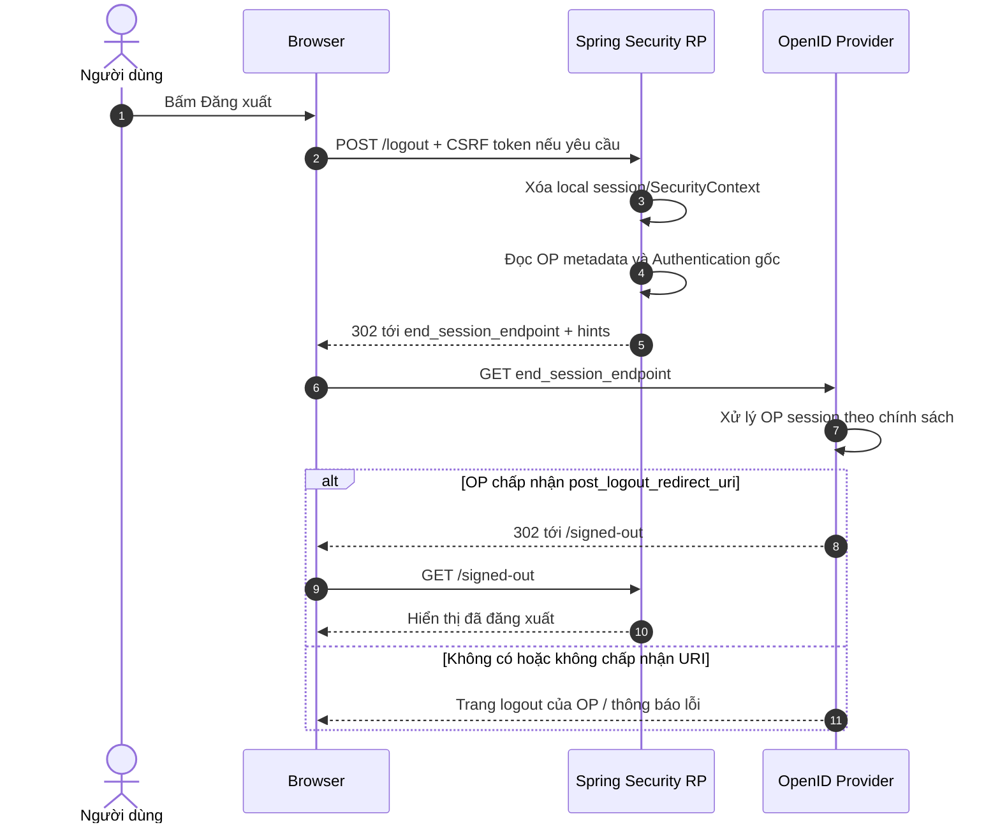

# 24.4. Discovery `end_session_endpoint` và điều kiện provider hỗ trợ

Trong **Spring Security OAuth 2.0/OIDC Client**, người dùng có thể đăng nhập qua OpenID Provider (OP), nhận một phiên xác thực tại ứng dụng và một phiên Single Sign-On (SSO) tại nhà cung cấp danh tính. Khi người dùng nhấn **Đăng xuất**, việc xóa phiên của ứng dụng chưa chắc đã kết thúc phiên SSO ở OP. Để yêu cầu OP kết thúc phiên, OpenID Connect định nghĩa cơ chế **RP-Initiated Logout**.

Một điểm kỹ thuật quyết định ứng dụng có thể áp dụng cơ chế này hay không là metadata **`end_session_endpoint`**. OP có thể công bố địa chỉ này trong tài liệu **OpenID Provider Configuration** lấy bằng **OIDC Discovery**. Spring Security có thể dùng metadata đó cùng ID Token của người dùng để xây URL đăng xuất và chuyển hướng trình duyệt tới OP.

Tuy nhiên, **`end_session_endpoint` là metadata tùy chọn**. Việc một nhà cung cấp hỗ trợ OIDC Login, trả ID Token, công bố `issuer` hoặc trả về tài liệu `/.well-known/openid-configuration` **không chứng minh** provider hỗ trợ RP-Initiated Logout. Ngay cả khi metadata có endpoint, OP vẫn có thể yêu cầu đăng ký `post_logout_redirect_uri`, kiểm tra `id_token_hint` hoặc `client_id`, áp dụng chính sách session riêng và chỉ hỗ trợ một số tham số.

Bài học giải thích cách discovery hoạt động, nhận biết hỗ trợ thực tế của provider, cấu hình **`OidcClientInitiatedLogoutSuccessHandler`** ở Servlet và **`OidcClientInitiatedServerLogoutSuccessHandler`** ở WebFlux, phân biệt local logout với OP logout/token revocation, cũng như bảo vệ redirect và xử lý khi endpoint không tồn tại.

## 1. Bài toán: ứng dụng đã logout nhưng vào lại không cần mật khẩu

Một tình huống thường gặp:

1. Người dùng truy cập `https://portal.example.test`.
2. Portal dùng Spring Security `oauth2Login` và chuyển tới `https://login.example.test`.
3. OP xác thực người dùng; browser nhận cookie SSO của OP.
4. Portal nhận authorization code, đổi token, xác minh ID Token rồi tạo local session.
5. Người dùng nhấn **Đăng xuất** trên portal.
6. Portal xóa local session nhưng **không** yêu cầu OP kết thúc SSO session.
7. Người dùng bấm **Đăng nhập** lần nữa, OP vẫn có cookie SSO và có thể cấp authorization code mới mà không yêu cầu nhập lại mật khẩu.

Đó không nhất thiết là bug của Spring Security: local logout có thể đã diễn ra đúng. Vấn đề nằm ở chỗ **hai phiên khác nhau**.

```text
Browser
├── Cookie phiên của portal (local session)
│     └── Spring Security Authentication / SecurityContext
└── Cookie phiên của OpenID Provider (OP session)
      └── Trạng thái đăng nhập SSO tại nhà cung cấp

Local logout:
  Xóa/invalid local session của portal
  Không tự động xóa OP cookie

RP-Initiated Logout:
  Portal điều hướng browser tới OP end_session_endpoint
  OP xử lý yêu cầu kết thúc phiên theo chính sách của mình
```

**Mục tiêu của RP-Initiated Logout** là cho phép Relying Party (RP, tức ứng dụng Spring) chủ động yêu cầu OP logout. Nó không đồng nghĩa một lệnh xóa mọi phiên trên mọi website và thiết bị.

## 2. Thuật ngữ cần phân biệt trước khi cấu hình

| Thuật ngữ | Ý nghĩa | Nhầm lẫn cần tránh |
|---|---|---|
| **Relying Party (RP)** | Ứng dụng sử dụng OIDC để đăng nhập người dùng | RP không phải Authorization Server |
| **OpenID Provider (OP)** | Nhà cung cấp xác thực OIDC và phát ID Token | OP session không đồng nhất local app session |
| **OIDC Discovery** | Cơ chế lấy metadata về issuer, endpoints và capabilities của OP | Discovery không bảo đảm tất cả feature có mặt |
| **`end_session_endpoint`** | Endpoint OP công bố cho RP-Initiated Logout | Không phải `token_endpoint` hoặc `revocation_endpoint` |
| **RP-Initiated Logout** | RP yêu cầu OP kết thúc phiên qua browser | Không nhất thiết logout mọi RP khác |
| **`id_token_hint`** | ID Token đã cấp, RP đưa cho OP để gợi ý phiên cần logout | Không phải access token hoặc refresh token |
| **`post_logout_redirect_uri`** | URL mà OP có thể chuyển browser về sau logout | Thường phải đăng ký và được OP chấp thuận |
| **`state` của logout** | Giá trị tùy chọn để RP liên hệ logout response với yêu cầu ban đầu | Khác `state` của OAuth2 authorization code flow |
| **Local logout** | Hủy local SecurityContext/session ở RP | Không tự revoke token tại OP |
| **Token revocation** | Yêu cầu AS vô hiệu hóa access/refresh token theo cơ chế hỗ trợ | Không đồng nhất OP session logout |
| **Front-/Back-Channel Logout** | Các cơ chế OP thông báo logout đến những RPs khác | Khác request RP-Initiated Logout |

Một ứng dụng có thể sử dụng cả ba hoạt động **local logout**, **RP-Initiated Logout** và **token revocation**, nhưng mỗi hoạt động cần được lựa chọn và cấu hình riêng.

## 3. Discovery của OIDC là gì?

Một OP hỗ trợ OpenID Connect Discovery công bố metadata tại một địa chỉ well-known gắn với issuer. Ví dụ issuer:

```text
https://login.example.test/realms/company
```

Tài liệu metadata thường có địa chỉ:

```text
https://login.example.test/realms/company/.well-known/openid-configuration
```

Ví dụ nội dung đã rút gọn:

```json
{
  "issuer": "https://login.example.test/realms/company",
  "authorization_endpoint": "https://login.example.test/realms/company/authorize",
  "token_endpoint": "https://login.example.test/realms/company/token",
  "jwks_uri": "https://login.example.test/realms/company/jwks",
  "userinfo_endpoint": "https://login.example.test/realms/company/userinfo",
  "response_types_supported": ["code"],
  "subject_types_supported": ["public"],
  "id_token_signing_alg_values_supported": ["RS256"],
  "end_session_endpoint": "https://login.example.test/realms/company/logout"
}
```

Đây là **JSON minh họa**, không phải metadata của một provider thật. Các trường thực tế tùy thuộc OP, tenant và version.

### 3.1. Trường `end_session_endpoint` nói lên điều gì?

Nó cho RP biết URL mà OP công bố để bắt đầu quy trình kết thúc phiên thông qua RP-Initiated Logout.

Ví dụ:

```text
end_session_endpoint
  = https://login.example.test/realms/company/logout
```

RP có thể xây một yêu cầu browser navigation đến endpoint đó, kèm các tham số giao thức phù hợp. Tuy nhiên:

- Endpoint tồn tại **không có nghĩa** mọi tham số logout đều được hỗ trợ.
- Endpoint tồn tại **không bảo đảm** mọi OP sessions hoặc federated sessions đều bị xóa.
- Endpoint có thể yêu cầu `id_token_hint`, `client_id` hoặc đăng ký URL quay lại.
- Provider có thể có behavior riêng khi nhiều user sessions đang mở hoặc login qua một IdP liên kết.
- Hỗ trợ có thể khác giữa environments, tenants hoặc phiên bản sản phẩm.

### 3.2. `end_session_endpoint` có bắt buộc trong OIDC Discovery không?

**Không.** OP có thể đáp ứng nhu cầu OIDC Login nhưng **không công bố `end_session_endpoint`**. Metadata này liên quan cơ chế OIDC logout được đặc tả riêng, không phải điều kiện bắt buộc để triển khai OIDC Core Authorization Code Login.

Một document hợp lệ cho login có thể chỉ chứa:

```json
{
  "issuer": "https://login.example.test/realms/company",
  "authorization_endpoint": "https://login.example.test/authorize",
  "token_endpoint": "https://login.example.test/token",
  "jwks_uri": "https://login.example.test/jwks",
  "response_types_supported": ["code"],
  "subject_types_supported": ["public"],
  "id_token_signing_alg_values_supported": ["RS256"]
}
```

Trong trường hợp này, không nên tự đoán URL logout là `issuer + "/logout"` rồi coi đó là endpoint chuẩn. Provider có thể cung cấp logout riêng trong tài liệu, hoặc không hỗ trợ RP-Initiated Logout.

### 3.3. Tên metadata phải chính xác

Tên chuẩn là:

```text
end_session_endpoint
```

Không nhầm với:

```text
logout_endpoint
revocation_endpoint
frontchannel_logout_uri
backchannel_logout_uri
check_session_iframe
token_endpoint
```

Các khóa khác có thể là metadata của giao thức khác, extension hoặc tích hợp riêng. **Không đổi tên tùy tiện** rồi cho rằng Spring tự nhận diện `end_session_endpoint`.

## 4. Lấy metadata bằng công cụ và cách đọc kết quả

Trong môi trường được phép truy cập provider, có thể kiểm tra:

```bash
curl --fail --silent --show-error \
  https://login.example.test/realms/company/.well-known/openid-configuration
```

Để chỉ hiển thị một số trường nếu máy có `jq`:

```bash
curl --fail --silent --show-error \
  https://login.example.test/realms/company/.well-known/openid-configuration \
  | jq '{issuer, authorization_endpoint, token_endpoint, end_session_endpoint}'
```

Ví dụ kết quả:

```json
{
  "issuer": "https://login.example.test/realms/company",
  "authorization_endpoint": "https://login.example.test/realms/company/authorize",
  "token_endpoint": "https://login.example.test/realms/company/token",
  "end_session_endpoint": "https://login.example.test/realms/company/logout"
}
```

Nếu `jq` trả `null` cho `end_session_endpoint` thì **document tải về không có field đó** hoặc có giá trị JSON null. Cần kiểm tra metadata gốc và tài liệu provider, không suy ra endpoint bằng quy tắc tự đặt.

### 4.1. Cẩn trọng với các đường dẫn discovery

Issuer đôi khi có **path** như `/realms/company`. Vị trí chính xác của well-known URL phụ thuộc quy tắc discovery và issuer. Với triển khai hiện đại, Spring Security có các thuật toán tìm metadata phù hợp khi dùng issuer location.

Không nên viết một công cụ discovery tự ghép path cho tất cả providers mà không kiểm tra tiêu chuẩn và đường dẫn thực tế. Đối với nhà cung cấp cụ thể, dùng `issuer-uri` được OP công bố và tài liệu chính thức.

### 4.2. Không nhầm discovery thất bại với logout không được hỗ trợ

Các trường hợp khác nhau:

| Kết quả | Kết luận hợp lý |
|---|---|
| Không kết nối được discovery URL | Lỗi DNS/TLS/network/đường dẫn hoặc provider tạm thời lỗi |
| HTTP 404 tại well-known | URL hoặc issuer có thể sai; chưa chứng minh provider không có logout |
| JSON parse lỗi | Metadata không hợp lệ hoặc response sai content type |
| Metadata có `issuer` khác issuer cấu hình | Sai provider/tenant hoặc cấu hình không đáng tin |
| Metadata hợp lệ, thiếu `end_session_endpoint` | Không có endpoint logout được **quảng bá qua metadata này** |
| Có field nhưng URL không hợp lệ | Metadata lỗi hoặc không đáp ứng kỳ vọng; không redirect mù quáng |
| Có HTTPS endpoint và đăng ký hợp lệ | Có cơ sở thử tích hợp RP-Initiated Logout; vẫn cần kiểm chứng behavior thực tế |

Không tắt TLS validation để lấy metadata. Không chấp nhận issuer URL do trình duyệt gửi tùy ý để đưa browser sang một logout endpoint không đáng tin.

## 5. OIDC RP-Initiated Logout hoạt động ra sao?

Một flow thường thấy:



Điểm then chốt: **RP chuyển hướng trình duyệt** tới OP. OP thường cần ngữ cảnh cookie/session của browser để biết phiên nào đang đăng xuất.

### 5.1. Vì sao không chỉ gọi HTTP GET từ backend tới `end_session_endpoint`?

Một backend HTTP client gửi request trực tiếp tới OP sẽ **không mang cookie phiên của OP trong trình duyệt người dùng** theo cách browser navigation thường làm. Backend có thể gọi đúng URL nhưng không tác động đến phiên SSO đang được browser giữ.

Do đó không thay redirect bằng:

```java
// KHÔNG NÊN coi đây là RP-Initiated browser logout:
restClient.get()
    .uri(endSessionEndpoint)
    .retrieve()
    .toBodilessEntity();
```

Chuẩn và implementation của provider có thể cho phép những hình thức khác, nhưng với RP-Initiated Logout thông dụng, **User-Agent của người dùng** là một phần quan trọng của flow.

### 5.2. Có phải logout ở OP nghĩa là logout mọi ứng dụng?

Không thể bảo đảm. OP có thể:

- Kết thúc OP SSO session hiện tại.
- Thông báo logout cho những RP đã đăng ký front-channel/back-channel theo khả năng.
- Không thông báo tới RP khác vì chúng không hỗ trợ cơ chế đó.
- Giữ phiên của một upstream IdP/federation.
- Giữ những access tokens còn hạn đã cấp cho các Resource Servers.
- Áp dụng chính sách session trên từng thiết bị, trình duyệt hoặc tenant.

Đặc biệt, **RP-Initiated Logout không tự động là một giao thức thu hồi mọi access token**.

## 6. Các tham số trong RP-Initiated Logout

Theo **OpenID Connect RP-Initiated Logout 1.0**, những tham số quan trọng gồm:

| Tham số | Mục đích | Lưu ý |
|---|---|---|
| `id_token_hint` | Gợi ý cho OP về phiên/user/RP liên quan thông qua ID Token đã cấp | Khuyến nghị; provider có thể yêu cầu |
| `logout_hint` | Gợi ý user/session theo định dạng OP quy định | Tùy chọn, provider-specific |
| `client_id` | Giúp OP xác định RP, đặc biệt khi không có `id_token_hint` hoặc cần xác định Client | Tuân theo policy OP |
| `post_logout_redirect_uri` | URL mong muốn OP chuyển browser về sau logout | Thường phải được OP đăng ký/chấp thuận |
| `state` | Giá trị tùy chọn giúp RP liên hệ response sau logout với request | OP trả lại nếu xử lý parameter theo spec |
| `ui_locales` | Gợi ý ngôn ngữ giao diện logout | Tùy OP |

### 6.1. Ví dụ URL logout

```text
https://login.example.test/realms/company/logout
  ?id_token_hint=EXAMPLE_ID_TOKEN
  &post_logout_redirect_uri=https%3A%2F%2Fportal.example.test%2Fsigned-out
  &state=EXAMPLE_LOGOUT_STATE
```

URL ở trên **chỉ mô tả format giao thức**, không được copy token thật vào tài liệu hoặc log. Tùy provider và Spring Security version, request thực tế có thể **không** chứa tất cả tham số.

### 6.2. `id_token_hint` không phải access token

Trong OIDC:

```text
ID Token:
  dùng RP xác minh identity, có thể được đưa làm id_token_hint

Access token:
  dùng gọi Resource Server

Refresh token:
  dùng xin access token mới tại Token Endpoint
```

Không sử dụng access token làm `id_token_hint`. Cũng không coi `id_token_hint` là lệnh buộc OP hủy access token của mọi API.

### 6.3. Vì sao OP muốn `id_token_hint`?

OP có thể nhận nhiều session và nhiều Clients. ID Token đã cấp cho RP giúp xác định:

- Client từng tham gia authentication.
- Issuer và subject liên quan.
- Ngữ cảnh phiên nếu có các claims như `sid`.
- Hợp lệ hay không hợp lệ của yêu cầu theo policy.

Từng OP có thể yêu cầu ID Token vẫn còn trong một khoảng thời gian, có issuer/audience đúng hoặc chứa `sid` theo implementation. **Không có một bảo đảm universal** rằng ID Token hết hạn vẫn luôn được chấp nhận cho logout.

### 6.4. `client_id` có thay thế `id_token_hint` không?

Một số OP chấp nhận `client_id` để xác định RP trong những trường hợp không có ID Token. Nhưng không có nghĩa cứ truyền client_id là OP phải kết thúc một phiên browser bất kỳ.

Nếu provider yêu cầu `id_token_hint` hoặc xác nhận bổ sung, Client phải tuân theo. Không tạo ID Token giả hay dùng JWT chưa được xác minh để “đủ điều kiện”.

### 6.5. `post_logout_redirect_uri` không phải redirect tự do

OP thường yêu cầu URL nằm trong **danh sách đã đăng ký** cho Client. Ví dụ:

```text
https://portal.example.test/signed-out
```

Nếu Client truyền:

```text
https://attacker.example.test/collect
```

OP phải áp dụng validation theo chuẩn/chính sách; RP cũng phải đảm bảo chính nó không tạo open redirect từ dữ liệu không tin cậy. Đừng biến `post_logout_redirect_uri` thành biến lấy trực tiếp từ query parameter `returnTo` do browser gửi.

## 7. Điều kiện thực tế để provider hỗ trợ logout

Một bộ điều kiện thường cần:

1. **Provider là OP OIDC hợp lệ** cho login bạn đang thực hiện, không chỉ là một OAuth2 Authorization Server.
2. **Provider hỗ trợ một cơ chế RP-Initiated Logout** tương thích với cách tích hợp của Spring Security.
3. **Metadata discovery có `end_session_endpoint`**, nếu dùng discovery để xây URL.
4. **ClientRegistration có lưu metadata đó** hoặc ứng dụng có một cấu hình endpoint đáng tin riêng được triển khai đúng.
5. **User Authentication còn thông tin OIDC cần thiết tại thời điểm logout**, thường là `OAuth2AuthenticationToken` với `OidcUser` và ID Token.
6. **OP nhận/hiểu tham số** mà RP gửi; `id_token_hint`, `client_id` hay các yêu cầu cụ thể phải đáp ứng.
7. **`post_logout_redirect_uri` được đăng ký** nếu yêu cầu chuyển hướng về ứng dụng.
8. **Browser có thể đi tới OP** bằng HTTPS và mang session context phù hợp.
9. **Portal cho phép truy cập trang đích sau logout** mà không buộc login lại ngay.
10. **Ứng dụng đã xác định fallback** khi OP không hỗ trợ hoặc từ chối logout.

**Không có endpoint trong discovery** thì Spring built-in handler thường không có đủ metadata để xây standard OP redirect. Nhưng provider vẫn có thể có một logout API riêng, hoặc tài liệu endpoint không được quảng bá; tích hợp riêng cần xem hợp đồng của nhà cung cấp.

### 7.1. Các mức độ hỗ trợ

| Mức độ | Khả năng | Cách xử lý |
|---|---|---|
| A | Không có OIDC Login | Không sử dụng OIDC logout handler |
| B | OIDC Login, không công bố `end_session_endpoint` | Local logout; kiểm tra tài liệu provider nếu cần custom logout |
| C | Có `end_session_endpoint`, OP không chấp nhận redirect URI hiện tại | Đăng ký đúng post-logout URI hoặc dùng flow không yêu cầu redirect |
| D | Có endpoint và xử lý hints hợp lệ | Có thể sử dụng RP-Initiated Logout |
| E | Ngoài RP-Initiated Logout còn hỗ trợ front/back-channel logout | Có thể thiết kế logout đồng bộ giữa RPs, cần tích hợp riêng |

Không nên coi mức E là mặc định chỉ vì mức D hoạt động.

## 8. Spring Boot cấu hình `issuer-uri` và discovery

Ví dụ một OIDC Client chạy trên Servlet Spring MVC:

```yaml
spring:
  security:
    oauth2:
      client:
        registration:
          company:
            provider: company-op
            client-id: ${OIDC_CLIENT_ID}
            client-secret: ${OIDC_CLIENT_SECRET}
            client-authentication-method: client_secret_basic
            authorization-grant-type: authorization_code
            scope:
              - openid
              - profile
              - email
            redirect-uri: "{baseUrl}/login/oauth2/code/{registrationId}"

        provider:
          company-op:
            issuer-uri: https://login.example.test/realms/company
```

Khi Spring Boot/Spring Security xử lý OIDC provider discovery cho issuer đã cấu hình:

- Đọc metadata provider phù hợp với issuer.
- Xác lập Authorization Endpoint, Token Endpoint, JWKS và các giá trị cần thiết.
- `ClientRegistration` có thể giữ metadata provider đã lấy được.
- Nếu metadata chứa `end_session_endpoint`, OIDC logout handler có thể sử dụng endpoint đó.

**Không có property chuẩn `end-session-uri` trong mẫu `spring.security.oauth2.client.provider` để mặc định gõ một URL rồi tin rằng Spring sẽ dùng như metadata.** Nếu nhà cung cấp không công bố endpoint mà bạn muốn hỗ trợ logout riêng, hãy chọn giải pháp tùy biến đáng tin và kiểm tra API/phiên bản, thay vì phát minh tên property.

### 8.1. Sự khác biệt khi cấu hình thủ công

Có những dự án không dùng `issuer-uri` mà khai báo thủ công:

```yaml
spring:
  security:
    oauth2:
      client:
        registration:
          company:
            provider: company-op
            client-id: ${OIDC_CLIENT_ID}
            client-secret: ${OIDC_CLIENT_SECRET}
            authorization-grant-type: authorization_code
            scope: [openid, profile]

        provider:
          company-op:
            authorization-uri: https://login.example.test/oauth2/authorize
            token-uri: https://login.example.test/oauth2/token
            jwk-set-uri: https://login.example.test/oauth2/jwks
            user-info-uri: https://login.example.test/oauth2/userinfo
            user-name-attribute: sub
```

Cấu hình các endpoint cho login **không tự tạo `end_session_endpoint` trong provider configuration metadata**. Nếu muốn dùng handler chuẩn mà metadata không có, cần bảo đảm ClientRegistration chứa metadata phù hợp từ nguồn tin cậy hoặc sử dụng một logout integration khác do provider hỗ trợ.

### 8.2. Có thể đăng nhập OAuth2 nhưng không phải OIDC

Ví dụ registration chỉ có `profile` hoặc `read:user` và provider OAuth2 không phát ID Token:

```text
OAuth2 Login -> OAuth2User
OIDC Login   -> OidcUser (có ID Token đã xác minh)
```

`OidcClientInitiatedLogoutSuccessHandler` hướng tới **OIDC**, không phải cơ chế logout phổ quát cho mọi OAuth2 provider. Không cố cast một `OAuth2User` thành `OidcUser` hoặc giả mạo ID Token.

## 9. Spring Security đọc `end_session_endpoint` từ đâu?

Với cấu hình ClientRegistration đã được discovery, metadata có thể được truy cập qua provider details.

Ví dụ Java **chỉ đọc metadata để quan sát**, không tự thực hiện logout:

```java
import java.util.Map;

import org.springframework.security.oauth2.client.registration.ClientRegistration;
import org.springframework.security.oauth2.client.registration.ClientRegistrationRepository;

public final class OidcLogoutMetadataInspector {

    private final ClientRegistrationRepository registrations;

    public OidcLogoutMetadataInspector(
            ClientRegistrationRepository registrations) {
        this.registrations = registrations;
    }

    public boolean hasEndSessionEndpoint(String registrationId) {
        ClientRegistration registration =
            registrations.findByRegistrationId(registrationId);

        if (registration == null) {
            return false;
        }

        Map<String, Object> metadata =
            registration.getProviderDetails().getConfigurationMetadata();

        Object value = metadata.get("end_session_endpoint");

        return value instanceof String endpoint && !endpoint.isBlank();
    }
}
```

Với Java 17+, pattern matching `instanceof` như ví dụ được hỗ trợ. Method này trả lời **metadata có chuỗi endpoint hay không**, không thay thế kiểm tra host/HTTPS, hợp đồng provider, ClientRegistration và đăng ký redirect URI.

### 9.1. `hasEndSessionEndpoint=true` có bảo đảm logout thành công?

**Không.** Nó chỉ xác nhận metadata có một giá trị. Có thể vẫn lỗi do:

- URI sai hoặc redirect đến endpoint không tồn tại.
- OP yêu cầu `id_token_hint` nhưng Authentication không có.
- `post_logout_redirect_uri` chưa được đăng ký.
- OP session đã hết hạn hoặc thuộc user khác.
- Browser bị chặn cookie/redirect.
- Provider hỗ trợ chỉ một số phương thức hoặc tham số.
- Handler không được cấu hình vào đúng Spring Security filter chain.

Nên đặt tên method phản ánh đúng phạm vi kiểm tra, không đặt `isLogoutFullySupported()` chỉ dựa vào một metadata field.

### 9.2. Nếu không có field trong `ClientRegistration` nhưng endpoint có trong well-known?

Có thể do:

- Ứng dụng đang dùng một provider khác với issuer bạn thử bằng curl.
- ClientRegistration được xây **thủ công**, không giữ metadata discovery.
- Metadata bị cache hoặc build đã sử dụng provider version khác.
- Bean `ClientRegistrationRepository` tùy biến không copy provider configuration metadata.
- Discovery response thay đổi sau khi ứng dụng start, nhưng repository chưa được refresh.

Khi chẩn đoán, đối chiếu đúng **registrationId**, **issuer**, **metadata nguồn** và **bean thực tế trong JVM**, không chỉ xem URL ngoài browser.

## 10. Cấu hình RP-Initiated Logout trong Spring MVC/Servlet

Spring Security có **`OidcClientInitiatedLogoutSuccessHandler`** dành cho Servlet.

Lớp thường được import:

```java
import org.springframework.security.oauth2.client.oidc.web.logout.OidcClientInitiatedLogoutSuccessHandler;
```

Ví dụ cấu hình:

```java
import org.springframework.context.annotation.Bean;
import org.springframework.context.annotation.Configuration;
import org.springframework.security.config.Customizer;
import org.springframework.security.config.annotation.web.builders.HttpSecurity;
import org.springframework.security.oauth2.client.oidc.web.logout.OidcClientInitiatedLogoutSuccessHandler;
import org.springframework.security.oauth2.client.registration.ClientRegistrationRepository;
import org.springframework.security.web.SecurityFilterChain;

@Configuration
public class SecurityConfiguration {

    @Bean
    SecurityFilterChain securityFilterChain(
            HttpSecurity http,
            ClientRegistrationRepository clientRegistrations)
            throws Exception {

        var oidcLogout =
            new OidcClientInitiatedLogoutSuccessHandler(
                clientRegistrations
            );

        oidcLogout.setPostLogoutRedirectUri("{baseUrl}/signed-out");

        http
            .authorizeHttpRequests(authorize -> authorize
                .requestMatchers("/", "/signed-out", "/error").permitAll()
                .anyRequest().authenticated()
            )
            .oauth2Login(Customizer.withDefaults())
            .logout(logout -> logout
                .logoutSuccessHandler(oidcLogout)
            );

        return http.build();
    }
}
```

### 10.1. Những gì cấu hình này làm

- `ClientRegistrationRepository` chứa các OIDC clients và provider metadata.
- Logout success handler sử dụng thông tin đăng nhập OIDC và provider để xây request RP-Initiated Logout **khi điều kiện thỏa**.
- `setPostLogoutRedirectUri("{baseUrl}/signed-out")` cho biết URL mong muốn OP chuyển browser về sau logout.
- `/signed-out` được phép truy cập sau local logout, tránh vô tình chuyển người dùng quay lại login.
- Spring Security logout pipeline xử lý local session và sau đó gọi logout success handler.

**Ví dụ không giả định mọi provider đều công bố `end_session_endpoint`.** Khi không đáp ứng điều kiện, handler có thể rơi về hành vi logout success mặc định/phù hợp version; ứng dụng phải test và có UX fallback rõ ràng.

### 10.2. Vì sao nên dùng built-in handler?

Nó đã được thiết kế để phối hợp với Spring Security OIDC Login, ClientRegistration metadata và Authentication. So với tự ghép:

```text
issuer + "/logout" + "?id_token_hint=" + rawIdToken
```

handler chuẩn giúp giảm nguy cơ:

- Dùng nhầm endpoint khác nhà cung cấp.
- Lấy nhầm access token thay ID Token.
- Quên encode parameters.
- Nhầm URL từ config không tin cậy.
- Bỏ quên điều kiện loại principal.
- Làm sai thứ tự local logout và OP redirect.

Tuy vậy, built-in handler vẫn phụ thuộc **provider support và registration chính xác**.

### 10.3. Vì sao handler cần Authentication còn truy cập được?

Spring Security logout pipeline nhận Authentication trước khi xóa security context/session và truyền tới `LogoutSuccessHandler`. Một OIDC handler có thể dùng Authentication gốc để tìm:

- `OAuth2AuthenticationToken`.
- `authorizedClientRegistrationId`.
- `OidcUser`.
- ID Token đã được OP phát trong lần đăng nhập.

Nếu một custom `LogoutHandler` xóa hoặc thay đổi thông tin cần thiết sai cách, việc tạo `id_token_hint` có thể không diễn ra như mong đợi.

Không tự viết logout endpoint **xóa authentication rồi gọi handler với `null`** nếu muốn RP-Initiated Logout dựa trên ID Token.

### 10.4. Có cần viết Controller `GET /logout`?

Thông thường không. Spring Security xử lý logout endpoint theo cấu hình, và với CSRF mặc định, thao tác logout có tính thay đổi trạng thái thường được gửi bằng **POST**.

Ví dụ Thymeleaf:

```html
<form th:action="@{/logout}" method="post">
    <button type="submit">Đăng xuất</button>
</form>
```

Trong tích hợp Thymeleaf/Spring Security phù hợp, CSRF token có thể được chèn theo cơ chế framework. Nếu tự dựng HTML hoặc gửi fetch/AJAX, phải **cung cấp CSRF token đúng cách** theo cấu hình ứng dụng. Đừng tắt CSRF chỉ để nút logout hoạt động.

Với GET `/logout` trong một số cấu hình, Spring có thể hiển thị trang xác nhận thay vì thực hiện logout ngay. Hành vi cụ thể phụ thuộc CSRF và version.

## 11. Trang `post_logout_redirect_uri` phải được đăng ký

Giả sử handler cấu hình:

```java
oidcLogout.setPostLogoutRedirectUri(
    "{baseUrl}/signed-out"
);
```

và app public origin là:

```text
https://portal.example.test
```

Thì URL mong đợi là:

```text
https://portal.example.test/signed-out
```

Ở phía OP, Client thường phải khai báo nó trong **allowed post-logout redirect URIs**. Đây thường là một danh sách **khác** với authorization code login Redirect URIs.

### 11.1. Hai loại redirect URIs không giống nhau

| Tham số | Thời điểm | Ví dụ |
|---|---|---|
| `redirect_uri` của authorization code | OP trả code cho RP lúc login | `https://portal.example.test/login/oauth2/code/company` |
| `post_logout_redirect_uri` của RP-Initiated Logout | OP chuyển browser về RP sau logout | `https://portal.example.test/signed-out` |

Không đăng ký một URI cho login rồi mặc định OP chấp nhận nó làm post-logout redirect.

### 11.2. Một số providers không cho post-logout redirect

OP có thể:

- Không hỗ trợ tham số này.
- Yêu cầu đăng ký URI riêng.
- Yêu cầu ID Token hint hoặc Client ID.
- Chỉ cho phép redirect trong cùng một miền theo policy.
- Giới hạn URI scheme/host/port.
- Hiển thị trang xác nhận logout trước khi redirect.
- Không redirect nếu phiên không xác định được.

Trong trường hợp đó, local logout vẫn phải thành công, và UX không nên phụ thuộc tuyệt đối vào việc browser trở về `/signed-out`.

### 11.3. Không để người dùng tự định nghĩa redirect target

Sai:

```java
// Ý tưởng KHÔNG AN TOÀN:
String next = request.getParameter("next");
oidcLogout.setPostLogoutRedirectUri(next);
```

Một RP có thể trở thành open redirect nếu lấy arbitrary URL từ browser. Chỉ dùng URL/route đã kiểm soát ở server, allowlist hoặc config đáng tin.

## 12. Các placeholder của post-logout redirect

Spring Security cho phép URI template nhất định trong `setPostLogoutRedirectUri`, thường dùng:

```text
{baseUrl}
```

Ví dụ:

```java
oidcLogout.setPostLogoutRedirectUri("{baseUrl}/signed-out");
```

`{baseUrl}` dựa trên ngữ cảnh URL công khai mà framework xác định; cần đảm bảo reverse proxy headers, scheme và host đúng.

### 12.1. Lỗi thường gặp sau reverse proxy

Hạ tầng:

```text
Browser:
  https://portal.example.test

Reverse proxy:
  https://portal.example.test -> http://spring-app:8080
```

Nếu ứng dụng không tin/không nhận forwarded headers đúng cách, `{baseUrl}` có thể thành:

```text
http://spring-app:8080
```

OP từ chối post-logout URL không nằm trong allowlist, hoặc browser không thể truy cập host nội bộ.

### 12.2. Cách giải quyết

- Đăng ký public HTTPS URL tại OP.
- Cấu hình reverse proxy gửi forwarded headers đúng.
- Chỉ tin `Forwarded`/`X-Forwarded-*` đến từ reverse proxy đáng tin.
- Cấu hình Spring Boot xử lý forwarded headers theo hạ tầng/phiên bản.
- Kiểm tra app tạo đúng scheme, host, port và context path.
- Không cho client Internet giả mạo `X-Forwarded-Host` rồi khiến app tạo redirect tới domain độc hại.

Cấu hình có thể liên quan:

```yaml
server:
  forward-headers-strategy: framework
```

Giá trị phù hợp phụ thuộc deployment. Không bật mù quáng nếu proxy không kiểm soát/sanitize headers.

## 13. Reactive WebFlux: `OidcClientInitiatedServerLogoutSuccessHandler`

Với **Spring Security WebFlux** sử dụng `SecurityWebFilterChain`, lớp tương ứng là:

```java
import org.springframework.security.oauth2.client.oidc.web.server.logout.OidcClientInitiatedServerLogoutSuccessHandler;
```

Ví dụ:

```java
import org.springframework.context.annotation.Bean;
import org.springframework.context.annotation.Configuration;
import org.springframework.security.config.Customizer;
import org.springframework.security.config.web.server.ServerHttpSecurity;
import org.springframework.security.oauth2.client.oidc.web.server.logout.OidcClientInitiatedServerLogoutSuccessHandler;
import org.springframework.security.oauth2.client.registration.ReactiveClientRegistrationRepository;
import org.springframework.security.web.server.SecurityWebFilterChain;

@Configuration
public class ReactiveSecurityConfiguration {

    @Bean
    SecurityWebFilterChain securityWebFilterChain(
            ServerHttpSecurity http,
            ReactiveClientRegistrationRepository registrations) {

        var oidcLogout =
            new OidcClientInitiatedServerLogoutSuccessHandler(
                registrations
            );

        oidcLogout.setPostLogoutRedirectUri("{baseUrl}/signed-out");

        return http
            .authorizeExchange(exchanges -> exchanges
                .pathMatchers("/", "/signed-out", "/error").permitAll()
                .anyExchange().authenticated()
            )
            .oauth2Login(Customizer.withDefaults())
            .logout(logout -> logout
                .logoutSuccessHandler(oidcLogout)
            )
            .build();
    }
}
```

Điểm khác với Servlet:

| Chủ đề | Servlet Spring MVC | Reactive WebFlux |
|---|---|---|
| HTTP security config | `HttpSecurity` | `ServerHttpSecurity` |
| Security filter chain | `SecurityFilterChain` | `SecurityWebFilterChain` |
| Client registration repository | `ClientRegistrationRepository` | `ReactiveClientRegistrationRepository` |
| OIDC logout success handler | `OidcClientInitiatedLogoutSuccessHandler` | `OidcClientInitiatedServerLogoutSuccessHandler` |
| Request context | Servlet `HttpServletRequest` | `ServerWebExchange` |
| Context/persistence | Servlet SecurityContext/session | Reactive SecurityContext/WebSession |

Không import nhầm Servlet handler cho WebFlux hoặc ngược lại. Cả hai dùng ý tưởng giống nhau: khám phá OP metadata, xác định Id Token/registration và điều hướng browser, nhưng API không hoán đổi.

### 13.1. WebFlux cũng cần cùng điều kiện provider

Reactive không tự “hỗ trợ thêm logout endpoint”. Nếu provider không có `end_session_endpoint` hoặc không chấp nhận redirect URI, WebFlux handler vẫn phải tuân khả năng thực tế của OP.

Không lấy `ServerOAuth2AuthorizedClientExchangeFilterFunction` — filter gắn access token cho WebClient API call — để thay cho OIDC logout success handler. Hai thành phần có mục đích khác nhau.

## 14. Local Logout, OP Logout và Token Revocation: ba trục khác nhau

### 14.1. Local logout

Spring Security logout thường làm những việc như:

- Invalidate local `HttpSession` hoặc quản lý `WebSession` theo cấu hình.
- Clear `SecurityContext`.
- Xóa một số cookie liên quan nếu được cấu hình.
- Chuyển hướng người dùng đến trang phù hợp.

Điều này kết thúc phiên ứng dụng. Nếu OP cookie vẫn còn, user có thể SSO vào lại ngay.

### 14.2. RP-Initiated Logout

RP điều hướng browser đến `end_session_endpoint` của OP để yêu cầu OP logout. Nó chủ yếu xử lý **OP session** theo chính sách provider.

Nó không tự chứng minh rằng:

- Mọi access tokens đã được revoke.
- Mọi refresh tokens đã bị revoke.
- Mọi phiên trên thiết bị khác đều đã kết thúc.
- Mọi RP khác đã được logout.
- Tài khoản user bị disable.

### 14.3. Token Revocation

OAuth2 Token Revocation (RFC 7009) mô tả cơ chế Client gửi access/refresh token tới **revocation endpoint** khi được hỗ trợ.

```text
RP-Initiated Logout:
  Browser -> end_session_endpoint
  Mục tiêu: OP browser session

Token Revocation:
  Client -> revocation_endpoint
  Mục tiêu: yêu cầu vô hiệu hóa token/grant theo AS

Local Logout:
  Spring app -> invalidate local session
  Mục tiêu: trạng thái authentication tại RP
```

Những mục tiêu này có liên quan nhưng **không tương đương**.

### 14.4. Thứ tự thực hiện có thể phụ thuộc sản phẩm

Một ứng dụng có thể có quy trình:

1. Người dùng nhấn logout.
2. Spring xóa local session và security context.
3. Handler điều hướng browser tới OP `end_session_endpoint`.
4. OP kết thúc browser SSO session.
5. OP chuyển browser về trang đã đăng xuất của RP nếu chấp thuận.

Ứng dụng khác cần chủ động revoke refresh token khi user disconnect. Đó là nghiệp vụ khác; đừng thêm token revocation vào mọi logout mà chưa xác định chính sách offline access, multi-device và user consent.

## 15. Vì sao `id_token_hint` có thể không khả dụng?

Một OIDC handler có thể không tạo được logout request tiêu chuẩn nếu không có ngữ cảnh OIDC phù hợp.

Các tình huống:

| Tình huống | Hệ quả có thể |
|---|---|
| User không đăng nhập OIDC, chỉ login bằng form | Không có `OidcUser`/ID Token |
| User đăng nhập OAuth2 provider không OIDC | Có `OAuth2User` nhưng không có ID Token |
| Authentication đã bị custom code thay bằng anonymous trước handler | Handler không biết registration hoặc ID Token |
| Một custom principal bỏ mất ID Token | Không tạo được `id_token_hint` chuẩn |
| App chỉ lưu userId trong JWT local và không còn original OIDC auth | Không còn thông tin cần cho handler |
| Đăng nhập trước đó từ provider khác | Registration/issuer có thể không khớp logout endpoint |
| Local session đã hết hạn | Browser logout có thể không còn Authentication gốc |
| OP yêu cầu ID Token hint còn đáp ứng policy riêng | OP có thể từ chối request dù handler tạo URL |

Giải pháp không phải tạo một JWT bất kỳ để làm ID Token hint. Hãy xác định người dùng đang có OIDC Authentication đúng provider và điều chỉnh architecture/authentication lifecycle.

### 15.1. Có nên lưu ID Token để dùng sau khi session hết hạn?

Chỉ lưu khi có mục đích rõ, phù hợp privacy/security/retention. ID Token có thể chứa PII; kéo dài vòng đời lưu trữ chỉ để phục vụ logout có thể tạo rủi ro.

Khi session đã hết hạn và không có ID Token phù hợp, local logout đã được thực hiện về mặt phiên ứng dụng; UI có thể hướng người dùng logout trực tiếp tại OP bằng một cơ chế đã được provider tài liệu hóa, hoặc cho người dùng biết phiên SSO bên ngoài có thể còn. Không mạo danh phiên đã mất.

## 16. Không phải provider nào cũng có logout giống nhau

Những loại provider thường gặp:

### 16.1. OIDC Provider có `end_session_endpoint`

Ví dụ provider tự host hoặc enterprise IdP hỗ trợ RP-Initiated Logout và công bố endpoint. Có thể triển khai built-in handler sau khi đăng ký post-logout redirect URI và kiểm thử request/response.

### 16.2. OIDC Provider không công bố `end_session_endpoint`

OIDC login vẫn hoạt động. Với logout, ứng dụng có thể chỉ xóa local session và hiển thị thông điệp rõ ràng, hoặc dùng giải pháp khác **theo tài liệu chính thức của provider**.

Không tự coi `/logout`, `/signout` hay `/end-session` là endpoint chuẩn chung.

### 16.3. OAuth2 Provider không có OIDC

Provider cấp access token và OAuth2User nhưng không phát ID Token OIDC. Không dùng OIDC RP-Initiated Logout handler như một “logout chung”.

Nếu provider có OAuth2 revoke/disconnect API riêng, xử lý bằng integration phù hợp; không nhầm với OP SSO session logout.

### 16.4. Provider công bố endpoint nhưng yêu cầu policy riêng

Có thể endpoint hiện diện nhưng:

- Yêu cầu client được enable RP logout.
- Chỉ chấp nhận whitelist post-logout URIs.
- Có prompt xác nhận logout.
- Yêu cầu `id_token_hint` phù hợp.
- Không trả browser về RP nếu thiếu hint.
- Có quy tắc liên quan multiple sessions hoặc upstream federation.

Khi tích hợp, **documentation và end-to-end test trên tenant thật** mới xác nhận sản phẩm có behavior mong muốn.

## 17. Multi-provider: chọn đúng endpoint cho đúng OIDC session

Giả sử portal hỗ trợ hai providers:

```yaml
spring:
  security:
    oauth2:
      client:
        registration:
          corp:
            provider: corp-op
            client-id: ${CORP_CLIENT_ID}
            client-secret: ${CORP_CLIENT_SECRET}
            authorization-grant-type: authorization_code
            scope: [openid, profile]

          partner:
            provider: partner-op
            client-id: ${PARTNER_CLIENT_ID}
            client-secret: ${PARTNER_CLIENT_SECRET}
            authorization-grant-type: authorization_code
            scope: [openid, profile]

        provider:
          corp-op:
            issuer-uri: https://corp-id.example.test/issuer
          partner-op:
            issuer-uri: https://partner-id.example.test/issuer
```

Người dùng A đăng nhập qua `corp`; người dùng B qua `partner`.

Handler cần gắn logout flow với **đúng ClientRegistration của phiên đăng nhập hiện tại**. Không được:

- Luôn logout ở provider `corp` cho mọi người dùng.
- Dùng ID Token từ `partner` làm hint gửi tới endpoint `corp`.
- Đọc một logout URL do user truyền vào rồi redirect.
- Kết hợp external identity chỉ bằng email khi xác định provider.
- Gửi ID Token sang host không thuộc issuer/OP tương ứng.

### 17.1. Registration ID và issuer khác nhau

`registrationId` là tên nội bộ Spring như `corp`. `issuer` là định danh của OP như `https://corp-id.example.test/issuer`.

Cùng một issuer có thể có nhiều Clients (các registration IDs khác nhau), và một ứng dụng multi-tenant có thể có nhiều issuers. Khi debug logout, cần kiểm tra cả **registration ID**, **issuer**, **end_session_endpoint** và **client ID**.

## 18. Khi discovery thiếu endpoint: fallback có kiểm soát

Không nên để nút logout trở thành hành động lỗi hoặc gây vòng lặp khi provider không hỗ trợ RP-Initiated Logout.

Một chính sách fallback hợp lý:

1. **Luôn thực hiện local logout đúng** theo Spring Security policy.
2. Chỉ dùng OP redirect khi có đủ điều kiện đáng tin.
3. Nếu endpoint không có, điều hướng tới một trang local như `/signed-out`.
4. Thông báo rõ phạm vi: “Bạn đã đăng xuất khỏi ứng dụng; phiên đăng nhập tại nhà cung cấp có thể vẫn còn.”
5. Nếu provider có trang logout riêng được tài liệu hóa, cung cấp hướng dẫn/link phù hợp thay vì đoán URL.
6. Không tự động lặp lại `/oauth2/authorization/...` ngay sau logout, vì OP SSO vẫn hoạt động và user có thể lập tức đăng nhập trở lại.
7. Nếu yêu cầu “đăng xuất mọi thiết bị” là bắt buộc, cần kiến trúc session management/revocation phù hợp ngoài standard handler.

### 18.1. UX nên phản ánh đúng hành vi

Tránh câu khẳng định tuyệt đối:

> “Bạn đã đăng xuất khỏi tất cả ứng dụng và thiết bị.”

Nếu chỉ có local logout, thông báo tốt hơn:

> “Bạn đã đăng xuất khỏi portal. Nếu sử dụng máy tính công cộng, hãy đóng trình duyệt và kiểm tra phiên tại nhà cung cấp đăng nhập.”

Nếu provider có OP logout và flow hoàn tất, có thể:

> “Yêu cầu đăng xuất khỏi nhà cung cấp đã được thực hiện. Một số ứng dụng hoặc thiết bị có thể vẫn duy trì phiên riêng.”

Nội dung cuối cùng phụ thuộc xác nhận thực tế của OP; một HTTP redirect được gửi đi không tự chứng minh provider đã kết thúc mọi phiên.

### 18.2. Bảo vệ trang `/signed-out` khỏi auto-login

Nếu `/signed-out` bị yêu cầu authentication:

```text
Logout -> /signed-out
        -> Security redirects /oauth2/authorization/company
        -> OP còn SSO session
        -> user lại đăng nhập
```

Trải nghiệm thành “logout không hiệu lực”. Hãy cho phép truy cập trang này khi anonymous như ví dụ `requestMatchers("/signed-out").permitAll()`, đồng thời không gọi API yêu cầu user token tự động trên trang signed-out.

## 19. Không nên hard-code `end_session_endpoint` theo issuer

Một anti-pattern:

```java
String logoutUrl = issuer + "/logout";
response.sendRedirect(logoutUrl);
```

Vấn đề:

- Endpoint path khác nhau theo provider/version.
- OP có thể không hỗ trợ logout API đó.
- Endpoint có thể yêu cầu query params, method hoặc Client identification cụ thể.
- `issuer` có thể có path/tenant khiến việc ghép URL sai.
- Đơn vị deployment có thể đổi URL khi nâng version.
- Với untrusted issuer input, còn có nguy cơ redirect độc hại.

Ưu tiên:

1. Discovery metadata `end_session_endpoint` từ issuer tin cậy.
2. Built-in Spring OIDC logout handler khi phù hợp.
3. Nếu metadata không có nhưng provider có documented custom logout flow, viết integration riêng **chỉ cho provider đó**, với URL trong cấu hình tin cậy và kiểm thử đầy đủ.
4. Có fallback local logout nếu custom flow thất bại.

### 19.1. Không tự động “suy đoán rồi thử nhiều endpoint”

Ví dụ không nên:

```text
issuer/logout
issuer/signout
issuer/endsession
issuer/protocol/logout
issuer/oauth2/logout
```

Việc bắn hàng loạt URL chưa biết có thể kích hoạt behavior ngoài ý muốn và tạo open redirect/security problems. Hỏi nhà cung cấp hoặc đọc metadata/API docs đáng tin thay vì thử ngẫu nhiên.

## 20. HTTPS, metadata trust và redirect safety

Logout liên quan đến identity/session nên phải bảo vệ chặt:

- Chỉ dùng **HTTPS** cho issuer, discovery endpoint và end-session endpoint production.
- Xác minh **issuer** của ID Token và metadata theo cấu hình tin cậy.
- Không lấy issuer/endpoint từ query param tự do.
- Không gửi ID Token hint đến domain ngoài trust boundary OP.
- Không bật “trust all certificates” để bypass TLS.
- Giới hạn `post_logout_redirect_uri` theo allowlist/registered URI.
- Tránh open redirects ở callback/trang signed-out.
- Không log raw `id_token_hint`, cookies hoặc full logout URL có ID Token.
- Cân nhắc privacy: ID Token có thể chứa thông tin định danh và xuất hiện trong browser URL, proxy logs, history/referrer nếu không quản lý đúng.
- Đặt `Cache-Control`/logging policy phù hợp ở các endpoint và reverse proxies liên quan.

### 20.1. Vì sao `id_token_hint` trong URL là dữ liệu nhạy cảm?

`id_token_hint` có thể là một ID Token JWT gốc từng cấp cho Client. URL logout có thể đi qua:

- Browser history và dev tools.
- Access logs của reverse proxy/OP.
- APM/tracing hoặc analytics nếu capture full URL.
- Monitoring pipeline.
- Referer headers trong một số bối cảnh nếu không kiểm soát.

Đừng dán URL logout thật chứa ID Token vào issue tracker hoặc chat không bảo mật. Khi debug, redaction trước khi chia sẻ.

### 20.2. Có nên parse JWT để tự tìm logout URL?

Không. `end_session_endpoint` là **provider metadata**, không phải claim của ID Token. ID Token có các claims như `iss`, `sub`, `aud`, `exp`, `iat` và có thể `sid`; không nên tự biến issuer claim thành một URL logout.

Issuer claim giúp xác minh token đến từ OP phù hợp, nhưng không thay việc truy cập metadata tin cậy.

## 21. OP Logout và SSO federation

Một OP có thể liên kết tới upstream Identity Provider:

```text
Portal (RP)
   |
   v
Corporate OP (OIDC provider)
   |
   v
External SAML/OIDC IdP
```

User được xác thực qua upstream IdP. Khi RP gọi `end_session_endpoint` của Corporate OP:

- Corporate OP có thể xóa session của chính mình.
- Nó có thể hoặc không yêu cầu upstream IdP logout.
- Upstream IdP có thể vẫn có cookie.
- Lần login tiếp theo có thể tái xác thực nhanh qua federation.

Do đó nếu người dùng báo “Logout xong vào lại vẫn tự đăng nhập”, cần điều tra:

1. Local RP session đã bị xóa chưa?
2. Browser có thực sự tới end-session endpoint không?
3. OP đã kết thúc phiên nào?
4. Upstream IdP còn session không?
5. OP có áp `prompt=login` hay policy buộc reauthentication trong lần login sau không?
6. Có những RP khác còn session độc lập không?

Không đổ mọi hiện tượng SSO tự động đăng nhập lại cho Spring Security handler.

## 22. Front-Channel và Back-Channel Logout khác RP-Initiated Logout

### 22.1. RP-Initiated Logout

RP chủ động yêu cầu OP logout, thường điều hướng browser tới `end_session_endpoint`.

### 22.2. Front-Channel Logout

OP có thể dùng browser front-channel để thông báo cho các RPs khác về một sự kiện logout. Nó cần cơ chế đăng ký/khả năng riêng; một RP có `end_session_endpoint` để khởi tạo logout **không đồng nghĩa** nó đã tích hợp front-channel logout listener.

### 22.3. Back-Channel Logout

OP gửi logout token/thông điệp trực tiếp server-to-server tới RP theo OIDC Back-Channel Logout. RP phải xác minh logout token, issuer/audience/event và tìm phiên liên quan theo chính sách.

```text
RP-Initiated:
  RP -> Browser -> OP end_session_endpoint

Front-channel:
  OP -> Browser -> các RPs theo hỗ trợ

Back-channel:
  OP -> HTTP back-channel -> RP logout endpoint
```

Đừng trộn metadata:

```text
end_session_endpoint
frontchannel_logout_supported
backchannel_logout_supported
backchannel_logout_session_supported
```

Chúng chỉ những capabilities khác nhau. Không tự viết một back-channel endpoint nhận GET `/logout` mà không xác minh logout token/định danh phiên.

## 23. Provider-specific behavior và multi-device

### 23.1. Session của trình duyệt hiện tại

RP-Initiated Logout thường tác động OP session liên hệ với user agent/hints đang gửi. Tác động tới browser khác, thiết bị khác hoặc phiên mobile app phụ thuộc khả năng OP.

### 23.2. Refresh token/consent còn hiệu lực sau logout

Một provider có thể giữ refresh token đã cấp cho offline access sau OP logout, hoặc có policy thu hồi chúng. **Không có quy tắc universal** rằng logout ở OP luôn thu hồi mọi refresh token.

Nếu ứng dụng phải dừng background sync sau người dùng nhấn “Disconnect”, cần thiết kế revocation/token cleanup riêng, không chỉ OIDC logout.

### 23.3. User đổi tài khoản tại OP

Người dùng có thể đã logout account A rồi đăng nhập account B ở OP. Khi portal bắt đầu login lại, ID Token mới phải được xác minh và liên kết đúng external identity `(iss, sub)`, không mặc định giữ mapping của phiên trước chỉ vì browser từng dùng cùng email.

### 23.4. OP yêu cầu prompt xác nhận logout

Một số OP hiển thị trang “Bạn có muốn đăng xuất?” hoặc từ chối logout khi không nhận biết session. Đó là provider policy; **không luôn có thể bỏ qua prompt** chỉ bằng một query parameter do RP tự đặt.

## 24. Testing: xác minh chức năng theo lớp

Có thể kiểm thử ở ba mức: metadata, handler redirect và end-to-end tại provider thật.

### 24.1. Test metadata

Với hai bộ metadata giả:

**Có logout endpoint:**

```json
{
  "issuer": "https://login.example.test/issuer",
  "authorization_endpoint": "https://login.example.test/authorize",
  "token_endpoint": "https://login.example.test/token",
  "jwks_uri": "https://login.example.test/jwks",
  "response_types_supported": ["code"],
  "subject_types_supported": ["public"],
  "id_token_signing_alg_values_supported": ["RS256"],
  "end_session_endpoint": "https://login.example.test/endsession"
}
```

**Không có logout endpoint:**

```json
{
  "issuer": "https://login.example.test/issuer",
  "authorization_endpoint": "https://login.example.test/authorize",
  "token_endpoint": "https://login.example.test/token",
  "jwks_uri": "https://login.example.test/jwks",
  "response_types_supported": ["code"],
  "subject_types_supported": ["public"],
  "id_token_signing_alg_values_supported": ["RS256"]
}
```

Kỳ vọng: app nhận biết khác biệt và không tự ghép endpoint giả cho trường hợp thứ hai.

### 24.2. Test Servlet logout redirect

Một integration test dùng Spring Security Test/MockMvc có thể chuẩn bị `OAuth2AuthenticationToken` với `OidcUser` và ClientRegistration có metadata phù hợp.

Kiểm tra:

- `POST /logout` có CSRF token đúng.
- Local authentication/session bị xóa theo policy.
- Khi có endpoint hợp lệ, response redirect đến đúng OP host/path.
- `post_logout_redirect_uri` được encode và chỉ nằm trong allowlist.
- Không dùng access token thay `id_token_hint`.
- Khi thiếu endpoint, ứng dụng vẫn có local logout và fallback.
- Khi principal không phải OIDC, ứng dụng không cố gửi ID Token giả.

**Không log hoặc snapshot full logout URL chứa ID Token thật.** Dùng fake tokens cho test.

### 24.3. Test WebFlux logout

Với `WebTestClient` và mocked ReactiveClientRegistrationRepository:

- Logout route đi qua đúng `SecurityWebFilterChain`.
- Session và reactive security context được dọn theo cấu hình.
- OP redirect được xây nếu có metadata và OIDC Authentication.
- `/signed-out` được permitAll.
- Browser/HTTP response không lặp redirect về `oauth2Login`.

### 24.4. End-to-end test với provider

Đây là bước quan trọng vì metadata hiện diện **chưa chắc đủ**. Một kịch bản:

1. Đăng nhập vào portal bằng OP test tenant.
2. Mở developer tools, quan sát cookie session RP/OP có mặt nhưng không chia sẻ giá trị.
3. Bấm logout POST.
4. Xác nhận portal local session biến mất.
5. Xác nhận browser được chuyển tới `end_session_endpoint` đã công bố.
6. Xác nhận OP xử lý `id_token_hint` và post-logout redirect.
7. Mở lại portal; quan sát OP có đòi đăng nhập hoặc SSO còn theo policy.
8. Kiểm tra trường hợp người dùng đã logout tại OP trước.
9. Kiểm tra multi-tab, nhiều OP clients, mobile/browser và upstream IdP nếu có.
10. Ghi lại behavior thực tế và thông tin phiên bản provider.

Đừng kết luận “global logout thành công” chỉ vì bước 4 hoặc HTTP 302 ở bước 5.

## 25. Troubleshooting: không redirect tới OP

| Triệu chứng | Nguyên nhân có thể | Hướng xử lý |
|---|---|---|
| `POST /logout` chỉ về `/login?logout` | Handler chưa gắn hoặc provider không có metadata | Kiểm tra logoutSuccessHandler và ClientRegistration |
| Well-known không có `end_session_endpoint` | OP không quảng bá RP logout | Kiểm tra docs; fallback local logout |
| `ClientRegistration` metadata rỗng | Cấu hình endpoints thủ công, không dùng discovery | Kiểm tra issuer-uri và cách xây registration |
| Có field trong curl nhưng handler không redirect | Registration khác, bean khác hoặc principal không đúng | Đối chiếu registrationId, OAuth2AuthenticationToken/OidcUser |
| OAuth2 login thành công nhưng không có ID Token | Provider là OAuth2-only hoặc principal đã custom sai | Không dùng OIDC logout handler |
| Browser không đến OP logout | JS intercept/redirect policy/CSP/client navigation | Quan sát status và Location header |
| Endpoint trả 400 `invalid_request` | Thiếu/không hợp lệ `id_token_hint`, `client_id` hoặc redirect URI | Xem provider policy và URL request đã redact |
| OP báo `post_logout_redirect_uri` không hợp lệ | Chưa register hoặc mismatch | Đăng ký exact public URL |
| OP redirect về host nội bộ | Proxy forwarded headers sai | Sửa base URL và proxy trust |
| Browser về `/signed-out` rồi login lại | Trang đích yêu cầu authentication | `permitAll` và tránh auto-login trên signed-out |
| Logout xong portal vẫn authenticated | Local logout không diễn ra hoặc session context khác | Kiểm tra POST, CSRF, filter chain và session invalidation |
| Local logout thành công nhưng vào lại SSO ngay | OP session vẫn còn hoặc upstream SSO | Kiểm tra OP logout và federation |
| OP logout nhưng access token vẫn dùng được | Token revocation khác logout | Kiểm tra token policy và RFC 7009 |
| Nhiều providers, logout sai OP | Mapping registration/principal sai | Đọc registration ID từ Authentication đáng tin |
| ID Token bị ghi vào logs | HTTP access logs ghi full query URL | Redact `id_token_hint` và hạn chế tracing |
| Redirect URL đến domain ngoài ý muốn | Untrusted forwarded host hoặc returnTo | Chỉ tin proxy và allowlist URLs |
| Reactive handler không được gọi | Dùng nhầm Servlet handler hoặc wrong chain | Dùng ServerLogoutSuccessHandler tương ứng |
| Chỉ lỗi sau session timeout | Không còn Authentication/ID Token | Local logout fallback; xem session policy |

### 25.1. Thứ tự điều tra đề xuất

1. **Kiểm tra stack:** Servlet hay WebFlux? Handler đúng loại?
2. **Kiểm tra OAuth2 registration:** tên ID, issuer và Client ID có khớp user login?
3. **Kiểm tra discovery:** OP có `end_session_endpoint` không?
4. **Kiểm tra metadata trong JVM:** ClientRegistration có field đó hay chỉ curl mới thấy?
5. **Kiểm tra Authentication lúc logout:** `OAuth2AuthenticationToken` và `OidcUser` có sẵn?
6. **Kiểm tra logout route/CSRF:** request đã đi qua đúng security chain và success handler chưa?
7. **Kiểm tra Location header:** browser có được redirect tới OP và đúng URL không?
8. **Kiểm tra post-logout URI:** có nằm trong allowlist OP, đúng HTTPS/public host không?
9. **Kiểm tra OP response:** lỗi gì, có prompt xác nhận hay redirect?
10. **Kiểm tra phiên sau logout:** local RP session, OP SSO session và upstream IdP lần lượt thế nào?
11. **Kiểm tra token revocation riêng:** user có yêu cầu disconnect/offline access cleanup không?
12. **Kiểm tra logs:** không để lộ id_token_hint hoặc session cookies.

## 26. Những anti-pattern cần tránh

### 26.1. Tự ghép logout URL từ issuer

```java
String url = issuer + "/logout";
```

Sai vì không dựa trên provider metadata/hợp đồng. Dùng discovery hoặc provider-specific documented integration.

### 26.2. Coi logout success redirect là chứng nhận OP đã xóa session

HTTP 302 tới OP chỉ là **bắt đầu request**. Cần kiểm tra behavior browser/OP và không hứa hẹn nhiều hơn hệ thống thực hiện.

### 26.3. Gửi access token làm `id_token_hint`

Sai loại credential. Dùng ID Token được cấp và xác minh từ OIDC Login theo khả năng handler/OP.

### 26.4. Gọi end-session endpoint bằng backend HTTP client thay browser redirect

Dễ bỏ qua OP cookie/session. Dùng đúng flow User-Agent khi provider yêu cầu.

### 26.5. Chấp nhận arbitrary `post_logout_redirect_uri` từ user

Tạo open redirect hoặc rò token/hint. Chỉ dùng URL đáng tin, đã đăng ký.

### 26.6. Bỏ CSRF để logout qua GET

Logout đổi trạng thái authentication. Theo cấu hình mặc định có CSRF, hãy dùng POST có CSRF token; không bỏ bảo vệ chỉ để tạo một hyperlink tiện lợi.

### 26.7. Không có fallback khi provider thiếu endpoint

Khi không có `end_session_endpoint`, ứng dụng vẫn cần logout local an toàn và một trang trạng thái rõ. Đừng biến logout thành 500 hoặc lặp login.

### 26.8. Giả định OIDC logout tự revoke refresh token

Token revocation và OP logout là các cơ chế khác nhau; theo provider policy, refresh token có thể còn hiệu lực.

### 26.9. Ghi full Location header chứa ID Token vào log

Cần redaction ngay ở HTTP logging/reverse proxy/APM. ID Token hint có thể chứa thông tin định danh.

## 27. Các bài tập thực hành

### Bài 1: Discovery thiếu endpoint

Metadata của OP chứa `issuer`, `authorization_endpoint`, `token_endpoint` và `jwks_uri`, nhưng không có `end_session_endpoint`.

**Câu hỏi:** OIDC Login có nhất thiết thất bại không? Có thể tự dùng `issuer + "/logout"` không?

**Gợi ý:** Login có thể vẫn hoạt động. Không có metadata logout không có nghĩa Login sai; cũng không được tự đoán URL chuẩn. Thực hiện local logout và kiểm tra tài liệu provider nếu cần tích hợp riêng.

### Bài 2: Metadata có endpoint nhưng OP từ chối

`end_session_endpoint` có trong JSON, nhưng OP trả `invalid_request` khi RP gửi `post_logout_redirect_uri=https://portal.example.test/signed-out`.

**Gợi ý:** Kiểm tra URI đã đăng ký, có yêu cầu `id_token_hint`/`client_id` không, và URI có match chính xác hay bị proxy tạo sai host/scheme.

### Bài 3: Login thành công nhưng local logout không làm mất SSO

User logout portal, sau đó login lại ngay mà không nhập mật khẩu.

**Gợi ý:** Có thể local session đã bị xóa đúng nhưng OP SSO cookie còn. Kiểm tra browser có tới `end_session_endpoint` không và provider đã kết thúc phiên nào.

### Bài 4: Chọn đúng handler

Ứng dụng dùng `SecurityWebFilterChain` và `ServerHttpSecurity`. Developer cấu hình `OidcClientInitiatedLogoutSuccessHandler`.

**Gợi ý:** Đây là Servlet handler. Dùng `OidcClientInitiatedServerLogoutSuccessHandler` trong WebFlux và ReactiveClientRegistrationRepository.

### Bài 5: Provider chỉ hỗ trợ OAuth2

Provider phát access token và OAuth2User nhưng không có ID Token.

**Gợi ý:** Không dùng OIDC RP-Initiated Logout handler làm logout chung. Xử lý local logout; provider-specific revoke/logout theo hợp đồng của provider.

### Bài 6: `id_token_hint` bị thiếu

Một custom LogoutSuccessHandler tự tạo redirect sau khi xóa toàn bộ authentication trước khi lấy OidcUser.

**Gợi ý:** Handler cần thông tin Authentication/ID Token gốc tại thời điểm logout. Dùng built-in handler trong logout success pipeline, không tự bỏ dữ liệu rồi cố tạo ID Token giả.

### Bài 7: Front-channel và RP-initiated logout

Một OP có `end_session_endpoint` và hỗ trợ RP-Initiated Logout. Có thể khẳng định nó sẽ tự logout mọi ứng dụng khác không?

**Gợi ý:** Không. Front/back-channel logout là cơ chế riêng, từng RP phải tích hợp. Browser/device/upstream sessions cũng có policy khác.

### Bài 8: Khác nhau giữa logout và revoke

Khi user nhấn Disconnect Calendar, ứng dụng xóa local session nhưng refresh token trong database vẫn còn.

**Gợi ý:** Disconnect một kết nối API khác local session logout. Cần xóa authorized client/refresh token đúng connection và xem có phải gọi revocation endpoint hay không theo provider/consent.

### Bài 9: Reverse proxy

Portal public HTTPS nhưng `post_logout_redirect_uri` gửi tới OP lại là `http://app:8080/signed-out`.

**Gợi ý:** Sửa forwarded headers/base URL và reverse proxy trust; đăng ký public HTTPS post-logout URI tại OP.

### Bài 10: Token hint trong URL log

Reverse proxy ghi nguyên query string tới `end_session_endpoint`, trong đó chứa `id_token_hint`.

**Gợi ý:** Redact ID Token hint, giới hạn HTTP access logs/tracing, bảo vệ log retention và điều tra data exposure nếu đã ghi token thật.

### Bài 11: Signed-out page yêu cầu login

OP logout thành công rồi redirect về `/signed-out`. Spring Security lại chuyển sang `/oauth2/authorization/company`.

**Gợi ý:** `/signed-out` cần `permitAll`, không tự trigger API/login cho trang này, nếu không dễ tạo login loop.

### Bài 12: OP federation

Portal logout tại Corporate OP, nhưng user login lại không cần password vì upstream IdP vẫn có session.

**Gợi ý:** Đây có thể là SSO federation behavior. Phân biệt local RP, OP và upstream IdP sessions; không coi một lần redirect đến `end_session_endpoint` là global logout.

### Bài 13: Hai providers

User login qua `partner`, nhưng app luôn gọi `corp` logout endpoint.

**Gợi ý:** Logout endpoint phải đi theo ClientRegistration và issuer của Authentication đã xác minh, không cố định một provider hoặc dựa trên input user chưa tin cậy.

### Bài 14: Không có `state` ở post-logout return

Một provider không trả `state` hoặc handler không gửi `state`.

**Gợi ý:** Không nhầm với OAuth2 Login `state`. RP-Initiated Logout có state tùy chọn; nếu ứng dụng cần correlation, hãy thiết kế và kiểm tra cách handler/OP hỗ trợ, không tự giả định built-in flow đã lưu/xác minh nó.

## 28. Checklist cho production

- [ ] Biết ứng dụng dùng OIDC Login hay chỉ OAuth2 login.
- [ ] Provider issuer là nguồn tin cậy, cấu hình đúng tenant và ClientRegistration.
- [ ] Đã kiểm tra well-known metadata có **`end_session_endpoint`** hay không.
- [ ] Không suy đoán logout URL bằng cách nối issuer với một path.
- [ ] Có OIDC Authentication/ID Token phù hợp khi logout handler cần.
- [ ] Dùng đúng **Servlet** hoặc **Reactive** OIDC logout success handler.
- [ ] `post_logout_redirect_uri` dùng HTTPS, public host và được OP chấp thuận/đăng ký.
- [ ] Trang `/signed-out` là public, không tự kích hoạt login loop.
- [ ] Logout request có CSRF protection theo Security configuration.
- [ ] Đã phân biệt local logout, OP session logout và OAuth2 token revocation.
- [ ] Không hứa rằng OP logout sẽ xóa mọi session/ứng dụng/thiết bị.
- [ ] Không đưa raw `id_token_hint`, cookie, access/refresh token vào logs.
- [ ] Không nhận arbitrary logout endpoint hoặc post-logout URL từ browser.
- [ ] Reverse proxy, forwarded headers và base URL được cấu hình an toàn.
- [ ] Có fallback local logout khi provider thiếu endpoint/không hỗ trợ.
- [ ] Có kiểm thử end-to-end trên tenant/provider version thực tế.
- [ ] Có policy riêng cho session SSO liên kết với upstream IdP.
- [ ] Có policy disconnect/revocation cho offline refresh token nếu cần.
- [ ] Multi-provider logout chọn đúng registration/issuer hiện tại.
- [ ] Có telemetry đủ phân biệt local logout, OP redirect và OP response mà không log secrets.

## 29. Tài liệu tham khảo chính thức

1. [OpenID Connect RP-Initiated Logout 1.0](https://openid.net/specs/openid-connect-rpinitiated-1_0.html): `end_session_endpoint`, `id_token_hint`, `post_logout_redirect_uri`, `client_id`, `state` và trình tự logout.
2. [OpenID Connect Discovery 1.0](https://openid.net/specs/openid-connect-discovery-1_0.html): OpenID Provider Configuration và cách tìm issuer metadata.
3. [OpenID Connect Core 1.0](https://openid.net/specs/openid-connect-core-1_0.html): ID Token, issuer/audience, authentication flow và OIDC claims.
4. [Spring Security Reference — OIDC Logout (Servlet)](https://docs.spring.io/spring-security/reference/servlet/oauth2/login/logout.html): cách triển khai RP-Initiated Logout với `OidcClientInitiatedLogoutSuccessHandler`.
5. [Spring Security API — OidcClientInitiatedLogoutSuccessHandler](https://docs.spring.io/spring-security/reference/api/java/org/springframework/security/oauth2/client/oidc/web/logout/OidcClientInitiatedLogoutSuccessHandler.html): Servlet handler và `setPostLogoutRedirectUri`.
6. [Spring Security Reference — OIDC Logout (Reactive)](https://docs.spring.io/spring-security/reference/reactive/oauth2/login/logout.html): cách triển khai RP-Initiated Logout với WebFlux.
7. [Spring Security API — OidcClientInitiatedServerLogoutSuccessHandler](https://docs.spring.io/spring-security/reference/api/java/org/springframework/security/oauth2/client/oidc/web/server/logout/OidcClientInitiatedServerLogoutSuccessHandler.html): Reactive handler.
8. [Spring Security API — ClientRegistration](https://docs.spring.io/spring-security/reference/api/java/org/springframework/security/oauth2/client/registration/ClientRegistration.html): provider details và configuration metadata.
9. [Spring Security Reference — Logout (Servlet)](https://docs.spring.io/spring-security/reference/servlet/authentication/logout.html): LogoutFilter, logout handlers, SecurityContext/session cleanup và CSRF.
10. [Spring Security Reference — Logout (Reactive)](https://docs.spring.io/spring-security/reference/reactive/authentication/logout.html): WebFlux logout flow.
11. [OAuth 2.0 Token Revocation — RFC 7009](https://www.rfc-editor.org/rfc/rfc7009): revocation endpoint, khác với OP logout.
12. [OpenID Connect Front-Channel Logout 1.0](https://openid.net/specs/openid-connect-frontchannel-1_0.html): thông báo logout thông qua browser.
13. [OpenID Connect Back-Channel Logout 1.0](https://openid.net/specs/openid-connect-backchannel-1_0.html): thông báo logout server-to-server và logout tokens.
14. [RFC 9700 — OAuth 2.0 Security Best Current Practice](https://www.rfc-editor.org/rfc/rfc9700): bảo vệ redirects, Clients và token lifecycle.

## 30. Tổng kết

**`end_session_endpoint` là metadata OIDC Discovery giúp Relying Party tìm endpoint để yêu cầu OpenID Provider thực hiện RP-Initiated Logout.** Đây **không phải** trường bắt buộc đối với mọi OIDC Provider. Do đó login qua `issuer-uri` thành công không đủ để kết luận OP có khả năng logout theo chuẩn này.

Trong Spring Security, **`OidcClientInitiatedLogoutSuccessHandler`** (Servlet) và **`OidcClientInitiatedServerLogoutSuccessHandler`** (Reactive) là những thành phần hỗ trợ xây request logout dựa trên OIDC Authentication và metadata của ClientRegistration. Để vận hành đúng, phải có provider support thực tế, ID Token hint phù hợp khi cần, post-logout URL được đăng ký và browser redirect đến OP qua HTTPS.

Điều quan trọng nhất là **không đánh đồng local logout với OP logout hoặc token revocation**. Khi OP không công bố `end_session_endpoint`, ứng dụng vẫn phải xóa local session an toàn, thông báo phạm vi đăng xuất chính xác và dùng một fallback có kiểm soát. Khi OP có endpoint, vẫn cần kiểm thử issuer, session, redirect, multi-provider và federation thay vì giả định một redirect đã đăng xuất người dùng khỏi tất cả hệ thống.
