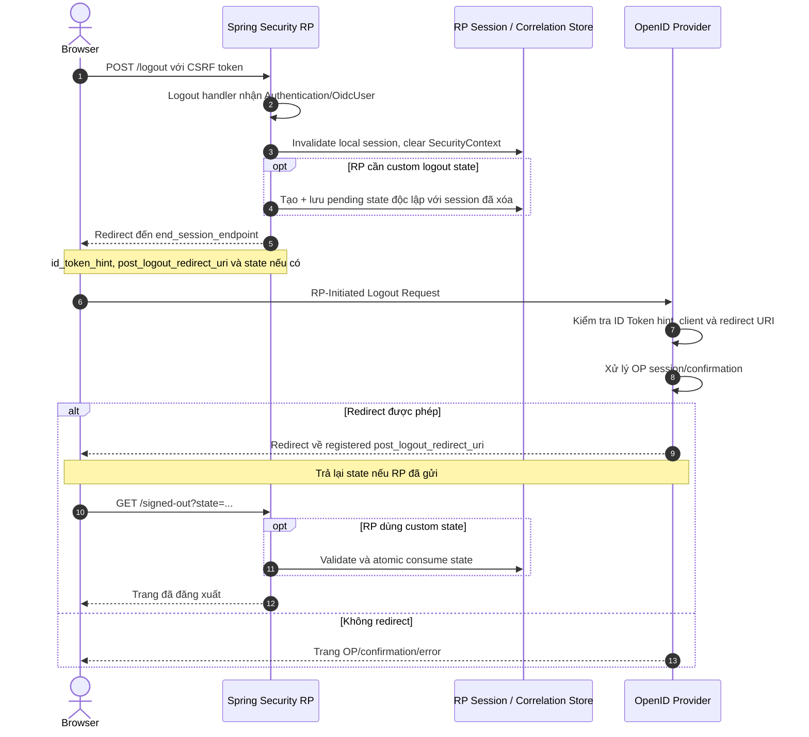

# 24.5. ID Token hint, post_logout_redirect_uri và logout state

## 1. Ba tham số quan trọng của RP-Initiated Logout

Trong **Spring Security OAuth 2.0/OIDC Client**, người dùng thường đăng nhập ứng dụng thông qua một **OpenID Provider (OP)**. Sau khi đăng nhập, browser có thể đồng thời giữ hai phiên:

- **Phiên tại Relying Party (RP):** session/SecurityContext của ứng dụng Spring.
- **Phiên SSO tại OP:** cookie hoặc trạng thái đăng nhập do nhà cung cấp danh tính quản lý.

Khi người dùng bấm **Đăng xuất**, chỉ xóa session nội bộ không có nghĩa là OP đã kết thúc phiên SSO. Browser có thể tiếp tục dùng phiên SSO để đăng nhập lại mà không cần nhập mật khẩu. Chuẩn **OpenID Connect RP-Initiated Logout 1.0** cho phép RP yêu cầu OP logout bằng cách điều hướng browser đến **Logout Endpoint**.

Ba tham số đặc biệt quan trọng:

| Tham số | Vai trò | Quy định trong chuẩn |
| --- | --- | --- |
| `id_token_hint` | ID Token đã cấp cho RP; gợi ý về user/OP session cần logout | **RECOMMENDED** |
| `post_logout_redirect_uri` | URI đã đăng ký để browser trở về RP sau OP logout | **OPTIONAL**, nhưng phải được đăng ký trước |
| `state` | Opaque value do RP tạo để tương quan request logout và callback | **OPTIONAL** |

Ví dụ cấu trúc:

```text
GET https://login.example.com/oidc/logout
  ?id_token_hint=FAKE_ID_TOKEN
  &post_logout_redirect_uri=https%3A%2F%2Fportal.example.com%2Fsigned-out
  &state=RANDOM_OPAQUE_LOGOUT_STATE
```

Trong request thực tế, các tham số cần được encode đúng. Đường dẫn Logout Endpoint phải lấy từ metadata/tài liệu OP đáng tin cậy, **không tự suy đoán**.

**Thông điệp chính:** `id_token_hint` giúp OP nhận dạng phiên; `post_logout_redirect_uri` xác định nơi quay về; `state` giúp RP nhận biết callback thuộc lượt logout nào. Chúng có trách nhiệm khác nhau, **không thay thế CSRF token, access token hoặc session cookie**.

### 1.1. Mục tiêu bài học

Sau bài học, người đọc cần có thể:

1. Phân biệt local logout, RP-Initiated Logout, token revocation và OIDC Back-Channel Logout.
2. Giải thích ID Token hint lấy từ đâu và OP kiểm tra gì.
3. Phân biệt post-logout redirect với authorization code callback khi đăng nhập.
4. Thiết kế `state` có entropy, TTL, browser binding và one-time consumption.
5. Nhận biết local session thường đã bị xóa trước callback.
6. Cấu hình Spring Security Servlet và WebFlux với OIDC logout success handler.
7. Phân biệt điều gì Spring Security handler làm **mặc định**, điều gì cần tùy biến.
8. Chẩn đoán lỗi `end_session_endpoint`, đăng ký URI, proxy, cookie và login loop.
9. Kiểm thử đúng HTTP contract và giới hạn bảo mật, không log raw ID Token.
10. Thiết kế UX an toàn nếu OP không redirect trở lại RP.

### 1.2. Bốn thành phần không được nhầm

| Thành phần | Chức năng |
| --- | --- |
| **OIDC ID Token** | Token OP cấp cho RP để truyền thông tin về lần xác thực user |
| **OAuth2 access token** | Credential gửi đến Resource Server để gọi API |
| **OAuth2 refresh token** | Credential gửi đến Token Endpoint để xin access token mới |
| **RP session cookie** | Browser dùng để liên kết với phiên đăng nhập của ứng dụng |

`id_token_hint` là **ID Token**, không phải access token và cũng không phải refresh token. RP-Initiated Logout qua browser **không phải** OAuth2 refresh/revocation grant.

## 2. Sơ đồ toàn bộ luồng đăng xuất



Điểm quan trọng:

- **Local logout** có thể đã hoàn thành **trước** khi browser đến OP.
- Trong Spring Security, `Authentication` vẫn được truyền vào logout success handler để handler có thể lấy ID Token hint, dù SecurityContext/session nội bộ đang được dọn dẹp.
- Nếu OP không redirect (browser đóng tab, user chưa xác nhận, URI sai), local logout vẫn có thể đã hoàn tất.
- Callback về `/signed-out` **không phải** callback nhận authorization code.
- `state` nếu được triển khai chỉ chứng minh mối liên kết request/callback theo thiết kế correlation; nó **không phải bằng chứng** tất cả các ứng dụng khác đã logout.

## 3. `end_session_endpoint`: URL nhận logout request

OP hỗ trợ RP-Initiated Logout và Discovery có thể công bố:

```json
{
  "issuer": "https://login.example.com/realms/corporate",
  "authorization_endpoint": "https://login.example.com/realms/corporate/oauth2/authorize",
  "token_endpoint": "https://login.example.com/realms/corporate/oauth2/token",
  "end_session_endpoint": "https://login.example.com/realms/corporate/oidc/logout"
}
```

Đây là **ví dụ metadata**, không phải endpoint cố định cho mọi provider.

Phân biệt:

- `authorization_endpoint`: gửi authorization request lúc đăng nhập.
- `token_endpoint`: đổi authorization code, refresh token và một số OAuth2 grants.
- `end_session_endpoint`: yêu cầu OP xử lý RP-Initiated Logout.

Thực tế các provider có thể dùng tên đường dẫn khác nhau, hỗ trợ logout ở các mức độ khác nhau hoặc yêu cầu thông số riêng. Nếu không thấy `end_session_endpoint`, cần kiểm tra khả năng của OP; không tự lấy Token Endpoint thay thế.

Theo chuẩn, OP nhận logout request thông qua **HTTP GET hoặc POST**, tương ứng query string hoặc form serialization. Spring Security Servlet handler thông dụng mặc định redirect browser bằng GET; một số phiên bản có thể được cấu hình POST qua `FormPostRedirectStrategy` nếu OP hỗ trợ.

## 4. `id_token_hint`: ý nghĩa và nguồn dữ liệu

### 4.1. Lấy ID Token từ `OidcUser`

Trong OIDC Login, principal thường implement:

```java
org.springframework.security.oauth2.core.oidc.user.OidcUser
```

Ví dụ sử dụng:

```java
if (authentication != null
        && authentication.getPrincipal() instanceof OidcUser oidcUser) {

    String idTokenHint =
        oidcUser.getIdToken().getTokenValue();

    // Chỉ gửi hint đến end_session_endpoint của đúng OP.
    // Không log raw idTokenHint.
}
```

`OidcUser.getIdToken().getTokenValue()` là nguồn phù hợp cho RP-Initiated Logout khi người dùng đã OIDC Login. ID Token có thể chứa `iss`, `sub`, `aud`, `exp`, và `sid` tùy OP.

**Không lấy** `OAuth2AuthorizedClient.getAccessToken().getTokenValue()` để đặt vào `id_token_hint`: access token có mục đích và audience khác.

### 4.2. OP kiểm tra gì khi nhận hint?

Theo RP-Initiated Logout:

- OP **phải xác minh** nó là issuer của ID Token được gửi.
- OP có thể dùng `aud` và/hoặc `sid` để nhận diện client/phiên liên quan.
- Nếu đồng thời có `client_id`, OP **phải kiểm tra** client ID phù hợp với ID Token.
- OP được khuyến nghị chấp nhận một ID Token của phiên hiện tại hoặc gần đây trong các trường hợp phù hợp **dù `exp` đã qua**; đây không phải quyền dùng mọi expired token tùy ý.
- Nếu ID Token hint không thuộc current/recent OP session, OP có thể coi request đáng nghi và từ chối hoặc yêu cầu xác nhận.

`id_token_hint` là **gợi ý có thể kiểm chứng**, không phải lệnh mà RP có thể dùng để bắt OP thu hồi toàn bộ token/session không liên quan.

### 4.3. Các tình huống có và không có hint

| Tình huống | Hành vi cần lưu ý |
| --- | --- |
| ID Token hợp lệ, đúng issuer/client | OP có cơ sở liên kết request với phiên |
| ID Token hết hạn, nhưng thuộc phiên gần đây | OP có thể chấp nhận theo khuyến nghị chuẩn |
| Token bị giả mạo, sai issuer/chữ ký | OP phải xác minh và không chấp nhận như hint hợp lệ |
| ID Token dành cho client khác | Không được lẫn client registration |
| Không có ID Token hint | OP có thể yêu cầu user xác nhận hoặc áp dụng điều kiện khác |
| User đã logout tại OP | RP logout request có tính idempotent; OP áp dụng policy của mình |
| OP không hỗ trợ RP-Initiated Logout | Cần local logout/fallback phù hợp |

Nếu custom code phá hủy Authentication trước khi tạo logout URL, handler có thể không còn ID Token; đây là một nguyên nhân khiến OP không nhận đủ thông tin để redirect về RP.

### 4.4. ID Token hint trong query URL có nhạy cảm không?

Có. ID Token thường chứa claims danh tính. Khi RP dùng HTTP redirect GET, hint được gửi trong **query string**:

```text
https://login.example.com/logout?id_token_hint=eyJ...&...
```

Giá trị này có thể bị ghi vào:

- Browser history, proxy/WAF logs, APM spans.
- HTTP access logs và error reports.
- Screenshots, copied URLs hoặc ticket hỗ trợ.
- Analytics và công cụ theo dõi request.
- Một số referrer flows nếu không có chính sách phù hợp.

Biện pháp:

1. Sử dụng HTTPS đúng hostname và chứng chỉ.
2. Redact `id_token_hint`, `state`, client credential và các token khỏi logs/traces.
3. Không paste full logout URL hoặc ID Token vào chat/ticket.
4. Hạn chế third-party content trên các trang xử lý dữ liệu nhạy cảm, áp dụng `Referrer-Policy`.
5. Xem xét POST form mode nếu framework, OP và chính sách vận hành cho phép.
6. Không gửi raw hint tới Resource Server API.
7. Không lưu hint trong localStorage hoặc cookie frontend chỉ để thực hiện logout.

## 5. `post_logout_redirect_uri`: callback sau logout

Giả sử RP muốn người dùng quay lại:

```text
https://portal.example.com/signed-out
```

Yêu cầu RP gửi tới OP:

```text
post_logout_redirect_uri=https%3A%2F%2Fportal.example.com%2Fsigned-out
```

Đây là URI **quay lại sau OP logout**, không phải authorization code callback.

### 5.1. Phải đăng ký trước tại OP

Chuẩn yêu cầu URI này phải thuộc tập **post-logout redirect URIs đã đăng ký** của RP tại OP. OP phải kiểm tra tính hợp lệ; giá trị không khớp thì OP **không thực hiện post-logout redirect** theo chuẩn.

Ví dụ:

| URI đã đăng ký | URI được yêu cầu | Điều cần kiểm tra |
| --- | --- | --- |
| `https://portal.example.com/signed-out` | Cùng URI | Có thể redirect nếu các điều kiện khác đạt |
| `https://portal.example.com/signed-out` | `http://portal.example.com/signed-out` | Scheme khác, không khớp |
| `https://portal.example.com/signed-out` | `https://portal.example.com/signed-out/` | Trailing slash khác |
| `https://portal.example.com/signed-out` | `https://evil.example/collect` | Ngoài allowlist, từ chối |
| `https://portal.example.com/signed-out` | `https://portal.example.com/signed-out?next=evil` | Query khác, phải kiểm tra exact registration |
| `https://portal.example.com/app/signed-out` | `https://portal.example.com/signed-out` | Context path khác |

Đăng ký logout redirect URI **khác** với đăng ký URI dùng cho Authorization Code.

### 5.2. So sánh login callback và logout callback

| Đặc điểm | Login `redirect_uri` | Logout `post_logout_redirect_uri` |
| --- | --- | --- |
| Mục đích | Browser mang authorization code về RP | Browser trở về RP sau OP logout |
| Giá trị ví dụ | `/login/oauth2/code/corporate` | `/signed-out` |
| Có authorization code? | Có | Không |
| Có OAuth2 login `state`? | Có trong authorization response | Không; có thể có **logout state** riêng |
| Session tại RP | Đang tạo/duy trì | Thường đã bị xóa |
| Bảo vệ chính | Code/PKCE/state/nonce theo flow | Registered URI và logout correlation nếu dùng |
| Callback có cần authentication? | Security login filter xử lý | Nên là public landing page |

Không đặt logout landing route thành một authorization code callback và không làm `/signed-out` tự động yêu cầu login.

### 5.3. `id_token_hint` vắng mặt nhưng vẫn có redirect?

Chuẩn khuyến nghị có hint khi yêu cầu post-logout redirect. Nếu **không có** ID Token hint, OP **không được redirect** trừ khi có cách khác để xác nhận tính hợp lệ của target.

`client_id` có thể giúp OP xác định client registration. Nhưng `client_id` không phải bí mật và **không tự chứng minh** quyền redirect. OP có thể cần user confirmation hoặc áp dụng chính sách khác.

Không gửi `client_secret` qua browser Logout Endpoint; nó không phải tham số của RP-Initiated Logout.

## 6. `state` của logout dùng để làm gì?

`state` trong RP-Initiated Logout là một giá trị **opaque**, tùy chọn, dùng để liên kết:

```text
RP tạo và lưu pending logout:
    state = abc123random

RP -> OP Logout Endpoint:
    ...&state=abc123random

OP -> RP post_logout_redirect_uri:
    https://portal.example.com/signed-out?state=abc123random

RP:
    Đối chiếu expected state + browser binding + TTL
    Consume một lần, hiển thị landing page
```

Nếu RP gửi `state`, OP theo chuẩn phải truyền lại state trong callback redirect. Tuy nhiên, **trạng thái khớp không chứng minh OP đã logout toàn bộ các phiên SSO**.

### 6.1. Logout state, login state và CSRF token

| Thành phần | Dùng ở đâu? | Mục đích |
| --- | --- | --- |
| OAuth2 **login `state`** | Authorization request và callback | Liên kết code response với authorization request |
| **Logout `state`** | RP-Initiated Logout request và post-logout redirect | Correlate lượt logout và lượt quay lại |
| **CSRF token** | POST logout/form/API của RP | Chống request cross-site dùng session cookie |
| **Session ID** | Browser cookie gửi đến RP | Nhận dạng session đã lưu |
| **OIDC `nonce`** | OIDC authorization request/ID Token | Liên kết ID Token với authentication request |

Không tái sử dụng cùng một state cho login và logout. Không dùng logout state thay CSRF token cho `POST /logout`. Không dùng logout state để xác minh OIDC ID Token.

### 6.2. Những gì `state` không chứng minh

Một callback có `state` đúng **không đồng nghĩa**:

- OP đã kết thúc tất cả các SSO sessions của user.
- Những RP khác đã logout.
- Access/refresh token đã được revoke.
- Một signed Logout Token của OP đã được xác minh.
- Người dùng nên được đăng nhập lại.
- Caller có quyền thao tác trên tài khoản khác.

Đặc biệt, logout state không thay thế **OIDC Back-Channel Logout Token**: Back-Channel Logout là protocol riêng có signed token và kiểm tra `iss`, `aud`, `sid`/`sub` theo quy tắc riêng.

## 7. Thiết kế logout state an toàn

Nếu sản phẩm chỉ cần trang `/signed-out` công khai, **không nhất thiết** phải tự xây logout state. Nếu ứng dụng cần correlation để kiểm soát UX/audit hoặc các bước không nhạy cảm, phải thiết kế đúng.

### 7.1. Tiêu chí

- Ngẫu nhiên đủ entropy, không đoán được.
- Không chứa user ID, email, client secret, raw token hoặc return URL tùy ý.
- Mỗi logout flow có giá trị riêng, không reuse.
- Có **TTL** ngắn và cleanup.
- Có **one-time atomic consume** để ngăn replay.
- Gắn với browser khởi tạo (khi mô hình đe dọa yêu cầu).
- Gắn với registration/issuer/expected callback URI.
- Không tạo lại SecurityContext khi kiểm tra thành công.
- Không dùng state như quyền truy cập một endpoint có side effect.
- Không log raw state nếu không cần.

### 7.2. Sinh state bằng CSPRNG

```java
import java.security.SecureRandom;
import java.util.Base64;

public final class LogoutStateGenerator {

    private static final SecureRandom RANDOM = new SecureRandom();

    private LogoutStateGenerator() {
    }

    public static String newState() {
        byte[] random = new byte[32];
        RANDOM.nextBytes(random);

        return Base64.getUrlEncoder()
            .withoutPadding()
            .encodeToString(random);
    }
}
```

Đây là opaque handle với 256 bit dữ liệu ngẫu nhiên. Không sinh state từ email, timestamp đơn lẻ, session ID hoặc một counter dễ đoán.

### 7.3. Record lưu correlation

Một DTO minh họa, **không phải Spring Security built-in API**:

```java
record PendingLogout(
    String stateHash,
    String browserBindingHash,
    String registrationId,
    String expectedIssuer,
    URI expectedReturnUri,
    Instant createdAt,
    Instant expiresAt
) {}
```

Store có thể là Redis/database hoặc một in-memory store cho môi trường đơn instance. Với nhiều pods, cần shared store nếu callback có thể đến một instance khác.

State khi callback tới phải được validate theo đúng record, browser binding, TTL và **atomic delete**. Nếu callback lặp lại, chỉ lần đầu có thể consume thành công.

### 7.4. Session cũ thường đã bị hủy!

Một lỗi rất phổ biến:

```text
POST /logout
  -> Lưu expected logout state vào HttpSession
  -> Logout handler invalidate HttpSession
  -> Redirect OP

GET /signed-out?state=...
  -> HttpSession trước đó không còn
  -> Không có expected state để đối chiếu
```

Một thiết kế có correlation cần sống độc lập với session đã logout:

```text
1. Tạo random logout state.
2. Lưu record trong short-lived correlation store.
3. Gắn browser với record qua cookie correlation riêng.
4. Local logout và redirect OP kèm state.
5. Callback GET /signed-out đọc state + correlation cookie.
6. Validate binding/issuer/registration/expiry, consume một lần.
7. Xóa cookie correlation và hiển thị trang công khai.
```

Cookie correlation riêng nên có `Secure`, `HttpOnly`, path/domain hẹp, TTL ngắn và `SameSite` phù hợp (ví dụ `Lax` cho top-level GET navigation). Không dùng cookie chứa raw ID Token.

### 7.5. Skeleton correlation service

```java
interface LogoutCorrelationService {

    PendingLogoutIssued issue(
        String registrationId,
        String expectedIssuer,
        URI expectedReturnUri,
        String browserBinding);

    boolean validateAndConsume(
        String returnedState,
        String browserBinding,
        URI actualCallbackUri);
}

record PendingLogoutIssued(
    String state,
    Instant expiresAt) {}
```

Đây là **interface ứng dụng tự định nghĩa**. Implementation production cần:

- Secure random/hashed stored token theo chính sách.
- Constant-time comparison khi phù hợp.
- TTL và atomic consume.
- Browser binding, issuer/registration/return URI checking.
- Giới hạn attempts và không leak thông tin user.
- Bảo vệ trước các callback bất thường.

Không chỉ kiểm tra `state != null` rồi coi callback hợp lệ.

## 8. Spring Security Servlet: handler có sẵn

Spring Security Servlet có:

```java
org.springframework.security.oauth2.client.oidc.web.logout
    .OidcClientInitiatedLogoutSuccessHandler
```

Handler là một `LogoutSuccessHandler`, nhận `ClientRegistrationRepository` và tạo redirect tới OP Logout Endpoint khi có OIDC authentication/metadata phù hợp.

### 8.1. Dependencies

Ví dụ Gradle:

```gradle
dependencies {
    implementation 'org.springframework.boot:spring-boot-starter-web'
    implementation 'org.springframework.boot:spring-boot-starter-security'
    implementation 'org.springframework.boot:spring-boot-starter-oauth2-client'
}
```

### 8.2. OIDC registration

```yaml
spring:
  security:
    oauth2:
      client:
        registration:
          corporate:
            provider: company
            client-id: ${CORPORATE_CLIENT_ID}
            client-secret: ${CORPORATE_CLIENT_SECRET}
            authorization-grant-type: authorization_code
            client-authentication-method: client_secret_basic
            redirect-uri: "{baseUrl}/login/oauth2/code/{registrationId}"
            scope:
              - openid
              - profile
              - email
        provider:
          company:
            issuer-uri: https://login.example.com/realms/corporate
```

`issuer-uri` cho phép đọc provider metadata khi hỗ trợ discovery, có thể bao gồm `end_session_endpoint`. Nhưng YAML **không thay** việc đăng ký `https://portal.example.com/signed-out` trong danh sách post-logout URI của client tại OP.

### 8.3. SecurityFilterChain

```java
@Configuration
class SecurityConfiguration {

    @Bean
    SecurityFilterChain securityFilterChain(
            HttpSecurity http,
            ClientRegistrationRepository registrations)
            throws Exception {

        var oidcLogout =
            new OidcClientInitiatedLogoutSuccessHandler(
                registrations);

        oidcLogout.setPostLogoutRedirectUri(
            "{baseUrl}/signed-out");

        http
            .authorizeHttpRequests(auth -> auth
                .requestMatchers(
                    "/", "/signed-out", "/assets/**")
                    .permitAll()
                .anyRequest().authenticated())
            .oauth2Login(Customizer.withDefaults())
            .logout(logout ->
                logout.logoutSuccessHandler(oidcLogout));

        return http.build();
    }
}
```

Các `import` được lược bỏ để tập trung vào cấu hình.

Những điểm cần hiểu:

1. Handler được gọi trong quy trình logout của Spring Security.
2. Handler có thể lấy ID Token hint từ `OidcUser` trong `Authentication`.
3. OP endpoint được tìm qua `ClientRegistration.getProviderDetails().getConfigurationMetadata()`.
4. `setPostLogoutRedirectUri(...)` chỉ cấu hình **giá trị yêu cầu gửi tới OP**, không cập nhật cấu hình OP.
5. `/signed-out` phải có route/view thực và được `permitAll`.
6. Local SecurityContext/session cleanup do logout infrastructure thực hiện theo cấu hình.
7. Nếu metadata/Authentication không phù hợp, handler có thể dùng fallback local logout target theo implementation; không tự khẳng định OP đã logout.

### 8.4. Trang landing không cần authentication

Ví dụ Spring MVC:

```java
@Controller
class SignedOutController {

    @GetMapping("/signed-out")
    String signedOut() {
        return "signed-out";
    }
}
```

`"signed-out"` là tên view cần được ứng dụng định nghĩa. Trang không nên tự gọi protected API hoặc yêu cầu authentication, vì browser có thể bị **đẩy trở lại OIDC Login ngay sau khi logout**.

### 8.5. POST `/logout` và CSRF

Với ứng dụng dùng browser session cookie, nên sử dụng Spring Security logout qua **POST với CSRF token**:

```html
<form method="post" action="/logout">
  <input type="hidden" name="_csrf" value="SERVER_RENDERED_CSRF_TOKEN">
  <button type="submit">Đăng xuất</button>
</form>
```

`SERVER_RENDERED_CSRF_TOKEN` chỉ là placeholder; template phải render CSRF token thực.

**Không tắt CSRF toàn cục hoặc cho phép GET logout bừa bãi** chỉ để trigger OIDC logout. POST tới RP và GET/POST tới OP là hai requests độc lập.

## 9. Spring Security WebFlux: handler Reactive

WebFlux dùng:

```java
org.springframework.security.oauth2.client.oidc.web.server.logout
    .OidcClientInitiatedServerLogoutSuccessHandler
```

và `ReactiveClientRegistrationRepository`.

### 9.1. Cấu hình

```java
@Configuration
@EnableWebFluxSecurity
class ReactiveSecurityConfiguration {

    @Bean
    SecurityWebFilterChain securityWebFilterChain(
            ServerHttpSecurity http,
            ReactiveClientRegistrationRepository registrations) {

        var oidcLogout =
            new OidcClientInitiatedServerLogoutSuccessHandler(
                registrations);

        oidcLogout.setPostLogoutRedirectUri(
            "{baseUrl}/signed-out");

        return http
            .authorizeExchange(exchanges -> exchanges
                .pathMatchers(
                    "/", "/signed-out", "/assets/**")
                    .permitAll()
                .anyExchange().authenticated())
            .oauth2Login(Customizer.withDefaults())
            .logout(logout ->
                logout.logoutSuccessHandler(oidcLogout))
            .build();
    }
}
```

Ví dụ dùng `SecurityWebFilterChain`, không nhầm với Servlet `SecurityFilterChain`.

| Servlet | WebFlux |
| --- | --- |
| `HttpSecurity` | `ServerHttpSecurity` |
| `ClientRegistrationRepository` | `ReactiveClientRegistrationRepository` |
| `OidcClientInitiatedLogoutSuccessHandler` | `OidcClientInitiatedServerLogoutSuccessHandler` |
| `LogoutSuccessHandler` | `ServerLogoutSuccessHandler` |
| `HttpSession` | `WebSession` |
| `SecurityContextHolder` | `ReactiveSecurityContextHolder` |

Khi viết custom handler, **không `.block()`** trong Reactor event loop. Dùng `Mono<Void>`, `flatMap` và reactive storage phù hợp.

### 9.2. URI template

Handler hỗ trợ các biến như:

```text
{baseUrl}
{baseScheme}
{baseHost}
{basePort}
{basePath}
```

Ví dụ:

```java
oidcLogout.setPostLogoutRedirectUri("{baseUrl}/signed-out");
```

Với public URL `https://portal.example.com`, URI mong muốn:

```text
https://portal.example.com/signed-out
```

Nếu app ở sau ingress, cần forwarded headers đáng tin cậy để `{baseUrl}` được mở rộng đúng.

## 10. Spring Security có tự sinh và verify logout `state` không?

**Không nên giả định có.**

Chuẩn RP-Initiated Logout **cho phép** tham số `state`, nhưng các `OidcClientInitiatedLogoutSuccessHandler` / `OidcClientInitiatedServerLogoutSuccessHandler` phổ biến tập trung vào việc tạo redirect từ **`id_token_hint`** và **`post_logout_redirect_uri`**. Trong implementation Servlet được công bố rộng rãi, URL được xây với hai tham số này; không có một tùy chọn công khai kiểu `setLogoutState(...)` tương đương bật trọn bộ state correlation.

Do đó:

- **Trang signed-out public:** built-in handler thường là đủ.
- **Cần correlation:** xây custom logout success handler/redirect builder và callback validator, hoặc sử dụng extension point chính thức nếu phiên bản cụ thể hỗ trợ.
- Chỉ thêm `&state=random` vào redirect URL mà **không lưu expected value** chưa phải bảo vệ.
- Chỉ đọc query `state` rồi chấp nhận mọi giá trị là sai.
- Phải đối chiếu API/behavior của đúng Spring Security version khi tùy biến.

### 10.1. Thiết kế custom handler theo trách nhiệm

```text
Custom logout success handler
    |
    +-- Authentication đã được Spring Security truyền vào
    +-- Xác định client registration của OIDC login
    +-- Lấy ID Token hint và trusted OP logout endpoint
    +-- Chọn post_logout_redirect_uri từ fixed allowlist
    +-- Sinh, lưu logout state và browser binding (nếu cần)
    +-- Xây URI với query parameters đã encode
    +-- Redirect browser đến đúng OP
```

Callback public:

```text
GET /signed-out?state=...
    |
    +-- Load pending state từ store độc lập session đã logout
    +-- Đối chiếu browser binding, TTL, registration, URI
    +-- Atomic consume
    +-- Xóa correlation cookie
    +-- Hiển thị trạng thái phù hợp, không restore login
```

**Không lấy URL OP, return URI, issuer hoặc client ID từ untrusted user input**. Không ghép query bằng string concatenation chứa token. Dùng URI builder và host/scheme validation.

### 10.2. `state` không chứng minh OP đã logout

Một attacker biết/lấy được state hoặc browser đến callback hợp lệ không đồng nghĩa có signed confirmation từ OP. Nếu nghiệp vụ đòi chứng minh/hủy SSO session đồng bộ, cần xem OP session APIs hoặc **OIDC Back-Channel Logout**, không biến một query parameter thành proof.

## 11. `client_id` và `logout_hint`

Hai tham số khác cũng có thể xuất hiện:

### 11.1. `client_id`

`client_id` là OAuth2 client identifier, hữu ích nếu:

- RP không có `id_token_hint` nhưng vẫn muốn dùng `post_logout_redirect_uri`.
- OP cần xác định client khi ID Token được mã hóa theo một kiểu nhất định.

Nếu **cả `client_id` và `id_token_hint`** xuất hiện, OP phải kiểm tra chúng tương ứng cùng client. Client ID **không phải secret** và không đủ để tự xác thực một request.

### 11.2. `logout_hint`

`logout_hint` là gợi ý tùy OP về người dùng, có thể là email, username, session identifier hoặc giá trị provider-specific. Không tự gửi PII/OP session ID khi không cần. Không suy ra OP nào cũng diễn giải `logout_hint` giống nhau.

Hai tham số này **không thay** `post_logout_redirect_uri` registration và security policy của OP.

## 12. Reverse proxy và tính chính xác của post-logout URI

Deployment điển hình:

```text
Browser:
    https://portal.example.com

Ingress:
    https://portal.example.com -> http://app-internal:8080

Spring app:
    http://app-internal:8080
```

Nếu `{baseUrl}` được suy ra từ internal request mà thiếu forwarded headers đúng, RP có thể gửi:

```text
http://app-internal:8080/signed-out
```

Trong khi OP chỉ đăng ký:

```text
https://portal.example.com/signed-out
```

Kết quả là provider từ chối redirect hoặc browser không truy cập được host nội bộ.

Có thể dùng cấu hình Spring Boot phù hợp:

```yaml
server:
  forward-headers-strategy: framework
```

Nhưng **chỉ tin Forwarded/X-Forwarded headers do proxy đáng tin cậy cung cấp**. Ingress phải loại bỏ/ghi đè headers từ client trực tiếp để tránh host/scheme spoofing hoặc open redirects.

Kiểm tra:

- Scheme `https` vs `http`.
- Hostname public vs internal.
- Port được hiển thị hay không.
- Context path.
- Trailing slash.
- Query parameters.
- URI cuối cùng có được đăng ký exact tại OP không?
- Cookie path/domain/SameSite nếu có logout correlation cookie.

Trong multi-tenant deployment có nhiều external hosts, nên ràng buộc allowed redirect URI theo client registration/tenant đã được xác minh, không dựa vào untrusted Host header.

## 13. Logout và cookie/browser state

Một browser có thể có:

| Cookie | Chủ sở hữu | Mục đích |
| --- | --- | --- |
| `JSESSIONID` hoặc RP `SESSION` | Ứng dụng RP | Giữ local authenticated session |
| OP SSO cookie | Domain OP | Giữ phiên SSO |
| Custom logout correlation cookie | Ứng dụng RP | Gắn callback với browser khởi tạo logout |
| CSRF cookie (nếu dùng) | Ứng dụng RP | Chống request giả mạo |

Local logout **không thể trực tiếp xóa cookie của domain OP**. Browser được redirect tới OP để OP xử lý session của mình.

Nếu custom state dùng cookie cho top-level GET callback:

- `SameSite=Lax` thường phù hợp.
- `SameSite=Strict` có thể khiến cookie không đi cùng cross-site navigation.
- `SameSite=None` yêu cầu Secure và tăng các bề mặt cross-site.
- `HttpOnly` nên bật cho correlation cookie không cần đọc bởi JavaScript.
- TTL ngắn; delete sau callback/expiry.
- Không lưu ID Token/access token vào correlation cookie.

Không tạo state chỉ trong HttpSession rồi invalidate chính session đó và kỳ vọng callback đọc được giá trị cũ.

## 14. Local logout, OP logout và token revocation là các vòng đời khác nhau

| Cơ chế | Mục đích | Không tự bảo đảm |
| --- | --- | --- |
| **Spring Security local logout** | Clear SecurityContext, invalidate session, cleanup cookies theo policy | OP session đã kết thúc |
| **RP-Initiated Logout** | RP yêu cầu OP logout qua browser | Access/refresh tokens đều bị revoke |
| **OAuth2 token revocation (RFC 7009)** | Request AS thu hồi token cụ thể | Browser session ở RP/OP tự kết thúc |
| **Remove authorized client** | Xóa access/refresh token khỏi local store | Token đã revoke tại AS |
| **OIDC Front-Channel Logout** | OP thông báo logout qua browser cho các RP | Browser luôn tải đủ các RP |
| **OIDC Back-Channel Logout** | OP gửi Logout Token từ server tới RP | Tự động revoke mọi API token nếu không có policy |

Một hệ thống yêu cầu **đăng xuất hoàn toàn** phải xác định:

1. RP session nào cần invalidate?
2. OP session nào cần kết thúc?
3. Authorized-client records của user có cần xóa không?
4. Access/refresh tokens có cần revoke không?
5. Các RP khác có hỗ trợ Front-/Back-Channel Logout không?
6. Resource Server chấp nhận token đã cấp trước đó trong bao lâu?
7. Có multi-tab/multi-device behavior nào cần giải thích cho user không?

Một `302` sau logout **không phải bằng chứng** mọi bước này đã hoàn tất.

## 15. Nếu OP không redirect về RP

Một số lý do:

- RP không gửi `post_logout_redirect_uri`.
- URI không được đăng ký hoặc không exact match.
- Không có ID Token hint và OP không đủ cơ sở xác minh redirect target.
- OP yêu cầu người dùng xác nhận logout.
- Browser/tab đóng trước khi OP hoàn tất.
- OP có lỗi chính sách/metadata/session.
- Proxy/network/cookie gây lỗi điều hướng.
- OP không hỗ trợ RP-Initiated Logout.

**Local logout nên hoàn thành độc lập callback.** Không chờ browser quay lại rồi mới xóa SecurityContext; nếu callback không đến, session RP không nên bị giữ chỉ vì UX đã bắt đầu logout.

Trang signed-out nên public, không chứa dữ liệu nhạy cảm và không phụ thuộc user session vừa bị xóa.

## 16. Multi-provider/multi-registration

Một ứng dụng hỗ trợ nhiều OIDC providers:

```yaml
spring:
  security:
    oauth2:
      client:
        registration:
          corporate:
            provider: corporate-idp
            client-id: ${CORPORATE_ID}
            client-secret: ${CORPORATE_SECRET}
            authorization-grant-type: authorization_code
            scope: openid, profile

          partner:
            provider: partner-idp
            client-id: ${PARTNER_ID}
            client-secret: ${PARTNER_SECRET}
            authorization-grant-type: authorization_code
            scope: openid, profile

        provider:
          corporate-idp:
            issuer-uri: https://login.corp.example/realms/staff
          partner-idp:
            issuer-uri: https://login.partner.example/realms/partner
```

Mỗi registration có:

- Issuer và ID Token khác.
- `end_session_endpoint` khác.
- Danh sách post-logout redirect URIs khác.
- Quy định ID Token hint/confirmation khác.

**Không gửi ID Token của Partner OP tới Corporate OP**; có thể lộ token và chắc chắn không đúng issuer. Handler/custom code phải xác định registration từ OIDC authentication tương ứng, tìm metadata của **đúng OP**, và ràng buộc logout URL/return URI theo client đó.

Nếu custom logout state, lưu `registrationId` và `issuer` trong pending record để callback không trộn các flows.

## 17. Ma trận kiểm thử

| ID | Ca kiểm thử | Điều cần xác nhận |
| --- | --- | --- |
| T01 | OIDC user, metadata có end-session endpoint | Redirect tới OP Logout Endpoint đúng |
| T02 | Có OIDC ID Token | Logout request mang `id_token_hint` |
| T03 | Hint thuộc issuer khác | OP không chấp nhận sai trust |
| T04 | `client_id` không khớp ID Token | OP từ chối |
| T05 | URI đã đăng ký | OP có thể redirect |
| T06 | URI chưa đăng ký | OP không redirect |
| T07 | URI sai scheme/path/trailing slash | Không được tự chấp nhận |
| T08 | Không có ID Token hint nhưng có URI | OP yêu cầu cách xác minh target |
| T09 | Có logout state | OP echo đúng state |
| T10 | Callback state đúng | RP consume một lần |
| T11 | Callback state bị đổi | Không coi là correlated success |
| T12 | Callback thiếu state | Không kích hoạt privileged action |
| T13 | Callback state hết hạn | Reject correlation |
| T14 | Replay cùng state | Chỉ consume thành công lần đầu |
| T15 | Callback từ browser khác | Browser binding mismatch |
| T16 | RP session đã invalidate | Pending state vẫn có thể xác minh độc lập |
| T17 | OP không redirect | Local session vẫn đã logout |
| T18 | Signed-out route public | Không redirect login lại |
| T19 | Reverse proxy HTTPS | Callback URL đúng public host/scheme |
| T20 | Người dùng login qua Partner OP | Không gửi hint cho Corporate OP |
| T21 | Ứng dụng không có OIDC Authentication | Local logout/fallback phù hợp |
| T22 | POST logout thiếu CSRF | Bị chặn theo security policy |
| T23 | POST logout có CSRF hợp lệ | Local cleanup và OIDC redirect |
| T24 | Nhiều pods nhận callback | State store shared/affinity phù hợp |
| T25 | Quan sát logs | Không lộ ID Token hint, state, cookie |
| T26 | OP confirmation chưa xong | Không tự coi redirect là signed proof |
| T27 | Access token còn hạn sau logout | Không suy ra revocation tự động |

### 17.1. MockMvc cho Spring Servlet

Có thể dùng `spring-security-test` với `oidcLogin()` và CSRF mock postprocessor để tạo request:

```java
mockMvc.perform(
        post("/logout")
            .with(csrf())
            .with(oidcLogin()))
    .andExpect(status().is3xxRedirection())
    .andExpect(header().string(
        HttpHeaders.LOCATION,
        startsWith("https://login.example.com/oidc/logout")));
```

Đây là **skeleton**: test cần `ClientRegistrationRepository` fixture với `registrationId` của OIDC login và `end_session_endpoint` test. Sau đó parse `Location` URI và assert:

- OP host/path đúng.
- `id_token_hint` từ **fake OIDC ID Token**.
- `post_logout_redirect_uri` đúng expected registered URI.
- Session đã bị invalidate theo policy.
- Không assert `state` trừ khi có custom correlation implementation.
- Logs không chứa raw fake token/cookie trong quá trình test.

Không cần test actual browser OP session bằng MockMvc; phần đó phải được integration test với OP sandbox.

### 17.2. WebFlux tests

Với Reactive, dùng `WebTestClient` kết hợp Spring Security test config/`mockOidcLogin` phù hợp phiên bản:

```text
POST /logout + valid CSRF
    -> Response 3xx
    -> Location = trusted end_session_endpoint
    -> id_token_hint + post_logout_redirect_uri đúng
    -> WebSession/SecurityContext được cleanup
```

Không sử dụng mock `HttpServletRequest` trong WebFlux; các controllers/handlers reactive trả `Mono` và không `.block()` trong event loop.

### 17.3. Test OP sandbox

Mock app test chỉ chứng minh **RP tạo request đúng**. Với provider test instance, thử:

- `id_token_hint` hợp lệ/sai issuer/sai client.
- URI có/không nằm trong post-logout allowlist.
- Không có hint nhưng có `client_id`/redirect.
- `state` được echo khi OP redirect.
- OP user confirmation và session behavior.
- Không redirect khi validation thất bại.
- Không tự log token thật hoặc thử trên production users.

## 18. Troubleshooting

| Triệu chứng | Nguyên nhân có thể | Hướng kiểm tra |
| --- | --- | --- |
| Logout chỉ về `/login?logout` | OIDC handler không được wired, thiếu metadata/Authentication | SecurityFilterChain và LogoutSuccessHandler |
| Không có `id_token_hint` | Principal không phải `OidcUser`, mất Authentication | OIDC login scopes và logout order |
| `end_session_endpoint` thiếu | OP không hỗ trợ/công bố metadata | Discovery response |
| OP báo redirect URI không hợp lệ | URI chưa đăng ký hoặc khác scheme/path | Exact post-logout URI và `{baseUrl}` |
| OP không redirect dù URI đúng | Thiếu hint/client confirmation hoặc OP policy | Provider logs/tài liệu |
| Browser quay về trang đăng nhập ngay | `/signed-out` vẫn yêu cầu auth | `permitAll("/signed-out")` |
| Logout thành công, login lại tức thì | OP SSO session chưa kết thúc | Phân biệt RP logout và OP logout |
| Callback state mismatch | Store mất, binding sai, TTL expired | Correlation store/cookie |
| Callback qua pod khác thất bại | Pending state/session ở RAM pod đầu | Shared store/affinity |
| State luôn thiếu | Built-in handler không tự tạo state | Kiểm tra custom implementation |
| Hint sai provider trong multi-tenant | Nhầm registration/issuer | OIDC Authentication registration ID |
| `http://internal-host` trong redirect | Reverse proxy headers sai | External base URL/forwarded headers |
| URI quá dài/ bị WAF chặn | ID Token trong GET query | POST mode nếu OP/framework hỗ trợ |
| POST `/logout` trả 403 | CSRF token thiếu/sai | CSRF repo/header/form |
| OP logout xong API token vẫn dùng được | Logout không tự revoke token | Token revocation/Resource Server policy |
| Trên web không thấy cookie correlation | SameSite/Secure/Path/browser policy | DevTools cookie và Set-Cookie |
| Một tab vẫn hiển thị dữ liệu cũ | UI cached, tab chưa reload | API auth response/cache headers |
| Có signed-out state nhưng session vẫn còn | Local logout handler thiếu hoặc custom bypass | Local session invalidation |

### 18.1. Chẩn đoán bằng log an toàn

Nên quan sát:

```text
logoutFlow=RP_INITIATED
registrationId=corporate
issuerHost=login.example.com
idTokenHintPresent=true
postLogoutRedirectUriId=signed-out
logoutStateCreated=true
localSessionInvalidated=true
redirectOutcome=sent
```

Nếu có callback:

```text
callbackPath=/signed-out
statePresent=true
stateValidation=accepted
correlationConsumed=true
```

**Không log**:

```text
id_token_hint=<raw-token>
Authorization: Bearer <token>
state=<raw-random-value>
Cookie: JSESSIONID=<session-id>
client_secret=<secret>
```

Sử dụng correlation ID nội bộ hoặc nhãn kết quả thay vì token/query nguyên văn.

## 19. Kịch bản thực tế

### Kịch bản A — Local logout nhưng SSO còn

Người dùng bấm Logout, Spring Security invalidate session. Sau đó user bấm Login và OP đăng nhập ngay.

**Giải thích:** RP logout không đồng nghĩa OP logout. Cần RP-Initiated Logout nếu yêu cầu kết thúc SSO, và OP policy vẫn là yếu tố quyết định.

### Kịch bản B — Logout redirect URI sai sau ingress

OP chỉ đăng ký `https://portal.example.com/signed-out`, trong khi handler gửi `http://service:8080/signed-out`.

**Giải pháp:** cấu hình public base URL/forwarded header trusted, không tắt OP exact redirect validation.

### Kịch bản C — Không đọc được state sau logout

Ứng dụng lưu expected state trong session vừa invalidate nên callback không tìm được.

**Giải pháp:** transient state store độc lập session đăng nhập và browser-bound cookie ngắn hạn.

### Kịch bản D — OP từ chối post-logout redirect khi không có hint

User không có `OidcUser` vì dùng OAuth2 Login thông thường, custom code vẫn gửi `post_logout_redirect_uri`.

**Giải pháp:** xác định OP hỗ trợ cơ chế logout nào. Không biến access token thành ID Token; nếu OP cho phép `client_id`/confirmation, dùng đúng contract.

### Kịch bản E — State bị replay

Một giá trị state xuất hiện trong browser history và callback đến hai lần.

**Giải pháp:** atomic one-time consume; callback thứ hai chỉ hiển thị trang public, không làm side effect.

### Kịch bản F — Một OP đăng xuất xong nhưng Resource Server vẫn nhận access token

**Giải thích:** RP-Initiated Logout không tự bảo đảm token revocation. Thiết kế thêm revocation, expiry và API token validation khi policy yêu cầu.

### Kịch bản G — Hai OIDC providers

Người dùng login qua Partner nhưng một custom logout handler luôn redirect Corporate OP.

**Giải pháp:** chọn đúng registration từ OIDC Authentication, khớp issuer/ID Token và trusted end-session endpoint.

### Kịch bản H — `/signed-out` yêu cầu auth

Browser trở về RP sau logout và ngay lập tức bị redirect về OP authorization flow.

**Giải pháp:** `permitAll` landing page và tránh khởi động login tự động trên trang đó.

### Kịch bản I — Browser đóng tab tại OP

Local logout đã thực hiện; callback không đến.

**Giải pháp:** pending correlation TTL sẽ cleanup, UX không coi đó là lỗi của local logout.

### Kịch bản J — App muốn điều hướng tùy ý sau logout

User gửi `returnTo=https://evil.example` và app dùng trực tiếp làm post-logout URI.

**Giải pháp:** dùng fixed registered post-logout URI; nếu cần target nội bộ tùy chọn, ánh xạ qua allowlist **sau khi** callback được xử lý, không tin raw external URLs.

## 20. Câu hỏi ôn tập

**1. `id_token_hint` dùng để làm gì?**  
Gợi ý OP về user/phiên OIDC liên quan tới RP đã được cấp ID Token.

**2. `id_token_hint` có phải access token không?**  
Không. Đây là ID Token do OP cấp cho RP.

**3. `id_token_hint` có bắt buộc không?**  
Nó được **RECOMMENDED**, không phải MUST trong đặc tả chung.

**4. Vì sao không nên gửi ID Token hint tới API business?**  
API Resource Server dùng access token theo audience của nó, không phải ID Token dành cho RP.

**5. `post_logout_redirect_uri` là gì?**  
URI được OP redirect browser trở lại sau logout nếu các điều kiện validation đạt.

**6. URI này có cần đăng ký trước với OP không?**  
Có; OP phải xác minh nó thuộc danh sách đã đăng ký.

**7. URI logout và login redirect có dùng chung endpoint không?**  
Không nên. Login callback xử lý authorization code, còn logout landing chỉ hiển thị hậu logout.

**8. `state` trong RP-Initiated Logout có bắt buộc không?**  
Không, là optional correlation parameter.

**9. Nếu RP gửi state, OP làm gì khi redirect?**  
OP gửi lại state đó cho RP ở post-logout redirect.

**10. State trùng có chứng minh OP revoke refresh token không?**  
Không, state là correlation handle, không phải signed proof hoặc revocation.

**11. Vì sao không lưu expected logout state chỉ trong HttpSession?**  
Local logout thường invalidate session trước khi callback quay lại.

**12. Nên sinh logout state bằng gì?**  
CSPRNG đủ entropy, có TTL và one-time consume.

**13. Có nên chứa email, token hoặc redirect target trong state không?**  
Không. Dùng opaque handle trỏ đến record server-side.

**14. Servlet handler nào hỗ trợ RP-Initiated Logout?**  
`OidcClientInitiatedLogoutSuccessHandler`.

**15. WebFlux handler tương ứng?**  
`OidcClientInitiatedServerLogoutSuccessHandler`.

**16. Handler built-in có chắc tự làm correlation state không?**  
Không. Phải kiểm tra phiên bản; nếu cần state thì cấu hình/custom rõ cả chiều đi và chiều về.

**17. Vì sao `setPostLogoutRedirectUri(...)` chưa đủ?**  
Vì OP vẫn phải có URI đó trong client registration và chấp nhận validation.

**18. `{baseUrl}` có thể sai trong hoàn cảnh nào?**  
Khi reverse proxy/TLS termination hoặc forwarded headers làm ứng dụng nhận internal scheme/host.

**19. `client_id` hữu ích khi nào?**  
Khi OP cần nhận dạng client, đặc biệt khi không có `id_token_hint` nhưng có post-logout redirect.

**20. `client_id` có thay client secret không?**  
Không; client ID không phải secret và không phải credential.

**21. Có nên dùng GET `/logout` cho browser app?**  
Không theo thói quen; ưu tiên POST kết hợp CSRF protection.

**22. Vì sao signed-out page nên public?**  
Vì RP session đã logout và browser không còn authentication.

**23. RP-Initiated Logout có luôn xóa OP SSO session không?**  
Không bảo đảm trong mọi tình huống; phụ thuộc OP confirmation và policy.

**24. Local logout có tự revoke mọi access token không?**  
Không.

**25. Khi OP không redirect về RP thì local logout có thể đã xong chưa?**  
Có.

**26. Vì sao cần kiểm thử exact URI?**  
Để tránh open redirect và đáp ứng validation của OP.

**27. Nếu có nhiều providers, ID Token hint chọn theo gì?**  
Theo client registration/issuer đã xác thực của OIDC Authentication đang logout.

**28. Các logs cần che dữ liệu gì?**  
ID Token hint, state, session cookie, access/refresh tokens và client secret.

## 21. Tài liệu tham khảo

- [OpenID Connect RP-Initiated Logout 1.0 — Final](https://openid.net/specs/openid-connect-rpinitiated-1_0-final.html)
- [OpenID Connect Core 1.0](https://openid.net/specs/openid-connect-core-1_0.html)
- [OpenID Connect Discovery 1.0](https://openid.net/specs/openid-connect-discovery-1_0.html)
- [OpenID Connect Front-Channel Logout 1.0](https://openid.net/specs/openid-connect-frontchannel-1_0.html)
- [OpenID Connect Back-Channel Logout 1.0](https://openid.net/specs/openid-connect-backchannel-1_0.html)
- [RFC 7009 — OAuth 2.0 Token Revocation](https://www.rfc-editor.org/rfc/rfc7009)
- [RFC 9700 — OAuth 2.0 Security Best Current Practice](https://www.rfc-editor.org/rfc/rfc9700)
- [Spring Security Reference — OIDC Logout (Servlet)](https://docs.spring.io/spring-security/reference/servlet/oauth2/login/logout.html)
- [Spring Security Reference — OIDC Logout (Reactive)](https://docs.spring.io/spring-security/reference/reactive/oauth2/login/logout.html)
- [Spring Security API — OidcClientInitiatedLogoutSuccessHandler](https://docs.spring.io/spring-security/site/docs/current/api/org/springframework/security/oauth2/client/oidc/web/logout/OidcClientInitiatedLogoutSuccessHandler.html)
- [Spring Security API — OidcClientInitiatedServerLogoutSuccessHandler](https://docs.spring.io/spring-security/site/docs/current/api/org/springframework/security/oauth2/client/oidc/web/server/logout/OidcClientInitiatedServerLogoutSuccessHandler.html)
- [Spring Security API — OidcUser](https://docs.spring.io/spring-security/site/docs/current/api/org/springframework/security/oauth2/core/oidc/user/OidcUser.html)
- [Spring Security Reference — CSRF (Servlet)](https://docs.spring.io/spring-security/reference/servlet/exploits/csrf.html)
- [Spring Security Reference — CSRF (Reactive)](https://docs.spring.io/spring-security/reference/reactive/exploits/csrf.html)

**Ghi nhớ:** Trong OIDC RP-Initiated Logout, `id_token_hint` giúp OP nhận diện phiên liên quan, `post_logout_redirect_uri` là **điểm quay lại đã đăng ký**, còn `state` là **giá trị opaque tùy chọn** để correlate callback. Spring Security hỗ trợ OIDC logout success handlers cho Servlet và WebFlux nhưng không nên mặc định rằng state đã được tự động sinh/kiểm tra. Nếu cần state correlation, hãy bảo vệ nó bằng TTL, one-time consume, browser binding và store độc lập session bị invalidate. Đừng nhầm local logout, OP logout, token revocation và Back-Channel Logout; đồng thời bảo vệ ID Token hint, exact redirect URI, HTTPS/proxy và CSRF của `POST /logout`.
