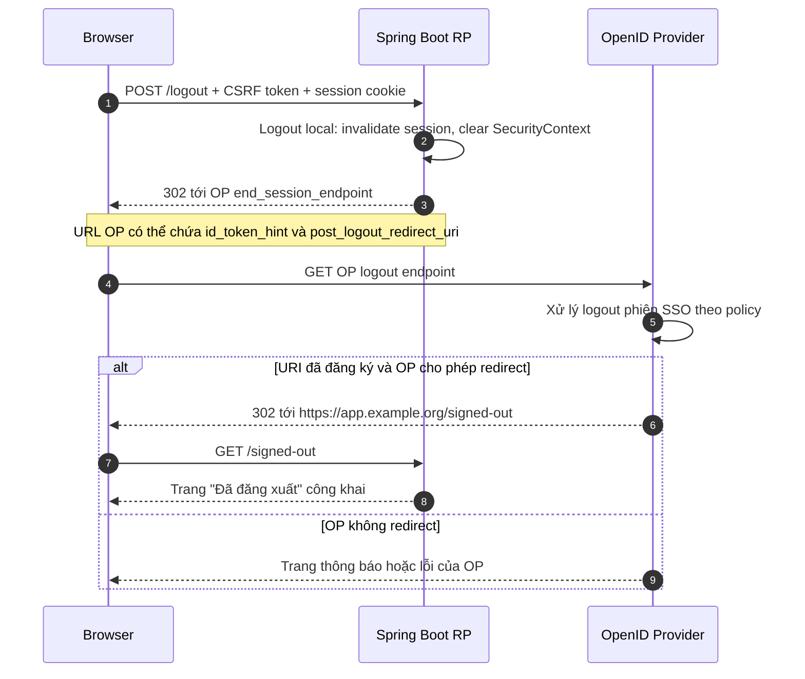
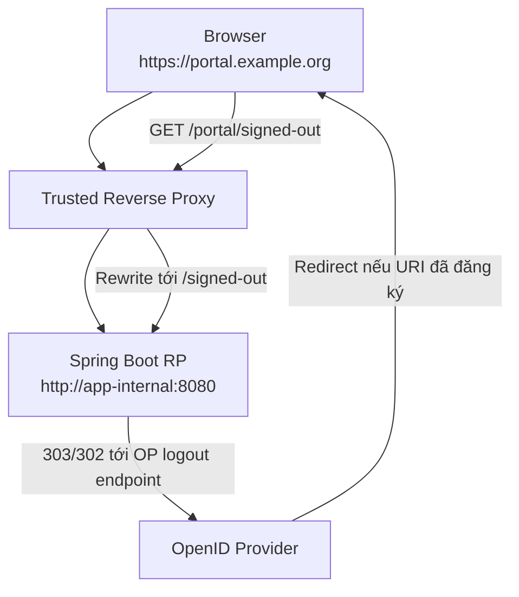
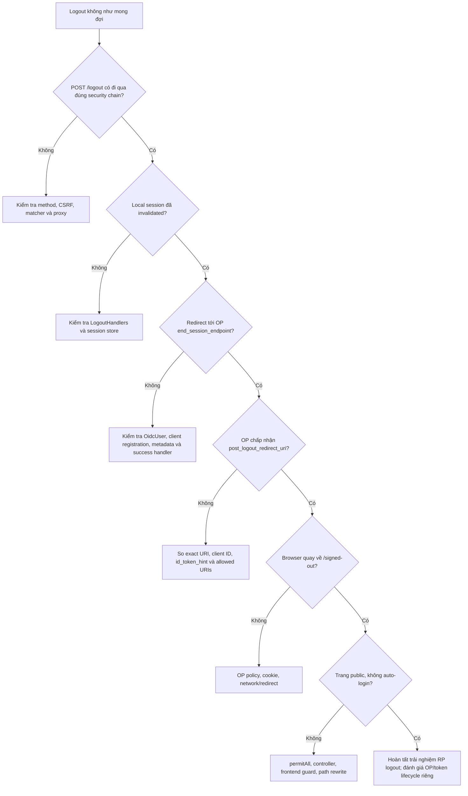

# 24.6. Đăng ký và kiểm soát Redirect URI sau đăng xuất

Trong **Spring Security OAuth 2.0 / OpenID Connect (OIDC) Client**, đăng xuất là một quá trình có thể liên quan **hai phiên độc lập**:

- **Phiên tại ứng dụng** (*Relying Party — RP*): ví dụ phiên Spring Boot đang lưu `SecurityContext` của người dùng trong `HttpSession` hoặc `WebSession`.
- **Phiên đăng nhập tại OpenID Provider (OP)**: ví dụ phiên Single Sign-On (SSO) mà OP dùng để nhận diện trình duyệt ở những lần đăng nhập tiếp theo.

Khi người dùng bấm **Đăng xuất**, ứng dụng có thể xóa phiên cục bộ. Nhưng để hoàn tất trải nghiệm SSO, RP thường còn muốn **đưa trình duyệt đến OP để kết thúc phiên OP**, rồi quay về một trang công khai của ứng dụng, chẳng hạn:

```text
https://app.example.org/signed-out
```

URL quay về này được gọi là **Post-Logout Redirect URI** và được truyền qua tham số OIDC **`post_logout_redirect_uri`** trong *RP-Initiated Logout* khi OP hỗ trợ.

Đây không phải một URL tự do do browser được phép chỉ định. OP phải biết những URI nào đã đăng ký cho client; ứng dụng phải tạo URI từ cấu hình tin cậy; proxy phải đưa ra public scheme/host chính xác; và trang nhận redirect **không được coi redirect là bằng chứng user đã được logout ở mọi hệ thống**.

Bài học trình bày cách **đăng ký, cấu hình, đối chiếu và kiểm soát Post-Logout Redirect URI** trong Spring Security OIDC Client, có ví dụ Spring Boot Servlet và WebFlux, sơ đồ luồng, nhiều môi trường/tenant, reverse proxy, kiểm soát open redirect, session/token lifecycle, xử lý lỗi và hướng chẩn đoán trong production.

> **Nguyên tắc chính:** `post_logout_redirect_uri` chỉ là **đích điều hướng sau khi OP xử lý logout**. Nó **không phải** callback đăng nhập, không thay thao tác xóa session local, và không phải một cơ chế tự thu hồi Access Token/Refresh Token.

## 1. Bối cảnh: một nút Đăng xuất, nhiều trạng thái cần xử lý

Giả sử có bốn thành phần:

| Thành phần | Vai trò |
|---|---|
| **Browser** | Giữ cookie phiên của ứng dụng và cookie SSO của OP theo chính sách trình duyệt. |
| **Spring Boot `orders-web`** | OIDC Client / Relying Party, quản lý authentication và session cục bộ. |
| **`company-idp`** | OpenID Provider, phát ID Token và quản lý phiên SSO. |
| **`orders-api`** | Resource Server nhận OAuth2 Access Token cho API nghiệp vụ. |

Nếu người dùng chỉ xóa `HttpSession` của `orders-web` nhưng cookie SSO tại OP vẫn hợp lệ, khi bấm Đăng nhập trở lại, OP có thể xác thực ngay mà không yêu cầu nhập mật khẩu. Điều này có thể đúng theo yêu cầu của hệ thống, nhưng nếu UX kỳ vọng **đăng xuất cả SSO**, cần thêm quy trình OP logout phù hợp.

Một luồng phổ biến:



Hành vi cụ thể của OP có thể khác: OP có thể hiển thị màn hình xác nhận, kết thúc phiên theo chính sách hoặc từ chối chuyển hướng nếu tham số không hợp lệ. **RP không được giả định OP chắc chắn sẽ redirect** chỉ vì đã có `post_logout_redirect_uri`.

### 1.1. Các trạng thái không đồng nhất

| Thao tác | Kết quả chính | Điều không được tự suy ra |
|---|---|---|
| Xóa `SecurityContext`/invalidate local session | Browser không còn authentication cục bộ hợp lệ cho phiên đó. | OP SSO session đã bị hủy. |
| Gửi browser tới OP end-session endpoint | Yêu cầu OP xử lý logout. | OP đã kết thúc mọi phiên trên mọi thiết bị. |
| OP chuyển browser tới `post_logout_redirect_uri` | Browser quay về URL được phép. | Access Token hoặc Refresh Token đã bị revoke. |
| Xóa `OAuth2AuthorizedClient` | Ứng dụng không còn bản ghi token ở local store tương ứng. | Token đã bị vô hiệu tại Resource Server. |
| Gọi token revocation endpoint | Yêu cầu Authorization Server thu hồi token theo khả năng/provider policy. | Mọi phiên ứng dụng khác đã bị hủy. |

Bởi vậy, **đăng xuất + redirect + thu hồi token** là những trách nhiệm liên quan nhưng khác nhau.

## 2. Phân biệt ba URI dễ nhầm

Trong ứng dụng OIDC, thường gặp ít nhất ba URI:

| URI | Bên tiếp nhận | Mục đích |
|---|---|---|
| **Authorization redirect URI / `redirect_uri`** | **Ứng dụng RP** | OP trả browser về trong **đăng nhập** cùng `code`/`state`. |
| **OP end-session endpoint / `end_session_endpoint`** | **OpenID Provider** | RP đưa browser tới để **yêu cầu logout ở OP**. |
| **Post-Logout Redirect URI / `post_logout_redirect_uri`** | **Ứng dụng RP** | OP trả browser về **sau bước logout** nếu chấp nhận URI. |

Ví dụ rõ ràng:

```text
1) Đăng nhập:
   RP -> OP authorization_endpoint
   OP -> https://app.example.org/login/oauth2/code/company

2) Đăng xuất:
   RP -> https://id.example.org/realms/company/protocol/openid-connect/logout
   OP -> https://app.example.org/signed-out
```

**`/login/oauth2/code/company`** là callback nhận authorization code, thường do Spring Security OAuth2 Login Filter xử lý.

**`/signed-out`** là một trang thông thường sau đăng xuất. Nó **không cần** nhận authorization code, không nên sử dụng như OAuth2 login callback, và phải được phép truy cập khi browser không còn authentication.

### 2.1. `redirect_uri` và `post_logout_redirect_uri` khác trường đăng ký

Trong cấu hình Spring Boot:

```yaml
spring:
  security:
    oauth2:
      client:
        registration:
          company:
            redirect-uri: "{baseUrl}/login/oauth2/code/{registrationId}"
```

`redirect-uri` là property dành cho **Authorization Code login callback**.

Trong Spring Security, Post-Logout Redirect URI thường được cấu hình trên **OIDC logout success handler**:

```java
logoutSuccessHandler.setPostLogoutRedirectUri("{baseUrl}/signed-out");
```

Đây là hai nơi cấu hình khác nhau. **Đổi property `redirect-uri` trong client registration không tự đổi URL quay về sau logout**.

### 2.2. Không nhầm với `/logout` của ứng dụng

`POST /logout` ở RP (mặc định khi CSRF được bật trong Servlet app) là endpoint mà browser yêu cầu **ứng dụng** đăng xuất.

`end_session_endpoint` ở OP là endpoint để **OP** xử lý logout SSO.

`/signed-out` là trang kết quả **sau** logout.

Ba đường dẫn có thể tồn tại đồng thời và được xử lý ở ba thời điểm khác nhau.

## 3. OIDC RP-Initiated Logout là gì?

**OpenID Connect RP-Initiated Logout 1.0** mô tả cách Relying Party gửi trình duyệt đến **Logout Endpoint của OpenID Provider** để bắt đầu logout.

Một logout request có thể chứa những tham số tiêu chuẩn như:

- `id_token_hint`: ID Token trước đó do OP cấp, gợi ý phiên/ngữ cảnh OP cần kết thúc.
- `post_logout_redirect_uri`: URI của RP mà OP có thể chuyển browser về sau khi xử lý logout.
- `state`: giá trị tùy chọn do RP cấp để liên kết logout request với phản hồi quay lại RP.
- `client_id`: có thể cần trong những trường hợp như xác định RP khi không có `id_token_hint`, theo quy tắc spec/provider.
- `logout_hint` hoặc `ui_locales` nếu OP hỗ trợ và ứng dụng có nhu cầu.

Không phải mọi provider yêu cầu hoặc hỗ trợ giống nhau tất cả tham số. Cần dựa trên tài liệu OIDC logout và hợp đồng của **OP cụ thể**.

Ví dụ minh họa:

```http
HTTP/1.1 302 Found
Location: https://id.example.org/oidc/logout?id_token_hint=<redacted-id-token>&post_logout_redirect_uri=https%3A%2F%2Fapp.example.org%2Fsigned-out
```

`Location` của response có thể chứa **ID Token trong `id_token_hint`**, vì vậy **không nên ghi raw Location header hoặc full logout URL vào application logs, access logs, APM traces hay support tickets**.

### 3.1. Vì sao cần `id_token_hint`?

OP có thể dùng ID Token để xác định RP hoặc phiên đăng nhập liên quan và kiểm tra logout request. Đặc biệt, OP có thể cần ngữ cảnh để quyết định có cho phép `post_logout_redirect_uri` hay không.

Tuy nhiên:

- `id_token_hint` **không** phải Access Token gửi tới Resource Server.
- ID Token cần được bảo vệ vì có thể chứa claim danh tính.
- Một số OP có thể xác nhận thêm hoặc yêu cầu `client_id`/điều kiện khác.
- Nếu local session đã mất và không còn OIDC authentication, Spring handler có thể không lấy được ID Token để tạo request như mong muốn.
- Việc OP chấp nhận URI vẫn phụ thuộc **đăng ký và validation phía OP**.

Không sửa lỗi thiếu ID Token bằng cách để frontend tự gửi raw ID Token vào query string của một controller không bảo vệ.

### 3.2. `state` của logout khác `state` của login

Trong Authorization Code Flow, `state` liên kết authorization request và callback, bảo vệ chống một số tấn công chèn phản hồi/login CSRF.

Trong RP-Initiated Logout, `state` tùy chọn có thể giúp ứng dụng xác nhận trình duyệt trở lại từ một logout flow đã khởi động. Nếu sử dụng, nên tạo giá trị khó đoán, lưu tương quan an toàn, kiểm tra khi nhận lại rồi loại bỏ. **Không giả định mọi Spring logout success handler tự tạo và kiểm tra logout state trong mọi phiên bản**.

Trang `/signed-out` không được coi một query parameter `state` bất kỳ là bằng chứng OP đã hoàn tất mọi thao tác revoke hay xóa session.

## 4. Tại sao OP phải đăng ký Post-Logout Redirect URI?

Một RP có thể được phép chuyển hướng browser về một URL sau khi logout. Nếu OP chấp nhận bất kỳ URL từ query string:

```text
post_logout_redirect_uri=https://attacker.example/phishing
```

thì logout endpoint của OP có thể bị lạm dụng thành **open redirect** đến trang lừa đảo. Bên ngoài có thể lợi dụng uy tín domain đăng nhập để khiến user theo một chuỗi redirect tới trang độc hại.

Vì vậy, OP cần ràng buộc URI quay về với RP/client đã đăng ký.

Một đăng ký client có thể có thông tin khái niệm:

```text
Client ID: orders-web
Allowed Login Redirect URIs:
  https://app.example.org/login/oauth2/code/company

Allowed Post-Logout Redirect URIs:
  https://app.example.org/signed-out
```

Tên trường trong giao diện quản trị của từng OP có thể khác nhau, ví dụ «Post logout redirect URIs», «Logout redirect URLs», «Sign-out callback URLs» hoặc tên tùy nhà cung cấp. Các mục đó thường **khác** danh sách allowed login redirect URIs.

### 4.1. Đăng ký chính xác URI công khai

Giả sử ứng dụng dùng:

```text
https://app.example.org/signed-out
```

Đây là URI cần OP cho phép. Những biến thể sau **có thể bị từ chối** nếu không được đăng ký hoặc OP so sánh chặt:

```text
http://app.example.org/signed-out
https://app.example.org/signed-out/
https://www.app.example.org/signed-out
https://app.example.org:8443/signed-out
https://app.example.org/app/signed-out
```

Khác biệt có thể nằm ở **scheme, hostname, port, path, trailing slash, context path, encoding hoặc query**. Quy tắc so sánh cụ thể thuộc OP, nhưng thực hành an toàn là **đăng ký đúng URI dự kiến** thay vì dựa vào wildcard rộng.

### 4.2. Không dùng wildcard tùy tiện

Một cấu hình quá rộng:

```text
https://*.example.org/*
```

có thể cho phép nhiều đích hơn dự kiến, đặc biệt nếu tổ chức có subdomain dành cho người dùng, đối tác hoặc môi trường thử nghiệm.

Chỉ dùng wildcard nếu provider/threat model thật sự yêu cầu và đã có kiểm soát chặt; với một trang logout cụ thể, **exact allowlist** đơn giản và an toàn hơn.

Không dùng:

```text
*
http://*
https://*
```

để «chữa» lỗi redirect mismatch. Đó là mở rộng ranh giới tin cậy, không phải giải quyết nguyên nhân.

### 4.3. HTTPS cho production

Post-Logout Redirect URI ở production nên là URL **HTTPS** thuộc origin tin cậy của ứng dụng. Điều này giảm nguy cơ điều hướng qua kết nối có thể bị can thiệp.

`http://localhost:8080/signed-out` có thể hữu ích trong môi trường development nếu OP cho phép, nhưng không nên tái sử dụng quy tắc development cho production.

### 4.4. Đăng ký theo client, không theo người dùng tùy ý

Một ứng dụng có nhiều client registrations có thể cần nhiều logout redirect URIs khác nhau. OP quyết định URI được phép **cho client registration liên quan**, không dựa đơn giản vào query parameter do browser gửi.

Đừng để người dùng nhập một URL bất kỳ rồi yêu cầu OP thêm nó vào allowed redirect URIs trong runtime.

## 5. Chọn đích quay về: trang nào là phù hợp?

Một trang sau logout tốt thường là:

```text
/signed-out
```

hoặc:

```text
/logout-complete
```

Nó nên:

- **Truy cập được khi chưa đăng nhập**.
- **Không tự kích hoạt OAuth2 Login** ngay lập tức.
- Không hiển thị dữ liệu riêng của user từ session trước.
- Không cần Access Token/Refresh Token.
- Không tin query parameter chưa xác minh.
- Không tự redirect sang host tùy ý.
- Có thông điệp rõ: phiên cục bộ đã được kết thúc, người dùng có thể đăng nhập lại.
- Có `Cache-Control` thích hợp nếu nội dung có liên quan trạng thái user và tránh cache dữ liệu riêng.
- Được thiết kế an toàn khi user truy cập trực tiếp mà **không đi qua OP logout**.

Ví dụ trang:

```html
<!doctype html>
<html lang="vi">
<head>
    <meta charset="utf-8">
    <title>Đã đăng xuất</title>
</head>
<body>
    <h1>Bạn đã đăng xuất khỏi ứng dụng</h1>
    <p>Bạn có thể đóng tab hoặc đăng nhập lại.</p>
    <a href="/login">Đăng nhập</a>
</body>
</html>
```

Thông báo cần phù hợp thực tế: nếu không có bằng chứng OP đã kết thúc SSO session, **không khẳng định người dùng đã đăng xuất khỏi mọi thiết bị hoặc mọi hệ thống**.

### 5.1. Đừng chọn trang yêu cầu authentication

Giả sử `/dashboard` bị bảo vệ bởi `authenticated()`. Nếu cấu hình:

```text
post_logout_redirect_uri=https://app.example.org/dashboard
```

thì sau khi OP redirect, Spring Security thấy browser không còn local session và **chuyển ngay sang login**. Nếu OP vẫn còn SSO session hoặc auto-login được kích hoạt, người dùng sẽ thấy vòng lặp «logout xong đăng nhập lại».

Đích quay về nên là **trang public thực sự**.

### 5.2. Đừng redirect thẳng về login trừ khi có chủ đích

Nếu OP redirect về:

```text
https://app.example.org/oauth2/authorization/company
```

thì trình duyệt sẽ khởi động đăng nhập OIDC ngay lập tức sau logout. Điều này thường trái mong đợi của nút «Đăng xuất».

Nếu sản phẩm cần đổi tài khoản, hãy thiết kế flow **switch account** tường minh với prompt/SSO policy thích hợp; không dùng đăng xuất rồi auto-login âm thầm như cơ chế duy nhất.

## 6. Spring Security hỗ trợ RP-Initiated Logout như thế nào?

Với ứng dụng **Servlet** dùng `oauth2Login()`, Spring Security cung cấp:

```java
org.springframework.security.oauth2.client.oidc.web.logout
    .OidcClientInitiatedLogoutSuccessHandler
```

Handler này được gọi sau khi người dùng yêu cầu logout cục bộ. Khi có đủ ngữ cảnh **`OidcUser`/ID Token**, client registration và **`end_session_endpoint`** từ OP, nó có thể tạo redirect tới OP và thêm Post-Logout Redirect URI đã cấu hình.

Cấu hình quan trọng:

```java
OidcClientInitiatedLogoutSuccessHandler handler =
    new OidcClientInitiatedLogoutSuccessHandler(clientRegistrations);

handler.setPostLogoutRedirectUri("{baseUrl}/signed-out");
```

Trong đó:

- `clientRegistrations` là `ClientRegistrationRepository` dùng cho các clients đăng nhập.
- `{baseUrl}` được Spring Security mở rộng từ public base URL của request/ứng dụng theo cấu hình và proxy context.
- `/signed-out` là **đích sau OP logout**, không phải callback nhận authorization code.
- Handler sử dụng ngữ cảnh OIDC để xác định OP logout endpoint nếu metadata và principal phù hợp.

**Đây không phải API có nhiệm vụ thu hồi mọi token.** Token revocation, authorized client cleanup và session invalidation cần được đánh giá riêng theo chính sách hệ thống.

### 6.1. Discovery metadata có `end_session_endpoint` không?

Một OP hỗ trợ RP-Initiated Logout có thể công bố metadata:

```json
{
  "issuer": "https://id.example.org/realms/company",
  "authorization_endpoint": "https://id.example.org/realms/company/protocol/openid-connect/auth",
  "token_endpoint": "https://id.example.org/realms/company/protocol/openid-connect/token",
  "end_session_endpoint": "https://id.example.org/realms/company/protocol/openid-connect/logout"
}
```

Đây là JSON **minh họa**, không phải endpoint của mọi provider.

Spring Security OIDC logout handler thường tìm `end_session_endpoint` trong metadata của provider, chẳng hạn `ClientRegistration.getProviderDetails().getConfigurationMetadata()`. Nếu provider không công bố thông tin này hoặc app đăng ký client bằng cấu hình không chứa metadata cần thiết, handler có thể **không tạo redirect tới OP** như mong muốn.

Vì vậy, trước khi chỉnh `post_logout_redirect_uri`, hãy xác nhận OP **hỗ trợ RP-Initiated Logout** và cung cấp **logout endpoint hợp lệ**.

### 6.2. Không giả định mọi OP có cùng logout URL

Đường dẫn như:

```text
/realms/company/protocol/openid-connect/logout
/connect/endsession
/oauth2/v2.0/logout
```

chỉ là các ví dụ phong cách endpoint của những hệ thống khác nhau. Không hardcode đường dẫn provider A cho provider B.

Sử dụng discovery metadata hoặc cấu hình provider-specific được kiểm soát và đối chiếu tài liệu OP. Không tự đoán `end_session_endpoint` từ `token-uri` hoặc `authorization-uri`.

## 7. Cấu hình Spring Boot Servlet hoàn chỉnh

### 7.1. Dependencies

Ví dụ Gradle:

```gradle
dependencies {
    implementation("org.springframework.boot:spring-boot-starter-web")
    implementation("org.springframework.boot:spring-boot-starter-security")
    implementation("org.springframework.boot:spring-boot-starter-oauth2-client")
}
```

Cấu hình này là ví dụ cho một **Spring MVC/Servlet application**, không phải WebFlux server.

### 7.2. `application.yml`

```yaml
spring:
  security:
    oauth2:
      client:
        registration:
          company:
            provider: company-oidc
            client-id: ${OIDC_CLIENT_ID}
            client-secret: ${OIDC_CLIENT_SECRET}
            client-authentication-method: client_secret_basic
            authorization-grant-type: authorization_code
            redirect-uri: "{baseUrl}/login/oauth2/code/{registrationId}"
            scope:
              - openid
              - profile
              - email
        provider:
          company-oidc:
            issuer-uri: https://id.example.org/realms/company
```

Trong file này, `redirect-uri` **chỉ là login callback**. Không cần đổi nó thành `/signed-out`.

Ví dụ mục cấu hình tại OP:

```text
Client ID: ${OIDC_CLIENT_ID}

Valid login redirect URI:
  https://app.example.org/login/oauth2/code/company

Valid post-logout redirect URI:
  https://app.example.org/signed-out
```

Hai URI nên được đăng ký riêng trong mục tương ứng của OP.

### 7.3. Cấu hình `SecurityFilterChain` và handler

```java
import org.springframework.context.annotation.Bean;
import org.springframework.context.annotation.Configuration;
import org.springframework.security.config.Customizer;
import org.springframework.security.config.annotation.web.builders.HttpSecurity;
import org.springframework.security.oauth2.client.oidc.web.logout.OidcClientInitiatedLogoutSuccessHandler;
import org.springframework.security.oauth2.client.registration.ClientRegistrationRepository;
import org.springframework.security.web.SecurityFilterChain;

@Configuration
public class OidcLogoutSecurityConfiguration {

    @Bean
    SecurityFilterChain securityFilterChain(
            HttpSecurity http,
            ClientRegistrationRepository registrations) throws Exception {

        OidcClientInitiatedLogoutSuccessHandler oidcLogout =
            new OidcClientInitiatedLogoutSuccessHandler(registrations);

        oidcLogout.setPostLogoutRedirectUri("{baseUrl}/signed-out");

        http
            .authorizeHttpRequests(auth -> auth
                .requestMatchers("/", "/signed-out", "/assets/**").permitAll()
                .anyRequest().authenticated()
            )
            .oauth2Login(Customizer.withDefaults())
            .logout(logout -> logout
                .logoutUrl("/logout")
                .logoutSuccessHandler(oidcLogout)
            );

        return http.build();
    }
}
```

Ý nghĩa:

1. Browser login OIDC thông qua `oauth2Login()`.
2. Một `POST /logout` hợp lệ đi qua Spring Security Logout Filter.
3. Các logout handlers mặc định xử lý local authentication/session theo cấu hình.
4. `OidcClientInitiatedLogoutSuccessHandler` nhận authentication gốc trong ngữ cảnh logout và xây redirect tới OP nếu có thể.
5. `post_logout_redirect_uri` có dạng `{baseUrl}/signed-out`.
6. `/signed-out` được phép truy cập không cần authentication.

Ví dụ giả định OP công bố `end_session_endpoint`, client registration và logout principal phù hợp. Nếu không, cơ chế fallback/behavior phụ thuộc Spring Security/version và cấu hình.

### 7.4. Controller phục vụ trang quay về

```java
import org.springframework.stereotype.Controller;
import org.springframework.web.bind.annotation.GetMapping;

@Controller
public class SignedOutPageController {

    @GetMapping("/signed-out")
    public String signedOut() {
        return "signed-out";
    }
}
```

Ví dụ trên giả định có template engine và view `signed-out`. Nếu ứng dụng là REST-only, có thể dùng `@RestController` trả message/public HTML theo thiết kế, hoặc phục vụ static HTML.

Điểm quan trọng: trang này **không cần Access Token/Refresh Token**, không nhận authorization code, không xác thực lại user và không redirect tới trang được bảo vệ.

## 8. Bắt đầu logout bằng POST và CSRF protection

Trong ứng dụng Servlet có CSRF protection, logout mặc định thường được khởi động qua **POST**. Điều này quan trọng vì logout là hành động thay đổi trạng thái session, không nên bị kích hoạt tùy tiện qua một hình ảnh/link từ trang khác.

Ví dụ form Thymeleaf:

```html
<form method="post" th:action="@{/logout}">
    <input type="hidden"
           th:name="${_csrf.parameterName}"
           th:value="${_csrf.token}" />
    <button type="submit">Đăng xuất</button>
</form>
```

Trong Thymeleaf chuẩn, cú pháp expression đúng dùng `${...}` ở ví dụ nguồn đã được biến đổi thành Spring expression `$ {...}`; khi sử dụng thực tế nên viết các thuộc tính dưới dạng:

```html
<form method="post" th:action="@{/logout}">
    <input type="hidden"
           th:name="\${_csrf.parameterName}"
           th:value="\${_csrf.token}" />
    <button type="submit">Đăng xuất</button>
</form>
```

Phần `\${...}` ở trên chỉ biểu diễn cú pháp template; khi đưa vào file HTML thực tế, bỏ dấu backslash trước `$`. Một số tích hợp Thymeleaf/Spring Security có thể tự thêm CSRF hidden input khi sử dụng `th:action` và form POST, nhưng cần xác nhận hành vi ở ứng dụng đang chạy thay vì mặc định tin rằng luôn có.

**Không tắt CSRF protection toàn ứng dụng chỉ để biến `GET /logout` thành một link dễ bấm.** Nếu cần logout API cho SPA/BFF, thiết kế endpoint POST với CSRF token hoặc cơ chế tương đương phù hợp threat model.

### 8.1. Vì sao GET logout có rủi ro?

Một đường dẫn:

```html
<a href="/logout">Đăng xuất</a>
```

có thể bị trình duyệt, crawler, prefetcher hoặc website bên ngoài kích hoạt nếu cấu hình cho phép GET thực hiện logout. Việc logout trái ý muốn là một dạng **logout CSRF**, có thể gây gián đoạn hoặc hỗ trợ một số chuỗi tấn công.

POST có CSRF protection giảm rủi ro này trong ứng dụng dùng cookie session.

### 8.2. RP logout request và OP logout request khác nhau

Bước đầu:

```http
POST /logout HTTP/1.1
Host: app.example.org
Cookie: JSESSIONID=<session-id>
Content-Type: application/x-www-form-urlencoded

_csrf=<csrf-token>
```

Sau đó Spring Security có thể đáp:

```http
HTTP/1.1 302 Found
Location: https://id.example.org/oidc/logout?id_token_hint=<redacted>&post_logout_redirect_uri=https%3A%2F%2Fapp.example.org%2Fsigned-out
```

Browser **GET** tới OP logout endpoint là phần điều hướng theo giao thức; không đồng nghĩa ứng dụng nên cung cấp một **GET endpoint làm thay đổi session local mà không kiểm soát CSRF**.

## 9. Post-Logout Redirect URI cần khớp ở những đâu?

Với ví dụ `{baseUrl}/signed-out`, có ít nhất **ba nguồn cấu hình** cần nhất quán:

| Nơi | Giá trị kỳ vọng | Vai trò |
|---|---|---|
| Spring Security logout success handler | `{baseUrl}/signed-out` | Tạo tham số `post_logout_redirect_uri` gửi OP. |
| OP allowed post-logout redirect URI list | `https://app.example.org/signed-out` | Xác định đích được phép chuyển browser về. |
| Route thực tế tại ứng dụng | `GET /signed-out` public | Phục vụ response sau khi browser trở về. |

Bên cạnh đó, **public base URL** mà Spring Security mở rộng từ `{baseUrl}` phải là `https://app.example.org` chứ không phải host/port nội bộ.

### 9.1. Một lỗi mismatch có thể trông như thế nào?

OP đăng ký:

```text
https://app.example.org/signed-out
```

nhưng Spring handler tạo:

```text
http://app:8080/signed-out
```

vì backend đứng sau reverse proxy và chưa hiểu forwarded headers. OP có thể từ chối redirect hoặc hiển thị trang lỗi. **Không sửa bằng việc đăng ký wildcard nội bộ**; cần sửa cách xác định public URL.

### 9.2. Trailing slash

Hai chuỗi:

```text
https://app.example.org/signed-out
https://app.example.org/signed-out/
```

không nhất thiết được OP xem là một URI. Nếu route của ứng dụng redirect từ URL này sang URL kia, vẫn có thể tạo thêm redirect không mong muốn.

Hãy chọn một dạng canonical và dùng nhất quán trong:

- Handler.
- Danh sách đăng ký tại OP.
- Gateway route rewrite.
- Controller/static page.
- Integration documentation.

### 9.3. Query parameters

Nếu URI có sẵn query:

```text
https://app.example.org/signed-out?source=oidc
```

cần kiểm tra provider có chấp nhận và cách URI được đăng ký. Không dùng query chứa token, email hoặc trạng thái bí mật.

Trong nhiều tình huống, dùng một URL cố định **không có query** là lựa chọn ít lỗi nhất. Nếu cần hiển thị ngữ cảnh sau logout, backend có thể dựa trên mã trạng thái nội bộ đã kiểm soát, không ghép dữ liệu nhạy cảm vào redirect URI.

## 10. `{baseUrl}` được tạo như thế nào?

Spring Security hỗ trợ URI template variables cho một số cấu hình liên quan OAuth2; `OidcClientInitiatedLogoutSuccessHandler#setPostLogoutRedirectUri` thường dùng:

```java
oidcLogout.setPostLogoutRedirectUri("{baseUrl}/signed-out");
```

`{baseUrl}` được suy ra từ URL mà ứng dụng nhận biết ở request hoặc từ proxy context theo cấu hình. Nếu browser truy cập:

```text
https://app.example.org/orders
```

thì kết quả mong đợi:

```text
https://app.example.org/signed-out
```

Nhưng khi backend nhận request nội bộ:

```text
http://orders-web:8080/orders
```

và không xử lý forwarded headers đúng, nó có thể tạo URL không phù hợp với danh sách URI public ở OP.

### 10.1. Reverse proxy / load balancer

Sơ đồ:

```text
Browser
  |
  | https://app.example.org/logout
  v
Trusted Reverse Proxy / Load Balancer
  |
  | http://orders-web:8080/logout
  | Forwarded: proto=https;host=app.example.org
  v
Spring Boot RP
  |
  | post_logout_redirect_uri cần là:
  | https://app.example.org/signed-out
  v
OpenID Provider
```

Spring Boot có thể sử dụng:

```yaml
server:
  forward-headers-strategy: framework
```

để các thành phần web nhận biết forwarded headers theo framework khi phù hợp. Chi tiết hành vi tùy hạ tầng và web stack.

**Quan trọng:** chỉ tin forwarded headers từ **reverse proxy đáng tin cậy**. Proxy phải loại bỏ hoặc ghi đè `Forwarded`/`X-Forwarded-Host`/`X-Forwarded-Proto` do client Internet tự gửi. Nếu không, một attacker có thể ảnh hưởng việc xây `{baseUrl}` và tạo redirect sai host (**host-header poisoning**).

### 10.2. Phần prefix/path do gateway rewrite

Giả sử public URL:

```text
https://app.example.org/portal/signed-out
```

nhưng backend route nội bộ:

```text
/signed-out
```

vì gateway strip `/portal`. Lúc này cần xác định:

- OP phải cho phép **public URL** chứa `/portal`.
- Spring handler cần tạo đúng **public redirect URI**.
- Gateway phải rewrite request quay về route backend thực.
- Session cookie `Path`, forwarded prefix và context path phải tương thích.
- Trang sau logout phải có thể truy cập không cần authenticated session.

Không máy móc thêm `/portal` vào matcher backend khi gateway đã strip prefix.

### 10.3. Khi nào dùng URL cố định thay `{baseUrl}`?

Nếu deployment chỉ có **một public origin xác định**, có thể cân nhắc:

```java
oidcLogout.setPostLogoutRedirectUri(
    "https://app.example.org/signed-out"
);
```

Ưu điểm là tránh bị ảnh hưởng bởi request host/proxy headers khi cấu hình chúng chưa ổn định.

Nhược điểm:

- Cần cấu hình riêng theo environment.
- Hardcode URL production vào dev/staging dễ gây redirect sai.
- Có thể không phù hợp multi-tenant/multi-host nếu không có chiến lược mapping tin cậy.

Nên đưa URL vào **trusted deployment configuration** và validate giá trị, thay vì lấy một request parameter do người dùng điều khiển.

## 11. Nhiều môi trường: local, staging và production

Một ứng dụng thường có nhiều OP clients hoặc redirect URIs theo môi trường:

| Môi trường | RP public base URL | Post-Logout Redirect URI |
|---|---|---|
| Development | `http://localhost:8080` | `http://localhost:8080/signed-out` |
| Staging | `https://staging.app.example.org` | `https://staging.app.example.org/signed-out` |
| Production | `https://app.example.org` | `https://app.example.org/signed-out` |

Đây chỉ là ví dụ; OP phải cho phép URI tương ứng.

### 11.1. Tách client registrations theo môi trường

Cân nhắc dùng `client_id`/credential riêng giữa dev, staging và production. Lợi ích:

- Không đưa secret production vào môi trường thử nghiệm.
- Có thể quản lý allowlist redirect riêng.
- Giảm nguy cơ staging trở thành điểm điều hướng không đáng tin.
- Thu hồi một môi trường mà không ảnh hưởng toàn hệ thống.
- Dễ audit và xoay credential.

Một OP có thể cho đăng ký nhiều post-logout URIs trên cùng client, nhưng thiết kế **tách identity/credential theo môi trường** thường rõ ràng hơn về quản trị.

### 11.2. Không dùng đường dẫn production khi dev

Nếu dev config trỏ:

```text
post_logout_redirect_uri=https://app.example.org/signed-out
```

browser chạy trên localhost có thể bị đưa về production sau khi OP logout. Đây là lỗi UX và đôi khi tạo rủi ro ngữ cảnh/cookie hoặc gây hiểu nhầm là logout ở môi trường khác.

Cần kiểm tra cấu hình từng deployment và dùng allowed URI tương ứng.

### 11.3. OP có giới hạn số lượng URI

Một số providers giới hạn số allowed redirect URIs, cách nhập URI hoặc yêu cầu exact matching. Khi số lượng deployment tăng, cần chiến lược quản lý client registrations thay vì liên tục bổ sung wildcard.

Không dùng tham số `post_logout_redirect_uri` do user gửi để tránh phải đăng ký trước.

## 12. Kiểm soát open redirect ở phía ứng dụng RP

Không chỉ OP cần allowlist; **ứng dụng RP cũng cần kiểm soát nguồn tạo Post-Logout Redirect URI**.

Ví dụ một endpoint nguy hiểm:

```text
POST /logout?returnUrl=https://attacker.example/phishing
```

nếu ứng dụng lấy `returnUrl` và gắn thẳng vào `post_logout_redirect_uri`, có thể làm mất kiểm soát điều hướng hoặc tạo failure do OP từ chối.

### 12.1. Anti-pattern: request parameter quyết định URI

Ví dụ minh họa không an toàn:

```java
// SAI: không chấp nhận URL tùy ý từ browser.
String postLogoutUrl = request.getParameter("returnUrl");
oidcLogout.setPostLogoutRedirectUri(postLogoutUrl);
```

Ngoài rủi ro open redirect, `setPostLogoutRedirectUri` thường cấu hình trên **một handler dùng chung**. Nếu sửa giá trị của singleton handler theo từng request, có thể tạo **race condition giữa users**: user A thay URL, user B logout ngay sau đó và nhận URL của A.

Không cập nhật mutable shared configuration theo input của một request.

### 12.2. Dùng URI cố định hoặc danh sách cho phép

Nếu chỉ có một trang sau logout:

```java
oidcLogout.setPostLogoutRedirectUri("{baseUrl}/signed-out");
```

là đủ, với `{baseUrl}` được tính từ host/proxy tin cậy.

Nếu có nhiều lựa chọn nội bộ như:

```text
/signed-out
/account-switch-complete
/session-ended
```

nên thiết kế **mapping server-side từ một enum/route key đã xác thực** sang **URI allowlisted**, thay vì nhận full URL từ query.

Ví dụ:

```java
enum LogoutDestination {
    SIGNED_OUT,
    ACCOUNT_SWITCH
}
```

Nhưng không giả định setter của handler là API per-request. Nếu cần đích thay đổi theo request/client, hãy dùng **custom logout success handler** được thiết kế cho concurrency và validation, hoặc tạo nhiều flow/logout endpoints với chiến lược tách biệt rõ.

### 12.3. Kiểm tra origin, không chỉ prefix string

Một phép kiểm tra nguy hiểm:

```java
// SAI: chuỗi này cũng có thể match attacker-controlled host.
url.startsWith("https://app.example.org")
```

vì URL như:

```text
https://app.example.org.attacker.example/phishing
```

vẫn bắt đầu bằng cùng chuỗi ký tự.

Nếu thật sự cần kiểm tra URI động, phải parse bằng `URI`, so sánh **scheme, host, port** và path theo allowlist chính xác, xử lý encoding/canonicalization và loại trừ userinfo/fragment/relative URL bất thường theo policy. Tốt nhất là **không cần nhận URI tùy ý**.

### 12.4. OP allowlist không thay server-side validation

Dù OP có danh sách URI được phép, RP vẫn cần giới hạn input của mình. Lý do:

- Có thể có URI được đăng ký cho các use cases khác nhưng không phù hợp logout hiện tại.
- Có thể có wildcard rộng do cấu hình cũ.
- Người dùng có thể được chuyển tới đường dẫn nội bộ gây hành động ngoài mong đợi.
- Không phải mọi OP xử lý allowlist giống nhau trong tất cả phiên bản/policy.

**Phòng vệ nhiều lớp** là kiểm soát đích ở cả RP và OP.

## 13. Trang sau logout không phải bằng chứng logout hoàn tất

Một người bất kỳ có thể truy cập trực tiếp:

```text
https://app.example.org/signed-out
```

mà chưa từng đăng xuất.

Do đó, trang đó **không được thực thi hành động bảo mật nhạy cảm chỉ vì browser đến từ OP** hoặc query string có `state` bất kỳ.

Những điều không nên làm:

- Tự revoke token của một user chỉ dựa vào `?sub=...` từ browser.
- Coi `/signed-out` là proof rằng OP đã xóa session trên mọi thiết bị.
- Tự vô hiệu tài khoản khi callback có query `logout=true`.
- Gửi event «user chắc chắn đã logout OP» cho audit mà không có nguồn xác nhận thích hợp.
- Cho phép nhận một URL từ callback và redirect tiếp không kiểm soát.

Nếu ứng dụng cần xác nhận đáng tin cậy một sự kiện đăng xuất từ OP, hãy tìm hiểu **Front-Channel Logout** hoặc **Back-Channel Logout** theo profile/provider hỗ trợ; Post-Logout Redirect URI **chỉ là luồng điều hướng browser**.

### 13.1. `state` có ích nhưng không phải phép màu

Nếu ứng dụng triển khai `state` trong RP-Initiated Logout:

1. Tạo state ngẫu nhiên khó đoán.
2. Gắn với logout flow/session trước khi xóa những dữ liệu cần giữ.
3. Chỉ dùng cookie hoặc store ngắn hạn phù hợp để tương quan khi callback.
4. Đối chiếu query state trong đích quay về khi có.
5. Giới hạn lifetime, tiêu thụ state một lần.
6. Không log state hoặc để nó tồn tại lâu không cần thiết.

Nhưng một state hợp lệ **không tự chứng minh** tất cả các phiên/tokens của user ở mọi hệ thống đã bị revoke. Nó chỉ giúp kiểm tra request/response correlation trong giới hạn giao thức.

## 14. Đăng ký URI khi có nhiều OIDC providers

Một ứng dụng có thể cho user đăng nhập qua:

```text
company -> OP của công ty
partner -> OP của đối tác
```

Cấu hình Spring Boot:

```yaml
spring:
  security:
    oauth2:
      client:
        registration:
          company:
            provider: company-oidc
            client-id: ${COMPANY_CLIENT_ID}
            client-secret: ${COMPANY_CLIENT_SECRET}
            authorization-grant-type: authorization_code
            scope: [openid, profile]
          partner:
            provider: partner-oidc
            client-id: ${PARTNER_CLIENT_ID}
            client-secret: ${PARTNER_CLIENT_SECRET}
            authorization-grant-type: authorization_code
            scope: [openid, profile]
        provider:
          company-oidc:
            issuer-uri: https://id.company.example/realms/work
          partner-oidc:
            issuer-uri: https://login.partner.example/tenant/main
```

Có thể dùng **cùng trang public**:

```text
https://app.example.org/signed-out
```

nếu **cả hai OP** đều cho phép URI đó cho từng client registration tương ứng.

### 14.1. Không phải mọi OP hỗ trợ RP-Initiated Logout

OP công ty có thể công bố `end_session_endpoint`, nhưng OP đối tác có thể không hỗ trợ hoặc yêu cầu extension riêng.

Khi user đăng xuất:

- Local logout vẫn cần được thực hiện.
- Chỉ gọi OP logout endpoint khi có capability hợp lệ.
- Có fallback UX an toàn cho provider không hỗ trợ.
- Không tự đoán URL logout provider từ issuer.
- Không coi thiếu redirect về RP là bằng chứng logout thất bại ở local app.

### 14.2. Multi-provider không có nghĩa lấy URI theo email domain

Không xác định OP hoặc post-logout destination bằng email domain tự khai báo của người dùng sau khi session đã bị xóa. Nên lấy registration/issuer từ **Authentication đã được framework xác minh trước logout**.

Nếu cần lưu context qua logout, dùng dữ liệu nội bộ đã xác thực và quản lý lifetime phù hợp. Đừng để request query string quyết định OP nào được gọi khi người dùng logout.

### 14.3. Một handler, nhiều registration

`OidcClientInitiatedLogoutSuccessHandler` có thể dùng `ClientRegistrationRepository` để tìm thông tin registration liên quan OIDC authentication hiện tại. Nếu tất cả clients dùng cùng Post-Logout Redirect URI, cấu hình chung `{baseUrl}/signed-out` thường phù hợp.

Nếu OP yêu cầu **URI quay về riêng cho từng registration**, không tự cập nhật setter dùng chung theo từng request. Cần thiết kế custom handler/strategy có allowlist ánh xạ registration → registered URI, bảo đảm mỗi request độc lập và không lộ token/URI sang registration khác.

## 15. Nhiều tenant và nhiều public host

Trong SaaS, một tenant có thể sử dụng domain:

```text
https://alpha.example.org
https://beta.example.org
```

Cấu hình:

```java
oidcLogout.setPostLogoutRedirectUri("{baseUrl}/signed-out");
```

sẽ phụ thuộc việc Spring Security nhìn thấy **base URL của request**. Điều này có thể hữu ích nhưng cũng tạo rủi ro nếu Host/Forwarded headers không được kiểm soát hoặc OP chỉ đăng ký một host.

### 15.1. Quy tắc chính

- Xác định public origins thuộc tenant nào trong **allowlist server-side**.
- Mỗi OP/client phải đăng ký các Post-Logout Redirect URIs được phép.
- Chỉ tin proxy headers từ hạ tầng được kiểm soát.
- Không chuyển user tenant alpha về domain beta do input tự do.
- Không lưu authorized client/token của nhiều tenant dưới cùng khóa thiếu tenant isolation.
- Dùng HTTPS và session cookie Domain/Path phù hợp từng host.
- Không đưa raw tenant token hay session ID vào redirect URI.

### 15.2. Ví dụ mapping có kiểm soát

Một kiến trúc có thể có:

```text
tenant alpha + registration alpha-oidc
    -> https://alpha.example.org/signed-out

tenant beta + registration beta-oidc
    -> https://beta.example.org/signed-out
```

Các mapping này được định nghĩa trong **trusted configuration**, không phải lấy từ `?tenant=alpha` một cách thiếu kiểm chứng.

Nếu provider không cho phép wildcard hoặc URI theo tenant phải được đăng ký trước, có thể chọn **một logout return endpoint trung tâm** của RP rồi chuyển đến trang tenant dựa trên state/allowlist server-side, không tự redirect tới full URL do browser cung cấp.

## 16. WebFlux Reactive: cấu hình Post-Logout Redirect URI

Bên cạnh Servlet, Spring Security có handler OIDC logout cho WebFlux:

```java
org.springframework.security.oauth2.client.oidc.web.server.logout
    .OidcClientInitiatedServerLogoutSuccessHandler
```

Nó làm việc với **`ReactiveClientRegistrationRepository`** và `ServerHttpSecurity` trong reactive security chain.

Ví dụ:

```java
import org.springframework.context.annotation.Bean;
import org.springframework.context.annotation.Configuration;
import org.springframework.security.config.Customizer;
import org.springframework.security.config.annotation.web.reactive.EnableWebFluxSecurity;
import org.springframework.security.config.web.server.ServerHttpSecurity;
import org.springframework.security.oauth2.client.oidc.web.server.logout.OidcClientInitiatedServerLogoutSuccessHandler;
import org.springframework.security.oauth2.client.registration.ReactiveClientRegistrationRepository;
import org.springframework.security.web.server.SecurityWebFilterChain;

@Configuration
@EnableWebFluxSecurity
public class ReactiveOidcLogoutConfiguration {

    @Bean
    SecurityWebFilterChain securityWebFilterChain(
            ServerHttpSecurity http,
            ReactiveClientRegistrationRepository registrations) {

        OidcClientInitiatedServerLogoutSuccessHandler oidcLogout =
            new OidcClientInitiatedServerLogoutSuccessHandler(registrations);

        oidcLogout.setPostLogoutRedirectUri("{baseUrl}/signed-out");

        return http
            .authorizeExchange(exchanges -> exchanges
                .pathMatchers("/", "/signed-out", "/assets/**").permitAll()
                .anyExchange().authenticated()
            )
            .oauth2Login(Customizer.withDefaults())
            .logout(logout -> logout
                .logoutSuccessHandler(oidcLogout)
            )
            .build();
    }
}
```

Ví dụ trên minh họa WebFlux OAuth2 Login + OIDC RP-Initiated Logout. Nó không thể thay thế trực tiếp cho Servlet configuration vì class/repository/security DSL khác nhau.

### 16.1. Bảng so sánh Servlet và WebFlux

| Vấn đề | Servlet/MVC | Reactive/WebFlux |
|---|---|---|
| Security DSL | `HttpSecurity` | `ServerHttpSecurity` |
| Chain | `SecurityFilterChain` | `SecurityWebFilterChain` |
| Client registration | `ClientRegistrationRepository` | `ReactiveClientRegistrationRepository` |
| OIDC logout success handler | `OidcClientInitiatedLogoutSuccessHandler` | `OidcClientInitiatedServerLogoutSuccessHandler` |
| Session | `HttpSession` | `WebSession` |
| Request context | `HttpServletRequest` | `ServerWebExchange` |
| Post-logout configuration | `setPostLogoutRedirectUri(...)` | `setPostLogoutRedirectUri(...)` |

Cả hai đều cần **OP cho phép URI quay về** và route `/signed-out` public. Đừng chỉ vì ứng dụng có `WebClient` mà dùng WebFlux handler; HTTP server stack mới quyết định Servlet hay reactive.

### 16.2. WebFlux session và browser callback

WebFlux cũng có thể giữ OIDC Authentication trong WebSession. Sau local logout, session/security context bị xóa theo handler/policy; browser đi đến OP rồi về `/signed-out`.

Không giả định WebSession cookie và Session fixation/CSRF behavior giống hệt Servlet. Khi dùng gateway, xác định chính xác cookie, SameSite, forwarded headers và WebFlux security chain.

## 17. Local logout: đừng hiểu nhầm thứ tự xử lý

Một Spring Security logout flow có thể đi qua:

```text
POST /logout
  |
  v
LogoutFilter (Servlet)
  |
  +-> SecurityContextLogoutHandler
  |      - clear SecurityContext
  |      - invalidate HttpSession theo cấu hình
  |
  +-> Các LogoutHandler tùy chỉnh khác nếu có
  |
  v
LogoutSuccessHandler
  |
  +-> OidcClientInitiatedLogoutSuccessHandler
       - sử dụng Authentication ngữ cảnh logout
       - tìm ClientRegistration và OP end_session_endpoint
       - xây redirect sang OP
```

Handler được gọi trong một **lượt logout đã có Authentication truyền vào**, không phải tự tìm lại user từ session sau khi đã xóa. Vì vậy, nếu viết custom code, **không phụ thuộc vào việc đọc SecurityContextHolder sau khi local logout** để tìm ID Token/registration.

### 17.1. Thêm cleanup authorized client

Tùy yêu cầu, có thể cần xóa `OAuth2AuthorizedClient` khỏi repository/service khi logout:

- Nếu token chỉ được dùng trong session browser, cleanup thường cần xem xét.
- Nếu user đã cấp offline access cho một integration riêng, policy có thể cho phép token tiếp tục tồn tại theo consent và retention.
- Nếu account bị disable hoặc user rút consent, phải dừng sử dụng và revoke khi cần.

Không xóa token của **tất cả users** chỉ vì một user bấm logout.

Với custom LogoutHandler, hãy bảo đảm có đủ principal/registration/context để xóa đúng entry và **không làm lỗi cleanup ngăn local session logout hoàn tất** theo chính sách. Đồng thời, xóa local record **không thu hồi token tại Authorization Server**.

### 17.2. Token revocation là thao tác riêng

Nếu cần revoke token tại OP/Authorization Server, xem xét endpoint như **OAuth 2.0 Token Revocation (RFC 7009)** và hỗ trợ của provider.

Luồng có thể gồm:

```text
Local session logout
  + optional local authorized client cleanup
  + optional remote token revocation
  + OP RP-Initiated Logout redirect
  + post_logout_redirect_uri về RP
```

Trình tự và tác động cần được thiết kế theo UX, latency và yêu cầu security. Không mặc định Spring's OIDC logout success handler sẽ revoke Access/Refresh Token khi nó tạo browser redirect.

### 17.3. Nếu browser bị đóng giữa chừng

Sau khi local logout đã xử lý, browser có thể bị đóng trước khi tải OP end-session URL. Khi ấy local session có thể đã bị hủy, nhưng **OP SSO session có thể vẫn tồn tại**.

Post-Logout Redirect URI không phải cơ chế đáng tin cậy để đảm bảo một browser luôn hoàn tất mọi bước mạng. Nếu yêu cầu security mạnh hơn, cần bổ sung chính sách token/session revocation hoặc các cơ chế logout OIDC khác khi được hỗ trợ.

## 18. OP có thể không redirect dù URI đã hợp lệ

Việc gửi:

```text
post_logout_redirect_uri=https://app.example.org/signed-out
```

không bảo đảm OP luôn trả browser về ngay.

Một số tình huống:

1. OP yêu cầu user xác nhận logout.
2. OP không tìm thấy phiên SSO tương ứng.
3. OP yêu cầu `id_token_hint` hoặc `client_id` theo policy.
4. OP từ chối URI do không đăng ký/không khớp.
5. Browser chặn cookie của OP hoặc bị hạn chế third-party cookie.
6. Logout endpoint không được hỗ trợ trong phiên bản provider.
7. Proxy/TLS/network làm redirect lỗi.
8. OP có chính sách logout khác cho từng realm/tenant.

Ứng dụng nên thông báo UX đủ rõ và **không phụ thuộc duy nhất vào việc browser quay về** để kết luận local logout đã xử lý đúng.

### 18.1. Người dùng bị giữ ở trang OP

Nếu OP hiển thị «You have been signed out» và không redirect, có thể là hành vi OP theo chính sách, chứ không nhất thiết là lỗi local session.

Để điều tra, kiểm tra:

- OP có hỗ trợ `post_logout_redirect_uri` không?
- URI có đăng ký đúng không?
- Handler có gửi tham số đó không?
- Có `id_token_hint`/client identity phù hợp không?
- OP trả HTTP status hay trang xác nhận gì?

Không ghi nguyên logout URL chứa ID Token ra log công khai.

### 18.2. Provider-specific logout không nên làm mất local logout

Nếu một OP không hỗ trợ chuẩn RP-Initiated Logout, RP vẫn phải xóa session cục bộ khi user yêu cầu logout. Có thể sử dụng fallback đến `/signed-out` và hiển thị rõ giới hạn SSO logout.

Không nên tạo custom redirect tới một endpoint chưa xác minh chỉ vì OP thiếu `end_session_endpoint`.

## 19. Sự khác nhau giữa RP-Initiated, Front-Channel và Back-Channel Logout

OIDC có nhiều cơ chế logout với vai trò khác nhau:

| Cơ chế | Bên chủ động | Đường đi | Mục đích |
|---|---|---|---|
| **RP-Initiated Logout** | Ứng dụng RP khi user bấm logout | Browser redirect tới OP logout endpoint; có thể quay về `post_logout_redirect_uri` | Đề nghị OP kết thúc phiên và điều hướng trở lại. |
| **Front-Channel Logout** | OP khi logout SSO | Browser/iframe tới những logout URI của các RPs | Thông báo một sự kiện logout cho các RPs qua browser. |
| **Back-Channel Logout** | OP khi logout SSO | Server-to-server gửi logout token tới RPs | Thông báo logout không phụ thuộc trực tiếp browser navigation. |

**Post-Logout Redirect URI thuộc RP-Initiated Logout**, không phải URI nhận front-channel logout hay endpoint back-channel logout token.

### 19.1. Không dùng `/signed-out` làm back-channel endpoint

Back-channel logout thường cần nhận và xác minh một **logout token** theo OIDC profile, liên kết với phiên/user và cập nhật session store. Một trang `GET /signed-out` công khai không đủ thực hiện việc đó.

Nếu yêu cầu «OP logout thì mọi ứng dụng cũng logout», cần đánh giá hỗ trợ front/back-channel logout ở OP và Spring Security/kiến trúc ứng dụng. Chỉ đăng ký Post-Logout Redirect URI không giải quyết toàn bộ Single Logout.

### 19.2. OP quay lại không có nghĩa mọi session khác đã bị hủy

User có thể đang đăng nhập nhiều ứng dụng, nhiều browser hoặc nhiều thiết bị. SSO logout semantics phụ thuộc OP và các RPs. Đừng hiển thị thông điệp tuyệt đối «đã đăng xuất khỏi tất cả nơi» nếu hệ thống không có cơ chế đảm bảo điều đó.

## 20. Logout và multi-tab/browser

Một người có thể mở nhiều tab cùng sử dụng một local session:

```text
Tab A: /orders
Tab B: /account
Tab C: /reports
```

Khi Tab A POST `/logout`:

- Session local có thể bị invalidated.
- Các tab khác thường trở thành unauthenticated ở request tiếp theo.
- OP logout có thể diễn ra qua Tab A.
- Tab B/C có thể hiển thị dữ liệu cũ trong DOM cho tới khi reload.
- Không được coi redirect về `/signed-out` là cách làm sạch mọi bộ nhớ/tab browser.

Nếu dữ liệu nhạy cảm, ứng dụng có thể dùng client-side event/BroadcastChannel theo thiết kế để đồng bộ UI giữa tabs và đặt cache headers phù hợp. Nhưng biện pháp nền tảng vẫn là **server-side session invalidation và authorization checks**.

### 20.1. Browser back button sau logout

Sau logout, browser có thể hiển thị lại trang đã render trước đó khi user bấm Back. Điều đó không nhất thiết nghĩa session còn hiệu lực; có thể do browser history/back-forward cache.

Cần:

- Không đưa dữ liệu nhạy cảm vào cache không phù hợp.
- Trên request mới, API phải kiểm tra session/token/authorization.
- Đặt `Cache-Control` cho trang nhạy cảm theo policy.
- Không chỉ dựa vào JavaScript ẩn menu sau logout để bảo vệ dữ liệu.

### 20.2. Redirect page không được giữ session cũ

`/signed-out` nên hoạt động khi không có authentication. Nếu controller cố đọc `@AuthenticationPrincipal OidcUser` và không xử lý user null, có thể gây lỗi đúng lúc logout.

Thiết kế trang kết thúc độc lập với user session.

## 21. Cookie, SameSite và HTTPS ảnh hưởng gì?

Browser có thể chứa hai nhóm cookie:

- Cookie ứng dụng RP, ví dụ `JSESSIONID` hoặc `SESSION`.
- Cookie OP, với domain của OP và chính sách SameSite/Secure riêng.

Khi RP logout, cookie session RP cần bị vô hiệu theo chính sách. Khi browser đến OP end-session endpoint, OP xử lý cookie SSO của mình. Hai nhóm cookie không do cùng một application quản lý.

### 21.1. `SameSite` và cross-site redirect

Một logout flow có chuyển hướng giữa RP và OP. Cookie behavior phụ thuộc:

- Top-level navigation.
- GET/POST method.
- SameSite Lax/Strict/None.
- Secure flag.
- Browser third-party cookie policies.
- Domain/Path.
- Reverse proxy TLS termination.

Trong nhiều flow redirect GET top-level, `SameSite=Lax` thường phù hợp, nhưng mỗi provider/browser có thể khác. Nếu một cookie không được gửi, OP có thể không nhận diện phiên cần logout.

**Không tắt CSRF, SameSite hoặc Secure một cách tùy tiện** để làm flow chạy.

### 21.2. Xóa cookie là chưa đủ nếu session store còn dữ liệu

Cookie chỉ tham chiếu tới session; local logout cần xóa hoặc invalidate session server-side. Đặt `Max-Age=0` trên cookie mà không thu hồi session server-side có thể để lại session ID vẫn hợp lệ nếu bị lấy cắp trước đó.

Với distributed session store, session invalidation cần được áp dụng nhất quán giữa các instances.

## 22. Kiểm soát logging và truy vết logout redirect

Logout endpoint có thể nhận:

```text
id_token_hint=<ID Token>
post_logout_redirect_uri=<URL>
state=<opaque-state>
```

Trong đó `id_token_hint` là dữ liệu nhạy cảm; `state` có thể dùng để correlation và cần bảo vệ theo mục đích.

Không log:

- Full `Location` header khi nó chứa ID Token.
- Full OP logout URL với query string.
- ID Token/Access Token/Refresh Token.
- Cookie `JSESSIONID`/`SESSION`.
- Raw `state`/nonce nếu không có nhu cầu bảo mật được phê duyệt.
- Dữ liệu user profile hoặc token claims không cần thiết.
- Client secret/authorization code nếu các middleware log chung OAuth2 traffic.

Nên ghi metadata an toàn:

| Metadata | Ví dụ |
|---|---|
| Logout stage | `local-logout`, `rp-initiated-request`, `return-page` |
| Registration alias | `company` |
| Provider alias | `company-oidc` |
| Có end-session endpoint? | `true` |
| Có post-logout URI cấu hình? | `true` |
| Redirect host alias | `app-production` |
| Local session invalidated? | `true/false` (nếu xác nhận được) |
| Kết quả | `redirect-issued` hoặc lỗi đã chuẩn hóa |
| Diagnostic ID | ID nội bộ không chứa credential |
| Latency | Thời gian xử lý, không ghi raw Location |

### 22.1. Reverse proxy access logs

Ngay cả khi Java application không log raw URL, reverse proxy/load balancer/OP access logs có thể ghi query string của logout request. Cần cấu hình redaction phù hợp và giới hạn retention/quyền truy cập.

`post_logout_redirect_uri` bản thân thường không phải secret, nhưng URL kết hợp với `id_token_hint` và `state` trong cùng query có thể tạo rủi ro nếu log nguyên request.

### 22.2. Referrer policy

Khi trình duyệt đang ở trang logout của OP và chuyển sang RP, các header liên quan referrer có thể chịu browser/referrer policy. Cần tránh trang trả về tải tài nguyên third-party không cần thiết và không để query nhạy cảm lộ ra ngoài.

Trang `/signed-out` nên đơn giản, không chứa token trong URL và có headers bảo mật phù hợp.

## 23. Kiểm soát `post_logout_redirect_uri` trong môi trường có gateway

Một triển khai nhiều lớp có thể như sau:



Các lỗi cần phân loại:

| Lớp | Lỗi thường gặp | Cách hiểu |
|---|---|---|
| RP | Handler thiếu Post-Logout Redirect URI. | Request gửi OP không có đích quay về. |
| OP | URI không nằm trong allowlist. | OP từ chối redirect theo policy. |
| Proxy inbound | Không forward proto/host chính xác. | `{baseUrl}` thành internal HTTP URL. |
| Proxy rewrite | Public `/portal/signed-out` không map tới backend. | Browser quay về nhưng 404. |
| Security chain | `/signed-out` bị bảo vệ. | Browser quay về rồi bị redirect login. |
| Session store | Local session chưa invalidate. | User quay về vẫn authenticated. |
| OP session | OP không logout hoặc yêu cầu xác nhận. | User login lại quá nhanh. |

Không «sửa» tất cả bằng việc mở wildcard allowlist ở OP.

## 24. Khi logout thành công nhưng bấm Login vẫn vào ngay

Triệu chứng:

```text
User bấm Logout
  -> thấy trang /signed-out
  -> bấm Login
  -> lập tức vào Dashboard, không cần mật khẩu
```

Nguyên nhân có thể:

1. RP chỉ logout local, không gửi browser tới OP.
2. OP không hỗ trợ/không nhận end-session request.
3. OP còn một SSO session khác.
4. OP có policy không yêu cầu nhập lại mật khẩu.
5. Browser giữ cookie SSO/thiết bị đăng nhập theo cơ chế riêng.
6. Thời điểm logout bị redirect trước khi OP hoàn tất.
7. Ứng dụng hoặc frontend tự động đăng nhập lại.

**Redirect quay về `/signed-out` không chứng minh OP đã xóa mọi khả năng SSO.** Để xác định vấn đề, cần xem luồng network và tài liệu OP theo cách không log token.

### 24.1. Không chỉ thêm `prompt=login` một cách tùy tiện

Một Authorization Request với `prompt=login` có thể yêu cầu OP xác thực lại, nhưng behavior phụ thuộc OP và không thay cho logout SSO đúng nghĩa.

Nếu sản phẩm có tính năng **Switch Account**, có thể cần policy login phù hợp sau khi logout. Không sử dụng prompt như cách che vấn đề local session chưa invalidated hoặc OP logout chưa được hỗ trợ.

## 25. Lỗi `post_logout_redirect_uri` không hợp lệ

Một số OP trả thông báo như:

```text
Invalid post_logout_redirect_uri
post_logout_redirect_uri mismatch
Redirect URI is not registered
```

Tên/mã lỗi phụ thuộc provider.

Điều tra theo thứ tự:

1. Đọc cấu hình `setPostLogoutRedirectUri(...)`.
2. Xác nhận handler thực sự được gắn vào `logoutSuccessHandler` của chain đang chạy.
3. Xác định **URI được gửi tới OP** bằng công cụ chẩn đoán bảo vệ tốt, không lưu nguyên `id_token_hint`.
4. So scheme/host/port/path/trailing slash/query với danh sách allowed post-logout URIs tại OP.
5. Kiểm tra reverse proxy/forwarded headers và context path.
6. Kiểm tra client registration đang login là `company` hay registration khác.
7. Kiểm tra OP có yêu cầu `id_token_hint`/`client_id` hoặc chính sách logout khác.
8. Kiểm tra URI thuộc **danh sách logout**, không chỉ login.
9. Đảm bảo route `/signed-out` thật sự hoạt động không cần login.
10. Không dùng wildcard quá rộng để thay thế xác định nguyên nhân.

### 25.1. Bảng các điểm mismatch

| RP gửi | OP đăng ký | Vấn đề |
|---|---|---|
| `https://app.example.org/signed-out` | Cùng URI | Cấu hình URI phù hợp; vẫn cần xét yêu cầu OP khác. |
| `http://app.example.org/signed-out` | `https://app.example.org/signed-out` | Sai scheme. |
| `https://app.example.org/signed-out/` | `https://app.example.org/signed-out` | Trailing slash. |
| `https://app.example.org/logout-complete` | `https://app.example.org/signed-out` | Sai path. |
| `https://app.example.org:8443/signed-out` | `https://app.example.org/signed-out` | Sai port. |
| `https://staging.app.example.org/signed-out` | Production URI | Sai environment. |
| `https://internal-app:8080/signed-out` | Public HTTPS URI | Proxy/baseUrl sai. |
| `https://app.example.org/portal/signed-out` | Không có prefix `/portal` | Gateway/context path mismatch. |

### 25.2. Đừng nhầm với `redirect_uri_mismatch` lúc đăng nhập

Nếu lỗi xảy ra ở **Authorization Endpoint** khi bắt đầu login, kiểm tra `ClientRegistration.redirectUri` và allowed **login** redirect URI.

Nếu lỗi xảy ra khi browser tới **OP end-session endpoint**, kiểm tra `post_logout_redirect_uri` và allowed **post-logout** redirect URI.

Hai danh sách khác nhau. Sửa một danh sách không tự giải quyết lỗi ở danh sách còn lại.

## 26. Handler không chuyển browser tới OP

Triệu chứng: bấm Logout, app xóa session và trở về trang local nhưng **không thấy navigation tới OP**.

Có thể do:

- `OidcClientInitiatedLogoutSuccessHandler` chưa được gắn vào security chain đang dùng.
- User chưa có OIDC Authentication hoặc đã hết local session.
- Application dùng form login/JWT authentication không phải `OidcUser` ở request logout.
- `ClientRegistrationRepository` thiếu registration tương ứng.
- Provider metadata không có `end_session_endpoint`.
- OP không hỗ trợ RP-Initiated Logout.
- Custom logout handler khác can thiệp flow.
- URL `/logout` không đi qua chain dự kiến.
- User gửi GET thay vì POST nên không gọi logout như kỳ vọng.

### 26.1. Khi đã mất local Authentication

Nếu browser session đã hết hạn, handler có thể không lấy được ID Token của OIDC login trước đó. Khi đó, gửi logout request tới OP cần một chiến lược khác hoặc fallback dựa trên policy.

Không nên để một endpoint public cho caller truyền arbitrary `id_token_hint` hoặc client registration rồi redirect sang OP, vì có thể tạo abuse, rò token và open redirect.

### 26.2. Khi OP không có `end_session_endpoint`

Cần kiểm tra discovery metadata và tài liệu nhà cung cấp. Một OP có thể cung cấp logout API riêng ngoài OIDC RP-Initiated Logout, hoặc không hỗ trợ flow này.

Giải pháp nên là **provider-specific integration được kiểm soát**, không đoán endpoint từ đường dẫn token/authorization hoặc hardcode logout URL của provider khác.

## 27. Logout trả về rồi lại bị redirect login

Triệu chứng:

```text
POST /logout
  -> OP logout
  -> GET /signed-out
  -> 302 /oauth2/authorization/company
  -> OP login...
```

Nguyên nhân thường gặp:

- `/signed-out` không được `permitAll`.
- App có global authentication entry point redirect mọi anonymous request tới OIDC login.
- Controller sau logout tự redirect tới protected route.
- Frontend router/guard tự đăng nhập lại.
- Gateway rewrite khiến request thực chất tới path khác đang được bảo vệ.
- Một frontend boot script gọi API protected rồi tự bắt đầu login.

Hướng xử lý:

- Cho phép **trang public** `/signed-out`.
- Tránh auto-login trên route logout complete.
- Phân tách login intent (user bấm Login) với logout completion.
- Đối chiếu browser network chain từng redirect.
- Kiểm tra local session đã invalidated và cookie không còn xác thực.
- Không xem việc thêm OP redirect là giải pháp cho frontend auto-login.

## 28. Cân nhắc bảo mật khi có trang chuyển hướng trung gian

Một số kiến trúc cần một trang trung gian:

```text
OP -> https://auth.example.org/logout/return
   -> https://tenant-a.example.org/signed-out
```

Điểm trung gian có thể giúp giảm số URI đăng ký tại OP, nhưng phải kiểm soát:

1. Đích tenant được xác định từ **trusted server-side mapping**.
2. Không lấy full destination URL từ query do browser quyết định.
3. Không forward ID Token/Logout state sang domain khác không cần thiết.
4. Chỉ redirect tới HTTPS origins trong allowlist.
5. Query `state` được đối chiếu/lifetime/one-time consumption nếu dùng.
6. Không tin Referer như bằng chứng logout hoàn tất.
7. Không cho URL trung gian trở thành open redirect.
8. Có session/tenant isolation phù hợp.

### 28.1. Ví dụ sai với `next`

```text
https://auth.example.org/logout/return?next=https://attacker.example
```

Nếu endpoint trả 302 theo `next` không kiểm soát, OP sẽ gián tiếp đưa browser sang attacker. OP đã đăng ký URI trung gian hợp lệ nhưng RP lại tạo open redirect ở chính URI đó, làm mất tác dụng allowlist.

### 28.2. Một thiết kế đơn giản hơn

Nếu chỉ có vài tenants hoặc environments, thường an toàn hơn khi đăng ký **exact Post-Logout Redirect URI cho từng client/tenant** thay vì thêm một open-ended redirect service.

Chỉ dùng redirect trung gian khi nhu cầu kỹ thuật rõ ràng và có server-side allowlist/tokenized context đáng tin cậy.

## 29. Thử nghiệm flow theo từng giai đoạn

Một hệ thống cần quan sát kết quả ở từng bước:

| Bước | Điều mong đợi |
|---|---|
| **1. User authenticated** | RP có OIDC Authentication hợp lệ. |
| **2. POST /logout** | Spring logout filter nhận request hợp lệ với CSRF theo policy. |
| **3. Local logout handlers** | Session/SecurityContext bị xử lý theo cấu hình. |
| **4. OIDC logout success handler** | Handler xác định OP logout endpoint và cấu hình URI quay về. |
| **5. Browser navigation** | Trình duyệt được chuyển tới đúng OP end-session URL. |
| **6. OP validation** | OP nhận client/session hint và chấp nhận URI đã đăng ký. |
| **7. OP logout policy** | OP xử lý phiên SSO theo chính sách, có thể cần xác nhận. |
| **8. Post-logout redirect** | Browser tới đúng public `/signed-out` nếu OP quyết định redirect. |
| **9. Public result page** | Trang được phục vụ không cần authentication, không tự login lại. |
| **10. New request** | Protected endpoints vẫn yêu cầu authentication mới. |

Bài học mô tả các tình huống cần hiểu. Việc chạy kiểm thử tích hợp, browser automation hoặc Content QA được thực hiện trong quy trình kiểm thử của dự án riêng, không phải ngay trong bước soạn tài liệu.

### 29.1. Không đánh giá flow chỉ bằng status 302

Một response 302 từ RP chỉ cho biết ứng dụng **đã phát redirect**; không bảo đảm:

- Browser đã theo redirect.
- OP đã chấp nhận logout request.
- OP đã xóa SSO session.
- OP đã quay về `/signed-out`.
- Access/Refresh Token đã bị revoke.

Cần phân biệt **redirect issued** với **logout completion**.

### 29.2. Không đánh giá flow chỉ bằng việc thấy trang `/signed-out`

Người dùng có thể gõ trực tiếp URL đó. Một trang logout complete là UX response, không phải security assertion.

## 30. Sự cố thường gặp và cách phân loại

| Triệu chứng | Khả năng nguyên nhân | Hướng xử lý |
|---|---|---|
| OP báo Post-Logout Redirect URI invalid. | URI chưa đăng ký, sai scheme/host/path/port/trailing slash. | So chính xác URI với OP allowlist. |
| URL logout chứa `http://internal:8080`. | Sai public base URL sau proxy. | Forwarded headers tin cậy, hoặc cấu hình public URI cố định. |
| Browser không quay lại RP. | OP không hỗ trợ redirect, thiếu hint, cần confirm, URI bị từ chối. | Kiểm tra OP metadata/policy và request đã redact. |
| Quay về RP nhưng 404. | Route `/signed-out` không tồn tại hoặc gateway rewrite sai. | Tạo route public và sửa mapping. |
| Quay về RP rồi login lại ngay. | Trang return được bảo vệ hoặc frontend auto-login. | `permitAll` và tắt auto-login trên route này. |
| Local session còn active. | `POST /logout` không qua chain, handler/logout endpoint sai. | Kiểm tra logout filter/CSRF/session invalidation. |
| OP vẫn còn SSO session. | Chỉ local logout, không gửi OP request, OP policy/cookie. | Phân biệt local và OP logout, xác nhận hỗ trợ. |
| Đăng xuất user A làm user B mất token. | Custom cleanup xóa quá rộng, không phân biệt principal. | Xóa theo user/registration/tenant. |
| User logout nhưng Refresh Token còn trong DB. | Offline authorization hoặc cleanup chưa thiết kế. | Quyết định retention/revocation theo policy. |
| GET /logout không thực hiện logout. | CSRF enabled yêu cầu POST. | Dùng POST form + CSRF token. |
| Handler không tìm thấy OP logout endpoint. | Metadata thiếu `end_session_endpoint` hoặc provider không hỗ trợ. | Kiểm tra discovery/provider docs. |
| Môi trường staging redirect sang production. | Hardcoded post logout URL hoặc config environment sai. | Tách cấu hình và registered URIs. |
| URI xuất hiện host attacker. | Untrusted forwarded headers hoặc input-driven redirect. | Chặn host poisoning, allowlist origin. |
| Nhiều tenants redirect lẫn nhau. | Dùng input user để chọn host/registration. | Trusted tenant mapping, separate clients khi cần. |
| Logs xuất hiện ID Token. | Logging raw Location/query của OP logout URL. | Redact và xử lý exposure theo policy. |
| Không thể logout khi session đã hết hạn. | Handler không có OIDC Authentication/ID Token. | Safe local fallback, provider-specific design nếu cần. |
| Browser back hiển thị trang cũ. | Cache/back-forward cache hoặc UI state cũ. | Cache controls và server-side authentication checks. |

### 30.1. Quy trình điều tra không lộ credential



Sơ đồ này tránh cách chữa sai lớp: tăng cookie SameSite không sửa được URI chưa đăng ký; đăng ký wildcard không sửa được proxy header bị đầu độc; nhìn thấy trang return không chứng minh token revocation.

## 31. Anti-pattern cần tránh

### 31.1. Chỉ cập nhật login `redirect-uri`

```yaml
redirect-uri: "{baseUrl}/signed-out"
```

làm Authorization Code callback có thể bị gửi sai endpoint. Đăng nhập và đăng xuất dùng **hai loại redirect URI** khác nhau.

### 31.2. Đăng ký wildcard ở OP để bỏ qua mismatch

```text
https://*.example.org/*
```

mở rộng đích không cần thiết. Dùng exact allowed Post-Logout Redirect URIs.

### 31.3. Truyền `returnUrl` tùy ý từ browser

```text
POST /logout?returnUrl=https://attacker.example
```

mà RP dùng trực tiếp trong `post_logout_redirect_uri` là thiết kế rủi ro. Dùng route/allowlist server-side.

### 31.4. Cập nhật `setPostLogoutRedirectUri` của singleton theo request

Setter có thể thay đổi trạng thái shared handler và tạo race giữa users. Với per-tenant/per-request destination, thiết kế handler bất biến theo policy hoặc chiến lược request-scoped an toàn, không sửa singleton tùy hứng.

### 31.5. Redirect về trang authenticated

`/dashboard` bị bảo vệ gây auto-login sau logout. Dùng `/signed-out` công khai.

### 31.6. Đưa ID Token/Access Token vào Post-Logout Redirect URI

`post_logout_redirect_uri=https://app.example.org/signed-out?id_token=...` là sai ranh giới dữ liệu. OP có thể gửi `id_token_hint` tới OP logout endpoint khi phù hợp, nhưng **URI quay về RP** không nên nhúng token.

### 31.7. Tự coi một GET page là bằng chứng OP logout

Mọi caller có thể mở `/signed-out`; không dựa vào nó để revoke quyền hoặc khẳng định Single Logout hoàn tất.

### 31.8. Chỉ xóa cookie nhưng không invalidate session

Một session server-side còn hợp lệ có thể bị reuse nếu cookie ID đã lộ. Logout local cần xử lý server-side session/security context.

### 31.9. Tắt CSRF để cho logout bằng link

Không tắt CSRF toàn ứng dụng chỉ để dùng `GET /logout` cho tiện. Dùng POST với CSRF policy phù hợp.

### 31.10. Log full `Location` header của OP logout

`Location` có thể chứa `id_token_hint` và `state`. Log có thể trở thành nguồn rò dữ liệu OIDC.

### 31.11. Giả định Post-Logout Redirect URI thu hồi mọi token

Xóa session và redirect không đồng nghĩa revoke Access/Refresh Token. Cần chiến lược token lifecycle riêng khi chính sách yêu cầu.

### 31.12. Dùng callback logout như callback authorization code

`/signed-out` không phải `/login/oauth2/code/{registrationId}`. Không tự xử lý `code`/`state` login trên trang sau logout.

## 32. Kiến trúc tham chiếu

```text
                         Browser
                            |
                POST /logout + CSRF
                            |
                            v
                Spring Security RP
                 (Servlet/WebFlux)
                            |
       +--------------------+--------------------+
       |                                         |
       v                                         v
Local logout handlers               OIDC logout success handler
  - invalidate session              - OIDC Authentication
  - clear SecurityContext           - ClientRegistration
  - optional client cleanup         - OP end_session_endpoint
       |                             - fixed/allowed URI
       |                                         |
       +--------------------+--------------------+
                            |
                      HTTP 302 / 303
                            |
                            v
                OpenID Provider Logout Endpoint
                   id_token_hint (khi có)
                   post_logout_redirect_uri
                            |
          +-----------------+-------------------+
          |                                     |
          v                                     v
OP logout policy/session                 OP URI validation
          |                                     |
          +-----------------+-------------------+
                            |
                  Redirect nếu được phép
                            |
                            v
                 https://app.example.org/signed-out
                            |
                      Public RP page
                            |
                Không có Access/Refresh Token
                Không tự bắt đầu OIDC Login

Ngoài luồng điều hướng:
  - Authorized Client Store / Refresh Token cleanup theo policy
  - Token Revocation tại Authorization Server nếu cần
  - Audit/Logging đã redacted
  - Session/SSO logout semantics và nhiều thiết bị
```

Thiết kế an toàn giữ những ranh giới:

- **RP** sở hữu local session và post-logout destination policy.
- **OP** sở hữu SSO session, end-session endpoint và allowed redirect URI validation.
- **Resource Server** sở hữu kiểm tra Access Token/authorization đối với API.
- **Browser** mang navigation nhưng không được tự chọn một URL tùy ý làm đích OP logout.
- **Logout Success Handler** xây request theo OIDC Authentication/ClientRegistration đáng tin cậy, không phải input user chưa xác minh.

## 33. Trình tự triển khai đề xuất

Khi thêm tính năng logout OIDC và Post-Logout Redirect URI cho Spring Boot:

1. **Xác định có dùng OIDC `oauth2Login()` thực sự không**, hay chỉ là form login/OAuth2 Client Credentials.
2. **Kiểm tra OP hỗ trợ RP-Initiated Logout**, đặc biệt `end_session_endpoint`/provider policy.
3. **Chọn trang quay về public**, ví dụ `/signed-out`, không auto-login.
4. **Đăng ký exact Post-Logout Redirect URI ở OP** cho client registration đang sử dụng.
5. **Giữ login `redirect-uri` riêng** cho Authorization Code Flow.
6. **Tạo `OidcClientInitiatedLogoutSuccessHandler`** (Servlet) hoặc `OidcClientInitiatedServerLogoutSuccessHandler` (WebFlux).
7. **Đặt `setPostLogoutRedirectUri(...)` từ cấu hình tin cậy**, không dùng arbitrary query input.
8. **Gắn handler vào logout DSL** của đúng Security Filter Chain.
9. **Giữ logout endpoint có CSRF protection** và cho phép user gửi POST đúng.
10. **Kiểm soát public base URL/reverse proxy**; không tin Host/Forwarded headers từ Internet.
11. **Thiết kế policy cho nhiều environments/tenants/providers** và lưu mapping vào cấu hình đáng tin cậy.
12. **Bảo đảm session local được invalidate**, xử lý token cleanup/revocation khi policy yêu cầu.
13. **Chẩn đoán từng bước redirect**, phân biệt local logout, OP logout và browser return.
14. **Redact ID Token trong `id_token_hint`**, cookie, state và full logout URL từ observability.
15. **Không khẳng định Single Logout trên mọi ứng dụng** nếu OP/RP không có cơ chế chứng thực điều đó.

## 34. Tài liệu tham khảo

- [OpenID Connect RP-Initiated Logout 1.0](https://openid.net/specs/openid-connect-rpinitiated-1_0.html)
- [OpenID Connect Discovery 1.0](https://openid.net/specs/openid-connect-discovery-1_0.html)
- [OpenID Connect Front-Channel Logout 1.0](https://openid.net/specs/openid-connect-frontchannel-1_0.html)
- [OpenID Connect Back-Channel Logout 1.0](https://openid.net/specs/openid-connect-backchannel-1_0.html)
- [Spring Security Reference — OIDC Logout (Servlet)](https://docs.spring.io/spring-security/reference/servlet/oauth2/login/logout.html)
- [Spring Security Reference — OIDC Logout (Reactive)](https://docs.spring.io/spring-security/reference/reactive/oauth2/login/logout.html)
- [Spring Security API — OidcClientInitiatedLogoutSuccessHandler](https://docs.spring.io/spring-security/reference/api/java/org/springframework/security/oauth2/client/oidc/web/logout/OidcClientInitiatedLogoutSuccessHandler.html)
- [Spring Security API — OidcClientInitiatedServerLogoutSuccessHandler](https://docs.spring.io/spring-security/reference/api/java/org/springframework/security/oauth2/client/oidc/web/server/logout/OidcClientInitiatedServerLogoutSuccessHandler.html)
- [Spring Security Reference — Logout (Servlet)](https://docs.spring.io/spring-security/reference/servlet/authentication/logout.html)
- [Spring Security Reference — CSRF Protection](https://docs.spring.io/spring-security/reference/servlet/exploits/csrf.html)
- [Spring Boot Reference — Forwarded Headers](https://docs.spring.io/spring-boot/reference/how-to/webserver.html)
- [OAuth 2.0 Token Revocation — RFC 7009](https://www.rfc-editor.org/rfc/rfc7009)
- [OAuth 2.0 Security Best Current Practice — RFC 9700](https://www.rfc-editor.org/rfc/rfc9700)
- [OWASP Cheat Sheet — Unvalidated Redirects and Forwards](https://cheatsheetseries.owasp.org/cheatsheets/Unvalidated_Redirects_and_Forwards_Cheat_Sheet.html)
- [OWASP Cheat Sheet — Session Management](https://cheatsheetseries.owasp.org/cheatsheets/Session_Management_Cheat_Sheet.html)

**Kết luận:** `post_logout_redirect_uri` là **địa chỉ công khai, được OP cho phép, để browser quay về RP sau một yêu cầu OIDC RP-Initiated Logout**. Trong Spring Security, cấu hình nó bằng OIDC logout success handler, **không** bằng `ClientRegistration.redirectUri` của login; đồng thời đăng ký URI chính xác tại OP và tạo route `/signed-out` công khai. Không lấy destination từ input tùy ý, không dùng wildcard rộng, không tin forwarded host chưa được proxy xác thực và không log `id_token_hint`. Cuối cùng, hãy tách **local session logout, OP SSO logout, browser return và token revocation** thành các trách nhiệm rõ ràng: redirect đúng là một phần của trải nghiệm đăng xuất, **không phải bằng chứng rằng mọi phiên và mọi token đã bị thu hồi**.
