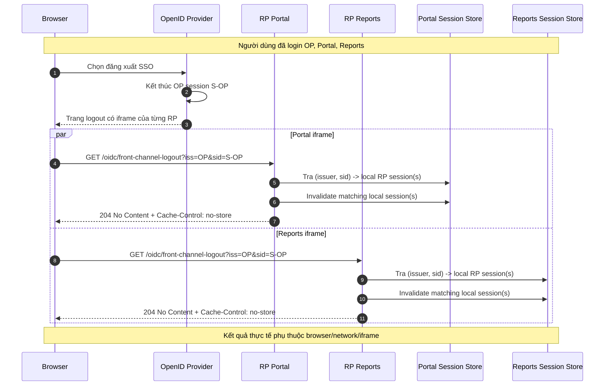

# 24.9. Front-channel logout, session management và giới hạn tương thích

Trong **Spring Security OAuth 2.0/OIDC Client**, người dùng có thể đăng nhập một lần tại **OpenID Provider (OP)** và mở nhiều ứng dụng khác nhau, mỗi ứng dụng là một **Relying Party (RP)**. Một câu hỏi khó xuất hiện khi họ đăng xuất ở OP hoặc ở một ứng dụng:

> Làm sao các RP khác biết phiên đăng nhập chung đã kết thúc để xóa phiên cục bộ của mình?

**OpenID Connect Front-Channel Logout 1.0** giải quyết một phần bài toán bằng cách để **OP gửi thông báo đăng xuất đến các RP thông qua chính trình duyệt người dùng**. Thông thường OP trả về một trang có nhiều thẻ `<iframe>`, mỗi iframe tải một `frontchannel_logout_uri` đã đăng ký của một RP.

```text
User logout tại OP
        |
        v
OP trả logout page
  +-- iframe -> RP A /frontchannel/logout
  +-- iframe -> RP B /frontchannel/logout
  +-- iframe -> RP C /frontchannel/logout
        |
        v
Mỗi RP cố gắng xóa phiên local tương ứng
```

Cơ chế này có ưu điểm là không nhất thiết yêu cầu OP gọi API server-to-server của từng RP. Nhưng đổi lại, nó chịu phụ thuộc vào **user agent**, **third-party cookies**, **iframe embedding policy**, khả năng giữ tab logout đang mở, **session correlation** và trạng thái của từng RP. Vì thế, front-channel logout **không nên được hiểu là đảm bảo toàn bộ các phiên, token và quyền truy cập bị thu hồi ngay lập tức**.

Bài học đi qua:

- Front-channel logout hoạt động ra sao theo đặc tả OIDC.
- Phân biệt **local logout**, **RP-Initiated Logout**, **Front-Channel Logout**, **Back-Channel Logout** và **OIDC Session Management**.
- Định dạng `frontchannel_logout_uri`, `iss`, `sid` và metadata discovery/registration.
- Cách liên kết **OP session** với **Spring Security session** một cách an toàn.
- Những rào cản do `SameSite`, third-party cookie blocking, CSP và `X-Frame-Options`.
- Những gì Spring Security hỗ trợ sẵn, và phần nào cần tích hợp tùy biến.
- Các lựa chọn fallback, kết hợp back-channel, timeout, logout propagation và kiểm thử đa trình duyệt.

## 1. Vì sao đăng xuất OIDC phức tạp hơn đăng xuất một ứng dụng?

Giả sử người dùng đã đăng nhập SSO tại:

```text
OpenID Provider:
  https://login.example.org
```

và đã mở:

```text
RP A: https://portal.example.org
RP B: https://reports.example.net
RP C: https://support.example.com
```

Sau đăng nhập thành công, mỗi RP có thể có:

1. **Phiên local** của riêng RP, thường dùng session cookie và session store.
2. **SecurityContext/Authentication** được tạo từ OIDC Login.
3. **OAuth2AuthorizedClient** chứa access token và optional refresh token.
4. Các cache về user profile, quyền nghiệp vụ hoặc trạng thái giao diện.
5. Một quan hệ tới **OP session**, có thể được nhận diện bằng claim `sid` trong ID Token khi OP cung cấp.

Nếu người dùng chỉ xóa session tại RP A, các thành phần sau có thể vẫn còn:

```text
OP SSO session        : còn
RP A local session    : đã kết thúc
RP B local session    : còn
RP C local session    : còn
Access tokens         : có thể vẫn hợp lệ
Refresh tokens        : có thể vẫn hợp lệ
```

Ngược lại, nếu OP xóa SSO session, **không có quy tắc mặc định nào khiến mọi RP ngay lập tức tự xóa session cục bộ**. Đây là vấn đề mà các cơ chế OIDC Logout được thiết kế để xử lý.

### 1.1. Session tại RP khác session tại OP

| Thành phần | Ai quản lý? | Ví dụ |
|---|---|---|
| **OP SSO session** | OpenID Provider | Cookie/phiên trên `login.example.org` |
| **RP local web session** | Spring Security ứng dụng RP | `JSESSIONID` hoặc cookie phiên khác |
| **OIDC `sid`** | OP phát và RP có thể lưu tương quan | Opaque identifier trong ID Token |
| **OAuth authorized client** | RP, qua repository/service | Access token và refresh token |
| **Access token lifetime** | Authorization Server/Resource Server | `exp` hoặc introspection status |
| **Refresh token lifecycle** | Authorization Server và client storage | Rotation, revocation, expiry |

Những vòng đời này **liên quan nhưng không đồng nhất**.

### 1.2. Logout không tự đồng nghĩa token revocation

Một RP xóa `HttpSession` chưa chắc AS đã vô hiệu access token. Một OP kết thúc SSO session chưa chắc refresh token đã bị thu hồi, tùy chính sách của provider. Một API có thể tiếp tục chấp nhận access token chưa hết hạn.

Do đó, để mô tả hành vi an toàn, cần nói chính xác:

- **Local session invalidation**: xóa xác thực/phiên ứng dụng.
- **OP logout**: kết thúc phiên tại provider.
- **Federated logout notification**: yêu cầu các RP khác xóa phiên.
- **Token revocation**: thu hồi token ở AS nếu hỗ trợ/chính sách yêu cầu.
- **Resource authorization**: API tiếp tục đánh giá token và quyền dữ liệu.

Không thay thế năm trách nhiệm này bằng một từ chung là “logout”.

## 2. Năm cơ chế dễ nhầm trong OIDC

| Cơ chế | Ai bắt đầu? | Đường truyền | Mục tiêu chính | Phụ thuộc browser? |
|---|---|---|---|---|
| **Local Logout** | User/RP | Request đến RP | Xóa session local | Thường có browser |
| **RP-Initiated Logout** | RP | Browser redirect tới OP `end_session_endpoint` | Yêu cầu OP kết thúc SSO session | **Có** |
| **Front-Channel Logout** | OP | Browser tải iframe URL của các RP | Thông báo RP logout | **Có, trực tiếp** |
| **Back-Channel Logout** | OP | Server-to-server POST Logout Token | Thông báo RP logout qua backend | **Không cần browser** |
| **OIDC Session Management** | RP/Browser | OP iframe + `postMessage`/`session_state` | Phát hiện thay đổi OP login state | **Có** |

### 2.1. Local Logout

Khi user gọi endpoint logout của Spring Security, framework có thể xóa SecurityContext và invalidate local session theo cấu hình.

Ví dụ với Spring MVC:

```java
http.logout(logout -> logout
    .logoutSuccessUrl("/"));
```

Đây là **local logout**. Nếu không thêm một cơ chế OIDC liên quan, RP không bắt buộc khiến OP đăng xuất.

### 2.2. RP-Initiated Logout

RP redirect browser tới OP logout endpoint:

```text
https://login.example.org/logout
  ?id_token_hint=...
  &post_logout_redirect_uri=...
  &state=...
```

Các tham số/chấp nhận endpoint phụ thuộc đặc tả và OP. Spring Security có integration cho RP-Initiated Logout, được trình bày ở mục sau.

### 2.3. Front-Channel Logout

OP trả trang có iframe tới các RP. RP nhận GET tới URL đã đăng ký và xóa trạng thái đăng nhập phù hợp.

**Không có signed Logout Token trong request front-channel chuẩn.** Các tham số `iss`/`sid` dùng để xác định/matching phiên, không tự tạo ra bằng chứng mật mã rằng request chắc chắn từ OP.

### 2.4. Back-Channel Logout

OP gửi request trực tiếp đến RP server, thường là HTTP POST chứa **Logout Token** (JWT) được RP xác minh chữ ký và claims.

Cơ chế này có thể hoạt động khi browser đã đóng, nhưng cần OP và RP hỗ trợ, và có yêu cầu riêng về phiên, routing, validation và token lifecycle.

### 2.5. OIDC Session Management

Một cơ chế khác dùng `check_session_iframe` và `session_state`; RP hỏi iframe của OP xem trạng thái SSO có thay đổi không.

Nó **không phải** cùng một cơ chế với front-channel logout, dù cả hai đều sử dụng iframes và chịu tác động bởi third-party content restrictions.

## 3. Front-Channel Logout theo đặc tả

OpenID Connect Front-Channel Logout 1.0 định nghĩa cách OP thực hiện thông báo đăng xuất thông qua user agent.

### 3.1. RP đăng ký logout URI

Ví dụ:

```text
frontchannel_logout_uri =
  https://portal.example.org/oidc/front-channel-logout
```

RP đăng ký URI này với OP qua cấu hình quản trị hoặc cơ chế Dynamic Client Registration, nếu OP hỗ trợ.

Theo đặc tả, front-channel logout URI:

- Là **absolute URI**.
- Có **scheme, host và port** tương ứng với một registered redirect URI của RP theo yêu cầu spec.
- Có thể có query string được đăng ký.
- **Không có URI fragment**.
- Nên dùng **HTTPS** trong triển khai thực tế.
- Cần được RP xử lý khi được tải bên trong iframe.

Ví dụ:

```text
Authorization redirect URI:
  https://portal.example.org/login/oauth2/code/company

Front-channel logout URI:
  https://portal.example.org/oidc/front-channel-logout
```

Hai URL cùng origin trong ví dụ nhưng **khác chức năng**. Callback login không phải endpoint logout.

### 3.2. OP nhúng logout URL trong iframe

Sau khi OP quyết định kết thúc SSO session, nó có thể xây một trang:

```html
<!doctype html>
<html lang="vi">
<head>
  <meta charset="utf-8">
  <title>Đang đăng xuất</title>
</head>
<body>
  <p>Đang kết thúc các phiên liên quan...</p>

  <iframe
    src="https://portal.example.org/oidc/front-channel-logout"
    hidden
    title="Portal logout">
  </iframe>

  <iframe
    src="https://reports.example.net/oidc/front-channel-logout"
    hidden
    title="Reports logout">
  </iframe>
</body>
</html>
```

Đây là HTML **minh họa trang phía OP**, không phải trang Spring RP tự phải render khi chỉ đăng ký nhận logout.

OP có thể tải các iframe song song. Trình duyệt có quyền chặn/không tải nội dung theo privacy/security settings.

### 3.3. RP phản ứng khi iframe GET được tải

RP nhận:

```http
GET /oidc/front-channel-logout HTTP/1.1
Host: portal.example.org
```

và cố xác định phiên local tương ứng, xóa session/authentication state theo policy.

Đặc tả cho phép một RP đã logout sẵn coi yêu cầu này là thành công; endpoint nên **idempotent**, không yêu cầu người dùng còn phiên hợp lệ để trả kết quả lỗi.

### 3.4. Không giả định OP luôn gửi iframe

Front-channel logout chỉ được gửi nếu:

- OP hỗ trợ cơ chế.
- RP đã đăng ký đúng front-channel logout URI.
- OP biết RP nào đã tham gia phiên.
- OP thực sự kích hoạt logout notification cho những RP đó.
- Browser có thể tải request.
- Chính sách iframe/cookie/network không chặn các bước cần thiết.

Ngay cả khi OP quảng cáo hỗ trợ, tính tương thích thực tế còn phụ thuộc trình duyệt và phương thức correlation của RP.

## 4. Tham số iss và sid trong front-channel logout

Để xác định đúng phiên tại RP, OP **có thể** thêm hai query parameters.

```http
GET /oidc/front-channel-logout
    ?iss=https%3A%2F%2Flogin.example.org
    &sid=op-session-08a5019c HTTP/1.1
Host: portal.example.org
```

Trong request thực tế, URL nằm trên một dòng, ở đây tách dòng để dễ đọc.

### 4.1. `iss` là gì?

`iss` là **issuer identifier của OP** phát thông báo logout.

Ví dụ:

```text
iss = https://login.example.org
```

RP phải so khớp với issuer mà RP đã tin qua OIDC client registration. Không chọn một issuer mới chỉ vì query parameter nói như vậy.

### 4.2. `sid` là gì?

`sid` là **session identifier** do OP dùng để nhận diện phiên giữa OP và RP.

Ví dụ ID Token sau đăng nhập có claim:

```json
{
  "iss": "https://login.example.org",
  "sub": "employee-725",
  "aud": "portal-web-prod",
  "sid": "op-session-08a5019c",
  "exp": 1794803600,
  "iat": 1794800000
}
```

Khi OP gửi front-channel logout:

```text
iss=https://login.example.org
sid=op-session-08a5019c
```

RP có thể tra các phiên local đã được liên kết với cặp `(iss, sid)` này.

**Quan trọng:** `sid` không nhất thiết bằng `JSESSIONID`. Một giá trị là phiên phía OP; giá trị còn lại là session identifier phía RP.

### 4.3. Khi một tham số xuất hiện thì sao?

Theo Front-Channel Logout 1.0:

- OP **có thể** gửi `iss` và `sid`.
- Nếu gửi **một** trong hai thì **phải gửi cả hai**.
- RP có thể so các giá trị này với claims trong ID Token của phiên hiện tại/gần đây để phát hiện mismatch.

Một ứng dụng có yêu cầu bảo mật cao thường nên yêu cầu cả hai để xác định chính xác phiên thay vì chỉ dựa vào cookie bên thứ ba.

### 4.4. `iss` và `sid` không phải chữ ký

GET front-channel logout thường không có signed JWT. Query string:

```text
?iss=https://login.example.org&sid=op-session-08a5019c
```

**không tự chứng minh** request do OP tạo. Một bên khác có thể gọi URL tương tự nếu biết hoặc đoán các giá trị.

Việc kiểm tra `iss` trùng issuer tin cậy và `sid` nằm trong session index giúp RP **nhắm đúng phiên**, nhưng không tạo bằng chứng nguồn gốc mật mã như Back-Channel Logout Token.

Hệ quả:

- Không dùng front-channel GET làm bằng chứng đủ để thu hồi toàn bộ tokens nhạy cảm của nhiều users nếu chưa có chính sách riêng.
- Không chấp nhận `sid` tùy ý rồi xóa mọi session của cùng `sub`.
- Cân nhắc rủi ro **logout CSRF / forced logout**.
- Không log `sid` thô rộng rãi hoặc coi nó như một secret có thể xác thực request.

## 5. Discovery metadata và client registration metadata

OIDC có các metadata phục vụ việc quyết định OP/RP có hỗ trợ front-channel logout hay không.

### 5.1. OP Discovery Metadata

Ví dụ từ OP:

```json
{
  "issuer": "https://login.example.org",
  "authorization_endpoint": "https://login.example.org/authorize",
  "token_endpoint": "https://login.example.org/token",
  "jwks_uri": "https://login.example.org/jwks",
  "frontchannel_logout_supported": true,
  "frontchannel_logout_session_supported": true
}
```

Các trường liên quan:

| Metadata | Nơi xuất hiện | Ý nghĩa |
|---|---|---|
| `frontchannel_logout_supported` | OP Discovery | OP hỗ trợ cơ chế front-channel logout |
| `frontchannel_logout_session_supported` | OP Discovery | OP có thể gửi `iss` và `sid` để xác định phiên |
| `frontchannel_logout_uri` | RP client registration | URL tại RP được OP tải trong iframe |
| `frontchannel_logout_session_required` | RP client registration | RP yêu cầu `iss` và `sid` đi cùng logout URI |

Nếu OP không khai báo hỗ trợ, không nên tự suy ra từ `end_session_endpoint` hoặc từ việc OP có trang logout.

### 5.2. Registration Metadata phía RP

Ví dụ cấu hình registration phía OP theo chuẩn ý nghĩa:

```json
{
  "client_id": "portal-web-prod",
  "redirect_uris": [
    "https://portal.example.org/login/oauth2/code/company"
  ],
  "frontchannel_logout_uri":
    "https://portal.example.org/oidc/front-channel-logout",
  "frontchannel_logout_session_required": true
}
```

Đây là payload **minh họa metadata RP theo OIDC**, không phải cú pháp tự động của Spring Boot `application.yml`.

Nếu `frontchannel_logout_session_required` bị bỏ qua, mặc định theo spec là `false`. Khi đặt `true`, OP cần hỗ trợ truyền `iss`/`sid`; nếu provider không làm được thì việc logout đúng phiên có thể không hoạt động.

### 5.3. Đừng nhầm hỗ trợ discovery với hỗ trợ framework

`spring.security.oauth2.client.provider.company.issuer-uri` giúp Spring Boot lấy OIDC metadata cho các chức năng OAuth2/OIDC Client đã được hỗ trợ.

Nhưng việc OP trả:

```json
"frontchannel_logout_supported": true
```

**không tự tạo** một endpoint Spring `/oidc/front-channel-logout`, không tự lưu mapping `sid ↔ HttpSession` và cũng không tự cấu hình iframe policy cho endpoint ấy.

Cần phân biệt **OP hỗ trợ giao thức** với **RP framework đã có tích hợp inbound front-channel**.

## 6. Luồng front-channel logout có iss và sid



Các bước:

1. User đã có phiên SSO ở OP.
2. OP biết những RPs đã được sử dụng trong phiên.
3. User/logout action khiến OP bắt đầu thông báo.
4. OP render iframe cho từng `frontchannel_logout_uri`.
5. Browser gửi GET đến các RPs.
6. Mỗi RP tìm phiên local tương ứng theo mapping đã ghi lúc login.
7. RP invalidate local session(s) và dọn state theo policy.
8. Các tab còn mở tại RP có thể chưa lập tức cập nhật UI; ở request tiếp theo, session đã bị xóa nên cần đăng nhập lại.

**Không có cam kết mọi iframe đều hoàn tất.** Một browser có thể ngăn request hoặc user có thể đóng trang sớm.

## 7. Session Management 1.0 khác Front-Channel Logout

### 7.1. OIDC Session Management dùng `check_session_iframe`

Trong **OIDC Session Management 1.0**, RP có thể nhúng một iframe của OP và trao đổi `postMessage` để hỏi liệu OP session state đã thay đổi.

OP discovery có thể có:

```json
{
  "check_session_iframe":
    "https://login.example.org/connect/check_session"
}
```

Authentication Response có thể chứa:

```text
session_state=<opaque-state-value>
```

Một RP-side script có thể gửi `client_id` và `session_state` qua `postMessage` đến OP iframe, rồi nhận một trong các trạng thái phù hợp như `unchanged`, `changed` hoặc `error` theo spec.

### 7.2. Cơ chế phát hiện thay đổi không tự xóa toàn bộ phiên

Nếu OP iframe báo `changed`, RP thường cần một hành động xác minh trạng thái đăng nhập và xử lý session phù hợp.

`changed` không nhất thiết có nghĩa chắc chắn user logout; nó có thể phản ánh những thay đổi session khác. Vì vậy không nên gán mọi `changed` trực tiếp thành “thu hồi toàn bộ token”.

### 7.3. Khác hướng truyền dữ liệu

**OIDC Session Management:**

```text
RP page
  -> embeds OP check_session_iframe
  -> postMessage status check
  -> detects possible OP state change
```

**Front-Channel Logout:**

```text
OP logout page
  -> embeds RP frontchannel_logout_uri in iframe
  -> RP receives logout GET
  -> RP clears local session
```

### 7.4. Cả hai đều phụ thuộc trạng thái browser

Nếu third-party cookies/storage bị chặn, OP iframe trong RP page không nhìn thấy OP session đúng như khi OP được mở top-level. Tương tự, RP iframe trong OP page có thể không thấy RP session cookies.

Vì vậy các browser privacy protections ảnh hưởng **cả hai**, nhưng theo những hướng khác nhau.

## 8. Cookie SameSite và third-party cookie blocking

Đây là giới hạn tương thích có ảnh hưởng lớn nhất trong triển khai thực tế.

### 8.1. Iframe đưa RP vào third-party context

Giả sử tab hiện tại là:

```text
https://login.example.org/logout
```

Trang OP nhúng:

```html
<iframe
  src="https://portal.example.org/oidc/front-channel-logout">
</iframe>
```

Trong tab này, `portal.example.org` có thể là **third-party site** đối với top-level OP site. Browser quyết định có gửi cookie của Portal vào iframe request hay không.

### 8.2. SameSite=Strict / Lax

Nếu cookie session RP có:

```http
Set-Cookie: JSESSIONID=...; Secure; HttpOnly; SameSite=Lax
```

thì trong một **cross-site iframe subrequest**, browser thường **không gửi cookie** theo chính sách SameSite=Lax.

Với `SameSite=Strict`, điều kiện còn hạn chế hơn. Khi RP endpoint chỉ dựa vào `JSESSIONID` từ request, nó có thể không tìm được phiên cần logout.

### 8.3. SameSite=None; Secure có đủ không?

Có thể cấu hình:

```http
Set-Cookie: JSESSIONID=...; Secure; HttpOnly; SameSite=None
```

để cookie đủ điều kiện xuất hiện trong cross-site context khi browser cho phép.

**Nhưng điều này không bảo đảm third-party cookies được gửi.** Nhiều browser có privacy controls, tracking prevention, cookie partitioning hoặc chính sách chặn third-party storage độc lập với thuộc tính SameSite.

Đổi `SameSite=Lax` sang `None` có thể cải thiện tương thích trong một số trường hợp, nhưng có chi phí bảo mật và **không phải cách chữa toàn diện**.

### 8.4. Không hạ bảo mật cookie toàn bộ ứng dụng chỉ vì front-channel

Cookie session phải được cấu hình theo threat model chung của RP:

- `Secure` và HTTPS.
- `HttpOnly` khi phù hợp.
- `SameSite` cân đối login redirects, CSRF và browser requirements.
- Path/domain đủ hẹp.
- CSRF controls cho endpoints thay đổi trạng thái.

Không chuyển mọi session cookies sang `SameSite=None` chỉ để iframe logout hoạt động, rồi quên kiểm tra CSRF/CORS/session security.

### 8.5. Server-side session index giảm phụ thuộc cookie

Nếu front-channel request có `iss` và `sid`, RP có thể tìm session ID trong **index server-side** mà không cần nhận session cookie trong iframe.

```text
(issuer, providerSid, registrationId)
                |
                v
Server-side Session Correlation Index
                |
                v
RP session ID(s)
                |
                v
Distributed Session Store / Invalidation
```

Đây là hướng thiết kế mạnh hơn trước third-party cookie restrictions, nhưng vẫn có giới hạn bảo mật: `iss`/`sid` trên GET **không được ký**. Xác minh cặp session mapping giúp tránh xóa sai; nó không xác thực nguồn request một cách mật mã.

## 9. Browser có thể chặn iframe hoặc storage

### 9.1. Những cơ chế chặn phổ biến

| Môi trường | Điều có thể xảy ra |
|---|---|
| Browser chặn third-party cookies | RP iframe không nhận RP session cookie |
| Cookie partitioning | Cookie của RP trong OP iframe khác cookie ở top-level RP |
| Tracking protection | Browser không tải hoặc giới hạn iframe/cookie/storage |
| Ad/privacy extensions | Chặn một số requests/iframes theo rule |
| CSP `frame-ancestors` | Không cho OP page embed RP logout document |
| `X-Frame-Options` | Legacy frame policy chặn iframe |
| Network timeout | Một trong các RP endpoints không trả response |
| User đóng tab logout sớm | Iframe requests chưa chạy xong |
| Browser chạy nền/đóng app | Execution/network có thể bị trì hoãn hoặc dừng |
| JavaScript bị chặn | Ảnh hưởng giải pháp dựa vào JS/session management |
| Client-side route chỉ render JS | GET iframe có thể không thực hiện server-side logout cần thiết |

### 9.2. Cache-Control: no-store

Đặc tả khuyến nghị response RP front-channel logout có:

```http
Cache-Control: no-store
```

Mục đích: tránh browser/cache trả response cũ mà không thực hiện request logout mới.

Endpoint nên trả một response tối giản, chẳng hạn:

```http
HTTP/1.1 204 No Content
Cache-Control: no-store
```

Không gửi nội dung chứa access token, ID token, session identifiers hoặc PII.

### 9.3. Không coi iframe đã load là bằng chứng toàn bộ logout thành công

OP có thể biết browser đã tải một iframe, nhưng:

- Response 200/204 không chứng minh mọi server-side sessions đã được invalidate.
- Một RP có thể trả HTTP success rồi xử lý logout async và thất bại.
- Một RP khác có thể không nhận request.
- Một web tab có thể vẫn hiển thị dữ liệu cached cho tới lần tương tác sau.

Mỗi RP cần chính sách session invalidation rõ và observability phù hợp.

## 10. CSP frame-ancestors và X-Frame-Options

Một Spring Security web app thường cấu hình header chống clickjacking:

```http
X-Frame-Options: DENY
```

hoặc:

```http
Content-Security-Policy: frame-ancestors 'none'
```

Trong khi đó, front-channel logout cần OP **nhúng endpoint logout của RP vào iframe**.

### 10.1. Căng thẳng giữa clickjacking protection và front-channel logout

Nếu RP logout document có policy:

```http
Content-Security-Policy: frame-ancestors 'none'
```

trình duyệt có thể từ chối nhúng trang. Nếu endpoint cần JavaScript/cookie operations trong iframe, cơ chế này có thể không hoàn tất đúng.

### 10.2. Không disable frame protection toàn ứng dụng

Một cách sửa nguy hiểm:

```java
// Anti-pattern: mở framing cho mọi trang của ứng dụng.
http.headers(headers -> headers
    .frameOptions(frame -> frame.disable()));
```

Điều này làm các trang chứa dữ liệu nhạy cảm dễ bị nhúng trái phép và có thể tăng rủi ro clickjacking.

Thay vào đó, cấu hình **riêng** cho logout endpoint một chính sách cho phép OP origin tin cậy:

```http
Content-Security-Policy: default-src 'none'; frame-ancestors https://login.example.org
Cache-Control: no-store
```

Cần đảm bảo các headers khác như `X-Frame-Options` không tạo conflict trên browser cần hỗ trợ. Một số trình duyệt cũ xử lý CSP/X-Frame-Options khác nhau.

### 10.3. Không dùng wildcard frame-ancestors

Tránh:

```http
Content-Security-Policy: frame-ancestors *
```

để “mở cho mọi OP”. Đúng hơn, allowlist các OP origins thật sự đã đăng ký và kiểm soát, ví dụ:

```text
https://login.example.org
https://sso.partner.example
```

Nếu RP multi-provider, chỉ thêm origins cần thiết; không cho request query tùy ý thay đổi CSP response.

### 10.4. Kiểm tra bằng network trace và console

Một request có thể đã đến server dù document bị browser từ chối render. Ngược lại, một số browser/security extensions chặn request ngay từ đầu.

Không suy ra “CSP chặn iframe” luôn đồng nghĩa server không nhận GET hoặc “server nhận GET” đồng nghĩa mọi JavaScript cookie cleanup đã chạy. Kiểm tra thực tế với browser cần hỗ trợ.

## 11. Session correlation: liên kết OP sid với RP session

Trong thực tế, một người dùng có thể có nhiều phiên:

```text
OP issuer: https://login.example.org
OP sid:    op-session-abc
RP:        portal.example.org

Local RP sessions:
  sess-rp-001  (Chrome)
  sess-rp-002  (Chrome tab/session restore?)
  sess-rp-778  (another browser/device)
```

Không mặc định một OP `sid` luôn tương ứng **duy nhất một** RP `JSESSIONID`. Quan hệ phụ thuộc cách OP quản lý SSO session và cách RP tạo sessions.

### 11.1. Mapping được xây sau login thành công

Sau khi Spring Security xác minh ID Token và tạo OIDC principal, RP có thể lưu:

```text
Key:
  registrationId = company
  issuer = https://login.example.org
  providerSid = op-session-abc

Value:
  one or more localSessionIds
```

Mapping chỉ được tạo từ **ID Token đã được xác minh** hoặc nguồn tin cậy tương đương. Không lấy `iss`/`sid` chưa xác minh từ client input để tự xây session index.

### 11.2. Vì sao cần registrationId?

Trong app nhiều providers:

```text
registrationId = company
issuer         = https://login.company.example
sid            = 123
```

khác:

```text
registrationId = partner
issuer         = https://login.partner.example
sid            = 123
```

Chỉ dùng `sid` làm khóa có thể va chạm giữa providers. Nếu hai registrations thuộc cùng issuer nhưng client policy khác nhau, registration ID vẫn hữu ích để giới hạn phạm vi logout.

### 11.3. Cần lưu thời điểm và lifetime của correlation

Một session index có thể cần:

```text
registrationId
issuer
providerSid
rpSessionId
subject (optional metadata)
createdAt
lastSeenAt
expiresAt
```

Khi RP session hết hạn/logout/rotated ID, phải dọn entry tương ứng. Không giữ mapping vô hạn hoặc cho một `sid` cũ tiếp tục điều khiển những sessions được tạo sau đó.

### 11.4. Khi ID Token không có sid

`sid` là một claim phục vụ session correlation khi OP cung cấp, nhưng không phải mọi OIDC login implementation/provider đều phát claim này trong mọi flow.

Nếu RP yêu cầu session-based front-channel logout nhưng OP không có `sid`:

- Không thể dùng cặp `(iss,sid)` để định danh phiên một cách đầy đủ.
- Có thể thử cookie-based front-channel khi browser cho phép.
- Hoặc chọn **back-channel logout**, RP-Initiated Logout kết hợp timeout/reauth, hay cơ chế provider-specific khác.
- Không tự giả lập `sid` bằng `sub` hay username và coi nó là OP session identifier.

## 12. Thiết kế Servlet front-channel logout endpoint

Spring Security hỗ trợ OAuth2/OIDC Login và một số logout integrations, nhưng **không nên giả định chỉ cần `oauth2Login()` là đã có sẵn endpoint front-channel đúng spec**.

Một giải pháp custom có thể gồm:

```text
Verified OIDC Login
  -> OIDC session indexing
      (registrationId, issuer, sid) -> RP session IDs

OP front-channel iframe GET
  -> endpoint /oidc/front-channel-logout
  -> validate params + lookup trusted issuer/session index
  -> invalidate only matching RP sessions
  -> cleanup token/session indexes per policy
  -> 204 / Cache-Control: no-store
```

### 12.1. Interface rõ hợp đồng cho session index

```java
import java.util.Set;

public interface OidcSessionCorrelationStore {

    void register(
        String registrationId,
        String issuer,
        String providerSid,
        String rpSessionId
    );

    Set<String> findRpSessionIds(
        String registrationId,
        String issuer,
        String providerSid
    );

    void removeRpSession(
        String rpSessionId
    );
}
```

Đây là interface **do ứng dụng định nghĩa**, không phải một API có sẵn trong Spring Security. Implementation phải quản lý TTL, index uniqueness, concurrency và persistence phù hợp với session store của dự án.

### 12.2. Interface invalidation của RP session

```java
public interface LocalRpSessionInvalidator {

    void invalidate(String rpSessionId);
}
```

Implementation phải sử dụng session infrastructure thật (ví dụ Spring Session repository hoặc component quản lý session được hỗ trợ), không chỉ xóa một key mapping mà để session/authentication trong store vẫn còn.

Nếu app dùng HttpSession container đơn thuần, Servlet API **không cung cấp một thao tác chung “load arbitrary session by ID”**; việc vô hiệu hóa phiên theo ID từ một request khác cần kiến trúc hỗ trợ, thường là shared session repository hoặc registry.

### 12.3. Service front-channel logout

```java
import java.util.Set;

public final class FrontChannelLogoutService {

    private final OidcSessionCorrelationStore correlations;
    private final LocalRpSessionInvalidator sessionInvalidator;

    public FrontChannelLogoutService(
            OidcSessionCorrelationStore correlations,
            LocalRpSessionInvalidator sessionInvalidator) {
        this.correlations = correlations;
        this.sessionInvalidator = sessionInvalidator;
    }

    public void logoutMatchingSessions(
            String registrationId,
            String trustedIssuer,
            String providerSid) {

        Set<String> localSessionIds =
            correlations.findRpSessionIds(
                registrationId, trustedIssuer, providerSid);

        for (String rpSessionId : localSessionIds) {
            sessionInvalidator.invalidate(rpSessionId);
            correlations.removeRpSession(rpSessionId);
        }
    }
}
```

Ví dụ này mô tả điều phối local session cleanup. Trong production, cần thiết kế idempotency, transaction/atomic state changes, distributed concurrency và policy cho lỗi từng session. Không xóa correlation trước khi session store xác nhận invalidation nếu việc đó làm mất khả năng retry.

### 12.4. Controller nhận iss và sid

Ví dụ **chỉ hỗ trợ trường hợp có đủ `iss` và `sid`**:

```java
import org.springframework.http.CacheControl;
import org.springframework.http.HttpStatus;
import org.springframework.http.ResponseEntity;
import org.springframework.web.bind.annotation.GetMapping;
import org.springframework.web.bind.annotation.RequestParam;
import org.springframework.web.bind.annotation.RestController;

@RestController
public class FrontChannelLogoutController {

    private static final String REGISTRATION_ID = "company";
    private static final String TRUSTED_ISSUER =
        "https://login.example.org";

    private final FrontChannelLogoutService service;

    public FrontChannelLogoutController(
            FrontChannelLogoutService service) {
        this.service = service;
    }

    @GetMapping("/oidc/front-channel-logout")
    public ResponseEntity<Void> logout(
            @RequestParam(name = "iss", required = false)
            String issuer,
            @RequestParam(name = "sid", required = false)
            String providerSid) {

        if (!TRUSTED_ISSUER.equals(issuer)
                || providerSid == null
                || providerSid.isBlank()) {

            return ResponseEntity
                .status(HttpStatus.BAD_REQUEST)
                .cacheControl(CacheControl.noStore())
                .build();
        }

        service.logoutMatchingSessions(
            REGISTRATION_ID,
            TRUSTED_ISSUER,
            providerSid
        );

        return ResponseEntity
            .noContent()
            .cacheControl(CacheControl.noStore())
            .build();
    }
}
```

**Giới hạn bảo mật rất quan trọng:** đoạn code này **không thể xác thực nguồn iframe request** chỉ bằng `iss`/`sid`. Nó dựa vào session index đã xây từ login được xác minh và chỉ xóa những sessions trùng khớp. Nếu `sid` bị lộ, attacker có thể kích hoạt **forced logout**. Cần threat model, rate limit, monitor và cân nhắc Back-Channel Logout nếu cần bằng chứng thông báo đáng tin hơn.

Đoạn code cũng **chưa bao gồm** implementation của session invalidator, correlation indexing lúc login, filter-chain policy, CSP, audit và transaction. Không sao chép một mình controller rồi coi SLO đã production-ready.

### 12.5. Vì sao không cần @AuthenticationPrincipal trong endpoint iframe?

Nếu browser không gửi RP session cookie trong cross-site iframe, endpoint sẽ không thấy authenticated principal hiện tại.

Vì vậy front-channel endpoint thường phải **chấp nhận unauthenticated GET** và tìm session bằng `iss/sid` hoặc một cơ chế correlation được thiết kế riêng. Nhưng vì request unauthenticated, nó **không thể được coi là một lệnh có chữ ký từ OP**.

Không gắn `.anyRequest().authenticated()` khiến iframe luôn bị redirect lại tới OP. Cần cho phép đúng endpoint logout, không mở tất cả endpoints quản trị/session deletion.

## 13. Cấu hình SecurityFilterChain cho endpoint iframe

Ví dụ Servlet:

```java
import org.springframework.context.annotation.Bean;
import org.springframework.context.annotation.Configuration;
import org.springframework.security.config.Customizer;
import org.springframework.security.config.annotation.web.builders.HttpSecurity;
import org.springframework.security.web.SecurityFilterChain;

@Configuration
public class SecurityConfig {

    @Bean
    SecurityFilterChain webSecurity(HttpSecurity http) throws Exception {
        http
            .authorizeHttpRequests(auth -> auth
                .requestMatchers(
                    "/",
                    "/login",
                    "/error",
                    "/oidc/front-channel-logout")
                    .permitAll()
                .anyRequest().authenticated())
            .oauth2Login(Customizer.withDefaults());

        return http.build();
    }
}
```

Controller `GET /oidc/front-channel-logout` được cho phép mà không cần principal hiện tại. Điều này chỉ phù hợp với threat model logout idempotent/targeted; endpoint không được thực hiện các thao tác phá hủy khác, không được nhận `userId` tùy ý để logout tài khoản.

### 13.1. CSRF không giống authorization

Spring Security thông thường bảo vệ các HTTP methods thay đổi trạng thái bằng CSRF, còn GET thường không cần token CSRF. Front-channel logout dùng GET, nên cần ý thức rằng **GET này cố tình tạo side effect** theo OIDC protocol.

Chính vì không có CSRF token và không có signed message, front-channel logout có rủi ro **logout CSRF**: bên khác có thể kích hoạt logout nếu biết cách nhắm session.

Không dùng quy tắc “GET luôn an toàn, không side effect” để bỏ phân tích bảo mật; đây là một ngoại lệ protocol cần được giới hạn rõ.

### 13.2. Không xóa mọi session chỉ vì endpoint được gọi

Sai:

```java
@GetMapping("/oidc/front-channel-logout")
public void logoutEveryone() {
    sessionRepository.deleteAll();
}
```

Đây là lỗ hổng availability/nguy cơ đăng xuất toàn bộ users. Cần mapping registration + issuer + provider session ID, hoặc chỉ local session của caller nếu cookie context hợp lệ và đó là chính sách được chấp nhận.

### 13.3. Xử lý iframe security headers riêng

Cấu hình frame policy cho **logout endpoint** cần được xác định ở security filter chain/response header layer thích hợp.

Có thể dùng một filter chain chuyên biệt cho endpoint, với matcher và order rõ, hoặc một response header policy được áp dụng đúng path. Đừng vô hiệu `X-Frame-Options` trên toàn bộ RP và quên CSP `frame-ancestors`.

Nếu có nhiều chains:

```text
@Order(1): /oidc/front-channel-logout -> permit, scoped iframe headers
@Order(2): web UI paths              -> oauth2Login + strict frame policy
```

Thứ tự chain và scope matcher phải được kiểm tra khi triển khai; đây là kiến trúc gợi ý, không phải bảo đảm chỉ bằng việc đặt một `@Order`.

## 14. Ghi mapping sid ↔ session sau OIDC Login

### 14.1. Lấy sid từ ID Token đã xác minh

Trong Spring Security Servlet, sau OIDC Login thành công, principal thường là `OidcUser`.

```java
import org.springframework.security.oauth2.core.oidc.user.OidcUser;

public void captureLoginMetadata(
        OidcUser oidcUser,
        String registrationId,
        String rpSessionId,
        OidcSessionCorrelationStore store) {

    String issuer = oidcUser.getIdToken()
        .getIssuer().toString();

    String providerSid = oidcUser.getIdToken()
        .getClaimAsString("sid");

    if (providerSid != null && !providerSid.isBlank()) {
        store.register(
            registrationId,
            issuer,
            providerSid,
            rpSessionId
        );
    }
}
```

Đây là **hàm minh họa**, giả định `OidcUser` đã được Spring Security xác minh và session ID đến từ phiên local thực. Nó không tự được gọi khi khai báo `oauth2Login()`.

Muốn tích hợp vào thành công login, cần chọn extension point phù hợp với phiên bản Spring Security, chẳng hạn một success handler được thiết kế/ủy quyền tiếp tới success handling chuẩn, session authentication strategy hoặc listener phù hợp.

### 14.2. Không thay success handler mà làm mất hành vi mặc định

Một custom success handler sơ sài:

```java
.oauth2Login(oauth2 -> oauth2
    .successHandler((request, response, auth) -> {
        // chỉ record mapping rồi không tiếp tục login success workflow
    }))
```

có thể làm mất saved-request redirect hoặc các nhiệm vụ khác nếu không triển khai đầy đủ.

Khi tùy biến, cần đảm bảo:

- ID Token đã được xác minh trước khi lập mapping.
- Session đã tồn tại với ID ổn định tương ứng.
- Authorized client được lưu đúng repository/service.
- Success redirect và SecurityContext persistence vẫn hoạt động.
- Mapping được dọn khi session rotate/expire/logout.

Không coi function `captureLoginMetadata(...)` ở trên là một success handler hoàn chỉnh.

### 14.3. Multi-session mapping

Nếu OP trả cùng `sid` cho nhiều local RP sessions, store có thể cần:

```text
(issuer, sid, registration) -> Set<RP session ID>
```

Khi logout, có thể invalidate những local sessions cùng provider session, tùy chính sách. Không chỉ lưu một `rpSessionId` rồi ghi đè khi user mở phiên khác.

### 14.4. Dọn mapping khi session kết thúc

Khi RP session hết hạn hoặc bị invalidate:

```text
RP session expired
  -> remove related correlation index entry
```

Có thể dùng event listener/session lifecycle hooks tương ứng với Servlet container hoặc Spring Session. Nếu không cleanup, index có thể chứa IDs không còn tồn tại và tăng dần theo thời gian.

## 15. Spring Session và nhiều instances

Nếu app chạy nhiều Spring Boot replicas sau load balancer:

```text
Browser
   |
Load Balancer
  /       \
RP Node A  RP Node B
   \       /
   Shared Session Store
        |
   Session Correlation Index
```

Một front-channel iframe request có thể đến **Node B**, trong khi user login ban đầu ở **Node A**.

### 15.1. Tại sao in-memory map không đủ?

Ví dụ:

```java
static Map<String, String> providerSidToRpSession;
```

không phù hợp production multi-node:

- Mỗi JVM có dữ liệu khác nhau.
- Restart làm mất mapping.
- Không có TTL/cleanup thống nhất.
- Khó đảm bảo thread safety.
- Có nguy cơ lộ PII và session IDs.
- Không đủ để invalidate session được lưu ở node khác.

### 15.2. Shared store

Một lựa chọn có thể là **Spring Session** với Redis/JDBC hoặc một session management infrastructure khác, kèm một correlation index được quản lý tập trung.

Tuy nhiên, **có Spring Session không tự tạo index `sid ↔ session`**. Phải thêm dữ liệu liên kết, lắng nghe lifecycle hoặc dựa vào một feature của framework được tài liệu phiên bản xác nhận.

### 15.3. Không chỉ xóa index

Nếu code:

```text
DELETE index[issuer, sid]
```

nhưng không invalidate session thật trong session store, SecurityContext vẫn có thể được khôi phục ở request sau.

Cần xóa **phiên thực** và metadata liên quan theo policy, không chỉ correlation row.

### 15.4. Concurrency và idempotency

Hai iframe requests có thể đến cùng lúc hoặc retry:

```text
GET /frontchannel?sid=S
GET /frontchannel?sid=S
```

Implementation phải idempotent:

- Không crash nếu session đã bị xóa.
- Không biến logout hai lần thành xóa session user khác.
- Không dùng stale mapping để invalidate session mới sau đăng nhập lại.
- Có cơ chế generation/version hoặc TTL phù hợp nếu cần tránh race.

## 16. User có thể đăng nhập lại trong khi logout iframe đến muộn

Ví dụ:

```text
T0: User login OP session S1, RP session R1.
T1: OP bắt đầu logout S1; iframe request bị trì hoãn.
T2: User đăng nhập lại, tạo OP session S2, RP session R2.
T3: Iframe logout S1 mới đến RP.
```

Nếu RP implementation dùng `sub=employee-725` để xóa **mọi** sessions của user, nó có thể xóa cả **R2** vừa được tạo.

Nếu RP dùng `(iss, sid=S1, registration)` được ghi từ ID Token cũ, nó có thể chỉ xóa những sessions thuộc S1.

### 16.1. Không dùng email/sub thay sid khi cần chính xác phiên

- `email` là attribute không ổn định và có thể bị tái sử dụng.
- `sub` là subject identity, không phải một session instance.
- `sid` định danh session phía OP theo contract.
- `JSESSIONID` là phiên local RP.

Khi thiếu `sid`, việc chỉ biết `sub` sẽ khiến targeted front-channel logout khó tin cậy hơn. Cần policy fallback rõ, không âm thầm xóa tất cả sessions.

### 16.2. Re-login trong tab khác

User có thể vẫn có UI/cache dữ liệu cũ trong tab. Sau local session invalidation, request mới phải được kiểm tra authentication lại. Nếu tab cần cập nhật ngay, có thể dùng cơ chế front-end app state sync (BroadcastChannel, storage event, SSE/WebSocket) **của RP**, nhưng không được coi đó là authorization boundary.

**Server-side session validation vẫn quyết định quyền truy cập.**

## 17. Front-channel logout không có Logout Token được ký

Back-Channel Logout dùng **Logout Token** với định dạng và kiểm tra OIDC riêng. Front-channel truyền `iss`/`sid` qua browser GET.

### 17.1. So sánh độ tin cậy của thông báo

| Khía cạnh | Front-channel | Back-channel |
|---|---|---|
| Transport | Browser iframe GET | OP server-to-RP server POST |
| Thông báo có JWT signature? | **Không trong protocol chuẩn** | **Có Logout Token** |
| RP cần cookie của browser? | Có thể, nếu không có session index | Không cần browser cookie để OP gửi |
| Có thể hoạt động khi browser đã đóng? | Thường **không** | **Có** nếu backend còn hoạt động |
| Chịu third-party cookie blocking? | **Có** | Không |
| Cần OP kết nối trực tiếp tới RP backend? | Không theo cùng cách | Có |
| Replay validation bằng JWT `jti`? | Không có signed logout token chuẩn | Có thể/được yêu cầu theo Back-Channel spec |
| Định danh phiên | `iss`/`sid` hoặc cookie | Logout Token `iss`, `aud` và `sid`/`sub` |
| Tính chắc chắn giao thông báo | Best effort theo browser | Có thể retry/monitor server-to-server |
| Rủi ro bị giả mạo logout request | Cao hơn do URL không ký | Giảm nhờ signature/claims validation |

### 17.2. Back-channel cũng có giới hạn

Back-channel không phụ thuộc third-party cookies, nhưng vẫn có thể thất bại do:

- RP backend không reachable từ OP.
- TLS/mTLS/certificate/DNS issues.
- Logout Token issuer/audience/signature sai.
- Session registry không biết OP sid/sub tương ứng.
- Quá tải hoặc network timeout.
- Nhiều instances không chia sẻ session registry.
- Provider có behavior không đúng spec.
- RP không cleanup refresh tokens hoặc domain sessions như mong đợi.

Vì vậy, back-channel là một bổ sung thường mạnh hơn cho thông báo logout, nhưng cũng cần kiểm thử và vận hành.

## 18. RP-Initiated Logout trong Spring Security

Khi **RP tự yêu cầu user logout khỏi OP**, Spring Security có integration cho RP-Initiated Logout. Đây là cơ chế **khác** inbound front-channel.

### 18.1. Servlet: OidcClientInitiatedLogoutSuccessHandler

Ví dụ minh họa:

```java
import org.springframework.context.annotation.Bean;
import org.springframework.context.annotation.Configuration;
import org.springframework.security.config.Customizer;
import org.springframework.security.config.annotation.web.builders.HttpSecurity;
import org.springframework.security.oauth2.client.registration.ClientRegistrationRepository;
import org.springframework.security.oauth2.client.oidc.web.logout.OidcClientInitiatedLogoutSuccessHandler;
import org.springframework.security.web.SecurityFilterChain;

@Configuration
public class OidcRpLogoutConfig {

    @Bean
    SecurityFilterChain filterChain(
            HttpSecurity http,
            ClientRegistrationRepository registrations
    ) throws Exception {

        var logoutSuccessHandler =
            new OidcClientInitiatedLogoutSuccessHandler(registrations);

        logoutSuccessHandler.setPostLogoutRedirectUri(
            "{baseUrl}/logged-out"
        );

        http
            .authorizeHttpRequests(auth -> auth
                .requestMatchers("/", "/logged-out", "/error")
                    .permitAll()
                .anyRequest().authenticated())
            .oauth2Login(Customizer.withDefaults())
            .logout(logout -> logout
                .logoutSuccessHandler(logoutSuccessHandler));

        return http.build();
    }
}
```

Cấu hình giả định OP hỗ trợ endpoint logout được cung cấp qua metadata, post-logout redirect URI được OP cho phép và client registration đúng.

Spring xử lý local logout rồi chuyển browser theo RP-Initiated Logout handler đến OP theo khả năng/configuration. **Không suy ra rằng front-channel cho các RP khác đã được cấu hình** chỉ vì RP này redirect tới OP logout.

### 18.2. Phụ thuộc OP end_session_endpoint

Một OP có thể quảng cáo:

```json
{
  "end_session_endpoint": "https://login.example.org/connect/logout"
}
```

Đây là **OP endpoint để RP yêu cầu OP logout**, không phải `frontchannel_logout_uri` của RP.

### 18.3. Post-logout redirect URI

Sau logout, OP có thể redirect user về:

```text
https://portal.example.org/logged-out
```

Đây là trang thông báo logout của RP. Nó không phải front-channel callback và không thay thế việc các RP khác nhận thông báo logout.

## 19. Back-Channel Logout support của Spring Security

Tài liệu Spring Security có cấu hình OIDC Back-Channel Logout ở các phiên bản hỗ trợ:

```java
http
    .oauth2Login(Customizer.withDefaults())
    .oidcLogout(oidc -> oidc
        .backChannel(Customizer.withDefaults()));
```

Thông thường endpoint được trình bày như:

```text
/logout/connect/back-channel/{registrationId}
```

Provider gửi **Logout Token** đến endpoint này; Spring có phần hỗ trợ xác minh token và liên kết session theo version/configuration.

**Không nhầm endpoint trên với front-channel logout URI**. Một OP yêu cầu front-channel iframe GET sẽ không tự tương thích với back-channel POST Logout Token endpoint.

### 19.1. Tùy phiên bản Spring Security

Tên các lớp, DSL options, session registry, custom handlers và yêu cầu cookies/session có thể khác giữa Spring Security 6.x và 7.x. Khi triển khai, kiểm tra tài liệu **đúng phiên bản đang chạy**.

Ví dụ documentation đề cập các thành phần:

- `OidcBackChannelLogoutHandler` trên Servlet.
- `OidcSessionRegistry` hoặc cơ chế tương quan session theo provider.
- `OidcBackChannelServerLogoutHandler` và reactive session registry với WebFlux.
- Cấu hình session cookie name khi session infrastructure dùng tên khác mặc định.

Đừng sao chép nguyên code từ một nhánh Spring Security khác mà không đối chiếu class signature.

### 19.2. Spring hỗ trợ back-channel không có nghĩa hỗ trợ front-channel tự động

Đối với **front-channel**, cần xác minh framework/version có hỗ trợ inbound feature tương ứng hay không. Tài liệu Spring Security tập trung vào **local logout**, **RP-Initiated Logout** và **Back-Channel Logout**; không nên mặc định `oauth2Login()` tự tạo front-channel iframe endpoint.

Nếu app cần nhận front-channel, thường phải:

- Đăng ký URI với OP.
- Viết/lắp extension endpoint phù hợp.
- Quản lý OP `sid` ↔ local session correlation.
- Thiết kế security headers/cookies.
- Xử lý invalidation và concurrent sessions.
- Kiểm thử browser compatibility.

## 20. Front-channel và OIDC Logout ở WebFlux

Trên WebFlux, Spring Security dùng:

| Servlet | Reactive / WebFlux |
|---|---|
| `HttpSecurity` | `ServerHttpSecurity` |
| `SecurityFilterChain` | `SecurityWebFilterChain` |
| `HttpServletRequest` | `ServerWebExchange` |
| `HttpSession` | `WebSession` |
| `ClientRegistrationRepository` | `ReactiveClientRegistrationRepository` |
| `OAuth2AuthorizedClientRepository` | `ServerOAuth2AuthorizedClientRepository` |
| `OidcClientInitiatedLogoutSuccessHandler` | `OidcClientInitiatedServerLogoutSuccessHandler` |

### 20.1. WebFlux RP-Initiated Logout

Ví dụ định hướng:

```java
import org.springframework.context.annotation.Bean;
import org.springframework.context.annotation.Configuration;
import org.springframework.security.config.Customizer;
import org.springframework.security.config.web.server.ServerHttpSecurity;
import org.springframework.security.oauth2.client.registration.ReactiveClientRegistrationRepository;
import org.springframework.security.oauth2.client.oidc.web.server.logout.OidcClientInitiatedServerLogoutSuccessHandler;
import org.springframework.security.web.server.SecurityWebFilterChain;

@Configuration
public class ReactiveOidcLogoutConfig {

    @Bean
    SecurityWebFilterChain webSecurity(
            ServerHttpSecurity http,
            ReactiveClientRegistrationRepository registrations
    ) {

        var logoutSuccessHandler =
            new OidcClientInitiatedServerLogoutSuccessHandler(
                registrations);

        logoutSuccessHandler.setPostLogoutRedirectUri(
            "{baseUrl}/logged-out"
        );

        return http
            .authorizeExchange(exchanges -> exchanges
                .pathMatchers("/", "/logged-out", "/error")
                    .permitAll()
                .anyExchange().authenticated())
            .oauth2Login(Customizer.withDefaults())
            .logout(logout -> logout
                .logoutSuccessHandler(logoutSuccessHandler))
            .build();
    }
}
```

Tên package/signature cần đối chiếu với phiên bản Spring Security sử dụng. Điểm cốt lõi là **WebFlux không có HttpSession và không nên dùng Servlet logout handler**.

### 20.2. Reactive front-channel handler

Nếu tự làm front-channel trên WebFlux:

```text
GET /oidc/front-channel-logout?iss=...&sid=...
   -> validate registration/issuer/parameters
   -> reactive session correlation lookup
   -> reactive session invalidation
   -> HTTP 204 no-store
```

Không gọi blocking JDBC/Redis client hoặc `block()` trên Reactor Netty event loop. Dùng reactive session store, reactive repository hoặc offload những đoạn legacy blocking một cách có kiểm soát.

### 20.3. Không đồng nhất WebSession với OP sid

`WebSession.getId()` là local WebFlux session ID, không phải `sid` của OP. Một custom correlation index vẫn cần identity key phù hợp nếu muốn invalidation qua iframe GET không kèm cookie.

## 21. Giới hạn tương thích giữa các OpenID Providers

Ngay cả khi OP quảng cáo `frontchannel_logout_supported=true`, khả năng thực tế có thể khác nhau.

### 21.1. Metadata có thể thiếu hoặc khác

OP A:

```json
{
  "frontchannel_logout_supported": true,
  "frontchannel_logout_session_supported": true
}
```

OP B:

```json
{
  "frontchannel_logout_supported": true,
  "frontchannel_logout_session_supported": false
}
```

OP C có thể không quảng cáo front-channel logout hoặc chỉ hỗ trợ một cơ chế provider-specific.

Đừng giả định mọi provider đều gửi `iss/sid`.

### 21.2. Sự khác biệt giữa OP session và client session

Một số OP có thể thay đổi session ID khi:

- User đăng nhập lại.
- User chuyển account trong cùng browser.
- OP rotate session.
- OP cập nhật policy hoặc MFA state.
- Có account linking hoặc multi-device behavior.

RP phải chỉ logout những local sessions tương quan với OP session được yêu cầu, không lấy `sid` của một session rồi suy rộng ra toàn bộ users cùng issuer.

### 21.3. Provider-specific behavior

Một số provider có thể:

- Chỉ hỗ trợ front-channel khi đã đăng ký callback trong admin UI.
- Gửi iframe không có `iss/sid`.
- Cho phép chỉ một logout URL trên client.
- Chỉ kích hoạt front-channel khi logout toàn bộ SSO, không phải local RP logout.
- Gửi notification một lần khi browser còn trang logout.
- Kết hợp back-channel và front-channel nhưng khác thứ tự.
- Không hỗ trợ session claim trong ID Token cho một số flows.

Cần kiểm thử hợp đồng với provider cụ thể, không dựa vào tên tính năng chung.

### 21.4. Trong các môi trường nhiều domain

`portal.example.org` và `login.example.org` có thể là same-site theo chính sách browser, nhưng `reports.example.net` là cross-site. Những RP nằm trên domains khác nhau có hành vi cookie khác nhau.

**Same-origin** và **same-site** không giống nhau. Browser cookie policy có thể dựa trên schemeful site, trong khi CSP frame-ancestors dựa trên origin. Không dùng một heuristic chung cho cả hai.

## 22. Khi front-channel logout không có sid

Trường hợp đơn giản:

```html
<iframe
  src="https://portal.example.org/oidc/front-channel-logout">
</iframe>
```

RP nhận GET **không có `iss/sid`**.

### 22.1. Nếu browser gửi session cookie

RP có thể lấy local RP session từ cookie và invalidate session của request.

```text
iframe GET
  -> Cookie: JSESSIONID=<current-rp-session>
  -> RP invalidates this local session
```

Nhưng nếu cookie không được gửi vì third-party cookie policy, RP sẽ không biết phiên nào cần xóa.

### 22.2. Nếu browser không gửi session cookie

RP không thể suy ra đúng session từ một GET không có params và không có cookie. Không được biến nó thành:

```text
"Không biết session nào"
  -> "Xóa tất cả sessions của mọi user"
```

Thay vì vậy, ghi nhận **unresolvable front-channel notification** và áp dụng cơ chế khác/timeout policy.

### 22.3. Có nên đổi SameSite=None?

Chỉ nếu security review chấp nhận và browser support matrix chứng minh có lợi. Ngay cả `SameSite=None; Secure` không vượt qua mọi third-party cookie blocking.

### 22.4. Lựa chọn thay thế

- OP/RP hỗ trợ `iss/sid` và session index.
- Back-Channel Logout với Logout Token đã được xác minh.
- Shorter RP session lifetime và re-authentication policy phù hợp.
- Session Management check nếu browser/provider hỗ trợ, nhưng vẫn browser-dependent.
- Application-specific notification qua first-party channel.
- Dọn token/consent theo chính sách riêng.

## 23. Tính idempotent và thời gian phản hồi

Front-channel logout có thể được gọi lại nhiều lần:

```text
GET ...?iss=OP&sid=S1
GET ...?iss=OP&sid=S1
```

RP nên coi một request nhắm đúng session đã kết thúc là thành công hoặc no-op.

### 23.1. Không chuyển redirect login từ endpoint logout

Nếu logout endpoint trả:

```http
HTTP/1.1 302 Found
Location: /login
```

iframe có thể đi qua nhiều redirects và phát sinh hành vi không cần thiết, thậm chí khiến RP/OP tạo vòng redirect.

Với server-side invalidation, phản hồi 204/no-store là đơn giản và phù hợp. Không cần trả HTML trang đăng nhập vào iframe.

### 23.2. Timeout và network failure

Nếu session store chậm, endpoint cần timeout và error handling rõ. Không trả 204 thành công trước khi durable session invalidation hoàn tất nếu ứng dụng cần đảm bảo ít nhất logout local của session tìm thấy.

Nếu có hàng trăm sessions mapping cùng một OP sid, nên thiết kế batch/concurrency limit. Không để một frontend iframe giữ DB connection vô hạn.

### 23.3. Không giữ secret trong URL

`iss`/`sid` là metadata session correlation, không phải raw access token. Không thêm:

```text
?access_token=...
?refresh_token=...
?id_token=...
```

vào front-channel logout URI. URL có thể bị ghi trong access logs, browser history hoặc tracing. Nếu log `sid`, áp dụng privacy policy và redaction phù hợp.

## 24. Logout từ nhiều RPs và hiệu ứng dây chuyền

Giả sử OP logout page thông báo ba RPs:

```text
OP -> iframe RP A
OP -> iframe RP B
OP -> iframe RP C
```

RP A là một hệ thống SSO trung gian và đồng thời đóng vai **OP đối với các ứng dụng downstream**. Khi RP A nhận logout, nó có thể cần thông báo tiếp đến các ứng dụng phụ thuộc.

### 24.1. Nested iframes theo spec

Đặc tả mô tả trường hợp một RP đồng thời là OP có thể render những iframe downstream để lan truyền logout.

Tuy vậy, nested iframes càng sâu càng dễ gặp:

- Third-party cookie blocking.
- Frame embedding policies.
- Browser timeout và throttling.
- Cross-site storage partitioning.
- UI/navigation restrictions.
- Khó xác định request nào thất bại.

Một kiến trúc nhiều tầng cần cân nhắc back-channel/server-to-server notifications hoặc identity broker có policy rõ thay vì kỳ vọng nested iframe propagation luôn tin cậy.

### 24.2. Tránh vòng lặp logout

Nếu RP A nhận logout từ OP B rồi tự gọi logout B lại, có thể tạo vòng lặp.

Cần phân biệt:

- **Nhận thông báo logout từ upstream.**
- **Khởi tạo logout ở upstream.**
- **Thông báo downstream sessions.**

Idempotency và correlation ID/issuer/session state có thể giúp tránh recursion không kiểm soát.

## 25. Session invalidation không xóa hết authorized clients theo mặc định

Trong Spring Security, login session và `OAuth2AuthorizedClient` là hai khái niệm riêng.

### 25.1. HTTP session storage

Nếu authorized client được giữ trong session repository, invalidate session thường làm mất token state gắn với phiên theo implementation tương ứng.

Nhưng cần kiểm tra:

- Có external/distributed session store không?
- Tokens có được duplicate trong cache không?
- Session replication và backup có lưu dữ liệu không?
- Cleanup có hoàn tất trên các nodes không?

### 25.2. Persistent OAuth2AuthorizedClientService

Nếu token được lưu bằng `JdbcOAuth2AuthorizedClientService` hoặc custom persistent service, invalidate HttpSession **không nhất thiết xóa record token** trong DB.

Một user có thể logout SSO nhưng refresh token vẫn tồn tại trong backend storage nếu ứng dụng không có cleanup policy.

### 25.3. Consent và offline access

Một số ứng dụng được user ủy quyền offline access. Khi user logout browser, business policy có thể:

- **Xóa luôn** authorized client và revoke token.
- **Giữ delegated offline grant** với consent/retention riêng.
- Chỉ chặn UI session nhưng vẫn chạy background task đã được user ủy quyền.

Không đưa ra một lựa chọn ngầm định. Việc logout có xóa offline access hay không là quyết định sản phẩm/bảo mật và phải được người dùng hiểu.

### 25.4. Refresh token rotation

Nếu refresh token đã bị rotate, local cleanup phải dùng token state mới nhất. Không ghi đè/revive một authorized client đã logout do một refresh request hoàn thành muộn.

Có thể cần version/generation/tombstone hoặc coordinator phù hợp trong hệ thống concurrent.

## 26. Logout, CSRF và forced logout

### 26.1. Vì sao GET logout khác thao tác GET thông thường?

HTTP GET về nguyên tắc nên được thiết kế ít side effects theo semantics của web. Nhưng OIDC Front-Channel Logout chủ động dùng GET iframe để yêu cầu RP xóa session.

Đây là một ngoại lệ cần nhìn từ security model: endpoint nhận **request do browser bên thứ ba kích hoạt**.

### 26.2. Forced logout là rủi ro availability

Nếu attacker biết một `sid` hợp lệ, họ có thể thử gọi:

```text
https://portal.example.org/oidc/front-channel-logout
  ?iss=https%3A%2F%2Flogin.example.org
  &sid=<known-provider-session-id>
```

và khiến RP đăng xuất một phiên không mong muốn nếu endpoint không có thêm xác minh.

Hậu quả có thể là gián đoạn phiên, mất công việc chưa lưu hoặc khiến user liên tục phải login lại. Đây thường là **rủi ro forced logout/availability**, không phải tự động chiếm quyền truy cập.

### 26.3. Không chỉ dựa vào Referer hoặc Origin

Với GET iframe, các header `Origin`/`Referer` có thể vắng mặt hoặc bị ảnh hưởng bởi privacy policy. `Referer` cũng không phải một bằng chứng mật mã rằng request được OP phát hành.

Kiểm tra nguồn theo headers có thể là signal bổ sung, nhưng **không thể thay thế** signed notification của back-channel.

### 26.4. Không gắn mã bí mật dài hạn trong logout URI

Một số hệ thống có thể muốn thêm query `secret=...` vào registered logout URI để xác thực. Cần hết sức thận trọng:

- URL có thể bị log ở OP, browser và RP infrastructure.
- Query secrets có thể bị lộ qua referrer/tracing.
- Không có replay protection mặc định.
- Secret chung có thể gây ảnh hưởng mọi sessions.

Nếu cần bằng chứng nguồn đáng tin cậy, ưu tiên giao thức có signed Logout Token như back-channel thay vì tự phát minh shared secret trong GET.

## 27. Tính tương thích với CSP và clickjacking

Một logout endpoint iframe thường cần cho phép một OP origin nhúng, nhưng UI pages khác không cần.

### 27.1. Policy theo route

```text
/oidc/front-channel-logout
  CSP: frame-ancestors https://login.example.org
  Cache-Control: no-store

/account
  CSP: frame-ancestors 'none'

/admin
  CSP: frame-ancestors 'none'
```

Với routes có dữ liệu nhạy cảm, giữ anti-clickjacking policy nghiêm ngặt. Không tắt headers toàn app.

### 27.2. Không render thông tin nhạy cảm trong iframe

Front-channel endpoint chỉ cần xử lý invalidation và response tối giản. Không render profile, token metadata, account ID hoặc session details.

### 27.3. Nested iframe cần thêm điều kiện

Nếu RP đồng thời là OP cho downstream apps, những nested iframes sẽ cần policies cho từng tầng. Không cấp wildcard origins một cách vô hạn chỉ để chuỗi iframe hoạt động.

### 27.4. Kiểm tra `frame-src` và `frame-ancestors` ở đúng phía

- `frame-ancestors` trên **RP response** quyết định ai được phép embed RP logout page.
- `frame-src` (hoặc `child-src` ở các policy liên quan) trên **OP page** quyết định OP page được tải iframes từ origins nào.

Sửa chỉ một phía có thể chưa đủ. Browser console thường cho biết chính sách nào đã chặn.

## 28. Một ma trận tương thích trước khi bật production

Cần kiểm thử cụ thể thay vì tuyên bố front-channel tương thích mọi trình duyệt.

| Kịch bản | Có `iss/sid`? | RP cookie trong iframe? | Kỳ vọng |
|---|---|---|---|
| Browser cho third-party cookies, OP gửi sid | Có | Có | RP có thể xác định phiên theo cả hai cách |
| Browser chặn third-party cookies, OP gửi sid | Có | Không | RP cần **server-side sid index** |
| Browser cho cookie, OP không gửi sid | Không | Có | Chỉ có thể nhắm local session dựa trên cookie nếu policy cho phép |
| Browser chặn cookie, OP không gửi sid | Không | Không | **Không thể xác định đúng local session** từ GET đơn thuần |
| CSP chặn embed | Bất kỳ | Bất kỳ | Phải kiểm tra request có đến server hay không và logic có chạy không |
| Tab logout bị đóng sớm | Bất kỳ | Bất kỳ | Có thể bỏ lỡ thông báo |
| OP gửi sid sai | Có nhưng không match | Bất kỳ | Không xóa phiên không khớp |
| OP gửi issuer lạ | Có | Bất kỳ | Từ chối theo trusted issuer policy |
| Logout bị gửi lại | Có | Bất kỳ | Idempotent, không crash |
| User re-login trước iframe cũ | Có sid cũ | Bất kỳ | Chỉ xóa phiên gắn với sid cũ |
| Nhiều RP replicas | Có | Bất kỳ | Index và session store phải chia sẻ |
| Authorized client lưu DB ngoài session | Có | Bất kỳ | Cần policy cleanup tokens riêng |

### 28.1. Không đo thành công bằng một HTTP 204

Một endpoint trả 204 chứng minh handler đã hoàn tất theo logic của nó, nhưng chưa chắc mọi browser tabs/UI caches/tokens đã được dọn. Kiểm tra:

1. Session local thật sự không còn xác thực.
2. Request mới đến protected route bị yêu cầu re-authenticate.
3. Không còn session mapping cũ.
4. Token storage cleanup đúng policy.
5. RPs khác đã nhận/không nhận notification.
6. Browser bị chặn cookie vẫn xử lý được khi có sid index.

### 28.2. Đo trên môi trường thực tế

Kiểm thử các browsers nằm trong support matrix của sản phẩm, bao gồm các chế độ privacy settings khác nhau. Không chỉ test bằng một Chrome profile đang cho phép third-party cookies.

## 29. Khi OP không hỗ trợ front-channel logout

Nếu OP không quảng cáo `frontchannel_logout_supported` hoặc admin console không cho đăng ký URI, đừng xây endpoint rồi kỳ vọng OP sẽ tự gọi.

Các lựa chọn:

- **Local Logout:** luôn đảm bảo RP kết thúc phiên khi user chủ động logout tại RP.
- **RP-Initiated Logout:** yêu cầu OP logout bằng `end_session_endpoint` nếu hỗ trợ.
- **Back-Channel Logout:** ưu tiên nếu OP/RP có hỗ trợ và cần SLO đáng tin hơn browser iframe.
- **Short session lifetime:** hạn chế phiên local kéo dài quá OP session.
- **Reauthentication policy:** dùng `max_age`, `prompt` hoặc chính sách phù hợp để kiểm tra lại user session trong các thao tác nhạy cảm.
- **Provider-specific hooks:** chỉ khi có hợp đồng và kiểm thử riêng.
- **Domain authorization:** kiểm tra quyền hiện hành ở API, không chỉ dựa vào RP login session.

Không xây “front-channel giả” dựa trên polling API bất kỳ hoặc iframe tự chế rồi coi nó tương đương OIDC Front-Channel Logout 1.0.

## 30. Logout trên nhiều thiết bị

Front-channel đi qua **browser đang nhận trang logout**. Nếu user đang đăng nhập cùng tài khoản trên:

```text
Laptop Chrome
Phone Safari
Tablet browser
```

thì logout page trên laptop không tự đi qua browsers khác.

Nếu OP muốn “global logout all devices”, nó cần cơ chế session registry/notifications phù hợp. Front-channel qua một browser không bảo đảm gửi được đến mọi session trên các devices khác.

### 30.1. sid vs sub

- `sid`: định danh phiên OP cụ thể, hữu ích để targeted logout.
- `sub`: danh tính user, có thể có nhiều sessions.

Back-channel Logout Token có thể biểu diễn `sid` hoặc `sub` theo spec và provider policy. Front-channel mặc định dựa iframe và optional `iss/sid`, không có signed `sub` logout claim.

### 30.2. Không quảng cáo “logout everywhere” nếu chỉ có iframe

UI nên mô tả chính xác điều hệ thống đảm bảo. Nếu sản phẩm hứa đăng xuất mọi thiết bị, cần cơ chế ở server/AS đủ mạnh để thực hiện lời hứa đó, không chỉ dựa vào iframe trong một browser tab.

## 31. Dữ liệu frontend có thể vẫn tồn tại sau session invalidation

Một SPA được phục vụ bởi RP có thể giữ:

- In-memory user profile.
- Cached API data.
- LocalStorage/sessionStorage app state.
- Offline service worker cache.
- Mở WebSocket/SSE connection.
- Dữ liệu hiển thị trong tab chưa reload.

Ngay cả khi RP session đã bị invalidate ở server, UI có thể tiếp tục hiển thị dữ liệu cũ cho tới khi ứng dụng phản ứng.

### 31.1. Server-side authorization vẫn là nguồn quyết định

Nếu user gọi API sau logout:

```http
GET /api/orders HTTP/1.1
Cookie: JSESSIONID=<old-session-id>
```

server phải không còn chấp nhận xác thực bằng phiên đã invalidated, bất kể UI trông như đã login.

Không chỉ ẩn nút hoặc xóa một biến JS và coi server session đã kết thúc.

### 31.2. Đồng bộ tab cùng origin

RP có thể dùng:

- BroadcastChannel.
- Storage events.
- SSE/WebSocket notifications.
- Kiểm tra session khi tab được focus.
- Session expiry responses và UI redirect.

Đây là những biện pháp UX hỗ trợ, không phải thay thế OIDC protocol, và không làm một iframe của OP có thể đọc data của RP khác origin.

### 31.3. Dọn client-side storage

Front-Channel Logout spec nói đến việc RP xóa state liên quan phiên, gồm cookies và HTML5 local storage khi có thể. Nhưng:

- HttpOnly cookies không thể bị xóa trực tiếp bởi JS.
- Third-party iframe có thể thấy partitioned storage khác top-level RP.
- Browser có thể ngăn iframe truy cập cookie/storage.
- Frontend code có thể không chạy nếu CSP/frame blocking.

Vì vậy, đặt **session invalidation server-side** làm ưu tiên cho bảo mật; client-side cleanup là phần bổ sung có giới hạn tương thích.

## 32. Multi-provider và issuer confusion

Nếu một RP hỗ trợ nhiều OIDC providers:

```yaml
spring:
  security:
    oauth2:
      client:
        registration:
          company:
            provider: company
            client-id: ${COMPANY_CLIENT_ID}
            client-secret: ${COMPANY_CLIENT_SECRET}
            authorization-grant-type: authorization_code
            redirect-uri: "{baseUrl}/login/oauth2/code/{registrationId}"
            scope: openid,profile

          partner:
            provider: partner
            client-id: ${PARTNER_CLIENT_ID}
            client-secret: ${PARTNER_CLIENT_SECRET}
            authorization-grant-type: authorization_code
            redirect-uri: "{baseUrl}/login/oauth2/code/{registrationId}"
            scope: openid,profile

        provider:
          company:
            issuer-uri: https://login.company.example
          partner:
            issuer-uri: https://login.partner.example
```

thì không được chỉ nhận query `iss` rồi tự động tạo provider mới.

### 32.1. Trusted issuer allowlist

```text
company -> https://login.company.example
partner -> https://login.partner.example
```

Một front-channel endpoint cho `company` chỉ chấp nhận issuer tương ứng và tìm correlation index ở đúng namespace.

### 32.2. Không dùng sid đơn độc

Hai providers có thể vô tình phát cùng `sid` string. Nếu index chỉ dùng `sid`, logout từ provider A có thể xóa session provider B.

### 32.3. Không dùng login email để chọn session

Một user có thể dùng cùng email ở hai OPs khác nhau. Không suy ra hai phiên thuộc cùng external identity chỉ bằng email. Với OIDC, external identity ổn định thường dựa trên `(iss,sub)`; targeted session correlation dùng `(iss,sid)` cùng registration context.

### 32.4. Không gửi callback tới issuer URL do input cung cấp

Không lấy `iss` của front-channel GET rồi tải discovery/JWKS từ URL đó để “kiểm tra xem provider có thật không”. Đó là rủi ro SSRF/issuer trust bypass. Tra trusted registration từ cấu hình server-side.

## 33. Session expiry và logout notification đến muộn

Một OP có thể gửi front-channel logout sau khi RP session đã hết hạn:

```text
T0: RP session R1 created
T1: RP session R1 expired
T2: OP sends logout for sid=S1
```

Đây nên là **idempotent no-op** nếu mapping đã bị dọn. Không trả server error chỉ vì phiên không còn.

### 33.1. Không invalidate session vừa tạo lại vì mapping stale

Nếu user login lại với same local cookie name nhưng session ID mới, cần tránh mapping cũ nhầm vào session mới.

### 33.2. TTL correlation index

TTL nên phù hợp RP session lifecycle và chính sách provider. Không kéo dài vô hạn chỉ vì OP có thể thông báo muộn.

### 33.3. Sessions bị hủy thủ công

Admin có thể revoke session local trước khi OP logout. Khi front-channel notification đến sau, handler phải xử lý an toàn và không tạo lại phiên.

### 33.4. Race với refresh token

Nếu API request đang refresh token trong khi front-channel logout xóa session, cần có policy để không **reinsert authorized client** sau logout. Có thể cần generation/version/tombstone ở persistent store trong hệ thống concurrency cao.

## 34. Logging và observability cho front-channel

Các events nên quan sát:

```text
event=oidc_front_channel_logout_received
registrationId=company
issuerAlias=company-sso
sidPresent=true
sessionMatches=1
invalidatedSessions=1
outcome=success
correlationId=<non-secret-id>
```

Không log raw `sid`/session IDs, access token, refresh token hoặc ID Token một cách không kiểm soát.

### 34.1. Metrics có ích

```text
oidc_frontchannel_requests_total{
  registration_id="company",
  outcome="matched"
}

oidc_frontchannel_requests_total{
  registration_id="company",
  outcome="no_matching_session"
}

oidc_frontchannel_requests_total{
  registration_id="company",
  outcome="invalid_issuer"
}

oidc_frontchannel_invalidation_duration_seconds{
  registration_id="company"
}
```

Các metric names chỉ minh họa. Tránh gắn `sid`, user ID hoặc raw session ID làm metric label vì làm tăng cardinality và lộ metadata.

### 34.2. Không suy ra notification bị browser chặn chỉ từ server logs

Nếu server không nhận GET, có thể do:

- OP không tạo iframe.
- Browser chặn request.
- CSP/frame policy.
- User đóng tab.
- DNS/network.
- Sai registered URI.
- OP session không ghi nhận RP.

Cần kết hợp OP logs, browser Network/Console và RP access logs để định vị.

### 34.3. Cần đo logout consistency ở phiên thật

Một test thực tế nên xác nhận sau OP logout:

1. Protected RP request không dùng được session cũ.
2. Authorized client cleanup đúng policy.
3. Browser tab đang mở không thể tiếp tục API access bằng cookie đã invalidated.
4. User re-login không bị xóa bởi notification cũ.
5. Các RPs khác có session state phù hợp mong đợi.
6. Nếu browser không nhận iframe, fallback policy vẫn giảm rủi ro.

## 35. Kiểm thử tích hợp OIDC Front-Channel Logout

### 35.1. Kiểm thử session mapping

Giả lập:

```text
Registration company
Issuer https://login.example.org
sid S1 -> localSession R1, R2
sid S2 -> localSession R3
```

Gửi:

```http
GET /oidc/front-channel-logout?iss=https%3A%2F%2Flogin.example.org&sid=S1
```

Kỳ vọng:

- R1, R2 bị invalidate.
- R3 còn nguyên.
- Response no-store.
- Không lộ token/session info.

### 35.2. Kiểm thử issuer sai

```http
GET /oidc/front-channel-logout?iss=https%3A%2F%2Funknown.example&sid=S1
```

Kỳ vọng: không invalidate sessions của trusted issuer.

### 35.3. Kiểm thử thiếu iss/sid

Nếu RP đặt `frontchannel_logout_session_required=true`, request thiếu một trong hai phải được xử lý theo policy, **không xóa mọi phiên**.

### 35.4. Kiểm thử replay

Gửi lại cùng GET hai lần. Lần hai không xóa phiên khác và không gây server error.

### 35.5. Kiểm thử multi-node

Login ở Node A, gửi logout iframe vào Node B. Shared correlation index và session store phải làm cho invalidation hoạt động xuyên nodes.

### 35.6. Kiểm thử third-party cookies bị chặn

Không có `Cookie` trên iframe GET, nhưng có `iss/sid`. Nếu đã thiết kế indexed logout, RP vẫn có thể xác định session.

Nếu không có indexed logout, phải ghi nhận limitation chứ không tự cho rằng logout đã thành công.

### 35.7. Kiểm thử CSP/X-Frame-Options

- OP origin được phép embed **logout endpoint**.
- Các trang account/admin vẫn chặn framing.
- Browser console không báo CSP violation ngoài dự kiến.
- Endpoint không cần JS để thực hiện phần server-side critical.

### 35.8. Kiểm thử re-login race

Session S1 được logout muộn sau khi S2 tạo. Xác minh S2 không bị xóa.

### 35.9. Kiểm thử OP không thông báo

Nếu user logout tại OP nhưng browser không tải iframe, RP session timeout/re-auth policy cần được kiểm tra. Test không chỉ happy path.

### 35.10. Kiểm thử cùng tài khoản nhiều thiết bị

Logout trên laptop không mặc định invalidate RP session trên điện thoại nếu chỉ có browser front-channel. Xác minh đúng scope của product logout policy.

## 36. Những anti-pattern cần tránh

### 36.1. Cho rằng oauth2Login tự bật front-channel

`oauth2Login()` xử lý OIDC authentication; không tự chứng minh inbound front-channel logout đã đăng ký và triển khai đầy đủ.

### 36.2. Coi sid là JSESSIONID

`sid` từ OP không phải local RP session cookie ID; cần correlation index.

### 36.3. Chỉ dựa vào cookie của iframe

Third-party cookie blocking có thể làm request không chứa session cookie.

### 36.4. Dùng sub/email để xóa tất cả phiên

Điều đó có thể xóa nhầm phiên mới hoặc những thiết bị không thuộc OP session đang logout.

### 36.5. Coi iss/sid là signed proof

Front-channel GET parameters không được ký như Back-Channel Logout Token.

### 36.6. Disable X-Frame-Options toàn ứng dụng

Mở framing cho trang nhạy cảm làm tăng rủi ro clickjacking.

### 36.7. Bỏ qua CSRF/rủi ro forced logout

Một GET endpoint unauthenticated có side effect cần scope và abuse controls.

### 36.8. Dùng một in-memory map trên cluster

Node khác hoặc restart sẽ mất mapping.

### 36.9. Chỉ xóa mapping, không invalidate session thật

SecurityContext và local authentication vẫn có thể tồn tại.

### 36.10. Coi xóa session là thu hồi access/refresh token

Token lifecycle nằm ở AS/authorized client storage và cần policy riêng.

### 36.11. Coi 204 là logout everywhere

Một iframe thành công không chứng minh mọi RPs/devices/tokens đã kết thúc.

### 36.12. Tắt SameSite protections toàn app

Dùng `SameSite=None` mà không phân tích CSRF/browser policy có thể tăng rủi ro và vẫn không giải quyết third-party cookie blocking.

### 36.13. Chấp nhận issuer bất kỳ

Issuer/query không được dùng để tạo dynamic trusted provider hoặc để tải JWKS tùy ý.

### 36.14. Lưu sid không TTL

Stale index có thể ảnh hưởng phiên mới và tăng rủi ro privacy.

### 36.15. Client-side logout chỉ bằng JavaScript

Nếu iframe bị chặn hoặc browser không cho storage access, script không chạy; cần bảo vệ session ở server.

## 37. Lựa chọn cơ chế theo nhu cầu hệ thống

| Yêu cầu | Cơ chế nên cân nhắc |
|---|---|
| User chủ động logout tại RP | Spring local logout + RP-Initiated Logout nếu cần OP |
| OP muốn thông báo RPs qua browser | Front-Channel Logout khi OP/RP và browsers hỗ trợ |
| Muốn tránh phụ thuộc third-party cookies | Front-channel với `iss/sid` indexed server-side, hoặc back-channel |
| Muốn thông báo server-to-server có chữ ký | **Back-Channel Logout** |
| RP cần phát hiện OP session thay đổi khi đang mở | OIDC Session Management, nếu browser/provider cho phép |
| Cần logout nhiều thiết bị | OP/server-side session registry + back-channel/global revoke policy |
| Cần thu hồi access/refresh token | Token Revocation/AS policy, không chỉ iframe |
| RP chạy nhiều instances | Shared session store và correlation registry |
| Browser SPA/BFF muốn UI cập nhật ngay | App-specific tab/channel sync bổ sung |
| Provider không hỗ trợ front-channel | Local/RP-initiated/back-channel/reauth fallback theo khả năng |

### 37.1. Khi có cả Front-Channel và Back-Channel

Một hệ thống có thể dùng:

```text
OP logout
   |
   +-- Back-channel JWT notification -> RP server invalidates sessions
   |
   +-- Front-channel iframe          -> Browser/RP best-effort cleanup
```

Back-channel giúp không phụ thuộc browser; front-channel có thể hỗ trợ một số client-side cleanup theo khả năng.

Hai thông báo có thể đến **khác thứ tự**, nên RP cần idempotency, version/session correlation và tránh double-delete side effects. Không thiết kế mỗi thông báo tự động revoke lại một token đã được xử lý theo cách gây lỗi lan truyền.

### 37.2. Nếu chỉ chọn một cơ chế

Với yêu cầu session invalidation đáng tin cậy giữa các services và OP hỗ trợ, **Back-Channel Logout** thường đáng ưu tiên vì có signed Logout Token và không phụ thuộc iframe/cookie. Nhưng cần xác minh provider, framework version và hạ tầng. Nếu không thể dùng back-channel, front-channel có thể là một cơ chế best-effort với những giới hạn đã nêu.

## 38. Checklist triển khai Front-Channel Logout

1. **OP thực sự hỗ trợ front-channel chưa?** Kiểm tra metadata và admin console.
2. **RP đã đăng ký đúng `frontchannel_logout_uri` chưa?** HTTPS, origin phù hợp redirect URI, không fragment.
3. **OP có hỗ trợ `iss/sid` không?** Xem `frontchannel_logout_session_supported`.
4. **RP có cần `frontchannel_logout_session_required=true` không?** Quyết định dựa trên session targeting.
5. **RP có lưu `sid` từ ID Token đã xác minh không?** Không tin claim chưa xác thực.
6. **Session index có đủ registration + issuer + sid không?** Tránh cross-provider mix-up.
7. **Index có shared store và TTL không?** Đặc biệt với nhiều nodes.
8. **Endpoint iframe có cho phép unauthenticated GET không?** Nhưng không mở những endpoints khác.
9. **CSP/frame policy có allowlist đúng OP không?** Không disable clickjacking protection toàn hệ thống.
10. **Browser có gửi third-party cookie không?** Không đặt assumption phụ thuộc một browser profile.
11. **RP có thể invalidate session theo ID không?** Servlet HttpSession API không tự cung cấp cross-request lookup.
12. **Logout endpoint có idempotent và Cache-Control: no-store không?**
13. **Có chống stale/mis-targeted logout không?** Re-login race, sid collision và wrong issuer.
14. **Có phân tích forced logout threat không?** Query iss/sid không phải signed authentication.
15. **Authorized clients/refresh tokens có cleanup policy không?** Session invalidation không tự revoke tokens.
16. **Có fallback nếu browser bỏ lỡ iframe không?** Timeout/re-auth/back-channel.
17. **Có kiểm thử multi-tab/multi-device/multi-provider không?**
18. **Có metrics và audit không lộ sid/token không?**
19. **Có phân biệt RP-Initiated Logout và Back-Channel Logout không?** Không dùng nhầm endpoints.
20. **Đã đối chiếu API Spring Security đúng phiên bản chưa?** Những tính năng built-in không hoàn toàn đồng nhất giữa versions.

## 39. Tổng kết kiến thức

**OpenID Connect Front-Channel Logout 1.0** cho phép OP thông báo cho các RPs kết thúc phiên bằng cách yêu cầu **browser tải `frontchannel_logout_uri` qua iframe**. RP nhận HTTP GET, có thể sử dụng `iss` và `sid` để xác định session, rồi invalidate local login state.

Để cơ chế an toàn hơn trong ứng dụng Spring Security:

- Phân biệt rõ **OP session**, **RP session**, **`sid`**, **access token** và **refresh token**.
- Đăng ký đúng logout URI và kiểm tra OP metadata.
- Nếu cần nhắm đúng phiên, lập **server-side mapping** từ issuer/session ID đã được xác minh tới local RP session.
- Không dựa hoàn toàn vào cookie của iframe vì browser có thể chặn third-party storage.
- Cấu hình **CSP/frame-ancestors theo endpoint**, không mở framing cho toàn bộ ứng dụng.
- Xem front-channel là **thông báo best effort, không có signed Logout Token**, nên có rủi ro forced logout và không bảo đảm all-device logout.
- Kiểm soát session invalidation, token cleanup, retry/idempotency, concurrency và logout đến muộn.
- Khi cần khả năng server-to-server đáng tin cậy hơn, cân nhắc **Back-Channel Logout**, kết hợp RP-Initiated Logout và session policy.

Một hệ thống có front-channel logout “hoạt động trong trình duyệt thử nghiệm” chưa chắc đã đạt yêu cầu Single Logout trong production. **Tính tương thích browser/provider, khả năng định danh phiên, và giới hạn của từng loại logout mới quyết định mức đảm bảo thực tế**.

## 40. Tài liệu tham khảo

- [OpenID Connect Front-Channel Logout 1.0 — Final](https://openid.net/specs/openid-connect-frontchannel-1_0.html): `frontchannel_logout_uri`, iframe, `iss/sid`, OP/RP metadata và các giới hạn browser.
- [OpenID Connect RP-Initiated Logout 1.0](https://openid.net/specs/openid-connect-rpinitiated-1_0.html): logout do RP yêu cầu qua OP `end_session_endpoint`.
- [OpenID Connect Back-Channel Logout 1.0](https://openid.net/specs/openid-connect-backchannel-1_0.html): Logout Token JWT và thông báo server-to-server.
- [OpenID Connect Session Management 1.0](https://openid.net/specs/openid-connect-session-1_0.html): `session_state`, `check_session_iframe` và `postMessage`.
- [OpenID Connect Core 1.0](https://openid.net/specs/openid-connect-core-1_0.html): ID Token, issuer/subject và xác minh login.
- [Spring Security — Servlet OIDC Logout](https://docs.spring.io/spring-security/reference/servlet/oauth2/login/logout.html): local logout, RP-Initiated và Back-Channel Logout.
- [Spring Security — Reactive OIDC Logout](https://docs.spring.io/spring-security/reference/reactive/oauth2/login/logout.html): WebFlux logout và reactive session management integration.
- [Spring Security — Servlet Logout](https://docs.spring.io/spring-security/reference/servlet/authentication/logout.html): LogoutHandler, SecurityContext/session invalidation.
- [Spring Security — OIDC Login](https://docs.spring.io/spring-security/reference/servlet/oauth2/login/index.html): OIDC principal, client registration và session lifecycle.
- [Spring Session — Reference](https://docs.spring.io/spring-session/reference/): distributed sessions, repositories, session lifecycle events.
- [RFC 7009 — OAuth 2.0 Token Revocation](https://www.rfc-editor.org/rfc/rfc7009): thu hồi access/refresh tokens ở Authorization Server.
- [RFC 9700 — Best Current Practice for OAuth 2.0 Security](https://www.rfc-editor.org/rfc/rfc9700): OAuth threats, refresh token security và client risks.
- [MDN — Set-Cookie / SameSite](https://developer.mozilla.org/en-US/docs/Web/HTTP/Headers/Set-Cookie): cookie SameSite/Secure/HttpOnly.
- [MDN — Content-Security-Policy: frame-ancestors](https://developer.mozilla.org/en-US/docs/Web/HTTP/Headers/Content-Security-Policy/frame-ancestors): giới hạn những origins được phép embed một trang.
