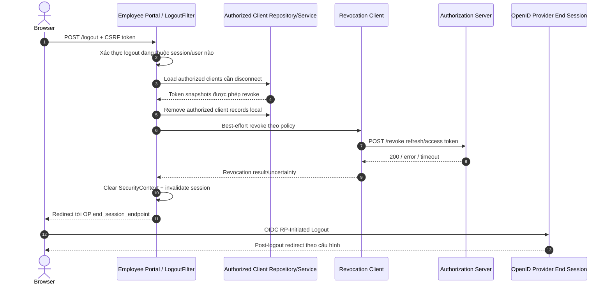

# 24.10. Token revocation và việc xóa authorized client sau logout

## 1. Bối cảnh: logout thành công, nhưng access token vẫn có thể còn hiệu lực

Giả sử **Employee Portal** sử dụng **Spring Security OAuth 2.0 / OIDC Client** để nhân viên đăng nhập qua OpenID Provider (OP). Sau khi login, backend dùng access token được cấp cho registration `company-oidc` để gọi Employee API. Ứng dụng có thể lưu một `OAuth2AuthorizedClient` gồm access token và refresh token trong repository/service.

Nhân viên nhấn **Đăng xuất**. Trình duyệt được đưa về trang `/signed-out`. Nhưng quản trị viên phát hiện một access token từng được cấp cho phiên đó vẫn được Employee API chấp nhận cho đến khi hết hạn. Đây không nhất thiết là bug của Spring Security: **logout ở ứng dụng, xóa dữ liệu token cục bộ và thu hồi token tại Authorization Server là các thao tác có mục đích khác nhau**.

Một triển khai có thể hoàn thành:

```text
Browser POST /logout
      |
      v
Spring Security xóa Authentication / SecurityContext
      |
      v
HTTP session bị invalidate theo cấu hình
      |
      v
Browser nhận redirect /signed-out
```

nhưng chưa thực hiện:

```text
DELETE local OAuth2AuthorizedClient record
POST Authorization Server revocation endpoint
Invalidate all other user sessions / revoke OP tokens
```

Vì vậy, câu hỏi cần giải quyết là:

> **Sau OIDC logout, làm thế nào để loại bỏ khả năng tái sử dụng authorized client ở backend, và khi chính sách yêu cầu, thu hồi access token/refresh token tại Authorization Server một cách đúng giao thức, an toàn và kiểm soát được lỗi?**

Bài học thuộc chương **24. Đăng xuất OIDC** của module **Spring Security OAuth 2.0 OIDC Client**. Các ví dụ chính dùng **Spring Boot 3.x, Spring Security 6.x, Java 17+, Servlet/MVC**; phần cuối đối chiếu với Reactive WebFlux. Phiên bản Spring Security và khả năng của từng OP/Authorization Server có thể khác nhau; mọi chính sách revocation phải được xác nhận với server thực tế.

### Mục tiêu học tập

Sau bài, bạn có thể:

1. Phân biệt **local logout**, **OIDC RP-Initiated Logout**, **authorized client removal** và **RFC 7009 Token Revocation**.
2. Xác định token đang nằm trong `OAuth2AuthorizedClientRepository`, `OAuth2AuthorizedClientService` hay HTTP session.
3. Hiểu khóa lưu token `(clientRegistrationId, principalName)` và những rủi ro khi xóa sai principal/registration.
4. Thiết kế luồng logout thu thập token cần revoke **trước khi trạng thái cần đọc bị mất**.
5. Gọi revocation endpoint đúng client authentication method, tránh lộ client secret/token.
6. Phân biệt xử lý access token, refresh token và ID Token.
7. Xử lý trường hợp revocation endpoint không hỗ trợ, lỗi timeout, đồng thời có nhiều session/registration hoặc nhiều node.
8. Kiểm thử local cleanup và revocation bằng mock/fake, không gửi credential production ra ngoài.
9. Hiểu khi nào nên **không** revoke một token dùng chung với các session hoặc workload khác.

## 2. Các loại trạng thái trong OIDC Client

### 2.1. Không phải thứ gì liên quan OAuth cũng là “session”

| Đối tượng | Công dụng | Ai quản lý? | Logout local có tự xử lý đầy đủ? |
| --- | --- | --- | --- |
| **`Authentication` / `SecurityContext`** | Danh tính đã xác thực trong ứng dụng | Spring Security | Thường được xóa khi logout hợp lệ |
| **`HttpSession`** | Duy trì trạng thái browser/server | Servlet container, Spring Session nếu dùng | Có thể invalidate theo cấu hình |
| **OIDC OP session** | Phiên đăng nhập tại nhà cung cấp danh tính | OpenID Provider | Không nhất thiết; cần OIDC logout phù hợp |
| **`OAuth2AuthorizedClient`** | Registration, principal name, access token, refresh token nếu có | OAuth2 Client | Không mặc định được xóa ở mọi kiểu storage |
| **Access token** | Credential để truy cập Resource Server | Được Authorization Server cấp, Resource Server kiểm tra | Không tự bị revoke chỉ vì browser logout |
| **Refresh token** | Credential để xin access token mới | Authorization Server và OAuth2 Client | Có thể vẫn hiệu lực nếu không bị revoke theo policy |
| **ID Token** | Khẳng định việc xác thực end-user với OIDC Client | OpenID Provider cấp | Không phải đối tượng revocation phổ biến theo RFC 7009 |
| **Authorization request + `state`** | Chống CSRF/correlation trong login callback | Authorization request repository | Khác với authorized-client store |
| **Client secret/private key** | Xác thực OAuth2 Client tại Token/Revocation Endpoint | App runtime/secret manager | Không nên bị xoay/xóa theo mỗi user logout |

**`SecurityContext` và `OAuth2AuthorizedClient` là hai trạng thái khác nhau.** Một access token lưu ở database có thể còn sau khi `SecurityContext` bị xóa, nhưng điều đó **không cho phép anonymous request sử dụng nó** nếu application authorization được thiết kế đúng.

### 2.2. `OAuth2AuthorizedClient` mang những trường nào?

```text
OAuth2AuthorizedClient
├── ClientRegistration
│   ├── registrationId = company-oidc
│   ├── clientId
│   ├── authorizationGrantType = authorization_code
│   └── providerDetails / tokenUri
├── principalName = employee-4821
├── OAuth2AccessToken
│   ├── tokenValue           [BÍ MẬT]
│   ├── issuedAt
│   ├── expiresAt
│   └── scopes
└── OAuth2RefreshToken      [CÓ THỂ NULL]
    └── tokenValue          [BÍ MẬT]
```

Đối với login OIDC qua Authorization Code, việc có refresh token còn phụ thuộc scope, consent và chính sách OP; **không thể giả định mọi login đều có refresh token**.

### 2.3. Khóa lưu authorized client

Với `OAuth2AuthorizedClientService`, ứng dụng thường tra cứu/lưu/xóa authorized client bằng:

```text
(clientRegistrationId, principalName)
```

Ví dụ:

| Registration ID | Principal name | Dữ liệu token thuộc về |
| --- | --- | --- |
| `company-oidc` | `employee-4821` | User 4821 đã cấp quyền cho client này |
| `company-oidc` | `employee-9274` | User 9274 |
| `partner-oidc` | `employee-4821` | Cùng user nhưng registration khác |
| `reports-api` | `reports-batch` | Workload Client Credentials, không phải session của user |

**Logout của `employee-4821` không nên xóa token Client Credentials `reports-batch`.** Ngược lại, nếu user có token ở nhiều registrations, chỉ xóa registration login có thể **không đủ** để thực thi chính sách “disconnect all user accounts”.

## 3. Bốn thao tác thường bị gọi chung là “logout”

### 3.1. Local logout

Local logout xử lý **phiên ở Relying Party (RP)** — chính ứng dụng Employee Portal:

- Xóa/clear `Authentication` và `SecurityContext`.
- Invalidate `HttpSession` nếu cấu hình như vậy.
- Xóa session cookie ở trình duyệt theo cơ chế phù hợp.
- Chuyển tới trang thông báo đã đăng xuất.

Trong Servlet Spring Security, `LogoutFilter` và `LogoutHandler` xử lý các bước theo cấu hình, sau đó `LogoutSuccessHandler` quyết định phản hồi.

**Local logout không mặc định gọi RFC 7009 revocation endpoint**, và cũng không bảo đảm chấm dứt OP session.

### 3.2. OIDC RP-Initiated Logout

OIDC RP-Initiated Logout cho phép ứng dụng chuyển browser tới logout endpoint do OpenID Provider cung cấp, thường dùng `id_token_hint` để OP xác định phiên liên quan.

Trong Spring Security Servlet, một lớp thường dùng là:

```java
OidcClientInitiatedLogoutSuccessHandler
```

Handler có thể tạo redirect đến OP end-session endpoint khi provider có metadata tương ứng và Authentication là OIDC user phù hợp.

Điều đó có nghĩa:

- Browser được hướng tới logout flow của OP.
- OP có thể chấm dứt phiên Single Sign-On theo chính sách.
- Ứng dụng có thể nhận callback/redirect về `post_logout_redirect_uri`.

**Nhưng OIDC RP-Initiated Logout không tương đương RFC 7009 revocation.** Chính sách OP quyết định token đã cấp có bị thu hồi hay không.

### 3.3. Xóa authorized client local

Xóa authorized client nghĩa là xóa bản sao token **được lưu tại ứng dụng** để những lần authorize/load sau **không thể dùng lại bản ghi local đó**.

Có thể thực hiện qua:

```java
authorizedClientService.removeAuthorizedClient(
        registrationId, principalName);
```

hoặc trong ngữ cảnh Servlet request:

```java
authorizedClientRepository.removeAuthorizedClient(
        registrationId, authentication, request, response);
```

**Xóa local record không gửi tín hiệu revoke tới Authorization Server.** Nếu một bản sao access token vẫn tồn tại ở nơi khác, token đó có thể tiếp tục được Resource Server chấp nhận trong thời hạn hiệu lực.

### 3.4. OAuth 2.0 Token Revocation

**RFC 7009** mô tả revocation endpoint của Authorization Server. OAuth client gửi một token cần revoke cùng thông tin xác thực client theo phương thức OP yêu cầu.

Ví dụ khái niệm:

```http
POST /oauth2/revoke HTTP/1.1
Host: auth.example.com
Content-Type: application/x-www-form-urlencoded
Authorization: Basic <redacted-client-credentials>

token=<url-encoded-token>
&token_type_hint=refresh_token
```

Authorization Server xử lý yêu cầu, thu hồi token nếu token tồn tại, thuộc client và chính sách cho phép. Đây là **remote operation**; nó có thể lỗi mạng, không được hỗ trợ hoặc có độ trễ.

### 3.5. Bảng so sánh

| Thao tác | Đích | Đối tượng chính | Có xóa token cục bộ? | Có revoke access/refresh token tại AS? |
| --- | --- | --- | --- | --- |
| Local logout | Employee Portal | SecurityContext/HttpSession | Không bảo đảm | Không |
| OIDC RP-Initiated Logout | OP end-session endpoint | OP login session | Không bảo đảm | Tùy chính sách OP; không phải RFC 7009 |
| Authorized client removal | Token store của Portal | `OAuth2AuthorizedClient` | **Có, đúng record đã chỉ định** | **Không** |
| RFC 7009 Revocation | AS revocation endpoint | Access/refresh token theo hợp đồng | **Không tự động** | **Có nếu AS xử lý thành công** |
| Disable client credentials | OP client administration | OAuth client/workload identity | Không tự động | Ảnh hưởng rộng, không dành cho user logout |
| OIDC Back-Channel Logout | RP session endpoint | Phiên RP được OP thông báo logout | Tùy RP implementation/policy | Không tự đồng nghĩa RFC 7009 |

**Không xóa client secret theo mỗi lần user logout.** Client secret thuộc registration của ứng dụng và có thể đang phục vụ nhiều user hoặc workload.

## 4. Vì sao logout không tự revoke mọi token?

### 4.1. OAuth2 cho phép access token có vòng đời riêng

Access token có thể được cấp thời hạn 5–60 phút hoặc khác theo OP. Resource Server có thể kiểm tra JWT signature/issuer/audience/expiry **mà không gọi trực tiếp Authorization Server mỗi request**.

Nếu ứng dụng chỉ hủy HTTP session, Resource Server không tự biết browser đã logout. JWT access token đã phát hành có thể được chấp nhận đến khi `exp`, hoặc bị từ chối sớm nếu hệ thống hỗ trợ revocation/revocation-list/short TTL và thực thi chính sách đó.

### 4.2. Local deletion không thể xóa các bản sao đã phát ra

Ví dụ:

```text
10:00 Employee Portal nhận Access Token A và lưu trong JDBC.
10:05 Portal gọi Employee API bằng A.
10:10 User logout; Portal xóa row JDBC.
10:11 Một request ở hệ thống khác còn giữ A.
10:12 Resource Server kiểm tra A và có thể vẫn chấp nhận.
```

Xóa JDBC chỉ ngăn Portal đọc lại A ở key đó. Nó **không tự hủy khả năng replay của A** ở nơi khác.

### 4.3. OIDC end-session và token revocation có hợp đồng khác nhau

Một OP có thể:

- Kết thúc browser session nhưng giữ token có hiệu lực.
- Revoke refresh tokens theo policy logout.
- Revoke access tokens trực tiếp hoặc qua policy riêng.
- Không cung cấp revocation endpoint cho client loại này.
- Có độ trễ trước khi Resource Server nhận biết token đã bị revoke.

Vì vậy, **không suy luận từ UI “Logout successful” rằng mọi token ở mọi Resource Server đã vô hiệu ngay lập tức**.

## 5. RFC 7009 Token Revocation: endpoint và semantics

### 5.1. Mẫu HTTP request

RFC 7009 sử dụng `application/x-www-form-urlencoded` trên HTTPS:

```http
POST /oauth2/revoke HTTP/1.1
Host: auth.example.com
Content-Type: application/x-www-form-urlencoded
Authorization: Basic <client-authentication-redacted>

token=<sensitive-value>
&token_type_hint=refresh_token
```

Các trường chính:

| Trường | Bắt buộc? | Ý nghĩa |
| --- | --- | --- |
| `token` | **Có** | Token cần thu hồi |
| `token_type_hint` | Không | Gợi ý cho server về loại token, thường `access_token` hoặc `refresh_token` |
| Client authentication | Theo đăng ký/chính sách AS | Xác thực OAuth client có quyền revoke token |
| Extra parameters | Theo server extension | Không tự thêm tùy ý nếu không có hợp đồng |

`token_type_hint` chỉ là **gợi ý**, không phải cách để client ép server coi một access token thành refresh token hoặc ngược lại.

### 5.2. Revoke refresh token hay access token trước?

Đây là quyết định chính sách, không có đáp án chung cho mọi provider:

- **Refresh token** thường là ưu tiên cao khi muốn ngăn client xin thêm access token sau logout.
- **Access token** nên được xem xét revoke nếu muốn giảm thời gian credential đã cấp còn có thể sử dụng.
- Revoking refresh token **có thể** ảnh hưởng access token liên quan theo chính sách/khả năng của server.
- Revoking access token **không nhất thiết** thu hồi refresh token liên quan.
- Không phải provider hỗ trợ revoke access token dạng JWT ngay lập tức ở mọi Resource Server.
- Một số OP quản lý toàn bộ grant/token family; việc revoke một token có thể ảnh hưởng những tokens khác, cần xác nhận trước.

Chính sách thực tế thường là: **ngăn khả năng refresh và giảm rủi ro replay của access token hiện tại**, nhưng phải tránh vô tình phá các phiên hoặc integrations khác khi provider áp dụng revocation theo toàn grant.

### 5.3. HTTP 200 không chứng minh token trước đó thực sự tồn tại

Theo RFC 7009, revocation endpoint có thể trả **200 OK** cả khi token đã bị revoke, không hợp lệ hoặc không được server nhận diện — để tránh lộ thông tin về token existence.

Do đó:

```text
HTTP 200 từ revocation endpoint
  = server đã xử lý request theo semantics của endpoint

KHÔNG bảo đảm:
  - Resource Server đã dừng chấp nhận mọi bản sao token.
  - Token đã tồn tại ở server trước request.
  - Tất cả access tokens của cùng user/client đều bị revoke.
  - OP login session đã kết thúc.
```

### 5.4. Một số lỗi revocation

| Kết quả | Cách hiểu |
| --- | --- |
| 200 OK | Request đã được xử lý theo RFC 7009 semantics |
| `unsupported_token_type` | AS không hỗ trợ revocation cho loại token yêu cầu |
| 400/401 | Request/authentication/parameters không hợp lệ theo provider |
| 429 | Có thể bị rate limit theo provider |
| 5xx/timeout | AS/network lỗi; không thể xác nhận kết quả |
| Redirect tới host khác | Không tự chuyển token/client secret sang endpoint mới |

**Không retry mọi 4xx.** Đặc biệt, client auth sai hoặc unsupported token type không thể sửa bằng việc gửi lại y nguyên. Với timeout, có thể yêu cầu đã được xử lý dù response mất; cần retry giới hạn và hiểu revocation operation có tính idempotent theo semantics chuẩn.

### 5.5. Đừng gửi ID Token tới RFC 7009 như access token

**ID Token** là assertion OIDC về authentication, thường dùng làm `id_token_hint` ở RP-Initiated Logout. Nó **không phải** OAuth2 access/refresh token để tự động gửi tới `/revoke`.

Nếu OP có cơ chế invalidation ID Token/session riêng, phải theo tài liệu OP; không tự khẳng định `token_type_hint=id_token` được RFC 7009 hỗ trợ.

### 5.6. Làm sao biết revocation endpoint ở đâu?

Phụ thuộc provider:

- OAuth2 Authorization Server metadata (RFC 8414) có thể quảng cáo `revocation_endpoint`.
- Một số OP OIDC discovery metadata cũng công bố thông tin liên quan.
- Nhiều hệ thống yêu cầu cấu hình URI rõ ràng theo môi trường.
- Một số provider **không hỗ trợ** endpoint hoặc chỉ hỗ trợ một số loại token/client.

Spring Boot `spring.security.oauth2.client.registration.*` và `provider.*` không nên được hiểu là tự cấu hình một revocation client hoàn chỉnh. `ClientRegistration.ProviderDetails.getTokenUri()` là **Token Endpoint**, không phải Revocation Endpoint. Không gửi revocation POST tới Token Endpoint trừ khi provider tài liệu hóa một extension như vậy.

URI revocation phải đến từ **cấu hình hoặc metadata đáng tin cậy**, được kiểm tra HTTPS/origin và không do browser cung cấp.

## 6. Authorized-client storage trong Spring Security Servlet

### 6.1. `OAuth2AuthorizedClientService`

Interface cấp ứng dụng có các phương thức quan trọng:

```java
<T extends OAuth2AuthorizedClient> T loadAuthorizedClient(
        String clientRegistrationId, String principalName);

void saveAuthorizedClient(
        OAuth2AuthorizedClient authorizedClient,
        Authentication principal);

void removeAuthorizedClient(
        String clientRegistrationId, String principalName);
```

Implementation thường gặp:

- `InMemoryOAuth2AuthorizedClientService`.
- `JdbcOAuth2AuthorizedClientService`.

Khi dùng service, **xóa đúng cặp `(registrationId, principalName)`** mới xóa authorized client tương ứng.

```java
authorizedClientService.removeAuthorizedClient(
        "company-oidc", "employee-4821");
```

Lệnh trên **không gọi mạng**, không revoke token và không xóa record của `employee-9274`.

### 6.2. `OAuth2AuthorizedClientRepository`

Trong Servlet HTTP request, repository có contract:

```java
<T extends OAuth2AuthorizedClient> T loadAuthorizedClient(
        String clientRegistrationId,
        Authentication principal,
        HttpServletRequest request);

void saveAuthorizedClient(
        OAuth2AuthorizedClient authorizedClient,
        Authentication principal,
        HttpServletRequest request,
        HttpServletResponse response);

void removeAuthorizedClient(
        String clientRegistrationId,
        Authentication principal,
        HttpServletRequest request,
        HttpServletResponse response);
```

Các implementation đáng chú ý:

- **`HttpSessionOAuth2AuthorizedClientRepository`**: gắn authorized client với HTTP session.
- **`AuthenticatedPrincipalOAuth2AuthorizedClientRepository`**: với authenticated principal, có thể ủy quyền cho `OAuth2AuthorizedClientService`; nhánh anonymous có thể dùng repository session.

Nếu application dùng repository nhưng bạn chỉ xóa một service **không phải service thực sự mà repository đang sử dụng**, authorized client có thể vẫn tồn tại trong session/store khác. **Chọn đúng abstraction mà flow login và OAuth2 Client đã cấu hình**.

### 6.3. Session invalidation không phải database delete

| Nơi token được lưu | Khi HttpSession bị invalidate | Có cần explicit removal? |
| --- | --- | --- |
| `HttpSessionOAuth2AuthorizedClientRepository` | Dữ liệu trong session thường biến mất | Có thể không cần để xóa session-local record; cần revoke remote riêng |
| `InMemoryOAuth2AuthorizedClientService` | Record có thể vẫn còn trong JVM | **Có nếu policy yêu cầu xóa** |
| `JdbcOAuth2AuthorizedClientService` | Record có thể vẫn còn trong database | **Có nếu policy yêu cầu xóa** |
| Custom distributed token store | Theo implementation riêng | Phải kiểm tra policy/cleanup của store |
| Client Credentials `reports-batch` | Không liên quan user HTTP session | **Không xóa chỉ vì user logout** |

Vì vậy, chỉ thêm:

```java
.logout(logout -> logout.invalidateHttpSession(true))
```

không chứng minh `JdbcOAuth2AuthorizedClientService` đã xóa tất cả tokens của user.

### 6.4. Không có API chuẩn “xóa mọi token của user” cho mọi service

`OAuth2AuthorizedClientService` chủ yếu load/remove theo **một registration ID và một principal name**. Contract không cung cấp một thao tác portable kiểu:

```java
// Đây KHÔNG PHẢI API chuẩn:
authorizedClientService.removeAllForUser(userId);
```

Nếu user có nhiều registrations, bạn cần biết registrations nào được cấp quyền, ví dụ:

- Danh sách registration allowlist mà ứng dụng thực sự quản lý.
- Index riêng theo user/registration do hệ thống duy trì khi authorized client được save.
- Custom repository/service có query/index phù hợp.
- Chính sách chọn registration cần disconnect khi logout.

Không duyệt một nguồn token store không đáng tin rồi xóa tất cả records có email trùng nhau, nhất là trong hệ thống multi-issuer/tenant.

### 6.5. Registration ID và principal name phải nhất quán

Ví dụ authorized client được lưu dưới:

```text
(company-oidc, employee-4821)
```

nhưng logout handler gọi:

```java
authorizedClientService.removeAuthorizedClient(
        "company-oidc",
        "employee@example.com");
```

Nếu key lúc lưu không phải email, lệnh có thể **không xóa gì**. Đừng xem logout đã sạch token chỉ vì method không ném exception.

Principal name phải được lấy từ **Authentication đã được xác thực hoặc token-ownership record đáng tin** và đúng naming strategy được sử dụng tại callback/login/authorize.

## 7. Thiết kế trình tự logout an toàn

### 7.1. Luồng khuyến nghị về mặt logic

Một trình tự có thể cần nhiều bước:



Đây là **thứ tự mục tiêu của một thiết kế có kiểm soát**, không phải bảo đảm Spring Security mặc định thực hiện y hệt. Đặc biệt, việc **snapshot tokens trước session invalidation** và thời điểm custom `LogoutHandler` chạy so với handler mặc định phải được cấu hình/thử nghiệm theo chính ứng dụng.

### 7.2. “Snapshot trước, remove local, revoke remote” nghĩa là gì?

Một cách suy nghĩ an toàn:

1. Xác định **Authentication đáng tin** và authorized clients cần ngắt kết nối.
2. **Đọc/capture token values cần revoke** trước khi session-local store mất.
3. Xóa authorized client local theo đúng key/store.
4. Gửi revocation request theo policy của từng registration/token.
5. Bất kể revocation remote có thành công hay không, **không giữ browser authenticated chỉ vì mạng lỗi**.
6. Kết thúc local session và tiến hành OIDC logout nếu khả thi.
7. Ghi nhận kết quả remote, có cơ chế phục hồi/giám sát nếu yêu cầu bảo mật cao.

**Không hủy HTTP session trước khi lấy token từ `HttpSessionOAuth2AuthorizedClientRepository` rồi mong vẫn đọc lại được.**

### 7.3. Ưu tiên local logout vẫn hoàn tất khi AS gặp sự cố

Revocation endpoint có thể timeout hoặc 503. Nếu code **ném exception ra `LogoutFilter`** trước khi Spring Security clear session, người dùng có thể vẫn authenticated dù đã nhấn Logout.

Một chính sách thường phù hợp cho browser logout:

- **Local logout là bắt buộc**.
- **Remote revocation là best-effort hoặc một workflow có retry bảo đảm theo yêu cầu doanh nghiệp**.
- Không giữ session người dùng mở vì AS/network tạm lỗi.
- Không claim “mọi token đã được revoke” khi chỉ có kết quả local cleanup.

Nếu threat model đòi revocation phải được xác nhận trước khi cho phép một hành động nhạy cảm khác, cần thiết kế state machine/failure policy riêng, không chỉ ném exception từ logout handler.

### 7.4. Revocation trước hay sau local deletion?

Hai chiến lược có đánh đổi:

| Cách | Ưu điểm | Rủi ro |
| --- | --- | --- |
| Revoke remote **trước** local removal | Có thể biết kết quả trước khi xóa | AS timeout làm logout chậm; nếu handler lỗi, local state có thể chưa dọn |
| Remove local **trước** remote revoke | Giảm nguy cơ app reuse token sau logout | Nếu chưa snapshot, mất token để revoke; thất bại remote cần được ghi nhận |
| Snapshot → remove local → revoke best-effort | Cân bằng trải nghiệm logout và cleanup | Cần giữ token snapshot an toàn trong thời gian rất ngắn; retry phải thiết kế |
| Gửi revocation event đến queue/outbox | Logout nhanh, có retry | Event chứa credential nhạy cảm; cần encryption, TTL, access control và delivery semantics |
| Chỉ xóa local, không revoke | Đơn giản, tránh ảnh hưởng token/session khác | Token remote có thể còn hiệu lực; chỉ phù hợp khi policy chấp nhận |

Không có một phương án phù hợp mọi hệ thống. Nhưng **không được trộn “xóa local” với “thu hồi remote” thành một status duy nhất** vì dẫn tới báo cáo sai về bảo mật.

## 8. Cấu hình Spring Boot OIDC Login và logout cơ bản

### 8.1. Dependencies

Ví dụ Maven cho Servlet/MVC:

```xml
<dependencies>
    <dependency>
        <groupId>org.springframework.boot</groupId>
        <artifactId>spring-boot-starter-web</artifactId>
    </dependency>
    <dependency>
        <groupId>org.springframework.boot</groupId>
        <artifactId>spring-boot-starter-security</artifactId>
    </dependency>
    <dependency>
        <groupId>org.springframework.boot</groupId>
        <artifactId>spring-boot-starter-oauth2-client</artifactId>
    </dependency>
</dependencies>
```

Gradle Kotlin DSL:

```kotlin
dependencies {
    implementation("org.springframework.boot:spring-boot-starter-web")
    implementation("org.springframework.boot:spring-boot-starter-security")
    implementation("org.springframework.boot:spring-boot-starter-oauth2-client")
}
```

Các ví dụ dùng `RestClient` nếu thực hiện revocation HTTP trực tiếp; `RestClient` có trong Spring Framework 6.1+ (thường tương ứng Boot 3.2+). Nếu dự án dùng phiên bản cũ hơn, phải dùng một HTTP client tương thích hoặc nâng cấp bộ dependencies theo BOM.

### 8.2. `application.yml`

```yaml
spring:
  security:
    oauth2:
      client:
        registration:
          company-oidc:
            provider: company
            client-id: ${OIDC_WEB_CLIENT_ID}
            client-secret: ${OIDC_WEB_CLIENT_SECRET}
            client-authentication-method: client_secret_basic
            authorization-grant-type: authorization_code
            redirect-uri: "{baseUrl}/login/oauth2/code/{registrationId}"
            scope:
              - openid
              - profile
              - employee.read

        provider:
          company:
            issuer-uri: https://identity.example.com/realms/employees

integrations:
  company:
    revocation-uri: https://identity.example.com/realms/employees/protocol/openid-connect/revoke
```

**Tất cả URL chỉ để minh họa**; revocation path thật phụ thuộc OP/AS. Không tự suy ra endpoint bằng việc nối `/revoke` vào `issuer-uri` hoặc `token-uri`. Cần đối chiếu discovery/documentation và đăng ký client tương ứng. `client-secret` phải đến từ secret manager/runtime environment, không commit giá trị vào source.

Ở file cấu hình trên, `client-authentication-method: client_secret_basic` phục vụ authorization code/token requests. Ví dụ revocation transport ở phần sau trình bày **một biến thể `client_secret_post`** để minh họa form encoding rõ ràng; khi áp dụng, **client authentication của registration phải khớp với transport đã triển khai**. Không copy cả hai phần thành một chương trình chạy ngay mà bỏ qua khác biệt phương thức xác thực.

### 8.3. OIDC client-initiated logout handler

```java
package com.example.portal.security;

import org.springframework.context.annotation.Bean;
import org.springframework.context.annotation.Configuration;
import org.springframework.security.config.Customizer;
import org.springframework.security.config.annotation.web.builders.HttpSecurity;
import org.springframework.security.oauth2.client.registration.ClientRegistrationRepository;
import org.springframework.security.oauth2.client.oidc.web.logout.OidcClientInitiatedLogoutSuccessHandler;
import org.springframework.security.web.SecurityFilterChain;

@Configuration
public class OidcWebSecurityConfig {

    @Bean
    SecurityFilterChain securityFilterChain(
            HttpSecurity http,
            ClientRegistrationRepository registrations) throws Exception {

        var oidcLogout =
                new OidcClientInitiatedLogoutSuccessHandler(registrations);

        oidcLogout.setPostLogoutRedirectUri("{baseUrl}/signed-out");

        return http
                .authorizeHttpRequests(authorize -> authorize
                        .requestMatchers("/", "/signed-out", "/error").permitAll()
                        .anyRequest().authenticated())
                .oauth2Login(Customizer.withDefaults())
                .logout(logout -> logout
                        .logoutUrl("/logout")
                        .invalidateHttpSession(true)
                        .clearAuthentication(true)
                        .logoutSuccessHandler(oidcLogout))
                .build();
    }
}
```

Đây là **cấu hình OIDC logout**, chưa có custom cleanup/revocation. `OidcClientInitiatedLogoutSuccessHandler` sử dụng thông tin OIDC Authentication và OP metadata như `end_session_endpoint` để khởi tạo logout ở OP khi được hỗ trợ. `setPostLogoutRedirectUri` cần tương thích với post-logout URI mà OP chấp nhận.

Điều kiện lưu ý:

- `/signed-out` phải là public endpoint hoặc static page phù hợp.
- Chỉ dùng OIDC handler khi authentication/provider đáp ứng flow; với đăng nhập không phải OIDC, cần fallback phù hợp.
- Nếu OP không cung cấp end-session endpoint, không tự giả định nó thực hiện remote logout.
- Khi user đăng nhập lại ngay và vẫn thấy SSO, có thể OP session chưa kết thúc; không nhất thiết là local session đã không bị xóa.
- Cấu hình này **không tự gọi RFC 7009 revocation**.

### 8.4. Sử dụng POST /logout và CSRF

Trong ứng dụng Spring Security có CSRF enabled, **POST `/logout`** với CSRF token là lựa chọn an toàn phổ biến. Không nên biến logout thành GET chỉ để tiện với một link.

Ví dụ form đơn giản trong template có tích hợp CSRF:

```html
<form action="/logout" method="post">
    <input type="hidden" name="_csrf" value="${_csrf.token}">
    <button type="submit">Đăng xuất</button>
</form>
```

Cú pháp biểu thức trong `value` tùy template engine (Thymeleaf, JSP, v.v.). Đoạn HTML chỉ minh họa cách gửi token; không hard-code một CSRF token tĩnh.

## 9. Chỉ xóa authorized client local bằng `OAuth2AuthorizedClientService`

### 9.1. LogoutHandler cho một registration đang được dùng để login

Để xóa record local của OIDC login khỏi **service** đã cấu hình, có thể tạo:

```java
package com.example.portal.security;

import jakarta.servlet.http.HttpServletRequest;
import jakarta.servlet.http.HttpServletResponse;

import org.springframework.security.core.Authentication;
import org.springframework.security.oauth2.client.OAuth2AuthorizedClientService;
import org.springframework.security.oauth2.client.authentication.OAuth2AuthenticationToken;
import org.springframework.security.web.authentication.logout.LogoutHandler;

public final class AuthorizedClientServiceCleanupLogoutHandler
        implements LogoutHandler {

    private final OAuth2AuthorizedClientService authorizedClientService;

    public AuthorizedClientServiceCleanupLogoutHandler(
            OAuth2AuthorizedClientService authorizedClientService) {

        this.authorizedClientService = authorizedClientService;
    }

    @Override
    public void logout(
            HttpServletRequest request,
            HttpServletResponse response,
            Authentication authentication) {

        if (!(authentication instanceof OAuth2AuthenticationToken oauth2)) {
            return;
        }

        String registrationId =
                oauth2.getAuthorizedClientRegistrationId();

        String principalName = oauth2.getName();

        // Xóa đúng authorized client thuộc registration của phiên login.
        authorizedClientService.removeAuthorizedClient(
                registrationId, principalName);
    }
}
```

Lưu ý:

- `OAuth2AuthenticationToken` là Authentication thường có trong ứng dụng dùng `oauth2Login`, bao gồm OIDC Login.
- `getAuthorizedClientRegistrationId()` chọn **registration ID** của session login; không nhầm với `clientId` của OP.
- `getName()` phải khớp principal name đã dùng khi authorized client được lưu.
- Handler này **chỉ xóa một registration liên quan Authentication hiện tại**. Nếu user còn authorized clients ở những registrations khác, cần danh sách/cleanup policy riêng.
- Không nhận registration/principal tùy ý từ query/body.
- Đây **chỉ là local removal**: không gửi `POST /revoke`.

### 9.2. Thêm handler vào Spring Security logout

Trong cấu hình SecurityFilterChain, thêm dependency:

```java
@Bean
SecurityFilterChain securityFilterChain(
        HttpSecurity http,
        ClientRegistrationRepository registrations,
        OAuth2AuthorizedClientService authorizedClients) throws Exception {

    var oidcLogout =
            new OidcClientInitiatedLogoutSuccessHandler(registrations);

    oidcLogout.setPostLogoutRedirectUri("{baseUrl}/signed-out");

    LogoutHandler cleanup =
            new AuthorizedClientServiceCleanupLogoutHandler(
                    authorizedClients);

    return http
            .authorizeHttpRequests(authorize -> authorize
                    .requestMatchers("/", "/signed-out", "/error").permitAll()
                    .anyRequest().authenticated())
            .oauth2Login(Customizer.withDefaults())
            .logout(logout -> logout
                    .addLogoutHandler(cleanup)
                    .invalidateHttpSession(true)
                    .clearAuthentication(true)
                    .logoutSuccessHandler(oidcLogout))
            .build();
}
```

Đây là **phương án thay thế** method bean ở mục 8.3; không khai báo hai `SecurityFilterChain` trùng matcher trong cùng app mà không có lý do. Trong đoạn fragment cần import `OAuth2AuthorizedClientService` và `LogoutHandler`.

Với `JdbcOAuth2AuthorizedClientService` hoặc `InMemoryOAuth2AuthorizedClientService` thực sự được OAuth2 Client flow sử dụng, thao tác remove có thể xóa record tương ứng. Nếu repository của bạn **chỉ lưu trong HttpSession**, service có thể không có record để xóa; hãy dùng cơ chế ở phần tiếp theo.

**Không thiết kế LogoutHandler ném unchecked exception ra ngoài như một điều kiện để user không được logout khi database token store đang lỗi.** Ở production cần ghi nhận lỗi cleanup, fail-safe cho local session và cơ chế recovery theo threat model.

### 9.3. Vì sao nên dùng `OAuth2AuthenticationToken` thay vì `OidcUser` để chọn registration?

`OidcUser` cung cấp ID Token, claims và user info OIDC, nhưng **không tự xác định duy nhất registration ID** nếu ứng dụng có nhiều client registrations cùng issuer. `OAuth2AuthenticationToken` mang `authorizedClientRegistrationId` thuộc Authentication của flow login.

Ví dụ:

```java
if (authentication instanceof OAuth2AuthenticationToken oauth2) {
    String registrationId = oauth2.getAuthorizedClientRegistrationId();
    String principalName = oauth2.getName();
}
```

Đừng đọc email từ ID Token rồi đoán registration:

```java
// PHẢN MẪU: email có thể thay đổi/trùng/không verified.
String principalName = oidcUser.getEmail();
```

### 9.4. Logout không phải lúc nào cũng có OAuth2AuthenticationToken

Một ứng dụng có thể dùng form login, API Bearer Resource Server, SAML, OIDC OAuth2 Login, remember-me hoặc custom Authentication. Nếu không phải `OAuth2AuthenticationToken`, handler ví dụ bỏ qua cleanup OAuth2 Login theo registration. Đây là hành vi có chủ đích, tránh xóa nhầm token của client khác chỉ vì nhận một Authentication bất kỳ.

## 10. Nếu token lưu trong `HttpSessionOAuth2AuthorizedClientRepository`

### 10.1. Dùng đúng repository, không chỉ service

Với authorized client lưu trong HTTP session, thao tác xóa trực tiếp là:

```java
authorizedClientRepository.removeAuthorizedClient(
        registrationId,
        authentication,
        request,
        response);
```

Ví dụ `LogoutHandler`:

```java
package com.example.portal.security;

import jakarta.servlet.http.HttpServletRequest;
import jakarta.servlet.http.HttpServletResponse;

import org.springframework.security.core.Authentication;
import org.springframework.security.oauth2.client.authentication.OAuth2AuthenticationToken;
import org.springframework.security.oauth2.client.web.OAuth2AuthorizedClientRepository;
import org.springframework.security.web.authentication.logout.LogoutHandler;

public final class AuthorizedClientRepositoryCleanupLogoutHandler
        implements LogoutHandler {

    private final OAuth2AuthorizedClientRepository repository;

    public AuthorizedClientRepositoryCleanupLogoutHandler(
            OAuth2AuthorizedClientRepository repository) {
        this.repository = repository;
    }

    @Override
    public void logout(
            HttpServletRequest request,
            HttpServletResponse response,
            Authentication authentication) {

        if (authentication instanceof OAuth2AuthenticationToken oauth2) {
            repository.removeAuthorizedClient(
                    oauth2.getAuthorizedClientRegistrationId(),
                    authentication,
                    request,
                    response);
        }
    }
}
```

**Quan trọng:** Nếu repository dựa trên `HttpSession`, việc gọi sau khi session đã bị invalidate có thể **không còn thao tác trên dữ liệu như mong muốn**. Cần kiểm soát thứ tự handler hoặc thực hiện một bước disconnect riêng **khi request vẫn authenticated và session còn tồn tại**.

Nếu toàn bộ authorized clients chỉ nằm trong HttpSession và session thực sự bị invalidate, việc xóa session có thể đủ để xóa các record session-local; nhưng bạn vẫn phải **snapshot token trước** nếu cần revoke remote.

### 10.2. `AuthenticatedPrincipalOAuth2AuthorizedClientRepository` là adapter

Repository mặc định thường có thể là:

```text
AuthenticatedPrincipalOAuth2AuthorizedClientRepository
     |
     +-- Authentication đã authenticated
     |       -> OAuth2AuthorizedClientService
     |
     +-- Anonymous / unauthenticated
             -> HttpSessionOAuth2AuthorizedClientRepository
```

Do đó cần biết **bean thực sự mà SecurityFilterChain và OAuth2AuthorizedClientManager sử dụng**. Xóa một bean service không cùng nguồn dữ liệu với login flow có thể không đạt mục tiêu.

### 10.3. Phân biệt hai cách “ngắt kết nối”

Một sản phẩm có thể có:

1. **Đăng xuất website:** invalidates session; có thể cleanup token của registration login.
2. **Disconnect một liên kết OAuth riêng:** xóa/revoke authorized client của registration đó **mà user vẫn logged-in** ở website.

Trong trường hợp 2, hãy dùng một operation authenticated riêng:

```text
POST /account/connections/partner/disconnect
        |
        v
Kiểm tra Authentication và CSRF
        |
        v
Xác định registration partner được user sở hữu
        |
        v
Load/snapshot authorized client
        |
        v
Remove local + revoke remote nếu policy
        |
        v
Trả kết quả disconnect (hoặc trạng thái pending)
```

Đây **không phải** OIDC browser logout. Một user có thể muốn ngắt kết nối Partner API nhưng vẫn tiếp tục dùng Employee Portal.

### 10.4. Helper cho disconnect khi session còn sống

```java
package com.example.portal.security;

import jakarta.servlet.http.HttpServletRequest;
import jakarta.servlet.http.HttpServletResponse;

import org.springframework.security.core.Authentication;
import org.springframework.security.oauth2.client.OAuth2AuthorizedClient;
import org.springframework.security.oauth2.client.web.OAuth2AuthorizedClientRepository;

public final class AuthorizedClientDisconnectService {

    private final OAuth2AuthorizedClientRepository repository;

    public AuthorizedClientDisconnectService(
            OAuth2AuthorizedClientRepository repository) {
        this.repository = repository;
    }

    public OAuth2AuthorizedClient disconnectLocal(
            String allowedRegistrationId,
            Authentication authenticatedPrincipal,
            HttpServletRequest request,
            HttpServletResponse response) {

        // allowedRegistrationId MUST already be authorized/allowlisted.
        OAuth2AuthorizedClient snapshot = repository.loadAuthorizedClient(
                allowedRegistrationId,
                authenticatedPrincipal,
                request);

        repository.removeAuthorizedClient(
                allowedRegistrationId,
                authenticatedPrincipal,
                request,
                response);

        // Trả snapshot chỉ cho backend workflow revoke;
        // KHÔNG serialize hoặc trả object này về browser.
        return snapshot;
    }
}
```

Đây là helper cho **bước trong luồng disconnect khi session còn hiệu lực**, không phải controller public. `allowedRegistrationId` phải được ánh xạ theo chính sách ứng dụng; `authenticatedPrincipal` phải là Authentication đã được xác thực.

Trả `OAuth2AuthorizedClient` giúp workflow backend giữ **snapshot trong bộ nhớ tạm** để revoke token ngay sau local deletion. **Không log/serialize toàn bộ snapshot**, không giữ vô hạn trong cache và không trả về HTTP response.

## 11. Kết hợp OIDC LogoutSuccessHandler và authorized-client cleanup

### 11.1. Không nhầm LogoutHandler với LogoutSuccessHandler

| Hook | Thời điểm/vai trò | Ví dụ |
| --- | --- | --- |
| **`LogoutHandler`** | Thực hiện cleanup/logout actions trong LogoutFilter | SecurityContext cleanup, token cleanup tùy biến |
| **`SecurityContextLogoutHandler`** | Xóa SecurityContext, có thể invalidate HttpSession | Local logout |
| **`LogoutSuccessHandler`** | Chọn HTTP response sau logout actions | Redirect tới OP end-session endpoint |
| **`OidcClientInitiatedLogoutSuccessHandler`** | OIDC logout success handler | RP-Initiated Logout redirect |
| **`OAuth2AuthorizedClientRepository.removeAuthorizedClient`** | Xóa authorized client local | Token store cleanup |
| **RFC 7009 revocation client** | HTTP call tới Authorization Server | Remote token invalidation |

Spring Security có thể truyền Authentication gốc tới `LogoutSuccessHandler` dù SecurityContext đã được xóa; **nhưng handler thành công không tự giữ nguyên HttpSession**. Không nên cố load session-local authorized client từ success handler nếu session đã bị invalidate.

### 11.2. Tránh phụ thuộc vào thứ tự ngầm của các handler

Nếu cleanup phụ thuộc vào **đọc token từ session trước khi invalidate**, cần xác định thứ tự handler bằng cấu hình/test phù hợp. Chỉ thêm:

```java
.logout(logout -> logout.addLogoutHandler(myLogoutHandler))
```

mà không kiểm tra relationship với `SecurityContextLogoutHandler` của phiên bản ứng dụng không đủ làm bằng chứng token được snapshot trước session invalidation.

Một thiết kế rõ ràng hơn khi cần remote revocation chắc chắn là:

- Tạo **disconnect operation authenticated** để đọc token và xử lý revocation trước.
- Sau đó thực hiện **POST /logout** theo cơ chế chuẩn.
- Hoặc xây một logout orchestration được kiểm soát thứ tự và test để đảm bảo snapshot, local cleanup, session invalidation, redirect diễn ra như hợp đồng.

Không dùng trực tiếp `SecurityContextHolder` trong một async task sau logout để đoán user đã đăng xuất, vì Authentication/session có thể đã bị clear.

### 11.3. Có nên revoke trực tiếp trong LogoutSuccessHandler không?

Chỉ khi đã có **snapshot đáng tin** được chuẩn bị trước khi token store/session biến mất và performance policy cho phép. Nếu success handler chỉ nhận Authentication, không đảm bảo nó vẫn đọc được refresh/access token từ HttpSession đã hủy.

Đối với database-backed `OAuth2AuthorizedClientService`, một success handler có thể đọc service bằng registration/principal, nhưng **không nên mặc định** post-logout redirect và remote revocation sẽ hoàn tất đúng thứ tự nếu network lỗi.

### 11.4. Tránh làm OIDC logout phụ thuộc sự sống của Revocation Endpoint

`OidcClientInitiatedLogoutSuccessHandler` cần tạo HTTP redirect cho browser. Nếu custom handler gọi revocation network và ném exception ra ngoài, redirect tới OP có thể không xảy ra.

Tốt hơn: bảo đảm local logout không bị block vô hạn; đặt timeout và retry giới hạn; ghi nhận kết quả không xác nhận được; theo dõi OP session logout độc lập; chỉ dùng post-logout URI đã được OP cho phép.

## 12. Gọi RFC 7009 Revocation Endpoint từ Spring Boot

### 12.1. Điều kiện trước khi triển khai

Một revocation client thực tế phải biết:

- **Revocation URI của đúng Authorization Server**, từ metadata/cấu hình đáng tin.
- **ClientRegistration** sở hữu token và phương thức client authentication server yêu cầu.
- Token cần revoke và loại hint (`access_token` hay `refresh_token`).
- Chính sách timeout, retry, redirect, TLS và log.
- Chính sách phản hồi khi server không hỗ trợ access-token revocation hoặc không thể xác nhận kết quả.

Spring Security OAuth2 Client quản lý việc lấy/refresh authorized client, nhưng **không nên giả định framework sẽ tự gọi một RFC 7009 revocation operation khi bạn bật `oauth2Login()` hoặc `logout()`**.

### 12.2. Ví dụ HTTP request bằng `RestClient` và `client_secret_basic`

Để nhất quán với `application.yml` ở mục 8.2, ví dụ bên dưới dùng `ClientAuthenticationMethod.CLIENT_SECRET_BASIC`.

RFC 6749 `2.3.1 yêu cầu client ID và client password được form-URL-encode trước khi đưa vào HTTP Basic. Điều này đặc biệt quan trọng nếu credentials chứa ký tự không phải ASCII, dấu cách hoặc dấu `:`.

```java
package com.example.portal.security;

import java.net.URI;
import java.net.URLEncoder;
import java.nio.charset.StandardCharsets;
import java.util.Set;

import org.springframework.http.MediaType;
import org.springframework.security.oauth2.client.registration.ClientRegistration;
import org.springframework.security.oauth2.core.ClientAuthenticationMethod;
import org.springframework.util.Assert;
import org.springframework.util.LinkedMultiValueMap;
import org.springframework.util.MultiValueMap;
import org.springframework.web.client.RestClient;

public final class Rfc7009RevocationClient {

    private static final Set<String> TOKEN_HINTS =
            Set.of("refresh_token", "access_token");

    private final RestClient restClient;
    private final URI revocationUri;

    public Rfc7009RevocationClient(
            RestClient restClient,
            URI revocationUri) {

        Assert.notNull(restClient, "restClient is required");
        Assert.notNull(revocationUri, "revocationUri is required");
        Assert.isTrue(
                "https".equalsIgnoreCase(revocationUri.getScheme()),
                "Revocation endpoint must use HTTPS");
        Assert.notNull(revocationUri.getHost(), "Revocation host is missing");
        Assert.isNull(
                revocationUri.getRawUserInfo(),
                "Revocation endpoint must not contain user info");
        Assert.isNull(
                revocationUri.getRawFragment(),
                "Revocation endpoint must not have a fragment");

        this.restClient = restClient;
        this.revocationUri = revocationUri;
    }

    public void revoke(
            String tokenValue,
            String tokenTypeHint,
            ClientRegistration registration) {

        Assert.hasText(tokenValue, "tokenValue is required");
        Assert.isTrue(
                TOKEN_HINTS.contains(tokenTypeHint),
                "Unsupported token_type_hint");

        if (!ClientAuthenticationMethod.CLIENT_SECRET_BASIC.equals(
                registration.getClientAuthenticationMethod())) {
            throw new IllegalStateException(
                    "Revocation client requires client_secret_basic");
        }

        // RFC 6749 2.3.1: form-encode each component before HTTP Basic.
        String encodedClientId = URLEncoder.encode(
                registration.getClientId(), StandardCharsets.UTF_8);

        String encodedClientSecret = URLEncoder.encode(
                registration.getClientSecret(), StandardCharsets.UTF_8);

        MultiValueMap<String, String> form = new LinkedMultiValueMap<>();
        form.add("token", tokenValue);
        form.add("token_type_hint", tokenTypeHint);

        restClient.post()
                .uri(revocationUri)
                .headers(headers ->
                        headers.setBasicAuth(
                                encodedClientId, encodedClientSecret))
                .contentType(MediaType.APPLICATION_FORM_URLENCODED)
                .body(form)
                .retrieve()
                .toBodilessEntity();
    }
}
```

**Đây là mẫu transport cho một chính sách cụ thể**, không phải general-purpose revocation SDK. Nó:

- Gửi một token mỗi request.
- Giữ client credentials trong Basic Authorization header, token trong form body.
- Để RestClient báo lỗi khi HTTP status là 4xx/5xx theo behavior mặc định.
- Không in token/client secret, không trả response body cho browser.
- Yêu cầu HTTPS và một endpoint được cấu hình bởi backend.

### 12.3. Giới hạn quan trọng của đoạn code mẫu

Class trên **chưa đủ cho production** nếu thiếu các lớp kiểm soát sau:

1. **Endpoint allowlist và network egress:** URI không được chọn từ request của user; host phải được đối chiếu với cấu hình của registration/AS.
2. **HTTP redirect policy:** không follow redirect sang host khác kèm `Authorization` hoặc `token` form field.
3. **Connection/read timeout:** tránh giữ logout request quá lâu.
4. **Client authentication khác:** `client_secret_post`, `private_key_jwt`, mTLS và public-client policy cần implementation tương ứng, không tự reuse Basic cho mọi registration.
5. **HTTP error mapping:** phân loại 200, 4xx, 429, timeout/5xx và hỗ trợ `unsupported_token_type` theo provider.
6. **Concurrency/rate limiting:** tránh hàng trăm logout hoặc workers cùng flood revocation endpoint.
7. **Log masking:** đảm bảo framework/proxy/tracing không ghi form body/Basic header.
8. **Reliable retry:** nếu cần bảo đảm remote revoke, có workflow lưu trạng thái an toàn theo policy.

**Không tắt TLS certificate validation để “sửa” revocation lỗi.** Và không sử dụng một RestClient mặc định cho arbitrary URL khi nó có khả năng gửi client secret tới revocation endpoint.

### 12.4. Bean cấu hình URI rõ ràng

```java
package com.example.portal.security;

import java.net.URI;

import org.springframework.beans.factory.annotation.Value;
import org.springframework.context.annotation.Bean;
import org.springframework.context.annotation.Configuration;
import org.springframework.web.client.RestClient;

@Configuration
public class RevocationClientConfig {

    @Bean
    Rfc7009RevocationClient companyRevocationClient(
            RestClient.Builder builder,
            @Value("${integrations.company.revocation-uri}")
            URI revocationUri) {

        // Cấu hình HTTP request factory với timeout/redirect policy
        // phù hợp trước khi dùng trong môi trường production.
        return new Rfc7009RevocationClient(
                builder.clone().build(),
                revocationUri);
    }
}
```

Ví dụ này chủ động giữ **một revocation endpoint cho một OP đã biết**. Khi ứng dụng có nhiều providers, nên tạo cấu hình dạng allowlist `registrationId → revocationEndpoint` và chọn theo registration đáng tin. Không truyền URI từ query/body browser vào `Rfc7009RevocationClient`.

### 12.5. Nếu provider yêu cầu `client_secret_post`

Với client được đăng ký `client_secret_post`, cách gửi client credentials là **form body**:

```http
POST /oauth2/revoke
Content-Type: application/x-www-form-urlencoded

token=<sensitive-value>
&token_type_hint=refresh_token
&client_id=<registered-client-id>
&client_secret=<registered-client-secret>
```

Không gửi đồng thời Basic và POST secret mà không có hợp đồng cho phép. Với `private_key_jwt` hoặc mTLS, sử dụng cơ chế signing/client certificate tương ứng; **đừng dùng static `client_secret` làm phương án fallback không được kiểm soát**.

### 12.6. Khi revocation endpoint chỉ hỗ trợ refresh tokens

Một số providers có chính sách thu hồi refresh token nhưng không xử lý access token theo cách ứng dụng kỳ vọng.

Trong tình huống này:

- Ưu tiên revoking refresh token nếu policy cho phép.
- Không coi việc server không hỗ trợ access-token revocation là lý do bỏ local cleanup.
- Giới hạn TTL access token và bảo vệ Resource Server theo hợp đồng.
- Đánh giá back-channel introspection/denylist/short-lived tokens khi yêu cầu invalidation sớm.
- Ghi nhận rằng access token đã phát hành **có thể còn hiệu lực đến expiry**.

Không tuyên bố toàn bộ access tokens đã vô hiệu nếu chỉ có refresh token được revoke.

## 13. Kết hợp snapshot, local removal và remote revocation ở service store

### 13.1. Mục tiêu của một LogoutHandler có policy rõ ràng

Khi token nằm trong `OAuth2AuthorizedClientService`, handler có thể dùng Registration/Principal của Authentication để:

1. Load authorized client và **snapshot token values** trong bộ nhớ.
2. Xóa record local.
3. Cố gắng revoke refresh token.
4. Cố gắng revoke access token theo provider policy.
5. Ghi nhận lỗi bằng metadata an toàn mà **không ném exception để giữ user session ở trạng thái logged-in**.

Ví dụ sau giả định **duy nhất registration `company-oidc`** dùng revocation endpoint đã cấu hình. Nếu có nhiều registrations, mỗi registration phải chọn đúng revocation endpoint/client auth policy; không gửi token của partner tới Company OP.

### 13.2. Implementation kết hợp

```java
package com.example.portal.security;

import jakarta.servlet.http.HttpServletRequest;
import jakarta.servlet.http.HttpServletResponse;

import org.slf4j.Logger;
import org.slf4j.LoggerFactory;
import org.springframework.security.core.Authentication;
import org.springframework.security.oauth2.client.OAuth2AuthorizedClient;
import org.springframework.security.oauth2.client.OAuth2AuthorizedClientService;
import org.springframework.security.oauth2.client.authentication.OAuth2AuthenticationToken;
import org.springframework.security.oauth2.client.registration.ClientRegistration;
import org.springframework.security.oauth2.core.OAuth2AccessToken;
import org.springframework.security.oauth2.core.OAuth2RefreshToken;
import org.springframework.security.web.authentication.logout.LogoutHandler;

public final class CompanyTokenCleanupLogoutHandler implements LogoutHandler {

    private static final Logger log =
            LoggerFactory.getLogger(CompanyTokenCleanupLogoutHandler.class);

    private static final String COMPANY_REGISTRATION = "company-oidc";

    private final OAuth2AuthorizedClientService store;
    private final Rfc7009RevocationClient revocationClient;

    public CompanyTokenCleanupLogoutHandler(
            OAuth2AuthorizedClientService store,
            Rfc7009RevocationClient revocationClient) {

        this.store = store;
        this.revocationClient = revocationClient;
    }

    @Override
    public void logout(
            HttpServletRequest request,
            HttpServletResponse response,
            Authentication authentication) {

        if (!(authentication instanceof OAuth2AuthenticationToken oauth2)) {
            return;
        }

        if (!COMPANY_REGISTRATION.equals(
                oauth2.getAuthorizedClientRegistrationId())) {
            return;
        }

        String principalName = oauth2.getName();
        OAuth2AuthorizedClient snapshot = null;

        // A. Load token before removing the local authorized client.
        try {
            snapshot = store.loadAuthorizedClient(
                    COMPANY_REGISTRATION, principalName);
        } catch (RuntimeException ex) {
            recordFailure("load", ex);
        }

        // B. Always attempt local removal even if loading failed.
        try {
            store.removeAuthorizedClient(
                    COMPANY_REGISTRATION, principalName);
        } catch (RuntimeException ex) {
            recordFailure("local_remove", ex);
        }

        // C. If there is no snapshot, the remote request is not possible.
        if (snapshot == null) {
            return;
        }

        ClientRegistration registration = snapshot.getClientRegistration();

        // D. Revoke refresh token first, if one was issued.
        OAuth2RefreshToken refreshToken = snapshot.getRefreshToken();
        if (refreshToken != null) {
            revokeSafely(refreshToken.getTokenValue(),
                    "refresh_token", registration);
        }

        // E. Revoke current access token if policy/AS supports it.
        OAuth2AccessToken accessToken = snapshot.getAccessToken();
        if (accessToken != null) {
            revokeSafely(accessToken.getTokenValue(),
                    "access_token", registration);
        }
    }

    private void revokeSafely(
            String tokenValue,
            String hint,
            ClientRegistration registration) {

        try {
            revocationClient.revoke(tokenValue, hint, registration);
        } catch (RuntimeException ex) {
            recordFailure("remote_revoke_" + hint, ex);
        }
    }

    private void recordFailure(String phase, RuntimeException ex) {
        // Metrics/structured logs in production should correlate the
        // attempt without logging client secret or token.
        log.warn("OIDC logout token cleanup failed phase={} type={}",
                phase, ex.getClass().getSimpleName());
    }
}
```

### 13.3. Ý nghĩa và giới hạn của ví dụ

Đây là **ví dụ best-effort đồng bộ**, không phải bảo đảm revocation đã thành công:

- Nếu `loadAuthorizedClient` lỗi, local removal vẫn được thử; không còn snapshot để revoke.
- Nếu local removal lỗi, remote revocation vẫn được thử; **row local có thể còn** và cần recovery.
- Nếu remote revocation lỗi/timeout, local logout vẫn nên tiếp tục; không báo “remote revoke thành công”.
- Nếu refresh token không tồn tại, không gửi form `token=` rỗng.
- Nếu AS không hỗ trợ revoke access token, lỗi đó phải được phân loại/đo lường, thay vì coi HTTP 400 là bằng chứng local logout không hoạt động.
- Thời gian thực thi có thể chậm bằng tổng thời gian hai revocation HTTP calls. Cần timeout nghiêm ngặt hoặc dùng workflow tách rời.
- Nếu provider revoking refresh token kéo theo revoke cả grant, revocation access token tiếp theo vẫn có thể trả 200 theo RFC semantics; không suy ra token tồn tại ở bước hai.
- Nếu client auth method không phải `client_secret_basic`, transport ví dụ từ mục 12 sẽ báo lỗi và bạn phải triển khai phương thức đúng.

**Đừng dùng code này để thử revoke token của user khác bằng cách đưa `principalName` từ query string.** Nó chỉ lấy token theo Authentication gốc của logout request.

### 13.4. Gắn handler với OIDC logout

Thay vì handler chỉ local ở mục 9, tạo:

```java
LogoutHandler cleanupAndRevoke =
        new CompanyTokenCleanupLogoutHandler(
                authorizedClientService, companyRevocationClient);

var oidcLogout =
        new OidcClientInitiatedLogoutSuccessHandler(registrations);

oidcLogout.setPostLogoutRedirectUri("{baseUrl}/signed-out");

http.logout(logout -> logout
        .addLogoutHandler(cleanupAndRevoke)
        .invalidateHttpSession(true)
        .clearAuthentication(true)
        .logoutSuccessHandler(oidcLogout));
```

Đây là **fragment** trong một SecurityFilterChain bean có các dependencies đã inject, không phải đoạn Java độc lập. **Không đăng ký đồng thời cả handler ở mục 9 và handler này** nếu cả hai cùng xóa một record mà không có chủ đích, vì sẽ tạo double-cleanup và khó diễn giải kết quả.

Cần xác nhận thứ tự/cấu hình handler của Spring Security version thực tế; ví dụ dùng service không phụ thuộc HTTP session nên không cần snapshot từ session sau khi SecurityContext bị clear. Với repository lưu trong HttpSession, dùng chiến lược ở mục 10 và chuẩn bị snapshot trước session invalidation.

### 13.5. Failure semantics phải được ghi nhận trung thực

Nên phân loại:

```text
LOCAL_LOGOUT_DONE
LOCAL_AUTHORIZED_CLIENT_REMOVED
REMOTE_REFRESH_TOKEN_REVOKE_CONFIRMED
REMOTE_ACCESS_TOKEN_REVOKE_CONFIRMED
REMOTE_REVOKE_NOT_SUPPORTED
REMOTE_REVOKE_UNKNOWN
LOCAL_REMOVE_FAILED
```

Không gộp mọi trường hợp thành một boolean `logoutSuccess=true` rồi suy ra cả local, OP session và tokens đều đã bị thu hồi. UI có thể thông báo **“Bạn đã đăng xuất khỏi ứng dụng”** sau khi local session kết thúc, trong khi hệ thống vận hành theo dõi riêng lỗi revocation.

## 14. Đồng bộ hay bất đồng bộ khi revoke token?

### 14.1. Revocation đồng bộ trong HTTP logout

Ưu điểm:

- Dễ triển khai và hiểu thứ tự.
- Có thể quan sát HTTP 200 từ revocation endpoint trước khi trả redirect.
- Không phải lưu token trong queue.

Nhược điểm:

- Browser logout chậm nếu OP/network chậm.
- Hai token × timeout có thể làm user đợi lâu.
- Server có thể bị flood khi nhiều nhân viên logout đồng thời.
- Nếu session bị invalidate và remote revoke lỗi, không còn token local để retry nếu không lưu snapshot ở nơi khác.

Phù hợp với hệ thống nhỏ khi OP ổn định, timeout ngắn và policy best-effort được chấp nhận.

### 14.2. Revocation bằng background job/outbox

Có thể thiết kế một workflow:

```text
Authenticated logout request
     |
     v
Snapshot authorized client
     |
     v
Tạo revocation task có TTL và encryption
     |
     v
Remove local authorized client
     |
     v
Invalidate RP session / OIDC logout redirect
     |
     v
Background worker
     |
     +-- Gọi revocation endpoint
     +-- Retry có giới hạn theo loại lỗi
     +-- Đánh dấu CONFIRMED / UNSUPPORTED / UNKNOWN
     +-- Xóa token snapshot khỏi task store
```

Đây là **lựa chọn kiến trúc**, không phải Spring Security tự động gửi revocation events. Chỉ triển khai nếu đội vận hành có thể bảo vệ credential trong task/outbox:

- **Encrypt** token snapshot, quản lý khóa qua KMS.
- Least privilege cho queue, worker, database và logs.
- Không gửi raw token trong message visible qua dashboard/support console.
- Task phải có TTL/retention; xóa credential sớm sau khi xử lý.
- Idempotency để không có token bị xử lý lặp vô hạn.
- Không để worker dùng credentials của registration khác.
- Revoke trước khi token hết hạn nếu còn ý nghĩa.
- Không lưu token access/refresh dưới dạng plain JSON trong queue để “retry dễ hơn”.

**Không hứa remote revoke chắc chắn nếu hệ thống không có delivery guarantee, alert và recovery runbook**. Background worker cũng có thể bị dừng hoặc hết hạn token trước khi retry.

### 14.3. So sánh chính sách

| Tiêu chí | Sync best-effort | Async retryable |
| --- | --- | --- |
| Độ trễ browser logout | Có thể tăng | Thường thấp hơn |
| Có cần token ở queue/store? | Không nhất thiết | Có, trừ kiến trúc thay thế |
| Bảo vệ credential | Snapshot trong memory ngắn hạn | Encryption/TTL/access control nghiêm ngặt |
| Retry qua restart | Khó nếu không lưu task | Có thể nếu outbox durable |
| Rủi ro token còn hiệu lực trong thời gian chờ | Thời gian HTTP call | Đến khi worker thực hiện |
| Vận hành | Ít thành phần hơn | Cần metrics/alert/recovery |
| Phù hợp | Use case đơn giản, latency dự đoán được | Chính sách revocation nghiêm ngặt/nhiều provider |

## 15. Có nhiều ClientRegistration: làm thế nào xóa đúng?

### 15.1. Một user có thể có nhiều OAuth connections

Ví dụ Employee Portal hỗ trợ:

```text
Registration: company-oidc
  -> đăng nhập Employee Portal

Registration: calendar
  -> user cấp quyền Calendar API

Registration: drive
  -> user cấp quyền Document API

Registration: reports-api
  -> backend Client Credentials (không thuộc user)
```

Nếu `OAuth2AuthenticationToken` của session login chỉ cho biết `company-oidc`, handler ở mục 9/13 **không tự biết** user đang kết nối `calendar` và `drive`.

Do đó sản phẩm cần định nghĩa một trong hai chính sách rõ ràng:

1. **Logout chỉ kết thúc RP session** và tùy policy xóa/revoke token của `company-oidc`; các liên kết `calendar`/`drive` được quản lý qua tính năng “Connected accounts”.
2. **Logout và disconnect toàn bộ user connections**: phải truy xuất danh sách registrations thuộc đúng user và remove/revoke từng authorized client tương ứng.

Không xóa token `reports-api` service-wide chỉ vì một user logout.

### 15.2. Bảng quyết định theo registration

| Registration | Chủ sở hữu | Khi user logout khỏi Portal |
| --- | --- | --- |
| `company-oidc` | User đã login | Có thể remove/revoke theo policy đăng xuất |
| `calendar` | User đã consent riêng | Chỉ disconnect nếu policy yêu cầu, có thể giữ qua logout |
| `drive` | User đã consent riêng | Tương tự |
| `reports-api` | Workload/backend | **Không revoke/xóa do user logout** |
| `payment-service` | Workload/backend | Không ảnh hưởng bởi session user |
| Registration của user khác | Principal khác | Không được truy xuất/xóa |

### 15.3. Không tự liệt kê bằng client ID

`ClientRegistrationRepository` có thể tìm `ClientRegistration` theo `registrationId`. Tuy nhiên, nó không phải token store và **không đảm bảo biết registration nào user đã thực sự authorize**. Một danh sách client registrations được cấu hình không tự là danh sách tokens của user.

Cần token ownership index đáng tin hoặc danh sách registrations có chính sách rõ:

```text
principalName = employee-4821
authorized registrations:
  company-oidc
  calendar
  drive
```

Với mỗi registration, gọi service/repository với cùng principal naming strategy và endpoint revocation phù hợp. Không cung cấp một API “logout user X” nhận arbitrary user string từ client không có quyền quản trị.

### 15.4. Đổi principal name khiến cleanup miss token

Ví dụ trước migration:

```text
(company-oidc, employee@example.com)
```

Sau migration:

```text
(company-oidc, employee-4821)
```

Handler xóa theo key mới sẽ không tìm row cũ. Hệ thống nên có migration/cleanup strategy với ánh xạ danh tính đã xác minh, không dò token bằng email ngẫu nhiên.

Trong multi-issuer OIDC, `sub` thường unique trong issuer, **không toàn cục**. Nếu dùng common registration hoặc token store đa tenant, cần namespace theo issuer/tenant phù hợp.

## 16. Nhiều phiên đăng nhập của cùng một user: xóa token nào?

### 16.1. Key `(registrationId, principalName)` có thể được chia sẻ giữa sessions

Giả sử employee-4821 đăng nhập Employee Portal đồng thời ở laptop và điện thoại:

```text
Laptop:
  HTTP session = S1
  Authentication.getName() = employee-4821

Mobile:
  HTTP session = S2
  Authentication.getName() = employee-4821

Authorized client service:
  key (company-oidc, employee-4821)
  -> OAuth2AuthorizedClient X
```

Nếu application-level `OAuth2AuthorizedClientService` chỉ giữ **một row** cho cặp registration/principal, hai sessions có thể sử dụng chung row. Nếu laptop logout và handler remove row đó, mobile có thể không load được authorized client cũ nữa. Nếu remote revoke token X, mobile có thể bị API từ chối access/refresh token đang dùng.

Điều này có thể:

- **Đúng chính sách**, nếu sản phẩm muốn “đăng xuất trên mọi thiết bị”.
- **Không đúng chính sách**, nếu người dùng chọn “chỉ đăng xuất thiết bị này”.

### 16.2. Không thể suy ra per-device isolation từ principal name

Để hỗ trợ logout từng device độc lập, cần xem xét:

- Session ID có cần là một dimension của token ownership không?
- Mỗi OIDC Login có nhận một token family riêng không?
- Authorized-client store có lưu **per-session/per-consent** thay vì một row theo principal không?
- Refresh token rotation có khiến token của session khác bị ghi đè không?
- Provider có quản lý grant theo user/client hay theo phiên cụ thể?
- Revocation endpoint thu hồi một token hay cả token family/grant?
- Ứng dụng có thể định danh phiên đang logout trước khi gọi OP không?

Đừng tự sửa `principalName` thành `employee-4821:S1` ở một logout handler trong khi login callback vẫn save theo `employee-4821`. Cần một **thiết kế storage key, token lifecycle và authentication/session** nhất quán từ đầu.

### 16.3. Ví dụ hai chính sách sản phẩm

| Chính sách | Local HTTP session | Authorized client store | Remote revocation |
| --- | --- | --- | --- |
| **Logout thiết bị hiện tại** | Xóa S1 | Không được vô tình xóa token chung mà S2 cần; cần per-session design | Tránh revoke token chung nếu sẽ ảnh hưởng S2 |
| **Logout mọi thiết bị** | Invalidate S1/S2 và các sessions liên quan | Xóa token của user theo danh sách registration/key đáng tin | Revoke tất cả tokens/grants theo khả năng OP và yêu cầu bảo mật |

Một nút “Logout” không tự cho biết có phải “logout all devices” hay không. Điều này cần được quyết định rõ trong chính sách bảo mật sản phẩm.

## 17. Refresh token rotation và race condition với logout

### 17.1. Một request đang refresh đúng lúc user logout

Giả sử hai luồng:

```text
T0  Request A load authorized client:
    refresh token = R1

T1  User POST /logout:
    logout handler load token R1

T2  Request A gửi refresh_token R1 tới Token Endpoint

T3  Authorization Server cấp access token A2, refresh token R2

T4  Logout handler revoke R1 và remove local row

T5  Request A save authorized client A2/R2 trở lại store
```

Nếu logout chỉ xóa row một lần tại T4, request A có thể **ghi lại một authorized client mới sau khi user đã logout**. Nếu OP dùng rotation, revoking R1 có thể hoặc không thể revoke R2 theo chính sách token family.

### 17.2. Cần một “authorization epoch” hoặc revocation barrier khi policy nghiêm ngặt

Với yêu cầu “sau logout không token nào của session/user được tái lưu”, có thể cần:

- Một **logout/revocation marker** theo session, user-grant hoặc token family.
- Transaction/optimistic versioning giữa authorized-client save và cleanup.
- Kiểm tra marker trước và sau khi refresh, từ chối save nếu grant đã disconnect.
- Một custom `OAuth2AuthorizationSuccessHandler` hoặc persistence layer có kiểm tra epoch.
- Distributed lock theo token ownership key nếu nhiều nodes.
- API authorization từ chối sử dụng token khi phiên liên quan đã logout.
- OP revocation/quản lý token family, không chỉ local DB delete.

Chỉ dùng `ConcurrentHashMap`/JDBC token store không tự giải quyết các race trên. **Authorization Server và local database cũng không nằm trong cùng một transaction ACID.**

### 17.3. Race khi cùng user đăng nhập lại

Ví dụ:

```text
T0  User logout S1, handler chuẩn bị delete
T1  User hoàn thành OIDC login mới S2
T2  S2 save authorized client Y dưới cùng key (company-oidc, employee-4821)
T3  Handler S1 gọi removeAuthorizedClient(company-oidc, employee-4821)
```

Nếu store chỉ có một row theo key, logout S1 có thể **xóa Y của phiên mới**. Điều này cho thấy cần phân biệt **logout toàn user** với **logout một session** và thiết kế token/version key phù hợp.

Với custom JDBC store, có thể cần compare-and-delete theo phiên bản/token fingerprint đã được lưu (không log token raw) hoặc một cơ chế key per grant/session. API `removeAuthorizedClient(registrationId, principalName)` chuẩn không nhận version, nên không thể kỳ vọng nó tự giải quyết yêu cầu compare-and-delete.

### 17.4. Refresh token rotation khiến retry đặc biệt nhạy cảm

Nếu refresh token R1 đã được dùng và OP cấp R2:

- Retry R1 có thể trả `invalid_grant`.
- Một số OP có reuse detection và có thể vô hiệu token family.
- Client phải đọc lại store/kiểm tra concurrent refresh thay vì retry vô điều kiện.
- Logout cần biết token mới R2 nếu policy yêu cầu revoke cả family.
- Nếu không thể biết R2, OP-level logout/revocation API riêng có thể cần thiết.

**Một lỗi `invalid_grant` khi logout đồng thời refresh không tự chứng minh user đăng nhập sai; đó có thể là lifecycle/concurrency issue.**

## 18. OIDC Back-Channel Logout, Front-Channel Logout và token revocation

### 18.1. OP có thể chủ động thông báo logout cho RP

Trong OIDC Single Sign-On, logout không chỉ bắt đầu từ nút Logout của Employee Portal:

- User logout từ một ứng dụng RP khác.
- OP kết thúc session vì chính sách thời gian/đổi mật khẩu.
- Admin buộc đăng xuất người dùng.
- OP gửi **Back-Channel Logout Token** tới RP đã đăng ký hỗ trợ.
- Browser có thể tham gia Front-Channel Logout tùy profile.

Spring Security có khả năng hỗ trợ các cơ chế OIDC logout tùy phiên bản/cấu hình, ví dụ back-channel logout support ở Spring Security Servlet. Nhưng **OP notification liên quan tới session state ở RP**, không mặc định mang theo access/refresh token cho RFC 7009 revocation.

### 18.2. Back-channel logout không có HttpSession browser đang gửi request

OIDC back-channel logout là một **server-to-server POST** mang Logout Token. Không nên giả định có HTTP session của user đang active trong request đó.

Một RP triển khai cần:

- Xác minh Logout Token JWT theo issuer, audience, signature và profile.
- Dùng `sid`/`sub` được xác minh để định vị session cần kết thúc.
- Invalidate đúng sessions, không xóa nhầm session user khác.
- Nếu chính sách yêu cầu xóa/revoke authorized clients, tìm token ownership qua store/index đáng tin.
- Không đọc principalName từ body chưa xác minh rồi xóa tokens.
- Kiểm soát replay, duplicate events, race với login/refresh.

### 18.3. Logout Token không phải access token để revoke

OIDC Back-Channel Logout Token là một JWT thông báo logout theo profile. Nó **không phải** access token/refresh token được đưa vào RFC 7009 endpoint để revoke.

```text
Back-Channel Logout Token
   -> RP xác minh sự kiện logout và xác định session(s)

Access/Refresh Token
   -> RFC 7009 revocation nếu RP có token
      và AS hỗ trợ/policy yêu cầu
```

Không tráo hai loại JWT/token chỉ vì chúng đều có thể chứa `iss` hoặc `sub`.

### 18.4. OP logout có thể rộng hơn một RP local session

Nếu OP chấm dứt phiên SSO liên kết nhiều RPs, các ứng dụng khác có thể nhận logout notification hoặc buộc user re-authenticate theo chính sách. Nhưng **điều đó không đồng nghĩa token từ các OAuth client registrations khác nhau đã bị revoke**.

Ngược lại, một RP có thể revoke refresh token của riêng client mà không chấm dứt OP browser session; user có thể login lại nhanh nhờ SSO. Cần xác định rõ mục đích từng thao tác.

## 19. Đăng xuất user có ảnh hưởng Client Credentials không?

### 19.1. Token M2M có principal kỹ thuật

Trong cùng ứng dụng, backend có thể dùng:

```text
Registration: reports-api
Grant: client_credentials
Principal: reports-batch
```

Token này đại diện cho **ứng dụng/workload**. Nó không có browser session hoặc OIDC end-user consent theo flow Client Credentials chuẩn.

Khi employee-4821 logout:

```text
REMOVE (company-oidc, employee-4821)    <- theo logout policy

DO NOT REMOVE (reports-api, reports-batch) chỉ vì user logout
```

Nếu handler vô tình gọi `removeAuthorizedClient("reports-api", "reports-batch")`, scheduled job có thể phải xin token mới; nếu còn gọi RFC 7009 revoke service token, có thể gây gián đoạn workflow của toàn hệ thống.

### 19.2. Dùng token service phục vụ user cũng phải kiểm tra quyền

Ví dụ frontend gọi `/reports/export` rồi backend sử dụng `reports-api` Client Credentials token. Backend vẫn phải kiểm tra user có quyền export, kể cả khi service token có scope rộng.

Logout của user phải chặn các request tiếp theo không có Authentication hợp lệ, **không dựa vào việc revoke toàn bộ service token** để bảo vệ trang web.

### 19.3. Workload revocation thuộc quy trình riêng

Client Credentials token/credential cần được thu hồi khi:

- Workload bị decommission.
- Client secret/private key bị lộ.
- OAuth client registration bị vô hiệu.
- Scope/audience của service thay đổi theo policy.
- Có incident response với service identity.

Đó là **quy trình vận hành workload**, không phải hậu quả thông thường của từng lần user logout.

## 20. Nếu Resource Server vẫn chấp nhận token đã “revoke” thì sao?

### 20.1. Khác nhau giữa opaque token và JWT offline validation

| Kiểu access token | Resource Server có thể kiểm tra thế nào? | Thu hồi sớm có thể gặp vấn đề gì? |
| --- | --- | --- |
| Opaque/reference token | Introspection tại AS hoặc cache introspection | Cache TTL/replication delay trước khi thấy revoked |
| JWT self-contained | Validate chữ ký/issuer/audience/expiry local | Không tự hỏi AS token đã revoke chưa |
| Sender-constrained token | Validate token và bằng chứng sở hữu khóa theo profile | Vẫn cần xử lý revoke/expiry của token |
| Custom token | Provider contract | Phụ thuộc hạ tầng token validation |

Nếu API tự xác minh JWT `exp` và không có revocation-list/introspection/short TTL policy, revocation endpoint có thể không khiến token bị từ chối ngay lập tức ở mọi request.

### 20.2. Các mô hình invalidation sớm

Tùy nhu cầu:

- Short-lived access tokens và revoke refresh tokens.
- Introspection theo yêu cầu hoặc cache TTL ngắn.
- Revocation list/denylist hoặc event propagation tới Resource Server.
- Token version/epoch check trong authorization layer.
- Sender-constrained tokens như mTLS/DPoP khi profile phù hợp.
- Re-authentication cho những operations nhạy cảm.

Mỗi cách có trade-off latency, availability, complexity và load. Không viết “RFC 7009 bảo đảm JWT không dùng được sau 1 ms” nếu API của bạn offline-validate token mà không nhận revocation state.

### 20.3. Quy trình điều tra

Nếu sau logout vẫn gọi API thành công bằng token cũ, xác minh lần lượt:

1. RP có thực sự xóa authorized client local không?
2. Có gửi RFC 7009 revocation request không?
3. Request có đúng token value, client registration và revocation endpoint không?
4. AS trả kết quả gì? Có support revoking token type đó không?
5. Access token có audience/expiry như kỳ vọng không?
6. Resource Server validate theo introspection/JWT offline hay kết hợp?
7. Cache/introspection/revocation propagation có độ trễ không?
8. Token có bị một request refresh đồng thời tạo lại không?
9. Token đang dùng thuộc phiên/grant khác không?
10. Logout policy là “this device” hay “all devices”?

Tránh kết luận ngay “Spring Security logout thất bại” chỉ từ việc một access token còn được API chấp nhận.

## 21. Bảo mật logout và revocation

### 21.1. CSRF, redirect và session fixation

Một endpoint logout có side effects cần bảo vệ CSRF đúng cách, nhất là khi dựa vào cookie/session. Không chuyển mọi state-changing logout/disconnect API sang GET vì browser tự gửi cookie trong một số tình huống.

Với OIDC RP-Initiated Logout:

- `post_logout_redirect_uri` phải được OP cho phép.
- Không nhận arbitrary redirect URL từ query rồi trả Location.
- `id_token_hint` phải đến từ OIDC Authentication đã xác thực, không từ input tùy ý.
- Kiểm soát cookie `Secure`, `HttpOnly`, `SameSite` theo cấu trúc OIDC redirect.
- Không ghi ID Token/`id_token_hint` trong access logs/proxy logs khi tránh được; một số flow redirect có query, cần masking thích hợp.

### 21.2. Không xây endpoint xóa token tùy ý

Phản mẫu:

```java
// PHẢN MẪU: browser tự chọn principal và registration.
@PostMapping("/admin/delete-authorized-client")
void delete(@RequestParam String registration,
            @RequestParam String principalName) {
    service.removeAuthorizedClient(registration, principalName);
}
```

Dù method không trả token, nó cho phép caller có thể **vô hiệu hóa kết nối của người khác** nếu không có kiểm tra quyền. Ở một endpoint bình thường, principal phải lấy từ Authentication đã xác thực và registration từ allowlist đúng quyền user.

Với admin operation, cần audit, authorization cấp cao, scope/tenant isolation và tiêu chí lựa chọn mục tiêu nghiêm ngặt.

### 21.3. Không log secrets khi lỗi revocation

Tránh:

```java
// PHẢN MẪU: token bị ghi vào log.
log.info("Revoking token {}", refreshToken.getTokenValue());
```

Cũng tránh log nguyên:

- Form body `token=...`.
- HTTP Basic Authorization header.
- Client secret/private key.
- Raw refresh/access/ID tokens.
- Full `OAuth2AuthorizedClient` hoặc `HttpSession` serialized state.
- Full exception/HTTP request dump nếu có thể chứa headers/body có token.
- Full redirect URL chứa `id_token_hint` hoặc `state`.

Nên log `registrationId`, loại token hint, phase, response class, correlation ID và elapsed time; chỉ ghi principal identifier khi chính sách privacy/audit cho phép.

### 21.4. Revocation endpoint cần egress/TLS policy

Một request revoke chứa **token cần thu hồi**, và thường chứa **client authentication**. Nếu một URL tùy ý nhận request đó, credential của app có thể bị lộ dù mục đích của code là “bảo mật hơn bằng revocation”.

Yêu cầu:

- HTTPS + hostname/certificate validation.
- Exact trusted revocation endpoint/host.
- Không auto-follow cross-origin redirect kèm credentials.
- Network egress allowlist/proxy được kiểm soát.
- Connection/read timeout.
- Masking logs/traces.
- Không đưa secret vào query string.
- Secrets manager và rotation.
- Không fallback gửi token sang endpoint “thử nghiệm” ngoài policy.

### 21.5. Privacy, deletion và retention

Một user có thể yêu cầu xóa dữ liệu hoặc disconnect account. Khi đó xóa authorized client là một phần của lifecycle dữ liệu, nhưng có thể còn:

- Token backups.
- In-memory caches.
- Async revocation task.
- Logs chứa metadata/token (nếu hệ thống ghi sai).
- Tokens tại OP vẫn chưa revoke.
- Session ở thiết bị khác hoặc các RPs khác.

Cần chính sách retention/backup/crypto erasure và incident response phù hợp. Không tuyên bố dữ liệu đã biến mất hoàn toàn chỉ vì `removeAuthorizedClient` không ném exception.

## 22. Nếu ứng dụng dùng Reactive WebFlux thì sao?

### 22.1. Servlet và WebFlux có abstraction khác nhau

Bài chủ yếu dùng Servlet, nhưng ý nghĩa **local cleanup khác remote revocation** vẫn đúng với WebFlux.

| Servlet/MVC | WebFlux/Reactive |
| --- | --- |
| `SecurityFilterChain` | `SecurityWebFilterChain` |
| `HttpSecurity` | `ServerHttpSecurity` |
| `HttpServletRequest` / `HttpSession` | `ServerWebExchange` / `WebSession` |
| `SecurityContextLogoutHandler` | `SecurityContextServerLogoutHandler` |
| `LogoutHandler` | `ServerLogoutHandler` |
| `LogoutSuccessHandler` | `ServerLogoutSuccessHandler` |
| `OidcClientInitiatedLogoutSuccessHandler` | `OidcClientInitiatedServerLogoutSuccessHandler` |
| `OAuth2AuthorizedClientService` | `ReactiveOAuth2AuthorizedClientService` |
| `OAuth2AuthorizedClientRepository` | `ServerOAuth2AuthorizedClientRepository` |
| `HttpSessionOAuth2AuthorizedClientRepository` | `WebSessionServerOAuth2AuthorizedClientRepository` |

**Không copy code Servlet `LogoutHandler` và `OAuth2AuthorizedClientService` vào WebFlux reactive chain rồi gọi `block()`**. Với WebFlux, lưu trữ/xóa token nên được compose bằng Reactor `Mono`.

### 22.2. Xóa authorized client reactive

Reactive service có contract:

```java
Mono<Void> removeAuthorizedClient(
        String clientRegistrationId,
        String principalName);
```

Ví dụ:

```java
public Mono<Void> removeCompanyToken(
        ReactiveOAuth2AuthorizedClientService service,
        Authentication authentication) {

    return service.removeAuthorizedClient(
            "company-oidc", authentication.getName());
}
```

Điều kiện vẫn là Authentication có nguồn gốc đáng tin và principal name đúng key đã lưu.

Nếu token nằm trong WebFlux request repository, dùng:

```java
return repository.removeAuthorizedClient(
        "company-oidc", authentication, serverWebExchange);
```

Trong đó `repository` là `ServerOAuth2AuthorizedClientRepository` và `serverWebExchange` là request hiện tại. Với `WebSessionServerOAuth2AuthorizedClientRepository`, snapshot phải được tạo **trước khi WebSession bị invalidate** nếu cần revocation.

### 22.3. Snapshot và cleanup reactive theo đúng thứ tự

Khi cần cả load và remove một authorized client, có thể compose:

```java
public Mono<Void> disconnectReactive(
        ServerOAuth2AuthorizedClientRepository repository,
        Authentication authentication,
        ServerWebExchange exchange,
        ReactiveTokenRevocationService revocationService) {

    String registrationId = "company-oidc";

    return repository
            .<OAuth2AuthorizedClient>loadAuthorizedClient(
                    registrationId, authentication, exchange)
            .map(java.util.Optional::of)
            .defaultIfEmpty(java.util.Optional.empty())
            .flatMap(snapshot ->
                    repository.removeAuthorizedClient(
                                    registrationId, authentication, exchange)
                            .then(snapshot
                                    .map(revocationService::revokeIfSupported)
                                    .orElseGet(Mono::empty)));
}
```

Trong đó `ReactiveTokenRevocationService` là **interface ứng dụng tự định nghĩa** với một method giả định:

```java
public interface ReactiveTokenRevocationService {
    Mono<Void> revokeIfSupported(OAuth2AuthorizedClient client);
}
```

Đoạn code là **helper minh họa**, không phải một bean tự chạy tại OIDC logout. Cần import `ServerOAuth2AuthorizedClientRepository`, `OAuth2AuthorizedClient`, `ServerWebExchange`, `Authentication` và `Mono`; principal và registration phải được kiểm tra quyền trước.

Nó cố ý:

- Load `OAuth2AuthorizedClient` trước khi remove.
- Dùng `Optional` để phân biệt **không có authorized client** với trường hợp `Mono<Void>` thành công nhưng không emit item.
- Compose `removeAuthorizedClient` trước thao tác revocation.
- Không dùng `block()` hoặc `subscribe()` thủ công.

Trong production, phải thêm **error handling để remote revocation lỗi không ngăn cleanup/logout**, cùng timeout, retry và metrics. Không tự gắn helper này vào `ServerLogoutHandler` mà không thiết kế thứ tự với session invalidation.

### 22.4. Reactive OIDC logout success handler

Spring Security WebFlux có:

```java
OidcClientInitiatedServerLogoutSuccessHandler
```

Nó tham gia RP-Initiated Logout tương ứng với Servlet handler. Đây vẫn là logout OP/browser flow, **không tự thay thế một reactive RFC 7009 revocation client**.

Khi dùng WebFlux, revocation HTTP có thể thực hiện bằng `WebClient` với Token Endpoint client authentication/TLS phù hợp. Tránh gọi blocking `RestClient` trên Reactor event loop nếu không có một blocking boundary được offload.

## 23. Kiểm thử logout cleanup và token revocation

### 23.1. Các loại test cần tách riêng

| Loại test | Mục tiêu | Công cụ phù hợp |
| --- | --- | --- |
| Unit test `LogoutHandler` | Xóa đúng registration/principal | JUnit 5 + Mockito |
| Unit test cleanup orchestration | Snapshot trước delete, remote failure không làm mất local logout | Fake repository/service/revoker |
| HTTP contract test revocation | POST đúng endpoint, method, form fields và client auth | MockRestServiceServer / WireMock / MockWebServer |
| Mock MVC logout test | POST /logout với CSRF, SecurityContext/session clear | Spring Security Test + MockMvc |
| OIDC RP-Initiated Logout test | Redirect đúng OP end-session endpoint khi metadata hợp lệ | Mock OIDC provider metadata + MVC test |
| Token store integration test | JDBC/InMemory removal đúng key, không xóa user khác | Database test phù hợp |
| Multi-session/concurrency test | Không xóa row của session mới ngoài policy | Test có coordinated threads/versioned store |
| Resource Server integration | Sau revoke token có bị từ chối theo policy không? | Mock/staging AS + Resource Server tương thích |

Không dùng access/refresh token production trong test fixture hoặc HTTP logs.

### 23.2. Unit test local handler

Ví dụ JUnit 5 + Mockito, không cần OP thật:

```java
package com.example.portal.security;

import static org.mockito.Mockito.*;

import org.junit.jupiter.api.Test;
import org.springframework.mock.web.MockHttpServletRequest;
import org.springframework.mock.web.MockHttpServletResponse;
import org.springframework.security.oauth2.client.OAuth2AuthorizedClientService;
import org.springframework.security.oauth2.client.authentication.OAuth2AuthenticationToken;

class AuthorizedClientServiceCleanupLogoutHandlerTest {

    @Test
    void removesOnlyAuthorizedClientOfCurrentLogin() {
        OAuth2AuthorizedClientService store =
                mock(OAuth2AuthorizedClientService.class);

        OAuth2AuthenticationToken authentication =
                mock(OAuth2AuthenticationToken.class);

        when(authentication.getAuthorizedClientRegistrationId())
                .thenReturn("company-oidc");
        when(authentication.getName()).thenReturn("employee-4821");

        var handler =
                new AuthorizedClientServiceCleanupLogoutHandler(store);

        handler.logout(
                new MockHttpServletRequest(),
                new MockHttpServletResponse(),
                authentication);

        verify(store).removeAuthorizedClient(
                "company-oidc", "employee-4821");
        verifyNoMoreInteractions(store);
    }
}
```

Đây là **test mẫu**, không phải kết quả đã chạy. `MockHttpServletRequest/Response` đến từ Spring Test; dự án có thể sử dụng `spring-boot-starter-test` và `spring-security-test` tùy cách viết tests.

Test nên xác minh handler không gọi remove cho:

- Anonymous Authentication.
- Form login không liên quan OAuth2.
- Authentication thiếu registration theo policy.
- Một người dùng khác.
- Service principal `reports-batch`.

### 23.3. HTTP contract test cho Revocation Client

Với Spring Test, có thể tạo một `RestClient.Builder` gắn `MockRestServiceServer` rồi kiểm tra request tới URI đã được cấu hình:

```java
RestClient.Builder builder = RestClient.builder();

MockRestServiceServer server =
        MockRestServiceServer.bindTo(builder).build();

server.expect(requestTo(
                "https://identity.example.test/oauth2/revoke"))
        .andExpect(method(HttpMethod.POST))
        .andRespond(withSuccess());

RestClient http = builder.build();

var revoker = new Rfc7009RevocationClient(
        http,
        URI.create("https://identity.example.test/oauth2/revoke"));

// Use a synthetic ClientRegistration with client_secret_basic.
// Use a fake token, never a production credential.
revoker.revoke("unit-test-token", "refresh_token", testRegistration);

server.verify();
```

Đoạn này là **fragment test**; cần import `RestClient`, `MockRestServiceServer`, `URI`, `HttpMethod` và static matchers `requestTo`, `method`, `withSuccess`. Biến `testRegistration` là một registration **giả** đã cấu hình client authentication `CLIENT_SECRET_BASIC`.

Cần bổ sung assertions để kiểm tra:

- Content-Type là `application/x-www-form-urlencoded`.
- Form có `token` và `token_type_hint` tương ứng.
- Basic client authentication đúng phương thức.
- Không có token trong URL/query.
- Sai revocation endpoint hoặc client auth method bị từ chối.
- HTTP 400/401/429/5xx được xử lý đúng policy.
- Redirect không gửi secret/token tới host khác.
- Logs không chứa token trong success/error path.

### 23.4. MockMvc test logout với CSRF

Với Spring Security Test, request logout thường cần CSRF token khi CSRF enabled:

```java
mockMvc.perform(post("/logout")
        .with(csrf()))
        .andExpect(status().is3xxRedirection());
```

Khi cần test OIDC logout redirect, phải thiết lập Authentication `OidcUser` phù hợp, đăng ký client và discovery metadata có `end_session_endpoint`. Không mặc định một status 302 chứng minh RFC 7009 revocation đã thành công.

Một test end-to-end tốt sẽ kiểm tra **riêng từng kết quả**:

```text
POST /logout
  -> SecurityContext/session bị clear
  -> authorized client key được remove theo policy
  -> revocation client được gọi với đúng token/type/client
  -> OP end_session redirect đúng khi có metadata
  -> lỗi revocation remote không làm giữ session authenticated
```

### 23.5. Test revocation timeout

Mô phỏng revocation client bị timeout hoặc trả HTTP 503:

```text
Input:
  Authorized client có access/refresh token.
  Revocation endpoint unavailable.

Expected:
  Local logout vẫn kết thúc theo chính sách.
  Authorized client local được remove hoặc ghi nhận cleanup failure.
  Không trả raw token/secret cho browser.
  Metrics ghi trạng thái remote revoke UNKNOWN/FAILED.
```

Không viết test với expectation “remote revoke luôn thành công” khi code đang thực hiện best-effort.

### 23.6. Test race giữa logout và login/refresh

Các concurrency tests nên cố tình điều phối:

1. Request A load old authorized client.
2. Request B bắt đầu logout và snapshot token.
3. Request A refresh token, chuẩn bị save row mới.
4. Request B remove hoặc gửi revoke.
5. Request A save.
6. Kiểm tra policy: có thể row bị tái sinh không; logout all devices có thực sự chặn reuse không.

Nếu sản phẩm yêu cầu atomic behavior, cần custom versioned storage/lock/barrier và tests tương ứng. Không kết luận “không có race” chỉ vì unit test chạy tuần tự đã pass.

## 24. Các tình huống thực hành và hành vi mong đợi

Những kịch bản dưới đây chỉ là **mẫu hành vi dự kiến**, không phải kết quả đã kiểm chứng với OP/Resource Server thật.

### 24.1. Case A — Local logout không có revocation

```text
Before:
  User đã OIDC Login.
  JDBC token store có (company-oidc, employee-4821).

Action:
  POST /logout, chỉ invalidate session.

Expected:
  Browser session kết thúc.
  JDBC authorized client có thể vẫn còn.
  Access/refresh token có thể vẫn hoạt động tại AS/API.
```

### 24.2. Case B — Xóa authorized client local

```text
Before:
  Store chứa token dưới (company-oidc, employee-4821).

Action:
  removeAuthorizedClient("company-oidc", "employee-4821").

Expected:
  Store không load được row đó.
  Không tự gửi RFC 7009 request.
  Token bản sao ở nơi khác có thể vẫn dùng được.
```

### 24.3. Case C — Revoke refresh token

```text
Input:
  Refresh token R1 thuộc company-oidc.

Action:
  POST /revoke token=R1, token_type_hint=refresh_token.

Expected:
  Nếu AS hỗ trợ và xử lý thành công, R1 không còn được dùng
  để cấp access token mới theo semantics của server.
  Access token đã phát hành có thể còn được chấp nhận.
```

### 24.4. Case D — Revoke access token JWT

```text
Input:
  JWT access token A1 đã được cấp.

Action:
  POST /revoke token=A1.

Resource Server:
  Tự validate JWT offline, không dùng revocation list.

Expected:
  Không được mặc định token A1 bị từ chối ngay lập tức.
  Phụ thuộc enforcement/propagation của hệ thống.
```

### 24.5. Case E — Không có refresh token

```text
Authorized client:
  getRefreshToken() == null.

Expected:
  Bỏ qua refresh token revocation.
  Cân nhắc access token revocation theo provider support/policy.
  Không gửi form token rỗng.
```

### 24.6. Case F — Revocation endpoint lỗi mạng

```text
Action:
  Browser nhấn Logout.
  AS revocation endpoint trả 503/timeout.

Expected:
  Local session vẫn được kết thúc.
  Không claim remote revoke confirmed.
  Ghi nhận unknown/failure và recovery policy.
```

### 24.7. Case G — User có thêm Calendar token

```text
Store:
  (company-oidc, employee-4821)
  (calendar, employee-4821)

Action:
  Logout policy chỉ xóa company-oidc.

Expected:
  Calendar token có thể còn trong store.
  Nếu chính sách cần disconnect-all, phải có cleanup riêng
  theo registration index/ownership và đúng provider.
```

### 24.8. Case H — Logout một thiết bị, token chia sẻ

```text
Laptop session S1 và mobile S2:
  Cùng principalName, cùng authorized client service key.

Action:
  Laptop logout và revoke token chung.

Expected:
  Mobile có thể chịu ảnh hưởng.
  Muốn logout per-device phải thiết kế token/session isolation.
```

### 24.9. Case I — Cùng lúc login mới và logout cũ

```text
T0 S1 logout chuẩn bị remove key.
T1 S2 login và save token Y dưới cùng key.
T2 S1 remove key.

Expected:
  Có thể xóa nhầm Y nếu storage chỉ xóa theo key.
  Cần versioned policy nếu không muốn ảnh hưởng S2.
```

### 24.10. Case J — Client Credentials job vẫn chạy sau user logout

```text
User logout:
  (company-oidc, employee-4821) được cleanup.

Scheduled job:
  (reports-api, reports-batch) vẫn có token M2M.

Expected:
  Không xóa hoặc revoke reports-api do user logout.
  Job chạy theo service identity và policy riêng.
```

### 24.11. Case K — Logout từ OP bằng Back-Channel

```text
OP:
  Gửi Logout Token JWT tới RP.

Expected:
  RP xác minh Logout Token và định vị sessions liên quan.
  Nếu cần revocation token, dùng workflow riêng theo policy.
  Không gửi Logout Token tới RFC 7009 endpoint như access token.
```

### 24.12. Case L — User bị tước quyền tại Resource Server

```text
Authorized client token:
  Chưa hết hạn.

Business policy:
  User không còn quyền xem dữ liệu.

Expected:
  Resource Server/application authorization có thể từ chối request.
  Logout/revocation không phải cơ chế thay thế kiểm tra quyền.
```

### 24.13. Case M — OP trả HTTP 200 cho token không tồn tại

```text
Revocation endpoint:
  HTTP 200 OK.

Expected:
  Theo semantics RFC 7009, có thể token đã revoked,
  token không tồn tại hoặc không được nhận diện.
  Không suy ra token trước đó từng tồn tại.
```

### 24.14. Case N — Logout xong user login lại không phải nhập mật khẩu

```text
RP:
  Đã local logout.

OP:
  SSO session chưa kết thúc hoặc end_session flow không thực thi.

Expected:
  OP có thể đăng nhập user trở lại qua SSO.
  Đây không chứng minh local authorized-client cleanup đã thất bại.
```

### 24.15. Case O — Token store DB bị lỗi khi cleanup

```text
Logout:
  Database removeAuthorizedClient ném exception.

Expected:
  Local session phải được kết thúc theo failure policy.
  Ghi rõ local_remove_failed.
  Không tuyên bố tất cả records đã bị xóa.
  Có recovery/cleanup workflow cho token còn lưu.
```

## 25. Bảng troubleshooting

| Triệu chứng | Nguyên nhân khả dĩ | Hướng xử lý |
| --- | --- | --- |
| User logout nhưng access token vẫn hoạt động | Chỉ local logout, không có revocation hoặc RS offline-validate JWT | Kiểm tra RFC7009, TTL và RS revocation enforcement |
| Logout redirect đến OP nhưng token còn hạn | RP-Initiated Logout khác Token Revocation | Thiết kế thêm revoke/cleanup theo policy |
| JDBC authorized client còn sau logout | Session invalidation không xóa application-level service | Remove đúng registration/principal |
| Handler không xóa row | `principalName` hoặc registration ID khác key lúc save | So sánh naming strategy của OAuth2 login/service |
| Repo xóa session, service vẫn có token | Xóa sai storage abstraction | Đồng bộ repository/service sử dụng thực tế |
| Không load được token để revoke sau logout | Session đã bị invalidate | Snapshot trước, hoặc dùng authenticated disconnect flow |
| Revocation endpoint 404 | URI sai hoặc server không hỗ trợ | Discovery/provider docs; không đoán từ token URI |
| `invalid_client` tại revocation | Sai client ID/secret/client auth method | Kiểm tra registration, credential rotation |
| HTTP 400 `unsupported_token_type` | Server không revoke loại token đó | Đánh giá refresh/access policy và RS enforcement |
| HTTP 200 nhưng API vẫn nhận token | AS/RS revocation semantics, caching hoặc JWT offline | Kiểm tra propagation/introspection/TTL |
| OP logout xong user có thể SSO lại | OP session chưa kết thúc hoàn toàn hoặc browser state khác | Kiểm tra `end_session_endpoint` và cookies |
| 302 tới URI lạ | Post-logout redirect không được kiểm soát | Allowlist, OP registration và tránh open redirect |
| Logout mất nhiều giây | Revocation sync thiếu timeout hoặc server chậm | Timeout/best-effort/async workflow |
| Revocation lỗi khiến user còn login | Handler ném exception chặn cleanup | Fail-safe local logout và phân loại lỗi |
| Token của user khác bị xóa | Principal từ input hoặc key collision | Authentication đã xác thực và tenant namespace |
| Token của phiên mới bị xóa | Logout cũ xóa theo key chung sau login mới | Versioned delete/per-session key/lock |
| Token xuất hiện lại sau logout | Concurrent refresh save token mới | Revoke barrier/epoch/concurrency policy |
| Mobile bị ảnh hưởng khi laptop logout | Shared user token store | Phân biệt logout per-device và all-devices |
| Background job bị mất token | Cleanup xóa Client Credentials registration | Loại M2M token khỏi user logout |
| API 403 sau logout/re-login | Scope/authorization policy không còn phù hợp | Kiểm tra Resource Server và consent |
| Token vẫn trong logs/backups | Credential bị logging/persistence ngoài ý muốn | Redaction, retention, incident response |
| Back-channel event đến nhưng token còn | Session invalidation không tự revoke token | Token ownership lookup + revocation workflow |
| Refresh token bị revoke nhưng access JWT còn | RS tự validate JWT đến expiry | TTL/denylist/introspection theo threat model |
| Revoke request 429 | Rate limit khi nhiều logout | Rate limit, backoff, retry budget |
| Request revoke tới host sai | Cấu hình endpoint sai, redirect hoặc SSRF | HTTPS origin allowlist và egress controls |

### 25.1. Sơ đồ chẩn đoán

```text
Browser đã POST /logout?
        |
        +-- Không -> HTTP method/CSRF/LogoutFilter
        |
        v
Spring Security đã clear Authentication/session?
        |
        +-- Không -> SecurityContextLogoutHandler/config
        |
        v
Chính sách yêu cầu xóa authorized client local?
        |
        +-- Không -> Documented token retention policy
        |
        v
Token đang lưu ở đâu?
        |
        +-- HttpSession repository -> session invalidation / snapshot trước
        |
        +-- InMemory/JDBC service -> remove đúng registration + principalName
        |
        v
Local removal thành công?
        |
        +-- Không -> storage/key/concurrency/recovery
        |
        v
Chính sách yêu cầu RFC 7009 revocation?
        |
        +-- Không -> token remote có thể còn đến expiry
        |
        v
Revocation endpoint đã được cấu hình/cho phép?
        |
        +-- Không -> provider docs/metadata
        |
        v
Có access/refresh token snapshot trước cleanup?
        |
        +-- Không -> cần thiết kế thứ tự, không đoán token
        |
        v
POST /revoke với đúng client auth và token hint
        |
        +-- 200 -> yêu cầu xử lý theo RFC7009 semantics
        +-- 4xx -> auth/unsupported/request policy
        +-- 429/5xx/timeout -> uncertain result/recovery
        |
        v
Resource Server còn chấp nhận token?
        |
        +-- Có -> cache, JWT offline, revoke propagation,
        |          wrong token, new login/refresh race
        |
        v
OIDC OP session đã kết thúc?
        |
        +-- Không -> RP-Initiated Logout/end_session policy
        |
        v
Kiểm tra multi-session, tenant, logout-all và audit
```

## 26. Những câu hỏi thường gặp

### 26.1. Gọi `logout()` trong Spring Security có tự revoke access token không?

**Không mặc định.** Logout thường dọn SecurityContext/session và thực hiện các logout handlers đã cấu hình. Muốn RFC 7009 revocation phải có integration riêng, đúng với khả năng OP.

### 26.2. `OidcClientInitiatedLogoutSuccessHandler` có gửi POST revocation không?

Không phải mục đích của handler này. Nó phục vụ **OIDC RP-Initiated Logout** bằng cách điều hướng browser tới OP logout endpoint khi phù hợp, khác RFC 7009.

### 26.3. Xóa `OAuth2AuthorizedClient` trong JDBC có khiến JWT hết hiệu lực không?

**Không.** Nó chỉ xóa bản lưu trong ứng dụng. Resource Server có thể vẫn chấp nhận token theo TTL và revocation policy.

### 26.4. Revoke refresh token có đủ chưa?

Phụ thuộc mục tiêu. Revoke refresh token có thể chặn token mới, nhưng access token đã phát hành có thể còn hiệu lực. Cần kiểm tra OP/RS policy trước khi khẳng định token đã bị vô hiệu hoàn toàn.

### 26.5. Có phải revoke access token rồi refresh token cũng bị revoke?

Không có bảo đảm chung. Revocation theo grant/token family phụ thuộc Authorization Server. Nếu muốn ngăn refresh, cần xem xét refresh-token revocation riêng.

### 26.6. `token_type_hint` có bắt buộc không?

Không. Nó giúp Authorization Server tìm loại token hiệu quả hơn; các giá trị phổ biến gồm `access_token` và `refresh_token`. Nó không thay thế client authentication.

### 26.7. HTTP 200 từ revocation có nghĩa token chắc chắn từng hợp lệ?

Không. RFC 7009 cho phép trả 200 cả khi token không tồn tại/đã invalid để tránh rò thông tin token existence.

### 26.8. Tại sao OIDC ID Token không được revoke giống refresh token?

ID Token là assertion về authentication dành cho RP, không phải bearer credential dùng để xin access token theo cách refresh token. RFC 7009 chuẩn hóa access/refresh token revocation; OP session/logout có hợp đồng khác.

### 26.9. User logout có cần xóa Client Credentials token không?

**Không**, trừ khi có một chính sách vận hành rất đặc biệt. Token Client Credentials đại diện service/workload, không thuộc HTTP session user.

### 26.10. Vì sao logout của một user làm session khác gặp lỗi?

Có thể hai sessions chia sẻ authorized client dưới cùng cặp `(registrationId, principalName)`, và cleanup/revoke ảnh hưởng token chung. Cần thiết kế per-device so với all-device logout rõ ràng.

### 26.11. Tại sao xóa đúng user rồi token lại xuất hiện trong DB?

Có thể một request đang refresh token đồng thời với logout và save authorized client mới sau khi cleanup. Đây là race cần versioning/lock/logout barrier nếu chính sách yêu cầu.

### 26.12. Có thể xóa mọi tokens của user qua một method `removeAllForUser` không?

Không phải method portable của `OAuth2AuthorizedClientService` tiêu chuẩn. Muốn xóa nhiều registrations cần biết danh sách/ownership đúng hoặc custom store/index phù hợp.

### 26.13. Nếu token nằm trong HttpSession, invalidate session đã đủ chưa?

Có thể đủ cho **local session-stored authorized client**, nhưng **không revoke token tại OP**. Nếu cần remote revoke, phải snapshot token trước session invalidation.

### 26.14. Có nên chờ revocation endpoint thành công mới trả logout response?

Tùy policy, nhưng không nên giữ user logged-in chỉ vì AS/network lỗi. Dùng timeout/best-effort hoặc workflow retry an toàn và phân loại rõ kết quả remote.

### 26.15. Có thể retry revocation không?

Có thể theo semantics RFC 7009 và policy AS, nhưng phải giới hạn retry, tuân thủ `Retry-After`/rate limit, không lộ token và không giữ credential snapshot lâu hơn cần thiết.

### 26.16. Nếu OP không có `revocation_endpoint` thì làm sao?

Không thể giả định một URI hoạt động. Có thể áp dụng local cleanup, short-lived access tokens, chính sách OP logout hoặc API quản trị/token invalidation khác nếu provider cung cấp. Phải ghi rõ giới hạn revocation.

### 26.17. Spring Security WebFlux có giống Servlet không?

Về mục tiêu thì giống, nhưng API khác: `ReactiveOAuth2AuthorizedClientService`, `ServerOAuth2AuthorizedClientRepository`, `SecurityContextServerLogoutHandler` và `OidcClientInitiatedServerLogoutSuccessHandler`. Không copy code Servlet blocking vào reactive event loop.

### 26.18. Có nên lưu token để retry revoke sau logout không?

Chỉ khi có yêu cầu rõ và có bảo mật mạnh: encrypted outbox/queue, TTL, least privilege, audit và deletion. Không đưa raw tokens vào một queue plain JSON hoặc log.

### 26.19. Nếu API vẫn nhận token ngay sau HTTP 200 revocation thì sao?

Kiểm tra token type, token value, client registration, AS support, JWT validation/introspection cache và propagation delay ở Resource Server. HTTP 200 không bảo đảm mọi RS từ chối token tức thì.

### 26.20. User tự chọn `principalName` để request disconnect có an toàn không?

Không mặc định. Principal phải lấy từ Authentication đáng tin hoặc admin policy được kiểm soát. Không dùng query parameter làm khóa để xóa/revoke token của user khác.

### 26.21. Vì sao logout bằng GET có rủi ro?

GET có thể bị trigger bởi preload/link/cross-site request, khiến browser logout ngoài ý muốn. Với session/cookie authentication, ưu tiên POST có CSRF protection theo cấu hình Spring Security.

### 26.22. Có thể gọi RFC 7009 bằng ID Token không?

Không nên mặc định. `id_token_hint` trong OIDC logout khác `token` của RFC 7009. Chỉ dùng cơ chế do OP tài liệu hóa nếu có extension riêng.

## 27. Tổng kết

Khi triển khai **OIDC logout trong Spring Security OAuth 2.0 Client**, phải nhìn thấy rõ **ba lớp độc lập**:

1. **Kết thúc phiên RP/OP:** Spring Security clear `SecurityContext`/`HttpSession`, và khi cần dùng `OidcClientInitiatedLogoutSuccessHandler` để bắt đầu RP-Initiated Logout tại OP.
2. **Xóa authorized client local:** dùng `OAuth2AuthorizedClientService.removeAuthorizedClient(registrationId, principalName)` hoặc `OAuth2AuthorizedClientRepository.removeAuthorizedClient(...)` đúng storage và key; không mặc định xóa mọi registrations.
3. **Thu hồi token từ Authorization Server:** nếu được hỗ trợ và policy yêu cầu, gửi **RFC 7009 POST** tới revocation endpoint với access/refresh token và client authentication đúng, theo dõi kết quả remote độc lập.

Một bản thiết kế production cần thêm:

- Snapshot token cần revoke **trước khi session-local state bị invalidate**.
- Giới hạn thời gian revocation/handling lỗi để local logout vẫn hoàn tất.
- Không revoke token M2M khi một user logout.
- Xác định rõ **logout một thiết bị hay tất cả thiết bị**.
- Chống race giữa logout, refresh và login mới.
- Bảo vệ token/client secret ở HTTP, storage, queue và logs.
- Không khẳng định JWT access token bị vô hiệu ngay nếu Resource Server không thực thi revocation state.
- Đo/kiểm thử riêng local cleanup, remote revocation và OP session logout.

### Mẫu code cần nhớ

Xóa authorized client local trong Servlet service:

```java
authorizedClientService.removeAuthorizedClient(
        oauth2Authentication.getAuthorizedClientRegistrationId(),
        oauth2Authentication.getName());
```

Nếu dùng repository có HTTP request:

```java
authorizedClientRepository.removeAuthorizedClient(
        registrationId,
        authentication,
        request,
        response);
```

Remote token revocation (minh họa cấu trúc, request hoàn chỉnh cần đúng client authentication, endpoint và timeout):

```http
POST /oauth2/revoke
Content-Type: application/x-www-form-urlencoded
Authorization: Basic <redacted>

token=<sensitive-token>&token_type_hint=refresh_token
```

**Kết luận:** **“Logout thành công” không đồng nghĩa “mọi token đã bị thu hồi”.** Thiết kế an toàn là xác định chính xác **phiên nào bị kết thúc, authorized client nào bị xóa và token nào thực sự được Authorization Server nhận yêu cầu revoke**, đồng thời quản lý giới hạn của từng bước.

### Tài liệu tham khảo

- [Spring Security — Servlet Logout](https://docs.spring.io/spring-security/reference/servlet/authentication/logout.html)
- [Spring Security — OAuth2 Login Servlet](https://docs.spring.io/spring-security/reference/servlet/oauth2/login/index.html)
- [Spring Security — OAuth2 Client Authorized Clients](https://docs.spring.io/spring-security/reference/servlet/oauth2/client/authorized-clients.html)
- [Spring Security — OAuth2 Client Core Interfaces](https://docs.spring.io/spring-security/reference/servlet/oauth2/client/core.html)
- [Spring Security — OIDC Logout](https://docs.spring.io/spring-security/reference/servlet/oauth2/login/logout.html)
- [Spring Security — Reactive OIDC Logout](https://docs.spring.io/spring-security/reference/reactive/oauth2/login/logout.html)
- [Spring Security API — OidcClientInitiatedLogoutSuccessHandler](https://docs.spring.io/spring-security/reference/api/java/org/springframework/security/oauth2/client/oidc/web/logout/OidcClientInitiatedLogoutSuccessHandler.html)
- [Spring Security API — OAuth2AuthorizedClientService](https://docs.spring.io/spring-security/reference/api/java/org/springframework/security/oauth2/client/OAuth2AuthorizedClientService.html)
- [Spring Security API — OAuth2AuthorizedClientRepository](https://docs.spring.io/spring-security/reference/api/java/org/springframework/security/oauth2/client/web/OAuth2AuthorizedClientRepository.html)
- [Spring Security API — OAuth2AuthenticationToken](https://docs.spring.io/spring-security/reference/api/java/org/springframework/security/oauth2/client/authentication/OAuth2AuthenticationToken.html)
- [RFC 7009 — OAuth 2.0 Token Revocation](https://www.rfc-editor.org/rfc/rfc7009)
- [RFC 6749 — OAuth 2.0 Authorization Framework](https://www.rfc-editor.org/rfc/rfc6749)
- [RFC 6750 — OAuth 2.0 Bearer Token Usage](https://www.rfc-editor.org/rfc/rfc6750)
- [RFC 8414 — OAuth 2.0 Authorization Server Metadata](https://www.rfc-editor.org/rfc/rfc8414)
- [RFC 9700 — OAuth 2.0 Security Best Current Practice](https://www.rfc-editor.org/rfc/rfc9700)
- [OpenID Connect RP-Initiated Logout 1.0](https://openid.net/specs/openid-connect-rpinitiated-1_0.html)
- [OpenID Connect Back-Channel Logout 1.0](https://openid.net/specs/openid-connect-backchannel-1_0.html)
