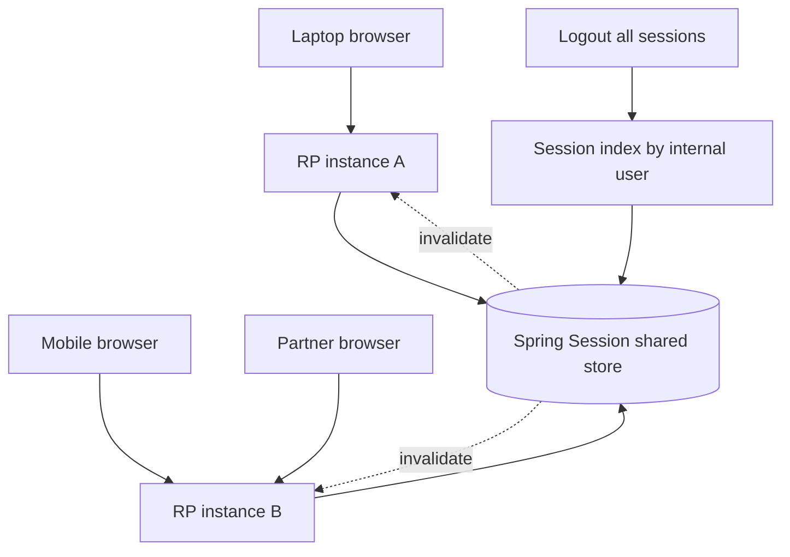
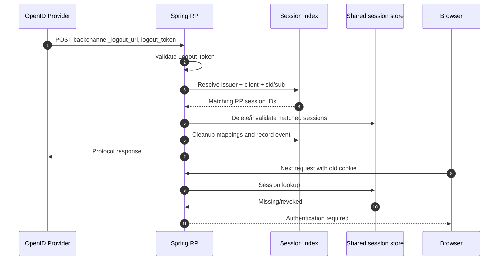

# 24.11. Đăng xuất nhiều provider và nhiều phiên người dùng

> **Module:** Spring Security OAuth 2.0 OIDC Client  
> **Chương:** 24. Đăng xuất OIDC  
> **Bối cảnh:** Ứng dụng Spring Boot/Spring Security đóng vai trò OIDC Relying Party (RP), cho phép đăng nhập qua nhiều OpenID Providers (OP) và hỗ trợ nhiều HTTP sessions trên các thiết bị, trình duyệt hoặc tenant khác nhau.

Một nút **Đăng xuất** trông đơn giản khi chỉ có một browser, một phiên và một nhà cung cấp danh tính. Nhưng một ứng dụng thực tế có thể hỗ trợ OP của doanh nghiệp A, OP của doanh nghiệp B, OP nội bộ và những OAuth2 integrations riêng để truy cập API. Cùng một người dùng có thể đăng nhập trên laptop, điện thoại và một browser profile khác. Mỗi phiên RP có thể được tạo từ một OP khác nhau; một số người dùng còn liên kết nhiều identities vào cùng tài khoản nội bộ.

Khi nhấn Logout, ứng dụng cần định nghĩa **đăng xuất khỏi đâu**:

- Chỉ HTTP session tại ứng dụng RP trong browser hiện tại?
- Cả Single Sign-On (SSO) session ở OP đã dùng để đăng nhập?
- Mọi RP sessions của cùng người dùng trên các thiết bị?
- Những OP khác mà người dùng đã liên kết tài khoản?
- Những OAuth2 authorizations/refresh tokens dùng cho API bên ngoài?
- Những sessions của tài khoản vừa bị khóa hoặc quyền vừa bị thu hồi?

**Không có một lời gọi duy nhất tự bảo đảm tất cả các phạm vi đó.** Spring Security hỗ trợ local logout và những giao thức OIDC Logout thích hợp, nhưng việc kết hợp nhiều providers, nhiều RP sessions, token revocation và chính sách đa tenant cần thiết kế riêng.

Bài này tập trung vào **đúng đích đăng xuất**, không xóa nhầm phiên của người khác, không gửi người dùng tới sai OP, không tạo lỗ hổng qua redirect/logout token và công bố rõ điều gì đã được hoàn tất.

---

## 1. Mục tiêu học tập

Sau khi học, bạn có thể:

1. Phân biệt RP session, OP SSO session, `OAuth2AuthorizedClient` và access/refresh tokens.
2. Phân biệt local logout, RP-Initiated Logout, Front-Channel Logout, Back-Channel Logout và token revocation.
3. Chọn OP của **Authentication hiện tại** qua `OAuth2AuthenticationToken.getAuthorizedClientRegistrationId()`.
4. Sử dụng `OidcClientInitiatedLogoutSuccessHandler` khi OP có hỗ trợ end-session endpoint.
5. Giải thích vì sao một HTTP redirect không thể bảo đảm kết thúc nhiều OP sessions cùng lúc.
6. Thiết kế logout-all RP sessions với Spring Session/index theo principal hoặc internal user ID.
7. Thiết kế ánh xạ theo `issuer`, `sub`, `sid`, Client ID và RP session ID.
8. Xác minh Logout Token của OIDC Back-Channel Logout trước khi vô hiệu hóa session.
9. Tránh xóa sai tenant khi hai OP trả cùng `sub` hoặc email.
10. Xử lý browser restrictions, event đến muộn, duplicate events và multi-instance consistency.
11. Tách logout khỏi token revocation và quyền truy cập API.
12. Lập kế hoạch kiểm thử đa provider, đa browser, đa thiết bị và provider lỗi.

## 2. Những dữ liệu và phiên không được nhập làm một

| Thành phần | Quản lý bởi | Một user có thể có bao nhiêu? | Kết thúc khi local logout? |
|---|---|---|---|
| RP HTTP session | Ứng dụng Servlet/Spring Session | Nhiều sessions theo thiết bị/profile | Thường chỉ session hiện tại |
| RP SecurityContext | Spring Security | Thường một Authentication trong mỗi session | Có thể clear cùng logout |
| OP SSO session | Mỗi OP | Nhiều sessions/thiết bị/providers | Không mặc định |
| OP `sid` | OP nếu hỗ trợ OIDC Session/Logout | Có thể nhiều cho một `sub` | Không tự kết thúc |
| OIDC ID Token | OP phát cho RP | Nhiều ID tokens qua các lần login | Không phải HTTP session credential |
| `OAuth2AuthorizedClient` | RP repository/service | Nhiều registrations và principals | Tùy cách lưu và cleanup |
| Access token | AS phát, RS tiêu thụ | Nhiều API tokens | Không tự revoke |
| Refresh token | AS phát, RP lưu | Có thể nhiều theo grants | Không tự revoke |
| Consent/grant | AS/OP | Theo Client, user, scopes | Không tự rút |
| Session registry/index | RP | Một hoặc nhiều records cho mỗi session | Phải dọn theo policy |

**RP** là Relying Party, tức ứng dụng Spring Security nhận danh tính; **OP** là OpenID Provider; **AS** phát OAuth2 tokens; **RS** là Resource Server. Một sản phẩm có thể gộp nhiều vai trò trong một máy chủ, nhưng nghĩa của chúng vẫn khác nhau.

### 2.1. Ví dụ ba thiết bị

```text
Laptop Chrome
  app.example.test        JSESSIONID = rp-A
  login.corporate.test    OP SSO session = op-101

Mobile Safari
  app.example.test        JSESSIONID = rp-B
  login.corporate.test    OP SSO session = op-202

Partner Browser
  app.example.test        JSESSIONID = rp-C
  login.partner.test      OP SSO session = op-303
```

Local logout trên Chrome có thể làm RP session `rp-A` mất hiệu lực. Nó **không đồng nghĩa** RP sessions `rp-B`, `rp-C` hoặc SSO sessions `op-202`, `op-303` bị xóa.

## 3. Bốn ý nghĩa của nút Logout

Một sản phẩm nên nói chính xác phạm vi:

| Lựa chọn | Ý nghĩa | Tác động chính |
|---|---|---|
| **Đăng xuất khỏi thiết bị này** | Kết thúc phiên RP hiện tại | Invalidate session hiện tại, clear SecurityContext |
| **Đăng xuất SSO của nhà cung cấp hiện tại** | Kết thúc RP session và yêu cầu OP kết thúc SSO session liên quan | Local logout + RP-Initiated Logout khi OP hỗ trợ |
| **Đăng xuất khỏi mọi thiết bị** | Hủy mọi RP sessions của cùng internal user | Shared session registry, nhiều session invalidations |
| **Ngắt kết nối API** | Ứng dụng không còn được phép truy cập API bằng delegated token | Disable/remove authorized client, revoke grant/token nếu được yêu cầu |

Nếu UI chỉ ghi **Đăng xuất mọi nơi** nhưng thực tế chỉ gọi `HttpSession.invalidate()`, mô tả chức năng đã vượt quá điều được bảo đảm.

### 3.1. “Global logout” có ít nhất bốn phạm vi

- Mọi RP sessions của người dùng trên mọi thiết bị.
- Mọi SSO sessions ở **một OP**.
- Mọi SSO sessions tại **nhiều OP**.
- Mọi OAuth2 grants và access/refresh tokens.

Đây không phải bốn cách gọi tên cùng một tính năng. Mỗi phạm vi có giao thức, quyền truy cập và khả năng thu hồi riêng.

## 4. Client registration, issuer và OP không đồng nghĩa

Ví dụ cấu hình nhiều registrations:

```yaml
spring:
  security:
    oauth2:
      client:
        registration:
          corporate-web:
            provider: corporate-op
            client-id: corporate-portal
            client-secret: ${CORPORATE_CLIENT_SECRET}
            authorization-grant-type: authorization_code
            redirect-uri: "{baseUrl}/login/oauth2/code/{registrationId}"
            scope: [openid, profile, email]
          corporate-reports:
            provider: corporate-op
            client-id: corporate-reports-web
            client-secret: ${REPORTS_CLIENT_SECRET}
            authorization-grant-type: authorization_code
            redirect-uri: "{baseUrl}/login/oauth2/code/{registrationId}"
            scope: [openid, profile]
          partner-web:
            provider: partner-op
            client-id: partner-portal
            client-secret: ${PARTNER_CLIENT_SECRET}
            authorization-grant-type: authorization_code
            redirect-uri: "{baseUrl}/login/oauth2/code/{registrationId}"
            scope: [openid, profile]
        provider:
          corporate-op:
            issuer-uri: https://login.corporate.test/realms/company
          partner-op:
            issuer-uri: https://login.partner.test/oidc
```

Có **ba registration IDs** nhưng chỉ **hai OP issuers**. Hai Client registrations cùng issuer không nhất thiết dùng cùng Client ID hoặc cùng session/grant policies. Các URLs và identifiers trong bài là dữ liệu test minh họa; production phải dùng metadata của OP thật và đăng ký redirect URIs chính xác.

| Thuật ngữ | Ví dụ | Ý nghĩa |
|---|---|---|
| Registration ID | `corporate-web` | Khóa cấu hình Spring Security |
| Provider ID | `corporate-op` | Khóa tập thông số OP |
| Issuer `iss` | `https://login.corporate.test/realms/company` | Định danh OP |
| Client ID | `corporate-portal` | RP Client mà OP cấp phép |
| Subject `sub` | `employee-734` | Định danh user trong issuer |
| OP Session ID `sid` | `op-session-101` | Định danh phiên OP khi có |
| RP Session ID | `rp-A` | Khóa phiên của ứng dụng |
| Internal user ID | `usr-9001` | Định danh tài khoản do ứng dụng quản lý |

Không dùng chỉ `sub` hoặc email để nhận diện user giữa các OP.

## 5. Chọn provider từ Authentication đã xác minh

Khi user đăng nhập qua OIDC trên Servlet stack, Spring Security có thể tạo `OAuth2AuthenticationToken`. Đối tượng này chứa registration ID của lần login:

```java
import org.springframework.security.core.Authentication;
import org.springframework.security.oauth2.client.authentication.OAuth2AuthenticationToken;
import org.springframework.security.oauth2.core.oidc.user.OidcUser;

void inspectCurrentLogin(Authentication authentication) {
    if (authentication instanceof OAuth2AuthenticationToken oauth2) {
        String registrationId =
            oauth2.getAuthorizedClientRegistrationId();

        if (oauth2.getPrincipal() instanceof OidcUser oidc) {
            String issuer =
                oidc.getIdToken().getIssuer().toString();
            String subject = oidc.getSubject();
        }
    }
}
```

Ý nghĩa:

- `registrationId` cho biết registration của **Authentication hiện tại**.
- `issuer`/`sub` xác định identity của lần OIDC login.
- Chúng không liệt kê mọi OAuth2 integrations từng được user kết nối.
- Nếu Authentication là form login hoặc OAuth2 không OIDC, không được giả định có `OidcUser`.

### 5.1. Không chọn provider từ query parameter

Phản ví dụ:

```text
POST /logout?provider=partner-web
POST /logout?redirect=https://untrusted.example/
```

Nếu server tin hai giá trị đó để chọn end-session URL, một caller có thể điều khiển hướng redirect hoặc nhầm ngữ cảnh. Nhà cung cấp phải được chọn từ **Authentication đã xác minh + ClientRegistrationRepository được tin cậy**.

Một lựa chọn UI như “logout thiết bị này” hay “logout all” có thể là tham số yêu cầu phạm vi, nhưng **phải được authorize độc lập**, không được coi là bằng chứng về danh tính/session ownership.

## 6. Local logout trong Spring Security Servlet

Cấu hình cơ bản:

```java
import org.springframework.context.annotation.Bean;
import org.springframework.context.annotation.Configuration;
import org.springframework.security.config.Customizer;
import org.springframework.security.config.annotation.web.builders.HttpSecurity;
import org.springframework.security.web.SecurityFilterChain;

@Configuration
class WebSecurityConfiguration {

    @Bean
    SecurityFilterChain filterChain(HttpSecurity http) throws Exception {
        return http
            .authorizeHttpRequests(auth -> auth
                .requestMatchers("/", "/signed-out", "/error")
                    .permitAll()
                .anyRequest().authenticated()
            )
            .oauth2Login(Customizer.withDefaults())
            .logout(logout -> logout.logoutSuccessUrl("/signed-out"))
            .build();
    }
}
```

Trong một cấu hình Spring Security thông thường, local logout làm sạch SecurityContext và invalidate session hiện tại theo logout handlers. Browser sẽ không thể dùng lại session cũ để truy cập endpoint yêu cầu Authentication.

**Giới hạn:** local logout không tự đăng xuất OP SSO session; không xóa mọi sessions ở thiết bị khác; không nhất thiết xóa JDBC authorized clients hoặc revoke token tại AS.

### 6.1. CSRF khi logout

Logout thay đổi trạng thái bảo mật. Với ứng dụng Servlet dùng cookie-based sessions và CSRF protection, nên thực hiện logout bằng **POST có CSRF token hợp lệ**. Không tùy tiện bật GET logout hoặc tắt CSRF toàn bộ ứng dụng chỉ để tạo một hyperlink tiện lợi.

Logout-all và disconnect integration còn có tác động rộng hơn, nên cần Authentication, authorization và xác nhận intent phù hợp.

## 7. RP-Initiated Logout: kết thúc SSO tại một OP

**OIDC RP-Initiated Logout** cho phép RP redirect browser đến end-session endpoint của OP khi OP hỗ trợ.

Spring Security Servlet cung cấp `OidcClientInitiatedLogoutSuccessHandler` để xây flow dựa vào Client registration/Authentication phù hợp, thay vì tự ghép URL logout từ input.

Ví dụ hoàn chỉnh:

```java
package example.oidc;

import org.springframework.context.annotation.Bean;
import org.springframework.context.annotation.Configuration;
import org.springframework.security.config.Customizer;
import org.springframework.security.config.annotation.web.builders.HttpSecurity;
import org.springframework.security.oauth2.client.oidc.web.logout.OidcClientInitiatedLogoutSuccessHandler;
import org.springframework.security.oauth2.client.registration.ClientRegistrationRepository;
import org.springframework.security.web.SecurityFilterChain;
import org.springframework.security.web.authentication.logout.LogoutSuccessHandler;

@Configuration
public class OidcLogoutConfig {

    @Bean
    LogoutSuccessHandler oidcLogoutSuccessHandler(
            ClientRegistrationRepository registrations) {

        OidcClientInitiatedLogoutSuccessHandler handler =
            new OidcClientInitiatedLogoutSuccessHandler(registrations);

        handler.setPostLogoutRedirectUri("{baseUrl}/signed-out");
        return handler;
    }

    @Bean
    SecurityFilterChain securityFilterChain(
            HttpSecurity http,
            LogoutSuccessHandler oidcLogoutSuccessHandler)
            throws Exception {

        return http
            .authorizeHttpRequests(auth -> auth
                .requestMatchers("/", "/signed-out", "/error")
                    .permitAll()
                .anyRequest().authenticated()
            )
            .oauth2Login(Customizer.withDefaults())
            .logout(logout -> logout
                .logoutSuccessHandler(oidcLogoutSuccessHandler)
            )
            .build();
    }
}
```

### 7.1. Điều kiện để flow hoạt động

- OP công bố hoặc hỗ trợ end-session endpoint.
- RP Client được phép dùng post-logout redirect URI.
- OIDC login của user hiện tại có context thích hợp.
- Spring Security version có API phù hợp.
- Browser theo redirect và OP chấp nhận request.

Nếu OP thiếu endpoint/hợp đồng, cần local fallback/UX rõ. Không đoán rằng mọi provider dùng đường dẫn `/logout` hoặc `/protocol/openid-connect/logout` giống nhau.

### 7.2. Các tham số thường gặp

Một RP-Initiated Logout request có thể sử dụng:

- `id_token_hint`: ID Token liên quan phiên đang logout.
- `post_logout_redirect_uri`: URI RP muốn quay lại, được OP cho phép.
- `state`: giá trị liên kết logout flow khi có.
- `client_id` hoặc `logout_hint` theo khả năng/hợp đồng của OP.

Không đưa token, callback URI hoặc hostname do browser chỉ định thẳng vào OP redirect request mà không xác minh.

## 8. Một redirect không thể tự logout mọi OP

HTTP response redirect có một đích điều hướng ở mỗi bước:

```http
HTTP/1.1 302 Found
Location: https://login.corporate.test/realms/company/logout?...
```

Không có tiêu chuẩn OIDC cho phép một RP-Initiated Logout tới Corporate tự kết thúc sessions tại Partner hoặc các OP độc lập khác.

Nếu sản phẩm muốn logout nhiều OP, phải định nghĩa một trong những mô hình:

1. **Logout OP hiện tại:** đơn giản nhất, thông qua Authentication đang logout.
2. **Workflow tuần tự qua nhiều OP:** chỉ khi mỗi OP hỗ trợ, browser/redirects hợp lệ và ứng dụng có cơ chế correlation, timeout, lỗi từng bước. Không có bảo đảm phổ quát.
3. **Provider admin/back-channel API:** chỉ khi từng nhà cung cấp có API đủ quyền; không phải OIDC RP-Initiated Logout chung.
4. **Chỉ logout RP sessions:** nếu sản phẩm hứa “đăng xuất khỏi ứng dụng” hơn là toàn bộ hệ thống SSO.

### 8.1. Không tự tạo nhiều iframes để ép global logout

Một vài hệ thống thử tải end-session URLs trong iframes. Cách này có thể thất bại vì:

- Browser chặn third-party cookies.
- `SameSite` hoặc `Secure` cookie policy.
- CSP và `X-Frame-Options`.
- Anti-tracking/partitioned storage.
- OP yêu cầu navigation chính hoặc tương tác người dùng.
- Browser/tab đóng trước khi các bước hoàn tất.

Không coi iframe logout là bằng chứng mọi phiên tại mọi OP đã kết thúc.

## 9. OAuth2 Login không OIDC cần đường logout riêng

Một provider có thể hỗ trợ OAuth2 Authorization Code và UserInfo endpoint nhưng **không** cung cấp ID Token hay giao thức OIDC logout.

Trong trường hợp đó:

- Local RP logout vẫn hợp lệ.
- `OidcClientInitiatedLogoutSuccessHandler` không phải giao thức logout phổ quát.
- Không tự chế `id_token_hint`.
- Provider có thể có logout endpoint riêng; cần đọc hợp đồng cụ thể nếu tích hợp.
- Token revocation RFC 7009 là vấn đề khác, không thay thế OP SSO logout.

Một ứng dụng hỗ trợ cả form login, OAuth2 login thường và OIDC login cần fallback đúng **loại Authentication**, không chỉ dựa vào tên công ty OP.

## 10. Nhiều identities từ nhiều issuers

Một internal account có thể được liên kết hợp lệ:

```text
internalUserId = usr-9001
  -> (issuer=corporate, sub=employee-734)
  -> (issuer=partner, sub=partner-user-47)
  -> (issuer=another, sub=external-911)
```

Không có nghĩa ba OP tự biết các identities thuộc cùng internal user. Chính RP phải quản lý account linking qua quy trình xác minh.

### 10.1. Subject có phạm vi issuer

Hai OP có thể cùng trả:

```text
sub = "123"
```

nhưng không có nghĩa là một người. Khóa an toàn là cặp:

```text
(issuer, subject)
```

Sau đó, ứng dụng ánh xạ cặp này thành internal account ID qua nguồn dữ liệu đáng tin.

### 10.2. Email không đủ để logout cross-provider

Email có thể thay đổi, chưa xác minh hoặc được cấp lại cho người khác. Không dùng `email` hoặc `preferred_username` làm khóa mặc định để chọn sessions cần xóa qua nhiều tenants/issuers.

### 10.3. Account linking không tạo quyền logout mọi OP

Việc RP biết hai identities liên quan cùng internal user **không tự cấp** quyền kết thúc mọi SSO sessions ở mọi OP. Muốn làm điều đó cần giao thức/capability và quyền tương ứng tại từng OP.

## 11. Một phiên RP có thể liên kết những gì?

Cần phân biệt:

**Login provider:** OP đã xác thực user và tạo `OAuth2AuthenticationToken` đang nằm trong SecurityContext.

**API integration provider:** nhà cung cấp mà user đã consent để RP lưu `OAuth2AuthorizedClient`, dùng access/refresh token gọi API.

Ví dụ:

```text
Current RP Authentication: corporate-web
Stored authorized clients:
  corporate-web -> login grant
  calendar-beta -> offline calendar access
  crm-gamma     -> offline CRM synchronization
```

Khi user logout RP bằng Corporate, không thể suy `calendar-beta` và `crm-gamma` có SSO sessions trong browser hiện tại, càng không tự coi chúng đã bị logout.

## 12. Nhiều phiên người dùng trên cùng ứng dụng

Một người dùng có thể có:

- Một RP session tại laptop.
- Một RP session tại điện thoại.
- Một RP session ở private browser.
- Một RP session ở browser khác bằng login provider khác.

**Local logout** thường chỉ invalidate session của request hiện tại. Để logout-all, RP cần tìm **mọi RP sessions của cùng internal account** trong shared store.

### 12.1. Nhiều tabs khác nhiều sessions

Nhiều tabs trong cùng browser profile thường chia sẻ cookie/session; logout ở một tab làm những tabs khác mất authentication ở request sau. Hai browser profiles/private windows thường có cookies và sessions riêng.

Đóng một tab không đồng nghĩa gửi yêu cầu logout; không dùng tab close event làm cơ chế bảo mật bảo đảm.

## 13. Dùng shared session store và session index

Ví dụ kiến trúc:



Nếu mỗi RP instance chỉ có in-memory session riêng, một request logout tại A không tự xóa sessions đang được B quản lý.

Spring Session có thể dùng Redis/JDBC hoặc backend phù hợp để chia sẻ sessions, nhưng index và identity mapping vẫn phải được cấu hình đúng.

## 14. FindByIndexNameSessionRepository

Spring Session cung cấp `FindByIndexNameSessionRepository` để tìm sessions theo principal khi backend hỗ trợ và principal index được duy trì.

Ví dụ:

```java
import org.springframework.session.FindByIndexNameSessionRepository;
import org.springframework.session.Session;
import org.springframework.stereotype.Service;

@Service
class RpSessionRevoker {

    private final FindByIndexNameSessionRepository<? extends Session> sessions;

    RpSessionRevoker(
            FindByIndexNameSessionRepository<? extends Session> sessions) {
        this.sessions = sessions;
    }

    void revokeByPrincipal(String trustedPrincipalName) {
        sessions.findByPrincipalName(trustedPrincipalName)
            .keySet()
            .forEach(sessions::deleteById);
    }
}
```

Yêu cầu:

- Store hỗ trợ index theo principal.
- `trustedPrincipalName` đến từ Authentication hoặc admin event đã xác minh quyền.
- Principal naming ổn định và namespace đúng tenant/issuer.
- Session index được cập nhật khi user login/logout và session bị đổi ID.
- Hiểu in-flight request có thể đang tiếp tục sau khi record bị xóa.

### 14.1. Không gọi findByPrincipalName với arbitrary email

Phản ví dụ:

```java
// Không an toàn nếu caller có thể chọn người bị logout.
String principal = request.getParameter("email");
sessionRevoker.revokeByPrincipal(principal);
```

Dữ liệu từ request phải được kiểm tra quyền và ánh xạ identity trước khi xóa sessions của người khác. Với self-service logout-all, user ID nên được lấy từ Authentication đã xác thực.

### 14.2. Principal index chưa chắc bao trùm nhiều OP

Nếu Spring Security dùng `OidcUser.getName()` làm `sub`, cùng internal user đăng nhập qua hai OP có thể có **hai principal names khác nhau**. `findByPrincipalName(...)` cho một key sẽ bỏ sót sessions thuộc issuer thứ hai.

Một ứng dụng đa provider nên có index theo **internal user ID** và chứa danh sách RP session IDs; chỉ dùng principal repository trực tiếp khi naming đã thống nhất và được chứng minh.

## 15. Session registry cho account linking

Một registry riêng có thể lưu:

```text
internalUserId       usr-9001
rpSessionId          rp-laptop-01
registrationId       corporate-web
issuer               https://login.corporate.test/realms/company
subject              employee-734
opSessionId          op-101       # nếu ID Token/protocol cung cấp
clientId             corporate-portal
createdAt            ...
expiresAt            ...
authorizationVersion ...
```

Nó cần hỗ trợ hai kiểu truy vấn:

1. **Logout all RP sessions:** tra theo `internalUserId`.
2. **Back-channel logout từ OP:** tra theo `issuer + clientId + sid/sub` theo phạm vi sự kiện.

### 15.1. Không lưu raw token trong session index

Index chỉ cần metadata liên kết. Không đặt access token, refresh token hoặc session cookie vào Redis key names, URLs, logs hay metrics labels.

### 15.2. TTL và dọn index

Khi session hết hạn hoặc bị invalidate, xóa/expire mapping tương ứng. Index còn sống sau session có thể gây nhầm lẫn; index mất sớm hơn session khiến OP logout event không tìm ra phiên.

TTL và cleanup phải gắn với lifecycle của session store, có xử lý session invalidation events/expiration theo backend.

## 16. OP sid khác RP session ID

OIDC Logout có thể dùng `sid` (*session identifier*) do OP tạo để nhận diện một phiên OP. RP có `HttpSession.getId()` riêng.

Ví dụ:

```text
OP Alpha:
  subject = employee-734
  sid = alpha-101 (laptop)
  sid = alpha-202 (mobile)

RP:
  session rp-A -> Alpha sid alpha-101
  session rp-B -> Alpha sid alpha-202
```

Không có quan hệ bắt buộc 1–1. Một OP session có thể liên quan nhiều RP sessions hoặc applications; cùng một subject có nhiều OP sessions.

### 16.1. Khóa mapping đúng

Một chỉ mục thường dùng:

```text
(issuer, clientId/registration, opSid) -> RP session IDs
```

Khi event chỉ chứa subject theo chuẩn:

```text
(issuer, clientId/registration, subject) -> RP session IDs
```

Không dùng `sid` hoặc `sub` đơn lẻ làm khóa toàn cục. Nhiều issuers có thể sử dụng giá trị trùng nhau.

## 17. OIDC Back-Channel Logout

**Back-Channel Logout** cho phép OP gửi thông điệp server-to-server tới RP để yêu cầu kết thúc sessions liên quan mà không cần browser đang online.

Luồng:



Spring Security có hỗ trợ các dạng OIDC logout tùy phiên bản. Việc cấu hình back-channel endpoint/session registry cần đối chiếu APIs của version và OP metadata hiện dùng; không tự dựng một HTTP endpoint nhận JSON rồi xóa sessions.

### 17.1. Back-Channel khác RP-Initiated

| | RP-Initiated | Back-Channel |
|---|---|---|
| Khởi tạo | RP/browser | OP |
| Kênh | Browser redirect | Server-to-server POST |
| Cần browser OP cookie? | Có thể liên quan | Không |
| Mục đích | Yêu cầu OP kết thúc SSO session | OP thông báo RP kết thúc RP sessions |
| Dùng sid/sub? | Có thể liên quan ID Token/session context | Cần match theo Logout Token |
| Tự revoke access tokens? | Không mặc định | Không mặc định |
| Rủi ro chính | Redirect/OP support | JWT signature/claims, replay, session index |

## 18. Xác minh Logout Token

Logout Token có profile OIDC riêng và thường là JWT có chữ ký. Trước khi xóa sessions, phải kiểm tra:

- Chữ ký bằng trusted keys của issuer đã đăng ký.
- `iss` khớp đúng OpenID Provider.
- `aud` chứa Client ID của RP nhận thông báo.
- `iat` và chính sách freshness/clock skew thích hợp.
- `jti` làm định danh để phát hiện replay/duplicate.
- `events` biểu thị đúng sự kiện Back-Channel Logout.
- Có `sub` và/hoặc `sid` theo quy tắc giao thức.
- Các claim ràng buộc khác theo profile; `exp` nếu được cung cấp phải được đánh giá.
- Không coi Logout Token là ID Token hoặc access token dùng cho API.
- Không tin `jku`/`kid` hoặc JWKS URI tùy ý từ token chưa xác minh để lấy khóa.

Ví dụ payload **chưa có chữ ký**:

```json
{
  "iss": "https://login.corporate.test/realms/company",
  "aud": "corporate-portal",
  "iat": 1893452400,
  "jti": "logout-evt-882",
  "events": {
    "http://schemas.openid.net/event/backchannel-logout": {}
  },
  "sid": "alpha-101"
}
```

**Không xóa sessions dựa trên JSON này** nếu chưa được xác minh đầy đủ bằng thư viện và chính sách của ứng dụng.

### 18.1. Issuer mismatch là lỗi bảo mật

Một Logout Token từ Partner có `sid=alpha-101` không được phép xóa RP session thuộc Corporate OP dù chuỗi sid trùng. Khóa phải phân biệt issuer/client/sid.

### 18.2. Duplicate Logout Token

OP có thể gửi lại một thông báo. Lưu replay marker theo `issuer + jti` với TTL phù hợp, xử lý idempotent; event cũ không được đảo ngược trạng thái hoặc xóa nhầm session mới.

## 19. Sid-scoped và sub-scoped Logout

Khi Logout Token có `sid` của một OP session, mục tiêu thường là các RP sessions được liên kết với phiên OP đó.

Nếu token chỉ có `sub` theo chuẩn/provider, phạm vi có thể là các sessions của subject tại issuer/client tương ứng.

Ví dụ:

```text
issuer = Corporate OP
sub = employee-734
sid = alpha-101 -> laptop
sid = alpha-202 -> mobile
```

Event chỉ định `sid=alpha-101` **không nên** làm mobile mất session `alpha-202` trừ khi semantics của OP event/policy yêu cầu phạm vi rộng hơn.

Trong mọi trường hợp, không tự mở rộng từ `issuer+sub` thành **toàn bộ internal account trên mọi OP** nếu event không có ý nghĩa đó.

## 20. Front-Channel Logout và browser restrictions

**Front-Channel Logout** dùng browser làm kênh thông báo logout đến RP theo capability của OP; đôi khi thông qua iframe/navigation.

Có những giới hạn:

- Third-party cookies có thể bị chặn.
- SameSite/CSP/X-Frame-Options ảnh hưởng request.
- Browser/tab có thể đóng hoặc offline.
- RP có thể không nhận đúng session cookie trong ngữ cảnh third-party.
- Cần xác minh `iss`/`sid`/target theo protocol.
- Không bỏ bảo vệ CSRF hoặc session routing bừa bãi.
- Không bảo đảm logout nhiều thiết bị chỉ vì một iframe được load.

Nếu yêu cầu sản phẩm là logout có hiệu lực khi user không mở browser, cần đánh giá Back-Channel Logout hoặc server-side session revocation thay vì chỉ Front-Channel.

## 21. Logout nhiều OP theo workflow tuần tự

Vì browser redirect chỉ có một đích ở mỗi bước, một sản phẩm muốn logout cả Corporate và Partner phải xây workflow **nếu provider hỗ trợ**, ví dụ:

```text
RP local logout
    |
    v
Prepare correlation state
    |
    v
Redirect Corporate OP end-session
    |
    v
Trusted callback/landing
    |
    v
Redirect Partner OP end-session (nếu có phiên và được phép)
    |
    v
Final signed-out page
```

Nhưng có các khó khăn:

- Không biết chắc browser có SSO session tại mỗi OP.
- Một OP có thể không hỗ trợ post-logout redirect.
- Browser đóng giữa chừng.
- OP có thể yêu cầu tương tác hoặc từ chối.
- Không có remote logout result mà RP có thể xác minh.
- Correlation state phải được bảo vệ sau local logout.
- Không để attacker chèn OP/redirect URLs vào chuỗi.

Do đó, **workflow tuần tự không phải bảo đảm global logout**. Nó là một lựa chọn triển khai có giới hạn và cần UX minh bạch.

## 22. OP logout thành công nhưng RP sessions khác vẫn còn?

Ví dụ user đăng nhập Corporate OP trên hai thiết bị và RP có hai sessions. Browser laptop gửi RP-Initiated Logout tới Corporate OP.

OP có thể chấm dứt SSO session của **laptop**, nhưng RP session trên điện thoại vẫn có thể tồn tại nếu RP không nhận back-channel/logout signal cho phiên đó hoặc user không yêu cầu logout-all.

**Không suy** rằng OP logout của một browser đã invalidate mọi RP sessions của cùng người dùng.

Với sản phẩm “logout all devices”, RP phải chủ động xóa mọi RP sessions theo internal account ID, độc lập với kết quả OP logout.

## 23. Khi nhiều OP cùng liên kết internal user

Một người dùng có thể đăng nhập RP bằng Corporate vào buổi sáng và Partner vào buổi chiều:

```text
Internal user usr-9001
  session rp-A (Corporate issuer, sub employee-734)
  session rp-B (Partner issuer, sub partner-47)
```

Logout-all RP nghĩa:

1. Xác minh actor có quyền logout chính account `usr-9001`.
2. Tìm cả `rp-A` và `rp-B` qua internal session index.
3. Xóa cả hai RP session records.
4. Cập nhật session/account revocation version nếu thiết kế có.
5. Để browser requests tiếp theo chịu authentication flow.
6. Không tự hứa Corporate hoặc Partner OP sessions đã logout.

OP identities đã được link hợp lệ mới có thể được quy về cùng internal user. Không xóa toàn bộ sessions có email giống nhau khi chưa xác minh account linking.

## 24. Session fixation và thay đổi RP session ID

Khi OIDC Login hoàn tất, Spring Security có thể áp session fixation protection làm **đổi session ID**.

Một lỗi:

```text
Trước login: session ID pre-auth=rp-old
OIDC callback thành công
Sau login: session ID=rp-new
Registry lưu nhầm rp-old
Back-channel logout xóa rp-old, rp-new vẫn sống
```

Session index phải trỏ tới **session sau khi Authentication được thiết lập** và session strategy hoàn tất. Cần test thực tế với container/Spring Session version đang sử dụng.

Không tự lưu pre-login cookie ID và giả định nó sẽ không đổi.

## 25. Sự kiện logout đến chậm

Xét chuỗi:

```text
T0: Corporate sid=alpha-101 -> RP session R1
T1: User local logout R1
T2: User login mới, sid=alpha-202 -> RP session R2
T3: Back-channel logout cũ cho alpha-101 đến
```

Nếu index chỉ dựa vào `sub` rồi xóa mọi sessions, R2 sẽ mất dù event chỉ nhắm sid cũ.

Cách phòng tránh:

- Match issuer/client/sid trước khi xóa.
- Duy trì session mapping chính xác.
- Dọn records của session đã chết.
- Có replay protection theo jti.
- Không áp event cũ vượt phạm vi của nó.
- Có version/epoch nếu dùng event bus cho logout-all.

## 26. Session invalidation không tự chặn request đang chạy

Một request có thể đã được xác thực trước lúc session bị xóa:

```text
10:00:00 Request admin đã qua SecurityFilterChain
10:00:01 Logout-all xóa session
10:00:02 Request admin đang xử lý
10:00:03 Request admin commit dữ liệu
```

Xóa session record thường làm **request mới** không còn Authentication, nhưng không tự rollback request in-flight.

Với thao tác nhạy cảm:

- kiểm tra authorization/account state gần thời điểm commit;
- dùng session/account revocation version;
- có chính sách cho WebSocket/streaming sessions;
- không coi xóa Redis key là cam kết mọi tác vụ đã dừng;
- theo dõi độ trễ invalidation trong nhiều instances.

## 27. Account session epoch cho logout-all

Một mô hình tăng độ tin cậy:

```text
Account:
  internalUserId = usr-9001
  sessionEpoch = 8

Session R1:
  internalUserId = usr-9001
  sessionEpoch = 7

Session R2:
  internalUserId = usr-9001
  sessionEpoch = 8
```

Khi logout-all, tăng epoch tại nguồn dữ liệu đáng tin và invalidate indexed sessions. Request chứa epoch cũ sẽ không còn được chấp nhận khi security policy kiểm tra.

Đây là **thiết kế của ứng dụng**, không phải feature mặc định của OIDC Logout. Nó yêu cầu nguồn epoch, cache freshness, consistency và kiểm thử. Không dùng clock của client làm phiên bản bảo mật.

## 28. Logout không đồng nghĩa thu hồi API tokens

Một user có thể logout RP, nhưng `JdbcOAuth2AuthorizedClientService` vẫn lưu:

```text
(registrationId=calendar-beta, principalName=user-734)
  access token
  refresh token
```

Nếu đây là kết nối đồng bộ lịch offline đã được consent, có thể sản phẩm muốn giữ nó sau logout. Nếu sản phẩm nói logout phải ngắt mọi truy cập API, phải có policy disconnect/revocation.

### 28.1. Local removal khác remote revocation

```java
authorizedClientService.removeAuthorizedClient(
    "calendar-beta",
    "user-734"
);
```

chỉ xóa local authorized client trong service đó, **không tự gọi RFC 7009** tới AS.

### 28.2. RFC 7009 Token Revocation

Một AS có thể cung cấp endpoint:

```http
POST /oauth2/revoke HTTP/1.1
Host: login.corporate.test
Authorization: Basic <redacted-client-credentials>
Content-Type: application/x-www-form-urlencoded

token=<redacted-refresh-token>&token_type_hint=refresh_token
```

Remote revocation và local session logout là hai thủ tục khác. Sau revoke refresh token, một JWT access token chưa hết hạn có thể vẫn được RS kiểm tra offline và chấp nhận nếu RS chưa biết tình trạng revoke.

### 28.3. Không cho user chọn principal khác để xóa token

Interface `OAuth2AuthorizedClientService` xóa theo registration/principal, không tự xác minh caller có quyền với token đó. Luôn suy identity từ Authentication đã xác minh hoặc admin event có quyền; không nhận principal name tùy ý từ browser.

## 29. Logout một integration so với logout browser

Hai chức năng cần tách:

**Logout browser:** xóa session/SecurityContext, có thể OP logout.

**Disconnect Calendar:** đánh dấu connection disabled, xóa/revoke authorized client Calendar, dừng background jobs, giữ RP session nếu người dùng vẫn đang quản lý tài khoản.

Ví dụ bảng:

| Hành động | RP session | Calendar authorized client | Corporate SSO session |
|---|---|---|---|
| Local logout | Hủy session hiện tại | Tùy policy | Có thể còn |
| RP-Initiated Logout Corporate | Hủy RP + yêu cầu Corporate logout | Tùy policy | OP xử lý theo hợp đồng |
| Disconnect Calendar | Có thể giữ | Disable/remove/revoke | Không liên quan trực tiếp |
| Logout-all RP devices | Hủy mọi indexed RP sessions | Tùy policy | Không tự kết thúc |
| Account disabled | Chặn login/sessions theo policy | Xem delegated tokens | Cần provider/AS integration riêng |

Không dùng OP end-session endpoint như Token Revocation Endpoint.

## 30. Multi-provider và account disabled

Một internal user đã bị khóa nhưng từng login bằng Corporate và Partner. Nếu RP chỉ kiểm tra account state trong Corporate login handler, Partner vẫn có thể tạo Authentication mới.

Cần:

1. Ánh xạ mọi `issuer/sub` tới internal account.
2. Kiểm tra account state ở mọi OIDC login path.
3. Invalidate sessions của internal account trên mọi thiết bị.
4. Chặn runtime authorization phù hợp.
5. Disable/revoke delegated tokens theo chính sách.
6. Dừng background jobs nếu user không còn quyền.
7. Theo dõi propagation lag giữa RP/OP/RS.

**Đừng trông chờ OP A tự biết account B hoặc một role nội bộ bị khóa.**

### 30.1. Thu hồi role không nhất thiết logout tất cả

Nếu chỉ `ROLE_ADMIN` bị thu hồi, người dùng có thể tiếp tục sử dụng chức năng thường. Cần permission freshness/session authorities update, không nhất thiết bắt mọi OP logout. JWT/Authentication có thể còn claims cũ nên phải thiết kế authorization tại thời điểm sử dụng.

## 31. Redirect security và CSRF

Những giá trị cần được bảo vệ trong multi-provider logout:

- OP end-session endpoint.
- `post_logout_redirect_uri`.
- `id_token_hint`.
- `state` của logout transaction.
- Client registration/issuer được chọn.
- Session identity và ownership.

Nguyên tắc:

- Không lấy end-session host từ request query.
- Redirect URIs phải trong allowlist và đăng ký đúng tại OP.
- Không gửi ID Token tới hostname không tin cậy.
- Dùng logout HTTP POST/CSRF phù hợp trong ứng dụng session-cookie.
- State logout phải ngắn hạn, khó đoán, kiểm tra một lần và không dùng để thay Authentication.
- Không ghi token/cookie trong access logs hoặc error traces.
- Không cho một redirect callback tự nhận quyền “logout mọi user”.

### 31.1. Logout CSRF khác Callback Back-Channel

Request logout do browser chủ động thường cần CSRF protection. Back-Channel Logout là server-to-server protocol endpoint có cơ chế xác minh Logout Token riêng, nên cần cấu hình request matching/CSRF policy chính xác theo version, **không** đơn giản tắt CSRF toàn ứng dụng.

## 32. Provider không hỗ trợ end-session endpoint

Một số OP/versions không hỗ trợ RP-Initiated Logout hoặc yêu cầu contract riêng.

Ứng dụng nên:

- Giữ local logout hoạt động.
- Không tự đoán logout URL.
- Không đưa provider credentials vào redirect.
- Có landing page giải thích “đã đăng xuất ứng dụng, bạn có thể vẫn đăng nhập tại nhà cung cấp”.
- Nếu cần, cung cấp hướng dẫn quản lý SSO sessions tại provider.
- Kiểm thử OP discovery metadata và phiên bản framework.

Không cố bỏ qua bảo mật browser bằng cách mở nhiều hidden logout iframes.

## 33. Trạng thái tổng hợp cho multi-OP logout

Thay vì một boolean `loggedOut=true`, thiết kế có thể lưu:

```text
LOGOUT_REQUESTED
  +-> RP_SESSION_INVALIDATED
  +-> RP_ALL_SESSIONS_INVALIDATED       [nếu chọn]
  +-> CORPORATE_OP_REQUESTED
  |      +-> CONFIRMED / UNKNOWN / FAILED
  +-> PARTNER_OP_REQUESTED             [nếu thực sự phù hợp]
  |      +-> CONFIRMED / UNKNOWN / FAILED
  +-> API_GRANTS_REVOKED / PENDING / OUT_OF_SCOPE
  -> FINAL_USER_STATUS
```

Một browser redirect đã phát **không chứng minh** remote OP logout thành công. Nếu không có callback/acknowledgment đáng tin, dùng trạng thái không chắc chắn và thông báo trung thực.

### 33.1. Có thể giữ workflow state sau local logout không?

Có thể dùng một short-lived correlation record bảo vệ bằng server-side store/token thiết kế riêng, không cần giữ RP Authentication đã đăng xuất. Record cần chống tampering, TTL và không chứa credentials không cần thiết.

## 34. Bảo vệ session index trong môi trường nhiều instances

Session index là metadata nhạy cảm:

- Issuer, subject, Client ID.
- OP sid.
- RP session ID.
- Internal user ID, tenant.
- Creation/expiration timestamps.

Cần RBAC, TLS, encryption-at-rest theo threat model, TTL và audit. Không đưa session IDs vào logs công khai. Event bus consumer phải xác minh nguồn sự kiện trước khi xóa sessions.

### 34.1. Sự kiện bị gửi trùng

OP có thể gửi lại Logout Token; backend có thể gửi lại `LogoutAll(user)` event. Các operations phải idempotent: xóa session đã hết không được tạo session mới, không xóa nhầm người vì event cũ.

### 34.2. Sự kiện sai thứ tự

Nếu account bị khóa rồi mở lại, event khóa cũ đến muộn không được ghi đè trạng thái mới. Với event bus, dùng version/sequence và source of truth, không chỉ timestamps do nhiều máy tạo.

## 35. Observability và tuyên bố bảo đảm

Có thể đo:

| Metric/event | Mục đích |
|---|---|
| `logout.local.requests` | Số lần RP logout |
| `logout.rp.sessions_invalidated` | Số RP sessions thực sự bị hủy |
| `logout.rp.all_devices_latency` | Độ trễ logout-all |
| `logout.oidc.provider_redirects` | Số lần RP-Initiated Logout theo registration |
| `logout.oidc.backchannel.received` | Logout Token events đã nhận |
| `logout.oidc.backchannel.rejected` | Sai chữ ký/issuer/audience/events |
| `logout.oidc.backchannel.duplicates` | Event replay/duplicate |
| `logout.session_index.misses` | Event không tìm thấy session mapping |
| `logout.oidc.provider_failures` | OP logout lỗi/không hỗ trợ |
| `logout.revocation.pending` | Remote revocation chưa hoàn tất |

Các tên là **gợi ý metric tự thiết kế**, không phải Spring Security metrics mặc định.

Không log ID Token, access token, refresh token, session cookie hay Logout Token raw. Với identifiers liên quan user/tenant, hạn chế exposure trong labels để tránh high-cardinality và thông tin cá nhân.

## 36. Lab A — Chọn OP logout theo phiên hiện tại

**Chuẩn bị:** hai OP test độc lập và hai registrations có `openid`.

Các bước:

1. Login bằng Corporate.
2. Gửi POST logout kèm CSRF hợp lệ.
3. Kiểm tra RP local session bị invalidate.
4. Kiểm tra redirect được tạo theo Corporate metadata.
5. Login lại bằng Partner trong session mới.
6. Logout và kiểm tra redirect tới Partner.
7. Thử `?provider=corporate-web` trong Partner session: không được đổi provider vì query đó.
8. Tắt end-session capability của một provider trong test; xác nhận fallback theo policy.

**Kết quả mong đợi:** login registration đã xác thực quyết định logout provider, không phải query parameter của browser.

## 37. Lab B — Local logout và logout mọi thiết bị

**Chuẩn bị:** Spring Session shared store, ba browser profiles cùng internal user.

Các bước:

1. Login trên laptop, mobile và private browser.
2. Kiểm tra có ba RP sessions được index.
3. Local logout trên laptop.
4. Xác nhận mobile/private còn phiên RP theo policy.
5. Login lại laptop.
6. Gọi logout-all đã được xác thực và CSRF bảo vệ.
7. Kiểm tra ba sessions bị invalidate trong shared store.
8. Thử request mới từ mọi browser: phải yêu cầu Authentication.

**Kết quả mong đợi:** logout-all RP khác logout session hiện tại, và không tự kết thúc OP SSO sessions.

## 38. Lab C — Hai issuers cùng sub

**Mục tiêu:** chống xóa nhầm sessions.

Các bước:

1. Tạo Corporate test issuer có `sub=123`.
2. Tạo Partner test issuer cũng có `sub=123`.
3. Login bằng Corporate ở A, Partner ở B.
4. Lưu session index bao gồm issuer, client, sub, sid và RP session ID.
5. Gửi Logout Token hợp lệ từ Corporate cho sid A.
6. Xác minh chỉ session Corporate phù hợp bị xóa.
7. Gửi token từ Partner có cùng sid chuỗi giả lập, xác minh không xóa Corporate session.
8. Thử logout-all theo internal user mapping hợp lệ để xóa cả hai.

**Kết quả mong đợi:** issuer namespace và account linking được xử lý riêng.

## 39. Lab D — Back-Channel Logout validation

| Test | Dữ liệu | Kỳ vọng |
|---|---|---|
| Hợp lệ | Logout Token ký đúng, iss/aud/events/sid khớp | Xóa đúng sessions |
| Sai chữ ký | JWT không khớp trusted OP keys | Từ chối |
| Sai issuer | Token từ issuer khác | Từ chối |
| Sai aud | Token dành cho Client khác | Từ chối |
| Thiếu logout events | Payload không phải Logout Token hợp lệ | Từ chối |
| Thiếu cả sid/sub | Không có session target | Từ chối |
| jti đã dùng | Replay cùng event | Idempotent/reject replay |
| Sid khác | Token nhắm OP session khác | Không xóa nhầm |
| Sub-only | Token subject-scoped hợp lệ | Xóa sessions đúng phạm vi issuer/client |
| Token đến muộn | Session mới đã được tạo | Không xóa session mới do event sid cũ |

Dùng test OP hoặc mock signer, không gửi Logout Token production tới logs.

## 40. Lab E — Event logout cũ sau login mới

Các bước:

1. Login tạo RP session R1, OP sid=S1.
2. Logout R1.
3. Login mới tạo R2, OP sid=S2.
4. Gửi Back-Channel Logout cho S1.
5. Kiểm tra R2 vẫn còn nếu event chỉ nhắm S1.
6. Gửi lại cùng jti và xác nhận replay/idempotency.
7. Gửi event S2 hợp lệ và xác nhận R2 bị invalidate.
8. Kiểm tra index cleanup.

**Kết quả mong đợi:** target-specific revocation không vô tình biến thành “logout mọi phiên của sub”.

## 41. Lab F — OAuth2 integration không phải login provider

Các bước:

1. Login RP bằng Corporate OP.
2. Kết nối Calendar API qua registration khác, lưu authorized client trong JDBC.
3. Logout RP theo Corporate flow.
4. Kiểm tra Calendar token record có thể còn theo policy.
5. Thực hiện “Disconnect Calendar” riêng.
6. Disable/remove authorized client Calendar.
7. Gọi RFC 7009 revocation nếu provider hỗ trợ và sản phẩm yêu cầu.
8. Xác minh background worker ngừng dùng integration đã disconnect.

**Kết quả mong đợi:** browser logout, OP SSO logout và token revocation có những vòng đời khác nhau.

## 42. Lab G — Một provider lỗi trong multi-OP workflow

Các bước:

1. User có RP sessions ở hai providers.
2. Logout-all RP và xác minh local sessions đã invalidated.
3. Corporate OP xử lý end-session request bình thường.
4. Partner OP không phản hồi hoặc từ chối redirect.
5. UI chỉ xác nhận điều chắc chắn: RP sessions đã bị hủy.
6. Partner OP kết quả được đánh dấu failed/unknown.
7. Không redirect vòng lặp.
8. Không log credentials hoặc raw tokens.

**Kết quả mong đợi:** remote OP failure không làm RP tuyên bố sai phạm vi logout.

## 43. Ma trận kiểm thử tổng hợp

| Kịch bản | Kỳ vọng |
|---|---|
| Corporate OIDC login rồi logout | Corporate OP được chọn |
| Partner OIDC login rồi logout | Partner OP được chọn |
| OAuth2 non-OIDC login | Fallback local/provider-specific, không giả OIDC |
| Form login rồi logout | Local logout hợp lệ |
| Provider query tampering | Không đổi logout target |
| Open redirect attempt | Từ chối URI không allowlist |
| Thiếu CSRF trên browser logout | Từ chối theo policy |
| Hai tabs chung cookie | Cùng RP session bị invalidate |
| Hai browser profiles | Local logout chỉ ảnh hưởng session mục tiêu |
| Logout-all trong cluster | Mọi RP sessions thuộc internal user bị vô hiệu hóa |
| Same sub khác issuer | Không xóa nhầm |
| Same email khác issuer | Không tự link identities |
| Back-channel wrong signature | Không xóa sessions |
| Back-channel wrong audience | Không xóa sessions |
| Back-channel duplicate jti | Idempotent/replay handling |
| Back-channel sid-scoped | Chỉ sessions mapped đúng sid |
| Back-channel subject-scoped | Chỉ đúng issuer/client/subject |
| Session ID rotated at login | Index trỏ post-auth session |
| Stale session index | Cleanup an toàn |
| Old logout event after new login | Không xóa nhầm session mới |
| Front-channel blocked cookies | Fallback/giới hạn được quan sát |
| OP end-session unavailable | Local logout vẫn xử lý |
| OP redirect fails | Không claim remote logout hoàn tất |
| JDBC authorized client survives | Theo token retention policy riêng |
| Refresh token revoked | RS access token cũ có thể cần validation riêng |
| Account disabled | Chặn login từ mọi OP được liên kết |
| In-flight request | Authorization freshness được xử lý riêng |

## 44. Hiểu lầm phổ biến

| Hiểu lầm | Thực tế |
|---|---|
| “Một LogoutHandler logout mọi OP.” | Local handler thường xử lý RP session. |
| “RP-Initiated Logout đồng nghĩa logout all providers.” | Nó làm việc với OP liên quan, không broadcast tới OP độc lập. |
| “Mọi ClientRegistration là một OP.” | Nhiều registrations có thể cùng issuer. |
| “Cùng sub ở hai OP là cùng user.” | Sub có phạm vi issuer. |
| “Email giống nhau chứng minh có thể xóa sessions chung.” | Cần account linking đáng tin. |
| “OP sid là RP JSESSIONID.” | Hai định danh từ hai hệ thống khác. |
| “Logout sid A nghĩa mọi sessions của user đều bị xóa.” | Phải tuân phạm vi Logout Token. |
| “Một 302 response kết thúc ba OP sessions.” | Browser chỉ đi một đích mỗi bước; không có bảo đảm chung. |
| “Front-channel qua iframe luôn thành công.” | Cookie/CSP/anti-tracking có thể cản trở. |
| “Back-channel là server-to-server nên không cần verify JWT.” | Logout Token bắt buộc được xác minh. |
| “Local logout thu hồi mọi API tokens.” | Revocation/authorized-client cleanup là trách nhiệm khác. |
| “Logout all RP tự xóa OP cookies trên điện thoại.” | RP chỉ quản lý RP sessions; OP cookies thuộc OP/browser. |
| “Session deleted nghĩa mọi request đang chạy dừng.” | In-flight requests có thể tiếp tục. |
| “Session index không nhạy cảm vì không chứa token.” | Nó chứa account/session metadata, cần bảo vệ. |

## 45. Câu hỏi tự kiểm tra

**1.** Registration ID của OIDC Authentication hiện tại lấy từ đâu?  
*Gợi ý:* `OAuth2AuthenticationToken.getAuthorizedClientRegistrationId()`.

**2.** Vì sao không dùng query `provider=...` để chọn OP logout?  
*Gợi ý:* caller có thể giả mạo.

**3.** Hai registrations cùng issuer có phải hai OP độc lập không?  
*Gợi ý:* không; registration ID khác issuer.

**4.** Local logout trên laptop có tự xóa RP session mobile?  
*Gợi ý:* không mặc định.

**5.** Vì sao Back-Channel Logout cần `iss` cùng `sid/sub`?  
*Gợi ý:* chống nhầm sessions giữa các OP.

**6.** Một Logout Token chỉ có `sid` khác có nên xóa mọi sessions của cùng sub?  
*Gợi ý:* không, nếu sự kiện chỉ nhắm một OP session.

**7.** `OidcClientInitiatedLogoutSuccessHandler` có tự revoke refresh token Calendar không?  
*Gợi ý:* không.

**8.** Nếu RP logout-all nhưng OP SSO session còn, login lại có thể diễn ra nhanh không?  
*Gợi ý:* có thể, bằng một OIDC login mới.

**9.** Vì sao cần index session ID sau session fixation protection?  
*Gợi ý:* ID có thể đổi khi login thành công.

**10.** Browser offline có nhận được front-channel iframe logout không?  
*Gợi ý:* không; server-side RP invalidation hoạt động theo cách khác.

**11.** Cần gì để logout-all nhiều RP sessions ở nhiều instances?  
*Gợi ý:* shared store và index theo account.

**12.** Một OP logout request không phản hồi, có nên báo “đã đăng xuất khỏi tất cả OP” không?  
*Gợi ý:* không; chỉ xác nhận phần đã hoàn tất.

**13.** Vì sao revocation refresh token không chắc làm JWT access token cũ chết ngay?  
*Gợi ý:* RS có thể xác minh JWT offline đến thời điểm expiry.

**14.** Nếu user bị khóa nhưng login bằng provider khác vẫn thành công, chỗ nào thiếu kiểm tra?  
*Gợi ý:* internal account status phải áp cho mọi login path.

## 46. Checklist trước production

- **Scope:** UI mô tả chính xác logout current device, all RP devices, OP SSO và disconnect API?
- **OP capability:** từng issuer có end-session, front/back-channel support nào?
- **Authentication:** chọn registration từ user Authentication đã xác minh?
- **Trusted metadata:** không lấy OP logout URI từ browser input?
- **Identity:** dùng issuer/sub + internal account mapping đáng tin?
- **Sessions:** có shared session store, index theo internal user và issuer/sid/sub?
- **Session rotation:** index được tạo sau session ID change?
- **Logout Tokens:** verify signature, iss, aud, events, jti và sid/sub?
- **Replay:** event trùng/đến trễ không xóa nhầm session mới?
- **CSRF:** browser logout yêu cầu CSRF theo security config?
- **Redirects:** post-logout URIs đã đăng ký và allowlist?
- **Multiple OPs:** có chính sách fallback và không hứa điều không bảo đảm?
- **Tokens:** logout session không vô tình hoặc bỏ sót yêu cầu revoke API tokens?
- **Account lock:** các login paths đều kiểm tra internal account state?
- **Multi-instance:** có xử lý in-flight requests và eventual consistency?
- **Audit:** logs không chứa tokens, cookies, session IDs raw?
- **Tests:** có hai providers, ba devices, wrong iss/aud, duplicate jti và delayed event?

## 47. Tài liệu tham khảo

- [Spring Security — OAuth 2.0 Login](https://docs.spring.io/spring-security/reference/servlet/oauth2/login/index.html): OIDC authentication và ClientRegistration.
- [Spring Security — Logout](https://docs.spring.io/spring-security/reference/servlet/authentication/logout.html): local logout, SecurityContext, session invalidation và CSRF.
- [Spring Security — OIDC Logout](https://docs.spring.io/spring-security/reference/servlet/oauth2/login/logout.html): các giao thức OIDC logout trên Servlet.
- [Spring Security API — OidcClientInitiatedLogoutSuccessHandler](https://docs.spring.io/spring-security/reference/api/java/org/springframework/security/oauth2/client/oidc/web/logout/OidcClientInitiatedLogoutSuccessHandler.html): RP-Initiated Logout handler.
- [Spring Security API — OAuth2AuthenticationToken](https://docs.spring.io/spring-security/reference/api/java/org/springframework/security/oauth2/client/authentication/OAuth2AuthenticationToken.html): login registration ID.
- [Spring Security API — OAuth2AuthorizedClientService](https://docs.spring.io/spring-security/reference/api/java/org/springframework/security/oauth2/client/OAuth2AuthorizedClientService.html): token storage và remove operation.
- [Spring Session Reference](https://docs.spring.io/spring-session/reference/): shared sessions và session lifecycle.
- [FindByIndexNameSessionRepository API](https://docs.spring.io/spring-session/docs/current/api/org/springframework/session/FindByIndexNameSessionRepository.html): tìm RP sessions theo principal.
- [OpenID Connect Core 1.0](https://openid.net/specs/openid-connect-core-1_0.html): issuer, subject và ID Token.
- [OIDC RP-Initiated Logout 1.0](https://openid.net/specs/openid-connect-rpinitiated-1_0.html): end-session và post-logout redirect.
- [OIDC Front-Channel Logout 1.0](https://openid.net/specs/openid-connect-frontchannel-1_0.html): browser-mediated logout.
- [OIDC Back-Channel Logout 1.0](https://openid.net/specs/openid-connect-backchannel-1_0.html): Logout Token, sid/sub và event verification.
- [RFC 7009 — OAuth2 Token Revocation](https://www.rfc-editor.org/rfc/rfc7009): thu hồi OAuth2 tokens.
- [RFC 7662 — Token Introspection](https://www.rfc-editor.org/rfc/rfc7662): kiểm tra trạng thái token.
- [RFC 9700 — OAuth2 Security Best Current Practice](https://www.rfc-editor.org/rfc/rfc9700): các khuyến nghị bảo mật OAuth2 hiện đại.

**Kết luận:** Với nhiều providers và nhiều phiên người dùng, **đăng xuất là một chính sách có phạm vi**, không phải chỉ một URL hay method. Local logout xử lý phiên RP hiện tại; RP-Initiated Logout yêu cầu OP đã xác thực người dùng kết thúc SSO session; Back-Channel Logout cần xác minh Logout Token và ánh xạ chính xác issuer/Client/sid/sub tới RP sessions; logout-all RP phải có shared session index. Không giả định một OP có thể logout các OP khác hoặc xóa sessions trên mọi thiết bị chỉ bằng redirect. Bảo vệ identity namespace, CSRF, redirect URIs, event replay và token lifecycle để mỗi thao tác xóa đúng phiên, đúng người, đúng phạm vi.
