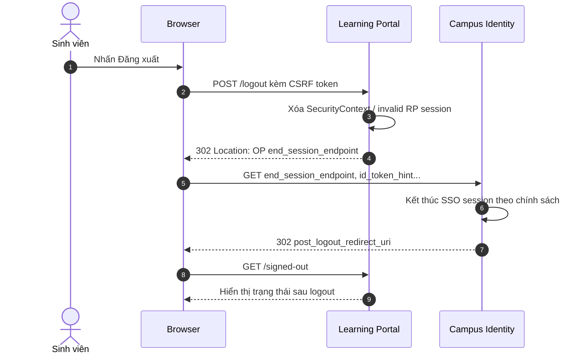
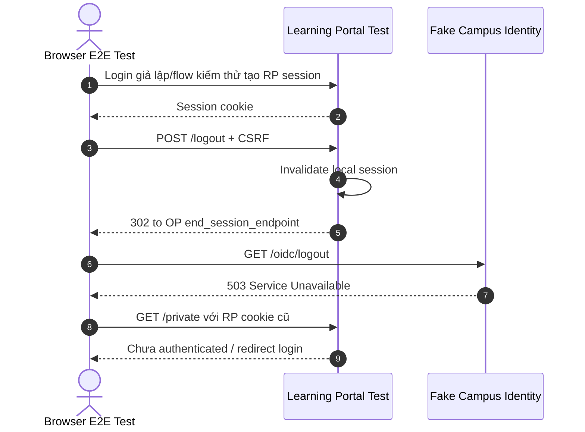

# 24.12. Kiểm thử logout khi provider lỗi hoặc phiên ứng dụng đã hết hạn

## Mục tiêu bài học

Sau khi hoàn thành bài học, bạn có thể:

- Phân biệt **logout cục bộ tại ứng dụng (Relying Party/RP)** với **OpenID Connect RP-Initiated Logout** tại OpenID Provider (OP).
- Thiết kế kiểm thử cho các tình huống OP không truy cập được, OP trả lỗi, thiếu `end_session_endpoint`, cấu hình `post_logout_redirect_uri` sai hoặc callback sau logout không xảy ra.
- Hiểu vì sao **logout thành công ở ứng dụng không có nghĩa logout SSO thành công ở provider**, và vì sao việc redirect đến OP không chứng minh OP đã kết thúc phiên.
- Kiểm thử trường hợp **HTTP session/WebSession đã timeout hoặc bị invalidate** trước khi người dùng nhấn Đăng xuất; hiểu hậu quả khi không còn `OidcUser` và **ID Token hint**.
- Cấu hình và kiểm thử `OidcClientInitiatedLogoutSuccessHandler` trên **Servlet** và `OidcClientInitiatedServerLogoutSuccessHandler` trên **Reactive/WebFlux**.
- Phân biệt các lớp kiểm thử: unit test cho handler, MockMvc/WebTestClient cho Spring Security, HTTP stub cho provider và browser end-to-end cho chuỗi redirect/cookie.
- Thiết kế fallback an toàn khi không thể thực hiện OP logout: phiên cục bộ phải được xử lý đúng, không hứa SSO đã kết thúc và không tạo vòng redirect tự động.
- Kiểm tra CSRF, session fixation, cookie, authorized-client/token persistence và tác động tới Resource Server khi logout lỗi.
- Tạo bảng test matrix, metric và kịch bản lỗi có thể tái hiện mà không ghi `id_token`, access token, refresh token hoặc cookie phiên vào log.

---

## 1. Bài toán thực tế: nhấn Đăng xuất nhưng provider không phản hồi

Giả sử **Learning Portal** là ứng dụng Spring Boot dùng **Campus Identity** làm OpenID Provider.

Sinh viên đã đăng nhập:

```text
Browser
   -> Learning Portal (RP): session S1
   -> Campus Identity (OP): SSO session P1
```

Người dùng nhấn nút Đăng xuất. Portal muốn:

1. Kết thúc session S1 tại Learning Portal.
2. Chuyển trình duyệt đến logout endpoint của Campus Identity để kết thúc SSO session P1.
3. Khi OP hoàn tất, chuyển browser về trang `/signed-out` của Portal.

Luồng mong muốn:



Nhưng thực tế có thể xảy ra:

- Campus Identity đang bảo trì; browser nhận HTTP 503.
- DNS, TLS hoặc network không truy cập được OP.
- OP thiếu `end_session_endpoint` trong metadata.
- OP không chấp nhận `post_logout_redirect_uri` đã gửi.
- RP session S1 đã timeout trước khi người dùng bấm Đăng xuất.
- OP còn SSO session khác hoặc yêu cầu người dùng chọn tài khoản để logout.
- Người dùng đóng tab ngay sau khi Portal trả redirect.
- Trình duyệt chặn cookie/redirect, hoặc reverse proxy làm sai URL.
- Người dùng quay lại Portal; OP SSO còn sống và có thể cho đăng nhập lại ngay.

Đây là lý do phải kiểm thử **nhiều ranh giới hệ thống**, không chỉ assert rằng POST `/logout` trả HTTP 302.

> **Nguyên tắc:** Hoàn tất local logout và hoàn tất OP logout là **hai kết quả cần quan sát riêng**. Không báo “Bạn đã đăng xuất khỏi mọi ứng dụng” nếu mới xác minh được session cục bộ của Portal đã mất.

## 2. Phân biệt bốn vòng đời liên quan

| Đối tượng | Nơi quản lý | Hậu quả khi kết thúc |
| --- | --- | --- |
| **RP session** | Learning Portal / Servlet HTTP session hoặc WebFlux WebSession | Browser không còn Authentication cục bộ |
| **OP SSO session** | Campus Identity | Có thể cần xác thực lại với OP tùy các ứng dụng và chính sách |
| **OAuth2AuthorizedClient** | RP repository/service | State của access token/refresh token được tải hoặc xóa theo policy |
| **Access Token/Refresh Token phía AS** | Campus Identity/Authorization Server | Có thể còn hiệu lực cho đến expiry hoặc token revocation |

Ví dụ:

```text
RP session S1 bị xóa            = TRUE
OP SSO session P1 còn sống      = TRUE
Access Token AT1 vẫn còn hạn    = TRUE
Authorized Client record còn DB = TRUE
```

Bốn điều này **có thể cùng xảy ra** nếu ứng dụng không áp dụng chính sách dọn state hoặc revoke thích hợp.

### 2.1. Local logout khác RP-Initiated Logout

**Local logout** là thao tác Spring Security tại RP, ví dụ:

```text
SecurityContextLogoutHandler
  -> xóa SecurityContext
  -> invalidate HTTP session theo cấu hình
```

**OIDC RP-Initiated Logout** là yêu cầu RP dẫn browser đến **OP logout endpoint** để yêu cầu kết thúc OP session. OP có thể cần `id_token_hint`, `client_id`, `post_logout_redirect_uri` hoặc các tham số khác theo đặc tả/chính sách provider.

Một logout success handler ở RP thường tạo **redirect URL**, không tự xác nhận OP đã xử lý yêu cầu thành công.

### 2.2. Token revocation không tự xảy ra

`OidcClientInitiatedLogoutSuccessHandler` **không phải** một Token Revocation Client. Nếu muốn revoke access token/refresh token, phải thiết kế thêm yêu cầu tới **Token Revocation Endpoint** của AS hoặc cơ chế provider hỗ trợ.

Không suy ra:

```text
POST /logout trả 302
   -> tất cả access token cũ đã bị thu hồi
```

Đặc biệt với JWT Access Token được Resource Server xác minh offline, token có thể tiếp tục được chấp nhận đến khi hết hạn nếu không có cơ chế thu hồi hiệu lực.

### 2.3. Back-channel logout là flow khác

**OIDC Back-Channel Logout** đi theo hướng:

```text
OP -> gửi Logout Token đến RP
```

Nó khác với:

```text
RP -> trả redirect để browser gọi OP logout endpoint
```

Khi OP mất kết nối, Back-Channel Logout có thể bị chậm hoặc không đến RP. Kiểm thử callback từ OP và kiểm thử RP-Initiated Logout phải là **hai nhóm riêng**, vì các điểm thất bại và ràng buộc bảo mật khác nhau.

## 3. Có những loại lỗi provider nào?

Để thiết kế test chính xác, hãy xác định **thời điểm** lỗi xảy ra.

| Thời điểm | Ví dụ | RP có biết ngay? | Cần loại kiểm thử nào? |
| --- | --- | --- | --- |
| **Cấu hình/khởi động** | OIDC discovery thất bại | Có thể biết ngay khi khởi tạo registration | Configuration/startup test |
| **Xây logout URL tại RP** | Metadata không có `end_session_endpoint` | Có, nếu handler đọc metadata cục bộ | Unit/MockMvc/WebTestClient |
| **Browser chuyển đến OP** | DNS fail, TLS fail, network timeout | **Không nhất thiết**; RP đã trả 302 | Browser/E2E/network test |
| **OP xử lý logout** | HTTP 400/403/500/503 | Browser thấy; RP thường không thấy như response của POST `/logout` | Stub OP + browser test |
| **OP redirect trở lại** | `post_logout_redirect_uri` không đăng ký | Có thể không có callback về RP | E2E + cấu hình provider |
| **Sau logout** | Browser truy cập trang protected và OP còn SSO | RP nhận một login flow mới | E2E, cookie/session test |
| **Session cục bộ đã hết hạn** | Không còn Authentication/ID Token | RP có thể biết request anonymous | MockMvc/WebTestClient/session test |

### 3.1. Nhầm lẫn phổ biến: “Mock OP trả 500 thì POST /logout tại RP cũng phải trả 500”

Trong RP-Initiated Logout kiểu redirect:

```text
POST https://portal.example.org/logout
    -> RP trả 302 Location: https://login.example.org/logout?...

GET https://login.example.org/logout?...
    -> OP trả 500
```

Đây là **hai HTTP requests khác nhau**. Response 500 của OP thường xuất hiện **sau khi** browser đã rời RP. RP không thể tự đổi status 302 đã gửi trước đó thành 500.

Vì vậy, một test chỉ dùng `MockMvc` gọi POST `/logout` **không thể chứng minh** OP đang hoạt động; nó chỉ kiểm tra redirect URL và local session behavior.

### 3.2. Metadata lỗi có thể được phát hiện ở giai đoạn khác

Nếu cấu hình:

```yaml
provider:
  campus:
    issuer-uri: https://login.example.org/realms/campus
```

Spring có thể cần tải OIDC Discovery Metadata để xây `ClientRegistration`. Khi OP unreachable **ngay lúc ứng dụng khởi động**, việc tạo registration có thể thất bại. Đó là **startup/configuration failure**, khác với trường hợp OP sập **sau khi user đã đăng nhập**, trong khi RP vẫn có metadata đã tải/cấu hình.

Đừng viết một test giả lập OP chết lúc logout rồi mong ứng dụng tự gọi discovery trong chính request logout, nếu implementation không làm như vậy.

## 4. Kịch bản thành công cần có trước khi kiểm thử lỗi

Một test baseline tốt phải xác nhận cả local logout và provider redirect.

```text
Given:
    User đã login OIDC với registration campus
    RP session S1 active
    OP công bố end_session_endpoint
    ID Token còn được lưu trong OidcUser

When:
    Browser POST /logout kèm CSRF token

Then:
    RP session S1 không còn được dùng để truy cập protected page
    Location trỏ tới OP end_session_endpoint tin cậy
    id_token_hint tương ứng ID Token của đúng login, khi áp dụng
    post_logout_redirect_uri là URL đã được cấu hình/cho phép
    Browser được OP redirect về RP nếu OP xử lý thành công
```

Phần `Then` cuối **không thể chỉ kiểm bằng unit test handler**. Test handler và test browser có trách nhiệm khác nhau.

### 4.1. Những dữ liệu của flow logout

Một RP-Initiated Logout URL minh họa:

```text
https://login.example.org/realms/campus/protocol/openid-connect/logout
    ?id_token_hint=<id-token>
    &post_logout_redirect_uri=https%3A%2F%2Fportal.example.org%2Fsigned-out
```

Các tham số được provider chấp nhận có thể khác theo OIDC implementation. Với provider tuân chuẩn hiện đại, có thể còn có `client_id`, `state`, `logout_hint` tùy contract. Không bắt buộc mọi OP có cùng query string.

**ID Token là credential chứa claims; nếu được dùng làm `id_token_hint` trong redirect, tránh ghi đầy đủ Location header vào log/tracing.**

## 5. Cấu hình Servlet OIDC Logout

Spring Security Servlet cung cấp:

```java
OidcClientInitiatedLogoutSuccessHandler
```

để xây redirect đến OP end-session endpoint dựa trên ClientRegistration và Authentication hiện tại.

### 5.1. Cấu hình Spring Boot ClientRegistration

Ví dụ:

```yaml
spring:
  security:
    oauth2:
      client:
        registration:
          campus:
            provider: campus
            client-id: ${CAMPUS_CLIENT_ID}
            client-secret: ${CAMPUS_CLIENT_SECRET}
            client-authentication-method: client_secret_basic
            authorization-grant-type: authorization_code
            redirect-uri: "{baseUrl}/login/oauth2/code/{registrationId}"
            scope:
              - openid
              - profile
              - email
        provider:
          campus:
            issuer-uri: https://login.example.org/realms/campus
```

Các giá trị là minh họa. `issuer-uri` phục vụ discovery khi OP hỗ trợ và cấu hình provider phù hợp.

### 5.2. SecurityFilterChain với handler

```java
@Configuration
class OidcLogoutConfiguration {

    @Bean
    SecurityFilterChain securityFilterChain(
            HttpSecurity http,
            ClientRegistrationRepository registrations)
            throws Exception {

        OidcClientInitiatedLogoutSuccessHandler oidcLogout =
            new OidcClientInitiatedLogoutSuccessHandler(
                registrations
            );

        oidcLogout.setPostLogoutRedirectUri(
            "{baseUrl}/signed-out"
        );

        oidcLogout.setDefaultTargetUrl("/signed-out");

        http
            .authorizeHttpRequests(auth -> auth
                .requestMatchers(
                    "/", "/signed-out", "/error",
                    "/assets/**"
                ).permitAll()
                .anyRequest().authenticated()
            )
            .oauth2Login(Customizer.withDefaults())
            .logout(logout -> logout
                .logoutUrl("/logout")
                .logoutSuccessHandler(oidcLogout)
            );

        return http.build();
    }
}
```

Ý nghĩa:

- Spring Security `LogoutFilter` xử lý request logout hợp lệ và gọi các logout handlers để làm sạch state cục bộ.
- `OidcClientInitiatedLogoutSuccessHandler` xử lý **điểm đến sau local logout**.
- `{baseUrl}/signed-out` là callback RP mà OP có thể redirect về khi logout thành công.
- `setDefaultTargetUrl("/signed-out")` cung cấp một đích cục bộ khi handler không xây được OP logout redirect theo bối cảnh; kiểm thử hành vi thực tế của phiên bản đang dùng.
- `/signed-out` phải truy cập được khi **không còn Authentication**.

**Giữ CSRF protection:** với Spring Security browser session thông thường, `POST /logout` cần CSRF token. Một GET request đến `/logout` có thể chỉ hiển thị trang xác nhận hoặc bị chặn tùy cấu hình.

### 5.3. Đừng dùng callback login làm callback logout

Ví dụ sai về ý nghĩa:

```text
/login/oauth2/code/campus
```

là endpoint xử lý **Authorization Code** sau login, không phải trang để OP quay lại sau logout.

Ví dụ hợp lý:

```text
/signed-out
```

Đăng ký URL này tại OP theo chính sách `post_logout_redirect_uri` nếu provider yêu cầu.

### 5.4. Đừng nhầm localhost và public base URL

Nếu Portal ở sau reverse proxy:

```text
Public:
https://portal.example.org

Internal:
http://portal-service:8080
```

`{baseUrl}` cần được Spring xác định đúng từ forwarded headers **đã được proxy tin cậy kiểm soát**. Nếu OP đã đăng ký public HTTPS URI mà RP phát sinh HTTP internal URI, OP có thể từ chối logout redirect.

Không tin arbitrary `X-Forwarded-Host` do client công khai gửi để tạo `post_logout_redirect_uri`; phải cấu hình proxy/forward headers an toàn.

## 6. Bài kiểm thử đơn vị cho logout success handler

**Mục đích:** xác định handler có tạo redirect URL đúng khi có OIDC Authentication và provider metadata phù hợp.

Kiểm thử cấp handler không cần mở browser hoặc gọi OP thật.

### 6.1. Tạo ClientRegistration test có end-session endpoint

Ví dụ JUnit 5 / Spring Security 6.x (lược import):

```java
private ClientRegistration campusRegistration() {
    return ClientRegistration.withRegistrationId("campus")
        .clientId("portal-test-client")
        .clientSecret("test-secret-only")
        .clientAuthenticationMethod(
            ClientAuthenticationMethod.CLIENT_SECRET_BASIC
        )
        .authorizationGrantType(
            AuthorizationGrantType.AUTHORIZATION_CODE
        )
        .redirectUri(
            "{baseUrl}/login/oauth2/code/{registrationId}"
        )
        .scope("openid", "profile")
        .authorizationUri(
            "https://idp.test.example/authorize"
        )
        .tokenUri(
            "https://idp.test.example/token"
        )
        .jwkSetUri(
            "https://idp.test.example/jwks"
        )
        .issuerUri(
            "https://idp.test.example"
        )
        .providerConfigurationMetadata(
            Map.of(
                "end_session_endpoint",
                "https://idp.test.example/oidc/logout"
            )
        )
        .clientName("Campus Test")
        .build();
}
```

Test cố ý tạo `ClientRegistration` cục bộ, **không dùng `ClientRegistrations.fromIssuerLocation(...)`** để tránh phụ thuộc network/discovery trong unit test.

Những API builder có thể khác nhẹ giữa các dòng Spring Security. Khi áp dụng trong dự án, đối chiếu version thực tế và imports.

### 6.2. Tạo OIDC Authentication dùng ID Token giả

```java
private Authentication oidcAuthentication() {
    Instant now = Instant.now();

    OidcIdToken idToken = new OidcIdToken(
        "header.payload.signature",
        now.minusSeconds(30),
        now.plusSeconds(300),
        Map.of(
            "iss", "https://idp.test.example",
            "sub", "student-123",
            "aud", List.of("portal-test-client")
        )
    );

    OidcUser user = new DefaultOidcUser(
        List.of(new SimpleGrantedAuthority("ROLE_USER")),
        idToken
    );

    return new OAuth2AuthenticationToken(
        user,
        user.getAuthorities(),
        "campus"
    );
}
```

Đây là fixture dùng để kiểm tra **logout redirect construction**; raw token giả không có chữ ký thật nên **không dùng để test OIDC Login/JWS validation**.

### 6.3. Assert handler xây đúng redirect

```java
@Test
void redirectsToOidcEndSessionEndpoint() throws Exception {
    ClientRegistration registration = campusRegistration();

    ClientRegistrationRepository registrations =
        new InMemoryClientRegistrationRepository(
            registration
        );

    OidcClientInitiatedLogoutSuccessHandler handler =
        new OidcClientInitiatedLogoutSuccessHandler(
            registrations
        );

    handler.setPostLogoutRedirectUri(
        "{baseUrl}/signed-out"
    );

    MockHttpServletRequest request =
        new MockHttpServletRequest("POST", "/logout");

    request.setScheme("https");
    request.setServerName("portal.test.example");
    request.setServerPort(443);

    MockHttpServletResponse response =
        new MockHttpServletResponse();

    handler.onLogoutSuccess(
        request,
        response,
        oidcAuthentication()
    );

    String location = response.getRedirectedUrl();

    assertThat(location)
        .startsWith("https://idp.test.example/oidc/logout?");

    assertThat(location)
        .contains("id_token_hint=");

    assertThat(location)
        .contains("post_logout_redirect_uri=");
}
```

**Điều test này chứng minh:** Handler tìm được metadata OP, dùng registration của Authentication và tạo `Location` chứa logout URI.

**Điều test này không chứng minh:** Campus Identity đã nhận request, xóa SSO cookie, trả post-logout callback hay revoke bất kỳ token nào.

### 6.4. Không assert nguyên URL theo thứ tự tham số

Query parameter order không phải tiêu chí nghiệp vụ. Trong test bền vững hơn, parse URI và assert:

```text
scheme == https
host == idp.test.example
path == /oidc/logout
id_token_hint == token test
post_logout_redirect_uri == https://portal.test.example/signed-out
```

Nếu callback URI bị percent-encode, dùng URI parser phù hợp trước khi so sánh. Không so sánh chuỗi literal chứa token thật, và đừng để test failure dump toàn bộ ID Token vào CI logs.

## 7. Kiểm thử khi provider thiếu `end_session_endpoint`

Một OP có thể hỗ trợ OIDC Login nhưng không công bố logout endpoint tiêu chuẩn, hoặc metadata được cấu hình thiếu.

Tạo registration test:

```java
ClientRegistration registration =
    ClientRegistration.withRegistrationId("campus")
        .clientId("portal-test-client")
        .clientSecret("test-secret-only")
        .authorizationGrantType(
            AuthorizationGrantType.AUTHORIZATION_CODE
        )
        .redirectUri(
            "{baseUrl}/login/oauth2/code/{registrationId}"
        )
        .authorizationUri(
            "https://idp.test.example/authorize"
        )
        .tokenUri(
            "https://idp.test.example/token"
        )
        .jwkSetUri(
            "https://idp.test.example/jwks"
        )
        .issuerUri(
            "https://idp.test.example"
        )
        .scope("openid")
        .build();
```

Ở registration này không có metadata `end_session_endpoint`.

### 7.1. Kỳ vọng

- **Local logout không bị đảo ngược** chỉ vì OP không cung cấp logout endpoint.
- Không redirect đến URL OP được tự suy đoán như `issuer + "/logout"` nếu provider không cho biết endpoint đó.
- Handler nên sử dụng fallback cục bộ phù hợp, hoặc ứng dụng có error handling rõ ràng nếu version/implementation không hỗ trợ fallback mong muốn.
- Browser không tiếp tục coi mình authenticated vào RP.
- UI không tuyên bố chắc chắn OP SSO đã kết thúc.

### 7.2. Một test tập trung

```java
@Test
void missingEndSessionEndpointFallsBackLocally()
        throws Exception {

    OidcClientInitiatedLogoutSuccessHandler handler =
        new OidcClientInitiatedLogoutSuccessHandler(
            registrationsWithoutEndSessionEndpoint
        );

    handler.setDefaultTargetUrl("/signed-out");

    MockHttpServletRequest request =
        new MockHttpServletRequest("POST", "/logout");

    MockHttpServletResponse response =
        new MockHttpServletResponse();

    handler.onLogoutSuccess(
        request, response, oidcAuthentication()
    );

    assertThat(response.getRedirectedUrl())
        .isEqualTo("/signed-out");
}
```

Ví dụ giả định repository được tạo từ registration thiếu endpoint và OIDC Authentication dùng registration ID `campus`. Cần kiểm tra hành vi chính xác của handler trong version Spring Security dự án; nếu provider có chính sách logout riêng, triển khai fallback chuyên biệt ở tầng ứng dụng thay vì thay metadata bằng URL đoán.

## 8. Provider HTTP 500/503: kiểm thử ở đúng ranh giới

Giả sử Portal trả:

```http
HTTP/1.1 302 Found
Location: https://idp.test.example/oidc/logout?...
```

Browser đi đến OP và OP trả:

```http
HTTP/1.1 503 Service Unavailable
```

Ứng dụng Portal **thường đã xóa local session trước khi redirect**, nhưng:

```text
OP SSO logout completed = UNKNOWN / FAILED
```

### 8.1. Test handler không nhìn thấy HTTP 503

Nếu test:

```java
handler.onLogoutSuccess(request, response, auth);
```

thì không có network call đến OP. Do vậy không thể mock response 503 bằng `MockRestServiceServer` gắn vào handler này rồi kỳ vọng lỗi trong method.

Muốn test lỗi ở OP, phải **cho browser hoặc HTTP client test tiếp tục follow redirect** đến một provider stub.

### 8.2. Mô hình test E2E bằng OP stub



Kỳ vọng **hai assertion độc lập**:

1. OP trả lỗi như đã inject.
2. RP session **đã bị vô hiệu**, không dùng được để truy cập dữ liệu protected.

Không để local logout thất bại chỉ vì network không đến được OP khi chính sách ứng dụng là kết thúc local session trước.

### 8.3. Stub server nên kiểm tra gì?

Một fake OP có thể:

- Trả `302` về `/signed-out`.
- Trả `400` khi callback URI không đăng ký.
- Trả `401` hoặc trang xác thực bổ sung.
- Trả `500`/`503` để mô phỏng sự cố.
- Giữ kết nối không phản hồi để mô phỏng timeout.
- Trả redirect tới host sai để test policy.
- Mô phỏng OP SSO cookie còn hoặc đã được xóa.

**Cảnh báo:** nếu chỉ dùng một HTTP client đơn giản follow redirect, việc cookie/SSO và navigation có thể không giống browser. Với test về cookie, SameSite, CSRF và URL navigation, nên dùng browser automation ở môi trường test.

## 9. Khi provider DNS/TLS/network lỗi

Các tình huống khác nhau:

```text
DNS NXDOMAIN
TLS certificate expired
TLS hostname mismatch
Connection refused
Connection timeout
Read timeout
Reverse proxy 502/504
```

Ở flow browser redirect:

```text
Portal POST /logout -> 302 thành công
Browser GET OP logout URL -> browser network error
```

### 9.1. Expected behavior

- Browser không còn session cục bộ hợp lệ ở Portal.
- Portal không thể kết luận SSO session OP đã kết thúc.
- Người dùng có thể quay lại Portal và đọc trang hướng dẫn.
- Không tự retry redirect vô hạn.
- Không hạ TLS verification hoặc đổi sang HTTP không mã hóa.
- Nếu retry logout ở OP, phải thiết kế phù hợp với provider; không phát tán ID Token qua nhiều domain.

### 9.2. Test các failure mode

| Fault injection | Quan sát mong đợi |
| --- | --- |
| DNS OP không resolve | Browser báo network error, RP session đã logout |
| TCP connection refused | Không còn quyền vào protected RP URL |
| TLS certificate invalid | Không vượt qua TLS; không bỏ certificate validation |
| OP 503 | Không có OP callback, local logout vẫn duy trì |
| OP trả HTML error | Không parse thành OIDC callback thành công |
| OP redirect loop | Browser test phát hiện giới hạn redirects; RP không tạo lại session khi chưa có OIDC Login |
| OP redirect sang domain lạ | Không coi đây là dấu hiệu logout thành công; kiểm tra provider policy |
| Browser đóng tab | Local session vẫn phải hết nếu POST logout đã được RP xử lý |

Một test provider outage thực tế cần **tách hai pha**:

1. **Login khi OP còn hoạt động** để tạo S1.
2. **Cho OP lỗi sau đó**, rồi thực hiện logout.

Nếu OP đã chết trước login và RP không có metadata, test không còn đánh giá đúng tình huống “logout sau khi login”.

## 10. Khi OP trả lỗi `post_logout_redirect_uri`

Một OP có thể từ chối:

```text
post_logout_redirect_uri=https://portal.example.org/signed-out
```

nếu URI chưa được đăng ký, không khớp scheme/host/path hoặc OP yêu cầu client identification theo chuẩn.

Kịch bản:

```text
RP -> 302 end_session_endpoint?post_logout_redirect_uri=...
OP -> 400 invalid_redirect_uri
Browser không trở lại /signed-out
```

Cần test:

- RP tạo đúng **public HTTPS URI**.
- URI nằm trong allowlist/registration của OP.
- Scheme/hostname/path/port khớp chính xác chính sách OP.
- Không lấy URI đích từ query parameter do user tùy ý chỉ định.
- Khi OP từ chối URI, local RP session vẫn không được coi là đang đăng nhập.
- Browser có thể nhận trang lỗi OP, không có callback về RP.

### 10.1. Tại sao không lấy URI động từ `returnTo`?

Một thiết kế đáng tránh:

```text
POST /logout?returnTo=https://untrusted.example/collect
```

rồi đưa nguyên `returnTo` thành:

```text
post_logout_redirect_uri
```

Nếu không allowlist, RP có thể tạo open redirect hoặc phát tán `id_token_hint` qua URL/Referer/log sai chỗ.

Tốt hơn là dùng URL được cấu hình cố định:

```java
oidcLogout.setPostLogoutRedirectUri(
    "{baseUrl}/signed-out"
);
```

và bảo vệ forwarded headers/reverse proxy. Nếu cần nhiều callback, phải có mapping cố định theo ClientRegistration và mục đích, không tin URL tùy ý từ browser.

## 11. Trường hợp phiên ứng dụng đã timeout trước khi người dùng nhấn Logout

Đây là case quan trọng nhất của đề bài.

Người dùng login lúc 09:00:

```text
RP session S1 valid
SecurityContext chứa OIDC Authentication
OidcUser chứa ID Token
```

Sau 30 phút không hoạt động:

```text
09:30
RP session S1 expired
SecurityContext / OidcUser không còn truy xuất được
Browser vẫn có thể giữ cookie JSESSIONID cũ
OP SSO session P1 có thể còn sống
```

Đến 09:40, user nhấn nút Đăng xuất:

```text
POST /logout với cookie S1 cũ
```

### 11.1. Điều gì đã thay đổi?

Khi session S1 đã timeout, RP có thể nhận request như **anonymous**. `OidcClientInitiatedLogoutSuccessHandler` không còn OIDC Authentication để đọc:

```text
registrationId
OidcUser
ID Token
id_token_hint
```

Nó **không thể tự phục hồi** ID Token đã bị xóa chỉ vì browser vẫn gửi Session ID cũ.

### 11.2. Kỳ vọng an toàn

1. Không tạo lại session S1 chỉ để “logout cho xong”.
2. Không báo local logout thất bại nếu S1 vốn đã hết hiệu lực.
3. Không gửi `id_token_hint` của **một user khác** hoặc access token từ global cache.
4. Có thể đưa browser về trang `/signed-out` hoặc `/session-expired` phù hợp.
5. Nói rõ OP SSO có thể vẫn tồn tại nếu không thực hiện được OP logout.
6. Không vô hiệu hóa CSRF một cách tùy tiện trên toàn ứng dụng để vượt lỗi POST logout.
7. Không tự redirect loop giữa RP logout, OP SSO và OIDC Login.

> **Kết luận:** Khi RP session đã hết hạn, local logout có thể xem là một thao tác **idempotent** về trạng thái cục bộ, nhưng RP **không có đủ dữ liệu** để cam kết OP logout theo cùng cách lúc OIDC Authentication còn sống.

## 12. CSRF khi session đã hết hạn: vì sao POST /logout có thể trả 403?

Trong browser session model thông thường, CSRF token có thể được lưu trong session hoặc được ràng buộc với session hiện tại.

Sau khi session hết hạn:

```text
Cookie JSESSIONID cũ
CSRF token trong HTML cũ
Session không còn
```

Browser gửi:

```http
POST /logout HTTP/1.1
Cookie: JSESSIONID=old-session
X-CSRF-TOKEN: old-csrf-token
```

Spring Security có thể từ chối **trước khi LogoutFilter thực hiện logout** nếu CSRF token không còn hợp lệ.

### 12.1. Vì sao điều này không phải lỗi OP?

OP chưa được gọi. Đây là **inbound request validation tại RP**.

Một test đúng phải phân biệt:

```text
POST /logout -> 403 CSRF
```

với:

```text
POST /logout -> 302 OP
Browser -> OP -> 503
```

Hai sự cố xảy ra ở các tầng khác nhau, cần thông báo và hướng xử lý khác nhau.

### 12.2. Có nên `.csrf().disable()` chỉ để logout được sau timeout?

Không nên. Nếu tắt CSRF trên toàn bộ browser session application, có thể mở ra các rủi ro cho nhiều endpoint thay đổi trạng thái.

Một thiết kế UX hợp lý:

- Khi session hết hạn, UI nhận HTTP 401/403/expired status.
- Cho phép browser **đi đến trang công khai** `/session-expired` hoặc `/signed-out`.
- Nếu người dùng muốn thử logout OP, cung cấp hướng dẫn/flow phù hợp với OP.
- Không cần thực hiện lại một POST logout cục bộ nếu phiên đã mất.
- Không tiết lộ dữ liệu bảo mật trong thông báo lỗi.

### 12.3. Phân biệt CSRF failure và expired session

Một HTTP 403 không đủ chứng minh nguyên nhân là session expired. Nó có thể do:

```text
CSRF token sai
User thiếu quyền
Security filter khác từ chối
Reverse proxy làm mất cookie/header
```

Do vậy, endpoint/UI nên nhận error code theo chính sách riêng và server logs chỉ ghi metadata an toàn. Đừng gán mọi 403 thành “đã đăng xuất khỏi tài khoản”.

## 13. Unit test khi Authentication không còn

Test trực tiếp handler với Authentication `null`:

```java
@Test
void missingAuthenticationUsesLocalFallback()
        throws Exception {

    OidcClientInitiatedLogoutSuccessHandler handler =
        new OidcClientInitiatedLogoutSuccessHandler(
            registrations
        );

    handler.setDefaultTargetUrl("/signed-out");

    MockHttpServletRequest request =
        new MockHttpServletRequest("POST", "/logout");

    MockHttpServletResponse response =
        new MockHttpServletResponse();

    handler.onLogoutSuccess(
        request,
        response,
        null
    );

    assertThat(response.getRedirectedUrl())
        .isEqualTo("/signed-out");
}
```

**Mục đích:** xác minh handler không cố đọc `OidcUser.getIdToken()` khi không có OIDC principal và có fallback cục bộ.

Nếu một Spring Security version có cách xử lý anonymous/exception khác, cần điều chỉnh custom fallback trong ứng dụng và test chính sách đó; không coi class framework bắt buộc phải có chính xác cùng behavior ở mọi version.

### 13.1. Một Authentication không phải OIDC

Cũng cần test:

```java
Authentication nonOidc =
    new UsernamePasswordAuthenticationToken(
        "student",
        null,
        List.of(
            new SimpleGrantedAuthority("ROLE_USER")
        )
    );
```

Handler không được đưa một token tưởng tượng vào `id_token_hint` chỉ vì Authentication hợp lệ theo Spring Security. OIDC RP-Initiated Logout cần ngữ cảnh OIDC đúng.

### 13.2. OIDC Authentication thiếu registration

Có thể xảy ra cấu hình sai:

```text
Authentication là OAuth2AuthenticationToken
registrationId = campus-old
ClientRegistrationRepository chỉ có campus
```

Test cần bảo đảm ứng dụng:

- Không chọn ngẫu nhiên registration khác.
- Không redirect đến OP do request tự khai.
- Có error/fallback rõ ràng.
- Không làm sống lại RP session đã được logout.

Trong hệ thống multi-provider, tránh “nếu không tìm thấy campus-old thì dùng provider đầu tiên”; đó là nguy cơ gửi ID Token/Logout Hint đến OP không đúng.

## 14. Integration test: session hết hạn trước POST logout

Unit test với `Authentication=null` **không chứng minh** toàn bộ Spring Security filter chain xử lý đúng cookie và CSRF sau timeout.

Cần integration test theo tầng:

```text
1. Login để tạo RP session S1.
2. Xác minh S1 truy cập được /private.
3. Cho S1 hết hạn qua session store/clock test hoặc invalidate.
4. Browser giữ cookie cũ.
5. Gửi POST /logout hoặc truy cập trang logout.
6. Kiểm tra response theo policy.
7. Xác minh /private không truy cập được bằng cookie S1.
8. Xác minh không có OP redirect với id_token_hint của user khác.
```

### 14.1. MockMvc mô phỏng session cũ

Trong unit/integration test Servlet có thể tạo:

```java
MockHttpSession session = new MockHttpSession();
session.setAttribute("example", "test");
session.invalidate();
```

Nhưng **đừng dùng một session đã invalidate** rồi kỳ vọng mọi API của `MockHttpServletRequest` hoạt động giống container thật khi nó được gắn lại. `MockMvc` không mô phỏng đầy đủ TTL của Servlet container và browser cookies.

Để test timeout thực tế, có thể dùng:

- Test server HTTP thật với session timeout ngắn ở môi trường kiểm thử.
- Spring Session repository test với thời gian/clock có thể điều khiển.
- Container integration test có cookie và session lifecycle.
- Mock riêng boundary “không còn Authentication” để kiểm tra handler độc lập.

### 14.2. Tránh `Thread.sleep(...)` để chờ session hết hạn

Test:

```java
Thread.sleep(31_000);
```

là cách chậm, dễ flaky và không chứng minh registry/session store chạy đúng dưới đồng hồ/cluster thật.

Tốt hơn:

```text
Fake/controllable clock
Test session repository với expiration controllable
Invalidate explicit session cho path test trạng thái mất
Integration test riêng cho TTL ở container
```

Khi dùng Spring Session Redis/JDBC, cần hiểu TTL index/cleanup event có thể **không xảy ra đúng mili-giây**, nên test tính đúng chính sách thay vì assert một thời điểm tuyệt đối.

### 14.3. Không tự phục hồi OIDC ID Token từ request cũ

Nếu RP session đã mất, không nên đọc cookie cũ rồi đoán principal name để tải ID Token người dùng khác, cũng không gửi lại token cũ từ cache global.

Muốn hỗ trợ SSO logout sau local-session timeout, phải có thiết kế riêng **có căn cứ xác thực và tương thích OP**. Đừng biến “cần logout” thành lý do cho phép unauthenticated caller chọn subject/token của người khác.

## 15. Servlet integration test với MockMvc: những gì cần kiểm tra

`MockMvc` hữu ích để test security filter chain **không cần browser thật**.

### 15.1. Test POST logout hợp lệ

Với Spring Security Test:

```java
@Autowired
MockMvc mvc;

@Test
void logoutRequiresValidCsrfAndClearsLocalAuthentication()
        throws Exception {

    mvc.perform(
            post("/logout")
                .with(csrf())
                .with(oidcLogin())
        )
        .andExpect(status().is3xxRedirection());
}
```

Đây là ví dụ **kiểm tra hướng của request và handler**. `oidcLogin()` mô phỏng authenticated principal; nó **không tự chạy** OIDC Authorization Code callback hoặc OP HTTP logout.

Để kiểm chứng session thực sự bị xóa, cần sử dụng session/security context từ request đầu hoặc tích hợp login fixture, sau đó gọi endpoint protected với **cùng session cookie** và assert không còn authenticated.

### 15.2. Test CSRF failure

```java
@Test
void logoutWithoutCsrfIsRejected()
        throws Exception {

    mvc.perform(
            post("/logout")
                .with(oidcLogin())
        )
        .andExpect(status().isForbidden());
}
```

Test giả định CSRF enabled với chính sách Spring Security browser session chuẩn. Nếu ứng dụng custom CSRF repository hoặc exception handling, mã status có thể khác, nhưng không được âm thầm thực hiện logout khi request không thỏa chính sách CSRF.

### 15.3. Test OP unavailable không nằm trong MockMvc alone

Nếu test chỉ:

```java
mvc.perform(post("/logout").with(csrf()))
    .andExpect(status().is3xxRedirection());
```

thì không chứng minh OP phục vụ redirect. Muốn kiểm tra OP 503 phải có một bước **HTTP GET đến OP stub** (hoặc browser navigation) sau response 302.

### 15.4. Test cookie của RP

Cần kiểm tra request với cookie S1 cũ sau logout:

```text
GET /private
Cookie: JSESSIONID=<old>

Expected:
  401 hoặc redirect login tùy application
  Không trả protected body
```

Không nhất thiết server luôn gửi `Set-Cookie: JSESSIONID=; Max-Age=0` trong mọi cấu hình; local session invalidation và browser cookie deletion có thể do container/logout configuration đảm nhiệm theo cách khác nhau. Quan trọng là **session ID cũ không còn cấp quyền**.

### 15.5. Test `id_token_hint` đúng user

Khi có hai OIDC identities:

```text
student A -> ID Token A
student B -> ID Token B
```

Logout request A không được tạo redirect chứa ID Token B. Test nên kiểm tra nguồn `OidcUser`/Authentication hiện tại, chứ không lấy token cuối cùng được xử lý ở singleton service.

## 16. Kiểm thử bằng browser và fake OP: toàn bộ chuỗi

Một test Browser E2E (Playwright, Selenium hoặc framework tương tự) có thể chạy cùng một OP stub phục vụ các endpoint:

```text
/.well-known/openid-configuration
/authorize
/token
/jwks
/oidc/logout
```

Khi đó có thể kiểm soát:

- Cookie OP SSO.
- `state`, `nonce` và callback login.
- ID Token fixture được ký hợp lệ bằng khóa test.
- Logout redirect behavior.
- OP 400/503/timeouts.
- Cookie cleanup và navigation của browser.

### 16.1. Flow baseline

```text
Login:
  browser -> /oauth2/authorization/campus
  fake OP -> authorization code
  RP -> token endpoint
  fake OP -> valid ID Token
  RP -> create S1

Logout:
  browser POST /logout + CSRF
  RP -> invalidate S1
  RP -> redirect OP end_session_endpoint
  OP -> clear SSO cookie and redirect /signed-out
```

### 16.2. Flow khi OP 503

```text
Login thành công
    -> OP stub đổi chế độ: end-session trả 503
    -> browser POST /logout
    -> RP trả redirect OP
    -> browser nhận OP 503
    -> browser quay lại RP /private
    -> RP yêu cầu login
```

Không khẳng định OP đã xóa SSO session sau 503. Một số OP có thể xử lý một phần trước khi gửi lỗi; đây là trạng thái **không xác định**, cần giải thích cẩn thận.

### 16.3. Flow khi OP không redirect về RP

Một OP có thể hoàn tất logout nhưng **không redirect** về `post_logout_redirect_uri` vì chính sách hoặc lỗi.

Kết quả:

```text
RP local logout: success
OP logout: may be success or unknown
Return navigation: failed
```

Do vậy test “browser không vào `/signed-out`” **không đủ để kết luận** OP logout thất bại. Phải quan sát fake OP session/cookies hoặc dùng các hợp đồng provider hỗ trợ.

### 16.4. Lưu ý mock OP và token signing

Nếu kiểm thử full OIDC Login thay vì inject `oidcLogin()`, OP giả phải phát ID Token đúng các điều kiện:

```text
iss = configured issuer
aud includes Client ID
exp/iat hợp lệ
JWS signature xác minh bằng JWKS giả
state/nonce đúng authorization request
```

Không tắt ID Token signature/issuer/audience/nonce validation chỉ để test logout thuận tiện. Nếu test cần bypass một phần login, hãy nói rõ đang dùng **mock authentication** và không xem đó là test full OIDC.

## 17. Spring Security WebFlux: logout handler và session hết hạn

Trên WebFlux/Reactive, Spring Security dùng:

```java
OidcClientInitiatedServerLogoutSuccessHandler
```

với:

```java
ReactiveClientRegistrationRepository
```

Không dùng lớp Servlet `OidcClientInitiatedLogoutSuccessHandler` trong một `SecurityWebFilterChain`.

### 17.1. Cấu hình reactive

```java
@Configuration
@EnableWebFluxSecurity
class ReactiveOidcLogoutConfig {

    @Bean
    SecurityWebFilterChain securityWebFilterChain(
            ServerHttpSecurity http,
            ReactiveClientRegistrationRepository registrations) {

        OidcClientInitiatedServerLogoutSuccessHandler oidcLogout =
            new OidcClientInitiatedServerLogoutSuccessHandler(
                registrations
            );

        oidcLogout.setPostLogoutRedirectUri(
            "{baseUrl}/signed-out"
        );

        http
            .authorizeExchange(exchanges -> exchanges
                .pathMatchers(
                    "/", "/signed-out", "/error"
                ).permitAll()
                .anyExchange().authenticated()
            )
            .oauth2Login(Customizer.withDefaults())
            .logout(logout -> logout
                .logoutSuccessHandler(oidcLogout)
            );

        return http.build();
    }
}
```

Các imports/dependencies phải đúng WebFlux (`ServerHttpSecurity`, `SecurityWebFilterChain`, `ReactiveClientRegistrationRepository`). Spring Boot có thể tự cấu hình các beans cần thiết khi starter và properties hợp lệ.

### 17.2. `Mono<Void>` và logout

Reactive logout success handler thao tác trên `WebFilterExchange` và `Authentication` theo reactive contract, trả một publisher đại diện cho response/redirect work. Không gọi `.block()` trong event-loop, không tự `.subscribe()` rồi trả success trước khi session invalidation hoàn thành.

### 17.3. WebSession timeout

Sau khi WebSession hết hạn:

```text
Reactive SecurityContext không còn
OIDC Authentication có thể null
IdTokenHint không có từ phiên cũ
```

Do đó Reactive handler cũng cần fallback hợp lý khi không còn OIDC principal. Tránh truy cập:

```java
authentication.getPrincipal()
```

mà không xét trường hợp anonymous/null trong custom reactive logout logic.

### 17.4. Kiểm thử WebTestClient

Ở mức WebFlux Security test:

```java
WebTestClient client = webTestClient
    .mutateWith(
        SecurityMockServerConfigurers.mockOidcLogin()
    );

client.post()
    .uri("/logout")
    .exchange()
    .expectStatus()
    .is3xxRedirection();
```

Đây là ví dụ ý tưởng khi test đã bind Spring Security WebFlux, CSRF được xử lý theo configurer/test fixture của project. Nếu CSRF enabled, cần gắn CSRF token hợp lệ cho request logout; không coi status 403 do thiếu CSRF là provider failure.

`mockOidcLogin()` mô phỏng OIDC Authentication **sau login**, không thực hiện thật Token Endpoint/JWKS validation. Muốn test OP 503 phải theo browser hoặc HTTP client đến stub OP.

### 17.5. Test reactive session store

Một bài integration test cần:

1. Tạo WebSession bằng OIDC Login hoặc fixture.
2. Kiểm tra `/private` truy cập được.
3. Invalidate/expire WebSession trong store hoặc qua clock test.
4. Gửi request giữ nguyên cookie `SESSION` cũ.
5. Xác nhận `/private` không còn truy cập được.
6. Thử logout và xác nhận fallback/status đúng.
7. Đảm bảo không tự tạo lại Authentication/ID Token cũ.

Khi sử dụng Spring Session Redis/R2DBC, phải kiểm tra expiration propagation và thời điểm dọn record, tránh phụ thuộc sleep cố định.

## 18. Provider không có end-session endpoint: nên làm gì?

Một OP không cung cấp `end_session_endpoint` có thể vẫn có cơ chế logout khác, nhưng **client không được tự suy đoán** đường dẫn tiêu chuẩn.

Có vài lựa chọn:

1. Chỉ thực hiện local logout, giải thích OP SSO có thể còn tồn tại.
2. Dùng cơ chế logout được provider **chính thức hỗ trợ** và cấu hình theo hợp đồng riêng.
3. Cung cấp đường dẫn hướng dẫn user đăng xuất trực tiếp tại OP khi phù hợp.
4. Kết hợp Token Revocation hoặc Back-Channel Logout nếu OP hỗ trợ và yêu cầu nghiệp vụ có cơ sở.

Không đưa user đến:

```text
https://login.example.org/unknown/logout
```

chỉ vì người phát triển đoán URL.

### 18.1. Chiến lược fallback

Một policy an toàn:

```text
Nếu có OIDC Authentication và OP end_session_endpoint:
    -> local logout
    -> redirect OP

Nếu Authentication không còn hoặc OP không có endpoint:
    -> local logout / bảo đảm request anonymous
    -> hiển thị trang thông tin /signed-out
    -> giải thích có thể cần đăng xuất SSO trực tiếp
```

Nếu sử dụng handler tùy biến, phải bảo đảm **một ngoại lệ trong việc xây redirect OP không khiến security context/session vừa logout bị sống lại**.

## 19. Thiết kế thông báo lỗi cho người dùng

Không nên có một thông báo duy nhất:

```text
Đăng xuất thành công khỏi tất cả dịch vụ.
```

cho mọi trường hợp. Thay vào đó, dùng các trạng thái phản ánh điều đã thực sự xác minh:

| Trạng thái quan sát | Thông báo gợi ý |
| --- | --- |
| RP session đã hết | “Bạn đã thoát khỏi Learning Portal.” |
| OP trả redirect thành công và test xác nhận SSO cookie đã xóa | “Đăng xuất khỏi Campus Identity đã hoàn tất.” |
| OP không truy cập được | “Bạn đã thoát khỏi Learning Portal. Hiện chưa thể xác nhận đăng xuất khỏi Campus Identity.” |
| RP session vốn đã hết hạn | “Phiên Learning Portal của bạn đã hết hạn. Bạn có thể đóng trang này.” |
| Logout bị CSRF reject | “Không thể xử lý yêu cầu này. Hãy tải lại trang hoặc đăng nhập lại.” |
| OP không có endpoint logout | “Bạn đã thoát khỏi Learning Portal; đăng xuất SSO có thể cần thực hiện riêng.” |

### 19.1. Tránh biến provider lỗi thành vòng redirect

Một mẫu nguy hiểm:

```text
OP trả 503
   -> frontend tự trở lại /logout
      -> RP redirect OP
         -> OP trả 503
            -> ...
```

Bảo vệ UX bằng cách:

- Không tự retry logout liên tục.
- Cung cấp trang công khai giải thích.
- Người dùng tự quyết định thử lại sau.
- Có giới hạn số lần retry nếu tích hợp browser logic.
- Không giữ token nhạy cảm trong URL của một “retry service” công khai.

### 19.2. Không yêu cầu người dùng gửi token để hỗ trợ

Khi user báo “logout bị lỗi”, tuyệt đối không yêu cầu họ copy:

```text
id_token_hint
access_token
refresh_token
JSESSIONID / SESSION cookie
Authorization header
```

Đây đều là credential hoặc dữ liệu nhạy cảm. Log/metric nên chỉ dùng correlation ID và loại lỗi.

## 20. Khi session expire giữa lúc logout đang diễn ra

Một race hiếm nhưng cần xét:

```text
T1: User POST /logout
T2: Session store expire S1
T3: LogoutFilter đang đọc SecurityContext
T4: OP redirect được xây hoặc fallback
```

Các vấn đề có thể xảy ra:

- Authentication null giữa các bước.
- Repository/session store ném exception nếu session đã bị invalidate.
- Custom logout handler chạy hai lần do retry.
- Response redirect đã được commit, callback không sửa được nữa.
- User mở hai tab và gửi hai POST logout gần đồng thời.

### 20.1. Mục tiêu tính idempotent

Local logout nên có tinh thần:

```text
logout(local state active) -> local state cleared
logout(local state absent) -> vẫn không có local state
```

Không cần khôi phục session cũ để thực hiện lần logout thứ hai.

Nhưng phải phân biệt:

```text
Local logout idempotence
```

với:

```text
OP logout protocol idempotence
```

OP có thể trả lỗi hoặc yêu cầu thông tin khi không còn SSO session. Không mặc định mọi OP chấp nhận lặp lại end-session request vô hạn.

### 20.2. Test hai lần logout

```text
Given user logged in:
    POST /logout lần 1 -> local session invalidated
    POST /logout lần 2 -> không còn Authentication
Then:
    Không tạo authenticated session mới
    Không gửi ID Token cũ của user khác
    Không trả protected content
    Hành vi CSRF/anonymous/fallback theo policy
```

Lần thứ hai có thể trả 403 vì CSRF cũ không hợp lệ; điều này không chứng minh local session còn sống. Nên test riêng CSRF boundary và post-logout anonymous state.

## 21. Kiểm thử khi logout và refresh token xảy ra cùng lúc

Trong hệ thống OAuth2 Client, background request có thể đang refresh access token:

```text
Request A: POST /logout của user
Request B: gọi Course API, cần refresh AT
```

Nếu authorized-client store tách khỏi session:

```text
Logout A làm mất RP session
Refresh B có thể vừa lưu AT2/RT2 vào database
```

### 21.1. Vì sao đây là vấn đề?

Nếu sản phẩm yêu cầu “logout xóa mọi authorized client của user”, một refresh request chạy muộn có thể **ghi lại token** sau khi cleanup đã diễn ra.

Giải pháp cần kiến trúc riêng:

- Version/generation của session/grant.
- Conditional save và invalidate marker.
- Atomic state transition hoặc lock theo principal/registration.
- Xóa token sau các background operations nếu phù hợp.
- Thu hồi grant tại OP khi chính sách yêu cầu.
- Không coi việc xóa cookie là đủ để chặn mọi background job.

### 21.2. Test concurrency

```text
Given:
    Store A/campus -> AT1/RT1

When:
    Request B bắt đầu refresh RT1, bị giữ trước save
    Request A logout, cleanup state
    Request B tiếp tục và cố save AT2/RT2

Then:
    Kết quả theo policy:
        không khôi phục grant sau logout
        hoặc có cơ chế invalidate/cleanup lại an toàn
```

Đừng để test chỉ assert response của `/logout` mà bỏ qua trạng thái database về sau.

## 22. Authorized-client repository: session và database khác nhau

| Store | Hành vi thường gặp khi RP session bị xóa | Điều phải kiểm thử |
| --- | --- | --- |
| `HttpSessionOAuth2AuthorizedClientRepository` | Authorized client gắn session có thể mất theo session | Không còn tải được token bằng session ID cũ |
| `AuthenticatedPrincipalOAuth2AuthorizedClientRepository` | Có thể delegate sang `OAuth2AuthorizedClientService` cho user authenticated | Có cleanup policy riêng khi logout |
| `JdbcOAuth2AuthorizedClientService` | Bản ghi có thể sống lâu hơn HTTP session | Không để token lưu vô hạn hoặc được user khác tải |
| Custom Redis/cache | Phụ thuộc key, TTL, eviction và quyền truy cập | Tách principal/registration/tenant và cleanup |
| Reactive `WebSession` | State có thể mất khi WebSession invalidated | Cookie SESSION cũ không tiếp tục được authenticated |
| Reactive `ReactiveOAuth2AuthorizedClientService` | Service state không phụ thuộc trực tiếp WebSession | Kiểm tra retention/revoke riêng |

### 22.1. Không tự xóa mọi OAuth2AuthorizedClient của mọi user

Nếu ứng dụng dùng chung OAuth2AuthorizedClientService, một logout request của user A phải không xóa token của user B.

Nên xác định khóa logic:

```text
(registrationId, principalName)
```

và nếu multi-tenant:

```text
(tenant, registrationId, principalName)
```

theo thiết kế store. Không nhận principal name từ query parameter do unauthenticated caller đưa vào để dọn token.

### 22.2. Logout không tự đổi subject của JWT đã cấp

Access Token có `sub`, `aud`, `exp` là những claim trong token; local RP logout không thể sửa token đã phát hành. Resource Server phải áp dụng expiration/introspection/revocation theo kiến trúc.

Nếu yêu cầu ngừng truy cập API ngay sau logout, hệ thống cần một cơ chế enforce token invalidation thực sự, không chỉ invalidate `HttpSession`.

## 23. Token revocation lỗi thì logout có được xem là thành công?

Giả sử Portal có bước gọi Token Revocation Endpoint khi logout:

```text
1. User yêu cầu logout
2. RP làm sạch local session
3. RP POST revocation endpoint
4. OP timeout / 503
```

Không có một đáp án duy nhất cho việc UX phản hồi như thế nào; nó phụ thuộc chính sách rủi ro và sản phẩm. Nhưng phải phân biệt:

```text
Local session invalidated = confirmed
Token revocation = failed/unknown
```

### 23.1. Chính sách fail-safe

Tối thiểu:

- Không khôi phục local session chỉ vì revocation call thất bại.
- Không nói token đã được revoke nếu chưa có bằng chứng.
- Không log raw refresh token hoặc Access Token để điều tra.
- Nếu có retry, bảo vệ credential, idempotency và retry budget.
- Theo dõi lỗi để vận hành biết có khoảng thời gian token có thể còn hợp lệ.
- Với workflow đặc biệt nhạy cảm, có thể cần denylist/short-lived token/central enforcement.

### 23.2. Test revocation riêng

Đừng gộp với test `OidcClientInitiatedLogoutSuccessHandler` vì handler đó chủ yếu xử lý redirect OP. Nếu ứng dụng tự thêm revocation client, cần mock riêng HTTP call tới revocation endpoint:

```text
Successful revoke: HTTP 200
Network timeout
HTTP 503
Invalid client credentials
Unknown token
Concurrent logout/revoke
```

Với RFC 7009, server có thể trả HTTP 200 cho token đã không hợp lệ/không tồn tại để tránh tiết lộ state; không suy luận token chỉ được revoke khi response body có một marker riêng.

## 24. Back-Channel Logout khi OP lỗi

Trong **OIDC Back-Channel Logout**, OP chủ động gửi một **Logout Token** đến RP. RP cần xác minh chữ ký, issuer, audience, thời gian và các claim đặc thù của Logout Token, rồi kết thúc session liên quan.

Các trường hợp cần test:

```text
OP gửi Logout Token hợp lệ -> RP vô hiệu hóa session đúng user
OP gửi Logout Token sai chữ ký -> RP từ chối
OP gửi token sai issuer/aud -> RP từ chối
OP gửi token thiếu sự kiện back-channel bắt buộc -> RP từ chối
OP gửi token trùng jti -> xử lý replay theo chính sách
OP không gửi được do network -> RP vẫn dựa vào timeout/local policy
```

Không kiểm thử bằng cách gửi một ID Token hoặc Access Token thông thường vào back-channel endpoint rồi chấp nhận nó như Logout Token.

### 24.1. Khi OP downtime

OP mất kết nối không có nghĩa OP có thể đẩy logout thông báo đúng lúc đến mọi RP. Vì vậy RP vẫn cần:

- Session timeout hợp lý.
- Local logout riêng.
- Reauthentication/authorization khi session hết hạn.
- Chính sách bảo mật bảo vệ user sessions.
- Health metrics và cảnh báo nếu back-channel requests thất bại.

### 24.2. Không nhầm callback

```text
RP-Initiated Logout:
  Browser -> OP logout endpoint -> RP post_logout_redirect_uri

Back-Channel Logout:
  OP server -> RP back-channel logout endpoint
```

Đây là hai luồng có **trust boundary khác nhau**. Post-logout redirect không phải nơi nhận Logout Token.

## 25. Thiết kế test matrix đầy đủ

| STT | Tiền điều kiện | Fault/case | Kỳ vọng tại RP | Kỳ vọng tại OP |
| --- | --- | --- | --- | --- |
| 1 | OIDC login hợp lệ | OP logout thành công | Local session mất, redirect đúng | SSO session kết thúc theo hợp đồng |
| 2 | Login hợp lệ | OP logout trả 503 | Local session mất | SSO logout chưa xác nhận |
| 3 | Login hợp lệ | OP DNS lỗi | Local session mất | Không xác nhận |
| 4 | Login hợp lệ | TLS certificate lỗi | Không hạ TLS, local session mất | Không xác nhận |
| 5 | Login hợp lệ | Không có `end_session_endpoint` | Fallback local đúng | Không gọi URL đoán |
| 6 | Login hợp lệ | `post_logout_redirect_uri` sai | Local session mất | OP có thể trả 400 |
| 7 | Login hợp lệ | Browser đóng tab trước OP call | Local session mất nếu RP đã xử lý POST | OP có thể còn SSO |
| 8 | Login hợp lệ | OP không redirect về RP | Local session mất | Có thể thành công hoặc không xác định |
| 9 | RP session hết hạn | POST logout với cookie cũ | Anonymous/fallback hoặc CSRF error rõ | Không gửi token của user khác |
| 10 | RP session hết hạn | GET protected URL | Không truy cập được dữ liệu | SSO có thể còn |
| 11 | RP session hết hạn | Login lại | Tạo flow OIDC mới theo policy | Có thể SSO không cần mật khẩu |
| 12 | User A và B | A logout | B không mất session/token | Không ảnh hưởng grant B |
| 13 | Hai tab cùng session | Logout một tab | Cả hai không dùng được session cũ | OP theo chính sách |
| 14 | Local logout đã xong | Logout lặp | Không tái tạo Authentication | Có thể từ chối/không xác định |
| 15 | WebFlux login | WebSession expire | Không còn Reactive SecurityContext | SSO riêng |
| 16 | Session DB | Logout local | Xử lý authorized-client persistence theo policy | Không mặc nhiên revoke |
| 17 | Refresh đang chạy | Logout đồng thời | Không hồi sinh grant sau logout | Token revocation theo policy |
| 18 | Bật revocation | Revocation 503 | Local session vẫn mất | Token có thể còn hiệu lực |
| 19 | Bật back-channel | Logout Token hợp lệ | Đúng session bị xóa | OP đã gửi notification |
| 20 | Bật back-channel | OP unreachable | Rely on local TTL/policy | Delivery chưa xác nhận |
| 21 | Multiple providers | Logout campus user | Redirect đúng Campus OP | Không gửi hint sang Partner |
| 22 | Reverse proxy | Public base URL | HTTPS callback đúng | URI được chấp nhận |
| 23 | API client | Không có CSRF | Request bị từ chối theo policy | Không redirect OP |
| 24 | API token vẫn còn | Logout RP session | API áp dụng token validity riêng | Không tự kết luận revoke |

### 25.1. Các mức test nên áp dụng

| Mức | Công cụ gợi ý | Nhiệm vụ |
| --- | --- | --- |
| Unit | JUnit 5 + Mockito/MockHttpServlet* | Kiểm tra logout success handler và fallback |
| Spring Security Servlet | MockMvc + spring-security-test | LogoutFilter, CSRF, Authentication, session behavior |
| Spring Security Reactive | WebTestClient + spring-security-test | WebSession, Reactive logout handler, CSRF |
| Integration OP | WireMock, MockWebServer hoặc provider fixture | OP discovery, end-session response, token/revocation |
| Browser E2E | Playwright/Selenium với OP test | Redirect, cookies, SameSite, callback, OP outage |
| Cluster/session | Spring Session + Redis/JDBC test environment | Session expiry và cleanup nhiều node |
| Chaos/failure injection | Fault-injection proxy hoặc test OP | DNS/timeout/503/TLS, retry và UX |

Các test nên ưu tiên **stubs/credentials giả**. Không dùng production ID Token/refresh token làm fixture.

## 26. Một số assert quan trọng

### 26.1. Assert local logout

```text
Sau logout:
    GET /private với cookie cũ
    -> 401 hoặc redirect login
    -> không chứa nội dung người dùng
```

Nếu dùng API JSON, có thể yêu cầu `401` thay vì `302` để frontend tránh tự follow redirect login và nhận HTML không mong đợi.

### 26.2. Assert OP redirect

```text
Location.scheme = https
Location.host = configured OP host
Location.path = configured end_session_endpoint path
id_token_hint đúng session user đang logout (khi có)
post_logout_redirect_uri thuộc allowlist
```

Không cho URL query do caller kiểm soát thay đổi host logout.

### 26.3. Assert khi provider lỗi

```text
RP logout state: completed
OP result: failed/unknown
No accidental local re-login
No token leak
No unbounded retry loop
```

### 26.4. Assert khi session đã hết hạn

```text
Không còn OidcUser trong RP SecurityContext
Không còn authenticated access bằng session cũ
Không dùng token của user khác làm id_token_hint
Fallback/CSRF behavior đúng policy
Không khôi phục session để xử lý logout
```

### 26.5. Assert authorized-client store

```text
Nếu token ở HTTP session:
    session invalidated => không thể dùng session cũ để load token

Nếu token ở database:
    logout cleanup/revoke policy được test riêng
    user A không ảnh hưởng user B
```

## 27. Thực hành quan sát và chẩn đoán

### 27.1. Metadata được phép ghi log

```text
event=logout_request
registrationId=campus
localSessionState=invalidated
oidcRedirectPrepared=true
providerResult=unknown
correlationId=afe3...
```

Hoặc:

```text
event=logout_fallback
reason=missing_oidc_authentication
localSessionState=already_expired
```

Không ghi:

```text
id_token_hint
access_token
refresh_token
authorization code
client_secret
JSESSIONID / SESSION cookie
raw Logout Token
full Location header chứa ID Token
```

Một HTTP proxy logger có thể vô tình ghi full redirect URL chứa `id_token_hint`; cần redact cả **query parameters trong `Location`** chứ không chỉ Authorization header.

### 27.2. Metric nên phân tách

```text
rp_logout_requests_total
rp_logout_local_completed_total
rp_logout_oidc_redirect_prepared_total
rp_logout_fallback_total
op_logout_e2e_completed_total (nếu đo được đáng tin)
op_logout_e2e_failed_total
session_expired_before_logout_total
logout_csrf_rejections_total
token_revocation_failures_total
```

Không dùng một metric `logout_success` duy nhất để đại diện cho cả RP và OP.

### 27.3. Không đánh giá OP success chỉ từ redirect Location

Dòng log:

```text
HTTP 302 Location=https://login.example.org/oidc/logout
```

chỉ chứng minh **RP đã tạo redirect**. Nó không chứng minh browser đã follow, OP đã xử lý hoặc OP cookie đã bị xóa.

### 27.4. Provider 503 sau redirect có xuất hiện trong server logs RP không?

Thông thường không. Browser đang giao tiếp trực tiếp với OP. Để quan sát lỗi này, cần:

- Browser-side telemetry được thiết kế bảo vệ riêng tư.
- Synthetic monitoring/test browser.
- Provider logs/metrics nếu có quyền.
- Correlation/reconciliation theo hợp đồng provider, không lấy raw ID Token làm log key.

## 28. Các lỗi thường gặp và cách xử lý

| Triệu chứng | Nguyên nhân có thể | Hướng xử lý |
| --- | --- | --- |
| POST `/logout` trả 403 khi session expired | CSRF token gắn session cũ không còn | Test CSRF boundary; dùng trang công khai/UX fallback |
| Logout về `/signed-out` nhưng OP vẫn đăng nhập | Chỉ local logout, thiếu end-session hoặc OP chưa xử lý | Kiểm tra OP protocol/SSO session |
| OP 503 nhưng RP đã logout | Redirect flow đã kết thúc ở RP | Truyền thông trạng thái chính xác |
| MockMvc test pass nhưng browser thấy OP lỗi | MockMvc không follow OP redirect | Thêm browser E2E hoặc OP stub |
| Logout handler không redirect OP | Không có OIDC Authentication/ID Token | Kiểm tra session hiện tại và fallback |
| OIDC Login thành công nhưng metadata thiếu logout endpoint | OP không công bố RP-Initiated Logout | Không đoán URL; local fallback |
| OP trả invalid redirect_uri | Public callback sai/không được đăng ký | Đối chiếu OP allowlist, forwarded headers |
| Redirect dùng HTTP internal hostname | Reverse proxy/base URL sai | Cấu hình trusted forwarded headers |
| Browser quay lại login mà không hỏi mật khẩu | OP SSO session còn sống | Thiết kế OP logout hoặc reauth phù hợp |
| Logout một browser, browser khác vẫn còn | Khác RP session hoặc OP/session policy | Kiểm tra giới hạn phiên/back-channel |
| Logout RP rồi API vẫn chấp nhận JWT | Access Token chưa revoke/hết hạn | Resource Server/token policy riêng |
| Xóa authorized client của user khác | Custom cleanup dùng principal sai | Phân tách registration + principal |
| Refresh token tái xuất hiện sau logout | Concurrent refresh save trễ | Lock/CAS/version và cleanup policy |
| Logout lặp lại tạo exception | Custom handler không chịu được anonymous/null state | Làm local cleanup idempotent |
| WebFlux test `.block()` gây lỗi | Blocking trong event loop | Dùng reactive pipeline/WebTestClient |
| Unit test mock OP 503 nhưng không vào handler | Handler không gọi OP HTTP | Test đúng tầng redirect/browser |
| `id_token_hint` lộ trong access log | Location query không redact | Redact URL/query/header nhạy cảm |
| Provider callback không tới RP | OP policy, browser đóng tab hoặc redirect lỗi | Đừng coi callback là bằng chứng duy nhất |
| Back-channel Logout Token bị từ chối | Sai signature/issuer/audience/events | Validate theo OIDC Back-Channel spec |
| Logout không hoàn tất sau OP timeout | Ứng dụng tự đồng bộ chờ provider trước local invalidate | Thiết kế local-first/failure isolation phù hợp |
| CSRF disabled để sửa logout | Bỏ bảo vệ browser endpoints | Khôi phục CSRF và thiết kế UX session-expired |

### 28.1. Quy trình debug theo từng ranh giới

1. Request `/logout` đã đến RP chưa? Phương thức HTTP có đúng không?
2. CSRF token/cookie có hợp lệ không?
3. Có `Authentication` của OIDC user hay không? Session đã timeout chưa?
4. Local logout handlers đã làm sạch SecurityContext/session chưa?
5. `ClientRegistration` có đúng `registrationId` và OP metadata không?
6. Handler có tìm được `end_session_endpoint` không?
7. `Location` có host HTTPS tin cậy và callback đúng allowlist không?
8. Browser có follow redirect đến OP không?
9. OP trả HTTP 2xx/3xx/4xx/5xx hay network error?
10. OP có thực sự xóa SSO session theo test fixture không?
11. Browser có quay lại `/signed-out` không?
12. Cookie phiên cũ có còn cấp quyền vào RP không?
13. OAuth2AuthorizedClient store còn token không, và đó có phù hợp policy không?
14. Access Token có bị Resource Server chấp nhận sau logout không?
15. Có log/trace nào chứa token, ID Token hint hoặc session cookie không?

Trình tự này giúp phân biệt **lỗi RP inbound**, **lỗi chuẩn bị redirect**, **lỗi OP browser-side** và **lỗi vòng đời token**.

## 29. Các kịch bản áp dụng thực tế

### Tình huống A — OP sập ngay khi user nhấn Logout

Sinh viên nhấn Đăng xuất. RP đã invalidate S1 và redirect. OP trả 503.

**Cần xác minh:** browser không dùng S1 để vào Course Portal; trạng thái logout SSO được ghi **chưa xác nhận**. Không hiện thông báo khẳng định đã logout mọi ứng dụng.

### Tình huống B — OP có login nhưng không có logout endpoint

RP nhận OIDC login bình thường. Metadata không có `end_session_endpoint`.

**Cần xác minh:** local logout vẫn hoạt động; fallback `/signed-out` rõ ràng; không đoán URL OP logout.

### Tình huống C — User để tab qua đêm

Session S1 timeout lúc 02:00, user bấm nút Logout lúc 08:00. CSRF token cũ có thể không còn hợp lệ.

**Cần xác minh:** browser không authenticated, policy xử lý 403/expired rõ ràng, không tái tạo OIDC session hoặc dùng token của user khác.

### Tình huống D — OP vẫn giữ SSO và login lại ngay

User logout RP rồi click Login. OP SSO cookie vẫn còn nên redirect trở lại, không cần mật khẩu.

**Cần xác minh:** đây là hệ quả OP SSO session, không phải RP session cũ vẫn sống. Nếu sản phẩm yêu cầu fresh authentication, dùng cơ chế OIDC phù hợp (`prompt=login`/`max_age`) theo provider và chính sách.

### Tình huống E — Logout giữa lúc refresh token

Request A logout, request B refresh token và ghi mới AT2/RT2 sau khi A đã cleanup.

**Cần xác minh:** kiến trúc không giữ token trái với logout policy. Cần conditional save, versioning hoặc cleanup coordination.

### Tình huống F — Multi-provider OIDC

Portal hỗ trợ Campus Identity và Partner Identity. User login với Campus, handler phải redirect Campus OP.

**Cần xác minh:** không dùng `end_session_endpoint` của Partner, không gửi ID Token Campus sang Partner.

### Tình huống G — Spring Session cluster

User login trên node A, logout qua node B. Token và SecurityContext được lưu trong shared session store.

**Cần xác minh:** S1 không còn authenticated trên cả A và B; registry/expiration propagate đúng. Không chỉ kiểm tra một node.

### Tình huống H — Browser báo lỗi certificate khi đến OP

RP trả redirect HTTPS đúng host. Trình duyệt chặn TLS vì certificate OP không hợp lệ.

**Cần xác minh:** không chuyển sang HTTP, không bypass trust. Local logout vẫn được giữ; người dùng nhận thông báo rõ và không có token leak.

## 30. Bài tập thực hành

### Bài tập 1 — Phân biệt phạm vi test

**Bài toán:** `MockMvc` gọi POST `/logout` và nhận 302 đến OP. Có thể khẳng định OP SSO session đã kết thúc không?

**Đáp án:** Không. Test chỉ chứng minh RP xử lý logout và tạo redirect. Cần test OP/browser riêng để xác minh OP logout.

### Bài tập 2 — Session đã hết hạn

**Bài toán:** Không còn `OidcUser` trong SecurityContext. Handler có thể đọc `id_token_hint` từ đâu?

**Đáp án:** Thông thường không còn nguồn tin cậy trong session. Không lấy token từ cache global/user khác; dùng fallback hoặc protocol/provider-specific flow được thiết kế riêng.

### Bài tập 3 — Provider 503

**Bài toán:** Browser đã theo 302 và OP trả 503. RP có nên giữ session cũ để người dùng thử logout lần nữa không?

**Đáp án:** Không nên khôi phục RP session đã bị invalidate chỉ vì OP lỗi. Trạng thái local và OP phải được quản lý riêng.

### Bài tập 4 — Test end-session endpoint

**Bài toán:** Bạn muốn kiểm tra `OidcClientInitiatedLogoutSuccessHandler` chọn đúng OP URI.

**Đáp án:** Tạo `ClientRegistrationRepository` với `providerConfigurationMetadata` có `end_session_endpoint`, truyền `OAuth2AuthenticationToken` chứa `OidcUser` giả và assert Location/host/query parameters.

### Bài tập 5 — OP thiếu metadata

**Bài toán:** `end_session_endpoint` không tồn tại.

**Đáp án:** Kiểm tra local fallback và không redirect đến URL đoán. Không bỏ local logout.

### Bài tập 6 — CSRF sau session timeout

**Bài toán:** POST `/logout` từ trang cũ trả 403.

**Đáp án:** CSRF token có thể hết cùng session. Phân biệt với lỗi OP và cung cấp public session-expired UX; không tắt CSRF toàn ứng dụng.

### Bài tập 7 — Callback không đến

**Bài toán:** OP trả 400 cho `post_logout_redirect_uri`.

**Đáp án:** Kiểm tra OP registration allowlist, URI public HTTPS, trusted forwarded headers. Local session vẫn phải mất sau POST logout đã hợp lệ.

### Bài tập 8 — Access Token vẫn dùng được

**Bài toán:** User đã logout RP nhưng Access Token JWT còn được Course API chấp nhận.

**Đáp án:** Local logout không tự revoke JWT. Nếu muốn chặn ngay, cần token revocation/introspection/denylist hoặc kiến trúc token phù hợp.

### Bài tập 9 — Hai OAuth2 providers

**Bài toán:** User từ Campus, nhưng handler redirect Partner.

**Đáp án:** Sai registration mapping. Test issuer, registration ID và end-session endpoint; tuyệt đối không gửi ID Token sang OP khác.

### Bài tập 10 — WebFlux test

**Bài toán:** Dự án dùng `SecurityWebFilterChain`. Dùng `OidcClientInitiatedLogoutSuccessHandler` của Servlet được không?

**Đáp án:** Không. WebFlux dùng `OidcClientInitiatedServerLogoutSuccessHandler` với ReactiveClientRegistrationRepository.

### Bài tập 11 — Bảo mật logs

**Bài toán:** Access log có cả `Location` chứa `id_token_hint`.

**Đáp án:** Cần redact query parameters/response headers chứa credential, giới hạn retention/access và không đưa raw ID Token vào metrics.

### Bài tập 12 — Logout lặp

**Bài toán:** Browser gửi hai POST logout gần nhau.

**Đáp án:** Local logout phải có chính sách an toàn khi state đã mất; request thứ hai có thể bị CSRF reject theo cấu hình. Không khôi phục session hoặc lấy token từ user khác.

## 31. Câu hỏi ôn tập

**1. OP logout lỗi có làm local logout bị rollback không?**

> Không nên trong kiến trúc local-first. Khi RP đã invalidate session, lỗi OP xảy ra ở ranh giới riêng.

**2. POST `/logout` trả 302 có nghĩa OP logout thành công không?**

> Không. Nó thường chỉ chứng minh RP đã tạo redirect.

**3. OP HTTP 503 cần kiểm thử bằng gì?**

> HTTP stub/provider test và browser/E2E navigation; MockMvc của RP riêng lẻ không gọi OP logout endpoint.

**4. Sau session timeout, `OidcUser` có còn không?**

> Không thể giả định còn. Spring Security có thể coi request là anonymous, nên `id_token_hint` không còn từ session cũ.

**5. POST logout với cookie cũ có thể trả 403 vì sao?**

> CSRF token của phiên đã mất hoặc không hợp lệ, trước khi LogoutFilter thực hiện logout.

**6. Có nên disable CSRF toàn ứng dụng để xử lý logout sau timeout không?**

> Không. Cần UX/fallback rõ và giữ bảo vệ CSRF cho browser session.

**7. `OidcClientInitiatedLogoutSuccessHandler` thuộc stack nào?**

> Servlet OAuth2/OIDC Client.

**8. WebFlux dùng handler nào?**

> `OidcClientInitiatedServerLogoutSuccessHandler`.

**9. `post_logout_redirect_uri` có phải login callback không?**

> Không. Login callback nhận authorization code, còn post-logout redirect là nơi OP chuyển browser về sau logout.

**10. Thiếu `end_session_endpoint` nên làm gì?**

> Local fallback hoặc cơ chế provider-supported, không tự đoán URL.

**11. RP session bị invalidate có tự revoke access token không?**

> Không. Token ở Authorization Server/Resource Server có vòng đời riêng.

**12. Provider offline sau khi RP trả 302 có thể được RP phát hiện ngay không?**

> Thường không; browser mới là bên liên hệ OP, nên cần browser-side test/telemetry.

**13. Người dùng nhấn Login ngay sau logout và không nhập mật khẩu, có chắc local logout hỏng?**

> Không. OP SSO cookie có thể còn hiệu lực; login mới có thể diễn ra nhờ SSO.

**14. Chỉ cần test Authentication null là đủ kiểm thử session timeout thật không?**

> Không. Cần test filter chain, cookie, CSRF và session lifecycle ở integration level.

**15. Xử lý logout nhiều node cần lưu ý gì?**

> Shared session store/registry, session invalidation propagation, token persistence và concurrent refresh cleanup.

**16. Có thể log full logout Location URL không?**

> Không nên, vì có thể chứa `id_token_hint`; cần redact credential.

**17. Back-channel logout là OP redirect về RP hay OP server gửi Logout Token?**

> Là OP server gửi Logout Token đến RP qua back-channel endpoint đã đăng ký.

**18. Tại sao phải test riêng revocation errors?**

> Vì Token Revocation là giao thức khác, không tự được thực hiện bởi OIDC RP-Initiated Logout Success Handler.

**19. Có nên retry logout OP vô hạn khi lỗi mạng?**

> Không. Cần retry budget/UX rõ, tránh vòng lặp và không phát tán token qua URL không tin cậy.

**20. Khi user session hết hạn, điều quan trọng nhất phải chứng minh là gì?**

> Cookie/session cũ không thể tiếp tục truy cập protected resource, không có thông tin OIDC của user khác bị dùng, và fallback/error message phản ánh đúng trạng thái RP/OP.

---

## Ghi nhớ

**Kiểm thử OIDC Logout khi provider lỗi hoặc RP session đã hết hạn** phải tách rõ **local logout**, **RP-Initiated Logout qua browser**, **OP SSO session**, **authorized-client persistence** và **Token Revocation**. Trong Spring Security Servlet, `OidcClientInitiatedLogoutSuccessHandler` chủ yếu tạo redirect đến `end_session_endpoint`; ở WebFlux dùng `OidcClientInitiatedServerLogoutSuccessHandler`. HTTP 302 tại RP **không chứng minh** OP logout thành công, nên OP 400/503, DNS/TLS errors và callback failures phải được kiểm qua **provider stub/browser E2E**. Khi session RP đã timeout, có thể không còn `OidcUser`/`id_token_hint`; POST `/logout` cũng có thể bị **CSRF** từ chối do token gắn với session cũ. Hãy bảo đảm phiên cũ không còn cấp quyền, có fallback công khai không gây redirect loop, không lấy token từ user khác, không ghi credential vào log và không hứa token/SSO đã được thu hồi khi chưa xác minh. Với logout đồng thời refresh token hoặc nhiều node, cần thêm kiểm soát persistence, concurrency và cleanup riêng.

## Tài liệu tham khảo

- [Spring Security — Servlet OAuth2 Login Logout](https://docs.spring.io/spring-security/reference/servlet/oauth2/login/logout.html): RP-Initiated Logout và Back-Channel Logout.
- [Spring Security — Reactive OAuth2 Login Logout](https://docs.spring.io/spring-security/reference/reactive/oauth2/login/logout.html): logout handler WebFlux và cấu hình reactive.
- [Spring Security — Servlet Logout](https://docs.spring.io/spring-security/reference/servlet/authentication/logout.html): LogoutFilter, logout handlers và CSRF.
- [Spring Security — Servlet Session Management](https://docs.spring.io/spring-security/reference/servlet/authentication/session-management.html): HTTP session, invalid session, concurrent sessions và timeout behavior.
- [Spring Security — WebFlux Logout](https://docs.spring.io/spring-security/reference/reactive/authentication/logout.html): reactive logout flow và ServerLogoutSuccessHandler.
- [Spring Security API — OidcClientInitiatedLogoutSuccessHandler](https://docs.spring.io/spring-security/reference/api/java/org/springframework/security/oauth2/client/oidc/web/logout/OidcClientInitiatedLogoutSuccessHandler.html): Servlet end-session redirect builder.
- [Spring Security API — OidcClientInitiatedServerLogoutSuccessHandler](https://docs.spring.io/spring-security/reference/api/java/org/springframework/security/oauth2/client/oidc/web/server/logout/OidcClientInitiatedServerLogoutSuccessHandler.html): Reactive end-session redirect builder.
- [OpenID Connect RP-Initiated Logout 1.0](https://openid.net/specs/openid-connect-rpinitiated-1_0.html): end-session request, `id_token_hint`, `post_logout_redirect_uri`.
- [OpenID Connect Back-Channel Logout 1.0](https://openid.net/specs/openid-connect-backchannel-1_0.html): OP gửi Logout Token đến RP.
- [RFC 7009 — OAuth 2.0 Token Revocation](https://www.rfc-editor.org/rfc/rfc7009): Token Revocation Endpoint khác OIDC logout.
- [OWASP — Session Management Cheat Sheet](https://cheatsheetseries.owasp.org/cheatsheets/Session_Management_Cheat_Sheet.html): session lifecycle, cookie và timeout.
