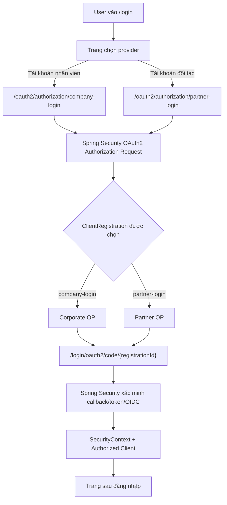
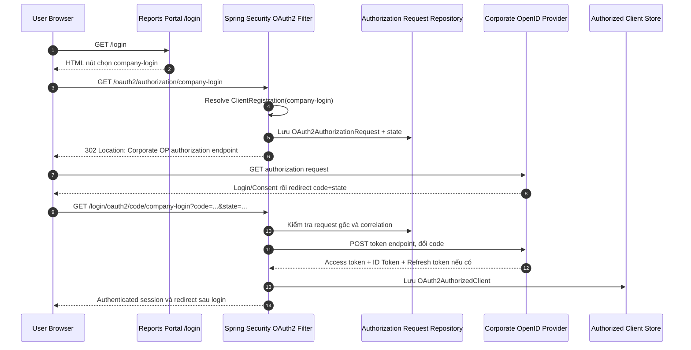
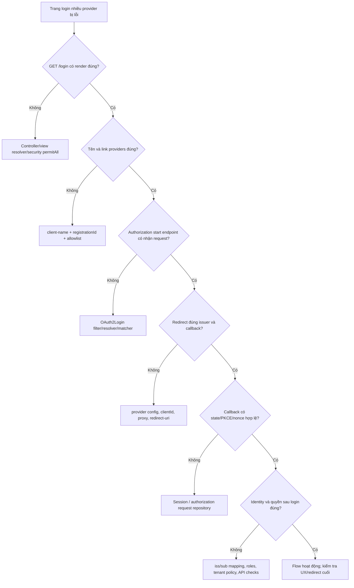

# 25.3. Trang chọn provider và tên hiển thị cho từng client

Một ứng dụng **Spring Security OAuth 2.0 / OpenID Connect (OIDC) Client** có thể cho phép người dùng đăng nhập bằng nhiều nhà cung cấp danh tính: tài khoản nhân viên, tài khoản đối tác, tài khoản khách hàng hoặc các OpenID Provider (OP) thuộc các tenant khác nhau. Khi đó, trang đăng nhập không chỉ có một nút “Login”; người dùng cần một **trang chọn provider** với các nhãn rõ ràng, đúng nghiệp vụ và dẫn tới đúng OAuth2 client registration.

Trong Spring Security, hai khái niệm dễ bị nhầm lẫn là:

- **`registrationId`**: khóa nội bộ để Spring Security xác định một `ClientRegistration` và bắt đầu authorization flow. Nó thường xuất hiện trên đường dẫn `/oauth2/authorization/{registrationId}`.
- **`clientName`**: tên dễ đọc dành cho con người, lấy từ `ClientRegistration.getClientName()`; có thể cấu hình bằng thuộc tính Spring Boot `client-name`. Nó thích hợp làm nhãn cho nút/link đăng nhập.

Ví dụ, người dùng nhìn thấy **“Đăng nhập bằng tài khoản công ty”**, nhưng đường dẫn thực tế là `/oauth2/authorization/company-login`. Tên hiển thị có thể thay đổi theo nội dung sản phẩm mà không nhất thiết đổi `registrationId` hoặc cấu hình callback.

Bài này xây dựng một trang chọn provider **từ cấu hình server-side**, phân biệt OIDC với OAuth2 Login, triển khai trên **Spring MVC Servlet** và mở rộng sang **Spring WebFlux Reactive**, đồng thời giải thích các giới hạn bảo mật của việc cho người dùng chọn nguồn danh tính.

## 1. Mục tiêu học tập

Sau bài này, bạn có thể:

1. Phân biệt `registrationId`, `provider ID`, `clientId`, `clientName`, issuer và nhãn hiển thị trên UI.
2. Định nghĩa nhiều registrations trong `application.yml`, mỗi registration có tên người dùng dễ hiểu.
3. Giải thích trang login mặc định của Spring Security có thể hiển thị các liên kết OAuth2 như thế nào.
4. Tạo trang `/login` tùy chỉnh với Thymeleaf, lấy danh sách provider hợp lệ từ cấu hình backend.
5. Tạo link đăng nhập `/oauth2/authorization/{registrationId}` thay vì tự nối URL authorization endpoint của OP.
6. Cấu hình `HttpSecurity.oauth2Login().loginPage(...)` và permit các tài nguyên công khai.
7. Biết cách triển khai trang chọn provider tương tự trong WebFlux với `ReactiveClientRegistrationRepository`.
8. Xử lý nhiều registrations thuộc cùng một OP, login failure, callback URI và trang điều hướng sau login.
9. Tránh open redirect, provider mix-up, user/tenant confusion, lộ credential và liên kết tài khoản sai.
10. Kiểm thử nhãn hiển thị, các đường dẫn đăng nhập và request khởi động OAuth2 flow.

## 2. Bối cảnh: một Portal có nhiều cách đăng nhập

Giả sử ứng dụng **Reports Portal** phục vụ:

- Nhân viên nội bộ dùng Corporate OP.
- Đối tác kinh doanh dùng Partner OP.
- Một công việc chạy nền dùng `client_credentials` để gọi Inventory API.

Người dùng nên nhìn thấy **hai lựa chọn tương tác**, không phải ba:

```text
                 Đăng nhập Reports Portal
        ┌──────────────────────────────────────┐
        │                                      │
        │  [ Tài khoản nhân viên công ty ]      │
        │                                      │
        │  [ Tài khoản đối tác ]                │
        │                                      │
        │  Cần hỗ trợ? Liên hệ quản trị viên   │
        │                                      │
        └──────────────────────────────────────┘

Nút nhân viên -> GET /oauth2/authorization/company-login
Nút đối tác   -> GET /oauth2/authorization/partner-login

inventory-service (client_credentials) -> KHÔNG là nút đăng nhập user
```

Luồng tương ứng:



Quan trọng: trang chọn provider **không tự xác thực người dùng**. Nó chỉ quyết định **bắt đầu flow với registration nào**. Người dùng thực sự được xác thực ở OP, rồi Spring Security kiểm tra callback, token và OIDC claims theo cấu hình.

## 3. Sáu tên/ID cần phân biệt

Trong một hệ thống nhiều provider, “tên nhà cung cấp” có thể chỉ một trong nhiều khái niệm:

| Thuật ngữ | Ví dụ | Ai sử dụng? |
|---|---|---|
| `registrationId` | `company-login` | Spring Security tìm một `ClientRegistration` |
| `provider ID` trong cấu hình | `corporate-op` | Spring Boot liên kết registration với một nhóm provider endpoints |
| `clientId` | `reports-portal-web-prod` | OP nhận diện OAuth2 client đã đăng ký |
| `clientName` | `Tài khoản nhân viên công ty` | UI hiển thị tên client/provider dễ đọc |
| `issuer` | `https://idp.example.org/realms/company` | OP định danh issuer, dùng discovery/validation |
| `principal/sub` | `employee-42` | Kết quả nhận diện user sau khi login |

Ví dụ:

```yaml
spring:
  security:
    oauth2:
      client:
        registration:
          company-login:                               # registrationId
            provider: corporate-op                     # provider ID cấu hình
            client-id: "${CORPORATE_CLIENT_ID}"          # clientId tại OP
            client-name: "Tài khoản nhân viên công ty"  # clientName/UI
            client-secret: "${CORPORATE_CLIENT_SECRET}"
            authorization-grant-type: authorization_code
            client-authentication-method: client_secret_basic
            redirect-uri: "{baseUrl}/login/oauth2/code/{registrationId}"
            scope: [openid, profile, email]
        provider:
          corporate-op:
            issuer-uri: "https://idp.example.org/realms/company"
```

**`client-name` là nhãn hiển thị, không phải thông số quyết định chọn OP.** Đổi tên “Tài khoản nhân viên công ty” thành “Đăng nhập SSO nội bộ” không tự đổi issuer, token endpoint hay registration ID.

### 3.1. Vì sao không đổi registrationId tùy tiện?

`registrationId` thường tham gia:

- URL khởi động `/oauth2/authorization/{registrationId}`.
- Callback URI `/login/oauth2/code/{registrationId}`.
- Khóa lưu `OAuth2AuthorizedClient` theo `(registrationId, principalName)`.
- Cấu hình lựa chọn client trong WebClient/authorized client manager.
- Logging, metrics và tài liệu vận hành.

Nếu đổi `company-login` thành `company` chỉ vì muốn nút có chữ ngắn hơn, bạn có thể làm sai redirect URI đã đăng ký ở OP, mất lookup authorized client cũ hoặc phá các link/callback. **Muốn đổi chữ trên nút, ưu tiên thay `client-name`**, không đổi khóa kỹ thuật.

### 3.2. Provider ID không nhất thiết là nút đăng nhập

Một provider configuration có thể được nhiều registrations tái sử dụng:

```text
provider: corporate-op
    ├── registration: company-login
    └── registration: company-admin-login
```

Hai registrations có thể cùng issuer nhưng khác client ID, redirect URI, scopes hoặc chính sách. Khi đó trang chọn có thể hiện **hai lựa chọn thuộc cùng một OP**, tùy yêu cầu nghiệp vụ. Ngược lại, một registration có thể dành cho `client_credentials`, hoàn toàn không phải login button.

### 3.3. OIDC provider khác OAuth2 provider thuần

Với đăng nhập OIDC, registration cần yêu cầu scope `openid` và có hợp đồng OP hỗ trợ OIDC (ID Token, issuer, JWK Set...). Một OAuth2 provider chỉ trả access token/userinfo theo API riêng có thể hỗ trợ `oauth2Login()` nhưng **không nhất thiết là OpenID Connect**.

Đừng dán nhãn mọi login provider là OIDC nếu provider không phát ID Token theo OIDC. Nếu tích hợp nhiều loại provider, mapping identity/authorities và validation có thể khác nhau.

## 4. Cấu hình nhiều ClientRegistration trong Spring Boot

Ví dụ `application.yml` với hai OIDC providers:

```yaml
spring:
  security:
    oauth2:
      client:
        registration:
          company-login:
            provider: corporate
            client-id: "${COMPANY_CLIENT_ID}"
            client-secret: "${COMPANY_CLIENT_SECRET}"
            client-name: "Tài khoản nhân viên công ty"
            client-authentication-method: client_secret_basic
            authorization-grant-type: authorization_code
            redirect-uri: "{baseUrl}/login/oauth2/code/{registrationId}"
            scope:
              - openid
              - profile
              - email

          partner-login:
            provider: partner
            client-id: "${PARTNER_CLIENT_ID}"
            client-secret: "${PARTNER_CLIENT_SECRET}"
            client-name: "Tài khoản đối tác"
            client-authentication-method: client_secret_basic
            authorization-grant-type: authorization_code
            redirect-uri: "{baseUrl}/login/oauth2/code/{registrationId}"
            scope:
              - openid
              - profile
              - email

          inventory-service:
            provider: corporate
            client-id: "${INVENTORY_CLIENT_ID}"
            client-secret: "${INVENTORY_CLIENT_SECRET}"
            client-name: "Inventory Service (không dùng đăng nhập)"
            client-authentication-method: client_secret_basic
            authorization-grant-type: client_credentials
            scope:
              - inventory.read

        provider:
          corporate:
            issuer-uri: "https://idp.example.org/realms/company"
          partner:
            issuer-uri: "https://login.partner.example.org/realms/partners"
```

Đây là cấu hình minh họa. Trong hệ thống thật, cả hai issuer phải được OP cung cấp và đáng tin cậy; các secrets nằm trong secret manager/environment, không commit. `inventory.read` là scope nghiệp vụ mẫu chỉ có ý nghĩa khi provider hỗ trợ.

### 4.1. Ý nghĩa của client-name

Spring Boot có thuộc tính:

```text
spring.security.oauth2.client.registration.<registration-id>.client-name
```

Nó được bind vào `ClientRegistration.clientName`. Ví dụ:

```java
ClientRegistration registration =
        clientRegistrationRepository.findByRegistrationId(
                "company-login");

String displayName = registration.getClientName();
```

`displayName` có thể được dùng làm nội dung nút/link. Nếu không khai báo `client-name`, builder/auto-configuration có cách đặt tên mặc định tùy registration và phiên bản; **đừng dựa vào tên mặc định như một UX contract**. Trong sản phẩm có nhiều providers, nên đặt tên hiển thị rõ ràng.

### 4.2. Một client-name dễ hiểu nên như thế nào?

Ví dụ tốt:

- “Tài khoản nhân viên công ty”
- “Tài khoản đối tác”
- “Đăng nhập qua Google Workspace” (khi đúng provider và có quyền sử dụng thương hiệu)
- “Cổng dành cho nhà cung cấp”

Ví dụ gây nhầm:

- `corp-oidc-prod-v2`: tên kỹ thuật không nói người dùng thuộc nhóm nào.
- `oauth2`: không phân biệt lựa chọn.
- “Đăng nhập an toàn tuyệt đối”: tuyên bố bảo mật không thể kiểm chứng.
- “Quản trị hệ thống” cho một client không có chính sách xác thực và phân quyền quản trị tương ứng.

**Nhãn là thông tin hướng dẫn người dùng**, không phải một quy tắc authorization. Dù nút ghi “Quản trị”, backend và OP vẫn phải xác minh ai được phép trở thành quản trị.

### 4.3. Phân biệt display name và localization

`client-name` là thuộc tính của registration và thường là một string. Nếu ứng dụng hỗ trợ tiếng Việt/tiếng Anh, có thể:

1. Lưu tên mặc định trong `client-name`.
2. Có bảng dịch giao diện theo registration ID cố định.
3. Lấy localization từ message bundles thay vì cho browser sửa tên provider tự do.
4. Giữ internal ID/callback không đổi khi đổi ngôn ngữ.

Ví dụ:

```properties
# messages_vi.properties
login.provider.company-login=Đăng nhập bằng tài khoản công ty
login.provider.partner-login=Đăng nhập bằng tài khoản đối tác

# messages_en.properties
login.provider.company-login=Sign in with your company account
login.provider.partner-login=Sign in with a partner account
```

Nếu dùng message bundles, cần code fallback an toàn và quy ước key rõ ràng; `ClientRegistration.getClientName()` vẫn hữu ích làm fallback. Không làm thay đổi `registrationId` chỉ để hỗ trợ đa ngôn ngữ.

## 5. Trang đăng nhập mặc định của Spring Security

Khi cấu hình `oauth2Login()` mà **không khai báo custom login page**, Spring Security có thể tạo trang login mặc định và hiển thị các liên kết OAuth2/OIDC đã đăng ký. Trong Servlet, component liên quan là `DefaultLoginPageGeneratingFilter`.

Khi repository hỗ trợ liệt kê registrations, ví dụ `InMemoryClientRegistrationRepository`, framework có thể dùng những registrations đó để xây lựa chọn provider.

```text
GET /login
   |
   v
Default login page (khi được bật/phù hợp)
   |
   +-- company-login -> /oauth2/authorization/company-login
   +-- partner-login -> /oauth2/authorization/partner-login
```

### 5.1. Điều kiện quan trọng: liệt kê registrations

`ClientRegistrationRepository` chỉ yêu cầu API:

```java
ClientRegistration findByRegistrationId(String registrationId);
```

Nó **không bắt buộc** triển khai `Iterable<ClientRegistration>`. Khi repository có thể liệt kê registrations, generated page mới có dữ liệu để dựng các liên kết. Một custom repository đọc từ remote config/database chỉ triển khai lookup theo ID có thể làm default page không hiện danh sách như mong đợi.

**Đừng coi trang mặc định là API discovery tự động cho mọi loại repository.** Nếu muốn UX ổn định, dùng trang custom với danh sách registration cho phép do server quản lý.

### 5.2. Default page để học, custom page cho sản phẩm

Default page tiện cho:

- Demo/OIDC proof of concept.
- Kiểm thử nhanh luồng authorization code.
- Xác nhận cấu hình registrations và callback.

Trang sản phẩm thường cần thêm:

- Tên provider rõ hơn và phù hợp người dùng.
- Mô tả “Dành cho nhân viên/đối tác”.
- Biểu tượng được cấp phép, khả năng truy cập và hỗ trợ mobile.
- Chính sách chỉ hiện những lựa chọn tương tác.
- Thông báo login error an toàn.
- Localization, trợ giúp người dùng và kiểm soát telemetry.

Không nên dùng generated page làm nơi hiển thị tất cả registrations trong hệ thống khi có cả `client_credentials`, internal service accounts hoặc cấu hình không dành cho người dùng.

## 6. Trang chọn provider tùy chỉnh trong Spring MVC

Ta xây một trang public `GET /login`, lấy metadata từ những registrations đã được backend cho phép, và render link có dạng:

```text
/oauth2/authorization/company-login
/oauth2/authorization/partner-login
```

Trình duyệt sẽ bắt đầu flow bằng **GET đến endpoint của ứng dụng**, không gửi trực tiếp `client_id` hoặc `client_secret` trong form.

### 6.1. Dependencies cơ bản

Ví dụ Maven:

```xml
<dependencies>
    <dependency>
        <groupId>org.springframework.boot</groupId>
        <artifactId>spring-boot-starter-web</artifactId>
    </dependency>
    <dependency>
        <groupId>org.springframework.boot</groupId>
        <artifactId>spring-boot-starter-security</artifactId>
    </dependency>
    <dependency>
        <groupId>org.springframework.boot</groupId>
        <artifactId>spring-boot-starter-oauth2-client</artifactId>
    </dependency>
    <dependency>
        <groupId>org.springframework.boot</groupId>
        <artifactId>spring-boot-starter-thymeleaf</artifactId>
    </dependency>
</dependencies>
```

Mỗi dependency có vai trò riêng: Spring MVC xử lý trang, Spring Security quản lý authentication, OAuth2 Client xử lý authorization flow, còn Thymeleaf render template.

### 6.2. Cấu hình SecurityFilterChain

```java
import org.springframework.context.annotation.Bean;
import org.springframework.context.annotation.Configuration;
import org.springframework.security.config.annotation.web.builders.HttpSecurity;
import org.springframework.security.web.SecurityFilterChain;

@Configuration
class WebSecurityConfig {

    @Bean
    SecurityFilterChain securityFilterChain(HttpSecurity http)
            throws Exception {

        return http
                .authorizeHttpRequests(authorize -> authorize
                        .requestMatchers(
                                "/", "/login", "/error",
                                "/css/**", "/images/**")
                        .permitAll()
                        .anyRequest().authenticated())
                .oauth2Login(oauth2 ->
                        oauth2.loginPage("/login"))
                .build();
    }
}
```

Ý nghĩa:

- `loginPage("/login")` cho Spring Security biết ứng dụng tự cung cấp trang login.
- `GET /login` phải do controller/template của ứng dụng xử lý.
- Các tài nguyên CSS/images cần public nếu trang login dùng chúng.
- `/oauth2/authorization/{registrationId}` vẫn là điểm khởi động flow do Spring Security xử lý theo cấu hình mặc định.
- `/login/oauth2/code/{registrationId}` vẫn là callback tương ứng với OAuth2 Client; không tự đổi chỉ vì thay UI.

**Không gọi `oauth2Login().loginPage("/login")` rồi mong Spring Security tự sinh template custom.** Khi đã chọn trang tùy chỉnh, ứng dụng phải cung cấp route và HTML tương ứng.

### 6.3. Tạo DTO cho một lựa chọn đăng nhập

```java
record ProviderChoice(
        String registrationId,
        String displayName) {}
```

Mỗi lựa chọn chứa **internal registration ID** và **nhãn UI**. Không cần đặt `clientSecret`, token URI, access token hoặc refresh token vào DTO gửi browser.

Nếu có phần trợ giúp, bạn có thể mở rộng DTO bằng `description` và `supportText` do server cung cấp. Hãy tránh đưa một URL login tùy ý từ dữ liệu không tin cậy vào DTO.

### 6.4. Controller liệt kê các registration được phép

```java
import java.util.List;
import org.springframework.security.oauth2.client.registration
        .ClientRegistration;
import org.springframework.security.oauth2.client.registration
        .ClientRegistrationRepository;
import org.springframework.stereotype.Controller;
import org.springframework.ui.Model;
import org.springframework.web.bind.annotation.GetMapping;

@Controller
class LoginPageController {

    private static final List<String> USER_LOGIN_IDS =
            List.of("company-login", "partner-login");

    private final ClientRegistrationRepository registrations;

    LoginPageController(ClientRegistrationRepository registrations) {
        this.registrations = registrations;
    }

    @GetMapping("/login")
    String login(Model model) {
        List<ProviderChoice> choices = USER_LOGIN_IDS.stream()
                .map(this::toChoice)
                .toList();

        model.addAttribute("providers", choices);
        return "login";
    }

    private ProviderChoice toChoice(String registrationId) {
        ClientRegistration registration =
                registrations.findByRegistrationId(registrationId);

        if (registration == null) {
            throw new IllegalStateException(
                    "Missing configured login registration: "
                            + registrationId);
        }

        return new ProviderChoice(
                registration.getRegistrationId(),
                registration.getClientName());
    }
}
```

Đoạn code dùng allowlist `USER_LOGIN_IDS` cố định **ở phía server**. Nhờ đó:

- `inventory-service` (grant `client_credentials`) không xuất hiện trên trang.
- Trang chọn chỉ chứa những registration được dành cho interactive login.
- Việc thêm một OAuth2 registration phục vụ máy-máy không tự sinh thêm nút đăng nhập.
- Mỗi nút lấy tên từ chính `ClientRegistration` đã cấu hình.

**Lưu ý về ranh giới:** không hiện một registration trong UI **không có nghĩa** `/oauth2/authorization/registration-khac` đã bị chặn. Nếu một registration nhạy cảm không được phép khởi động từ browser, phải bảo vệ ở routing/resolver, client registration/provider policy hoặc thiết kế tách client; không dựa vào việc giấu nút.

### 6.5. Nên lọc grant type không?

Nếu danh sách được xây từ toàn bộ registrations, cần chỉ đưa lên UI những client dành cho tương tác với user, thường là `authorization_code`. Một check có thể là:

```java
import org.springframework.security.oauth2.core.AuthorizationGrantType;

boolean interactive =
        AuthorizationGrantType.AUTHORIZATION_CODE.equals(
                registration.getAuthorizationGrantType());
```

Tuy nhiên, **grant type một mình chưa đủ** để quyết định product UX. Một authorization-code registration có thể là internal integration không nên hiện công khai. Cách dễ kiểm soát là dùng **allowlist chức năng**, sau đó kiểm tra grant type/metadata lúc khởi động hoặc dựng trang để phát hiện cấu hình sai.

### 6.6. Template Thymeleaf: templates/login.html

```html
<!DOCTYPE html>
<html lang="vi" xmlns:th="http://www.thymeleaf.org">
<head>
  <meta charset="UTF-8" />
  <meta name="viewport" content="width=device-width, initial-scale=1" />
  <title>Đăng nhập Reports Portal</title>
  <link rel="stylesheet" th:href="@{/css/login.css}" />
</head>
<body>
  <main class="login-panel">
    <h1>Đăng nhập Reports Portal</h1>
    <p>Chọn loại tài khoản bạn đang sử dụng.</p>

    <div class="login-options"
         aria-label="Các cách đăng nhập được hỗ trợ">
      <a class="login-option"
         th:each="provider : ${providers}"
         th:href="@{/oauth2/authorization/{id}(id=${provider.registrationId})}"
         th:text="${provider.displayName}">
        Đăng nhập bằng tài khoản
      </a>
    </div>

    <p th:if="${param.error}" role="alert">
      Đăng nhập chưa hoàn tất. Vui lòng thử lại hoặc liên hệ hỗ trợ.
    </p>
    <p th:if="${param.logout}" role="status">
      Bạn đã đăng xuất khỏi ứng dụng.
    </p>

    <p class="help">Không biết dùng tài khoản nào?
      Hãy liên hệ bộ phận hỗ trợ.</p>
  </main>
</body>
</html>
```

Lưu ý: template dùng cú pháp Thymeleaf `th:each`/`th:text`/`th:href`; các giá trị `providers` do controller truyền vào, không phải query parameters của browser.

Đường dẫn:

```text
src/main/resources/templates/login.html
```

là vị trí template thông dụng trong Spring Boot với Thymeleaf. CSS tùy chọn có thể nằm ở `src/main/resources/static/css/login.css`.

### 6.7. Vì sao dùng th:text thay vì th:utext?

`th:text` thực hiện escaping phù hợp khi render text. `th:utext` chèn HTML không escape và có thể tạo XSS nếu label đến từ nguồn không tin cậy.

Tên provider là dữ liệu cấu hình từ backend nhưng vẫn nên render như **text**, không như HTML. Nếu cần icon/logo, sử dụng resource path tĩnh hoặc metadata đã allowlist, không gắn trực tiếp HTML/URL bên ngoài do query parameter cung cấp.

### 6.8. Tại sao không dùng link thẳng đến authorization_uri của OP?

Ví dụ **không nên** dựng thủ công:

```html
<a href="https://idp.example.org/authorize?client_id=...&state=fixed">
  Đăng nhập
</a>
```

Tự tạo URL dễ bỏ sót `state`, `nonce`, PKCE và cách xây `redirect_uri`. Link tới `/oauth2/authorization/{registrationId}` để Spring Security:

1. Chọn đúng `ClientRegistration`.
2. Xây `OAuth2AuthorizationRequest`.
3. Sinh `state` và context chống giả mạo request/callback.
4. Sử dụng PKCE/nonce theo flow và cấu hình.
5. Lưu authorization request tạm thời cho callback.
6. Redirect tới đúng provider authorization endpoint.

Trang login chỉ **chọn** registration; framework thực hiện phần OAuth2/OIDC security-sensitive.

## 7. Request đăng nhập hoạt động thế nào?

Giả sử Alice nhấn nút **“Tài khoản nhân viên công ty”**.



Phía browser thấy nút có `displayName`, nhưng sự kiện OAuth2 quan trọng ở backend được định danh bằng `registrationId` và state.

### 7.1. Các URL trong một flow

| URL | Vị trí | Vai trò |
|---|---|---|
| `/login` | Client application | Trang UI để chọn provider |
| `/oauth2/authorization/company-login` | Client application | Khởi động OAuth2 Authorization Code Flow |
| `https://idp.example.org/.../auth` | OP | Authorization endpoint để user đăng nhập/consent |
| `/login/oauth2/code/company-login` | Client application | Callback nhận authorization code/state |
| `/dashboard` | Client application | Trang sau login (theo success handler) |

Không được nhầm **login page** với **authorization endpoint** hoặc **callback endpoint**. `loginPage("/login")` chỉ thay nơi hiển thị UI đăng nhập của application, không đổi callback URI và không tự sửa redirect URI đã đăng ký tại OP.

### 7.2. Có cần POST khi bấm nút chọn provider?

Thông thường đường khởi động `/oauth2/authorization/{registrationId}` là **GET**, vì nó bắt đầu redirect. Đây khác `POST /logout` ở web app có CSRF, hoặc một form nghiệp vụ thay đổi trạng thái.

Security-sensitive `state`/PKCE được Spring Security quản lý khi bắt đầu authorization request. Không tự chuyển sang POST tùy tiện rồi bỏ qua filter matcher của framework.

### 7.3. Không gửi client secret qua browser

Trang `/login` chỉ cần:

```text
registrationId
displayName
relative login URL
```

**Không render**:

```text
client_secret
private_key
access_token / refresh_token
code_verifier
client assertion JWT
full authorization request attributes
```

`client_id` OAuth2 có thể xuất hiện trong authorization request theo giao thức và thường không phải secret; nhưng `client_secret`/private key không được đưa ra browser. Browser luôn có thể nhìn thấy link login, do đó nút không phải nơi để lưu bí mật.

## 8. Một registration có thể có nhãn ngắn và nhãn mô tả

`ClientRegistration.clientName` phù hợp một nhãn cơ bản, nhưng UI thường cần thêm mô tả:

```text
Tài khoản nhân viên công ty
  Dành cho người đang làm việc tại doanh nghiệp

Tài khoản đối tác
  Dành cho nhà cung cấp và doanh nghiệp hợp tác
```

Bạn có thể dùng metadata của riêng ứng dụng:

```java
record LoginUiMetadata(
        String registrationId,
        String description,
        String iconKey,
        int order) {}

private static final List<LoginUiMetadata> LOGIN_UI = List.of(
        new LoginUiMetadata(
                "company-login",
                "Dành cho nhân viên nội bộ",
                "company",
                10),
        new LoginUiMetadata(
                "partner-login",
                "Dành cho tài khoản đối tác",
                "partner",
                20));
```

Trong lúc dựng `ProviderChoice`, kết hợp `registration.getClientName()` với metadata đã allowlist. `iconKey` nên là một khóa hình ảnh tĩnh mà ứng dụng kiểm soát, ví dụ map `company -> /images/company.svg`; **không dùng một icon URL do browser gửi**.

### 8.1. Sắp xếp nút một cách ổn định

Nếu tạo danh sách trực tiếp từ repository, thứ tự của registrations có thể phụ thuộc implementation hoặc cấu hình. Để UX ổn định và kiểm thử dễ dàng:

- Dùng danh sách IDs theo thứ tự trong server config.
- Hoặc có trường `order` do admin quản lý.
- Kiểm tra trùng `registrationId`.
- Không cho một record bất kỳ từ database tự xuất hiện trên trang login nếu chưa được duyệt.

### 8.2. Accessibility

Trang chọn provider nên có:

- Nút/link đọc được bằng screen reader, nội dung mô tả chính xác.
- Focus indicator rõ, có thể thao tác bằng bàn phím.
- Contrast phù hợp, kích thước vùng nhấn đủ.
- Text label độc lập với logo (không chỉ dùng icon).
- Thông báo lỗi có `role="alert"`, không dựa vào màu sắc duy nhất.
- Layout phù hợp mobile và localization.

Việc có nhiều provider không nên làm người dùng phải đoán biểu tượng nào ứng với loại tài khoản nào.

## 9. Tên provider khi cùng một OP có nhiều client

Một OP có thể cấp hai client IDs:

```text
Corporate OpenID Provider
    ├── employee-web-client      -> registrationId: company-login
    └── admin-console-client     -> registrationId: admin-login
```

Đặt tên:

```yaml
spring:
  security:
    oauth2:
      client:
        registration:
          company-login:
            provider: corporate
            client-name: "Tài khoản nhân viên"
            client-id: "${EMPLOYEE_CLIENT_ID}"
            client-secret: "${EMPLOYEE_CLIENT_SECRET}"
            authorization-grant-type: authorization_code
            redirect-uri: "{baseUrl}/login/oauth2/code/{registrationId}"
            scope: [openid, profile]
          admin-login:
            provider: corporate
            client-name: "Tài khoản quản trị được phê duyệt"
            client-id: "${ADMIN_CLIENT_ID}"
            client-secret: "${ADMIN_CLIENT_SECRET}"
            authorization-grant-type: authorization_code
            redirect-uri: "{baseUrl}/login/oauth2/code/{registrationId}"
            scope: [openid, profile]
        provider:
          corporate:
            issuer-uri: "https://idp.example.org/realms/company"
```

Chính việc chọn `admin-login` **không làm Alice thành admin**. Phải xác minh OP authentication policy/MFA và ánh xạ authorities/permissions sau login. Nếu cả hai client có cùng issuer và user subject, backend vẫn phải xử lý chính xác quyền đã được cấp.

### 9.1. Không dùng client-name để xác định quyền

Anti-pattern:

```java
// KHÔNG NÊN:
if (registration.getClientName().contains("quản trị")) {
    grantAdminRoleToCurrentUser();
}
```

`clientName` là presentation metadata. Quyền phải dựa trên `Authentication` đã xác minh, issuer/subject, claims theo trust contract, authorities mapping và business authorization. Tên hiển thị thay đổi theo ngôn ngữ sẽ không làm quyền thay đổi.

### 9.2. Scope/consent khác nhãn UI

Một registration có thể yêu cầu scopes `openid profile`; registration khác yêu cầu `openid reports.read`. Nhưng việc nút ghi “Quản trị” hoặc “Đọc báo cáo” không khiến authorization server cấp thêm scope.

Ngược lại, việc yêu cầu scope rộng không bảo đảm user được cấp quyền. API downstream vẫn kiểm tra granted scope, token audience và object-level authorization.

## 10. Trang chọn provider và multiple issuers

Trong OIDC, issuer là một phần cốt lõi để xác định trust boundary:

```text
Corporate OP:
    issuer = https://idp.example.org/realms/company

Partner OP:
    issuer = https://login.partner.example.org/realms/partners
```

Sau login:

```text
Corporate: iss=A, sub=12345
Partner:   iss=B, sub=12345
```

Hai `sub` cùng chuỗi **không đồng nghĩa cùng một người**. OIDC identity chỉ có ý nghĩa trong ngữ cảnh issuer. Backend nên ánh xạ một external identity theo **`(iss, sub)`** về local user ID khi chính sách cho phép.

### 10.1. Không liên kết tài khoản chỉ dựa vào email

Một lỗi nguy hiểm:

```text
Corporate OP trả email: alice@example.org
Partner OP trả email:   alice@example.org
    |
    v
Ứng dụng gộp hai tài khoản thành một user admin
```

Email có thể thay đổi hoặc không được xác minh/đảm bảo duy nhất theo cùng hợp đồng ở các providers. Dù `email_verified=true`, điều đó không thay thế một **quy trình account linking được phê duyệt**, có chứng minh quyền sở hữu các danh tính theo policy.

Trang chọn provider giúp user bắt đầu đúng luồng, nhưng **không quyết định cách ghép hoặc phân quyền tài khoản**.

### 10.2. Provider mix-up

Khi có nhiều Authorization Servers, ứng dụng phải ràng buộc authorization response với request gốc và issuer/provider phù hợp. Spring Security dùng OAuth2 Authorization Request Repository/`state` và thông tin registration để liên kết flow.

Đừng viết callback handler tự suy luận OP chỉ từ:

```text
email domain
login button label
clientName
user-supplied ?provider=...
```

Điều cần xác minh dựa trên registration/authorization request đã tin cậy, issuer/ID Token validation và các biện pháp OAuth2/OIDC được framework/provider hỗ trợ.

### 10.3. Một provider gặp sự cố không nên làm sai provider khác

Nếu Partner OP tạm thời không hoạt động, trang chọn provider có thể thông báo “Đăng nhập đối tác đang gặp sự cố” theo monitoring đáng tin cậy. Tuy nhiên:

- Không tự redirect user tới Corporate OP với mục tiêu “mượn danh tính”.
- Không gửi corporate token cho partner API.
- Không tự bỏ kiểm tra issuer/signature vì một OP lỗi.
- Không đặt nhãn “Đăng nhập đối tác” nhưng link thực tế trỏ tới issuer không đúng.

Availability và identity trust là hai vấn đề riêng.

## 11. Tùy chỉnh trang login cho nhiều tenant

Một SaaS có thể có tên provider theo tenant:

```text
tenant-north -> registrationId: north-oidc
tenant-south -> registrationId: south-oidc
```

Có hai cách UX phổ biến:

1. Hiển thị **tất cả lựa chọn được phép** trên một trang chung.
2. Chọn tenant trước, rồi chỉ hiển thị provider của tenant đó, theo policy của backend.

Với phương án 2, việc browser gửi `tenant=north` **không chứng minh** user thuộc North. Trước khi chọn một client/issuer nhạy cảm, ứng dụng phải xác định tenant route/host/dữ liệu đã được xác minh và không cấp quyền dựa đơn thuần trên query parameter.

### 11.1. Bảng ánh xạ tenant tới registration

```java
record TenantLoginOptions(
        String tenantId,
        List<String> allowedRegistrationIds) {}

Map<String, TenantLoginOptions> tenants = Map.of(
        "north", new TenantLoginOptions(
                "north", List.of("north-oidc")),
        "south", new TenantLoginOptions(
                "south", List.of("south-oidc")));
```

Đây là dữ liệu cấu hình ví dụ. Việc cho tenant nào xuất hiện nên dựa trên allowlist/host mapping của backend và chiến lược UX, không biến route lựa chọn tenant thành chứng cứ ủy quyền truy cập dữ liệu của tenant.

### 11.2. Không tạo ClientRegistration động từ URL user nhập

Ví dụ cần tránh:

```text
GET /login?issuer=https://untrusted.example
    -> tự discovery OP
    -> gửi user sang authorization URI mới
    -> tự nhận token mà không kiểm tra allowlist
```

Điều này có thể tạo SSRF qua discovery, provider impersonation, token/code exfiltration hoặc login confusion. Với dynamic client onboarding, cần quy trình tin cậy kiểm tra issuer, metadata, client credentials, redirect URI, trust policy và ownership; không phải một tùy chọn tự do trên login page.

## 12. Cho phép người dùng quay về trang mong muốn sau đăng nhập

Trường hợp thường gặp:

```text
Alice truy cập GET /reports/summary
-> chưa authenticated
-> được đưa tới /login
-> chọn Corporate OP
-> đăng nhập xong
-> quay về /reports/summary
```

Spring Security có cơ chế request cache / success handler giúp phục hồi saved request trong những cấu hình phù hợp. Với trang custom, bạn không nhất thiết phải tự chèn `returnUrl` vào từng link provider.

### 12.1. Vì sao không nối returnUrl vào redirect tùy ý?

Anti-pattern:

```text
/login?returnUrl=https://attacker.example/phishing
   -> sau login:
      302 Location: https://attacker.example/phishing
```

Đó là **open redirect**. Nếu business thật sự cần target sau login, ưu tiên saved request/relative path allowlist và validate host/scheme khi có redirect ngoài ứng dụng được phê duyệt.

Đừng sử dụng `state` của OAuth2 như một trường bất kỳ do browser điều khiển. `state` phải được Spring Security sinh và bảo vệ để liên kết authorization request với callback.

### 12.2. Default success URL hay saved request?

Trong Servlet, bạn có thể cấu hình một trang mặc định:

```java
.oauth2Login(oauth2 -> oauth2
        .loginPage("/login")
        .defaultSuccessUrl("/dashboard", false))
```

Tham số `false` cho phép success handler ưu tiên saved request khi phù hợp, thay vì luôn buộc người dùng về `/dashboard`. Hành vi cụ thể còn phụ thuộc custom success handler/request cache nếu ứng dụng thay thế chúng.

Nếu chọn `defaultSuccessUrl("/dashboard", true)`, ứng dụng có thể luôn điều hướng đến trang đó, bỏ qua saved request. Đây là quyết định UX, không phải đặc trưng bắt buộc khi có nhiều provider.

### 12.3. Đăng nhập sai provider rồi muốn đổi provider

Ví dụ user dùng nút đối tác nhưng họ là nhân viên Corporate. OP có thể từ chối hoặc cho login một tài khoản khác. Ứng dụng nên:

- Hiển thị thông báo chung khi flow không hoàn tất.
- Cho user quay lại trang chọn provider và thử lại.
- Không tự liên kết email từ các providers.
- Không tự dùng authorized client/token của provider cũ để mô phỏng login provider mới.
- Có thể cung cấp mô tả “Bạn là nhân viên hay đối tác?” trước khi bắt đầu flow.

Nếu đã authenticated bằng một provider và người dùng chủ động chọn provider khác, cần policy account switching/reauthentication rõ ràng; không âm thầm gộp danh tính hai sources.

## 13. Tùy chỉnh URL bắt đầu Authorization Request

Đường mặc định trong Servlet thường là:

```text
/oauth2/authorization/{registrationId}
```

Nhưng ứng dụng có thể thay base URI bằng `DefaultOAuth2AuthorizationRequestResolver` và cấu hình filter theo API của phiên bản Spring Security tương ứng.

Ví dụ biểu diễn đường mới:

```text
/sso/start/{registrationId}
```

Khi tùy chỉnh resolver, phải đồng bộ:

1. Request matcher của resolver.
2. Security filter chain nhận authorization initiation.
3. Link trong template.
4. Tài liệu/support/monitoring.

**Không đổi callback URI bằng cách chỉ đổi link trên trang login.** Callback vẫn liên quan `redirect-uri` trong ClientRegistration và endpoint callback handler của Spring Security.

### 13.1. Cảnh báo: không tự tạo state hoặc nonce

Một link custom trỏ đến OAuth2 Authorization Request của Spring Security vẫn giúp framework tạo `state`. Nếu thay bằng URL provider tự dựng:

```text
https://op.example/authorize?client_id=portal&state=fixed
```

bạn có nguy cơ làm mất những bảo vệ quan trọng. Nếu cần `prompt`/`login_hint`/`max_age` cho một provider, hãy tùy chỉnh **OAuth2AuthorizationRequestResolver** theo API hỗ trợ, không nhét secret hoặc static state vào HTML.

### 13.2. Provider-specific prompt không phải tên hiển thị

`clientName`/display label trên trang login là **UI metadata**. Tham số `prompt=login`/`prompt=select_account` là **authorization request parameter** mà OP có thể hỗ trợ. Chúng tác động những phần khác nhau:

| Nhu cầu | Nơi cấu hình |
|---|---|
| Nút ghi “Đăng nhập nhân viên” | `client-name` hoặc UI metadata/message bundle |
| Dẫn nút tới Corporate OP | `registrationId` và `ClientRegistration.provider` |
| Yêu cầu OP chọn tài khoản | Custom authorization request resolver, `prompt=select_account` nếu được hỗ trợ |
| Yêu cầu xác thực gần đây | OIDC `max_age`/`prompt` + kiểm chứng kết quả |
| Cho user quyền xem báo cáo | Authorization policy tại backend/Resource Server |

Không lấy tên nút làm bằng chứng rằng OP đã thực hiện mức xác thực nào.

## 14. Trang chọn provider trong Spring WebFlux Reactive

Với ứng dụng **Spring WebFlux**, thành phần tương ứng dùng:

- `ServerHttpSecurity` và `SecurityWebFilterChain`.
- `ReactiveClientRegistrationRepository` thay cho Servlet `ClientRegistrationRepository`.
- `ServerOAuth2AuthorizationRequestResolver`/`DefaultServerOAuth2AuthorizationRequestResolver`.
- `WebSession`/Reactive SecurityContext thay cho các API Servlet.

### 14.1. Cấu hình OAuth2 Login Reactive

```java
import org.springframework.context.annotation.Bean;
import org.springframework.context.annotation.Configuration;
import org.springframework.security.config.annotation.web.reactive
        .EnableWebFluxSecurity;
import org.springframework.security.config.web.server.ServerHttpSecurity;
import org.springframework.security.web.server.SecurityWebFilterChain;

@Configuration
@EnableWebFluxSecurity
class ReactiveSecurityConfig {

    @Bean
    SecurityWebFilterChain securityWebFilterChain(
            ServerHttpSecurity http) {

        return http
                .authorizeExchange(exchanges -> exchanges
                        .pathMatchers(
                                "/", "/login", "/error",
                                "/css/**", "/images/**")
                        .permitAll()
                        .anyExchange().authenticated())
                .oauth2Login(oauth2 ->
                        oauth2.loginPage("/login"))
                .build();
    }
}
```

Đoạn này dành cho WebFlux server. Không sử dụng `HttpSecurity` hoặc `HttpServletRequest` trong phần Reactive.

### 14.2. Reactive repository có Mono

Interface:

```java
Mono<ClientRegistration> findByRegistrationId(
        String registrationId);
```

Do đó, controller dựng danh sách provider bằng `Flux`/`Mono` thay vì gọi đồng bộ hoặc `block()`.

### 14.3. Controller Reactive trả trang login

```java
import java.util.List;
import org.springframework.security.oauth2.client.registration
        .ReactiveClientRegistrationRepository;
import org.springframework.security.oauth2.client.registration
        .ClientRegistration;
import org.springframework.stereotype.Controller;
import org.springframework.ui.Model;
import org.springframework.web.bind.annotation.GetMapping;
import reactor.core.publisher.Flux;
import reactor.core.publisher.Mono;

@Controller
class ReactiveLoginController {

    private static final List<String> LOGIN_IDS =
            List.of("company-login", "partner-login");

    private final ReactiveClientRegistrationRepository registrations;

    ReactiveLoginController(
            ReactiveClientRegistrationRepository registrations) {
        this.registrations = registrations;
    }

    @GetMapping("/login")
    Mono<String> login(Model model) {
        return Flux.fromIterable(LOGIN_IDS)
                .concatMap(this::loadChoice)
                .collectList()
                .doOnNext(choices ->
                        model.addAttribute("providers", choices))
                .thenReturn("login");
    }

    private Mono<ProviderChoice> loadChoice(String id) {
        return registrations.findByRegistrationId(id)
                .switchIfEmpty(Mono.error(
                        new IllegalStateException(
                                "Missing configured login registration: " + id)))
                .map(registration -> new ProviderChoice(
                        registration.getRegistrationId(),
                        registration.getClientName()));
    }

    record ProviderChoice(
            String registrationId,
            String displayName) {}
}
```

Điểm chính:

- `Flux.fromIterable(LOGIN_IDS)` duy trì danh sách cho phép từ server.
- `concatMap` giữ thứ tự đăng nhập đã định nghĩa.
- `findByRegistrationId` là truy vấn Reactive, không `block()` trên event loop.
- `Mono.error` khi thiếu registration giúp phát hiện cấu hình sai thay vì im lặng hiện một trang thiếu nút.
- Template `login.html` có thể dùng cùng cấu trúc Thymeleaf khi tích hợp view resolver Reactive phù hợp.

Nếu dự án dùng Mustache/FreeMarker hoặc frontend riêng, renderer khác nhưng nguyên tắc **registration ID tin cậy và nhãn hiển thị rõ ràng** vẫn giữ nguyên.

### 14.4. Không dùng Servlet OAuth2AuthorizationRequestResolver trong WebFlux

Servlet:

```text
DefaultOAuth2AuthorizationRequestResolver
ClientRegistrationRepository
HttpServletRequest
```

Reactive:

```text
DefaultServerOAuth2AuthorizationRequestResolver
ReactiveClientRegistrationRepository
ServerWebExchange
```

Đường khởi động có thể giống nhau ở UI, nhưng cơ chế filter/callback/state repository phía server khác nhau. Không đổi mỗi tên bean rồi copy nguyên code Servlet vào WebFlux.

### 14.5. Không để controller query provider làm chậm login

Nếu registrations nằm ở remote config service hoặc database:

- Cache metadata cấu hình phù hợp và kiểm soát invalidation.
- Áp timeout cho các truy vấn mạng nếu cần.
- Định nghĩa cách trả lỗi UX khi không thể tải danh sách.
- Tránh để unauthenticated request `/login` gây số lượng truy vấn không giới hạn vào remote store.
- Không đưa client credentials/private keys vào view model.

Với allowlist nhỏ, có thể khởi tạo metadata login choices lúc startup thay vì tra lại mọi lần; nhưng nếu provider có thể bị disable động, cần một cơ chế cập nhật đáng tin.

## 15. Phân biệt trang login với lựa chọn authorized client khi gọi API

Một ứng dụng có thể có `company-login` và `partner-login` trong login page, đồng thời có `inventory-service` để gọi API:

```text
GET /login:
    hiển thị các lựa chọn cho human login

GET /oauth2/authorization/company-login:
    khởi động user authorization code flow

Backend InventoryJob:
    AuthorizedClientServiceOAuth2AuthorizedClientManager
    authorize(registrationId=inventory-service, principal=service:job)
    -> client_credentials access token
```

**Trang chọn provider không phải OAuth2AuthorizedClientManager.** UI không lấy token hoặc refresh token; nó chỉ đưa user tới luồng đăng nhập.

### 15.1. Không hiển thị client_credentials registration trên UI

Registration `inventory-service` có `client_credentials` và không đại diện cho một human sign-in. Một link:

```text
/oauth2/authorization/inventory-service
```

không tự biến service credential thành OIDC Login. Cố làm vậy có thể gây lỗi request hoặc làm developer xử lý không đúng grant.

### 15.2. Đăng nhập ở provider A không tự tạo token của provider B

Nếu user chọn `company-login` rồi đăng nhập thành công, Spring Security sẽ có authentication/authorized client theo flow của company. Nó **không tự cấp token thay mặt user tại Partner OP**.

Nếu application cần liên kết hai provider, phải có một flow linking/consent và chính sách local identity rõ ràng. Không chỉ gọi `OAuth2AuthorizedClientService.loadAuthorizedClient("partner-login", authentication.getName())` rồi giả định tồn tại.

### 15.3. Cùng user có thể có nhiều authorized clients

Authorized client service thường dùng khóa:

```text
(clientRegistrationId, principalName)
```

Ví dụ:

```text
(company-login, employee-42) -> token của Corporate OP
(partner-login, partner-user-7) -> token của Partner OP
```

Nếu user chuyển provider, `Authentication.getName()` có thể đổi và SecurityContext mới thay thế authentication cũ. Một cơ chế account linking chuyên biệt mới có thể quy về local account ổn định; không gộp nhầm token theo email hoặc display name.

## 16. Lỗi đăng nhập và cách báo cho người dùng

Một số lỗi có thể xuất hiện:

- User chọn nhầm loại tài khoản.
- User đóng/huỷ login/consent ở provider.
- Client registration không còn hợp lệ.
- Callback `state` không khớp hoặc đã hết hạn.
- `redirect_uri` không được đăng ký tại OP.
- Client secret/key sai.
- OP không truy cập được.
- ID Token không hợp lệ hoặc issuer/audience sai.
- Người dùng đăng nhập thành công ở OP nhưng không được phép sử dụng Portal theo business policy.

Trong các trường hợp đó, trang login nên có thông báo **ngắn, không tiết lộ secrets hoặc chi tiết provider nhạy cảm**:

```text
Đăng nhập chưa hoàn tất.
Vui lòng chọn đúng loại tài khoản và thử lại.
Nếu sự cố tiếp diễn, liên hệ hỗ trợ và cung cấp mã yêu cầu.
```

### 16.1. Thông báo lỗi kỹ thuật vs thông báo cho user

| Tình huống | UI nên hiển thị | Vận hành nên ghi |
|---|---|---|
| User hủy consent | “Bạn chưa hoàn tất đăng nhập.” | Provider, loại lỗi được phép, correlation ID |
| Unknown registration | “Không tìm thấy cách đăng nhập phù hợp.” | Registration key, cấu hình/routing |
| `invalid_state` | “Phiên đăng nhập đã hết hạn. Thử lại.” | Correlation/state mismatch dạng sự kiện, **không log state nhạy cảm nguyên văn** |
| Token endpoint lỗi | “Tạm thời không thể đăng nhập.” | Loại response/status, provider registration, latency |
| OIDC signature/issuer sai | “Không thể xác minh đăng nhập.” | Issuer/config/trust validation failure đã lọc |
| User không được phép vào Portal | “Tài khoản chưa được cấp quyền.” | Authorization policy result đã kiểm soát |

Không đưa `client_secret`, authorization code, access token, ID Token, refresh token, full callback query hoặc provider exception stack trace vào HTML.

### 16.2. Không suy luận provider từ tham số lỗi tự do

Một URL như:

```text
/login?provider=partner&error=...
```

có thể chứa dữ liệu do browser sửa được. Nếu cần hiển thị “Đăng nhập Partner thất bại”, hãy lấy provider identity từ một correlation được server bảo vệ hoặc state đã xác minh, không tin hoàn toàn query parameter `provider` rồi làm thay đổi quyền/cấu hình.

### 16.3. Tránh login loop

Nếu trang `/login` yêu cầu authenticated hoặc đăng nhập thất bại bị redirect vô điều kiện về `/oauth2/authorization/{registrationId}`, browser có thể lặp:

```text
/login -> OP -> callback error -> /login -> OP -> ...
```

Trang chọn provider nên có endpoint public và hành vi lỗi cho phép người dùng **dừng, thử lại có chủ ý hoặc chọn provider khác**. Không ép reauthentication liên tục.

## 17. Chỉ hiện nút không đồng nghĩa khóa endpoint

Ví dụ application có ba registrations:

```text
company-login
partner-login
internal-admin-login
```

Controller chỉ render hai lựa chọn đầu. Nhưng nếu `internal-admin-login` vẫn là `authorization_code` registration có thể dùng qua default authorization-request redirect filter, người dùng có thể thử:

```http
GET /oauth2/authorization/internal-admin-login
```

**Giấu link trên UI không phải biện pháp kiểm soát truy cập.** Để hạn chế registration có quyền đặc biệt:

1. Cân nhắc tách security boundary/app/client theo mục đích.
2. Chỉ cấp client registration và grant cần dùng trong ứng dụng thực tế.
3. Nếu cần, kiểm soát những registration được phép giải quyết trong authorization request resolver.
4. Ràng buộc OP client policy và user eligibility.
5. Sau callback, xác minh identity/role/tenant tại ứng dụng.
6. Test truy cập trực tiếp URL không được phép.

Việc filter chặn request khởi động flow không thay thế business authorization sau login, nhưng là một lớp phòng vệ cần thiết khi có registration nhạy cảm.

### 17.1. Một registration ID không phải bí mật

`company-login` xuất hiện trong URL công khai và thường có thể đoán được. Không thiết kế bảo mật dựa trên việc “không ai biết registration ID”. Secret chỉ được lưu và xác thực ở những nơi đúng hợp đồng OAuth2.

### 17.2. Một nút “Admin” không cấp quyền admin

Ngay cả khi `admin-login` được phép hiển thị, user có thể tự bấm nút đó. Sau callback, backend phải kiểm tra kết quả xác thực và policies. Không gán role dựa vào registration name hoặc UI label.

## 18. Tránh callback và redirect-uri mismatch

Mỗi registration trong ví dụ có:

```yaml
redirect-uri: "{baseUrl}/login/oauth2/code/{registrationId}"
```

Do đó:

```text
company-login -> https://portal.example.org/login/oauth2/code/company-login
partner-login -> https://portal.example.org/login/oauth2/code/partner-login
```

Các URI cần được đăng ký tại OP tương ứng theo quy định provider. Một OP có thể chấp nhận nhiều redirect URIs, nhưng không nên dùng wildcard không kiểm soát.

### 18.1. Login page và callback khác nhau

```text
GET /login                                -> HTML chọn provider
GET /oauth2/authorization/company-login  -> bắt đầu redirect
GET /login/oauth2/code/company-login     -> callback nhận code/state
```

Đổi trang chọn thành `/signin` không nhất thiết thay `/login/oauth2/code/...`. Nếu đổi callback, phải cập nhật `redirect-uri`, cấu hình filter/handler và đăng ký ở provider.

### 18.2. Reverse proxy có thể làm baseUrl sai

Nếu người dùng truy cập:

```text
https://portal.example.org
```

nhưng container nhận request qua:

```text
http://portal-service:8080
```

ứng dụng phải xử lý proxy/forwarded headers từ nguồn **đáng tin** để tạo redirect URI đúng. Không tin `X-Forwarded-Host` từ mọi client Internet, vì host header injection có thể làm redirect tới host ngoài ý muốn.

## 19. Kiểm thử trang chọn provider với MockMvc

Mục tiêu kiểm thử không chỉ là trang `/login` trả HTTP 200; phải chứng minh:

1. Có đúng những login choices đã được duyệt.
2. Nhãn hiển thị lấy từ `clientName`/localization đúng.
3. Link dùng **registrationId**, không dùng `clientId` hoặc issuer string.
4. Không lộ secret hoặc token trong HTML.
5. Truy cập link khởi động OAuth2 request tới đúng OP.
6. `state` xuất hiện, không bị hardcode.
7. Unknown/hidden registrations không tự được UI render.
8. Trang public và không bị redirect loop.

### 19.1. Test HTML chứa hai lựa chọn

```java
import org.junit.jupiter.api.Test;
import org.springframework.beans.factory.annotation.Autowired;
import org.springframework.boot.test.autoconfigure.web.servlet
        .AutoConfigureMockMvc;
import org.springframework.boot.test.context.SpringBootTest;
import org.springframework.test.web.servlet.MockMvc;

import static org.springframework.test.web.servlet.request
        .MockMvcRequestBuilders.get;
import static org.springframework.test.web.servlet.result
        .MockMvcResultMatchers.status;
import static org.springframework.test.web.servlet.result
        .MockMvcResultMatchers.content;

@SpringBootTest
@AutoConfigureMockMvc
class LoginPageIntegrationTest {

    @Autowired
    MockMvc mvc;

    @Test
    void loginPageShowsOnlyHumanProviders() throws Exception {
        mvc.perform(get("/login"))
                .andExpect(status().isOk())
                .andExpect(content().string(
                        org.hamcrest.Matchers.containsString(
                                "Tài khoản nhân viên công ty")))
                .andExpect(content().string(
                        org.hamcrest.Matchers.containsString(
                                "/oauth2/authorization/company-login")))
                .andExpect(content().string(
                        org.hamcrest.Matchers.containsString(
                                "/oauth2/authorization/partner-login")))
                .andExpect(content().string(
                        org.hamcrest.Matchers.not(
                                org.hamcrest.Matchers.containsString(
                                        "/oauth2/authorization/inventory-service"))));
    }
}
```

Test giả định application context có registrations và template giống ví dụ. Các values có thể khác khi dùng localization. Không nên assert rằng một đoạn CSS bất kỳ là contract OAuth2; tập trung vào **lựa chọn provider và link**.

### 19.2. Test redirect tới đúng Authorization Server

```java
import static org.springframework.test.web.servlet.request
        .MockMvcRequestBuilders.get;
import static org.springframework.test.web.servlet.result
        .MockMvcResultMatchers.status;

@Test
void companyLoginStartsAuthorizationCodeFlow() throws Exception {
    mvc.perform(get("/oauth2/authorization/company-login"))
            .andExpect(status().is3xxRedirection())
            .andExpect(result -> {
                String location = result.getResponse()
                        .getRedirectedUrl();
                org.assertj.core.api.Assertions.assertThat(location)
                        .startsWith("https://idp.example.org/");

                var uri = java.net.URI.create(location);
                var query = org.springframework.web.util.UriComponentsBuilder
                        .fromUri(uri)
                        .build()
                        .getQueryParams();

                org.assertj.core.api.Assertions
                        .assertThat(query.getFirst("response_type"))
                        .isEqualTo("code");
                org.assertj.core.api.Assertions
                        .assertThat(query.getFirst("client_id"))
                        .isEqualTo("test-company-client-id");
                org.assertj.core.api.Assertions
                        .assertThat(query.getFirst("state"))
                        .isNotBlank();
            });
}
```

Đây là ví dụ cấu trúc test dùng **test registration riêng** với `clientId="test-company-client-id"`, không dùng credential production. Không nhất thiết cần gọi OP thật vì test chỉ kiểm chứng HTTP redirect khởi động flow.

Đối với OIDC/PKCE, có thể kiểm tra nonce/challenge khi flow áp dụng và so sánh state giữa hai login starts. **Không assert bằng một giá trị state cố định**.

### 19.3. Test mapping giữa label và registration

| Nhãn trên trang | Link kỳ vọng |
|---|---|
| Tài khoản nhân viên công ty | `/oauth2/authorization/company-login` |
| Tài khoản đối tác | `/oauth2/authorization/partner-login` |
| Inventory Service | Không hiển thị login link |

Test theo cặp label→href, không chỉ kiểm tra hai chuỗi xuất hiện đâu đó trong HTML. Nếu có nhiều labels hoặc localization, test cấu hình mapping riêng.

### 19.4. Test input không tin cậy

| Tình huống | Kỳ vọng |
|---|---|
| `GET /login?registrationId=internal-admin-login` | UI không tự thêm nút admin ngoài allowlist |
| `GET /login?issuer=https://untrusted.example` | Không tự cấu hình discovery provider mới |
| `GET /login?returnTo=https://attacker.example` | Không tạo open redirect |
| `GET /oauth2/authorization/unknown` | Không khởi động flow tới provider bất kỳ |
| Label có ký tự `<`/`>` từ nguồn thử nghiệm | Render text escaped, không chạy HTML/script |
| User cố gọi `client_credentials` registration bằng URL login | Không được biến thành human login |
| Partner OP trả subject trùng Corporate OP | Không tự liên kết tài khoản nếu issuer khác |

Test những ranh giới này phát hiện lỗi thiết kế mà một ảnh chụp màn hình login page không cho thấy.

## 20. Kiểm thử Reactive với WebTestClient

Với WebFlux, `WebTestClient` kiểm thử HTTP route `/login` và endpoint authorization initiation.

Ví dụ ý tưởng:

```java
import org.junit.jupiter.api.Test;
import org.springframework.beans.factory.annotation.Autowired;
import org.springframework.test.web.reactive.server.WebTestClient;

class ReactiveLoginPageTest {

    @Autowired
    WebTestClient client;

    @Test
    void loginPageContainsCompanyChoice() {
        client.get()
                .uri("/login")
                .exchange()
                .expectStatus().isOk()
                .expectBody(String.class)
                .value(body -> org.assertj.core.api.Assertions
                        .assertThat(body)
                        .contains(
                                "/oauth2/authorization/company-login"));
    }
}
```

Test giả định `WebTestClient` đã được setup với WebFlux application/security context và template renderer. Để test redirect, gọi:

```text
GET /oauth2/authorization/company-login
  -> HTTP 3xx
  -> Location host = idp.example.org
  -> response_type=code
  -> state khác rỗng
```

Không gọi `block()` từ application reactive code để “đợi” repository; test tools có thể điều phối bất đồng bộ giúp bạn.

## 21. Giám sát và khả năng hỗ trợ vận hành

Một trang đăng nhập đa provider thường là điểm đầu vào của nhiều nhóm người dùng. Metrics hữu ích:

```text
login_page_view_total
oauth2_login_started_total{registration="company-login"}
oauth2_login_started_total{registration="partner-login"}
oauth2_login_completed_total{registration="company-login",outcome="success"}
oauth2_login_completed_total{registration="partner-login",outcome="failure"}
oauth2_login_callback_error_total{registration="partner-login",error="state_mismatch"}
```

Đây là tên metric **do ứng dụng tự thiết kế**, không phải các metric mặc định được Spring Security hứa có sẵn.

Điểm cần chú ý:

- `registrationId` là nhãn hữu ích có cardinality nhỏ khi danh sách cố định.
- Không gắn email, `sub`, session ID, OAuth2 `state` hoặc authorization code vào metrics label.
- Không ghi access/refresh tokens, client secrets hoặc nguyên URL authorization/callback khi chứa dữ liệu nhạy cảm.
- Dùng correlation ID của ứng dụng để hỗ trợ điều tra mà không tiết lộ raw credential.
- Theo dõi tỷ lệ user “chọn nhầm provider” một cách tôn trọng quyền riêng tư; không suy luận danh tính từ lỗi thô.

### 21.1. Khi thay tên hiển thị

Nếu product đổi “Tài khoản công ty” thành “Nhân viên nội bộ”:

1. Đổi `client-name` hoặc message bundle.
2. Giữ `registrationId` để không thay login URL và authorized client keys.
3. Kiểm tra template/localization.
4. Cập nhật trợ giúp và nhãn trong telemetry nếu cần.
5. Không thay issuer/client ID hoặc callback khi chỉ yêu cầu đổi câu chữ.

Đây là một thay đổi UX, không phải migration OAuth2 Client.

### 21.2. Khi một provider bị vô hiệu

Nếu Partner OP bị ngừng dùng, cần quyết định:

- Ẩn nút Partner Login trên UI.
- Vô hiệu hóa registration/authorization route thực tế theo policy.
- Xử lý authorized clients đã được cấp trước đó.
- Đóng hoặc migration những local user liên quan nếu phù hợp.
- Thông báo người dùng và hỗ trợ cơ chế tài khoản mới có kiểm soát.

Chỉ đổi `client-name` thành “Không hỗ trợ” không thực sự disable registration hoặc thu hồi token.

## 22. Bảng xử lý lỗi khi trang chọn provider không hoạt động

| Triệu chứng | Nguyên nhân có thể | Hướng xử lý |
|---|---|---|
| `GET /login` trả 404 | Thiếu controller/template hoặc view resolver | Tạo route/template, kiểm tra file view |
| `GET /login` redirect lại chính nó | Trang login không được `permitAll` hoặc chain không khớp | Kiểm tra `SecurityFilterChain`/`SecurityWebFilterChain` |
| Default page không hiển thị OAuth2 links | Custom repository không iterable, chưa có registrations hoặc login config không phù hợp | Kiểm tra repository và dùng custom page |
| Nút ghi `company-login` thay vì tên người dùng | `client-name` chưa đặt hoặc template dùng registrationId | Lấy `ClientRegistration.getClientName()` |
| Nhấn nút bị 404 | Sai URL `/oauth2/authorization/{registrationId}` hoặc custom matcher khác | Đồng bộ template/resolver và registration |
| Nhấn nút đi sai OP | Registration mapping `provider`/issuer sai | Kiểm tra `application.yml` và issuer metadata |
| Bấm Partner nhưng callback đi company | Template link/callback registrationId sai hoặc cấu hình redirect-uri | Kiểm tra link, registration, state và callback |
| `redirect_uri_mismatch` | Callback URL chưa đăng ký ở OP hoặc proxy baseUrl sai | Cập nhật OP registration/forwarded headers |
| Login vào OP xong báo `invalid_state` | Không tìm được authorization request, session mất, nhiều pods không chia sẻ state | Kiểm tra session/repository/CSRF/correlation |
| OIDC token validation lỗi | Issuer, signature, audience, nonce sai | Kiểm tra OIDC discovery/client configuration |
| Partner hiện cả khi không dành cho user | Lấy toàn bộ registrations thay vì login allowlist | Lọc danh sách interactive clients |
| Ẩn nút admin nhưng URL admin vẫn hoạt động | UI hide không bảo vệ authorization initiation | Hạn chế route/resolver/provider policy thực tế |
| Login success nhưng user vào sai tenant | Account linking/tenant mapping dựa trên email hoặc input không tin cậy | Ràng buộc `iss`, `sub` và business authorization |
| `/login?error` lộ stacktrace hoặc token | Template phản chiếu exception/provider response | Dùng thông báo generic, log có redaction |
| Reactive page chậm | Lookup registrations blocking hoặc remote service không giới hạn | Dùng Reactor APIs, cache, timeout |

### 22.1. Quy trình chẩn đoán



## 23. Tình huống tổng hợp: Portal dành cho nhân viên và đối tác

Giả sử một Portal đang chạy production:

```text
Reports Portal
  ├── company-login
  │     client-name = Tài khoản nhân viên công ty
  │     provider    = Corporate OP
  │     grant       = authorization_code
  │
  ├── partner-login
  │     client-name = Tài khoản đối tác
  │     provider    = Partner OP
  │     grant       = authorization_code
  │
  └── inventory-service
        client-name = Inventory Service
        provider    = Corporate AS
        grant       = client_credentials
```

Thiết kế:

1. Trang `/login` lấy **hai** registrations tương tác theo allowlist.
2. Nhãn lấy từ `getClientName()` hoặc bản dịch có kiểm soát.
3. Link mỗi nút dẫn tới `/oauth2/authorization/{registrationId}` trên chính Portal.
4. Spring Security tạo OAuth2 Authorization Request, `state`/nonce/PKCE khi áp dụng và redirect đúng OP.
5. Sau callback, Spring Security xác minh flow/token/issuer và tạo `Authentication`.
6. App ánh xạ external identity dựa trên (`issuer`, `subject`) theo quy trình tin cậy, **không gộp tài khoản chỉ qua email**.
7. Local user/tenant/role policies quyết định user xem được những báo cáo nào.
8. `inventory-service` không xuất hiện trên UI và được dùng qua service authorized client manager riêng.
9. Nếu OP lỗi, user nhận thông báo an toàn và có thể quay lại trang chọn.
10. Nếu đổi tên nút, không đổi registration ID/callback một cách vô ý.

### 23.1. Checklist trước khi release

| Câu hỏi | Điều cần xác nhận |
|---|---|
| Registrations nào dành cho human login? | Allowlist tường minh |
| `client-name` có rõ ràng không? | Tên đúng ngữ cảnh nghiệp vụ, localization |
| `registrationId` có ổn định không? | Không đổi chỉ vì sửa label |
| URL login link có đúng không? | `/oauth2/authorization/{registrationId}` |
| Trang `/login` có public không? | Matcher/permitAll và static assets |
| Callback URI đăng ký tại OP nào? | `redirect-uri` theo registration |
| Có provider OAuth2 thuần xen OIDC không? | Kiểm tra scope `openid` và validation flow |
| Có nhiều issuers/tenants không? | Trust boundary, (`iss`, `sub`), account linking |
| Hidden registration có còn mở được trực tiếp không? | Chính sách resolver/OP/authorization |
| Có nguy cơ open redirect hoặc SSRF không? | Return URL, issuer URL, UI assets từ allowlist |
| Trường nhạy cảm có lộ trên HTML/log không? | Chỉ label/ID, không secret/token |
| Trang login có dễ dùng không? | Accessibility, error UX, keyboard, mobile |
| Test bao phủ những gì? | Label/link, redirect/`state`, callback, tenant/roles, failure |

## 24. Những lỗi thiết kế cần tránh

1. **Hiển thị `clientId` thay vì `clientName`** khiến người dùng thấy tên kỹ thuật.
2. **Nhầm `registrationId` với tên provider cấu hình**, xây sai URL khởi động.
3. **Đổi registration ID khi chỉ muốn đổi chữ trên nút**, gây callback mismatch hoặc mất authorized client lookup.
4. **Tự nối authorization URL/`state` bằng chuỗi** thay vì dùng Spring Security OAuth2 authorization endpoint.
5. **Đưa `client_secret` hoặc token vào template** để browser “tự đăng nhập”.
6. **Lấy toàn bộ registrations làm menu** và hiện cả `client_credentials` service client.
7. **Ẩn nút và coi đó là kiểm soát truy cập**, trong khi URL registration vẫn gọi được trực tiếp.
8. **Dùng tên nút “Admin” để cấp role admin** mà không xác minh policy/claims.
9. **Liên kết người dùng từ hai OP chỉ dựa vào email**, không xét issuer/subject.
10. **Nhận issuer hoặc redirect URL từ query input** và tạo registration động không tin cậy.
11. **Cho user tùy chọn post-login URL tuyệt đối không kiểm tra**, tạo open redirect.
12. **Quên permit trang login hoặc CSS**, gây login loop hoặc trang thiếu giao diện.
13. **Dùng `th:utext` cho provider label**, có thể dẫn tới XSS.
14. **Log nguyên callback URL/authorization code/ID Token** khi provider báo lỗi.
15. **Gộp OAuth2 Client với OAuth2 Resource Server**, nghĩ nút login tự cấu hình audience/scope của API.
16. **Giả định đăng nhập provider A tự có authorized client của provider B**.
17. **Dùng blocking repository trong Reactive controller** khiến event loop bị nghẽn.
18. **Tin UI label để xác định issuer của callback**, không ràng buộc với authorization request đã bảo vệ.
19. **Chỉ test HTTP 200 của `/login`**, không test link, state và provider mapping.
20. **Không kiểm tra UX khi provider bị lỗi/hủy consent**, tạo vòng lặp redirect.

## 25. Câu hỏi ôn tập

1. `registrationId` và `clientName` khác nhau thế nào? Trường nào phù hợp làm nhãn nút?
2. `provider` ID trong `application.yml` khác `clientId` và `issuer-uri` ở điểm nào?
3. Vì sao đổi `client-name` không cần đổi redirect URI trong một ứng dụng bình thường?
4. Một client registration `client_credentials` có nên hiện trên trang chọn provider không? Vì sao?
5. Trang login mặc định của Spring Security có thể hiển thị OAuth2 links trong điều kiện nào?
6. Vì sao custom `ClientRegistrationRepository` không iterable có thể làm default login page thiếu link?
7. Với trang custom, `HttpSecurity.oauth2Login().loginPage("/login")` đóng vai trò gì?
8. Vì sao cần tạo `GET /login` trong controller/template sau khi khai báo trang tùy chỉnh?
9. Nên dùng link `/oauth2/authorization/{registrationId}` hay URL authorization endpoint tự nối? Vì sao?
10. `th:text` có ưu điểm gì so với `th:utext` khi render tên provider?
11. Vì sao một allowlist login choices tốt hơn việc render mọi OAuth2 registrations?
12. Giấu nút `admin-login` có chặn người dùng truy cập trực tiếp URL authorization của registration không?
13. Nếu có hai OpenID Providers phát cùng `sub`, chúng có phải cùng một user không?
14. Vì sao không nên tự liên kết account giữa Corporate và Partner OP dựa trên email?
15. `openid` scope giúp phân biệt OIDC login với OAuth2 provider thuần ra sao?
16. Vì sao `state`/nonce/PKCE không được đặt bằng giá trị cố định trong trang login?
17. Khi user truy cập trang cần authentication rồi chọn provider, nên dùng saved request hay returnUrl tùy ý?
18. Reactive `ReactiveClientRegistrationRepository` khác Servlet repository về API đọc registration như thế nào?
19. Khi nhiều providers, callback URI và issuer phải được kiểm tra những gì?
20. Test nào chứng minh link “Tài khoản đối tác” dẫn tới **đúng** OP thay vì chỉ có text trên HTML?
21. Cần xử lý như thế nào nếu user chọn nhầm provider hoặc provider hủy consent?
22. Vì sao UI hiển thị “Quản trị” không cấp quyền quản trị?
23. Một background `inventory-service` cần dùng component nào để lấy token thay vì trang login?
24. Những dữ liệu nào không nên đưa lên HTML hoặc log khi xây trang nhiều providers?

## Tài liệu tham khảo

- [Spring Security Reference — OAuth2 Login (Servlet)](https://docs.spring.io/spring-security/reference/servlet/oauth2/login/index.html)
- [Spring Security Reference — OAuth2 Login: Advanced Configuration (Servlet)](https://docs.spring.io/spring-security/reference/servlet/oauth2/login/advanced.html)
- [Spring Security Reference — OAuth2 Client Core](https://docs.spring.io/spring-security/reference/servlet/oauth2/client/core.html)
- [Spring Security Reference — Reactive OAuth2 Login](https://docs.spring.io/spring-security/reference/reactive/oauth2/login/index.html)
- [Spring Security Reference — Reactive OAuth2 Client](https://docs.spring.io/spring-security/reference/reactive/oauth2/client/index.html)
- [Spring Security API — ClientRegistration](https://docs.spring.io/spring-security/reference/api/java/org/springframework/security/oauth2/client/registration/ClientRegistration.html)
- [Spring Security API — ClientRegistrationRepository](https://docs.spring.io/spring-security/reference/api/java/org/springframework/security/oauth2/client/registration/ClientRegistrationRepository.html)
- [Spring Security API — ReactiveClientRegistrationRepository](https://docs.spring.io/spring-security/reference/api/java/org/springframework/security/oauth2/client/registration/ReactiveClientRegistrationRepository.html)
- [Spring Security API — DefaultOAuth2AuthorizationRequestResolver](https://docs.spring.io/spring-security/reference/api/java/org/springframework/security/oauth2/client/web/DefaultOAuth2AuthorizationRequestResolver.html)
- [Spring Security API — DefaultServerOAuth2AuthorizationRequestResolver](https://docs.spring.io/spring-security/reference/api/java/org/springframework/security/oauth2/client/web/server/DefaultServerOAuth2AuthorizationRequestResolver.html)
- [Spring Security API — OAuth2AuthenticationToken](https://docs.spring.io/spring-security/reference/api/java/org/springframework/security/oauth2/client/authentication/OAuth2AuthenticationToken.html)
- [Spring Boot Reference — OAuth2 Client Registration](https://docs.spring.io/spring-boot/reference/web/spring-security.html)
- [Thymeleaf — Standard Dialect](https://www.thymeleaf.org/doc/tutorials/3.1/usingthymeleaf.html)
- [OpenID Connect Core 1.0](https://openid.net/specs/openid-connect-core-1_0.html)
- [RFC 6749 — OAuth2 Authorization Code Grant](https://datatracker.ietf.org/doc/html/rfc6749#section-4.1)
- [RFC 9700 — OAuth 2.0 Security Best Current Practice](https://www.rfc-editor.org/rfc/rfc9700.html)
