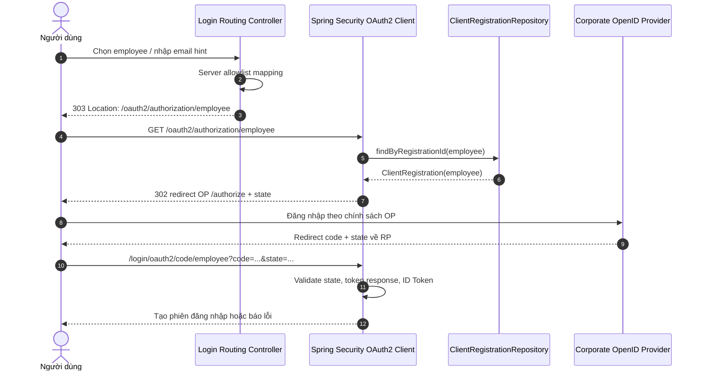

# 25.4. Điều hướng đăng nhập theo loại người dùng hoặc miền tổ chức

Một ứng dụng **Spring Security OAuth 2.0 / OpenID Connect (OIDC) Client** có thể kết nối nhiều **OpenID Provider (OP)**: SSO nhân viên, nhà cung cấp danh tính của đối tác, hoặc một nền tảng đăng nhập dành cho khách hàng. Khi tất cả cùng xuất hiện trên một website, người dùng không nhất thiết biết mình phải nhấn nút **“Đăng nhập với nhà cung cấp nào?”**.

Một trải nghiệm phổ biến là ứng dụng hỏi **loại người dùng** (nhân viên, đối tác, khách hàng) hoặc **địa chỉ email/miền tổ chức** rồi điều hướng đến OP thích hợp. Cơ chế này thường được gọi là **Home Realm Discovery (HRD)** hoặc **Identity Provider Discovery**. Trong Spring Security, ứng dụng thường quyết định một **`registrationId` đã được cấu hình**, sau đó chuyển browser đến endpoint chuẩn:

```text
/oauth2/authorization/{registrationId}
```

Ví dụ, một người nhập `an@corp.example` có thể được gợi ý tới registration `employee`, còn người chọn “Đối tác” có thể được hướng tới `partner`. Tuy nhiên, địa chỉ email hoặc loại người dùng **trước đăng nhập chỉ là thông tin tự khai**, chưa chứng minh người đó thuộc tổ chức. Việc xác thực, liên kết danh tính và cấp quyền phải thực hiện **sau khi OP xác thực thành công**, dựa trên issuer, subject và chính sách của ứng dụng.

Bài học này trình bày mô hình thiết kế, cấu hình và code với **Spring Boot 3.x / Spring Security 6.x**, tập trung vào **Spring MVC/Servlet** và chỉ rõ khác biệt khi áp dụng cho **Spring WebFlux/Reactive**.

> **Nguyên tắc trung tâm:** Dùng thông tin trước đăng nhập để **chọn đường đi đến provider đã được phê duyệt**, tuyệt đối không dùng nó để xác nhận danh tính, cấp role, chọn issuer tùy ý hoặc vượt qua bước authorization.

## 1. Sau bài học, bạn làm được gì?

Bạn có thể:

1. Giải thích vì sao ứng dụng nhiều OIDC providers cần một **login routing policy**.
2. Phân biệt lựa chọn theo **loại người dùng**, **miền email**, **mã tổ chức**, **subdomain** và **danh tính đã xác thực**.
3. Cấu hình nhiều `ClientRegistration` với các `registrationId` tách biệt.
4. Tạo trang chọn phương thức đăng nhập và route `/sso/start/**` chỉ redirect đến những registrations được cho phép.
5. Tạo một **home realm discovery** dựa trên domain được ánh xạ bằng allowlist server-side.
6. Xử lý trường hợp không tìm thấy domain, domain có nhiều nhà cung cấp hoặc input cố tình giả mạo.
7. Bảo vệ `state`, PKCE, nonce, `redirect_uri`, issuer và callback khi có nhiều providers.
8. Map user sau OIDC Login theo **`(iss, sub)`** và kiểm tra tenant membership/role từ nguồn đáng tin cậy.
9. Tránh lộ thông tin tài khoản, open redirect, phishing, SSRF và lẫn token giữa tenants.
10. Hiểu điểm khác nhau giữa Servlet và Reactive khi chọn registration.
11. Kiểm thử lựa chọn provider, routing lỗi, đăng nhập sai OP, multi-tab, logout và account switching.

## 2. Bài toán nghiệp vụ: một ứng dụng, nhiều nhà cung cấp danh tính

Giả sử cổng quản lý thuê thiết bị có ba nhóm người dùng:

| Nhóm | Trải nghiệm mong muốn | OP tin cậy | Registration ID |
| --- | --- | --- | --- |
| Nhân viên nội bộ | Đăng nhập bằng SSO công ty | `https://sso.corp.example/realms/staff` | `employee` |
| Đối tác vận hành | Đăng nhập bằng hệ thống của đối tác | `https://login.partner.example/oidc` | `partner` |
| Khách hàng | Đăng nhập bằng hệ thống khách hàng | `https://identity.customer.example` | `customer` |

Một trang login có thể hiển thị ba nút, nhưng một tổ chức có hàng trăm đối tác thường muốn giảm sự lựa chọn. Ví dụ:

- User chọn “Tôi là nhân viên”.
- User chọn “Tôi là đối tác”.
- User nhập email công việc để hệ thống gợi ý OP.
- User chọn doanh nghiệp từ một danh mục đã được quản trị.
- User truy cập subdomain `alpha.portal.example` và được đưa tới OP của Alpha.

**Các lựa chọn trên chỉ là bước định tuyến trước authentication.** Kẻ tấn công cũng có thể nhấn “Nhân viên” hoặc nhập `ceo@corp.example`. OP vẫn phải xác thực người dùng; sau đó ứng dụng mới quyết định người dùng có thuộc tenant và có quyền truy cập hay không.

### 2.1. Sơ đồ tổng thể

```mermaid
flowchart TD
    A[Browser mở trang /login] --> B{Nguồn gợi ý?}
    B --> C[Loại người dùng được chọn]
    B --> D[Miền từ email hint]
    B --> E[Mã tổ chức hoặc subdomain]
    C --> F[Server-side routing policy]
    D --> F
    E --> F
    F --> G{Có registration được phê duyệt?}
    G -- Không hoặc không chắc --> H[Trang chọn thủ công / hỗ trợ]
    G -- Có --> I[registrationId tin cậy]
    I --> J[/oauth2/authorization/registrationId]
    J --> K[Spring Security Authorization Request]
    K --> L[OP được cấu hình xác thực user]
    L --> M[Callback + state/PKCE/nonce validation]
    M --> N[Authentication đã xác thực]
    N --> O[Map issuer + subject tới account]
    O --> P{Membership và quyền hợp lệ?}
    P -- Không --> Q[Từ chối hoặc yêu cầu account linking]
    P -- Có --> R[Cho phép truy cập theo role/tenant policy]
```

Lớp routing nên **hẹp và dễ kiểm thử**. Nó chọn một ID trong tập đã biết, chứ không trực tiếp xây authorization URL chứa mọi thông số protocol.

## 3. Bốn khái niệm tuyệt đối không được đánh đồng

| Khái niệm | Ví dụ | Có thể tin trước login không? | Dùng để làm gì? |
| --- | --- | --- | --- |
| **Loại người dùng tự chọn** | `employee` | Không, chỉ là hint | Quyết định nút/luồng login được gợi ý |
| **Email tự nhập** | `an@corp.example` | Không, chưa xác minh sở hữu | Home realm discovery |
| **`registrationId`** | `employee` | Tin được khi do server map tới cấu hình đã duyệt | Chọn `ClientRegistration` |
| **Danh tính OIDC đã xác thực** | `iss + sub` | Có sau khi Spring xác minh login; vẫn cần authorization | Liên kết account và kiểm tra quyền |

Ngoài ra còn có **`clientId`**, **provider alias**, **issuer URI** và **tenant ID**. Chúng đều khác `registrationId`.

Ví dụ:

```yaml
registration:
  employee:
    provider: corporate-op
    client-id: enterprise-portal-prod
provider:
  corporate-op:
    issuer-uri: https://sso.corp.example/realms/staff
```

Trong ví dụ này:

- `employee` = **registration ID**.
- `corporate-op` = **alias cấu hình provider**.
- `enterprise-portal-prod` = **client ID do OP cấp**.
- `https://sso.corp.example/realms/staff` = **issuer URI**.
- “nhân viên” = **nhóm người dùng trong nghiệp vụ**, không phải bằng chứng đã xác thực.

Browser bắt đầu flow bằng `/oauth2/authorization/employee`, không phải đường dẫn mang client secret hoặc issuer URL từ form input.

## 4. Hai giai đoạn ra quyết định: trước và sau authentication

Cùng một từ “loại người dùng” thường xuất hiện ở hai thời điểm nhưng có ý nghĩa hoàn toàn khác.

### 4.1. Trước login: quyết định routing

```text
Input:
  emailHint = alice@corp.example
  selectedKind = employee

Decision:
  route to registrationId = employee
```

Đây là **lựa chọn provider để thử xác thực**, chưa có role, principal hay membership đáng tin cậy.

### 4.2. Sau login: xác minh identity và quyền

```text
Validated OIDC login:
  iss = https://sso.corp.example/realms/staff
  sub = 00u12345
  registrationId = employee

Server-side account mapping:
  (iss, sub) -> internalAccountId = 9182
  internalAccountId belongs to tenant corporate
  roles = [RENTAL_OPERATOR]
```

Lúc này ứng dụng mới có căn cứ cấp quyền theo policy. Ngay cả sau khi OIDC Login thành công, người dùng có thể chưa được cấp quyền dùng ứng dụng, ví dụ họ không thuộc danh sách nhân viên hoạt động hoặc chưa được mời vào tenant.

**Không bao giờ viết:** “Chọn `employee` → cấp `ROLE_EMPLOYEE`”. Đây là privilege escalation vì bất kỳ ai cũng có thể chọn nút.

## 5. Luồng chuẩn khi điều hướng theo registration ID

Trên Servlet OAuth2 Login, Spring Security có endpoint mặc định:

```text
GET /oauth2/authorization/{registrationId}
```

Nó không phải URL của OP. Đây là **endpoint trong ứng dụng RP** do `OAuth2AuthorizationRequestRedirectFilter` xử lý.

Ví dụ:

```text
GET /oauth2/authorization/employee
```

Spring sẽ:

1. Tra `ClientRegistrationRepository` theo `employee`.
2. Đọc authorization endpoint, client ID, redirect URI, scopes và provider metadata.
3. Tạo authorization request gồm `state` và các tham số cần thiết.
4. Áp dụng PKCE/nonce theo grant, OP và cấu hình tương ứng.
5. Lưu trạng thái liên kết request/callback bằng cơ chế authorization request repository.
6. Redirect browser tới đúng Authorization Endpoint của OP.
7. Nhận callback `/login/oauth2/code/employee`.
8. Kiểm tra response và hoàn thành OIDC Login trước khi tạo Authentication.

### 5.1. Sequence diagram



**Routing controller không cần tự ký `state`, tự xử lý authorization code hay tự lấy JWKS.** Các việc đó nên để Spring Security và các OAuth2/OIDC components phù hợp thực hiện.

## 6. Khi nào nên chọn theo loại người dùng?

Điều hướng theo loại người dùng phù hợp khi mỗi nhóm có **đường login dễ hiểu và tương đối ổn định**:

- “Nhân viên công ty”.
- “Đối tác đã được cấp quyền”.
- “Khách hàng cá nhân”.
- “Nhà quản trị tổ chức” (chỉ là tên nút; quyền admin vẫn được kiểm tra sau login).

Ưu điểm:

- Không cần thu thập email trước authentication.
- Dễ hiển thị trên một trang login.
- Giảm phụ thuộc vào mapping email domain.
- Ít nguy cơ account enumeration.
- Dễ giải thích khi công ty có nhiều domain.

Hạn chế:

- User có thể chọn nhầm.
- Một người có thể thuộc nhiều nhóm.
- Một group có thể chứa nhiều OP/tenants.
- Không được dùng lựa chọn này làm authorization.

### 6.1. Chọn nhầm nhóm thì sao?

Nếu user nhấn “Nhân viên” nhưng không có account ở Corporate OP, OP có thể hiển thị lỗi hoặc màn hình đăng nhập. Ứng dụng nên có lối quay lại trang chọn provider, không tự “thử đăng nhập tất cả OP” một cách âm thầm.

Một redirect sau lỗi nên đưa về trang chung với thông báo nhẹ, ví dụ **“Không đăng nhập được bằng phương thức vừa chọn. Hãy thử phương thức khác hoặc liên hệ quản trị.”** Tránh tiết lộ tài khoản email nào tồn tại tại OP nào.

## 7. Khi nào nên chọn theo miền tổ chức?

Một ứng dụng B2B có thể dùng **email-domain-based routing**:

```text
@corp.example      -> employee
@partner.example   -> partner
@customer.example  -> customer
```

Nếu người dùng nhập `name@corp.example`, app tra **bảng domain đã được quản lý phía server** rồi hướng browser đến `/oauth2/authorization/employee`.

**Domain chỉ là gợi ý tìm OP, không chứng minh quyền sở hữu.** Kẻ tấn công có thể nhập bất kỳ email nào trước login.

### 7.1. Cần dùng mapping exact, không phải substring

Sai:

```java
// SAI: attacker@example.corp.example.evil có thể khớp.
if (email.contains("corp.example")) {
    return "employee";
}
```

Cũng không nên:

```java
// SAI: một miền con không có trong policy vẫn có thể được chọn.
if (domain.endsWith("corp.example")) {
    return "employee";
}
```

Nếu policy chỉ chấp nhận `corp.example`, hãy so sánh **chuỗi domain đã chuẩn hóa và canonicalize theo một ánh xạ exact**:

```text
domain == "corp.example"
```

Chỉ cho phép subdomain khi registry đã chỉ rõ và có quy tắc ranh giới nhãn DNS, ví dụ `domain.equals("corp.example") || domain.endsWith(".corp.example")` **khi toàn bộ subdomain thật sự được tổ chức quản lý**. Với B2B tenants, safer default là exact map.

### 7.2. Miền email có thể mơ hồ

Những trường hợp không nên auto-route cứng:

- Dịch vụ email dùng chung như `gmail.com` hoặc `outlook.com`.
- Hai đối tác cùng dùng một email hosting domain.
- Nhà thầu có email công ty nhưng phải đăng nhập qua OP của đối tác.
- Một người thuộc hai tổ chức, cùng một email alias.
- Người dùng đổi miền sau khi công ty sáp nhập.
- Khách hàng liên kết nhiều identities/OPs.
- Internationalized domain names (IDN) và punycode.
- Domain không đăng ký trong hệ thống.

Trong các trường hợp đó, nên hiển thị **danh sách provider được phép** hoặc yêu cầu người dùng chọn **mã tổ chức** thay vì tự thử nhiều OP.

## 8. Khi nào chọn theo mã tổ chức hoặc subdomain?

Thay vì email, SaaS có thể dùng:

```text
alpha.portal.example  -> registrationId = alpha-oidc
beta.portal.example   -> registrationId = beta-oidc
```

hoặc người dùng nhập mã tổ chức:

```text
Organization code = alpha
                    |
                    v
Approved tenant record
                    |
                    v
registrationId = alpha-oidc
```

Ưu điểm:

- Ánh xạ trực tiếp tới tenant đã được quản trị.
- Hoạt động khi nhiều tenants cùng dùng email domain.
- Không cần thu thập email chỉ để tìm OP.
- Có thể tích hợp custom branding/login policy.

Tuy nhiên, **subdomain/organization code không phải bằng chứng người dùng thuộc tenant**. Sau authentication, cần kiểm tra user được cấp quyền tại đúng tenant.

Nếu ứng dụng chạy qua custom domains, phải kiểm soát **Host header và forwarded headers** từ proxy đáng tin cậy. Không dựa vào `X-Forwarded-Host` do client Internet tùy ý gửi để chọn OAuth issuer hoặc redirect URI.

## 9. Cấu hình ba OIDC providers trong Spring Boot

### 9.1. Maven

```xml
<dependencies>
    <dependency>
        <groupId>org.springframework.boot</groupId>
        <artifactId>spring-boot-starter-web</artifactId>
    </dependency>
    <dependency>
        <groupId>org.springframework.boot</groupId>
        <artifactId>spring-boot-starter-security</artifactId>
    </dependency>
    <dependency>
        <groupId>org.springframework.boot</groupId>
        <artifactId>spring-boot-starter-oauth2-client</artifactId>
    </dependency>
</dependencies>
```

Nếu dùng trang login Thymeleaf, cần thêm `spring-boot-starter-thymeleaf` theo lựa chọn view technology của ứng dụng.

### 9.2. `application.yml`

```yaml
spring:
  security:
    oauth2:
      client:
        registration:
          employee:
            provider: corporate-oidc
            client-id: ${EMPLOYEE_OIDC_CLIENT_ID}
            client-secret: ${EMPLOYEE_OIDC_CLIENT_SECRET}
            client-authentication-method: client_secret_basic
            authorization-grant-type: authorization_code
            redirect-uri: "{baseUrl}/login/oauth2/code/{registrationId}"
            scope:
              - openid
              - profile
              - email
            client-name: "SSO nhân viên"

          partner:
            provider: partner-oidc
            client-id: ${PARTNER_OIDC_CLIENT_ID}
            client-secret: ${PARTNER_OIDC_CLIENT_SECRET}
            client-authentication-method: client_secret_basic
            authorization-grant-type: authorization_code
            redirect-uri: "{baseUrl}/login/oauth2/code/{registrationId}"
            scope:
              - openid
              - profile
            client-name: "SSO đối tác"

          customer:
            provider: customer-oidc
            client-id: ${CUSTOMER_OIDC_CLIENT_ID}
            client-secret: ${CUSTOMER_OIDC_CLIENT_SECRET}
            client-authentication-method: client_secret_basic
            authorization-grant-type: authorization_code
            redirect-uri: "{baseUrl}/login/oauth2/code/{registrationId}"
            scope:
              - openid
              - profile
            client-name: "Đăng nhập khách hàng"

        provider:
          corporate-oidc:
            issuer-uri: https://sso.corp.example/realms/staff
          partner-oidc:
            issuer-uri: https://login.partner.example/oidc
          customer-oidc:
            issuer-uri: https://identity.customer.example
```

`issuer-uri` là địa chỉ issuer giả lập để giải thích, không phải URL dịch vụ có thể dùng ngay. Với OP thực, kiểm tra OIDC Discovery, TLS, ID Token issuer và redirect URI đã đăng ký.

### 9.3. `application.properties` tương đương cho một provider

```properties
spring.security.oauth2.client.registration.employee.provider=corporate-oidc
spring.security.oauth2.client.registration.employee.client-id=${EMPLOYEE_OIDC_CLIENT_ID}
spring.security.oauth2.client.registration.employee.client-secret=${EMPLOYEE_OIDC_CLIENT_SECRET}
spring.security.oauth2.client.registration.employee.client-authentication-method=client_secret_basic
spring.security.oauth2.client.registration.employee.authorization-grant-type=authorization_code
spring.security.oauth2.client.registration.employee.redirect-uri={baseUrl}/login/oauth2/code/{registrationId}
spring.security.oauth2.client.registration.employee.scope=openid,profile,email
spring.security.oauth2.client.registration.employee.client-name=SSO nhân viên
spring.security.oauth2.client.provider.corporate-oidc.issuer-uri=https://sso.corp.example/realms/staff
```

Các registrations `partner` và `customer` có thể biểu diễn tương tự. Chỉ cần chọn một kiểu cấu hình trong dự án để tránh ghi đè cấu hình vô ý.

### 9.4. Một registration không nhất thiết bằng một OP

Bạn có thể đăng ký hai client IDs cùng một issuer:

```text
registrationId = employee-web
clientId = web-client
issuer = https://sso.corp.example

registrationId = employee-admin-tool
clientId = admin-tool-client
issuer = https://sso.corp.example
```

Dù issuer giống nhau, chúng có thể có redirect URIs, scopes và policy khác nhau. **Routing phải chọn đúng registration ID đã được phê duyệt cho nghiệp vụ**, không chỉ chọn provider host.

## 10. Thiết lập `SecurityFilterChain` cho một trang login riêng

Trong Spring MVC/Servlet:

```java
import org.springframework.context.annotation.Bean;
import org.springframework.context.annotation.Configuration;
import org.springframework.security.config.annotation.web.builders.HttpSecurity;
import org.springframework.security.web.SecurityFilterChain;

@Configuration
public class MultiProviderSecurityConfig {

    @Bean
    SecurityFilterChain securityFilterChain(HttpSecurity http)
            throws Exception {

        http
            .authorizeHttpRequests(authorize -> authorize
                .requestMatchers(
                    "/", "/login", "/login-error",
                    "/sso/start/**", "/sso/discover",
                    "/css/**", "/js/**", "/error")
                    .permitAll()
                .anyRequest().authenticated())
            .oauth2Login(oauth -> oauth
                .loginPage("/login")
                .failureUrl("/login?error"));

        return http.build();
    }
}
```

`oauth2Login(...)` vẫn để Spring Security làm việc với Authorization Code Flow; bạn chỉ thay phần **trang hiển thị lựa chọn login**.

Không tắt `csrf()`. Nếu có POST form gửi email hint để điều hướng, nó cũng nên nhận CSRF token hợp lệ trong một website dùng session.

### 10.1. Controller trang login

```java
import org.springframework.stereotype.Controller;
import org.springframework.web.bind.annotation.GetMapping;

@Controller
public class LoginPageController {

    @GetMapping("/login")
    String loginPage() {
        return "login"; // templates/login.html
    }
}
```

Nếu người dùng nhấn link `/oauth2/authorization/employee`, Spring Security sẽ tiếp tục flow. Không cần tự xây authorization endpoint URL trong controller này.

### 10.2. Mẫu trang login với lựa chọn trực tiếp

```html
<section aria-labelledby="login-title">
  <h1 id="login-title">Chọn phương thức đăng nhập</h1>

  <a href="/sso/start/employee">Tôi là nhân viên</a>
  <a href="/sso/start/partner">Tôi là đối tác</a>
  <a href="/sso/start/customer">Tôi là khách hàng</a>
</section>
```

Các đường `/sso/start/*` là routes tùy biến của ứng dụng. Nó nên **redirect tới endpoint Spring Security** chứ không tự tạo `state` hay callback URL.

## 11. Một controller chỉ cho phép ba lựa chọn đã duyệt

Đoạn dưới dùng **Java 17+**, phù hợp baseline của Spring Boot 3.

```java
import java.net.URI;

import org.springframework.http.HttpStatus;
import org.springframework.http.ResponseEntity;
import org.springframework.web.bind.annotation.GetMapping;
import org.springframework.web.bind.annotation.PathVariable;
import org.springframework.web.bind.annotation.RestController;
import org.springframework.web.server.ResponseStatusException;

@RestController
public class LoginStartController {

    @GetMapping("/sso/start/{kind}")
    public ResponseEntity<Void> start(
            @PathVariable String kind) {

        String registrationId = switch (kind) {
            case "employee" -> "employee";
            case "partner" -> "partner";
            case "customer" -> "customer";
            default -> throw new ResponseStatusException(
                    HttpStatus.NOT_FOUND);
        };

        URI internalAuthorizationUri = URI.create(
                "/oauth2/authorization/" + registrationId);

        return ResponseEntity
                .status(HttpStatus.SEE_OTHER)
                .location(internalAuthorizationUri)
                .build();
    }
}
```

Tại sao đoạn này an toàn hơn việc xây URL từ issuer tự nhập?

- `kind` chỉ được đối chiếu với **ba chuỗi do server định nghĩa**.
- `registrationId` chỉ nhận giá trị từ allowlist, không phản ánh tùy ý input.
- Đích của redirect là **URL nội bộ** do Spring Security xử lý.
- `client_id`, `redirect_uri`, issuer, scopes và `state` đến từ `ClientRegistration`/Spring Security.
- Không có client secret trong response hoặc URL.
- Không cấp quyền dựa trên `kind`.

**Đây là bước routing, không phải validation toàn bộ OIDC login.** Sau redirect, Spring Security và OP mới thực hiện xác thực.

### 11.1. Vì sao dùng 303?

`303 See Other` giúp browser tiếp tục bằng GET tới endpoint bắt đầu authorization, đặc biệt phù hợp khi bước lựa chọn ban đầu là POST. `302 Found` cũng thường được dùng trong browser redirect; quan trọng là đảm bảo behavior được kiểm thử theo HTTP client/browser đang hỗ trợ.

### 11.2. Không nhận `registrationId` tự do từ người dùng

Sai:

```java
@GetMapping("/sso/start")
ResponseEntity<Void> start(@RequestParam String registrationId) {
    return ResponseEntity.status(302)
            .location(URI.create(
                "/oauth2/authorization/" + registrationId))
            .build();
}
```

Dù endpoint Spring Security có thể từ chối registration không tồn tại, code tùy tiện như trên làm mờ chính sách business (tenant nào được dùng registration nào), khó chống spoofing/phishing, và có nguy cơ gây path/redirect issues nếu input không được kiểm soát.

Sử dụng enum, map đã duyệt hoặc một policy service. **“Có `ClientRegistration`” không tự đồng nghĩa “mọi caller được phép khởi động flow của registration đó”.**

## 12. Tạo policy chọn provider theo miền email hoặc user type

Một implementation nên có **một nơi duy nhất** giữ ánh xạ domain/user type sang registration. Nó không biết client secret, token endpoint hay JWT keys.

### 12.1. Ví dụ `LoginRoutingPolicy`

```java
import java.net.IDN;
import java.util.Locale;
import java.util.Map;
import java.util.Optional;

import org.springframework.stereotype.Component;

@Component
public final class LoginRoutingPolicy {

    private static final Map<String, String> DOMAIN_TO_REGISTRATION =
            Map.of(
                    "corp.example", "employee",
                    "partner.example", "partner");

    private static final Map<String, String> KIND_TO_REGISTRATION =
            Map.of(
                    "employee", "employee",
                    "partner", "partner",
                    "customer", "customer");

    public Optional<String> select(String emailHint, String kind) {
        String byKind = kind == null
                ? null
                : KIND_TO_REGISTRATION.get(
                        kind.trim().toLowerCase(Locale.ROOT));

        String byDomain = normalizedDomain(emailHint)
                .map(DOMAIN_TO_REGISTRATION::get)
                .orElse(null);

        // Hai gợi ý mâu thuẫn: không tự quyết định tùy tiện.
        if (byKind != null
                && byDomain != null
                && !byKind.equals(byDomain)) {
            return Optional.empty();
        }

        // Domain được đăng ký ưu tiên khi rõ ràng.
        String selected = byDomain != null ? byDomain : byKind;

        // Không có kết quả -> trang chọn thủ công.
        return Optional.ofNullable(selected);
    }

    private Optional<String> normalizedDomain(String emailHint) {
        if (emailHint == null
                || emailHint.isBlank()
                || emailHint.length() > 254) {
            return Optional.empty();
        }

        String value = emailHint.trim();
        int at = value.indexOf('@');

        // Chỉ chấp nhận một dấu @ và có phần local/domain.
        if (at <= 0
                || at != value.lastIndexOf('@')
                || at == value.length() - 1) {
            return Optional.empty();
        }

        String rawDomain = value.substring(at + 1);

        try {
            String ascii = IDN.toASCII(
                    rawDomain, IDN.USE_STD3_ASCII_RULES)
                    .toLowerCase(Locale.ROOT);

            if (ascii.isBlank()
                    || ascii.length() > 253
                    || ascii.startsWith(".")
                    || ascii.endsWith(".")
                    || ascii.contains("..")) {
                return Optional.empty();
            }
            return Optional.of(ascii);
        } catch (IllegalArgumentException invalidDomain) {
            return Optional.empty();
        }
    }
}
```

**Đây là parser tối thiểu dành cho một ô email hint**, không phải bộ kiểm tra email chuẩn RFC hoàn chỉnh hoặc bằng chứng sở hữu email. `IDN.toASCII` hỗ trợ canonicalize nhiều domain quốc tế sang ASCII/punycode để so chính xác với registry. Vì mapping chỉ nhận **exact allowlisted domains**, input lạ không thể tự tạo registration.

Dùng một thư viện email validation đã được thẩm định nếu sản phẩm có yêu cầu đầy đủ về EAI, Unicode, mailbox syntax; nhưng vẫn phải giữ **routing map phía server** và không biến email tự nhập thành identity.

### 12.2. Tại sao không lưu `emailHint` như danh tính đã được xác minh?

Trong flow này, `emailHint` có thể là:

- Chuỗi người dùng tự gõ nhầm.
- Một email không thuộc họ.
- Email đã đổi/được dùng chung.
- Email được cung cấp với mục đích định tuyến/phishing.
- Dữ liệu cá nhân không cần giữ sau khi chọn provider.

Vì vậy, không dùng email hint để:

- Tạo `ROLE_EMPLOYEE`.
- Gán tenant membership.
- Liên kết hai accounts.
- Truy vấn hồ sơ nhân sự và trả trạng thái tồn tại.
- Vô hiệu hóa user khác.
- Ghi log PII không cần thiết.

Nếu phải giữ `login_hint` cho UX tại OP, cần hạn chế vòng đời, tránh lộ qua URL/log, và coi nó là **hint chưa được xác minh**.

## 13. Controller nhận email hint bằng POST

Để giảm khả năng email bị ghi vào URL/history/proxy logs, có thể nhận dữ liệu qua **POST form** và trả 303 tới endpoint authorization nội bộ.

```java
import java.net.URI;

import org.springframework.http.HttpStatus;
import org.springframework.http.ResponseEntity;
import org.springframework.web.bind.annotation.PostMapping;
import org.springframework.web.bind.annotation.RequestParam;
import org.springframework.web.bind.annotation.RestController;

@RestController
public class LoginDiscoveryController {

    private final LoginRoutingPolicy policy;

    public LoginDiscoveryController(LoginRoutingPolicy policy) {
        this.policy = policy;
    }

    @PostMapping("/sso/discover")
    public ResponseEntity<Void> discover(
            @RequestParam(name = "email", required = false)
            String email,
            @RequestParam(name = "kind", required = false)
            String kind) {

        URI destination = policy.select(email, kind)
                .map(id -> URI.create(
                        "/oauth2/authorization/" + id))
                .orElseGet(() ->
                        URI.create("/login?choose=manual"));

        return ResponseEntity.status(HttpStatus.SEE_OTHER)
                .location(destination)
                .build();
    }
}
```

**Lưu ý:** `/sso/discover` được `permitAll` để user chưa đăng nhập gọi được, nhưng **CSRF filter vẫn áp dụng cho POST**. Ngoài ra phải có rate limiting/input-size limits phù hợp để tránh lạm dụng một endpoint public.

### 13.1. HTML form với CSRF trong Thymeleaf

```html
<form th:action="@{/sso/discover}" method="post">
  <label for="work-email">Email công việc (không bắt buộc)</label>
  <input id="work-email"
         type="email"
         name="email"
         autocomplete="email"
         maxlength="254">

  <label for="account-kind">Tôi đăng nhập với vai trò</label>
  <select id="account-kind" name="kind">
    <option value="">Chọn sau</option>
    <option value="employee">Nhân viên</option>
    <option value="partner">Đối tác</option>
    <option value="customer">Khách hàng</option>
  </select>

  <input type="hidden"
         th:name="${_csrf.parameterName}"
         th:value="${_csrf.token}">

  <button type="submit">Tiếp tục</button>
</form>
```

Các biểu thức `_csrf` giả định Spring Security và Thymeleaf đã cung cấp `CsrfToken` cho template theo cơ chế tích hợp của phiên bản đang dùng. Không hardcode CSRF token và không tắt CSRF chỉ để form hoạt động.

### 13.2. Kết quả từ policy

| Input | Mapping | Kết quả |
| --- | --- | --- |
| `an@corp.example`, kind trống | Domain exact `corp.example` | `employee` |
| `bob@partner.example`, kind `partner` | Cả hai cùng chỉ một registration | `partner` |
| `an@corp.example`, kind `customer` | Hai hints mâu thuẫn | Trang chọn thủ công |
| `alice@gmail.com`, kind trống | Domain không nằm trong registry | Trang chọn thủ công |
| Email rỗng, kind `customer` | User type explicit | `customer` |
| `alice@corp.example.evil` | Không khớp exact map | Trang chọn thủ công |
| Email chứa nhiều `@` | Invalid hint | Trang chọn thủ công |
| Kind không được biết | Không khớp type allowlist | Trang chọn thủ công |

Từ góc độ bảo mật, đây là **user experience routing**. Việc user nhập đúng domain không cho họ quyền ưu tiên hoặc chứng minh họ là nhân viên; OP và policy hậu đăng nhập vẫn phải quyết định.

### 13.3. Tránh account enumeration

Không nên trả về:

```text
Email alice@corp.example hiện là nhân viên hợp lệ.
Email bob@corp.example chưa có tài khoản.
```

trên một endpoint public. Một actor có thể thử hàng loạt email để suy ra danh sách nhân viên/khách hàng. Nếu dùng domain mapping công khai, chỉ trả lựa chọn provider, không xác nhận tài khoản cụ thể. Có thể áp dụng rate limiting, response normalization và monitoring chống abuse.

## 14. Nếu domain không khớp thì làm gì?

Một lỗi trải nghiệm thường gặp là **tự chuyển sang OP mặc định** khi không nhận diện domain, khiến user không hiểu tại sao lại bị đưa tới login khác.

Nên chọn một trong các chính sách rõ ràng:

1. **Trang chọn thủ công:** hiển thị các provider được phép dùng với môi trường hiện tại.
2. **Yêu cầu mã tổ chức:** nếu một domain có thể thuộc nhiều tenants.
3. **Liên hệ quản trị:** nếu tổ chức phải được onboarding trước.
4. **Provider khách hàng mặc định:** chỉ khi đây là mô hình sản phẩm đã được thiết kế và không tạo account confusion.
5. **Nút “Quay lại” sau lỗi đăng nhập:** tránh giữ user trong redirect loop.

Không thử tuần tự `employee → partner → customer` bằng cách gửi authorization requests âm thầm. Mỗi OP có thể yêu cầu interaction, consent, cookie và trust boundary riêng.

### 14.1. Có nên hiển thị nhà cung cấp cho domain không?

Hiển thị “Dùng SSO Công ty” chỉ là UX. Nếu tên provider/tenant được xem là nhạy cảm, hãy dùng thông báo chung như “Tiếp tục tới nhà cung cấp đăng nhập phù hợp” hoặc yêu cầu mã tổ chức đã biết.

Mức độ tiết lộ metadata của tổ chức cần được chính sách sản phẩm quyết định, không phải từ response lỗi của OP.

## 15. `login_hint` và `domain_hint`: hỗ trợ UX, không xác thực

Một số OP hỗ trợ authorization request parameters như:

- `login_hint`: gợi ý username/email hiển thị hoặc prefill tại OP.
- `domain_hint`: gợi ý tổ chức/home realm cho một số providers.
- `prompt`: điều chỉnh yêu cầu tương tác đăng nhập/consent theo OIDC.
- `ui_locales`: gợi ý ngôn ngữ UI.

**Chúng không phải cơ chế xác thực**. Việc OP nhận `login_hint=ceo@corp.example` không chứng minh browser đang thuộc về CEO.

### 15.1. Cách Spring thêm authorization parameters

Với Servlet, Spring Security có `DefaultOAuth2AuthorizationRequestResolver` và các cách tùy biến `OAuth2AuthorizationRequest` qua authorization request resolver/customizer.

Một thiết kế có kiểm soát:

```text
POST /sso/discover (email hint)
      |
      +--> normalize/domain routing
      +--> chọn registration đã phê duyệt
      +--> lưu hint tối thiểu trong session nếu thật sự cần
      |
      v
GET /oauth2/authorization/{registrationId}
      |
      v
Custom OAuth2AuthorizationRequestResolver (tùy chọn)
      |
      +--> delegate tạo request chuẩn
      +--> thêm login_hint được validate/đọc từ context tin cậy
      |
      v
Authorization Request với state, PKCE/nonce như framework thiết kế
```

Đừng tự lắp URL `https://op.example/authorize?...` bằng cách nối query string rồi bỏ qua Spring Security request resolver. Khi làm vậy rất dễ thiếu `state`, PKCE, nonce, redirect URI và persistence cần thiết cho callback.

### 15.2. Ví dụ bọc resolver thay vì viết lại state machine

```java
import jakarta.servlet.http.HttpServletRequest;

import org.springframework.security.oauth2.client.registration
        .ClientRegistrationRepository;
import org.springframework.security.oauth2.client.web
        .DefaultOAuth2AuthorizationRequestResolver;
import org.springframework.security.oauth2.client.web
        .OAuth2AuthorizationRequestResolver;
import org.springframework.security.oauth2.core.endpoint
        .OAuth2AuthorizationRequest;

public final class TrustedLoginHintResolver
        implements OAuth2AuthorizationRequestResolver {

    private final OAuth2AuthorizationRequestResolver delegate;

    public TrustedLoginHintResolver(
            ClientRegistrationRepository registrations) {
        this.delegate =
                new DefaultOAuth2AuthorizationRequestResolver(
                        registrations, "/oauth2/authorization");
    }

    @Override
    public OAuth2AuthorizationRequest resolve(
            HttpServletRequest request) {
        return customize(delegate.resolve(request), request);
    }

    @Override
    public OAuth2AuthorizationRequest resolve(
            HttpServletRequest request,
            String clientRegistrationId) {
        return customize(
                delegate.resolve(request, clientRegistrationId),
                request);
    }

    private OAuth2AuthorizationRequest customize(
            OAuth2AuthorizationRequest original,
            HttpServletRequest request) {

        if (original == null) {
            return null;
        }

        // Ví dụ kiến trúc: session attribute chỉ do server tạo sau
        // khi validate email hint, không lấy trực tiếp từ URL của OP.
        Object hint = request.getSession(false) == null
                ? null
                : request.getSession(false)
                        .getAttribute("approvedLoginHint");

        if (!(hint instanceof String loginHint)
                || loginHint.isBlank()) {
            return original;
        }

        return OAuth2AuthorizationRequest.from(original)
                .additionalParameters(parameters ->
                        parameters.put("login_hint", loginHint))
                .build();
    }
}
```

Cần gắn resolver này qua cấu hình:

```java
http.oauth2Login(oauth -> oauth
        .authorizationEndpoint(endpoint ->
                endpoint.authorizationRequestResolver(
                        new TrustedLoginHintResolver(registrations))));
```

**Không áp dụng cùng lúc với một `oauth2Login(...)` khác cho cùng chain mà không hợp nhất các tùy biến.** Mẫu chỉ minh họa cách delegate để giữ cơ chế chuẩn. Trong production, hãy giới hạn vòng đời session attribute, xóa hint sau khi dùng, tránh lẫn hint giữa nhiều tabs hoặc providers, đồng thời kiểm tra `login_hint` không chứa PII ngoài mục đích đã định.

### 15.3. Khi không cần `login_hint`, đừng thêm

Nếu OP có thể hiển thị login page phù hợp chỉ nhờ registration, hãy để routing controller chuyển tới `/oauth2/authorization/{registrationId}` rồi kết thúc trách nhiệm. Ít tham số tùy biến giúp giảm dữ liệu nhạy cảm trong URL và giảm rủi ro tương thích giữa providers.

## 16. Sau login: lấy registration và OIDC identity đáng tin cậy

Khi callback OIDC hợp lệ, Spring Security tạo một `Authentication` như `OAuth2AuthenticationToken` với `OidcUser`.

Có thể đọc registration đã được dùng:

```java
import org.springframework.security.oauth2.client.authentication
        .OAuth2AuthenticationToken;
import org.springframework.security.oauth2.core.oidc.user.OidcUser;

void inspectValidatedLogin(
        OAuth2AuthenticationToken authentication) {

    String registrationId =
            authentication.getAuthorizedClientRegistrationId();

    if (!(authentication.getPrincipal() instanceof OidcUser user)) {
        throw new IllegalStateException(
                "Expected an OIDC principal");
    }

    String issuer =
            user.getIdToken().getIssuer().toString();
    String subject =
            user.getIdToken().getSubject();

    // Dùng issuer + subject trong server-side identity mapping.
    // Không log token hoặc tự gửi claims ra browser.
    assertExpectedIdentityProvider(registrationId, issuer, subject);
}
```

Trong ví dụ này, `assertExpectedIdentityProvider` là **hàm nghiệp vụ cần triển khai**, không phải method có sẵn của Spring Security. Nó cần tra registry của tổ chức và xác nhận các điều kiện trust/tenant.

### 16.1. Vì sao dùng `(issuer, subject)`?

OIDC `sub` là định danh subject **trong phạm vi issuer**. Hai OP khác nhau có thể cùng trả `sub="123"` cho hai người hoàn toàn khác nhau.

```text
OP employee:
  iss = https://sso.corp.example/realms/staff
  sub = 123

OP partner:
  iss = https://login.partner.example/oidc
  sub = 123
```

Không được gộp hai identities chỉ vì `sub` giống nhau. Key tài khoản ngoài nên tối thiểu bao gồm **`iss` và `sub`**, sau đó liên kết tới internal user ID qua quy trình được phê duyệt.

### 16.2. Không chỉ dùng email để liên kết tài khoản

Email có thể:

- Thay đổi.
- Được tái cấp cho người khác.
- Trùng giữa các OP.
- Có `email_verified` nhưng không có trust relationship đủ để cấp quyền nội bộ.
- Bị thiếu hoặc bị che trong một số provider profiles.

Có thể dùng email cho UX hoặc account linking **khi có xác minh bổ sung**, nhưng không tự liên kết hai tài khoản giữa các issuers chỉ dựa trên email giống nhau.

### 16.3. Kiểm tra tenant membership sau OIDC validation

Một luồng an toàn:

```text
OIDC Login validated
      |
      v
(issuer, subject) -> InternalAccount
      |
      v
InternalAccount + selected tenant -> Membership
      |
      +--> Active? đúng tổ chức?
      |
      +--> Role/permissions do internal policy cấp
      |
      v
Cho truy cập đúng tài nguyên
```

Nếu user chọn `employee` nhưng đăng nhập thành công bằng một account OP không thuộc danh sách nhân viên đang hoạt động, ứng dụng có thể từ chối quyền truy cập nghiệp vụ hoặc đưa đến onboarding. Không cấp role chỉ vì registration name chứa `employee`.

## 17. Provider routing và authorization: hai cơ chế khác nhau

Nên tách:

**Routing policy:** `"email domain / organization code / choice" -> registrationId`.

**Identity policy:** `"validated issuer + subject" -> internal account`.

**Authorization policy:** `"internal account + tenant + role" -> permitted action`.

Ví dụ:

```java
// PSEUDOCODE: cả ba interface dưới đây là thành phần ứng dụng.
String registrationId = routingPolicy.selectLoginProvider(input);

OidcIdentity identity =
        validatedOidcLogin.getVerifiedIdentity();

InternalAccount account =
        identityDirectory.linkedAccount(
                identity.issuer(), identity.subject());

authorizationPolicy.requirePermission(
        account, requestedTenant, "rental:read");
```

Không có một phép ánh xạ tự động an toàn từ `registrationId = employee` thành `ROLE_ADMIN`. Đó là chính sách nội bộ phải được kiểm chứng riêng.

### 17.1. Các nhóm quyền do OP cấp có thể dùng không?

Có thể nếu:

1. OP là nguồn authority được tổ chức tin cậy cho claim đó.
2. Claim được xác minh trong ID Token hoặc qua endpoint bảo vệ phù hợp.
3. Có mapping role/group rõ ràng cho tenant và client.
4. Không chấp nhận claim từ OP khác hoặc token khác audience.
5. Có vòng đời role revocation và reauthentication/session policy phù hợp.

Không dùng một claim tên `groups` hoặc `roles` từ **mọi OP** mà mặc định cấp quyền giống nhau.

## 18. Multiple provider mix-up: tránh nhầm issuer và callback

Một hệ thống có `employee`, `partner`, `customer` sẽ có nhiều Authorization Endpoints và Token Endpoints. Nếu ứng dụng tự viết OAuth2 flow, một lỗi nguy hiểm là **nhận authorization response của provider A nhưng đổi code tại Token Endpoint của provider B**.

Spring Security quản lý registration, authorization request repository và callback correlation. Đừng tự thay đổi những binding đó bằng input từ callback.

### 18.1. Các thành phần cần ràng buộc

| Thuộc tính | Cần gắn với |
| --- | --- |
| `registrationId` | ClientRegistration được chọn trước redirect |
| `state` | Authorization request được tạo cho browser session |
| `redirect_uri` | Client registration đã đăng ký ở OP |
| `code_verifier` (PKCE) | `code_challenge` tương ứng trong flow |
| `nonce` (OIDC khi dùng) | Authentication request và ID Token response |
| Token endpoint | Provider của registration đã chọn |
| `iss` | Issuer được tin cậy cho registration |
| `aud` | Client ID của RP theo OIDC validation |
| Subject | `(issuer, sub)` sau khi xác minh ID Token |

Không lấy tham số `provider=...` của callback làm nguồn quyết định Token Endpoint, không nhận issuer từ một JWT header chưa xác thực và không dùng cùng một callback tùy ý mà bỏ state correlation.

### 18.2. Callback mặc định phân biệt registrations

```text
/login/oauth2/code/employee
/login/oauth2/code/partner
/login/oauth2/code/customer
```

Các URI cần được đăng ký phù hợp tại từng OP. Một số ứng dụng dùng custom callback pattern; nếu tùy biến, phải giữ state/client/issuer binding và kiểm thử với từng registration.

### 18.3. Mở nhiều tabs khi lựa chọn provider

Một user có thể:

1. Tab A bắt đầu login `employee`.
2. Tab B bắt đầu login `partner`.
3. Callback từ Tab B đến trước.
4. Callback từ Tab A đến sau.

Nếu bạn tự lưu một biến session `selectedProvider` duy nhất và dùng nó để xác minh mọi callback, hai flows có thể ghi đè nhau. **Không dùng một session attribute global như nguồn duy nhất quyết định provider trong callback**. Spring Security authorization request với `state` giúp correlation; custom resolver/storage phải được thiết kế để không phá cơ chế này.

Account switching sau khi đã login cũng cần session lifecycle rõ để tránh giữ token user cũ.

## 19. Nhiều providers nhưng có một miền chung: xử lý sao?

Một enterprise có thể có:

```text
staff@company.example   -> Công ty SSO A
contractor@company.example -> Đối tác SSO B
service@company.example -> Không được đăng nhập tương tác
```

Chỉ dựa vào domain `company.example` không đủ. Các phương án:

- Hỏi **loại tài khoản** hoặc mã tổ chức.
- Dùng employee number / invitation flow với dữ liệu đã được bảo vệ.
- Chọn OP tại một enterprise broker được cấu hình sẵn.
- Cấu hình Home Realm Discovery trực tiếp **tại OP/broker**, nếu sản phẩm hỗ trợ.
- Đưa người dùng tới login page của một OP thống nhất để OP tự chọn federation upstream.

**Không có nghĩa backend tự kiểm tra user “có tồn tại” ở từng OP** bằng cách gửi email qua các endpoints không được thiết kế cho discovery. Cách đó gây rò PII, account enumeration và khó duy trì.

### 19.1. Khi nào nên chuyển trách nhiệm HRD cho OP?

Nếu một identity broker hỗ trợ realm discovery, ứng dụng RP có thể chỉ có **một ClientRegistration** trỏ tới broker. Broker mới chọn Active Directory, SAML IdP hay social identity upstream.

Ưu điểm:

- RP đơn giản hơn.
- OP/broker quản lý federation và hợp đồng với các IdPs.
- Giảm số registrations cần quản lý.
- Ít state/callback branches trong RP.

Đánh đổi:

- Phụ thuộc vào broker và policy của nó.
- Cần kiểm tra claims, issuer và identity mapping mà RP thực nhận.
- Không tự đồng nhất upstream identity với quyền nội bộ.
- Vẫn phải kiểm soát redirect, logout và account linking.

Một OP có thể sử dụng SAML ở upstream nhưng ứng dụng RP vẫn thực hiện **OIDC với broker**. Không nhầm điều này với ứng dụng trực tiếp cấu hình Spring `saml2Login()`.

## 20. Multi-tenant dynamic registrations

Với ba providers cố định, `InMemoryClientRegistrationRepository` do Spring Boot auto-configure thường đủ. Với hàng trăm tổ chức có issuer/client ID riêng, cần quản lý registrations động.

### 20.1. Quy trình onboarding một tenant/OP

```text
Admin được ủy quyền đăng ký tổ chức
        |
        v
Xác minh sở hữu tổ chức và metadata
        |
        v
Approve issuer, client ID, redirect URI, scopes
        |
        v
Lưu client secret trong secret manager
        |
        v
Tạo ClientRegistration đã kiểm soát
        |
        v
Map tenant/domain -> registration ID
        |
        v
Enable login routing cho tenant
```

Không để browser gửi `issuer=https://arbitrary.example` rồi ứng dụng tự tải discovery metadata, tạo registration mới và chuyển token/credential đến nơi đó. Đây là bề mặt **SSRF, issuer confusion và credential leakage**.

### 20.2. Registry cần gì?

Một record quản trị có thể có:

```text
organizationId
approvedEmailDomains[]
registrationId
issuerUri
clientIdReference
clientSecretReference
allowedRedirectUris[]
scopes[]
status = ACTIVE | SUSPENDED
policyVersion
updatedAt
```

Các trường trên là một **mô hình quản trị đề xuất**, không phải schema được Spring Security sinh sẵn.

### 20.3. Một thay đổi mapping không tự nâng cấp user sessions

Nếu admin đổi `corp.example` từ OP A sang OP B:

- Những authorization requests đang chờ callback phải giữ đúng correlation.
- Session đã login qua A không tự biến thành identity từ B.
- Authorized clients/tokens cũ có thể còn tồn tại.
- Logout OP A/B có endpoint khác nhau.
- Account linking cần migration/review nếu subject hoặc issuer đổi.
- Monitoring phải phân biệt phiên bản policy.

Cần migration plan, không chỉ thay một map rồi hy vọng token/session còn đúng.

## 21. Khác biệt khi triển khai trên Spring WebFlux

Nguyên tắc routing vẫn là **server-side allowlist -> registrationId -> Spring Security OAuth2 authorization endpoint**, nhưng stack APIs thay đổi:

| Chức năng | Servlet | Reactive/WebFlux |
| --- | --- | --- |
| Web security config | `HttpSecurity` | `ServerHttpSecurity` |
| Filter chain | `SecurityFilterChain` | `SecurityWebFilterChain` |
| Registration repository | `ClientRegistrationRepository` | `ReactiveClientRegistrationRepository` |
| Lookup | `ClientRegistration findByRegistrationId(...)` | `Mono<ClientRegistration> findByRegistrationId(...)` |
| Request | `HttpServletRequest` | `ServerWebExchange` |
| User context | `SecurityContextHolder` trong Servlet request | `ReactiveSecurityContextHolder` qua Reactor Context |
| HTTP session | `HttpSession` | `WebSession` |
| Start authorization filter | `OAuth2AuthorizationRequestRedirectFilter` | `OAuth2AuthorizationRequestRedirectWebFilter` |

### 21.1. Security configuration trên WebFlux

```java
import org.springframework.context.annotation.Bean;
import org.springframework.context.annotation.Configuration;
import org.springframework.security.config.Customizer;
import org.springframework.security.config.web.server.ServerHttpSecurity;
import org.springframework.security.web.server.SecurityWebFilterChain;

@Configuration
class ReactiveMultiProviderSecurityConfig {

    @Bean
    SecurityWebFilterChain webFilterChain(ServerHttpSecurity http) {
        return http
                .authorizeExchange(exchange -> exchange
                        .pathMatchers(
                                "/", "/login", "/sso/start/**",
                                "/sso/discover", "/css/**", "/error")
                            .permitAll()
                        .anyExchange()
                            .authenticated())
                .oauth2Login(Customizer.withDefaults())
                .build();
    }
}
```

Nếu dùng custom login page trên WebFlux, cấu hình tương ứng qua `oauth2Login(...)` API của `ServerHttpSecurity` và đảm bảo route public. **Không dùng `HttpSecurity` hoặc Servlet resolver vào một WebFlux app**.

### 21.2. Kiểm tra registration reactive trước khi redirect

```java
import java.net.URI;
import java.util.Map;

import org.springframework.http.HttpStatus;
import org.springframework.http.ResponseEntity;
import org.springframework.security.oauth2.client.registration
        .ReactiveClientRegistrationRepository;
import org.springframework.web.bind.annotation.GetMapping;
import org.springframework.web.bind.annotation.PathVariable;
import org.springframework.web.bind.annotation.RestController;

import reactor.core.publisher.Mono;

@RestController
class ReactiveLoginStartController {

    private static final Map<String, String> APPROVED =
            Map.of(
                    "employee", "employee",
                    "partner", "partner",
                    "customer", "customer");

    private final ReactiveClientRegistrationRepository registrations;

    ReactiveLoginStartController(
            ReactiveClientRegistrationRepository registrations) {
        this.registrations = registrations;
    }

    @GetMapping("/sso/start/{kind}")
    Mono<ResponseEntity<Void>> start(
            @PathVariable String kind) {

        String registrationId = APPROVED.get(kind);
        if (registrationId == null) {
            return Mono.just(ResponseEntity.notFound().build());
        }

        return registrations
                .findByRegistrationId(registrationId)
                .map(reg -> ResponseEntity
                        .status(HttpStatus.SEE_OTHER)
                        .location(URI.create(
                                "/oauth2/authorization/" +
                                reg.getRegistrationId()))
                        .<Void>build())
                .defaultIfEmpty(
                        ResponseEntity.notFound().build());
    }
}
```

Controller này là **phiên bản Reactive thay thế**, không khai báo đồng thời với controller Servlet cùng route trong một ứng dụng đơn stack. Nó chỉ lấy registration ID từ allowlist, tra repository bằng `Mono`, rồi redirect đến Spring authorization endpoint.

**Không gọi `block()`** trong WebFlux controller để tra registration và không tự `subscribe()`. Nếu registry tenant động dùng database, hãy dùng reactive driver hoặc thiết kế boundary cho I/O blocking, không chặn event-loop.

### 21.3. Reactive routing không tự tạo role

Như Servlet, các claims và Authentication của OP chỉ được tin sau khi Spring xác minh callback. Tenant mapping và authorization vẫn phải diễn ra phía server; việc một user chọn `employee` hay URL `/sso/start/employee` không cho quyền nhân viên.

## 22. Tránh open redirect khi giữ trang đích sau login

Người dùng có thể vào một tài nguyên bảo vệ trước khi login:

```text
GET /orders/123
      |
      v
Cần đăng nhập
      |
      v
Chọn provider
      |
      v
OIDC Login
      |
      v
Quay lại /orders/123
```

Một số ứng dụng muốn lưu `returnTo`. Không dùng:

```java
// SAI: cho client quyết định URL ngoài.
String returnTo = request.getParameter("returnTo");
response.sendRedirect(returnTo);
```

Một input như `//evil.example` hoặc URL được encode tinh vi có thể gây **open redirect**. Nếu redirect sau login cần tính năng này:

- Ưu tiên cơ chế **SavedRequest/RequestCache** đã được Spring Security tích hợp đúng cách.
- Hoặc lưu **relative path đã kiểm tra** trong server-side session/correlation context.
- Chỉ cho phép đích thuộc một **allowlist route** hợp lệ.
- Không dùng arbitrary `https://...` đến website ngoài.
- Ràng buộc return path với đúng login attempt/session khi cần.
- Tránh dùng query params chứa token hoặc dữ liệu nhạy cảm.
- Khi login thất bại, dùng fallback chung thay vì tự động thử OP khác.

### 22.1. SavedRequest không phải bằng chứng quyền

Ngay cả khi user trở lại `/orders/123` sau login, Spring Security vẫn phải kiểm tra user có quyền xem order 123 hay không. Redirect trở lại tài nguyên không tự cấp permission.

## 23. Cần làm gì khi login sai provider?

Một user có thể đăng nhập thành công tại OP nhưng không thuộc loại account mà ứng dụng mong đợi. Ví dụ user chọn `employee` và có account tại OP công ty, nhưng đã nghỉ việc hoặc chưa được cấp quyền hệ thống.

Các phản ứng phù hợp:

1. Xác minh Authentication, issuer, subject hợp lệ.
2. Tra chính sách internal account/tenant membership.
3. Nếu thiếu quyền, báo không thể truy cập hoặc hướng tới onboarding/review.
4. Không tự đổi provider sau callback và dùng token cũ.
5. Không lấy email hint ban đầu làm bằng chứng cấp quyền.
6. Nếu cần cho user chọn lại provider, thực hiện flow mới với state/nonce/correlation mới.
7. Tránh vòng lặp tự động giữa OPs.

### 23.1. Authentication success và authorization success khác nhau

OIDC Login success nghĩa là OP đã xác thực user theo contract, Spring đã xác minh ID Token và tạo Authentication. Nó không tự xác nhận user được truy cập mọi nghiệp vụ.

Một account có thể tồn tại nhưng `ROLE_RENTAL_MANAGER` vẫn phải lấy từ policy đáng tin cậy, không phải từ tên registration.

### 23.2. Không dùng fallback provider để vượt login failure

Nếu OP nhân viên từ chối xác thực, không âm thầm “fallback sang OP khách hàng” rồi tự gán cùng account. Điều đó có thể làm yếu yêu cầu MFA/assurance hoặc tạo account takeover qua account linking sai.

Muốn hỗ trợ nhiều phương thức đăng nhập cho cùng account, phải có một **account linking/recovery process** được kiểm soát, không phải retry sang provider có yêu cầu nhẹ hơn.

## 24. Bảo mật khi chọn provider theo email/domain

| Rủi ro | Anti-pattern | Giải pháp |
| --- | --- | --- |
| **Fake employee** | User nhập email công ty → cấp role | Chỉ route; authorization sau validated OIDC |
| **Account enumeration** | Endpoint cho biết email có tồn tại ở SSO không | Phản hồi chung, không tiết lộ account existence |
| **SSRF** | Nhận issuer URL từ form rồi tải metadata | Chỉ cho phép issuer/registration đã được quản trị |
| **Open redirect** | Redirect đến returnTo/OP URL tùy ý | Server-side allowlist và internal authorization endpoint |
| **Provider mix-up** | Callback chọn Token Endpoint theo query `provider` | Giữ state/registration binding của Spring |
| **Domain spoofing** | `email.contains("corp.example")` | Canonicalize + exact allowlist |
| **IDN homograph** | So Unicode domain bằng mắt | IDNA canonical form, registry đã duyệt và UX rõ |
| **Email PII leak** | `GET /discover?email=...` + proxy logs | POST và data minimization/redaction |
| **Cross-tenant login** | Cấp quyền từ loại user đã chọn | Kiểm tra issuer+sub+tenant membership |
| **Token leakage** | Gửi AT/ID Token tới OP khác | Registration-specific token handling |
| **State collision** | Dùng một `selectedProvider` session variable duy nhất cho nhiều tabs | Spring authorization request correlation, per-attempt context |
| **Redirect URI mismatch** | Public host khác host Spring nhìn thấy | Trusted proxy config và URI đăng ký |
| **Unsafe fallback** | OP A fail → tự đăng nhập OP B | Explicit user choice/approved recovery |
| **Role confusion** | Mọi claim `groups=admins` từ mọi OP đều tương đương | Issuer-specific authority mapping |
| **Untrusted Host** | Forwarded host do browser tự set | Proxy sanitize headers và trusted domain map |

### 24.1. Đừng cho router trả dữ liệu nhạy cảm

API public chỉ cần trả redirect hoặc một danh sách login methods công khai. Không trả `ClientRegistration` object, client secret, discovery metadata đầy đủ, authorized clients, access/refresh/ID tokens hoặc thông tin account tồn tại.

### 24.2. TLS và redirect URI

Các OP thường yêu cầu HTTPS và redirect URIs đã đăng ký. Khi app chạy sau proxy:

```yaml
server:
  forward-headers-strategy: framework
```

có thể giúp Spring nhận biết URL công khai trong môi trường proxy đáng tin cậy. **Nhưng proxy phải loại bỏ và ghi đè `Forwarded`/`X-Forwarded-*` do client bên ngoài gửi.** Không tin host headers từ Internet để xây redirect_uri hoặc chọn provider.

### 24.3. Login routing và OAuth2 client secret

Browser chỉ thấy redirect authorization request; client secret phải ở backend/Token Endpoint. Không lưu client secret trong JavaScript, localStorage hoặc URL. Email hint cũng không cần được gửi tới Token Endpoint dưới dạng secret hay credential.

## 25. Logging và observability

Một router tốt ghi metadata tối thiểu để chẩn đoán nhưng không lưu PII dư thừa.

### 25.1. Logging có thể chấp nhận

```text
event=sso_routing_decision
route=employee
source=organization_domain_allowlist
result=redirect
requestId=opaque-correlation-id
```

Khi không tìm được:

```text
event=sso_routing_decision
result=manual_selection
reason=unknown_or_ambiguous_hint
requestId=opaque-correlation-id
```

Không cần ghi raw `emailHint`. Nếu theo dõi doanh nghiệp trong multi-tenant, dùng tenant alias nội bộ đã được phép log và giới hạn retention.

### 25.2. Những thứ không được log

- Email người dùng trước login nếu không có nhu cầu hợp lệ.
- Client secret/private key.
- Authorization code ở callback URL.
- `state`, nonce, PKCE `code_verifier`.
- Access/refresh/ID Token hoặc toàn bộ `Authorization` header.
- Cookie session.
- Raw OIDC claims hoặc UserInfo response.
- Redirect `Location` chứa credential.
- Token endpoint HTTP request/response body.

### 25.3. Metrics hữu ích

| Metric | Ý nghĩa |
| --- | --- |
| Login route selections theo registration | Đo luồng được chọn, phát hiện cấu hình sai |
| Unknown/ambiguous domain hints | Tìm nhu cầu onboarding hoặc UX khó hiểu |
| OP redirect successes/failures | Phân biệt routing lỗi và OP unavailable |
| Callback failures theo registration | Theo dõi state, issuer, redirect URI, token errors |
| Post-login membership denials | Phát hiện sai tenant mapping/role policy |
| Account-linking-required | Đánh giá nhu cầu linking giữa OPs |
| Registration disabled/unknown requests | Phát hiện broken links hoặc enumeration attempts |
| Routing latency | Truy vấn tenant registry chậm |
| Session correlation failures | Multi-tab/multi-node issues |
| Login-loop occurrences | Redirect chain bị lặp |

Tránh labels có email, user ID hoặc domain tùy ý chưa normalize: vừa làm tăng cardinality, vừa có thể lộ dữ liệu cá nhân.

## 26. Kiểm thử routing đúng và an toàn

Không chỉ test rằng browser nhận 302. Cần test **registration đã chọn**, tính chính xác domain mapping và **định danh/role sau callback**.

### 26.1. Unit test cho `LoginRoutingPolicy`

```java
import static org.junit.jupiter.api.Assertions.assertEquals;

import java.util.Optional;

import org.junit.jupiter.api.Test;

class LoginRoutingPolicyTest {

    private final LoginRoutingPolicy policy =
            new LoginRoutingPolicy();

    @Test
    void employeeDomainRoutesToEmployeeSso() {
        assertEquals(
                Optional.of("employee"),
                policy.select("alice@corp.example", null));
    }

    @Test
    void caseInsensitiveDomainIsCanonicalized() {
        assertEquals(
                Optional.of("employee"),
                policy.select("Alice@CORP.EXAMPLE", null));
    }

    @Test
    void unknownDomainDoesNotAutoRoute() {
        assertEquals(
                Optional.empty(),
                policy.select("alice@unknown.example", null));
    }

    @Test
    void suffixSpoofingDoesNotMatch() {
        assertEquals(
                Optional.empty(),
                policy.select("alice@corp.example.evil", null));
    }

    @Test
    void conflictingKindAndDomainRequiresManualChoice() {
        assertEquals(
                Optional.empty(),
                policy.select("alice@corp.example", "customer"));
    }

    @Test
    void explicitCustomerChoiceCanBeSelectedWithoutEmail() {
        assertEquals(
                Optional.of("customer"),
                policy.select("", "customer"));
    }
}
```

Các test này xác nhận router thuần túy, **không chứng minh user thật sự thuộc tổ chức**. Vai trò và account mapping phải được kiểm thử ở bước sau login.

### 26.2. MockMvc test redirect của controller

```java
import static org.springframework.test.web.servlet.request
        .MockMvcRequestBuilders.get;
import static org.springframework.test.web.servlet.result
        .MockMvcResultMatchers.header;
import static org.springframework.test.web.servlet.result
        .MockMvcResultMatchers.status;

import org.junit.jupiter.api.Test;
import org.springframework.beans.factory.annotation.Autowired;
import org.springframework.boot.test.autoconfigure.web.servlet.WebMvcTest;
import org.springframework.test.web.servlet.MockMvc;

@WebMvcTest(LoginStartController.class)
class LoginStartControllerTest {

    @Autowired
    MockMvc mvc;

    @Test
    void employeeChoiceRedirectsOnlyToInternalStartUrl()
            throws Exception {

        mvc.perform(get("/sso/start/employee"))
                .andExpect(status().isSeeOther())
                .andExpect(header().string(
                        "Location",
                        "/oauth2/authorization/employee"));
    }

    @Test
    void arbitraryChoiceIsRejected()
            throws Exception {

        mvc.perform(get("/sso/start/unknown"))
                .andExpect(status().isNotFound());
    }
}
```

Nếu test slice tải Spring Security filters, cần cấu hình test security context/mocks phù hợp. Test controller routing có thể chạy riêng không cần OP thật; integration tests tiếp theo phải xác nhận Spring OAuth2 authorization endpoint thật hoạt động.

### 26.3. Integration test authorization redirect

Với một `ClientRegistration` fixture không cần truy vấn Internet:

```text
Given:
  registrationId = employee
  authorizationUri = https://idp.test/authorize
  clientId = test-employee-client

When:
  GET /oauth2/authorization/employee

Then:
  302 Location tới https://idp.test/authorize
  client_id = test-employee-client
  response_type = code
  redirect_uri trỏ đúng callback employee
  state tồn tại, được lưu/correlate
  nonce/PKCE theo OIDC configuration
```

Phải dùng `MockMvc`/test client với HTTP session và security filters thực sự. Không khẳng định đã kiểm thử `state`/PKCE/nonce chỉ vì router trả 303.

### 26.4. Negative cases không thể bỏ qua

| Test | Input/bối cảnh | Điều cần xác nhận |
| --- | --- | --- |
| Unknown kind | `/sso/start/superadmin` | 404, không tự tạo registration |
| Unknown domain | `user@unknown.example` | Manual selection, không đoán OP |
| Suffix spoofing | `user@corp.example.evil` | Không match `corp.example` |
| Multiple `@` | `a@b@corp.example` | Không chấp nhận như email hint bình thường |
| Case variants | `USER@CORP.EXAMPLE` | Canonicalize domain đúng |
| Unicode/IDN | Miền quốc tế/homograph | So theo registry đã xác minh |
| Shared domain | Domain của nhiều tenants | Không âm thầm chọn một OP |
| Mismatched hint | Email corp, kind customer | Manual selection hoặc policy rõ |
| Login wrong OP | Callback từ issuer không mong đợi | Bị từ chối theo OIDC/state validation |
| Account not member | OIDC login hợp lệ nhưng user không thuộc tenant | Không cấp quyền nghiệp vụ |
| Same `sub` different OPs | Issuers khác nhau | Không tự gộp account |
| Invalid redirect URI | Proxy baseUrl không khớp | Phát hiện cấu hình, không cho arbitrary redirect |
| Open redirect attempt | `returnTo=https://evil...` | Không chuyển tới external URL |
| CSRF missing | POST `/sso/discover` | Spring CSRF protection hoạt động |
| Multi-tab | Hai flows chọn OP khác nhau | Không trộn state/registration |
| Account switching | User A logout rồi B login | Không dùng token/authorities A |
| Disabled tenant | Registry ngừng cho login | Router từ chối; không dùng mapping stale |
| Sensitive logging | Email hint và token giả | Không xuất raw dữ liệu nhạy cảm |
| Provider outage | OP authorization endpoint lỗi | UI lỗi có kiểm soát, không tự dùng OP khác |
| Reactive repository error | Mongo/R2DBC/HTTP registry lỗi | Không block event-loop và không chọn provider tùy tiện |

### 26.5. Mock login không thay protocol test

Spring Security Test có `oauth2Login()`/`oidcLogin()` cho MVC và `mockOidcLogin()` cho WebFlux trong những ngữ cảnh phù hợp. Những helper này giúp kiểm tra **controller authorization** với principal giả lập.

Chúng **không chứng minh**:

- Email domain được map đúng OP khi bắt đầu login.
- Redirect thực sự tới authorization endpoint đúng.
- Callback state/PKCE/nonce được bảo vệ.
- ID Token signature/issuer/audience validation.
- OP cookie/consent/login session behavior.

Cần tách unit test routing, security filter integration test và OIDC protocol tests với OP fixture.

## 27. Troubleshooting: người dùng bị đưa đến sai OP

| Triệu chứng | Nguyên nhân khả dĩ | Hướng xử lý |
| --- | --- | --- |
| Nhập email corp nhưng đến Customer OP | Domain map hoặc default fallback sai | So normalized exact map và policy conflict |
| Link /oauth2/authorization/staff không hoạt động | YAML dùng registration ID `employee` | Phân biệt registration ID và provider alias |
| OP báo invalid redirect URI | URI chưa đăng ký, public proxy host sai | Kiểm tra `redirect-uri` và forwarded headers |
| Login thành công nhưng user không có quyền | User chưa được map/membership chưa hợp lệ | Kiểm tra `(iss, sub)` và authorization policy |
| User được cấp quyền chỉ vì chọn employee | Role mapping dựa vào input trước login | Loại bỏ implicit privilege mapping |
| Hai OP cùng trả `sub=123` và bị gộp user | Identity key chỉ dùng sub/email | Dùng issuer + subject và linking policy |
| Login vào tài khoản khác sau mở hai tabs | Session/provider state tùy biến bị ghi đè | Giữ state correlation của Spring, không dùng một biến global |
| Domain mới không được nhận diện | Registry chưa onboarding/caching stale | Cập nhật approved domain mapping và invalidation |
| Browser luôn chọn OP sai | Route entrypoint hoặc login button hardcode | Kiểm tra link và server allowlist |
| Sau login lại quay về /login | SavedRequest/returnTo/role policy tạo loop | Kiểm tra success redirect và route public |
| Customer chọn employee nhưng OP vẫn login được | OP xác thực user, không có nghĩa app cấp role | Kiểm tra hậu login; đây có thể là flow được phép |
| Email xuất hiện trong access logs | GET query chứa email hint | Dùng POST và redaction |
| OAuth callback báo invalid_state | Session/correlation mất hoặc custom resolver làm hỏng flow | Kiểm tra cookies, state repo, multi-node routing |
| ISS mismatch | OP không khớp registration/metadata | Không tắt issuer validation; sửa cấu hình |
| Token endpoint được gọi sai OP | Provider mix-up hoặc custom flow thiếu binding | Dùng Spring authorization request state + registration |
| App có nhiều registrations nhưng chỉ hiện một nút | Custom login page/manual options chưa đủ | Duyệt allowlist và render tất cả lựa chọn được phép |
| WebFlux dùng Servlet repository | Sai stack | Dùng `ReactiveClientRegistrationRepository` và `ServerHttpSecurity` |
| OP discovery startup chậm | Metadata I/O hoặc issuer unavailable | Kiểm tra timeout, TLS, startup/caching |
| Ngắt kết nối một OP mà vẫn có session ở OP khác | Separate OP sessions | Định nghĩa logout/revocation policy theo provider |

### 27.1. Quy trình điều tra có trật tự

1. Ghi nhận loại tài khoản/tenant được chọn (không ghi raw email).
2. Kiểm tra registration ID router trả ra có trong allowlist không.
3. Kiểm tra `ClientRegistrationRepository` hoặc reactive repository trả đúng registration.
4. Kiểm tra provider metadata: authorization URI, issuer, client ID và redirect URI.
5. Xác nhận Spring tạo đúng authorization request, có `state`/PKCE/nonce khi áp dụng.
6. Xác định callback được liên kết với registration nào.
7. Kiểm tra ID Token issuer/audience/subject validation.
8. Kiểm tra internal account mapping và tenant membership sau login.
9. Xem session/logout/account switching khi login nhiều OP.
10. Phân biệt lỗi UX routing với lỗi bảo mật identity/authorization.

Không giải quyết các lỗi này bằng cách bỏ `state`, bỏ issuer validation, dùng wildcard redirect URI hoặc hardcode token endpoint từ input.

## 28. Bài tập tự luyện

**Bài 1 — Chọn provider theo email.** User chưa đăng nhập nhập `admin@corp.example`. Ứng dụng có thể cấp `ROLE_ADMIN` ngay không?

> Không. Email tự nhập chỉ là hint. Cần OP xác thực và chính sách hậu login cấp quyền từ nguồn tin cậy.

**Bài 2 — Registration ID.** YAML có `registration.employee.provider=corporate-oidc`. Browser nên mở URL nào để bắt đầu login?

> `/oauth2/authorization/employee`. `corporate-oidc` là provider alias.

**Bài 3 — Domain spoof.** Vì sao `email.contains("corp.example")` không an toàn?

> Chuỗi `corp.example` có thể xuất hiện trong domain không được duyệt như `corp.example.evil`. Dùng canonical exact domain mapping.

**Bài 4 — Shared domain.** Nhiều tenants cùng dùng `@shared.example`. Nên xử lý thế nào?

> Không auto-route theo domain duy nhất. Dùng mã tổ chức, lựa chọn thủ công hoặc HRD tại identity broker.

**Bài 5 — Unknown domain.** Email `user@unknown.example` không có mapping. Có nên thử tất cả OPs để xem user tồn tại không?

> Không. Làm vậy có thể gây enumeration/PII leak. Đưa về manual selection/onboarding.

**Bài 6 — IDN.** Tại sao cần canonicalize domain trước khi so?

> Domain có thể xuất hiện với chữ hoa, Unicode/IDN hoặc dạng ASCII punycode. Mapping cần dùng dạng canonical đã được thẩm định.

**Bài 7 — Multiple login tabs.** A chọn employee, B chọn partner; callback B đến trước. Có nên dùng session attribute `selectedProvider` duy nhất để quyết định Token Endpoint?

> Không. Phải giữ correlation theo `state`/authorization request; một biến toàn cục bị tabs ghi đè có thể dẫn đến provider mix-up.

**Bài 8 — Same subject.** Hai OP cùng trả `sub="123"`. Có thể là một người không?

> Có thể hoặc không. Không được tự gộp; định danh ngoài phải bao gồm `iss` và `sub`, account linking riêng.

**Bài 9 — Redirect URI.** OP A chỉ đăng ký `/login/oauth2/code/employee`, nhưng app gửi callback `/login/oauth2/code/partner`.

> Sai registration/redirect URI binding; sửa cấu hình và không làm yếu redirect URI validation.

**Bài 10 — ReturnTo.** User gửi `?returnTo=//evil.example`. Có được redirect sau login không?

> Không. Dùng saved request hoặc relative destination thuộc server-side allowlist.

**Bài 11 — Success sau OIDC.** User đăng nhập thành công tại Corporate OP nhưng không còn trong danh sách nhân viên được phép dùng ứng dụng.

> Từ chối quyền nghiệp vụ/onboarding theo policy; OIDC authentication success không đồng nghĩa authorization success.

**Bài 12 — Client secret.** Router nhận input `issuerUrl` và tạo OAuth2 ClientRegistration động kèm secret chung của công ty.

> Không. Đây là rủi ro SSRF/provider confusion và credential leakage. Dynamic registration phải qua admin enrollment và issuer allowlist.

**Bài 13 — login_hint.** User nhập email và RP gửi `login_hint` tới OP. OP có thể tin hint là email đã xác minh chưa?

> Không. `login_hint` phục vụ UX, không chứng minh account ownership hoặc quyền.

**Bài 14 — Reactive.** Một WebFlux router gọi `registrations.findByRegistrationId(id).block()`.

> Tránh blocking trên event loop. Compose `Mono` và trả reactive response; với dynamic registry dùng I/O nonblocking.

**Bài 15 — OAuth2 token.** Tại sao login routing controller không nên tự lấy access token bằng `POST /token`?

> Nó chưa có authorization code/grant context hợp lệ. Spring Security chịu trách nhiệm authorization request, callback và token exchange; routing chỉ chọn registration.

**Bài 16 — OP broker.** Công ty có 50 SAML IdPs upstream nhưng một OIDC broker duy nhất. RP có cần 50 registrations không?

> Không nhất thiết. RP có thể đăng ký một OIDC client với broker, để broker thực hiện federation/HRD theo chính sách; vẫn phải map verified issuer/subject và kiểm tra quyền.

**Bài 17 — Test.** Test chỉ assert `/sso/start/employee` trả 303. Đã đủ chứng minh login đúng OP chưa?

> Chưa. Cần integration test `/oauth2/authorization/employee`, callback, ID Token validation, state và identity/tenant mapping.

**Bài 18 — Logout/account switching.** User A logout rồi user B đăng nhập cùng browser, nhưng token của A vẫn còn trong authorized client repository.

> Cần dọn session/authorized client và kiểm tra identity partitioning. Không cho B dùng token đã cấp cho A.

## 29. Tổng kết

```text
                         TRƯỚC ĐĂNG NHẬP
User chọn loại / nhập domain / mã tổ chức
                      |
                      v
         Canonicalize + server-side allowlist
                      |
            +---------+-----------+
            |                     |
       Unknown/ambiguous     Approved registrationId
            |                     |
            v                     v
     Trang chọn thủ công     /oauth2/authorization/{id}
                                  |
                                  v
                     Spring Security OIDC flow
                     - state, PKCE, nonce
                     - trusted issuer/endpoints
                     - registered redirect URI
                                  |
                                  v
                     OP xác thực browser user
                                  |
                                  v
                     Callback được Spring validate
                                  |
                         SAU ĐĂNG NHẬP
                                  |
                                  v
                           (iss, sub)
                                  |
                                  v
                      Internal identity mapping
                                  |
                                  v
                      Tenant membership và roles
                                  |
                       +----------+----------+
                       |                     |
                  Được phép              Không được
                       |                     |
                       v                     v
                   Vào ứng dụng          Từ chối/quy trình
                                        onboarding/linking
```

**Mười điều quan trọng nhất:**

1. **Điều hướng đăng nhập là bước chọn provider, không phải xác thực hay cấp quyền.**
2. **Loại người dùng/email trước login chỉ là hint.** Không cấp role hoặc xác nhận account membership từ input đó.
3. **Map dữ liệu đến registration IDs đã phê duyệt.** Không xây issuer, token endpoint hay redirect URI từ input tự do.
4. **Endpoint Spring `/oauth2/authorization/{registrationId}`** nên là điểm khởi đầu OAuth2 Authorization Code/OIDC Login.
5. **Domain routing dùng canonical exact match**, có fallback khi unknown/ambiguous và không xác nhận tài khoản có tồn tại.
6. **Sau login, dùng `(iss, sub)` để liên kết identity**, rồi kiểm tra tenant/role theo policy nội bộ.
7. **Giữ `state`, PKCE, nonce, client registration và callback binding** khi có nhiều providers; tránh mix-up do custom session state.
8. **Bảo vệ redirect, PII và token.** Không có open redirect, SSRF, email enumeration hay cross-provider token leakage.
9. **Servlet và Reactive có APIs khác nhau**, nhưng cùng nguyên tắc server allowlist và post-login authorization.
10. **Kiểm thử cả router lẫn OIDC flow và quyền hậu login**; 302/303 một mình chưa chứng minh đăng nhập an toàn.

### Tài liệu tham khảo

- [Spring Security Reference — OAuth 2.0 Login (Servlet)](https://docs.spring.io/spring-security/reference/servlet/oauth2/login/index.html).
- [Spring Security Reference — OAuth2 Login Advanced Configuration](https://docs.spring.io/spring-security/reference/servlet/oauth2/login/advanced.html).
- [Spring Security Reference — OAuth2 Client](https://docs.spring.io/spring-security/reference/servlet/oauth2/client/index.html).
- [Spring Security Reference — Reactive OAuth2 Login](https://docs.spring.io/spring-security/reference/reactive/oauth2/login/index.html).
- [Spring Security API — ClientRegistrationRepository](https://docs.spring.io/spring-security/reference/api/java/org/springframework/security/oauth2/client/registration/ClientRegistrationRepository.html).
- [Spring Security API — DefaultOAuth2AuthorizationRequestResolver](https://docs.spring.io/spring-security/reference/api/java/org/springframework/security/oauth2/client/web/DefaultOAuth2AuthorizationRequestResolver.html).
- [Spring Security API — OAuth2AuthenticationToken](https://docs.spring.io/spring-security/reference/api/java/org/springframework/security/oauth2/client/authentication/OAuth2AuthenticationToken.html).
- [Spring Security API — ReactiveClientRegistrationRepository](https://docs.spring.io/spring-security/reference/api/java/org/springframework/security/oauth2/client/registration/ReactiveClientRegistrationRepository.html).
- [OpenID Connect Core 1.0](https://openid.net/specs/openid-connect-core-1_0.html).
- [OpenID Connect Discovery 1.0](https://openid.net/specs/openid-connect-discovery-1_0.html).
- [RFC 6749 — OAuth 2.0 Authorization Framework](https://www.rfc-editor.org/rfc/rfc6749).
- [RFC 7636 — Proof Key for Code Exchange (PKCE)](https://www.rfc-editor.org/rfc/rfc7636).
- [RFC 9207 — OAuth 2.0 Authorization Server Issuer Identification](https://www.rfc-editor.org/rfc/rfc9207).
- [RFC 9700 — Best Current Practice for OAuth 2.0 Security](https://www.rfc-editor.org/rfc/rfc9700).
- [OWASP OAuth2 Cheat Sheet](https://cheatsheetseries.owasp.org/cheatsheets/OAuth2_Cheat_Sheet.html).
- [OWASP Authentication Cheat Sheet](https://cheatsheetseries.owasp.org/cheatsheets/Authentication_Cheat_Sheet.html).
