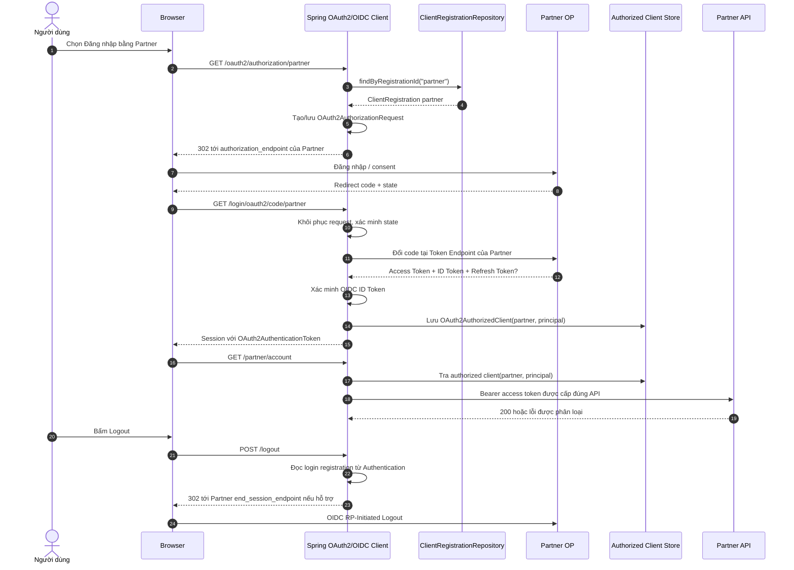
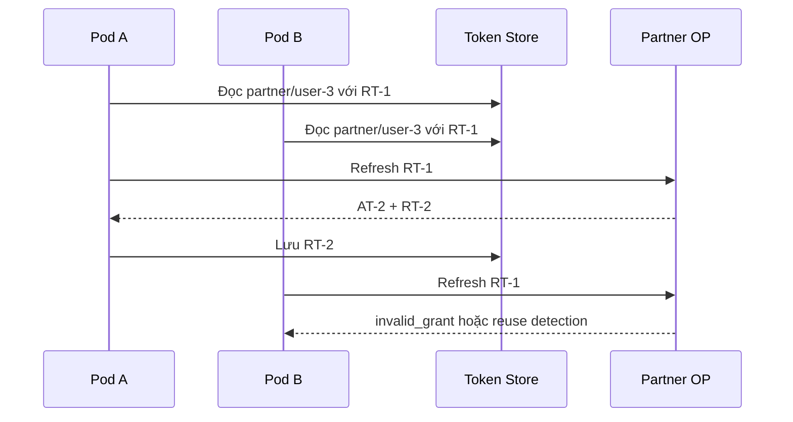

# 25.5. Giữ registration ID xuyên suốt login, API call và logout

Trong một ứng dụng **Spring Security OAuth 2.0/OIDC Client** hỗ trợ **nhiều provider**, người dùng có thể đăng nhập bằng một trong nhiều OpenID Provider (OP), đồng thời ứng dụng có thể lưu nhiều kết nối đến các API bên ngoài. Lúc đó, việc chọn đúng **`registrationId`** ảnh hưởng trực tiếp đến luồng đăng nhập, nơi lưu token, access token gửi tới API và OpenID Provider nhận yêu cầu logout.

Ví dụ một portal hỗ trợ hai nhà cung cấp:

- **`corp`** — OIDC provider dành cho nhân viên.
- **`partner`** — OIDC provider dành cho đối tác.

Nếu người dùng bắt đầu ở `/oauth2/authorization/partner` nhưng code sau login lại lấy authorized client `corp`, kết quả có thể là không tìm thấy token hoặc gửi token tới sai Resource Server. Nếu lúc logout ứng dụng gửi `id_token_hint` của `partner` tới `end_session_endpoint` của `corp`, đó còn là lỗi **ranh giới tin cậy và bảo mật thông tin định danh**.

Bài này trình bày cách giữ ngữ cảnh registration qua **login initiation → authorization callback → Authentication → authorized client → API call → OIDC logout**, phân biệt trường hợp **dùng cùng registration** với trường hợp **mỗi kết nối phải có registration riêng**, và đưa ra các ví dụ Spring MVC/Servlet và Reactive WebFlux.

> **Nguyên tắc cốt lõi:** Giữ đúng registration ID nghĩa là dùng một `ClientRegistration` nhất quán **trong từng flow đã xác định**; không phải bắt mọi API và mọi thao tác logout dùng registration của nhà cung cấp đăng nhập, nếu chúng vốn thuộc những flow ủy quyền khác nhau.

## 1. Hiểu đúng `registrationId`

`ClientRegistration` của Spring Security mô tả một OAuth2/OIDC Client đã đăng ký với Authorization Server: Client ID, client authentication, authorization grant, redirect URI, scope và provider metadata.

`registrationId` là **khóa cấu hình nội bộ** giúp Spring tìm ClientRegistration. Ví dụ:

```yaml
spring:
  security:
    oauth2:
      client:
        registration:
          corp:
            provider: company-op
            client-id: ${CORP_CLIENT_ID}
            client-secret: ${CORP_CLIENT_SECRET}
            authorization-grant-type: authorization_code
            scope: [openid, profile]
          partner:
            provider: partner-op
            client-id: ${PARTNER_CLIENT_ID}
            client-secret: ${PARTNER_CLIENT_SECRET}
            authorization-grant-type: authorization_code
            scope: [openid, profile]
        provider:
          company-op:
            issuer-uri: https://identity.company.example.test/realms/main
          partner-op:
            issuer-uri: https://identity.partner.example.test/tenant/main
```

Trong ví dụ:

- `corp` và `partner` là **registration IDs**.
- `company-op` và `partner-op` là **provider IDs** trong YAML, dùng tham chiếu provider configuration.
- `client-id` được cấp bởi từng Authorization Server, **không nhất thiết giống registrationId**.
- `issuer-uri` là địa chỉ issuer OP đáng tin để lấy metadata và xác minh ID Token.

### 1.1. Những identifier dễ nhầm

| Identifier | Ví dụ | Vai trò |
|---|---|---|
| **`registrationId`** | `corp` | Khóa tìm ClientRegistration trong Spring |
| **Provider ID** | `company-op` | Khóa provider details trong `application.yml` |
| **OAuth2 `client_id`** | `web-portal-123` | Định danh Client được AS cấp |
| **OIDC `issuer` (`iss`)** | `https://identity.company.example.test/...` | Định danh OP phát hành ID Token |
| **OIDC `subject` (`sub`)** | `user-782` | Định danh người dùng trong phạm vi issuer |
| **`principalName`** | `user-782` hoặc internal key | Khóa xác định principal để lưu authorized client |
| **Business connection ID** | `connection-42` | Định danh một external API connection của ứng dụng |
| **HTTP session ID** | Cookie session | Liên kết trình duyệt với local authenticated session |

Một ID không thể tự thay thế ID khác. `registrationId` không phải bằng chứng xác thực, không phải email, không phải issuer URL và không phải secret.

### 1.2. Một issuer có thể phục vụ nhiều ClientRegistrations

Ví dụ:

```text
registrationId: corp-login
  clientId: portal-web
  issuer: https://identity.company.example.test

registrationId: corp-reporting
  clientId: reports-client
  issuer: https://identity.company.example.test
```

Dù `issuer` giống nhau, hai registrations có thể khác Client ID, scopes, redirect URIs, audience và consent. Token cấp cho `corp-login` không tự động có hiệu lực với `corp-reporting`.

Ngược lại, một ứng dụng có nhiều issuers có thể nhận những giá trị `sub` giống nhau. Vì thế identity mapping với OIDC thường phải xét **cặp `(iss, sub)` đã xác minh**, không chỉ `sub` hoặc email.

## 2. Sơ đồ registration ID xuyên suốt một flow



Sơ đồ mô tả trường hợp **provider dùng đăng nhập cũng cấp access token cho API đó**. Nếu Portal login qua Corp nhưng user cấp quyền riêng cho Calendar, API Calendar phải dùng **Calendar registration**, còn OIDC logout của Portal phải chọn **Corp registration**.

## 3. Đăng ký nhiều OIDC providers bằng Spring Boot

Một cấu hình đầy đủ hơn:

```yaml
spring:
  security:
    oauth2:
      client:
        registration:
          corp:
            provider: company-op
            client-id: ${CORP_CLIENT_ID}
            client-secret: ${CORP_CLIENT_SECRET}
            client-authentication-method: client_secret_basic
            authorization-grant-type: authorization_code
            redirect-uri: "{baseUrl}/login/oauth2/code/{registrationId}"
            scope:
              - openid
              - profile
              - reports.read

          partner:
            provider: partner-op
            client-id: ${PARTNER_CLIENT_ID}
            client-secret: ${PARTNER_CLIENT_SECRET}
            client-authentication-method: client_secret_basic
            authorization-grant-type: authorization_code
            redirect-uri: "{baseUrl}/login/oauth2/code/{registrationId}"
            scope:
              - openid
              - profile
              - partner.read

        provider:
          company-op:
            issuer-uri: https://identity.company.example.test/realms/main
          partner-op:
            issuer-uri: https://identity.partner.example.test/tenant/main
```

Các tên miền ví dụ không phải provider thật. Để chạy, cần đăng ký Client đúng tại từng OP và đặt redirect URIs đã được chấp thuận.

### 3.1. `registrationId` đi vào đường dẫn nào?

Với cấu hình trên:

```text
Bắt đầu login Corp:
  /oauth2/authorization/corp

Callback Corp:
  /login/oauth2/code/corp

Bắt đầu login Partner:
  /oauth2/authorization/partner

Callback Partner:
  /login/oauth2/code/partner
```

Nếu dùng `company-op` trong URL khởi tạo thay vì `corp`, Spring mặc định không tìm thấy ClientRegistration ID đó, vì `company-op` chỉ là ID của provider details.

### 3.2. `scope` chưa bảo đảm API chấp nhận token

`reports.read` trong YAML chỉ là scope minh họa. Authorization Server phải hỗ trợ/cấp quyền đó, và Resource Server phải chấp nhận access token với đúng audience, issuer và scope. Có OIDC login thành công không có nghĩa access token có thể gọi mọi API.

### 3.3. Vì sao đặt tên ID ổn định?

`registrationId` không chỉ xuất hiện trong YAML mà còn trong:

- Login initiation URL và callback URI.
- `OAuth2AuthenticationToken#getAuthorizedClientRegistrationId()`.
- `OAuth2AuthorizedClient#getClientRegistration()`.
- `OAuth2AuthorizedClientService` storage keys.
- `@RegisteredOAuth2AuthorizedClient`.
- WebClient/RestClient token selection.
- OIDC logout provider lookup.
- Background jobs, audit metadata và connection records.

Đổi `corp` thành `company-oidc` có thể cần migration và cập nhật redirect URIs, không phải chỉ thay nhãn hiển thị.

## 4. Giai đoạn login initiation: chọn đúng ClientRegistration

Spring Security cung cấp authorization initiation endpoint mặc định theo mẫu:

```text
GET /oauth2/authorization/{registrationId}
```

Ví dụ trang chọn provider:

```html
<nav aria-label="Đăng nhập">
  <a href="/oauth2/authorization/corp">
    Đăng nhập bằng tài khoản công ty
  </a>

  <a href="/oauth2/authorization/partner">
    Đăng nhập bằng tài khoản đối tác
  </a>
</nav>
```

Mỗi link cố ý chọn một ClientRegistration đã được backend cấu hình. Đây là cách đơn giản, rõ và không phải tự suy đoán URL Authorization Endpoint theo issuer.

### 4.1. Không lấy issuer tùy ý từ browser

Thiết kế rủi ro:

```text
/login?issuer=https://unknown.example.test
```

rồi backend tự tải metadata và chuyển user đến một OP bất kỳ. Nếu thiếu trust model, có thể dẫn đến open redirect, SSRF hoặc nhầm issuer. Với danh sách providers đã biết, backend nên dùng **allowlist registration IDs**.

Ví dụ:

```java
import java.util.Map;

public final class LoginProviderChoices {

    private static final Map<String, String> CHOICES = Map.of(
        "company", "corp",
        "external", "partner"
    );

    private LoginProviderChoices() {}

    public static String registrationIdFor(String choice) {
        String registrationId = CHOICES.get(choice);
        if (registrationId == null) {
            throw new IllegalArgumentException(
                "Unsupported authentication provider"
            );
        }
        return registrationId;
    }
}
```

Đây là mapper lựa chọn từ danh sách cố định, **không thay thế** việc Spring Security kiểm tra state, callback, PKCE, nonce và token.

### 4.2. Không dùng registration ID làm OAuth2 `state`

`registrationId` là khóa cấu hình có thể công khai. `state` là giá trị ràng buộc authorization response với request đã được Client khởi tạo, thường có entropy cao.

| Giá trị | Dùng để |
|---|---|
| `registrationId` | Chọn ClientRegistration |
| Authorization `state` | Liên kết callback với authorization request ban đầu |
| OIDC `nonce` | Liên kết ID Token với yêu cầu xác thực khi áp dụng |
| PKCE `code_verifier` | Chứng minh Client có bí mật cho authorization code |
| Authorization code | Đổi lấy token, dùng một lần |

Không dùng `registrationId` thay `state` hoặc `nonce`. Không tự ghi một cookie tùy ý chỉ chứa registration ID rồi dùng nó thay authorization request repository.

## 5. Callback: giữ ClientRegistration gốc, không tin mỗi đoạn URL

Sau khi người dùng xác thực ở Partner OP, browser có thể nhận:

```http
GET /login/oauth2/code/partner?code=EXAMPLE_CODE&state=EXAMPLE_STATE HTTP/1.1
Host: portal.example.test
Cookie: JSESSIONID=EXAMPLE_SESSION
```

Spring Security phải khôi phục authorization request đã lưu khi redirect và kiểm tra callback thuộc đúng flow. Các bước thường gồm:

1. Liên hệ `state` trong callback với authorization request trước đó.
2. Xác định ClientRegistration gốc.
3. Kiểm tra redirect URI và metadata flow.
4. Đổi authorization code tại **Token Endpoint đúng provider**.
5. Gửi PKCE `code_verifier` khi flow yêu cầu.
6. Với OIDC, xác minh ID Token issuer, signature, audience, time và nonce.
7. Tạo `OAuth2AuthenticationToken`/`OidcUser` hoặc OAuth2User phù hợp.
8. Lưu authorized client đã cấp token theo đúng principal/registration.

### 5.1. Không chọn provider chỉ từ query/path callback

Không tự tạo controller:

```java
// THIẾT KẾ KHÔNG AN TOÀN nếu bỏ các bước xác minh:
// String registrationId = request.getParameter("provider");
// String code = request.getParameter("code");
// Gửi code sang endpoint tùy ý chỉ dựa vào input browser.
```

Một URL callback có chữ `partner` **không tự chứng minh** code do Partner phát hành. Đúng registration phải đi cùng **authorization request đã được ràng buộc, issuer metadata tin cậy và giao thức được kiểm tra**.

### 5.2. Redirect URI phải đăng ký theo từng Client

Ví dụ các callback public:

```text
https://portal.example.test/login/oauth2/code/corp
https://portal.example.test/login/oauth2/code/partner
```

Nếu app chạy sau reverse proxy, `{baseUrl}` phải thể hiện đúng HTTPS public host. Đừng sửa `redirect_uri_mismatch` bằng cách vô hiệu hóa validation hoặc sử dụng wildcard URI quá rộng.

## 6. Sau login: đọc registration từ Authentication

Trong Spring Security Servlet, một user đăng nhập bằng OAuth2/OIDC thường có Authentication thuộc lớp:

```java
org.springframework.security.oauth2.client.authentication.OAuth2AuthenticationToken
```

Phương thức:

```java
String getAuthorizedClientRegistrationId();
```

cho biết **registration đã dùng cho phiên OAuth2 Login hiện tại**.

### 6.1. Controller quan sát login registration

```java
import java.util.Map;

import org.springframework.security.core.Authentication;
import org.springframework.security.oauth2.client.authentication.OAuth2AuthenticationToken;
import org.springframework.web.bind.annotation.GetMapping;
import org.springframework.web.bind.annotation.RestController;

@RestController
public class LoginContextController {

    @GetMapping("/me/provider")
    public Map<String, String> currentProvider(
            Authentication authentication) {

        if (authentication instanceof OAuth2AuthenticationToken oauth2) {
            return Map.of(
                "loginRegistrationId",
                oauth2.getAuthorizedClientRegistrationId()
            );
        }

        return Map.of("authenticationType", "not-oauth2-login");
    }
}
```

Endpoint minh họa cần được bảo vệ theo policy. Với form login, Bearer Resource Server hoặc custom auth, Authentication không nhất thiết là `OAuth2AuthenticationToken`. **Không ép cast mọi Authentication** thành loại đó.

### 6.2. OIDC issuer/subject có cùng vai trò với registration không?

Không. Với OIDC Login, principal thường là `OidcUser`. Có thể lấy identity đã được xác minh:

```java
import org.springframework.security.core.Authentication;
import org.springframework.security.oauth2.client.authentication.OAuth2AuthenticationToken;
import org.springframework.security.oauth2.core.oidc.user.OidcUser;

if (authentication instanceof OAuth2AuthenticationToken oauth2
        && oauth2.getPrincipal() instanceof OidcUser user) {

    String loginRegistrationId =
        oauth2.getAuthorizedClientRegistrationId();

    String issuer = user.getIdToken().getIssuer().toString();
    String subject = user.getSubject();

    // registrationId: chọn Client.
    // (issuer, subject): liên kết external identity.
}
```

Identity mapping nên dùng **verified `(iss, sub)`** cùng internal account ownership, không chỉ email. `registrationId` vẫn cần để chọn authorized client và metadata OP.

## 7. `OAuth2AuthorizedClient` giữ registration và principal

Sau login, Spring có thể lưu authorized client:

```text
OAuth2AuthorizedClient
├── clientRegistration
│     └── registrationId = partner
├── principalName = user-486
├── accessToken
└── refreshToken? (có thể null)
```

`OAuth2AuthorizedClientService` thường tra token theo cặp:

```java
<T extends OAuth2AuthorizedClient> T loadAuthorizedClient(
    String clientRegistrationId,
    String principalName
);
```

Ví dụ:

```text
("corp", "user-corp-3")       -> Corp authorized client
("partner", "user-partner-8") -> Partner authorized client
("calendar", "internal-42")  -> Calendar authorized client
```

**Đúng registration ID nhưng sai principalName vẫn có thể trả null.** Và đúng cả hai key cũng chưa đủ nếu web login lưu token trong session repository còn background job lại đọc một service store khác.

### 7.1. Đọc authorized client theo login registration

```java
import org.springframework.security.core.Authentication;
import org.springframework.security.oauth2.client.OAuth2AuthorizedClient;
import org.springframework.security.oauth2.client.OAuth2AuthorizedClientService;
import org.springframework.security.oauth2.client.authentication.OAuth2AuthenticationToken;

public class LoginAuthorizedClientReader {

    private final OAuth2AuthorizedClientService service;

    public LoginAuthorizedClientReader(
            OAuth2AuthorizedClientService service) {
        this.service = service;
    }

    public OAuth2AuthorizedClient read(
            Authentication authentication) {

        if (!(authentication instanceof OAuth2AuthenticationToken oauth2)) {
            throw new IllegalArgumentException(
                "OAuth2 Login authentication required"
            );
        }

        return service.loadAuthorizedClient(
            oauth2.getAuthorizedClientRegistrationId(),
            authentication.getName()
        );
    }
}
```

Ví dụ này áp dụng khi authorized client thực sự được lưu trong **service đó**. Nếu cấu hình dùng `HttpSessionOAuth2AuthorizedClientRepository` hoặc kho khác, hãy dùng repository/manager phù hợp; không tự kết luận token mất chỉ vì service trả null.

### 7.2. Đừng dùng một map token chỉ theo provider name

Sai:

```java
// Nguy hiểm với multi-user:
Map<String, String> accessTokensByProvider;
```

Khóa `"partner"` không phân biệt user A/B và có thể gây rò token xuyên tài khoản. Hãy sử dụng abstraction của Spring Security với principal và kiểm tra ownership.

## 8. Gọi API: chọn authorized client tường minh

### 8.1. Servlet WebClient

Với Spring MVC dùng WebClient, lớp phù hợp là `ServletOAuth2AuthorizedClientExchangeFilterFunction`:

```java
import org.springframework.context.annotation.Bean;
import org.springframework.context.annotation.Configuration;
import org.springframework.security.oauth2.client.registration.ClientRegistrationRepository;
import org.springframework.security.oauth2.client.web.OAuth2AuthorizedClientRepository;
import org.springframework.security.oauth2.client.web.reactive.function.client.ServletOAuth2AuthorizedClientExchangeFilterFunction;
import org.springframework.web.reactive.function.client.WebClient;

@Configuration
public class PartnerApiConfig {

    @Bean
    WebClient partnerApiClient(
            ClientRegistrationRepository registrations,
            OAuth2AuthorizedClientRepository clients) {

        var oauth2 =
            new ServletOAuth2AuthorizedClientExchangeFilterFunction(
                registrations, clients
            );

        return WebClient.builder()
            .baseUrl("https://api.partner.example.test")
            .apply(oauth2.oauth2Configuration())
            .build();
    }
}
```

Gọi API:

```java
import static org.springframework.security.oauth2.client.web.reactive.function.client.ServletOAuth2AuthorizedClientExchangeFilterFunction.clientRegistrationId;

String response = partnerApiClient.get()
    .uri("/v1/account")
    .attributes(clientRegistrationId("partner"))
    .retrieve()
    .bodyToMono(String.class)
    .block(java.time.Duration.ofSeconds(10));
```

Ví dụ gọi đồng bộ bằng `block` chỉ phù hợp trong ngữ cảnh chấp nhận chặn thread, như một số Servlet controllers. Không sử dụng `block()` trên Reactor event-loop.

**Quan trọng:** `clientRegistrationId("partner")` chọn ClientRegistration, nhưng access token có được Partner API chấp nhận hay không vẫn phụ thuộc audience, scope, issuer và policy.

### 8.2. Truyền authorized client đã được chọn

Có thể dùng `@RegisteredOAuth2AuthorizedClient`:

```java
import org.springframework.security.oauth2.client.OAuth2AuthorizedClient;
import org.springframework.security.oauth2.client.annotation.RegisteredOAuth2AuthorizedClient;

@GetMapping("/partner/account")
public String partnerAccount(
        @RegisteredOAuth2AuthorizedClient("partner")
        OAuth2AuthorizedClient partnerClient) {

    return partnerApiClient.get()
        .uri("/v1/account")
        .attributes(
            ServletOAuth2AuthorizedClientExchangeFilterFunction
                .oauth2AuthorizedClient(partnerClient)
        )
        .retrieve()
        .bodyToMono(String.class)
        .block(java.time.Duration.ofSeconds(10));
}
```

Đoạn method cần đặt trong controller có các imports/fields tương ứng. Annotation không tự cấp consent: nếu user chưa authorize `partner`, hệ thống vẫn cần flow cấp quyền phù hợp.

### 8.3. Rủi ro khi bật default authorized client

```java
oauth2.setDefaultOAuth2AuthorizedClient(true);
```

có thể làm WebClient tự chọn authorized client gắn với current OAuth2 Authentication cho các requests không chỉ định registration. Trong multi-provider app, một WebClient dùng chung dễ gửi token sai host:

```text
User login bằng Corp
    -> default client = corp

WebClient gửi request đến Partner API
    -> vô tình gắn Corp access token
    -> 401 hoặc rò credential sang origin không phù hợp
```

Hãy ưu tiên `clientRegistrationId(...)` hoặc `oauth2AuthorizedClient(...)` tường minh, WebClient chuyên biệt theo API host, và allowlist HTTP destinations.

## 9. Login provider có thể khác API provider

Đây là điểm quan trọng nhất khi triển khai nhiều providers.

```text
Portal login:
  loginRegistrationId = corp

External API connections:
  calendarRegistrationId = google-calendar
  crmRegistrationId      = salesforce-crm
  storageRegistrationId  = box-storage
```

Khi user:

- **Đăng nhập portal:** chọn `corp`.
- **Gọi Calendar API:** chọn `google-calendar` đã được cấp quyền.
- **Gọi CRM API:** chọn `salesforce-crm` đã được cấp quyền.
- **Logout OIDC khỏi portal:** chọn `corp` từ Authentication phiên login.
- **Ngắt kết nối Calendar:** xử lý token/consent của `google-calendar` theo policy, không logout Corp chỉ vì Calendar lỗi.

Vì vậy, khái niệm “giữ registration ID xuyên suốt” chính xác là **giữ registration đúng cho từng connection/grant flow**, không ép mọi bước dùng một ID bất biến.

### 9.1. Dùng tên biến phản ánh mục đích

```java
String loginRegistrationId = "corp";
String reportsApiRegistrationId = "corp";
String calendarConnectionRegistrationId = "google-calendar";
```

Nếu một service phụ trách nhiều nhiệm vụ, một biến `registrationId` chung chung dễ che giấu việc chọn nhầm token.

### 9.2. Account linking không phải OAuth2 Login lần hai đơn giản

Người dùng đã login Corp nhưng muốn kết nối Partner API. Nếu chỉ khởi động một `oauth2Login` mới qua Partner, Spring có thể thay Authentication hiện tại bằng Partner user sau callback. Khi đó **loginRegistrationId của portal cũng đổi**, dù mục đích ban đầu chỉ là link external account.

Một flow linking có chủ đích nên:

1. Xác minh user đang đăng nhập portal.
2. Lưu pending connection context ràng buộc internal account và session.
3. Bắt đầu authorization code flow tới external provider.
4. Bảo vệ `state`, PKCE, OIDC nonce theo flow.
5. Xác minh external identity/issuer/subject sau callback.
6. Liên kết với internal account **đã được xác minh ownership**.
7. Lưu OAuth2AuthorizedClient của external registration.
8. Giữ portal Authentication nếu mục tiêu là liên kết API, không phải chuyển người dùng.
9. Không tự hợp nhất tài khoản theo email trùng.

Không trông chờ OAuth2 Login mặc định luôn bảo toàn login provider sau một flow authorization mới; đây là yêu cầu kiến trúc cần thiết kế rõ.

## 10. Token audience và scope: đúng registration chưa đủ

Giả sử:

```text
Login provider:
  issuer = https://identity.company.example.test

ID Token:
  aud = portal-client-id

Access Token:
  aud = userinfo-service
  scope = openid profile

Reports API yêu cầu:
  aud = reports-api
  scope = reports.read
```

Dù WebClient chọn `corp`, API có thể trả 401 do access token không đúng audience. Đừng sửa bằng cách dùng ID Token làm Bearer hoặc chọn một registration bất kỳ để thử.

Cần xác minh:

- Authorization Server nào cấp token cho Resource Server?
- `client_id` và grant nào được phép xin token đó?
- Scope và audience của access token có đúng không?
- User đã cấp consent thích hợp chưa?
- Provider có cơ chế resource indicators/token exchange riêng không?
- API có tin issuer và signing keys của AS đó không?

### 10.1. HTTP 401 và 403 khác lỗi registration lookup

| Triệu chứng | Ý nghĩa điển hình |
|---|---|
| `No ClientRegistration` | Registration ID sai hoặc chưa khai báo |
| Không tìm thấy `OAuth2AuthorizedClient` | Sai registration/principal/store hoặc chưa authorize |
| HTTP 401 `invalid_token` | API từ chối access token: expired/revoked/wrong audience/issuer |
| HTTP 403 `insufficient_scope` | API chấp nhận cơ chế auth nhưng thiếu quyền |
| Token Endpoint `invalid_grant` | Grant/code/refresh token không hợp lệ |
| Token Endpoint `invalid_client` | Client authentication sai |

Không tự thử các registrations khác nhau để vượt qua 403 hoặc 401. Làm vậy có thể vi phạm permission boundary.

## 11. OIDC logout phải chọn đúng OP của phiên đăng nhập

Khi user login qua `partner`, local Authentication thường chứa:

```text
OAuth2AuthenticationToken
  principal = OidcUser của Partner
  authorizedClientRegistrationId = partner
```

`OidcClientInitiatedLogoutSuccessHandler` trên Servlet sử dụng Authentication và ClientRegistrationRepository để xây RP-Initiated Logout redirect dựa trên metadata của đúng provider, khi hỗ trợ.

### 11.1. Servlet config với OIDC logout

```java
import org.springframework.context.annotation.Bean;
import org.springframework.context.annotation.Configuration;
import org.springframework.security.config.Customizer;
import org.springframework.security.config.annotation.web.builders.HttpSecurity;
import org.springframework.security.oauth2.client.oidc.web.logout.OidcClientInitiatedLogoutSuccessHandler;
import org.springframework.security.oauth2.client.registration.ClientRegistrationRepository;
import org.springframework.security.web.SecurityFilterChain;

@Configuration
public class MultiProviderSecurityConfig {

    @Bean
    SecurityFilterChain securityFilterChain(
            HttpSecurity http,
            ClientRegistrationRepository registrations) throws Exception {

        var oidcLogout =
            new OidcClientInitiatedLogoutSuccessHandler(registrations);

        oidcLogout.setPostLogoutRedirectUri("{baseUrl}/signed-out");

        return http
            .authorizeHttpRequests(authorize -> authorize
                .requestMatchers("/", "/signed-out", "/error").permitAll()
                .anyRequest().authenticated()
            )
            .oauth2Login(Customizer.withDefaults())
            .oauth2Client(Customizer.withDefaults())
            .logout(logout -> logout.logoutSuccessHandler(oidcLogout))
            .build();
    }
}
```

Khi Partner Authentication còn sẵn tại logout success handler và provider metadata có `end_session_endpoint`, handler có thể gửi browser tới **Partner OP**. Nếu current session login qua Corp, handler xử lý Corp.

### 11.2. `end_session_endpoint` là optional

OIDC Login thành công không đảm bảo OP hỗ trợ RP-Initiated Logout. Metadata `end_session_endpoint` là tùy chọn và một số providers không quảng bá nó.

Nếu thiếu endpoint, cần fallback local logout và thông báo phạm vi đăng xuất chính xác. **Không tự suy đoán `issuer + "/logout"`**, hoặc gửi token sang một endpoint chưa được xác thực nguồn gốc.

### 11.3. Không gửi ID Token hint tới sai issuer

Một RP-Initiated Logout request có thể chứa:

```text
https://identity.partner.example.test/endsession
    ?id_token_hint=EXAMPLE_PARTNER_ID_TOKEN
    &post_logout_redirect_uri=https%3A%2F%2Fportal.example.test%2Fsigned-out
```

Sai và có thể gây rò thông tin định danh:

```text
https://identity.company.example.test/endsession
    ?id_token_hint=EXAMPLE_PARTNER_ID_TOKEN
```

`id_token_hint` phải tương ứng với OP/Client đã phát ID Token. Đừng dùng access token, refresh token hoặc ID Token của provider khác làm hint.

### 11.4. Logout portal khác disconnect API

Khi user bấm **Logout portal**, local session được xóa; OP logout dùng **login registration**.

Khi user bấm **Disconnect Calendar**, ứng dụng xử lý authorized client và revocation liên quan **Calendar registration**. Không nhất thiết logout Corp hoặc mọi providers khác.

Local logout, OP RP-Initiated Logout và OAuth2 token revocation là **những thao tác khác nhau**.

## 12. Multi-provider và nhiều sessions

Một user có thể:

```text
Browser A:
  loginRegistrationId = corp

Browser B:
  loginRegistrationId = partner

Shared authorized-client service:
  corp / principal-X
  partner / principal-Y
  calendar / principal-Z
```

Logout Browser A không mặc định:

- Xóa Browser B local session.
- Logout Partner OP trên Browser B.
- Revoke Calendar refresh token.
- Logout mọi ứng dụng và mọi thiết bị.

“Logout all devices” cần một chiến lược rộng hơn: session management, OP capabilities, front-/back-channel logout, token revocation và Resource Server enforcement. Không thể chỉ lặp một OIDC logout handler trên tất cả registration IDs.

### 12.1. Account switching trong một browser

Nếu browser đăng nhập Corp, sau đó hoàn tất login Partner, Authentication hiện tại có thể trở thành Partner Authentication tùy cấu hình. OIDC logout dùng **Authentication hiện tại**, không mặc định nhớ provider lần đầu.

Do đó cần phân biệt rõ user đang **switch account** hay **link external API**, nếu không logout có thể trông như “chọn sai OP” dù Spring đang xử lý Authentication mới.

## 13. Reactive WebFlux: các lớp tương ứng

Nếu ứng dụng dùng `SecurityWebFilterChain` và `ServerHttpSecurity`, không được import nhầm Servlet-specific classes.

| Servlet Spring MVC | Reactive WebFlux |
|---|---|
| `SecurityFilterChain` | `SecurityWebFilterChain` |
| `HttpSecurity` | `ServerHttpSecurity` |
| `ClientRegistrationRepository` | `ReactiveClientRegistrationRepository` |
| `OAuth2AuthorizedClientRepository` | `ServerOAuth2AuthorizedClientRepository` |
| `ServletOAuth2AuthorizedClientExchangeFilterFunction` | `ServerOAuth2AuthorizedClientExchangeFilterFunction` |
| `OidcClientInitiatedLogoutSuccessHandler` | `OidcClientInitiatedServerLogoutSuccessHandler` |
| `SecurityContextHolder` theo Servlet context | `ReactiveSecurityContextHolder` |

### 13.1. Reactive security chain và logout

```java
import org.springframework.context.annotation.Bean;
import org.springframework.security.config.Customizer;
import org.springframework.security.config.web.server.ServerHttpSecurity;
import org.springframework.security.oauth2.client.oidc.web.server.logout.OidcClientInitiatedServerLogoutSuccessHandler;
import org.springframework.security.oauth2.client.registration.ReactiveClientRegistrationRepository;
import org.springframework.security.web.server.SecurityWebFilterChain;

@Bean
SecurityWebFilterChain webFluxSecurity(
        ServerHttpSecurity http,
        ReactiveClientRegistrationRepository registrations) {

    var logout =
        new OidcClientInitiatedServerLogoutSuccessHandler(registrations);

    logout.setPostLogoutRedirectUri("{baseUrl}/signed-out");

    return http
        .authorizeExchange(exchanges -> exchanges
            .pathMatchers("/", "/signed-out", "/error").permitAll()
            .anyExchange().authenticated()
        )
        .oauth2Login(Customizer.withDefaults())
        .oauth2Client(Customizer.withDefaults())
        .logout(spec -> spec.logoutSuccessHandler(logout))
        .build();
}
```

### 13.2. Reactive WebClient với registration tường minh

```java
import org.springframework.context.annotation.Bean;
import org.springframework.security.oauth2.client.registration.ReactiveClientRegistrationRepository;
import org.springframework.security.oauth2.client.web.server.ServerOAuth2AuthorizedClientRepository;
import org.springframework.security.oauth2.client.web.reactive.function.client.ServerOAuth2AuthorizedClientExchangeFilterFunction;
import org.springframework.web.reactive.function.client.WebClient;

@Bean
WebClient partnerWebClient(
        ReactiveClientRegistrationRepository registrations,
        ServerOAuth2AuthorizedClientRepository authorizedClients) {

    var oauth2 =
        new ServerOAuth2AuthorizedClientExchangeFilterFunction(
            registrations, authorizedClients
        );

    return WebClient.builder()
        .baseUrl("https://api.partner.example.test")
        .filter(oauth2)
        .build();
}
```

Một request:

```java
import static org.springframework.security.oauth2.client.web.reactive.function.client.ServerOAuth2AuthorizedClientExchangeFilterFunction.clientRegistrationId;

Mono<String> response = partnerWebClient.get()
    .uri("/v1/account")
    .attributes(clientRegistrationId("partner"))
    .retrieve()
    .bodyToMono(String.class);
```

Pipeline có thể thực thi lazy theo Reactor; không dùng `block()` trên Netty event-loop.

### 13.3. Đọc login registration từ ReactiveSecurityContext

```java
import org.springframework.security.core.context.ReactiveSecurityContextHolder;
import org.springframework.security.oauth2.client.authentication.OAuth2AuthenticationToken;
import reactor.core.publisher.Mono;

Mono<String> currentLoginRegistration() {
    return ReactiveSecurityContextHolder.getContext()
        .map(context -> context.getAuthentication())
        .ofType(OAuth2AuthenticationToken.class)
        .map(OAuth2AuthenticationToken::getAuthorizedClientRegistrationId)
        .switchIfEmpty(Mono.error(
            new IllegalStateException("No OAuth2 login authentication")
        ));
}
```

Không tự lấy `SecurityContextHolder` ThreadLocal kiểu Servlet trong một Reactor pipeline rồi giả định context luôn được truyền giữa các threads. Với background tasks, dùng trusted service/connection context riêng.

## 14. Background jobs: registration nào được dùng?

Trong `@Scheduled`, queue consumer hoặc batch job có thể không có local HTTP session. Vì vậy:

- Với **`client_credentials`**, job dùng service ClientRegistration, không cần user login registration.
- Với **user-delegated offline access**, job dùng registration và principal đã lưu từ external connection được user cấp quyền.
- Với API provider khác login provider, job vẫn dùng API registration đã xác minh, không quay lại đọc `OAuth2AuthenticationToken` của một request cũ.

### 14.1. Service manager và Client Credentials

```java
import org.springframework.security.oauth2.client.OAuth2AuthorizeRequest;

OAuth2AuthorizeRequest request =
    OAuth2AuthorizeRequest
        .withClientRegistrationId("reporting-service")
        .principal("service:reporting")
        .build();
```

`reporting-service` là registration được cấu hình cho service-to-service. `service:reporting` chỉ là một principal key để lưu authorized client, không mang ý nghĩa mạo danh người dùng.

Với Servlet, manager phù hợp cho service tier là `AuthorizedClientServiceOAuth2AuthorizedClientManager`; Reactive tương ứng là `AuthorizedClientServiceReactiveOAuth2AuthorizedClientManager`.

### 14.2. Khi job dùng quyền của user

Một message nội bộ có thể chứa:

```text
connectionId = conn-42
```

Worker tra database sau khi kiểm tra account/tenant ownership:

```text
conn-42:
  registrationId = google-calendar
  authorizedClientPrincipalName = stored-trusted-principal
  status = CONNECTED
```

Sau đó worker mới lấy authorized client. Không cho message do user điều khiển trực tiếp chỉ định `principalName` của user khác hoặc registration của tenant khác.

## 15. Khi cùng OP có nhiều ClientRegistrations

Giả sử:

```yaml
spring:
  security:
    oauth2:
      client:
        registration:
          corp-login:
            provider: corp-op
            client-id: ${LOGIN_CLIENT_ID}
            client-secret: ${LOGIN_CLIENT_SECRET}
            authorization-grant-type: authorization_code
            scope: [openid, profile]

          corp-api:
            provider: corp-op
            client-id: ${API_CLIENT_ID}
            client-secret: ${API_CLIENT_SECRET}
            authorization-grant-type: authorization_code
            scope: [openid, reports.read]

        provider:
          corp-op:
            issuer-uri: https://identity.company.example.test/realms/main
```

User login qua `corp-login` không có nghĩa đã được cấp token cho `corp-api`, dù hai registrations có cùng issuer.

- Authentication của portal gắn với `corp-login`.
- Authorized client `corp-api` cần grant/consent riêng nếu API yêu cầu.
- Logout OIDC dùng registration login `corp-login`.
- Đổi token của `corp-login` thành một object mang tên `corp-api` không tạo ra quyền mới.

### 15.1. Đừng chỉ dùng issuer để chọn API client

Một service thấy hai registrations cùng issuer không thể mặc nhiên coi chúng tương đương. `client_id`, scopes, Token Endpoint policy và redirect URIs có thể khác.

### 15.2. Đừng chỉ dùng email để liên kết user

Cùng email từ hai issuers không đảm bảo cùng identity. Dùng verified `(iss, sub)` và account linking policy.

## 16. Đổi registration ID khi đã triển khai production

Đổi:

```text
partner -> partner-oidc
```

có thể ảnh hưởng:

- Login links.
- Callback URI đăng ký tại OP.
- `OAuth2AuthenticationToken` và session đang tồn tại.
- Khóa dữ liệu trong `OAuth2AuthorizedClientService`.
- JDBC records chứa `client_registration_id`.
- External connection rows, jobs và queue messages.
- WebClient configuration.
- OIDC logout provider mapping và telemetry.

### 16.1. Kế hoạch migration

1. Kiểm kê toàn bộ registrations và các phụ thuộc.
2. Kiểm tra issuer, Client ID và grant có thay đổi không.
3. Cập nhật login/callback và post-logout redirect URI đúng provider.
4. Kiểm tra authorized clients đang lưu theo ID cũ.
5. Chọn migration dữ liệu an toàn hoặc yêu cầu reauthorization.
6. Kiểm tra principal/tenant ownership trước khi di chuyển row.
7. Không trộn token của hai Client IDs khác nhau.
8. Kiểm thử refresh token rotation trong rolling deployment.
9. Giữ cách chẩn đoán rõ ràng cho các phiên/session cũ.
10. Có rollback phù hợp, không dump raw tokens vào log/CSV.

### 16.2. Tại sao đổi tên có thể làm mất token?

`OAuth2AuthorizedClientService` tra theo `(registrationId, principalName)`. Database row cũ `("partner","user-3")` không tự trở thành `("partner-oidc","user-3")`. Ngay cả khi sửa key, token cũ còn hợp lệ hay không tùy Client ID, issuer và provider policy.

### 16.3. Vấn đề rolling deployment

Nếu pods cũ dùng `partner` và pods mới dùng `partner-oidc` trong khi chia sẻ JDBC database, requests có thể tra hai keys khác nhau. Cần strategy chuyển đổi trạng thái và version compatibility có kiểm soát.

## 17. Multi-tenant: registration ID không phải tenant boundary

Một provider có thể có nhiều tenants:

```text
Tenant A:
  issuer = https://id.example.test/tenant/a
  sub = 123

Tenant B:
  issuer = https://id.example.test/tenant/b
  sub = 123
```

Hai identities có cùng `sub` nhưng khác issuer không phải một identity duy nhất. Nếu chỉ dùng `principalName="123"` và registration chung không có tenant isolation, có nguy cơ trộn token.

Cần thiết kế:

- Mapping verified `(iss, sub)` → internal account.
- Registration/issuer đúng tenant.
- Ownership check trước khi tra authorized client.
- Khóa principal ổn định không xung đột giữa tenants.
- Không cho tenant A yêu cầu token của Client tenant B.
- HTTP destinations đúng Resource Server và trust boundary.

### 17.1. Domain record tham khảo

```java
public record ExternalConnection(
    String id,
    String internalAccountId,
    String registrationId,
    String authorizedClientPrincipalName,
    String externalIssuer,
    String externalSubject,
    String status
) {}
```

Record này lưu **metadata** để quản lý kết nối; token thật nằm trong authorized client service/kho được bảo vệ. Browser chỉ nên chọn một connection ID và backend phải xác minh quyền sở hữu trước khi lấy registration/principal.

## 18. Refresh token rotation và lỗi `invalid_grant`

`OAuth2AuthorizedClient` có thể chứa refresh token; khi access token hết hạn, manager/provider được cấu hình phù hợp có thể gửi Refresh Token Grant tới Token Endpoint của registration ấy.

```text
Authorized client:
  registrationId = partner
  principalName = user-3
  accessToken = AT-1
  refreshToken = RT-1

Refresh thành công:
  accessToken = AT-2
  refreshToken = RT-2 (nếu provider rotation)
```

Nếu cùng một record được hai pods refresh đồng thời:



Giữ đúng registration vẫn **không tự giải quyết concurrency**. Với refresh token rotation, cần cân nhắc single-flight, optimistic locking, distributed coordination và persistence của token mới.

### 18.1. Không thử registration khác khi refresh lỗi

Nếu Partner refresh token bị revoke, không chuyển sang token của Corp để tiếp tục gọi Partner API. Điều đó vượt ranh giới quyền. Hệ thống cần cleanup authorized client lỗi và yêu cầu user reauthorize **đúng external connection**, tùy policy.

### 18.2. Local session và external connection tách biệt

User vẫn có thể đăng nhập portal bằng Corp khi Calendar refresh token đã bị revoke. Thay vì logout toàn portal theo mặc định, có thể đánh dấu Calendar connection là `RECONNECT_REQUIRED`.

## 19. Bảo mật khi lựa chọn registration

### 19.1. Đúng registration nhưng sai HTTP host vẫn nguy hiểm

```java
webClient.get()
    .uri(userSuppliedAbsoluteUrl)
    .attributes(clientRegistrationId("partner"))
    .retrieve();
```

Nếu `userSuppliedAbsoluteUrl` trỏ tới host ngoài trust boundary, Partner access token có thể bị gửi sai đích. Phải giới hạn outbound origins, dùng base URL server-side, relative paths được kiểm soát và kiểm tra redirect behavior.

### 19.2. Không lấy logout endpoint từ user input

Một giá trị `registrationId=partner` do user chọn ở trang login không đủ làm bằng chứng rằng phiên hiện tại đã đăng nhập qua Partner. Khi logout, dùng Authentication đã xác minh và ClientRegistrationRepository đáng tin. Không redirect ID Token hint tới host lấy từ query param.

### 19.3. Không coi registration ID là quyền truy cập

Biết chuỗi `partner` không có nghĩa user được dùng Partner authorized client. Cần OAuth2 authorization, principal ownership, tenant checks và API permission checks.

### 19.4. Không log credential

Log có thể ghi:

```text
event=oauth2_login_success
loginRegistrationId=partner

event=oauth2_api_call
apiRegistrationId=partner
targetService=partner-api
httpStatus=200

event=oidc_logout_started
loginRegistrationId=partner
opLogoutSupported=true
```

Không ghi raw access/refresh token, authorization code, session cookie, Client secret hoặc logout URL chứa `id_token_hint`.

### 19.5. Tránh open redirect và forwarded host giả

Các URL `{baseUrl}` trong callback/logout có thể bị sai nếu reverse proxy không truyền scheme/host đúng. Chỉ tin proxy headers từ proxies được kiểm soát. Không dùng `post_logout_redirect_uri` tùy ý từ browser.

## 20. Kiểm thử luồng nhiều provider

Test với tối thiểu hai registrations có issuers và Client IDs khác nhau.

### 20.1. Login Corp

1. `GET /oauth2/authorization/corp` chuyển tới Corp Authorization Endpoint.
2. Callback `/login/oauth2/code/corp` có `state` hợp lệ.
3. Token request dùng Corp ClientRegistration/Token Endpoint.
4. ID Token issuer/audience/nonce được xác minh.
5. Authentication có `getAuthorizedClientRegistrationId() == "corp"`.
6. Authorized client lưu theo `corp` và principal chính xác.
7. Corp API nhận token có đúng scope/audience.
8. OIDC logout chuyển tới Corp OP khi hỗ trợ.

### 20.2. Login Partner

Lặp các bước tương tự cho Partner. Đảm bảo không gọi Corp Token Endpoint, không dùng Corp token cho Partner API và không gửi Partner ID Token hint tới Corp logout endpoint.

### 20.3. Account linking và external API

1. User login Corp.
2. User yêu cầu link Calendar.
3. Calendar authorization flow được bảo vệ.
4. Backend kiểm tra connection ownership và external identity.
5. Calendar authorized client lưu đúng registration/principal.
6. Portal login session vẫn là Corp **nếu thiết kế yêu cầu**.
7. API Calendar dùng Calendar registration.
8. Logout portal dùng Corp; disconnect Calendar có token cleanup riêng.

### 20.4. Failure cases

- Callback sai `state` không được chấp nhận.
- User A không thể tra token user B bằng cách biết registration ID.
- Token sai audience bị Resource Server từ chối, không thử registration khác.
- `end_session_endpoint` thiếu dẫn đến fallback local logout.
- `post_logout_redirect_uri` không đúng bị xử lý rõ.
- Registration đổi tên được kiểm tra với database và redirect URIs.
- Concurrent refresh không làm mất token mới.
- Multi-tenant có cùng `sub` không trộn identity.

Đây là những kịch bản **đề xuất** cho testing, không phải tuyên bố code đã được thực thi hoặc QA.

## 21. Troubleshooting theo luồng

| Triệu chứng | Nguyên nhân có thể | Hướng xử lý |
|---|---|---|
| `/oauth2/authorization/company-op` không hoạt động | Dùng provider ID thay registration ID | Dùng `corp` theo cấu hình |
| Callback `redirect_uri_mismatch` | URI public sai host/path/registration | Đối chiếu OP registration và proxy |
| Callback `invalid_state` | Authorization request/cookie bị mất hoặc không khớp | Kiểm tra session, state và multi-tab |
| Authentication hiển thị Partner dù mong Corp | Flow Partner vừa thay local login | Kiểm tra initiation và account switching |
| `OAuth2AuthorizedClient` không tìm thấy | Sai registration/principal/store | Kiểm tra key và storage |
| Login Corp nhưng Calendar API cần token | API registration khác chưa được cấp consent | Authorize Calendar đúng flow |
| API 401 `invalid_token` | Token expired/revoked/sai audience | Kiểm tra Resource Server contract |
| API 403 `insufficient_scope` | Token thiếu quyền | Xin đúng scope, không thử provider khác |
| Token Endpoint `invalid_grant` | Code/refresh token sai, expired hoặc rotated | Xem grant và lifecycle token |
| OIDC logout tới sai OP | Custom handler lấy registration sai | Dùng Authentication login và provider metadata |
| Logout không chuyển OP | Không có OIDC principal hoặc `end_session_endpoint` | Local fallback, kiểm tra discovery |
| Post-logout quay lại login ngay | `/signed-out` bị bảo vệ | `permitAll`, tránh auto-login |
| Sau đổi registration ID token “mất” | Persisted rows dưới key cũ | Migration an toàn hoặc reauthorize |
| Background worker dùng token sai user | Principal/tenant mapping không được kiểm tra | Trusted connection records và ownership |
| WebClient gắn Bearer vào public host | Default token hoặc arbitrary URL | Tách WebClients và allowlist host |
| Multi-tenant user identities bị gộp | Chỉ dùng email hoặc sub không có issuer | Verified `(iss, sub)` và tenant mapping |

### 21.1. Trình tự chẩn đoán

1. Xác định **registrationId lúc bắt đầu login**.
2. Kiểm tra `ClientRegistrationRepository` có ID ấy không.
3. Kiểm tra callback và saved authorization request/state.
4. Kiểm tra `Authentication` sau login và verified issuer.
5. Kiểm tra authorized client theo registration/principal.
6. Kiểm tra API request attributes chọn registration nào.
7. Kiểm tra audience/scope/issuer của access token.
8. Kiểm tra login vs external API connection policy.
9. Kiểm tra OIDC logout handler và đúng OP metadata.
10. Kiểm tra session, multi-tenant/account linking và mapping.
11. Kiểm tra migration nếu registration vừa đổi.
12. Ghi log đã lọc, không dump credential.

## 22. Bài tập thực hành

### Bài 1: Registration vs Provider ID

Cấu hình:

```yaml
registration:
  company-login:
    provider: company-op
provider:
  company-op:
    issuer-uri: https://id.example.test
```

**Câu hỏi:** URL khởi tạo login là gì?

**Gợi ý đáp án:** `/oauth2/authorization/company-login`.

### Bài 2: Đọc registration từ Authentication

```java
if (authentication instanceof OAuth2AuthenticationToken oauth2) {
    String id = oauth2.getAuthorizedClientRegistrationId();
}
```

**Giải thích:** Đây là login ClientRegistration hiện tại, không nhất thiết là API registration cho mọi external connection.

### Bài 3: Portal Corp + Calendar API

User login Corp và đã authorize Google Calendar.

**Gợi ý đáp án:** API Calendar dùng `google-calendar`; OIDC logout Portal dùng `corp`.

### Bài 4: Authorized client không tìm thấy

Storage lưu `("partner","partner-sub-7")`; service tra `("partner","corp-sub-1")`.

**Gợi ý đáp án:** Principal key sai. Phải dùng mapping đã xác minh và nhất quán, không thay principal tùy ý.

### Bài 5: ID Token hint sai provider

User login Partner, logout tới Corp endpoint với Partner ID Token.

**Gợi ý đáp án:** Sai ranh giới tin cậy; lấy ClientRegistration từ Authentication đăng nhập và đúng OP metadata.

### Bài 6: Một issuer, hai registrations

`corp-login` và `corp-api` cùng issuer nhưng Client IDs khác.

**Gợi ý đáp án:** Login bằng `corp-login` không cấp token cho `corp-api`. Cần flow ủy quyền đúng API.

### Bài 7: Resource Server trả 403

Token `corp` thiếu `reports.write`.

**Gợi ý đáp án:** Cần xin quyền đúng/điều chỉnh policy; không dùng Partner token để thử vượt qua quyền.

### Bài 8: Đổi registration ID

Team đổi `partner` thành `partner-oidc` khi có nhiều refresh tokens trong JDBC.

**Gợi ý đáp án:** Kiểm kê callback, login links, token keys, jobs, principal/issuer và triển khai migration an toàn hoặc reauthorization.

### Bài 9: Hai tenants cùng subject

Tenant A và B cùng `sub="123"`, issuer khác.

**Gợi ý đáp án:** Không hợp nhất chỉ theo `sub` hoặc email; dùng verified `(iss, sub)` và ownership.

### Bài 10: Account linking

User đã login Corp, bấm “Connect Partner” và callback khiến local session chuyển sang Partner.

**Gợi ý đáp án:** Flow linking phải được thiết kế riêng nếu cần giữ Corp Authentication; phải kiểm tra pending connection và external identity.

### Bài 11: Background job

Job đọc `registrationId` từ một queue message do user có thể sửa và tra token user khác.

**Gợi ý đáp án:** Chỉ nhận trusted connection ID, tra metadata từ server-side record và xác minh quyền trước khi lấy token.

### Bài 12: Sai destination

WebClient chọn `partner` nhưng URI do browser nhập trỏ sang host ngoài.

**Gợi ý đáp án:** Đúng registration vẫn nguy hiểm nếu sai origin. Dùng allowlisted host/base URL và kiểm soát redirects.

### Bài 13: Token Endpoint `invalid_grant`

Refresh Partner thất bại; service muốn thử refresh Corp.

**Gợi ý đáp án:** Không chuyển grant/identity. Dừng dùng Partner refresh token hỏng, xử lý cleanup và reauthorization của Partner connection khi cần.

### Bài 14: WebFlux

Code Reactive cố lấy Authentication theo ThreadLocal Servlet.

**Gợi ý đáp án:** Dùng Reactive SecurityContext hoặc truyền trusted context; background jobs dùng service-based manager.

### Bài 15: Logout all devices

User logout Corp trên laptop, Partner session trên điện thoại và Calendar background job vẫn hoạt động.

**Gợi ý đáp án:** Local logout/RP-Initiated Logout không mặc định hủy các trạng thái này. Cần chính sách multi-session, OP logout và token revocation riêng.

## 23. Checklist triển khai

- [ ] Đặt `registrationId` rõ nghĩa, ổn định và phân biệt với provider ID/issuer.
- [ ] Login chooser chỉ có các registration IDs được phép.
- [ ] Callback có saved authorization request, `state`, PKCE/nonce khi áp dụng.
- [ ] Không chọn issuer/Token Endpoint tùy ý từ query parameter.
- [ ] Đọc login registration từ `OAuth2AuthenticationToken` khi phù hợp.
- [ ] OIDC identity mapping dùng verified `(iss, sub)`.
- [ ] Authorized client lưu/tra đúng `(registrationId, principalName)` và repository.
- [ ] API registration được lựa chọn theo connection/resource, không mặc định là login registration.
- [ ] Access token đáp ứng audience, scope và issuer của Resource Server.
- [ ] WebClient/RestClient không gửi token tới arbitrary host.
- [ ] Không bật default authorized client trên shared HTTP client nhiều origins.
- [ ] Account linking tách khỏi login-as nếu sản phẩm cần giữ Authentication.
- [ ] Multi-tenant ownership và principal isolation được kiểm tra.
- [ ] OIDC logout dùng provider của login Authentication hiện tại.
- [ ] `end_session_endpoint` và post-logout redirect URI được kiểm tra theo OP.
- [ ] Local logout và disconnect/token revocation được phân biệt.
- [ ] Không gửi ID Token hint sang issuer khác.
- [ ] Background jobs dùng trusted connection/registration/principal.
- [ ] Đổi registration ID có migration plan cho token storage và redirects.
- [ ] Refresh rotation/concurrency có cơ chế bảo vệ khi nhiều instances.
- [ ] Logging phân biệt loginRegistrationId, apiRegistrationId và logoutRegistrationId, không chứa token.
- [ ] Có test cả providers khác issuer và nhiều Clients cùng issuer.

## 24. Tài liệu tham khảo

1. [Spring Security Reference — OAuth2 Login (Servlet)](https://docs.spring.io/spring-security/reference/servlet/oauth2/login/index.html): login initiation, callback và OIDC authentication.
2. [Spring Security Reference — OAuth2 Client (Servlet)](https://docs.spring.io/spring-security/reference/servlet/oauth2/client/index.html): ClientRegistration, authorized clients và managers.
3. [Spring Security API — ClientRegistration](https://docs.spring.io/spring-security/reference/api/java/org/springframework/security/oauth2/client/registration/ClientRegistration.html): registration ID, provider details và grant.
4. [Spring Security API — OAuth2AuthenticationToken](https://docs.spring.io/spring-security/reference/api/java/org/springframework/security/oauth2/client/authentication/OAuth2AuthenticationToken.html): `getAuthorizedClientRegistrationId()`.
5. [Spring Security API — OAuth2AuthorizedClient](https://docs.spring.io/spring-security/reference/api/java/org/springframework/security/oauth2/client/OAuth2AuthorizedClient.html): ClientRegistration, principalName và tokens.
6. [Spring Security API — OAuth2AuthorizedClientService](https://docs.spring.io/spring-security/reference/api/java/org/springframework/security/oauth2/client/OAuth2AuthorizedClientService.html): lưu/tra theo registration và principal.
7. [Spring Security API — ServletOAuth2AuthorizedClientExchangeFilterFunction](https://docs.spring.io/spring-security/reference/api/java/org/springframework/security/oauth2/client/web/reactive/function/client/ServletOAuth2AuthorizedClientExchangeFilterFunction.html): chọn authorized client cho Servlet WebClient.
8. [Spring Security API — ServerOAuth2AuthorizedClientExchangeFilterFunction](https://docs.spring.io/spring-security/reference/api/java/org/springframework/security/oauth2/client/web/reactive/function/client/ServerOAuth2AuthorizedClientExchangeFilterFunction.html): Reactive WebClient OAuth2 filter.
9. [Spring Security Reference — OIDC Logout (Servlet)](https://docs.spring.io/spring-security/reference/servlet/oauth2/login/logout.html): RP-Initiated Logout và OIDC logout success handler.
10. [Spring Security Reference — OIDC Logout (Reactive)](https://docs.spring.io/spring-security/reference/reactive/oauth2/login/logout.html): reactive logout.
11. [OpenID Connect Core 1.0](https://openid.net/specs/openid-connect-core-1_0.html): issuer, subject, audience, nonce và ID Token validation.
12. [OpenID Connect Discovery 1.0](https://openid.net/specs/openid-connect-discovery-1_0.html): provider metadata.
13. [OpenID Connect RP-Initiated Logout 1.0](https://openid.net/specs/openid-connect-rpinitiated-1_0.html): end-session endpoint và logout hints.
14. [OAuth 2.0 — RFC 6749](https://www.rfc-editor.org/rfc/rfc6749): Authorization Code Flow và token semantics.
15. [OAuth 2.0 Security Best Current Practice — RFC 9700](https://www.rfc-editor.org/rfc/rfc9700): redirect/token security.

## 25. Tổng kết

**`registrationId` là khóa cấu hình OAuth2 Client của Spring Security**, không phải issuer, Client ID hay danh tính người dùng. Trong một OAuth2/OIDC Login flow, ứng dụng phải chọn đúng registration khi bắt đầu authorization, khôi phục authorization request khi callback, xác minh token theo OP tương ứng, và lưu authorized client dưới registration/principal đúng. Khi gọi API, cần chọn một authorized client có grant, scope và audience hợp lệ với Resource Server. Khi OIDC logout, cần gửi browser tới OP được xác định từ **Authentication của phiên đăng nhập hiện tại**.

**Tính nhất quán không có nghĩa mọi bước bắt buộc dùng cùng một registration.** Nếu login qua Corp nhưng user đã liên kết Calendar và CRM, các API integrations có registration riêng, còn OIDC logout Portal vẫn thuộc Corp. Tách rõ **`loginRegistrationId`**, **`apiRegistrationId`** và **`connectionRegistrationId`** cùng với verified external identity, principal ownership và HTTP origin trust sẽ giúp tránh sai token, sai issuer, logout nhầm OP và các lỗ hổng account linking khi ứng dụng có nhiều provider.
