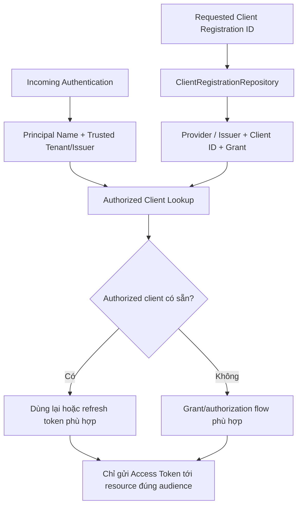
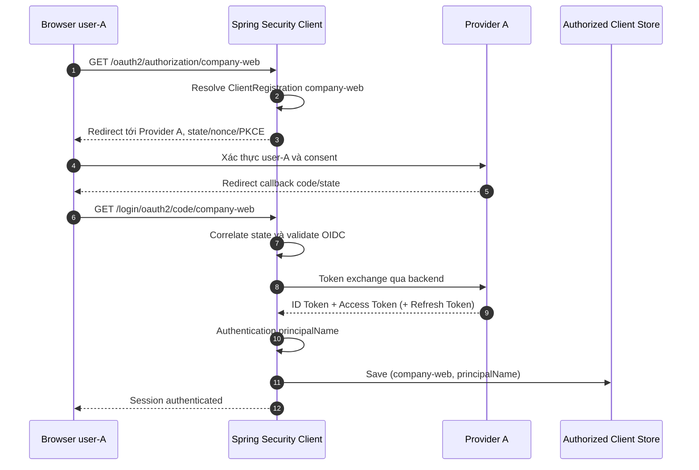
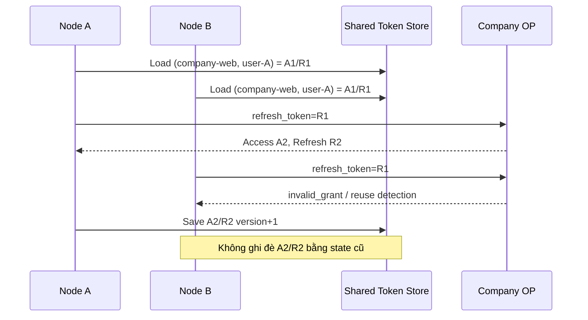
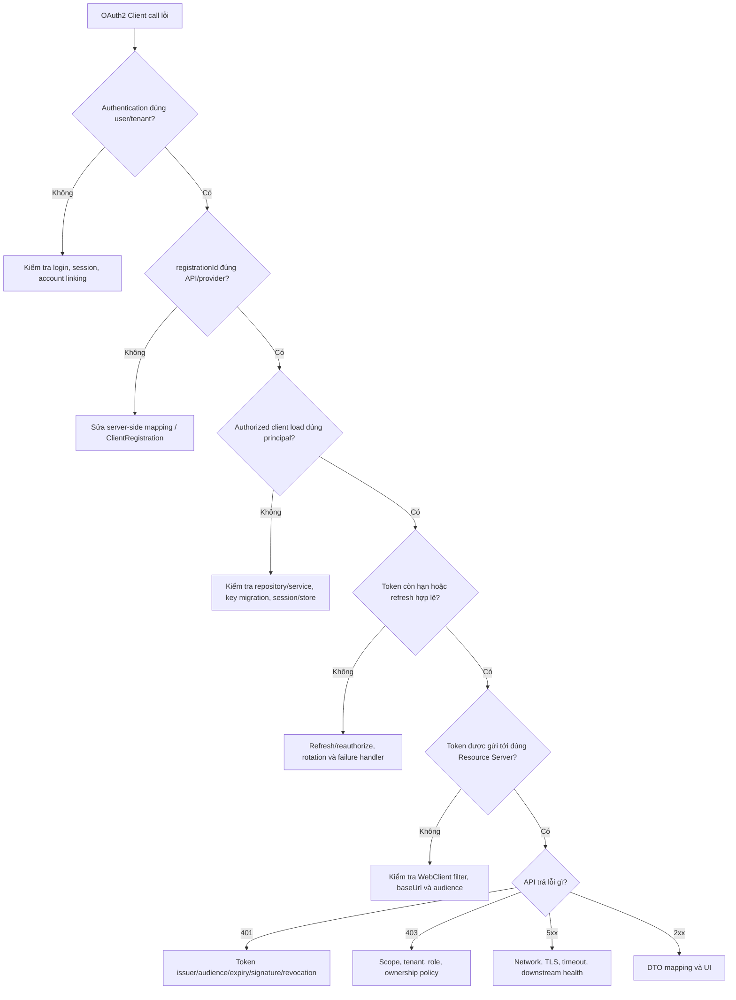

# 25.7. Tách authorized client theo provider và principal

Trong ứng dụng **Spring Security OAuth 2.0 / OpenID Connect (OIDC) Client** tích hợp nhiều nhà cung cấp định danh, việc đăng nhập thành công chỉ giải quyết một phần bài toán. Sau khi user được xác thực, ứng dụng còn phải lưu và dùng đúng **`OAuth2AuthorizedClient`** tương ứng với **client registration** và **principal** của họ.

Nếu ứng dụng có hai OpenID Providers, nhiều OAuth2 client registrations, nhiều người dùng, nhiều tenant hoặc cả các job chạy bằng `client_credentials`, việc truy xuất token không đúng khóa có thể gây ra các lỗi nghiêm trọng:

- Dùng **Access Token của user A** để gọi API thay mặt **user B**.
- Dùng token cấp bởi **provider A** để gọi API thuộc **provider B**.
- Trộn Refresh Token giữa hai client registrations dù cùng issuer.
- Dùng machine token quyền rộng để «sửa» lỗi thiếu user token.
- Ghi đè Refresh Token mới trong một cuộc refresh race.
- Không tìm được authorized client sau khi đổi cách đặt `principalName` hoặc chuyển instance.
- Rò token qua WebClient, logging hoặc một API cho phép chọn principal tùy ý.

Spring Security có một mô hình nền tảng rất quan trọng:

\[
\text{Authorized Client Lookup Key}
\approx
(\text{clientRegistrationId},\ \text{principalName})
\]

Đây là khóa tra cứu đặc trưng của **`OAuth2AuthorizedClientService`**, không phải một cơ chế tự hiểu tất cả tenant, issuer hoặc quyền nghiệp vụ. **Provider** thường được liên kết gián tiếp qua `ClientRegistration`; nếu hệ thống có nhiều issuer/tenant động, người thiết kế phải bảo đảm sự phân vùng dữ liệu không bị mất khi ánh xạ về cặp khóa này.

Bài học tập trung vào cách tách authorized clients theo **provider, registration, user principal, tenant và grant type**, cấu hình Spring Boot, cách lưu/tải qua repository/service, manager Servlet/Reactive, ví dụ WebClient, concurrency khi refresh token, mô hình account linking, troubleshooting và kiểm soát bảo mật.

## 1. Bốn khái niệm cần phân biệt trước tiên

Trong một hệ thống đa provider, các tên thường xuất hiện đồng thời:

| Khái niệm | Ý nghĩa | Ví dụ |
|---|---|---|
| **OpenID Provider / Authorization Server** | Hệ thống phát token và xác thực user, được xác định bởi issuer cùng metadata. | `https://id.company.example/realms/main` |
| **Provider ID trong Spring Boot** | Tên khóa cấu hình dưới `spring.security.oauth2.client.provider`. | `company-oidc` |
| **Client Registration ID** | Khóa duy nhất để Spring Security tìm một `ClientRegistration`. | `company-orders` |
| **Principal Name** | Tên principal dùng trong ngữ cảnh authorization/token store. | `company-sub-7f42` |

Một người dùng có thể có một hoặc nhiều authorized clients, mỗi authorized client gắn với **registration ID** và **principal name**.

### 1.1. Provider không đồng nghĩa client registration

Một provider có thể phục vụ nhiều OAuth2 clients:

```text
OpenID Provider: company-oidc
  |
  +-- ClientRegistration company-web
  |      client_id=employee-portal
  |
  +-- ClientRegistration company-calendar
  |      client_id=calendar-connector
  |
  +-- ClientRegistration reports-machine
         client_id=nightly-reports
```

Ba registrations có thể cùng sử dụng issuer hoặc token endpoint nhưng khác `client_id`, `client_secret`, scopes, grant type và chính sách token.

Ngược lại, hai registrations mang tên gần giống nhau không nhất thiết trỏ cùng provider.

**Không dùng `providerId` thay cho `registrationId` khi gọi `loadAuthorizedClient` hoặc `OAuth2AuthorizeRequest.withClientRegistrationId(...)`.**

### 1.2. Principal Name không đồng nghĩa email

Principal name là khóa gắn với `Authentication`. Trong OIDC, một định danh đáng tin cậy thường xuất phát từ cặp:

```text
(issuer, subject / sub)
```

vì `sub` chỉ được định nghĩa duy nhất trong phạm vi issuer theo hợp đồng OIDC. Cùng chuỗi `sub` ở hai issuers khác nhau **không nhất thiết là cùng người**.

Email có thể thay đổi, không được xác minh hoặc bị tái sử dụng; không nên dùng email do caller cung cấp để quyết định xem token nào được tải.

### 1.3. Authorized client không phải Authentication

| Thành phần | Trả lời câu hỏi | Vòng đời chính |
|---|---|---|
| `Authentication` | User hiện tại đã được xác thực như ai? | Security context/session của ứng dụng. |
| `OidcUser` và `OidcIdToken` | OP đã xác nhận danh tính nào? | Kết quả OIDC login. |
| `ClientRegistration` | OAuth2 client nào có thể xin token từ provider nào? | Cấu hình ứng dụng. |
| `OAuth2AuthorizedClient` | Registration này có Access/Refresh Token nào của principal này? | OAuth2 authorization/token lifecycle. |
| `OAuth2AuthorizedClientRepository`/Service | Lưu/tải authorized client ở đâu? | Session hoặc persistence độc lập request. |

Không vì tìm được authorized client trong database mà tự coi user đã có **HTTP session authenticated**. Cũng không vì user có session hợp lệ mà mặc định mọi provider/registration đều có token.

## 2. Ví dụ tổng thể: hai providers, hai users và một machine client

Giả sử hệ thống có:

```text
Provider A: company-oidc (issuer https://id.company.example/main)
Provider B: partner-oidc (issuer https://login.partner.example/main)

Registrations:
  company-web     -> Provider A -> Authorization Code/OIDC
  company-calendar-> Provider A -> Authorization Code/OIDC
  partner-web     -> Provider B -> Authorization Code/OIDC
  reports-machine -> Provider A -> Client Credentials

Principals:
  user-A (company subject 1001)
  user-B (company subject 1002)
  user-A khi liên kết tài khoản partner (partner subject p-778)
  service:nightly-reports
```

Những authorized clients riêng biệt về mặt logic:

| Registration ID | Principal key | Token | Mục đích |
|---|---|---|---|
| `company-web` | `company-sub-1001` | A1/R1 | User A truy cập API công ty. |
| `company-web` | `company-sub-1002` | A2/R2 | User B truy cập API công ty. |
| `company-calendar` | `company-sub-1001` | A3/R3 | User A cấp quyền truy cập calendar. |
| `partner-web` | `partner-sub-p-778` | A4/R4 | User A đã liên kết tài khoản đối tác. |
| `reports-machine` | `service:nightly-reports` | A5; thường không có Refresh Token | Tác vụ máy chạy định kỳ. |

Bảng chỉ minh họa thiết kế định danh; `principalName` thực tế lấy từ `Authentication.getName()` hoặc principal kỹ thuật do ứng dụng cung cấp, không tự động được Spring Security ghép prefix như bảng.

Những token A1–A5 phải được **tách biệt**, kể cả khi hai registrations có cùng provider hoặc hai người có cùng email hiển thị.



**Nguyên tắc:** phải xác định **đúng registration và đúng principal**, sau đó mới xem đến việc dùng Access Token hay refresh.

## 3. Spring Security dùng khóa nào để lưu authorized client?

Giao diện `OAuth2AuthorizedClientService` trên Servlet stack có method:

```java
<T extends OAuth2AuthorizedClient> T loadAuthorizedClient(
    String clientRegistrationId,
    String principalName
);
```

Khi lưu:

```java
void saveAuthorizedClient(
    OAuth2AuthorizedClient authorizedClient,
    Authentication principal
);
```

Và khi xóa:

```java
void removeAuthorizedClient(
    String clientRegistrationId,
    String principalName
);
```

Đây là ba operation quan trọng. Với một `OAuth2AuthorizedClient` đã được tạo, Spring Security giữ:

```text
OAuth2AuthorizedClient
  ├── ClientRegistration
  │     ├── registrationId
  │     ├── clientId
  │     ├── authorizationGrantType
  │     └── provider details
  ├── principalName
  ├── OAuth2AccessToken
  └── OAuth2RefreshToken (nullable)
```

### 3.1. Vì sao không chỉ dùng provider ID?

Giả sử `company-web` và `company-calendar` cùng dùng `company-oidc`. Nếu token store lưu theo:

```text
(providerId, principalName)
```

thì cùng một user có thể bị ghi đè giữa hai client registrations vốn khác scopes/audience/client authentication. Spring Security mặc định tách theo **registration ID**, chính là ranh giới cụ thể của một OAuth2 client configuration.

### 3.2. Vì sao không chỉ dùng principal name?

Nếu lưu một token duy nhất theo:

```text
principalName = "employee-1001"
```

rồi app vừa gọi API company vừa gọi API partner, không có bảo đảm token ấy thuộc issuer/client/audience nào. Việc bỏ registration khỏi khóa lưu làm mất một lớp cách ly rất quan trọng.

### 3.3. Vì sao provider không luôn là một trường khóa riêng?

Trong mô hình chuẩn của Spring Security, một `ClientRegistration` có `registrationId` duy nhất và chứa thông tin provider/issuer. Vì vậy **registration ID có thể đóng vai trò phân vùng gián tiếp theo provider**.

Tuy nhiên, khi có **dynamic tenants** hoặc registration cùng tên nhưng trỏ tới providers khác nhau tùy request, cặp khóa mặc định có thể **không đủ** nếu các đối tượng khác issuer vẫn dùng chung `registrationId` và `principalName` trong một store. Khi đó phải thiết kế thêm ranh giới hoặc tên khóa ổn định bao gồm tenant/issuer theo chính sách.

Không đổi metadata provider động dưới một registration ID dùng chung mà không đánh giá lại token store.

## 4. ClientRegistrationRepository là nơi xác định provider

Với Spring Boot, cấu hình có thể như sau:

```yaml
spring:
  security:
    oauth2:
      client:
        registration:
          company-web:
            provider: company-oidc
            client-id: ${COMPANY_WEB_CLIENT_ID}
            client-secret: ${COMPANY_WEB_CLIENT_SECRET}
            client-authentication-method: client_secret_basic
            authorization-grant-type: authorization_code
            redirect-uri: "{baseUrl}/login/oauth2/code/{registrationId}"
            scope:
              - openid
              - profile
              - orders.read

          partner-web:
            provider: partner-oidc
            client-id: ${PARTNER_WEB_CLIENT_ID}
            client-secret: ${PARTNER_WEB_CLIENT_SECRET}
            client-authentication-method: client_secret_basic
            authorization-grant-type: authorization_code
            redirect-uri: "{baseUrl}/login/oauth2/code/{registrationId}"
            scope:
              - openid
              - profile
              - partner.orders.read

        provider:
          company-oidc:
            issuer-uri: https://id.company.example/realms/main
          partner-oidc:
            issuer-uri: https://login.partner.example/tenant/main
```

Ở đây:

- `company-web` là registration ID của OAuth2 Client A.
- `partner-web` là registration ID của OAuth2 Client B.
- `company-oidc` và `partner-oidc` là provider keys trong cấu hình Boot.
- `issuer-uri` là OIDC issuer dùng cho discovery/validation.
- `client-id` là identity của một client tại OP; **không phải principal name**.
- `scope` là quyền ứng dụng yêu cầu; authorization server quyết định cấp quyền thực tế.

Client secret phải đến từ nguồn quản lý secret phù hợp; ví dụ trên sử dụng environment placeholders và **không** hardcode credential thật.

### 4.1. Hai URL login tạo hai flows riêng

Với hai registrations:

```text
GET /oauth2/authorization/company-web
GET /oauth2/authorization/partner-web
```

Spring Security tìm registration theo segment cuối URL để tạo Authorization Request đến issuer/provider tương ứng.

Callback mặc định:

```text
/login/oauth2/code/company-web
/login/oauth2/code/partner-web
```

Vì authorization requests khác nhau, state/nonce/PKCE context phải được liên kết với đúng flow và session. **Không đổi `registrationId` trong callback tùy ý** để buộc code do OP A cấp được đổi tại token endpoint của OP B.

### 4.2. Provider metadata không thay đăng ký OAuth2 client

OIDC discovery cung cấp thông tin như authorization endpoint, token endpoint, JWKS URI và issuer. Nó **không tự đăng ký client ID/secret/scopes** và không thay quyết định tách authorized client theo principal.

Nếu OP A và OP B cùng dùng một phần tên đường dẫn hoặc cùng logo trên UI, vẫn phải đối chiếu **issuer exact** và registration ID cụ thể.

### 4.3. Hai registrations dùng cùng một issuer vẫn khác nhau

Thêm ví dụ:

```yaml
spring:
  security:
    oauth2:
      client:
        registration:
          company-calendar:
            provider: company-oidc
            client-id: ${COMPANY_CALENDAR_CLIENT_ID}
            client-secret: ${COMPANY_CALENDAR_CLIENT_SECRET}
            authorization-grant-type: authorization_code
            redirect-uri: "{baseUrl}/login/oauth2/code/{registrationId}"
            scope:
              - openid
              - calendar.read
```

Dù `company-web` và `company-calendar` cùng dùng `company-oidc`, chúng có thể có **client IDs, consent, audience và Refresh Tokens khác nhau**.

Không ghi token của `company-calendar` vào bản ghi mang key `company-web` chỉ vì cả hai cùng issuer.

## 5. Principal trong OIDC: `iss` + `sub` và tên hiển thị

OIDC ID Token có claim:

```json
{
  "iss": "https://id.company.example/realms/main",
  "sub": "1001",
  "aud": "company-web-client-id",
  "exp": 1794825000
}
```

Ví dụ chỉ minh họa claim. Trong một OP khác, subject có thể cũng là `1001`:

```json
{
  "iss": "https://login.partner.example/tenant/main",
  "sub": "1001",
  "aud": "partner-web-client-id",
  "exp": 1794825000
}
```

**Hai `sub=1001` không chứng minh đó là cùng một identity.** Để liên kết một tài khoản qua nhiều issuers, application cần dựa trên **cặp issuer/subject đã được xác minh** và chính sách account linking được phép.

### 5.1. `Authentication.getName()` được lấy ở đâu?

Với `oauth2Login()`, Spring Security tạo một `OAuth2AuthenticationToken`. `getName()` thường phản ánh tên của principal đã được xác thực; với `OidcUser` mặc định có thể dựa trên `sub` hoặc claim cấu hình tên principal.

Ví dụ:

```java
@GetMapping("/who-am-i")
public String whoAmI(Authentication authentication) {
    return authentication.getName();
}
```

Nếu ứng dụng tùy biến `OidcUserService` hoặc principal name attribute, **giá trị name có thể thay đổi**. Token store dựa trên principal name phải dùng **cách đặt tên nhất quán** từ lúc save đến lúc load.

### 5.2. Đừng lấy email làm khóa định danh bất biến

Rủi ro khi dùng email:

- Email có thể đổi.
- Một số provider không bảo đảm `email_verified`.
- Các issuers khác nhau có thể trả cùng email cho các tài khoản không liên quan.
- Email alias/case normalization có thể tạo trùng hoặc thay đổi key.
- Một user có thể có nhiều địa chỉ email.

Vì vậy, email phù hợp để **hiển thị/liên hệ** hơn là làm khóa authorized client đa provider nếu không có một identity mapping bền vững và bảo vệ phù hợp.

### 5.3. Account linking khác token merging

Một user nội bộ có thể liên kết:

```text
internalUserId = employee-42
  |
  +-- company issuer + sub=1001
  |
  +-- partner issuer + sub=partner-778
```

Ứng dụng có thể coi chúng là một **internal account** sau quy trình linking được xác thực. Nhưng những OAuth2 authorized clients vẫn phải là **hai authorizations riêng**:

```text
(company-web, principalCompany) -> token-company
(partner-web, principalPartner) -> token-partner
```

Account linking không có nghĩa copy Refresh Token của OP A sang client registration của OP B hoặc coi token A hợp lệ cho API B.

## 6. Ví dụ va chạm principal giữa nhiều providers

Giả sử developer tự viết một token store:

```text
Map<String, OAuth2AuthorizedClient> tokensByPrincipalName
```

User đăng nhập ở company với `getName()="1001"`, rồi một user khác đăng nhập ở partner cũng có `getName()="1001"`.

Nếu store chỉ dùng key `1001`:

```text
Map["1001"] = companyAuthorizedClient
Map["1001"] = partnerAuthorizedClient  // ghi đè
```

Khi service lấy `Map["1001"]` để gọi API công ty, nó có thể sử dụng token partner sai issuer/audience, hoặc tệ hơn rò token chéo identity nếu downstream cấu hình thiếu validation.

Khóa đúng tối thiểu cho storage theo giao diện Spring là:

```text
(clientRegistrationId, principalName)
```

Ví dụ:

```text
(company-web, 1001) -> company token
(partner-web, 1001) -> partner token
```

Nếu mỗi registration ID ràng buộc bền vững với một provider/issuer, hai token sẽ được tách.

Nếu registration ID **không** ràng buộc một issuer cố định (ví dụ dynamic tenant registration), cần thêm quy tắc phân vùng để bảo đảm identity từ tenant A không dùng cùng cặp khóa như tenant B.

## 7. Các lớp isolation cần có

| Lớp isolation | Khóa hoặc ranh giới | Vì sao cần |
|---|---|---|
| **Provider/issuer** | `issuer-uri` / issuer đã xác minh | Không nhầm identity và token của hai OPs. |
| **OAuth2 client registration** | `registrationId` | Tách client ID, grant, scopes, audience, secrets và token. |
| **End user principal** | `Authentication.getName()` / key đáng tin cậy | Không lấy token của người khác. |
| **Tenant/workspace** | Tenant ID từ security context đã xác thực | Không trộn token giữa các khách hàng trong SaaS. |
| **Grant/workload** | Registration dành cho user và machine riêng | Không dùng machine token thay delegated user token. |
| **Session/web request** | Cookie + SecurityContext theo browser | Không đọc token từ request/session của user khác. |
| **Storage namespace** | DB schema/key prefix/RBAC và encryption context | Ngăn quyền đọc quá rộng, va chạm key và lộ token. |
| **Resource Server** | Audience/scope/tenant/ownership policy | Token đúng user chưa chắc đúng API hoặc được phép truy cập tài nguyên. |

Không có một trường dữ liệu đơn lẻ bảo đảm toàn bộ isolation. Tách theo registration và principal là nền tảng, nhưng **authorization nghiệp vụ và kiểm soát tenant vẫn cần thực thi ở các tầng liên quan**.

## 8. Luồng đăng nhập và lưu `OAuth2AuthorizedClient`

Trong OIDC Authorization Code Flow:



Điều cần hiểu:

1. Registration `company-web` xác định OP và client credential.
2. Người dùng đã hoàn tất flow và được tạo một principal.
3. `OAuth2AuthorizedClient` được lưu theo registration và principal trong repository/service phù hợp.
4. Khi gọi API tiếp theo, application phải tải **đúng** entry đó.

**`state` và OIDC `nonce`** bảo vệ liên kết authorization response với request đăng nhập. Chúng **không phải khóa lâu dài** của authorized client store; khóa lưu token có logic riêng.

### 8.1. Nếu user đăng nhập qua provider B sau provider A?

Trong một browser session đơn giản, login lại bằng provider B có thể thay đổi `Authentication` hiện tại của ứng dụng. Điều đó **không tự liên kết** hai external identities hoặc tạo quyền tải authorized client của provider A theo principal mới.

Nếu sản phẩm hỗ trợ nhiều external accounts trong cùng một internal account, cần flow **account linking/secondary authorization** rõ ràng; không dựa vào việc đổi đăng nhập trên browser rồi giữ mọi Refresh Token từ phiên trước như một pool quyền vô giới hạn.

### 8.2. Hai OP cùng có `sub` giống nhau

Nếu cùng `principalName="1001"` nhưng registration IDs khác nhau, standard service lookup vẫn phân biệt qua `clientRegistrationId`.

Đây là lợi ích cụ thể của khóa hai thành phần. Nhưng **chỉ tách ở DB** chưa đủ nếu controller cho phép một user tự yêu cầu registration bất kỳ và repository tải token của principal khác do code tự tạo.

## 9. `OAuth2AuthorizedClientRepository` khác `OAuth2AuthorizedClientService`

Với **Servlet**:

| Interface | Phương thức gắn với | Ngữ cảnh chính |
|---|---|---|
| `OAuth2AuthorizedClientRepository` | Registration, `Authentication`, `HttpServletRequest`/Response | Trong một HTTP request/session. |
| `OAuth2AuthorizedClientService` | `registrationId` và `principalName` | Độc lập HTTP request, thuận tiện persistence/service. |

Ví dụ load trực tiếp bằng service:

```java
OAuth2AuthorizedClient companyClient =
    authorizedClientService.loadAuthorizedClient(
        "company-web",
        authentication.getName()
    );
```

Ví dụ dùng repository:

```java
OAuth2AuthorizedClient companyClient =
    authorizedClientRepository.loadAuthorizedClient(
        "company-web",
        authentication,
        request
    );
```

Hai đoạn này minh họa sự khác biệt: **service cần principal name string**, còn **repository nhận Authentication và Servlet request** để thực hiện chính sách lưu/tải tương ứng.

### 9.1. `AuthenticatedPrincipalOAuth2AuthorizedClientRepository`

Một implementation thường gặp sử dụng `OAuth2AuthorizedClientService` cho principal đã authenticated và có thể dùng session-based repository trong một số ngữ cảnh anonymous theo chiến lược của nó.

Điều quan trọng là phải biết **repository nào thực sự được `oauth2Login()` và manager/WebClient sử dụng**. Nếu login lưu theo service A còn WebClient tìm trong service B hoặc session khác, error «authorized client not found» không thể giải quyết bằng cách đổi provider ID.

### 9.2. `HttpSessionOAuth2AuthorizedClientRepository`

Repository dựa trên HTTP session phù hợp với use case có session browser, nhưng cần lưu ý:

- Session phải gắn với đúng user và được invalidate/rotate theo security policy.
- Nếu cùng một session được dùng để đổi tài khoản, ứng dụng cần tránh reuse authorized client cũ ngoài ý muốn.
- Cluster cần shared session hoặc routing phù hợp.
- Session store/backup có thể chứa token nhạy cảm.
- Mất session có thể khiến authorized client không còn truy xuất được.
- HTTP session không phải một DB partition theo tenant tự động.

Một repository dùng session không có nghĩa nó tự xác minh audience/scope/tenant đối với mọi outbound API.

### 9.3. `JdbcOAuth2AuthorizedClientService`

JDBC service thường dùng các trường và khóa liên quan `client_registration_id`, `principal_name`. Bản ghi token có thể chứa Access Token, Refresh Token và metadata.

Không mặc định rằng JDBC service cung cấp **application-level encryption**, thêm cột tenant, optimistic locking cho rotation hoặc ranh giới access theo mọi custom multi-tenant model. Nếu cần isolation ngoài hợp đồng built-in, phải thiết kế custom service/store hoặc key namespacing phù hợp.

## 10. Chọn đúng authorized client trong Controller Servlet

Một ví dụ Spring MVC:

```java
import java.time.Instant;
import java.util.Map;

import org.springframework.security.oauth2.client.OAuth2AuthorizedClient;
import org.springframework.security.oauth2.client.annotation.RegisteredOAuth2AuthorizedClient;
import org.springframework.web.bind.annotation.GetMapping;
import org.springframework.web.bind.annotation.RestController;

@RestController
public class AuthorizedClientMetadataController {

    @GetMapping("/internal/authorized-client/status")
    public Map<String, Object> companyStatus(
            @RegisteredOAuth2AuthorizedClient("company-web")
            OAuth2AuthorizedClient client) {

        Instant expiresAt = client.getAccessToken().getExpiresAt();

        return Map.of(
            "registrationId",
            client.getClientRegistration().getRegistrationId(),
            "expiresAt",
            expiresAt == null ? "unknown" : expiresAt.toString(),
            "hasRefreshToken",
            client.getRefreshToken() != null
        );
    }
}
```

`@RegisteredOAuth2AuthorizedClient("company-web")` yêu cầu authorized client của **registration được chỉ định**, trong ngữ cảnh request/Authentication do Spring Security giải quyết.

Đây là ví dụ giáo dục; endpoint metadata vẫn phải được bảo vệ bằng security policy và **không trả Access Token, Refresh Token hoặc client secret**.

### 10.1. Annotation không tạo quyền với mọi provider

Nếu user đăng nhập qua `partner-web` nhưng controller yêu cầu `company-web`, đừng mặc định Spring Security có thể trả token company. Có thể cần một authorization flow riêng hoặc liên kết account đã được thực hiện.

Annotation **không có nghĩa** «lấy token nào đó có sẵn của user ở provider gần giống».

### 10.2. Không dùng annotation trống trong hệ thống phức tạp

Ví dụ:

```java
@RegisteredOAuth2AuthorizedClient
OAuth2AuthorizedClient authorizedClient
```

có thể phụ thuộc registration trong authentication/context tùy khả năng resolver. Với nhiều providers, rõ ràng hơn là:

```java
@RegisteredOAuth2AuthorizedClient("company-web")
OAuth2AuthorizedClient authorizedClient
```

Việc viết rõ registration làm giảm nguy cơ đọc nhầm token và giúp code review nhận ra API nào cần quyền nào.

## 11. Dùng `OAuth2AuthorizedClientManager` để load/refresh

Trong Spring Security Servlet, `OAuth2AuthorizedClientManager` phối hợp tìm authorized client, dùng provider chain theo grant, refresh token khi cần và lưu kết quả tùy cấu hình.

Ví dụ sử dụng manager với Authentication của request:

```java
import org.springframework.security.core.Authentication;
import org.springframework.security.oauth2.client.OAuth2AuthorizeRequest;
import org.springframework.security.oauth2.client.OAuth2AuthorizedClient;
import org.springframework.security.oauth2.client.OAuth2AuthorizedClientManager;

public final class UserAuthorizedClientAccess {

    private final OAuth2AuthorizedClientManager manager;

    public UserAuthorizedClientAccess(
            OAuth2AuthorizedClientManager manager) {
        this.manager = manager;
    }

    public OAuth2AuthorizedClient companyClient(
            Authentication authentication) {

        OAuth2AuthorizeRequest request =
            OAuth2AuthorizeRequest
                .withClientRegistrationId("company-web")
                .principal(authentication)
                .build();

        OAuth2AuthorizedClient client = manager.authorize(request);

        if (client == null) {
            throw new IllegalStateException(
                "Company OAuth2 authorization is unavailable"
            );
        }

        return client;
    }
}
```

**`principal(authentication)` phải nhận authentication đã được xác minh trong request**, không phải một string do browser truyền tùy ý. Manager không tự biết mọi quy tắc tenant/business của ứng dụng.

### 11.1. Không tự tạo principal giả để tải token

Sai:

```java
// SAI nếu principalName được lấy từ ?user=... của browser.
OAuth2AuthorizeRequest request =
    OAuth2AuthorizeRequest
        .withClientRegistrationId("company-web")
        .principal(userSuppliedPrincipalName)
        .build();
```

Nếu manager/service dùng tên đó để lookup token, caller có thể yêu cầu token của principal khác khi application không kiểm tra authorization.

Đúng hơn: user principal phải đến từ **SecurityContext** đã được xác thực, hoặc một trusted service identity trong flow machine-to-machine.

### 11.2. Trường hợp account linking

Khi một user nội bộ được phép dùng linked provider token, service cần thực hiện:

1. Kiểm tra user hiện tại được phép truy cập linked account.
2. Xác định issuer + subject đã được liên kết qua flow đáng tin cậy.
3. Xác định registration nào tương ứng OP/API cần gọi.
4. Load authorized client theo principal key thực sự được dùng lúc lưu.
5. Giới hạn destination và quyền sử dụng token.
6. Có audit/consent và cơ chế revoke/unlink.

Không được đơn giản lấy `linkedUserEmail` rồi dùng như `principalName` để truy vấn mọi token của provider.

## 12. Cấu hình manager cho user flow trên Servlet

Ví dụ một manager sử dụng `OAuth2AuthorizedClientRepository` của Servlet request:

```java
import org.springframework.context.annotation.Bean;
import org.springframework.context.annotation.Configuration;
import org.springframework.security.oauth2.client.DefaultOAuth2AuthorizedClientManager;
import org.springframework.security.oauth2.client.OAuth2AuthorizedClientManager;
import org.springframework.security.oauth2.client.OAuth2AuthorizedClientProvider;
import org.springframework.security.oauth2.client.OAuth2AuthorizedClientProviderBuilder;
import org.springframework.security.oauth2.client.registration.ClientRegistrationRepository;
import org.springframework.security.oauth2.client.web.OAuth2AuthorizedClientRepository;

@Configuration
public class UserOAuth2ManagerConfiguration {

    @Bean
    OAuth2AuthorizedClientManager userAuthorizedClientManager(
            ClientRegistrationRepository registrations,
            OAuth2AuthorizedClientRepository authorizedClients) {

        OAuth2AuthorizedClientProvider provider =
            OAuth2AuthorizedClientProviderBuilder.builder()
                .authorizationCode()
                .refreshToken()
                .build();

        DefaultOAuth2AuthorizedClientManager manager =
            new DefaultOAuth2AuthorizedClientManager(
                registrations,
                authorizedClients
            );

        manager.setAuthorizedClientProvider(provider);
        return manager;
    }
}
```

Ví dụ này cho flow dùng authorization code và Refresh Token trong **Servlet HTTP context**. Nó không có nghĩa manager sẽ tự mở browser cho một registration chưa được user authorize, hoặc Refresh Token chắc chắn được OP cấp.

### 12.1. Vì sao không thêm mọi grant vào cùng manager một cách thiếu kiểm soát?

Nếu cùng manager chứa:

```java
.authorizationCode()
.refreshToken()
.clientCredentials()
```

thì application có thể authorize cả user-based và machine registrations. Đó không nhất thiết là lỗi, nhưng với hệ thống nhiều providers và tenants, tách **manager cho user** và **manager cho machine** thường giúp giới hạn quyền/khóa principal rõ ràng hơn.

Không để một controller user API có thể tùy chọn registration `reports-machine` mà không qua policy.

## 13. Machine client: tách khỏi principal của người dùng

`client_credentials` thường cấp Access Token đại diện **workload/client**, không đại diện user đã đăng nhập.

Ví dụ registration:

```yaml
spring:
  security:
    oauth2:
      client:
        registration:
          reports-machine:
            provider: company-oidc
            client-id: ${REPORTS_CLIENT_ID}
            client-secret: ${REPORTS_CLIENT_SECRET}
            client-authentication-method: client_secret_basic
            authorization-grant-type: client_credentials
            scope:
              - reports.write
        provider:
          company-oidc:
            issuer-uri: https://id.company.example/realms/main
```

Một background job có thể dùng principal kỹ thuật ổn định:

```java
OAuth2AuthorizeRequest request =
    OAuth2AuthorizeRequest
        .withClientRegistrationId("reports-machine")
        .principal("service:nightly-reports")
        .build();
```

`principal("service:nightly-reports")` là **khóa lưu authorized client** trong context machine; nó **không biến Client Credentials token thành token của user mang tên đó**.

### 13.1. Service-backed manager cho background job

```java
import org.springframework.context.annotation.Bean;
import org.springframework.context.annotation.Configuration;
import org.springframework.security.oauth2.client.AuthorizedClientServiceOAuth2AuthorizedClientManager;
import org.springframework.security.oauth2.client.OAuth2AuthorizedClientManager;
import org.springframework.security.oauth2.client.OAuth2AuthorizedClientProvider;
import org.springframework.security.oauth2.client.OAuth2AuthorizedClientProviderBuilder;
import org.springframework.security.oauth2.client.OAuth2AuthorizedClientService;
import org.springframework.security.oauth2.client.registration.ClientRegistrationRepository;

@Configuration
public class MachineOAuth2ManagerConfiguration {

    @Bean
    OAuth2AuthorizedClientManager machineAuthorizedClientManager(
            ClientRegistrationRepository registrations,
            OAuth2AuthorizedClientService authorizedClients) {

        OAuth2AuthorizedClientProvider provider =
            OAuth2AuthorizedClientProviderBuilder.builder()
                .clientCredentials()
                .build();

        AuthorizedClientServiceOAuth2AuthorizedClientManager manager =
            new AuthorizedClientServiceOAuth2AuthorizedClientManager(
                registrations,
                authorizedClients
            );

        manager.setAuthorizedClientProvider(provider);
        return manager;
    }
}
```

Manager này phù hợp khi **không có Servlet HttpServletRequest**. Kho `OAuth2AuthorizedClientService` lưu theo registration ID và technical principal; application có thể reuse machine token mà không mượn HTTP session của một user.

### 13.2. Giữ registration machine và user tách biệt

Ví dụ:

```text
(company-web, employee-42) -> delegated Access Token
(reports-machine, service:nightly-reports) -> workload Access Token
```

Không cho `/orders?registration=reports-machine` tự chọn machine registration để gọi một API yêu cầu delegated user scope. Đây có thể là **privilege escalation**.

Khi user token thiếu hoặc bị revoke, cần xử lý reauthorization/failure, không fallback sang token của machine chỉ để «giữ chức năng chạy».

## 14. `ClientRegistration` gắn với issuer và audience như thế nào?

Registration mô tả **OAuth2 Client** và provider metadata; tuy nhiên Access Token được cấp còn có thể khác nhau về **audience/resource, scopes, grant và policy**.

Ví dụ:

```text
Registration company-web:
  provider = company-oidc
  scopes = openid, profile, orders.read
  intended resource = orders-api

Registration company-calendar:
  provider = company-oidc
  scopes = openid, calendar.read
  intended resource = calendar-api
```

Dù cùng OP, không dùng token cho calendar API để gọi orders API nếu scope/audience không phù hợp.

**Ranh giới token quan trọng gồm:**

- Issuer do OP/Authorization Server định nghĩa.
- Client registration/client ID nhận authorization.
- Grant type và subject (nếu có).
- Audience/resource indicator.
- Scope/permissions được cấp.
- Tenant/ownership policy của Resource Server.
- Thời hạn, revocation và sender constraints nếu có.

Spring Security authorized client store tách **đúng registration + principal** nhưng **không thay Resource Server kiểm tra token/authorization**.

### 14.1. Không dựa vào tên provider để quyết định audience

Một provider có thể cấp token cho nhiều APIs. `company-oidc` không có nghĩa mọi API trong công ty đều chấp nhận cùng token.

Nếu API trả 401 vì audience sai, đừng đổi registration sang một cái tên khác cùng issuer và mong vấn đề được giải quyết. Cần xin token theo hợp đồng authorization/resource của provider.

### 14.2. ID Token không phải Access Token

OIDC login trả ID Token cho client xác minh danh tính. Khi gọi API, dùng **`OAuth2AuthorizedClient.getAccessToken()`** hoặc WebClient OAuth2 filter, không dùng `OidcUser.getIdToken().getTokenValue()`.

ID Token audience thường là client ID; Resource Server cần Access Token dành cho resource của nó.

## 15. Gọi API theo đúng authorized client bằng WebClient trên Servlet

Một WebClient dùng cho `orders-api` nên có **base URL cố định** và yêu cầu authorized client explicit.

Cấu hình:

```java
import org.springframework.context.annotation.Bean;
import org.springframework.context.annotation.Configuration;
import org.springframework.security.oauth2.client.OAuth2AuthorizedClientManager;
import org.springframework.security.oauth2.client.web.reactive.function.client.ServletOAuth2AuthorizedClientExchangeFilterFunction;
import org.springframework.web.reactive.function.client.WebClient;

@Configuration
public class CompanyApiWebClientConfiguration {

    @Bean
    WebClient companyOrdersWebClient(
            OAuth2AuthorizedClientManager userAuthorizedClientManager) {

        ServletOAuth2AuthorizedClientExchangeFilterFunction oauth2 =
            new ServletOAuth2AuthorizedClientExchangeFilterFunction(
                userAuthorizedClientManager
            );

        return WebClient.builder()
            .baseUrl("https://api.orders.example.org")
            .apply(oauth2.oauth2Configuration())
            .build();
    }
}
```

Với constructor dựa trên manager, cần đánh giá cấu hình **authorization failure handler** phù hợp cho những trường hợp Resource Server từ chối token. Không mặc định mọi lỗi 401 sẽ tự refresh hoặc remove authorized client trong mọi phiên bản/cách wiring.

Service nhận object được xác định trước:

```java
import org.springframework.security.oauth2.client.OAuth2AuthorizedClient;
import org.springframework.security.oauth2.client.web.reactive.function.client.ServletOAuth2AuthorizedClientExchangeFilterFunction;
import org.springframework.stereotype.Service;
import org.springframework.web.reactive.function.client.WebClient;
import reactor.core.publisher.Mono;

@Service
public class CompanyOrdersApi {

    private final WebClient webClient;

    public CompanyOrdersApi(WebClient companyOrdersWebClient) {
        this.webClient = companyOrdersWebClient;
    }

    public Mono<String> listOrders(
            OAuth2AuthorizedClient companyClient) {

        return webClient.get()
            .uri("/api/orders")
            .attributes(
                ServletOAuth2AuthorizedClientExchangeFilterFunction
                    .oauth2AuthorizedClient(companyClient)
            )
            .retrieve()
            .bodyToMono(String.class);
    }
}
```

### 15.1. Controller chọn registration cụ thể

```java
import org.springframework.security.oauth2.client.OAuth2AuthorizedClient;
import org.springframework.security.oauth2.client.annotation.RegisteredOAuth2AuthorizedClient;
import org.springframework.web.bind.annotation.GetMapping;
import org.springframework.web.bind.annotation.RestController;
import reactor.core.publisher.Mono;

@RestController
public class CompanyOrdersController {

    private final CompanyOrdersApi api;

    public CompanyOrdersController(CompanyOrdersApi api) {
        this.api = api;
    }

    @GetMapping("/my-orders")
    public Mono<String> myOrders(
            @RegisteredOAuth2AuthorizedClient("company-web")
            OAuth2AuthorizedClient client) {

        return api.listOrders(client);
    }
}
```

Mẫu này giảm rủi ro:

- Controller cho biết rõ registration cần dùng.
- Service không tự suy đoán provider từ email.
- Token được gắn vào một API request cụ thể.
- WebClient không cần giữ Access Token trong global default header.
- Browser nhận dữ liệu nghiệp vụ, không nhận raw token.

### 15.2. Không dùng một WebClient với token mặc định cho mọi API

Nếu bật:

```java
oauth2.setDefaultOAuth2AuthorizedClient(true);
```

trên một WebClient gọi nhiều hosts, filter có thể tự gắn Bearer token vào những request không muốn mang credential. Với đa provider, điều này càng nguy hiểm: token từ OP A có thể bị gửi tới host thuộc OP B hoặc một server ngoài.

Ưu tiên:

- WebClient riêng theo Resource Server.
- Fixed/allowlisted base URL.
- Explicit `oauth2AuthorizedClient(client)` cho request cần user token.
- Không tự forward Authorization header qua redirect cross-origin.
- Không nhận full URL từ browser rồi gửi Bearer token.

## 16. Reactive/WebFlux: tách authorized client bằng các interface tương ứng

Trong **Spring WebFlux**, khái niệm registration/principal vẫn tồn tại, nhưng API lưu/tải là **reactive**:

| Servlet | Reactive/WebFlux |
|---|---|
| `ClientRegistrationRepository` | `ReactiveClientRegistrationRepository` |
| `OAuth2AuthorizedClientRepository` | `ServerOAuth2AuthorizedClientRepository` |
| `OAuth2AuthorizedClientService` | `ReactiveOAuth2AuthorizedClientService` |
| `OAuth2AuthorizedClientManager` | `ReactiveOAuth2AuthorizedClientManager` |
| `DefaultOAuth2AuthorizedClientManager` | `DefaultReactiveOAuth2AuthorizedClientManager` |
| `ServletOAuth2AuthorizedClientExchangeFilterFunction` | `ServerOAuth2AuthorizedClientExchangeFilterFunction` |
| `HttpSecurity` | `ServerHttpSecurity` |

Ví dụ reactive service lookup có dạng ý nghĩa:

```java
Mono<OAuth2AuthorizedClient> authorizedClient =
    reactiveAuthorizedClientService.loadAuthorizedClient(
        "company-web",
        principalName
    );
```

Ở đây `principalName` phải đến từ security context hoặc trusted linkage, không phải query parameter chưa kiểm soát.

### 16.1. Controller WebFlux dùng annotation

```java
@GetMapping("/my-orders")
public Mono<String> myOrders(
        @RegisteredOAuth2AuthorizedClient("company-web")
        OAuth2AuthorizedClient client) {

    return ordersApi.listOrders(client);
}
```

Annotation giúp controller nhận authorized client theo registration hiện tại, thông qua các thành phần reactive argument resolution và manager/repository tương ứng.

Nếu service đã nhận `OAuth2AuthorizedClient`, có thể truyền nó cho `WebClient` reactive filter:

```java
.attributes(
    ServerOAuth2AuthorizedClientExchangeFilterFunction
        .oauth2AuthorizedClient(client)
)
```

Không dùng Servlet-specific OAuth2 WebClient filter trong WebFlux server chỉ vì cả hai đều có class tên gần giống.

### 16.2. Reactor Context không phải Servlet ThreadLocal

WebFlux giữ authentication trong reactive context. Một callback ở thread khác không được tự coi:

```java
SecurityContextHolder.getContext().getAuthentication()
```

là nguồn identity chính xác cho reactive request.

Dùng argument resolution, `ReactiveSecurityContextHolder` hoặc truyền explicit authorized client/principal. Không gọi `block()` trong Reactor event loop để đợi JDBC service hoặc HTTP request; chọn giải pháp non-blocking phù hợp.

## 17. Provider-specific Authorized Client Manager có cần thiết không?

Trong nhiều ứng dụng có registration IDs tách biệt rõ và một provider chain thống nhất, **một manager** có thể phục vụ nhiều providers. Manager chọn `ClientRegistration` theo `registrationId` rồi dùng metadata grant/provider tương ứng.

Tuy nhiên, có các trường hợp nên tách managers theo mục đích:

- User delegated Authorization Code + Refresh Token.
- Machine-to-machine Client Credentials.
- Một provider yêu cầu đặc biệt về token endpoint HTTP client, mTLS hoặc client assertion.
- Một client cần retry/timeout khác.
- Một tenant có chính sách lưu token và encryption key riêng.
- Một nhóm client có chính sách refresh/revocation riêng.

**Tách manager không thay đăng ký registration đúng**, và không tự giải quyết cross-tenant isolation nếu cả hai managers vẫn đọc chung một store thiếu ranh giới.

### 17.1. Quy tắc chọn grant chain

| Trường hợp | Authorized Client Provider | Khóa principal thường dùng |
|---|---|---|
| User đã login OIDC, cần Refresh Token Grant | `RefreshTokenOAuth2AuthorizedClientProvider` | `Authentication.getName()` của user/registration. |
| User cần Authorization Code Flow | `AuthorizationCodeOAuth2AuthorizedClientProvider` cùng web login flow | Principal của user theo policy. |
| Background job | `ClientCredentialsOAuth2AuthorizedClientProvider` | Technical principal ổn định. |
| Device Code hoặc extension đặc thù | Provider/flow được framework và OP hỗ trợ | Identity context theo grant, không giả định user web. |

Khi manager được gọi, provider có thể trả token cũ, refresh hoặc không xử lý tùy điều kiện. Không phải mỗi lần manager authorize đều gọi token endpoint.

## 18. `principalName` phải ổn định qua lưu và tải

Một vấn đề thường gặp khi custom principal mapping:

**Trước khi thay đổi code:**

```text
authentication.getName() = "oidc-sub-1001"
store key = ("company-web", "oidc-sub-1001")
```

**Sau khi thay đổi `OidcUserService` hoặc name attribute:**

```text
authentication.getName() = "alice@example.org"
lookup key = ("company-web", "alice@example.org")
```

Kết quả: authorized client cũ vẫn ở DB nhưng code không còn tìm thấy nó.

Việc đổi principal name có thể ảnh hưởng:

- Đăng nhập và tải authorized client.
- Refresh Token Grant.
- Logout cleanup.
- Account linking.
- Migrating persistent authorized clients.
- Multi-tenant isolation.
- Audit record correlation.

### 18.1. Không sửa nhanh bằng lookup theo email

Một cách sửa nguy hiểm là thử:

```text
Nếu không thấy theo principal mới:
    tìm token theo email
    hoặc SELECT latest token của registration
```

Điều này có thể dùng nhầm token của người khác. Cần thiết kế migration có **identity binding đáng tin cậy** và kiểm tra ownership trước khi chuyển dữ liệu.

### 18.2. Khi cần migrate principal key

Một kế hoạch an toàn về mặt khái niệm:

1. Xác định quy tắc principal cũ và mới.
2. Xây mapping từ **issuer + sub đã xác minh** tới internal account.
3. Không dựa vào email chưa xác minh hoặc query parameter tự khai.
4. Chỉ migrate authorized clients thuộc đúng registration/issuer/tenant.
5. Giữ encryption/version và lịch sử revocation phù hợp.
6. Tránh trộn Refresh Tokens từ hai external accounts.
7. Có rollback/cleanup hoặc yêu cầu reauthorization nếu không xác minh được binding.
8. Ghi audit metadata, không ghi raw token.

Không thay đổi `principalName` trong token store hàng loạt mà thiếu nguồn identity đáng tin cậy.

## 19. Multi-tenant: khi nào cặp khóa mặc định không đủ?

Giả sử một SaaS dùng cùng registration ID cho tất cả khách hàng:

```text
registrationId = "oidc"
principalName  = "1001"

Tenant alpha:
  issuer = https://id.alpha.example
  sub = 1001

Tenant beta:
  issuer = https://id.beta.example
  sub = 1001
```

Nếu application có dynamic registration và mọi tenant cùng lưu:

```text
("oidc", "1001")
```

thì dữ liệu token có thể **va chạm**. Đây là ví dụ thiết kế không an toàn.

### 19.1. Cách tổ chức an toàn hơn

Các lựa chọn theo kiến trúc:

1. **Registration IDs duy nhất theo tenant/provider**, ví dụ `alpha-oidc` và `beta-oidc`.
2. **Principal keys có namespace tin cậy**, ví dụ internal opaque ID đã gắn issuer/tenant hợp lệ.
3. **Custom authorized client store có tenant partition**, với mọi load/save/remove bắt buộc kiểm tra tenant.
4. **Separate storage/IAM/KMS keys** cho nhóm tenants nhạy cảm khi cần.
5. **Account linking chính thức**, thay vì chỉ so email hoặc subject string.
6. **Resource Server tenant checks** độc lập với token storage.

Không nhất thiết phải áp dụng tất cả biện pháp ở mọi sản phẩm. Nhưng phải chứng minh rằng **hai external identities khác nhau không thể dùng cùng khóa lưu và cùng authorization context** ngoài ý muốn.

### 19.2. Schema minh họa cho custom store

Một schema **do ứng dụng tự thiết kế**, không phải schema mặc định của `JdbcOAuth2AuthorizedClientService`:

```sql
CREATE TABLE app_oauth2_authorized_client (
    tenant_id           VARCHAR(128) NOT NULL,
    registration_id     VARCHAR(128) NOT NULL,
    issuer_key          VARCHAR(512) NOT NULL,
    principal_key       VARCHAR(512) NOT NULL,
    access_ciphertext   TEXT NOT NULL,
    access_expires_at   TIMESTAMP NOT NULL,
    refresh_ciphertext  TEXT,
    token_version       BIGINT NOT NULL DEFAULT 0,
    updated_at          TIMESTAMP NOT NULL,
    PRIMARY KEY (
        tenant_id,
        registration_id,
        issuer_key,
        principal_key
    )
);
```

Đây là schema tham khảo để thấy các ranh giới, cần điều chỉnh cho DBMS, cách mã hóa, timezone/precision và chính sách retention thực tế.

### 19.3. Chỉ thêm cột tenant không tạo isolation

Nếu query vẫn là:

```sql
SELECT *
FROM app_oauth2_authorized_client
WHERE registration_id = ?
  AND principal_key = ?;
```

mà bỏ `tenant_id` và `issuer_key`, bản ghi có thể được đọc sai hoặc query trả nhiều rows.

Một custom store cần enforce toàn bộ security partition trong **load, save, update, delete, refresh concurrency và admin operations**, không chỉ trong câu lệnh insert.

### 19.4. Tenant phải đến từ context tin cậy

Không nên:

```text
GET /orders?tenant=beta
  -> load token beta bằng query parameter
```

nếu user chưa được xác minh là thành viên tenant beta. Tenant context phải được ràng buộc với authentication và membership/authorization policy. Khi cho user chuyển tenant, phải kiểm tra quyền chuyển và chọn registration/authorized client đúng tenant.

## 20. Identity linking giữa nhiều providers

Một người có thể muốn kết nối hai dịch vụ:

```text
Đăng nhập ứng dụng qua company-oidc
  -> sử dụng chức năng "Liên kết tài khoản đối tác"
  -> thực hiện Authorization Code Flow ở partner-oidc
  -> lưu authorized client partner
  -> từ đó ứng dụng có thể gọi partner-api theo consent
```

Đây là **account linking/secondary authorization**, không phải tự động có được token của provider B ngay khi đã login provider A.

### 20.1. Mô hình quan hệ

```text
Internal Account: employee-42
  |
  +-- ExternalIdentity
  |      issuer: https://id.company.example/main
  |      sub: company-1001
  |      registration: company-web
  |      authorizedClientKey: (...)
  |
  +-- LinkedExternalIdentity
         issuer: https://login.partner.example/main
         sub: partner-778
         registration: partner-web
         authorizedClientKey: (...)
```

Khi link, phải có cơ chế chứng minh user đã có quyền với **cả hai tài khoản** qua authorization/consent phù hợp. Không chỉ dựa vào email giống nhau để tự liên kết.

### 20.2. Giữ token của hai links riêng biệt

Một authorized client do partner OP cấp không được ghi đè vào bản ghi company. Token renewal, revocation, scopes và provider policies cần độc lập.

Nếu user unlink partner account, chỉ token/authorization thuộc partner link đó được remove/revoke theo chính sách, không xóa token company hoặc token của người dùng khác.

### 20.3. Tránh dùng `Authentication.getName()` hiện tại một cách máy móc

Nếu login hiện tại qua company, `Authentication.getName()` có thể là company subject. Nhưng linked partner authorized client đã được lưu theo một linked account principal khác.

Một call:

```java
service.loadAuthorizedClient(
    "partner-web",
    companyAuthentication.getName()
);
```

có thể không tìm thấy token hoặc dùng sai mapping nếu kiến trúc cố gắng hợp nhất identity bằng strings tùy tiện.

Cần **lớp mapping được kiểm soát**: internal account → linked issuer/sub → authorized client principal key, có authorization checks. Không để user đưa một `principalName` khác vào request để lấy token.

## 21. Chọn token cho API nào: mapping explicit

Một design tốt thường có mapping:

| API nghiệp vụ | Registration cho phép | Đối tượng chủ thể | Dạng token |
|---|---|---|---|
| `orders-api` | `company-web` | User đã đăng nhập công ty | Delegated user Access Token |
| `partner-api` | `partner-web` | Linked partner account được cho phép | Delegated partner Access Token |
| `calendar-api` | `company-calendar` | User đã authorize calendar | Calendar Access Token |
| `reports-admin-api` | `reports-machine` | Technical service principal | Client Credentials Access Token |

Không xác định registration chỉ bằng chuỗi do browser nhập như `?clientRegistrationId=...`.

Tốt hơn là service gọi API đã biết trước registration/destination, hoặc sử dụng **server-side policy registry** từ use case tới registration và scope.

### 21.1. Ví dụ service có hai WebClients riêng

```text
CompanyOrdersApi:
  baseUrl = https://api.orders.example.org
  permitted registration = company-web

PartnerOrdersApi:
  baseUrl = https://api.partner.example.org
  permitted registration = partner-web
```

Controller có thể nhận authorized client tương ứng hoặc service resolve với manager sau khi policy xác nhận user có linked identity.

### 21.2. Không reuse token khi audience khác

Hai API cùng chấp nhận OAuth2 token format không có nghĩa một Access Token được cấp cho API A có thể dùng ở API B.

Resource Server phải xác minh issuer, signature/introspection, audience/resource, scopes và tenant/ownership. Lỗi 401/403 cần được điều tra theo hợp đồng API; không tắt audience validation để token dùng «đa provider» hơn.

## 22. Token storage, encryption và quyền truy cập

Authorized clients chứa **Access Token** và có thể chứa **Refresh Token**. Đây là credentials nhạy cảm; phải bảo vệ ở storage và runtime.

Các lớp kiểm soát:

- Least-privilege DB accounts và network isolation.
- HTTPS/TLS cho kết nối token endpoint, database và downstream API.
- At-rest encryption và backup encryption.
- Application-level encryption/KMS khi threat model yêu cầu chống DB read exposure.
- Tách encryption keys khỏi quyền đọc database.
- Key rotation, retention và xóa authorized client theo policy.
- Không log raw token, client secret hoặc token endpoint body.
- Giới hạn quyền đọc heap dumps, traces, Actuator/config endpoints.
- Namespace riêng cho tenant/provider nếu cần.

### 22.1. Token store nên lưu gì?

Ví dụ conceptual record:

```text
tenantId          = alpha
registrationId    = company-web
issuerKey         = company-oidc
principalKey      = company-1001
accessToken       = encrypted(...)
accessExpiresAt   = ...
refreshToken      = encrypted(...) / null
tokenVersion      = 8
updatedAt         = ...
```

Không trả bản ghi này nguyên vẹn qua một controller public. Ngay cả metadata như issuer, principal và scopes cũng có thể nhạy cảm tùy sản phẩm.

### 22.2. Không cache token theo một khóa thiếu thành phần

Sai:

```java
Map<String, String> accessTokensByEmail;
```

hoặc:

```java
Map<String, OAuth2AuthorizedClient> lastTokenByProvider;
```

vì mất registration/principal context. Cache cần gắn với khóa đủ phân vùng và cùng security policy với backing store, có TTL/eviction hợp lý. Token không được tồn tại vô thời hạn chỉ vì cache chưa evict.

### 22.3. Session store khác authorized client store

Một HTTP session đang authenticated có thể không chứa mọi authorized client nếu app lưu token vào JDBC service. Ngược lại, token trong JDBC có thể còn tồn tại sau session logout khi application cho phép offline access.

Tách hai vòng đời:

- **User web session**: khi nào browser còn authenticated.
- **OAuth2 authorization**: khi nào client có quyền dùng token và Refresh Token.
- **OP SSO session**: trạng thái xác thực tại provider.
- **Domain authorization**: user có quyền truy cập dữ liệu nào tại thời điểm gọi API.

Không coi một loại còn sống là bằng chứng ba loại còn lại vẫn hợp lệ.

## 23. Refresh Token Rotation và key per principal

Khi Access Token sắp hết hạn, một `OAuth2AuthorizedClientManager` có provider refresh có thể gửi Refresh Token Grant.

Ví dụ:

```text
(company-web, company-1001) -> Access Token A1, Refresh Token R1
(company-web, company-1002) -> Access Token B1, Refresh Token S1
(partner-web, partner-778)  -> Access Token P1, Refresh Token T1
```

Một refresh của user A tại company phải cập nhật **đúng**:

```text
(company-web, company-1001)
```

Không đụng tới token của user B hay partner registration.

### 23.1. Race condition trong cluster



Nếu OP áp dụng Refresh Token Rotation, request thứ hai có thể bị từ chối hoặc làm token family bị thu hồi theo policy.

### 23.2. Coordination key cần đủ phân vùng

Nếu dùng distributed lock/single-flight, khóa có thể dựa trên:

```text
(tenant, registrationId, issuer, principalKey)
```

theo thiết kế thực tế của custom store.

Không lock theo `principalName` đơn lẻ khiến refresh của nhiều providers không liên quan chặn nhau; cũng không lock theo provider ID khiến mọi users chia sẻ một lock lớn.

### 23.3. Atomic update và optimistic version

Khi OP trả Refresh Token mới, nên cập nhật Access/Refresh Token và version nhất quán. Nếu một node lấy bản ghi stale, cần đọc lại sau lock hoặc sử dụng optimistic locking để không ghi đè token mới.

Nếu token endpoint refresh **thành công** nhưng DB commit thất bại, R1 có thể đã bị revoke trong khi store còn R1. Đây là trường hợp phải có failure/recovery policy; không giả định retry R1 sẽ luôn thành công.

### 23.4. Failure handler có thể xóa nhầm bản ghi mới

Một race tinh vi:

1. Node A refresh thành công và lưu R2.
2. Node B dùng R1 cũ, nhận `invalid_grant`.
3. Node B xử lý lỗi bằng `removeAuthorizedClient(company-web, user-A)` mà không xét version.
4. Bản ghi R2 vừa lưu có thể bị xóa.

Với hệ thống distributed có rotation, **cleanup sau failure cũng cần coordination hoặc điều kiện version**. Không chỉ khóa đường ghi thành công mà bỏ qua đường xóa do lỗi.

## 24. `clockSkew` và thời điểm refresh

`RefreshTokenOAuth2AuthorizedClientProvider` thường có `clockSkew` để xem Access Token là sắp hết hạn **trước** `expiresAt`.

Ý tưởng:

\[
\text{refreshThreshold} = \text{expiresAt} - \text{clockSkew}
\]

Ví dụ:

```text
expiresAt = 10:05:00
clockSkew = 60 giây
threshold = 10:04:00
```

Đây chỉ là **ngưỡng khi manager xem xét token**, không có scheduler tự refresh.

### 24.1. Mỗi registration có TTL khác nhau

```text
company-web Access Token TTL = 5 phút
partner-web Access Token TTL = 60 phút
reports-machine TTL = 45 giây
```

Một skew 60 giây có thể hợp lý cho user token sống nhiều phút nhưng quá lớn cho machine token 45 giây. Nếu managers/providers được dùng chung, cần kiểm tra token TTL và lựa chọn policy phù hợp, thay vì copy một giá trị cố định.

### 24.2. Đồng hồ các node phải đồng bộ

Nếu nodes có clock drift khác nhau, cùng token có thể được xem là sắp hết hạn ở thời điểm khác nhau. Đừng dùng skew lớn để che server clock sai hàng phút; cần time sync và quan sát drift.

### 24.3. Refresh lỗi không biến token của provider khác thành fallback

Nếu partner Refresh Token bị revoke, không dùng company token vì cả hai cùng gắn với internal account. Đó là **hai authorization khác nhau**.

Cần xóa/re-authorize đúng linked registration, không thay đổi issuer/audience của API.

## 25. Xử lý logout, unlink account và token revocation

Một user có thể:

- Logout phiên browser.
- Đăng xuất SSO ở OP.
- Unlink external provider account.
- Rút consent với một OAuth2 client.
- Disable internal account.
- Bị admin thu hồi token.

Đây là những sự kiện khác nhau. Mỗi sự kiện cần xác định **authorized clients nào bị ảnh hưởng**.

### 25.1. Logout local

Khi user logout khỏi `orders-web`, ứng dụng thường invalidate local session và clear `SecurityContext`. Tùy policy, có thể remove authorized client gắn với phiên hoặc giữ offline token nếu đã có consent hợp lệ.

Không xóa mọi token của cùng email ở các providers khác nếu user chỉ muốn logout một session.

### 25.2. Unlink một provider

Ví dụ user unlink partner account:

```text
Remove/revoke:
  (partner-web, linkedPartnerPrincipal)

Keep:
  (company-web, companyPrincipal)
  (company-calendar, companyPrincipal) nếu còn được cấp quyền
```

Cần kiểm tra ownership của linked identity, revoke tại OP khi hỗ trợ, xóa local authorized client đúng key và cleanup mapping theo policy.

### 25.3. Remove ở store khác revoke tại OP

`OAuth2AuthorizedClientService.removeAuthorizedClient(...)` chỉ xóa bản ghi local. Nó **không tự gọi Token Revocation Endpoint** của Authorization Server.

Nếu API yêu cầu revoke ngay, cần dùng phương thức provider hỗ trợ (ví dụ RFC 7009 khi có), không xem DB delete là bảo đảm Access Token đã vô hiệu ở Resource Server.

### 25.4. Disabled account

Một user bị khóa nội bộ có thể vẫn giữ Access Token còn hạn. Resource Server/app phải thực thi policy account/tenant ở thời điểm cần thiết; không dựa duy nhất vào việc authorized client còn trong store.

## 26. Multi-provider identity và session fixation/account switching

Khi người dùng đổi từ account A sang account B trong cùng browser:

- `Authentication` hiện tại có thể thay đổi.
- Session có thể được rotate/invalidate theo cấu hình.
- Authorized client trong session/store của A không được dùng cho B.
- UI cần làm sạch dữ liệu cache thuộc A.
- Cookies của OP A và OP B có thể tồn tại độc lập.
- Account linking khác hoàn toàn với login account switch.

### 26.1. Không giữ `OAuth2AuthorizedClient` trong singleton field

Sai:

```java
@Service
public class BadTokenStore {
    private OAuth2AuthorizedClient latestClient;
}
```

Một Spring singleton phục vụ nhiều users. User B có thể ghi đè `latestClient` của A hoặc request sau của A dùng token B.

Dùng repository/service gắn với registration+principal và truyền authorized client trong request/service method cụ thể.

### 26.2. Không dùng session ID làm identity vĩnh viễn

Session ID có thể đổi khi login, hết hạn hoặc bị invalidate. Nó là khóa phiên browser, **không phải định danh OIDC ổn định** cho lưu token offline.

Nếu giữ Refresh Token qua session restart, dùng identity binding đáng tin cậy với registration/issuer/subject và storage policy tương ứng; không chỉ dùng session ID cũ làm principalName.

### 26.3. Không tự gộp hai external identities vì cùng email

Nếu company và partner OP đều trả `alice@example.org`, đó không đủ để tự cho user truy cập Refresh Token của cả hai accounts. Linking phải được user xác thực ở mỗi OP và được kiểm tra chống account takeover.

## 27. Cache và nhiều instance

Khi triển khai nhiều replicas:

```text
Browser
   |
 Load Balancer
  /       \
Node A   Node B
  \       /
 Shared Authorized Client Store
```

Nếu mỗi node dùng `InMemoryOAuth2AuthorizedClientService` riêng, cùng principal/registration có thể không thấy token đã được lưu ở node còn lại.

Các yếu tố cần đánh giá:

- Session persistence/shared WebSession/HttpSession theo stack.
- Shared OAuth2 authorized client store.
- Stable principal name/registration IDs trên mọi instances.
- Đồng nhất client registration/provider metadata.
- Token encryption key và KMS permission.
- Distributed lock/optimistic versioning cho Refresh Token Rotation.
- Đảm bảo tenant partition ở mọi node.
- Backup/restore và token retention phù hợp.
- Clock drift và token expiry.

### 27.1. Cache key nên phản ánh đúng identity boundary

Ví dụ conceptual:

```text
oauth2:authorized:
  tenant=alpha:
  registration=company-web:
  issuer=company-oidc:
  principal=company-sub-1001
```

Đây không phải một Redis key syntax bắt buộc; cần namespace/escape đúng, cân nhắc kích thước key và bảo vệ dữ liệu cá nhân. Tránh đưa raw email/subject vào logs hoặc cache keys có thể bị lộ qua admin interfaces; có thể dùng opaque surrogate key/hashing được thiết kế đúng.

### 27.2. TTL cache khác token expiry

Một Access Token `expiresAt=10:05` không trở nên hợp lệ đến 10:30 chỉ vì Redis TTL bằng 30 phút.

Ngược lại, xóa mọi authorized client sau Access Token expiry có thể làm mất Refresh Token cần thiết để refresh. Retention cần xét grant và policy, không chỉ Access Token TTL.

### 27.3. Session data và tokens trong backup

Authorized clients có thể chứa Refresh Tokens dài hạn. DB dump/Redis snapshot/heap dump có thể chứa credential; cần mã hóa, RBAC, retention và audit phù hợp. Không dùng bản backup token của tenant A trong môi trường staging cho tenant B.

## 28. Truy cập authorized client theo quyền thay vì chỉ biết key

Một lỗi authorization phổ biến là **IDOR trên token store**:

```text
GET /debug/authorized-client?registration=company-web&principal=alice
```

nếu controller dùng query params trực tiếp:

```java
// SAI: không có authorization để caller đọc token của alice.
service.loadAuthorizedClient(registration, principal);
```

Ngay cả khi service chỉ trả metadata, endpoint có thể tiết lộ sự tồn tại của external identities/authorizations.

### 28.1. Quy tắc cần giữ

- Derive current user từ authenticated security context.
- Không cho browser tự chọn principalName trong token lookup.
- Chỉ chấp nhận registration IDs trong allowlist theo chức năng.
- Nếu truy xuất linked accounts, kiểm tra user có quyền với liên kết.
- Dùng tenant context được xác minh ở mọi query.
- Không trả raw token qua REST API.
- Hạn chế admin/support xem metadata theo vai trò.
- Audit các thao tác revoke/unlink/migration nhạy cảm.

### 28.2. Key không phải permission

Cặp khóa `(registrationId,principalName)` là **locator**, không phải **chứng cứ authorization**. Biết tên key không làm một caller có quyền đọc/sử dụng token.

Policy dùng token phải ở service/controller/manager/store và Resource Server tương ứng.

## 29. Tách provider không đồng nghĩa mở quyền mặc định

Một ứng dụng có thể cho người dùng lựa chọn provider ở login page:

```html
<a href="/oauth2/authorization/company-web">
  Đăng nhập qua công ty
</a>
<a href="/oauth2/authorization/partner-web">
  Đăng nhập qua đối tác
</a>
```

Nhưng điều này không có nghĩa mọi authenticated user được sử dụng mọi registration/grant trong app.

Ví dụ `reports-machine` không nên xuất hiện trong login page của end user. Client Credentials là grant cho workload, không phải một lựa chọn đăng nhập OIDC trong browser.

Nếu application chứa các provider có trust/policy khác nhau, cần phân loại:

- User nào được dùng provider nào?
- Registration có được dùng cho internal admin API không?
- OP có mức assurance/MFA nào?
- Có được phép account linking không?
- Tenant nào cho phép issuer nào?
- Client registration nào có quyền xin scope nào?

Các câu hỏi này không được giải quyết chỉ bằng việc tạo thêm `ClientRegistration`.

## 30. Logging/metrics khi có nhiều providers

Trong incident, operator cần biết authorization nào lỗi mà **không xem raw token**.

Nên ghi:

| Metadata | Ví dụ |
|---|---|
| `registrationId` | `company-web` |
| Provider alias | `company-oidc` |
| Issuer alias | `company-main` thay vì URL/query nhạy cảm nếu cần |
| Principal diagnostic ID | Internal opaque correlation ID |
| Tenant alias | `alpha` theo quyền/logging policy |
| Grant type | `authorization_code`, `refresh_token`, `client_credentials` |
| Token remaining TTL | `120s` |
| Has refresh token | `true/false` |
| Refresh outcome | `reused`, `refreshed`, `invalid_grant` |
| Downstream API alias | `orders-api` |
| HTTP status | `401`, `403`, `5xx` |
| Store version | `tokenVersion=8` |

Không ghi:

- Access Token, Refresh Token, ID Token.
- Client secret hoặc private key.
- Full token endpoint request/response.
- Authorization code, state, nonce, PKCE verifier.
- Raw browser session cookie.
- Email hoặc subject không cần thiết làm metric labels.
- Full `OAuth2AuthorizedClient`/`ClientRegistration` dump.

### 30.1. Không dùng token value làm cache/debug correlation

Token là credential, không nên dùng làm trace ID, metric label hoặc log key. Dùng opaque correlation ID độc lập và lưu token version/registration metadata có giới hạn.

### 30.2. Phân biệt ba nhóm lỗi

- **Authentication failure**: login/OIDC verification hoặc SecurityContext lỗi.
- **Authorized client failure**: không tìm thấy hoặc refresh thất bại ở registration/principal.
- **Resource Server authorization failure**: API từ chối token do issuer/audience/scope/ownership.

Đổi principalName không sửa được sai audience; tăng clockSkew không sửa được lookup sai registration; re-login không thay một access policy thiếu quyền.

## 31. Bảng troubleshooting nhiều provider và principal

| Triệu chứng | Nguyên nhân có thể | Hướng điều tra |
|---|---|---|
| User A thấy dữ liệu user B. | Global token cache, IDOR, principal lookup từ input user hoặc session reuse. | Kiểm tra binding `Authentication`, authorized client key, tenant policy, cache isolation. |
| Company login thành công nhưng partner API lỗi 401. | Đang gửi company token, sai audience/issuer hoặc partner chưa được authorize. | Xem registration/token acquisition và Resource Server validation. |
| `loadAuthorizedClient` trả `null`. | Sai registration ID hoặc `principalName`, store khác, session mất. | Đối chiếu save/load key và Bean wiring. |
| Sau thay đổi name attribute, token không tìm thấy. | `Authentication.getName()` đổi. | Migration theo issuer/sub đáng tin cậy hoặc reauthorization. |
| Hai providers có cùng `sub`. | Thiếu namespace nếu registration/tenant key bị dùng chung. | Bảo đảm unique registration/issuer partition. |
| Hai registrations cùng provider ghi đè token. | Custom store key chỉ chứa provider ID. | Key theo registration ID và principal. |
| Chỉ lỗi trong cluster. | In-memory store, session không chia sẻ, token refresh race. | Shared store, time sync, concurrency/versioning. |
| Refresh partner làm company token mất. | Cleanup/remove key quá rộng. | Remove theo đúng registration/principal/tenant. |
| `invalid_grant` sau refresh đồng thời. | Refresh Token Rotation reuse hoặc token đã revoke. | Coordination, optimistic lock và failure cleanup. |
| Có token trong DB nhưng browser bị login lại. | Web session/SecurityContext có vòng đời riêng. | Kiểm tra session, không coi token store là authentication. |
| API trả 403 dù token còn hạn. | Scope/role/tenant/ownership policy. | Điều tra authorization, không tự đổi grant. |
| Background job không có Refresh Token. | `client_credentials` thường không cấp Refresh Token. | Dùng Client Credentials provider để xin token mới. |
| WebClient gửi token tới host khác. | Default token policy/absolute URI/redirect không được kiểm soát. | Fixed API clients, explicit token selection, allowlist. |
| Một tenant đọc được token tenant khác. | Query thiếu tenant/issuer predicate hoặc key collision. | Enforce storage partition và authorization tại mọi operation. |
| Sau logout token vẫn có trong DB. | Offline consent/retention hoặc cleanup chưa thiết kế. | Phân biệt local logout, revoke và storage policy. |
| Provider metadata đổi nhưng token cũ vẫn được dùng. | Registration động tái sử dụng ID hoặc stale cache. | Versioning/namespace, không gắn issuer mới vào token cũ. |
| Token manager trả `null` cho registration khác. | Chưa authorize hoặc provider chain không hỗ trợ grant. | Thực hiện authorization flow đúng client, không lấy token bất kỳ. |
| Support muốn xem raw token để debug. | Thiếu observability an toàn. | Cung cấp issuer alias, expiry, registration, error code thay vì token. |

### 31.1. Quy trình chẩn đoán theo lớp



Không debug bằng cách in nguyên Access Token hoặc bỏ các validation của Resource Server. Dùng metadata, correlation IDs và quyền chẩn đoán hạn chế.

## 32. Trường hợp migration khi đổi provider

Giả sử ứng dụng chuyển từ OP cũ sang OP mới:

```text
Before:
  registrationId = company-web
  issuer = https://id.old.example
  user subject = old-1001

After:
  registrationId = company-web (bị dùng lại)
  issuer = https://id.new.example
  user subject = new-1001
```

Nếu giữ cùng registration ID và storage cache cũ, có thể tồn tại Access/Refresh Token do **issuer cũ** phát hành trong record được lookup bởi **cấu hình mới**.

Điều này có thể dẫn tới 401, `invalid_grant` hoặc trộn identity nếu custom mapping quá đơn giản.

### 32.1. Thiết kế migration

Các lựa chọn an toàn:

- Đặt registration ID mới theo provider/issuer version, ví dụ `company-v2`.
- Phân vùng hoặc invalidate authorized clients cũ khi thay provider.
- Yêu cầu reauthorization với OP mới.
- Chỉ chuyển account mapping theo quy trình identity migration được xác minh.
- Không cố refresh token do OP cũ phát hành tại token endpoint OP mới.
- Làm sạch bản ghi cũ theo retention/revocation policy.

Một migration provider không chỉ là sửa `issuer-uri` trong YAML.

### 32.2. Không gộp token khi hai providers hợp nhất

Nếu business muốn gộp accounts, phải xác định **token audience, scopes và client registration**; không copy Access/Refresh Token như dữ liệu profile bình thường. Credential của issuer cũ không tự trở thành hợp lệ ở issuer mới.

## 33. Những anti-pattern quan trọng

### 33.1. Khóa token store chỉ theo provider

```text
Map<providerId, authorizedClient>
```

làm mọi users và registrations cùng provider đè lên nhau. Ít nhất cần registration + principal, thêm ranh giới tenant/issuer khi mô hình yêu cầu.

### 33.2. Khóa store chỉ theo email

Email có thể đổi hoặc trùng giữa issuers. Không dùng email do caller cung cấp để load token.

### 33.3. Một registration ID đại diện nhiều issuers động mà không phân vùng

Nếu token của tenant A và B được lưu dưới cùng `(registrationId,principalName)`, collision có thể xảy ra. Dùng unique registration IDs hoặc custom multi-tenant store phù hợp.

### 33.4. Xem `principalName` là quyền đọc token

Principal key chỉ giúp tìm record. Caller vẫn phải được xác thực/ủy quyền và không được tự chọn principal của user khác.

### 33.5. Dùng client_credentials principal tên user để giả lập delegation

`principal("alice")` không biến machine Access Token thành user token của Alice. Quyền được cấp bởi grant/AS, không bởi tên khóa lưu.

### 33.6. Dùng token của provider A cho provider B

Không coi OPs dùng chung chuẩn OIDC là có thể dùng chéo Access Token. API kiểm tra issuer, audience và scope theo policy.

### 33.7. Cache authorized client toàn cục trong singleton

Một singleton field có thể chia sẻ token giữa users. Dùng per-user/registration store và method parameter.

### 33.8. Refresh race không kiểm soát

Hai nodes có thể cùng dùng Refresh Token cũ. Coordination phải theo authorized client key và gồm cả failure cleanup để không xóa token mới.

### 33.9. Tự chọn registration từ query input

User có thể chọn machine registration hoặc provider ngoài quyền của mình. Dùng trusted routing/policy mapping.

### 33.10. Coi token còn trong DB là user còn logged-in

Authorized client store và WebSession/SecurityContext có vòng đời khác nhau. Cần authentication thực cho request.

### 33.11. Tắt audience validation để «tái sử dụng» token

Sai ranh giới OAuth2. Xin token đúng resource, không làm Resource Server chấp nhận token sai đối tượng.

### 33.12. Log raw authorized client khi có lỗi

Đối tượng có thể chứa Access/Refresh Token. Ghi metadata an toàn, không in credential.

## 34. Kiến trúc tham chiếu

```text
                         Browser / API Caller
                                  |
                                  | Session / Authentication
                                  v
                        Spring Security Client
                                  |
                     Trusted User + Tenant Context
                                  |
                          API Use-Case Mapping
                                  |
               +------------------+------------------+
               |                                     |
               v                                     v
       User OAuth2 Client Manager             Machine Client Manager
       Authorization Code/Refresh             Client Credentials
               |                                     |
               v                                     v
      ClientRegistrationRepository           ClientRegistrationRepository
               |                                     |
       +-------+--------+                      reports-machine
       |                |                              |
       v                v                              v
   company-web       partner-web             principal=service:reports
   Provider A        Provider B
       |                |
       +--------+-------+
                |
                v
       Authorized Client Repository/Service
                |
          Key = registrationId + principalName
                |
         +------+-------+------------+
         |              |            |
         v              v            v
    user A/company  user B/company  user A/partner
      token A          token B        token P
         |              |            |
         +--------------+------------+
                        |
                Explicit WebClient Choice
                        |
                  Fixed Resource Server
                        |
           issuer/audience/scope/tenant checks

Additional controls:
  - Per-tenant/issuer namespace when required
  - Consistent account-linking identity mapping
  - Encrypted token persistence, RBAC, KMS
  - Refresh Token Rotation coordination
  - Session/logout/revocation lifecycle separation
  - Redacted logging/observability
```

Không nhất thiết phải tạo các class hoàn toàn độc lập cho mọi provider, nhưng **logic phân quyền và phân vùng token phải tường minh** ở những nơi quyết định registration, principal, tenant, storage key và Resource Server destination.

## 35. Trình tự thiết kế đề xuất

Khi xây Spring Security OAuth2/OIDC Client có nhiều providers:

1. **Liệt kê các issuers/Authorization Servers** và trust boundaries, không chỉ tên hiển thị của nhà cung cấp.
2. **Đặt registration IDs duy nhất, ổn định** cho từng OAuth2 client context.
3. **Phân biệt provider ID và registration ID** trong Spring Boot.
4. **Chọn principal name bền vững** từ authentication đã xác minh; với OIDC lưu ý issuer + subject.
5. **Xác định mô hình multi-tenant** và bảo đảm registration/principal keys không va chạm giữa tenants.
6. **Tách user delegated registrations và machine registrations** cùng manager/grant policies khi phù hợp.
7. **Cấu hình repository/service dùng nhất quán** giữa `oauth2Login()`, controller, manager và WebClient.
8. **Tách authorized client theo registration + principal**; thêm custom partition khi có dynamic issuers/tenants.
9. **Định nghĩa account linking riêng** nếu một internal account cần dùng nhiều external identities.
10. **Giới hạn API → registration mapping** bằng trusted policy, không lấy trực tiếp từ user query input.
11. **Chọn token explicit cho outbound API** và kiểm tra audience/scope ở Resource Server.
12. **Bảo vệ token storage** với quyền tối thiểu, encryption/retention và redaction.
13. **Thiết kế refresh concurrency** và token rotation nếu chạy nhiều instances.
14. **Xây chính sách logout/unlink/revoke** theo đúng registration/principal/tenant.
15. **Giữ metadata quan sát phù hợp** để phân biệt login, token store và API authorization failures.
16. **Chuẩn bị migration plan** nếu thay issuer, principal name hoặc registration ID.

Một hệ thống có thể vận hành với số registration nhỏ và in-memory store; khi tăng providers/tenants/replicas, phải đánh giá lại ranh giới này thay vì sao chép nguyên mô hình đơn provider.

## 36. Tài liệu tham khảo

- [Spring Security Reference — OAuth 2.0 Client (Servlet)](https://docs.spring.io/spring-security/reference/servlet/oauth2/client/index.html)
- [Spring Security Reference — OAuth 2.0 Client Core](https://docs.spring.io/spring-security/reference/servlet/oauth2/client/core.html)
- [Spring Security Reference — Authorized Clients (Servlet)](https://docs.spring.io/spring-security/reference/servlet/oauth2/client/authorized-clients.html)
- [Spring Security Reference — OAuth 2.0 Login](https://docs.spring.io/spring-security/reference/servlet/oauth2/login/index.html)
- [Spring Security Reference — OAuth 2.0 Client (Reactive)](https://docs.spring.io/spring-security/reference/reactive/oauth2/client/index.html)
- [Spring Security API — OAuth2AuthorizedClient](https://docs.spring.io/spring-security/reference/api/java/org/springframework/security/oauth2/client/OAuth2AuthorizedClient.html)
- [Spring Security API — OAuth2AuthorizedClientService](https://docs.spring.io/spring-security/reference/api/java/org/springframework/security/oauth2/client/OAuth2AuthorizedClientService.html)
- [Spring Security API — OAuth2AuthorizedClientRepository](https://docs.spring.io/spring-security/reference/api/java/org/springframework/security/oauth2/client/web/OAuth2AuthorizedClientRepository.html)
- [Spring Security API — OAuth2AuthorizedClientManager](https://docs.spring.io/spring-security/reference/api/java/org/springframework/security/oauth2/client/OAuth2AuthorizedClientManager.html)
- [Spring Security API — OAuth2AuthenticationToken](https://docs.spring.io/spring-security/reference/api/java/org/springframework/security/oauth2/client/authentication/OAuth2AuthenticationToken.html)
- [Spring Security API — ClientRegistration](https://docs.spring.io/spring-security/reference/api/java/org/springframework/security/oauth2/client/registration/ClientRegistration.html)
- [Spring Security API — JdbcOAuth2AuthorizedClientService](https://docs.spring.io/spring-security/reference/api/java/org/springframework/security/oauth2/client/JdbcOAuth2AuthorizedClientService.html)
- [Spring Security API — DefaultReactiveOAuth2AuthorizedClientManager](https://docs.spring.io/spring-security/reference/api/java/org/springframework/security/oauth2/client/DefaultReactiveOAuth2AuthorizedClientManager.html)
- [OAuth 2.0 Authorization Framework — RFC 6749](https://www.rfc-editor.org/rfc/rfc6749)
- [OAuth 2.0 Bearer Token Usage — RFC 6750](https://www.rfc-editor.org/rfc/rfc6750)
- [OAuth 2.0 Token Revocation — RFC 7009](https://www.rfc-editor.org/rfc/rfc7009)
- [OAuth 2.0 Security Best Current Practice — RFC 9700](https://www.rfc-editor.org/rfc/rfc9700)
- [OpenID Connect Core 1.0](https://openid.net/specs/openid-connect-core-1_0.html)
- [OpenID Connect Discovery 1.0](https://openid.net/specs/openid-connect-discovery-1_0.html)

**Kết luận:** trong Spring Security OAuth2/OIDC Client, authorized client cần được **tách đúng theo `clientRegistrationId` và `principalName`**, đồng thời bảo đảm registration thực sự gắn với **provider/issuer, grant, scope/audience và tenant đáng tin cậy**. Đừng gộp token theo email, provider display name hoặc một singleton cache; cũng đừng cho caller tự chọn principal/registration để đọc credential. Với nhiều OPs và linked accounts, hãy giữ từng authorization riêng, dùng manager/repository nhất quán, giới hạn token theo Resource Server và bảo vệ Refresh Token Rotation/concurrency. Khi các ranh giới này được thiết kế rõ, ứng dụng có thể hỗ trợ nhiều providers, users và tenants mà không trộn danh tính, không dùng nhầm Access Token và không mở rộng quyền ngoài ý muốn.
