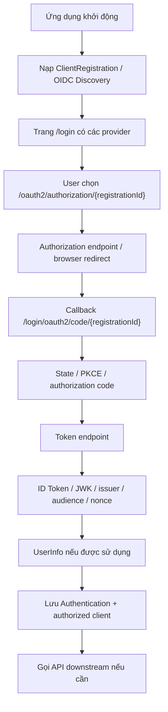
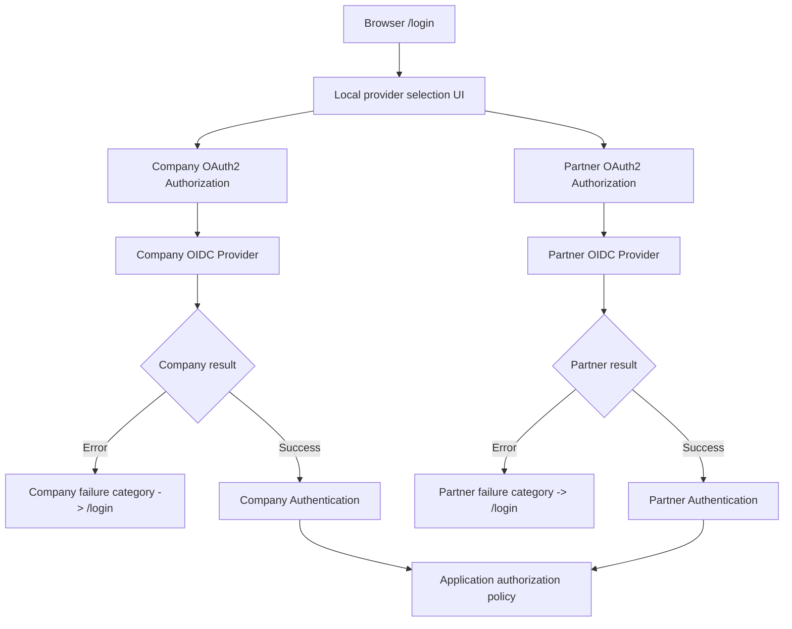

# 25.10. Xử lý lỗi của một provider khi các provider còn lại vẫn hoạt động

Một ứng dụng dùng **Spring Security OAuth 2.0 / OpenID Connect (OIDC) Client** có thể cho phép người dùng đăng nhập bằng nhiều nhà cung cấp danh tính (Identity Provider — IdP, hoặc OpenID Provider — OP). Ví dụ, một cổng thông tin hỗ trợ **Company SSO** cho nhân viên và **Partner SSO** cho đối tác.

Một ngày, Company SSO trả HTTP 503 tại token endpoint, trong khi Partner SSO vẫn hoạt động bình thường. Hệ thống phải làm gì?

**Mục tiêu không phải “chuyển token từ Company sang Partner”.** Mục tiêu là **cô lập lỗi theo provider**, để:

1. Người dùng chọn Company thấy thông báo lỗi phù hợp, không bị redirect lặp vô hạn.
2. Người dùng chọn Partner vẫn có thể hoàn tất Authorization Code/OIDC Login bình thường.
3. Session đã đăng nhập hợp lệ, những thành phần không phụ thuộc Company và các kết nối API độc lập không bị hủy chỉ vì một OP gặp sự cố.
4. Không bỏ qua kiểm tra `state`, PKCE, issuer, audience, nonce hay chữ ký token để “giữ hệ thống chạy”.
5. Bộ phận vận hành xác định **provider nào**, **bước nào của flow** và **lỗi thuộc loại nào** mà không làm lộ authorization code, ID Token, access token hoặc thông tin cá nhân.

Bài này thuộc chương **25. Nhiều provider**, tập trung vào chiến lược **partial failure / fault isolation** cho Spring Security OAuth2 Login trên Servlet. Các kỹ thuật liên quan đến Reactive WebFlux được đối chiếu khi cần, nhưng code chính sử dụng **`HttpSecurity` / `SecurityFilterChain`**.

> **Phạm vi phiên bản:** Spring Boot 3.x, Spring Security 6.x, Java 17+. Những API minh họa gần với Spring Security 6.5; tên package và chính sách tự động cấu hình có thể khác ở phiên bản khác. Các URL `example.test` và thông tin provider là ví dụ, không phải máy chủ thật.

---

## 1. Tình huống kinh doanh và nguyên tắc cô lập lỗi

Giả sử một ứng dụng có:

```text
                              +-------------------------------+
                              | Spring Boot Portal            |
                              | /login                        |
                              +---------------+---------------+
                                              |
                             User chọn provider login
                                              |
                       +----------------------+--------------------+
                       |                                           |
                       v                                           v
              Company SSO (OP A)                         Partner SSO (OP B)
              https://id.company...                      https://id.partner...
              [ĐANG GẶP LỖI 503]                        [HOẠT ĐỘNG]
                       |                                           |
                       v                                           v
              Hiển thị lỗi Company                         Đăng nhập Partner
              Không đổi sang token B                      Không bị ảnh hưởng
```

Những yêu cầu quan trọng:

- **Per-provider failure:** lỗi xảy ra trong flow của registration nào phải được xử lý như lỗi của registration đó.
- **Graceful degradation:** UI vẫn hiển thị những lựa chọn đăng nhập được phép, đưa ra thông báo có thể hiểu và giữ đường quay lại.
- **Fail closed:** không chấp nhận token sai issuer, không tự gán user danh tính ở provider khác và không bỏ kiểm tra correlation.
- **Bounded failure:** timeout và retry có giới hạn; một provider treo không giữ vô hạn thread, connection pool hoặc browser.
- **Observability:** log theo registration ID và lớp lỗi, không chứa secrets.
- **Recovery:** khi provider hoạt động trở lại, có thể thử login mới đúng flow; không dùng lại authorization code cũ hoặc vòng lặp redirect.

### 1.1. Phân biệt “provider down” với “user không có quyền”

Một callback chứa:

```text
error=access_denied
```

thường có nghĩa user từ chối consent hoặc OP không cấp quyền; **không đủ để đánh dấu provider bị outage**.

Ngược lại, lỗi DNS/timeout/HTTP 503 tại token endpoint có thể là dấu hiệu khả dụng của provider bị suy giảm. Còn `invalid_client` thường cho thấy cấu hình client secret, phương thức xác thực hoặc chính sách OP sai — không nên retry liên tục.

### 1.2. “Provider khác hoạt động” không đồng nghĩa “user A có thể đăng nhập bằng provider B”

Hai provider có thể đại diện cho **hai miền danh tính khác nhau**:

```text
issuer = https://id.company.example.test
sub    = 43fa...

issuer = https://id.partner.example.test
sub    = 43fa...
```

Ngay cả khi `sub` bằng nhau, hai định danh không phải một vì **issuer khác nhau**. Email cũng có thể thay đổi, được tái sử dụng hoặc chưa xác minh.

Nếu user chỉ được phép dùng Company SSO theo chính sách doanh nghiệp, không được tự động đăng nhập họ bằng Partner SSO để né outage. Chỉ đưa ra lựa chọn khác khi **ứng dụng và chính sách account linking** cho phép.

## 2. Các điểm một provider có thể thất bại

Một OIDC login có nhiều bước độc lập; “provider lỗi” là cách nói quá rộng.



| Giai đoạn | Ví dụ lỗi | Phạm vi ảnh hưởng | Cách phản ứng |
| --- | --- | --- | --- |
| **Khởi động/discovery** | OP A không trả `.well-known/openid-configuration` | Có thể làm toàn bộ app không khởi động nếu cấu hình phụ thuộc eager discovery | Thiết kế khởi động không phụ thuộc OP A khi có yêu cầu availability |
| Bắt đầu authorization | Registration A không tồn tại, authorization URI sai | Link đăng nhập A | Không tạo redirect giả; hiển thị lỗi/đường quay lại |
| Authorization endpoint | OP A 503, DNS lỗi, trang đăng nhập treo | Browser không hoàn tất đăng nhập A | Không vòng lặp retry browser; UI thông báo/cho retry có chủ đích |
| Authorization response | `access_denied`, `server_error`, `temporarily_unavailable` | Một giao dịch A | Classify theo mã lỗi; không đánh đồng user cancel và outage |
| Callback correlation | Thiếu/sai `state`, session hết hạn | Giao dịch A không đáng tin | Từ chối callback, không thử dùng code cho B |
| Token endpoint | Timeout, 5xx, `invalid_grant`, `invalid_client` | A token exchange | Không dùng token B; xử lý theo loại lỗi |
| OIDC validation | `iss`/`aud`/signature/nonce sai, JWKS không truy cập được | A token validation | Fail closed, không bỏ signature/issuer validation |
| UserInfo | HTTP 401/500/timeout | A OIDC/OAuth2 user enrichment | Chính sách tùy flow; không tạo user tùy tiện |
| Authorized client refresh | Refresh token A bị revoke hoặc OP A outage | API sử dụng token A | Giữ những kết nối không liên quan B; phân loại failure |
| Resource Server A | API A trả 401/403/503 | Các tính năng phụ thuộc API A | Không suy ra B login bị lỗi |

**Đăng nhập thành công và API downstream có sẵn là hai việc khác nhau.** OP A có thể vẫn cho login nhưng Reports API của A đang lỗi; hoặc OP A đang lỗi nhưng user có local session hợp lệ và chức năng không dùng OP A vẫn hoạt động.

---

## 3. Một cấu hình nhiều ClientRegistration

Spring Security phân biệt các OAuth2 Client bằng **`registrationId`**. Một ví dụ Spring Boot:

```yaml
spring:
  security:
    oauth2:
      client:
        registration:
          company:
            provider: company-op
            client-id: ${COMPANY_OIDC_CLIENT_ID}
            client-secret: ${COMPANY_OIDC_CLIENT_SECRET}
            client-authentication-method: client_secret_basic
            authorization-grant-type: authorization_code
            redirect-uri: "{baseUrl}/login/oauth2/code/{registrationId}"
            scope:
              - openid
              - profile
              - email

          partner:
            provider: partner-op
            client-id: ${PARTNER_OIDC_CLIENT_ID}
            client-secret: ${PARTNER_OIDC_CLIENT_SECRET}
            client-authentication-method: client_secret_basic
            authorization-grant-type: authorization_code
            redirect-uri: "{baseUrl}/login/oauth2/code/{registrationId}"
            scope:
              - openid
              - profile

        provider:
          company-op:
            issuer-uri: https://id.company.example.test/realms/main
          partner-op:
            issuer-uri: https://id.partner.example.test/tenant
```

Hai registrations có callback riêng theo mặc định:

```text
GET /oauth2/authorization/company
GET /oauth2/authorization/partner

GET /login/oauth2/code/company?code=...&state=...
GET /login/oauth2/code/partner?code=...&state=...
```

Điều cốt lõi:

- `company` và `partner` là **registration IDs** của ứng dụng.
- `company-op` và `partner-op` là keys provider metadata.
- `client-id` là định danh client ở từng OP, không phải `registrationId`.
- Mỗi issuer phải có configuration/metadata và trust boundary riêng.
- Mỗi `ClientRegistration` quy định grant, redirect URI và scopes của client tương ứng.

**Không tạo một registration chung rồi thay `authorizationUri`/`tokenUri` theo raw query parameter.** Điều đó phá ranh giới issuer và có thể làm lộ code/client credentials.

### 3.1. Maven dependencies

```xml
<dependencies>
    <dependency>
        <groupId>org.springframework.boot</groupId>
        <artifactId>spring-boot-starter-web</artifactId>
    </dependency>
    <dependency>
        <groupId>org.springframework.boot</groupId>
        <artifactId>spring-boot-starter-security</artifactId>
    </dependency>
    <dependency>
        <groupId>org.springframework.boot</groupId>
        <artifactId>spring-boot-starter-oauth2-client</artifactId>
    </dependency>
</dependencies>
```

Ví dụ chạy trên **Servlet/Spring MVC**. Spring WebFlux dùng API `ReactiveClientRegistrationRepository`, `ServerHttpSecurity` và `SecurityWebFilterChain` tương ứng; không trộn cấu hình WebFlux vào ví dụ Servlet.

## 4. Rủi ro đặc biệt: discovery làm toàn ứng dụng không khởi động

Khi dùng:

```yaml
provider:
  company-op:
    issuer-uri: https://id.company.example.test/realms/main
```

Spring Boot/Spring Security có thể cần **lấy metadata discovery** từ issuer để dựng `ClientRegistration`. Nếu OP Company không truy cập được **ngay lúc ứng dụng khởi động**, việc xây repository và application context có thể thất bại.

```text
Startup Portal
    |
    +-- Resolve Company OIDC metadata -> timeout/503
    |                                    |
    |                                    v
    |                             ClientRegistration setup fails
    |
    +-- Partner metadata có sẵn --------+----> App có thể không start
```

Vì vậy, **chỉ thêm AuthenticationFailureHandler ở callback chưa đủ**: ứng dụng còn chưa có HTTP server để xử lý request.

### 4.1. Cách giảm phụ thuộc discovery lúc startup

Một hướng là **dựng ClientRegistration tường minh bằng các endpoints đã biết và issuer cố định**, thay vì gọi discovery trong quá trình build registration. Với OIDC, phải **giữ validation issuer**, không bỏ issuer chỉ để tránh một HTTP request.

Spring Security có API `ClientRegistration.Builder` hỗ trợ:

```text
issuerUri(...)
authorizationUri(...)
tokenUri(...)
jwkSetUri(...)
userInfoUri(...)
userNameAttributeName(...)
```

Một @Bean cấu hình thủ công có thể chứa cả hai registrations:

```java
package example.security;

import org.springframework.beans.factory.annotation.Value;
import org.springframework.context.annotation.Bean;
import org.springframework.context.annotation.Configuration;
import org.springframework.security.oauth2.client.registration.ClientRegistration;
import org.springframework.security.oauth2.client.registration.ClientRegistrationRepository;
import org.springframework.security.oauth2.client.registration.InMemoryClientRegistrationRepository;
import org.springframework.security.oauth2.core.AuthorizationGrantType;
import org.springframework.security.oauth2.core.ClientAuthenticationMethod;

@Configuration
class ExplicitOidcRegistrations {

    @Bean
    ClientRegistrationRepository clientRegistrationRepository(
            @Value("${app.oidc.company.client-id}") String companyId,
            @Value("${app.oidc.company.client-secret}") String companySecret,
            @Value("${app.oidc.partner.client-id}") String partnerId,
            @Value("${app.oidc.partner.client-secret}") String partnerSecret) {

        ClientRegistration company =
            oidcRegistration(
                "company",
                "Company SSO",
                companyId,
                companySecret,
                "https://id.company.example.test/realms/main",
                "https://id.company.example.test/realms/main/authorize",
                "https://id.company.example.test/realms/main/token",
                "https://id.company.example.test/realms/main/jwks",
                "https://id.company.example.test/realms/main/userinfo");

        ClientRegistration partner =
            oidcRegistration(
                "partner",
                "Partner SSO",
                partnerId,
                partnerSecret,
                "https://id.partner.example.test/tenant",
                "https://id.partner.example.test/tenant/authorize",
                "https://id.partner.example.test/tenant/token",
                "https://id.partner.example.test/tenant/jwks",
                "https://id.partner.example.test/tenant/userinfo");

        return new InMemoryClientRegistrationRepository(company, partner);
    }

    private ClientRegistration oidcRegistration(
            String registrationId,
            String name,
            String clientId,
            String clientSecret,
            String issuer,
            String authorizationUri,
            String tokenUri,
            String jwkSetUri,
            String userInfoUri) {

        return ClientRegistration.withRegistrationId(registrationId)
            .clientName(name)
            .clientId(clientId)
            .clientSecret(clientSecret)
            .clientAuthenticationMethod(ClientAuthenticationMethod.CLIENT_SECRET_BASIC)
            .authorizationGrantType(AuthorizationGrantType.AUTHORIZATION_CODE)
            .redirectUri("{baseUrl}/login/oauth2/code/{registrationId}")
            .scope("openid", "profile", "email")
            .issuerUri(issuer)
            .authorizationUri(authorizationUri)
            .tokenUri(tokenUri)
            .jwkSetUri(jwkSetUri)
            .userInfoUri(userInfoUri)
            .userNameAttributeName("sub")
            .build();
    }
}
```

Đây là **mẫu minh họa kiến trúc dùng metadata tĩnh**. Địa chỉ `authorize`, `token` và `jwks` ở ví dụ phải thay bằng các endpoints **đã được nhà cung cấp xác nhận**; không suy ra endpoint bằng cách ghép chuỗi từ issuer.

Với cách này, không cần gọi discovery để dựng registration khi startup, nhưng vẫn có những điểm có thể cần network **lúc login**, đặc biệt token endpoint, JWKS và UserInfo. Cần kiểm tra mã nguồn/phiên bản thực tế để bảo đảm không còn bean khác làm eager network lookup trong startup.

### 4.2. Chú ý khi vừa cấu hình issuer-uri trong YAML vừa khai endpoints

Không nên giả định rằng chỉ cần thêm `authorization-uri` và `token-uri` bên cạnh `issuer-uri` thì Spring Boot chắc chắn bỏ discovery. Logic auto-configuration có thể vẫn gọi discovery để hoàn thành metadata.

Nếu muốn **startup independence có chủ đích**, dùng cấu hình explicit đã kiểm chứng với phiên bản cụ thể, hoặc một cơ chế snapshot/last-known-good metadata do hệ thống quản lý, không bỏ qua issuer validation.

### 4.3. Đổi sự cố startup thành sự cố runtime không phải chữa mọi thứ

Cấu hình tĩnh tránh một điểm phụ thuộc nhưng tạo trách nhiệm:

- Endpoint có thể thay đổi theo OP upgrade.
- JWK key rotation vẫn phải được hỗ trợ đúng.
- Metadata có thể lỗi thời.
- Cần bảo vệ issuer, redirect URI và trust configuration.
- Phải kiểm thử OIDC validation thực sự kiểm tra issuer và signature.
- Khi OP A đang down, đăng nhập A vẫn không thể thành công chỉ nhờ metadata tĩnh.

**Mục đích là để Partner SSO còn phục vụ được**, không phải để bypass security của Company SSO.

## 5. Bốn nhóm lỗi cần đối xử khác nhau

Có thể chia lỗi thành:

| Nhóm | Ví dụ | Ứng dụng nên làm |
| --- | --- | --- |
| **User decision** | `access_denied` (từ chối consent) | Thông báo không cấp quyền, cho user quay lại chọn provider |
| **Temporary availability** | Timeout, DNS tạm lỗi, HTTP 502/503, `temporarily_unavailable` | Retry có giới hạn/cho user thử lại sau, không tác động OP khác |
| **Configuration/contract error** | `invalid_client`, redirect URI mismatch, `invalid_scope`, issuer metadata sai | Cảnh báo vận hành, không retry liên tục; sửa cấu hình |
| **Security/correlation failure** | Sai `state`, invalid nonce, signature/issuer/audience mismatch | **Fail closed**, không đổi sang provider khác để qua xác minh |

Dù hai lỗi cùng đưa người dùng về `/login`, **nguyên nhân vận hành và hành động ứng dụng rất khác nhau**.

### 5.1. OAuth2 authorization response error

OP có thể đưa browser về callback với:

```text
/login/oauth2/code/company?
    error=temporarily_unavailable
    &error_description=...
    &state=...
```

Các error codes liên quan OAuth2:

- `access_denied`;
- `invalid_request`;
- `unauthorized_client`;
- `unsupported_response_type`;
- `invalid_scope`;
- `server_error`;
- `temporarily_unavailable`.

OIDC còn có lỗi tương tác như `login_required`, `interaction_required`, `consent_required` hay `account_selection_required` trong ngữ cảnh phù hợp.

Đừng hiển thị raw `error_description`; nó có thể chứa nội dung không tin cậy, ký tự HTML/script, query params, details nội bộ hoặc PII.

### 5.2. Token endpoint error

Nếu authorization code callback hợp lệ nhưng token exchange thất bại:

```json
{
  "error": "invalid_grant",
  "error_description": "Authorization code expired"
}
```

`invalid_grant` có thể là code đã dùng/hết hạn, refresh token revoked, PKCE verifier mismatch hoặc redirect URI không khớp. Nó **không chứng minh provider bị down**.

### 5.3. Không có callback

Khi OP timeout ở trang login hoặc DNS lỗi trước khi redirect về RP, **AuthenticationFailureHandler của callback có thể hoàn toàn không được gọi**.

Cần UX và vận hành khác:
- Login page luôn có đường quay lại an toàn.
- UI có thể hiển thị tình trạng đã được hệ thống xác minh.
- Tránh auto-retry vòng lặp qua authorization endpoint.
- Người dùng có thể tự thử lại hoặc chọn provider khác khi policy cho phép.

---

## 6. Trang đăng nhập phải độc lập với availability của từng OP

Một thiết kế xấu là trang `/login` luôn redirect thẳng tới Company SSO:

```text
GET /login -> 302 /oauth2/authorization/company
```

Khi Company gặp lỗi, user không còn thấy lựa chọn Partner. Vòng redirect có thể làm hệ thống trông như hoàn toàn chết.

Một thiết kế tốt hơn là có **trang lựa chọn provider** do chính RP phục vụ:

```text
GET /login
  -> Render UI local
     [Đăng nhập Company SSO]
     [Đăng nhập Partner SSO]
     [Help / Status]
```

**Không cần gọi network tới hai OP ngay khi render page.** Trang chọn login nên vẫn tải được ngay cả khi một OP chậm.

### 6.1. Cấu hình SecurityFilterChain

```java
package example.security;

import org.springframework.context.annotation.Bean;
import org.springframework.context.annotation.Configuration;
import org.springframework.security.config.annotation.web.builders.HttpSecurity;
import org.springframework.security.web.SecurityFilterChain;
import org.springframework.security.web.authentication.AuthenticationFailureHandler;

@Configuration
class MultiProviderSecurityConfiguration {

    @Bean
    SecurityFilterChain securityFilterChain(
            HttpSecurity http,
            AuthenticationFailureHandler safeOAuth2FailureHandler) throws Exception {

        return http
            .authorizeHttpRequests(authorize -> authorize
                .requestMatchers(
                    "/",
                    "/login",
                    "/error",
                    "/css/**",
                    "/js/**")
                .permitAll()
                .anyRequest().authenticated())
            .oauth2Login(oauth2 -> oauth2
                .loginPage("/login")
                .failureHandler(safeOAuth2FailureHandler))
            .build();
    }
}
```

Đây là Servlet `HttpSecurity`. Khi đổi `loginPage("/login")`, ứng dụng phải **tự cung cấp trang login** và links tới registration tương ứng; Spring Security không tự tạo login page như cấu hình mặc định nữa.

### 6.2. Controller cho trang login

```java
package example.web;

import org.springframework.stereotype.Controller;
import org.springframework.ui.Model;
import org.springframework.web.bind.annotation.GetMapping;
import org.springframework.web.bind.annotation.RequestParam;

@Controller
class LoginPageController {

    @GetMapping("/login")
    String login(
            @RequestParam(name = "reason", required = false) String reason,
            Model model) {

        String message = switch (reason == null ? "" : reason) {
            case "cancelled" ->
                "Bạn chưa cấp quyền đăng nhập. Có thể thử lại khi sẵn sàng.";
            case "unavailable" ->
                "Nhà cung cấp đăng nhập tạm thời không sẵn sàng. Hãy thử lại sau.";
            case "failed" ->
                "Không hoàn tất được đăng nhập. Hãy thử lại hoặc liên hệ hỗ trợ.";
            default -> "";
        };

        model.addAttribute("errorMessage", message);
        return "login";
    }
}
```

Đoạn này giả định có Thymeleaf hoặc view resolver tương ứng. **Message được ánh xạ từ danh sách cố định** thay vì phản chiếu raw query/error_description.

### 6.3. Template HTML minh họa

```html
<!DOCTYPE html>
<html lang="vi" xmlns:th="http://www.thymeleaf.org">
<head>
    <meta charset="UTF-8" />
    <title>Chọn nhà cung cấp đăng nhập</title>
</head>
<body>
<main>
    <h1>Đăng nhập</h1>

    <p th:if="${errorMessage != ''}"
       role="alert"
       th:text="${errorMessage}"></p>

    <nav aria-label="Lựa chọn đăng nhập">
        <a th:href="@{/oauth2/authorization/company}">
            Đăng nhập bằng Company SSO
        </a>
        <a th:href="@{/oauth2/authorization/partner}">
            Đăng nhập bằng Partner SSO
        </a>
    </nav>
</main>
</body>
</html>
```

Các đường dẫn là **static, backend-approved registration IDs**. Không xây:

```html
<!-- Không để input không tin cậy quyết định registration/redirect. -->
<a th:href="${param.redirectUrl}">Đăng nhập</a>
```

trừ khi có cơ chế validation/allowlist thực sự. Nếu ứng dụng có tenant policy, chỉ hiển thị những provider user **được phép** sử dụng; không hiển thị tự do mọi provider nếu chúng có ranh giới quyền khác nhau.

### 6.4. Query reason không phải nguồn chân lý bảo mật

User có thể tự đổi URL:

```text
/login?reason=unavailable
```

Do đó, thông báo trên trang login **chỉ là thông tin UX**, không phải chứng cứ vận hành để tự động đổi routing hay cấp quyền. Trạng thái availability tin cậy phải đến từ monitoring hoặc backend policy, không từ query string.

---

## 7. AuthenticationFailureHandler: xử lý lỗi callback theo provider

Ở Servlet, flow OAuth2 Login sử dụng **`OAuth2LoginAuthenticationFilter`** để xử lý callback Authorization Code Flow. Khi xảy ra **AuthenticationException** trong phạm vi filter, nó có thể gọi `AuthenticationFailureHandler` đã cấu hình.

Vì vậy một handler tốt cần:

1. Không làm rò provider exception ra browser.
2. Nhận diện **registrationId từ callback path theo allowlist**.
3. Phân loại lỗi OAuth2 có thể nhận biết.
4. Log category và registration ID mà không log tokens/code/state.
5. Redirect về một trang local an toàn, không vòng sang OP đang lỗi.
6. Không tự áp đặt phương thức đăng nhập bằng một provider khác.

### 7.1. Cài đặt failure handler

```java
package example.security;

import java.io.IOException;
import java.util.Set;

import jakarta.servlet.http.HttpServletRequest;
import jakarta.servlet.http.HttpServletResponse;

import org.slf4j.Logger;
import org.slf4j.LoggerFactory;
import org.springframework.context.annotation.Bean;
import org.springframework.context.annotation.Configuration;
import org.springframework.security.core.AuthenticationException;
import org.springframework.security.oauth2.core.OAuth2AuthenticationException;
import org.springframework.security.web.authentication.AuthenticationFailureHandler;

@Configuration
class OAuth2FailureHandlingConfiguration {

    private static final Logger log =
        LoggerFactory.getLogger(OAuth2FailureHandlingConfiguration.class);

    private static final String CALLBACK_PREFIX =
        "/login/oauth2/code/";

    private static final Set<String> REGISTRATIONS =
        Set.of("company", "partner");

    @Bean
    AuthenticationFailureHandler safeOAuth2FailureHandler() {
        return (request, response, exception) -> {
            String provider = safeRegistrationFromCallback(request);
            String reason = safeReason(exception);

            // Không ghi raw exception message: có thể chứa code,
            // state, URI hoặc provider description.
            log.warn("oauth2_login_failure provider={} category={}",
                provider, reason);

            String target = request.getContextPath()
                + "/login?reason=" + reason;

            response.sendRedirect(response.encodeRedirectURL(target));
        };
    }

    private static String safeRegistrationFromCallback(
            HttpServletRequest request) {

        String path = request.getServletPath();

        if (!path.startsWith(CALLBACK_PREFIX)) {
            return "unknown";
        }

        String candidate = path.substring(CALLBACK_PREFIX.length());

        return REGISTRATIONS.contains(candidate)
            ? candidate
            : "unknown";
    }

    private static String safeReason(AuthenticationException exception) {
        if (exception instanceof OAuth2AuthenticationException oauth2) {
            String errorCode = oauth2.getError().getErrorCode();

            return switch (errorCode) {
                case "access_denied" -> "cancelled";
                case "temporarily_unavailable", "server_error" ->
                    "unavailable";
                default -> "failed";
            };
        }

        return "failed";
    }
}
```

**Giới hạn của đoạn code:**
- `safeRegistrationFromCallback()` hoạt động với **callback path mặc định**. Nếu bạn thay `redirectionEndpoint().baseUri()` hoặc servlet mapping, phải đồng bộ logic nhận diện.
- URI callback là **untrusted HTTP request path**; allowlist ngăn log injection và trả về registration lạ, nhưng **không được coi bản thân callback path là bằng chứng đã xác minh danh tính provider**. OAuth2 flow mới xác minh correlation/issuer.
- Handler chỉ xử lý **AuthenticationException đi qua OAuth2 Login authentication filter**. Nó **không bắt mọi lỗi khởi động/discovery, HTTP 503 ở trang OP ngoài browser hoặc lỗi từ một filter khác**.
- `safeReason()` có thể cần phân loại sâu hơn nếu provider error được bọc trong exception; mặc định `failed` là lựa chọn không phơi lộ chi tiết.
- `IOException` và các imports không dùng khác có thể bỏ trong dự án thực; ví dụ tập trung vào contract failure.

### 7.2. Vì sao không dùng raw exception.getMessage() trên trang login?

Một exception hoặc `error_description` có thể chứa:

- URL token endpoint có query;
- Authorization code/state;
- Dữ liệu cấu hình hoặc HTTP response;
- Chuỗi HTML do provider trả;
- PII của người dùng;
- Thông tin khiến attacker phân biệt account/tenant.

Ví dụ không nên:

```java
response.sendRedirect(
    "/login?error=" + exception.getMessage());
```

Ngoài nguy cơ XSS/phishing khi render, URL có thể bị lưu vào browser history/access logs và có vấn đề encoding/open redirect nếu xây không an toàn.

### 7.3. Vì sao `access_denied` không nên bị báo “dịch vụ chết”?

Khi người dùng chủ động từ chối consent, việc hiển thị “Company SSO đang gián đoạn” là sai. Nên có thông báo như:

> Bạn chưa cấp quyền đăng nhập. Nếu muốn tiếp tục, hãy thử lại.

Ngược lại, `server_error` hoặc `temporarily_unavailable` báo tình trạng provider/authorization flow khác. Không ghi nhận hai tình huống này vào cùng một số đo “availability outage” nếu monitoring cần chính xác.

### 7.4. Không tự redirect sang provider B từ failure handler

Không nên:

```java
// Anti-pattern: lỗi Company thì tự bật Partner.
response.sendRedirect("/oauth2/authorization/partner");
```

Vì:
- User có thể không có tài khoản tại Partner;
- Partner có thể trả danh tính khác;
- Chính sách tenant/workforce có thể cấm;
- Tạo vòng lặp khi Partner cũng lỗi;
- Có thể gây account mix-up nếu business code liên kết theo email.

**Trả user về trang lựa chọn và giải thích lựa chọn còn hợp lệ** tốt hơn việc chuyển OP ngầm.

## 8. Khi failure handler không bắt được lỗi

Một cơ chế xử lý robust cần phân loại lỗi theo **điểm phát sinh**.

| Nơi phát sinh lỗi | AuthenticationFailureHandler của oauth2Login có chắc chạy? | Hướng xử lý |
| --- | --- | --- |
| Callback do `OAuth2LoginAuthenticationFilter` xử lý và phát AuthenticationException | Thông thường **có** | Custom failure handler |
| Đang ở trang authorization endpoint của OP, browser gặp lỗi mạng | **Không** | UI/monitoring/cho user trở về RP |
| Spring Boot fail khi tạo ClientRegistration do discovery startup | **Không** | Đổi kiến trúc registration/startup dependency |
| `OAuth2AuthorizationRequestRedirectFilter` chưa tạo redirect, exception trước callback | **Không thể giả định** | Kiểm tra filter/exception handling cụ thể |
| Scheduled refresh token job | **Không** | OAuth2AuthorizedClientManager failure handler |
| Resource Server trả 401/403 khi app gọi API | **Không** | HTTP client/interceptor/authorized-client failure handling |
| Controller business ném exception sau khi login | **Không** | Controller/service error handling |

### 8.1. Không bắt mọi Throwable rồi cho phép login

Một anti-pattern nguy hiểm:

```java
try {
    authenticateWithCompany();
} catch (Exception ex) {
    return createLocalAuthentication("alice");
}
```

Đây là **authentication bypass**. Nếu không xác minh được danh tính từ provider đã chọn, kết quả phải là **login thất bại**, không được tự tạo `Authentication` thay thế.

### 8.2. Không biến lỗi state thành “thử provider khác”

`invalid_state_parameter` hoặc tình huống thiếu authorization request có thể xảy ra do browser session không còn, callback bị sửa, tab song song hoặc CSRF. Đây là **lỗi correlation cần fail closed**.

Không dùng authorization code của Company để gọi token endpoint Partner; authorization code ràng buộc với client/redirect URI/AS và thường chỉ dùng một lần.

---

## 9. Giữ ranh giới state, PKCE và issuer giữa providers

Các thông tin thuộc một authorization flow:

```text
Flow Company:
  registrationId = company
  issuer         = https://id.company.example.test/realms/main
  state          = S-company
  redirectUri    = https://app.example.test/login/oauth2/code/company
  code_verifier  = V-company (nếu PKCE)

Flow Partner:
  registrationId = partner
  issuer         = https://id.partner.example.test/tenant
  state          = S-partner
  redirectUri    = https://app.example.test/login/oauth2/code/partner
  code_verifier  = V-partner (nếu PKCE)
```

Chỉ khi callback hợp lệ cho **đúng giao dịch**, framework mới tiếp tục token exchange và OIDC validation.

### 9.1. Không bỏ kiểm tra state khi provider A chậm

Sai:

```text
Nếu không tìm thấy authorization request trong session:
    lấy registration đầu tiên
    thử đổi code
```

Cách này phá cơ chế chống login CSRF/mix-up. Đúng là **từ chối callback**, hiển thị thông báo hết phiên đăng nhập và bắt đầu flow mới khi user chọn lại.

### 9.2. Không dùng lại code verifier từ provider khác

PKCE dùng `code_verifier` của authorization request tương ứng. Mất verifier thì không được lấy verifier của flow khác, hoặc tắt PKCE chỉ để token exchange chạy được.

### 9.3. ID Token phải được kiểm tra theo issuer và audience

OIDC ID Token từ Company không thể được chấp nhận làm ID Token của Partner chỉ vì signature/subject “trông hợp lý”.

Các ràng buộc gồm:
- Signature với JWK từ đúng OP;
- `iss` đúng issuer đã cấu hình;
- `aud` chứa client ID được phép;
- `exp`, `iat` và ràng buộc thời gian;
- `nonce` khi áp dụng;
- `sub` đúng khi so khớp UserInfo.

**Không dùng JWK set của Partner để xác minh ID Token Company**, và không “fallback” sang JWK URL khác khi Company JWKS timeout. JWKS keys có thể cache theo issuer/`kid` nhưng phải tuân thủ vòng đời/cache và validation đúng.

## 10. Định danh người dùng qua nhiều issuer

OIDC xác định một end-user bởi ít nhất tổ hợp:

```text
(issuer, subject)
```

Ví dụ:

```text
("https://id.company.example.test/realms/main", "user-001")
("https://id.partner.example.test/tenant", "user-001")
```

Hai tuple khác nhau. Không dùng `sub` đơn lẻ làm global user ID trong hệ thống multi-provider.

### 10.1. Email giống nhau không đủ chứng minh cùng account

`email` có thể:
- Chưa được xác minh;
- Thay đổi theo thời gian;
- Bị tái sử dụng;
- Được chuẩn hóa khác nhau ở các OP;
- Bị provider giả nếu tin nhầm issuer.

Do đó, khi Company outage, user đăng nhập Partner với email tương tự **không được tự động nhận quyền nội bộ của Company account**.

### 10.2. Nếu cho phép account linking

Cần cơ chế liên kết account có kiểm soát, ví dụ:
- User đã có một phiên hợp lệ và thực hiện xác minh bổ sung;
- Quy trình admin/provisioning được xác thực;
- Xác nhận cả hai danh tính với OP tương ứng khi chúng hoạt động;
- Lưu liên kết giữa cặp (issuer, sub) và local user ID;
- Kiểm soát tenant, role và quyền sau login.

**Account linking là bài toán identity governance**, không phải “retry chiến thuật” của failure handler.

### 10.3. Nếu có tenant-specific identity policy

Không để raw query `tenant=foo` quyết định tùy ý user được chuyển sang bất kỳ provider nào.

Nên có một mapping đáng tin:

```text
Authenticated/verified tenant A:
    allowed registrations: company

Authenticated/verified tenant B:
    allowed registrations: partner

Một user có quyền cả A và B:
    có thể chọn trong tập được phép
```

Nhưng trên login page trước khi xác thực, làm thế nào xác định tenant cũng cần thiết kế an toàn. URL tenant hint có thể là UX input, **không phải chứng cứ authorization**.

---

## 11. Provider status và circuit breaker: có nên không?

Có thể cung cấp tình trạng khả dụng mỗi provider:

```text
company -> UNAVAILABLE
partner -> AVAILABLE
```

Nhưng phải phân biệt **tình trạng do monitoring suy luận** và **sự thật tuyệt đối**:

- Discovery endpoint khỏe không có nghĩa authorization endpoint/token endpoint/UserInfo đều khỏe.
- Một lỗi `access_denied` không làm provider thành UNAVAILABLE.
- Monitoring có thể nằm ở region khác với user.
- OP có thể hoạt động nhưng một registration/client secret bị lỗi.
- Một provider outage có thể là lỗi cục bộ mạng giữa RP và OP.

### 11.1. Không kiểm tra mọi provider đồng bộ trên mỗi request login page

Anti-pattern:

```text
GET /login
   -> HTTP GET OP A metadata
   -> HTTP GET OP B metadata
   -> HTTP GET OP C metadata
   -> Chỉ render sau khi cả ba trả response
```

Khi A timeout, trang login có thể chậm hoặc lỗi, dù B/C còn hoạt động.

Tốt hơn:
- Render login page từ danh sách registrations tin cậy.
- Đọc trạng thái đã được **cache** từ monitoring riêng, nếu cần.
- Kiểm tra health từng provider với timeout và nhịp phù hợp.
- Không dùng raw error message làm trạng thái provider.
- Đảm bảo User Agent vẫn có đường chọn/đổi provider hợp lệ.

### 11.2. Mô hình availability đơn giản

```java
enum ProviderAvailability {
    AVAILABLE,
    DEGRADED,
    UNAVAILABLE,
    UNKNOWN
}
```

Đây là enum của ứng dụng, không phải API có sẵn Spring Security.

Một service cung cấp trạng thái có thể có contract:

```java
interface ProviderStatusReader {
    ProviderAvailability status(String registrationId);
}
```

**Status Reader không phải nơi quyết định một token có hợp lệ hay không**. Dù status nói AVAILABLE, Spring Security vẫn phải xác minh login/token; dù status nói UNAVAILABLE, business policy có thể cho phép user thử lại với sự thông báo rõ ràng.

### 11.3. Circuit breaker sử dụng ở đâu?

Nếu có nhiều cuộc gọi server-to-server tới API/token endpoints, circuit breaker/bulkhead/timeouts có thể giảm tình trạng OP A làm cạn thread/connection pool.

Cần thận trọng:
- Mỗi provider/destination có circuit riêng.
- Không share circuit breaker giữa A và B nếu chúng độc lập.
- Không cache một Authentication thành công để “trả lại” khi provider lỗi.
- Không áp dụng retry tự động cho authorization code đã có tính một lần.
- Không dùng circuit breaker state để tự cấp role/user.
- Đừng bật circuit breaker trước login browser authorization endpoint một cách không phân biệt; browser có vòng đời và UX riêng.

## 12. Quản lý timeout và retry ở token endpoint

### 12.1. Phân loại trước khi retry

| Lỗi | Có nên tự retry? | Lý do |
| --- | --- | --- |
| DNS tạm thời / connection timeout | Có thể cân nhắc một retry có giới hạn nếu tác vụ idempotent và contract cho phép | Network transient |
| Token endpoint HTTP 503 | Backoff có giới hạn; không nhất thiết retry ngay authorization code | AS outage / rate control |
| `temporarily_unavailable` | Cho user retry có chủ đích, tránh redirect loop | OAuth availability error |
| `invalid_client` | **Không** retry giống hệt liên tục | Cần sửa credentials/config |
| `invalid_grant` | **Không** retry giống hệt authorization code/refresh token vô hạn | Code one-time, token revoked/expired |
| `invalid_scope` | **Không** | Cấu hình/consent không hợp lệ |
| State/nonce/signature mismatch | **Không** | Security failure |
| User `access_denied` | **Không** tự retry | Người dùng đã từ chối |

### 12.2. Vì sao retry token request có thể nguy hiểm?

Authorization code thường là **single-use credential**. Giả sử token endpoint đã xử lý code và phát token, nhưng response bị mất trên đường truyền. Client không thể chắc chắn request có thành công hay chưa.

```text
RP -> POST /token (code=C1)
OP -> xử lý C1, phát token
Network -> mất response
RP -> retry code=C1
OP -> invalid_grant vì C1 đã dùng
```

Retry ngây thơ không làm kết quả tốt hơn. Nên báo login chưa hoàn tất và khởi động lại authorization flow **bằng request mới** nếu user đồng ý.

### 12.3. Không cho OP A chiếm toàn bộ HTTP connections

Với client HTTP tùy chỉnh:
- Connection timeout/read timeout phù hợp;
- Connection pool tách hoặc giới hạn theo host;
- Bulkhead/circuit breaker ở luồng thích hợp;
- Retry với jitter/backoff và quota;
- Metrics theo host/registration;
- Hạn chế số login flows pending;
- Không log form token endpoint chứa code/verifier/client_secret.

Nhiều thứ thuộc tầng HTTP/operations, không phải một flag `oauth2Login()` duy nhất.

## 13. Các session đã đăng nhập thì sao?

Đặt tình huống:

```text
08:00 Alice đăng nhập bằng Company thành công
08:20 Company OP bắt đầu outage
08:30 Alice mở một trang local của Portal
08:31 Bob đăng nhập Partner mới
```

**Alice có thể tiếp tục sử dụng phiên Portal đang hợp lệ** cho những chức năng không cần gọi lại Company OP, nếu security/session policy cho phép. **Bob vẫn có thể đăng nhập Partner** nếu login flow B độc lập.

Nhưng nếu một trang của Alice gọi API cần access token đã hết hạn, manager có thể cần refresh ở Company token endpoint và thất bại. Lúc đó:

- Không logout tất cả users của Portal chỉ vì refresh thất bại một client;
- Không dùng Partner access token cho Company API;
- Chỉ trả lỗi/degraded status cho tính năng phụ thuộc token Company;
- Phân loại `invalid_grant` (credential hỏng) khác HTTP 503 (provider tạm gián đoạn);
- Không xóa authorized client còn có giá trị vì network timeout một cách thiếu căn cứ.

### 13.1. Access token còn hạn có dùng được không?

Có thể, nếu Resource Server còn chấp nhận token và không phụ thuộc OP runtime, nhưng **không có bảo đảm tổng quát**. Resource Server có thể dùng introspection cần gọi OP, hoặc token đã bị revoke.

Một API JWT self-contained có thể tiếp tục validate signature từ JWK cache trong một khoảng thời gian, nhưng vẫn phải tuân thủ expiry và issuer/audience validation.

### 13.2. Không biến lỗi refresh của A thành xóa token B

Authorized client thường gắn với:

```text
(clientRegistrationId, principalName)
```

Ví dụ:

```text
(company-api, alice) -> token A
(partner-api, alice) -> token B
```

Khi refresh token A lỗi, không được xóa B, không gán A cho B và không tự thay `principalName` để tìm token khác.

### 13.3. Login session khác OAuth2AuthorizedClient

- `SecurityContext`/HTTP session lưu Authentication của user tại RP.
- `OAuth2AuthorizedClient` lưu access/refresh tokens để gọi API.
- `ClientRegistrationRepository` lưu metadata của OP/AS.
- `AuthorizationRequestRepository` lưu state/correlation qua login redirects.

Sự cố ở tầng nào nên được xử lý đúng tầng đó. Không xóa toàn bộ HTTP sessions vì một provider metadata health check thất bại.

---

## 14. Không đánh đồng error của OP và error của Resource Server

Một client có thể nhận:

```text
Authorization Server / token endpoint:
    400 invalid_grant
    401 invalid_client
    503 unavailable

Resource Server / business API:
    401 Bearer invalid_token
    403 Bearer insufficient_scope
    503 API unavailable
```

Mỗi lỗi có tác động khác nhau.

### 14.1. 401 invalid_token tại API

Có thể do token expired, revoked, issuer/audience sai. Nếu ứng dụng dùng `OAuth2ClientHttpRequestInterceptor` của Servlet RestClient hoặc `ServletOAuth2AuthorizedClientExchangeFilterFunction` của WebClient, cần kiểm tra cấu hình authorization failure handler để dọn authorized client lỗi khi phù hợp.

**Không mặc định HTTP 401 từ API tự logout user khỏi RP hoặc ảnh hưởng mọi providers.**

### 14.2. 403 insufficient_scope

Token có thể hợp lệ nhưng thiếu quyền. Không chuyển sang provider khác hoặc client có scope rộng hơn để bỏ qua policy. Cần authorization/consent hợp lệ hoặc trả lỗi quyền truy cập.

### 14.3. API A 503 không có nghĩa OP A down

Resource Server và Authorization Server có thể là các dịch vụ/cluster khác nhau. Monitoring nên giữ nhãn rõ:
- `op_authorization`;
- `op_token_endpoint`;
- `op_jwks`;
- `op_userinfo`;
- `resource_api`.

Không suy luận “OP unavailable” chỉ từ API 503.

## 15. JWK cache và provider-specific trust

OIDC ID Token thường cần xác minh chữ ký với JWK Set của **đúng OP**.

```text
ID Token Company
    iss = https://id.company...
    kid = key-company-2
        |
        v
    JWK Set Company

ID Token Partner
    iss = https://id.partner...
    kid = key-partner-8
        |
        v
    JWK Set Partner
```

Nếu Company JWKS endpoint tạm lỗi:
- Một verifier có key cached hợp lệ có thể tiếp tục theo cache policy;
- Khi cần key mới không có trong cache, validation phải thất bại;
- Không lấy JWK Set Partner để verify Company ID Token;
- Không tắt signature validation;
- Không chấp nhận một `alg=none` hoặc thuật toán khác không được chấp thuận.

### 15.1. Key rotation và tình trạng partial outage

OP có thể rotate keys trong lúc metadata/JWKS endpoint lỗi. Khi đó những token ký bằng key mới có thể không verify được. Đây là tình huống **degraded login theo provider** cần log/metric rõ, không coi token là hợp lệ chỉ vì người dùng từng có session.

### 15.2. Issuer và client audience vẫn phải đúng

Cấu hình issuer tĩnh để tránh discovery startup **không được biến thành bỏ kiểm tra issuer**. Cần bảo đảm ClientRegistration và OIDC validator vẫn so khớp `iss` với issuer đáng tin và `aud` với client ID phù hợp.

## 16. Lỗi state/correlation trong môi trường nhiều provider

Một user mở hai tab:

```text
Tab A: /oauth2/authorization/company
    state = A-123

Tab B: /oauth2/authorization/partner
    state = B-456
```

Callback Partner có `state=B-456` phải khôi phục đúng authorization request B, không dùng request A.

Một custom `AuthorizationRequestRepository` chỉ lưu một slot trong session có thể gây ghi đè giữa các tabs:

```text
session["AUTH_REQUEST"] = latestRequest
```

Khi callback A đến, repository chỉ còn B → state mismatch. Không được kết luận Company OP outage chỉ vì state không khớp.

### 16.1. Phân biệt session problem với OP outage

| Triệu chứng | Gợi ý nguyên nhân |
| --- | --- |
| Callback không có session cookie | SameSite, Secure, Domain, Path, proxy |
| Không tìm thấy authorization request | Session timeout/overwrite/stale callback |
| `state` không khớp | CSRF/mix-up, callback cũ, multi-tab hoặc thay đổi request |
| Token endpoint timeout | OP/AS/network, sau khi correlation đã qua |
| ID Token `iss` sai | Wrong issuer/security validation, không phải availability thông thường |

**Không retry tự động callback cũ**. Nếu state đã mất, user nên bắt đầu lại login flow, khi provider được phép và còn khả dụng.

## 17. Không chia sẻ OAuth2 token hoặc exception theo kiểu global mutable state

Sai:

```java
// ANTI-PATTERN
static String lastAccessToken;
static String lastProviderError;
static String currentProvider;
```

Trong server nhiều request đồng thời:
- Request Alice có thể ghi token A rồi Bob đọc nhầm;
- Error của Company bị gán cho Partner;
- Một tenant có thể thấy error hoặc dữ liệu của tenant khác.

Cách phù hợp:
- `ClientRegistration` bất biến, theo registration ID;
- Authorized client storage theo registration + principal;
- Request-scoped hoặc correlation-safe context;
- Provider health snapshot theo registration, không theo người dùng;
- Log context riêng request/trace ID;
- Không lưu raw tokens trong mutable global field.

### 17.1. Không sửa ClientRegistrationRepository khi provider down

`InMemoryClientRegistrationRepository` thường chứa các registrations cố định. Việc xóa registration Company khi health check thất bại có thể khiến:
- Callback đang diễn ra không còn tìm thấy registration;
- User nhìn thấy login URL lỗi khác;
- Session/authorized client code bị bất nhất;
- Không có cơ chế phục hồi rõ.

**Provider availability nên là trạng thái vận hành riêng**, không đồng nghĩa xóa metadata client hoặc thay secret/issuer ngay trong runtime vì một HTTP 503.

## 18. Logging, metrics và cảnh báo từng provider

Một event được lọc:

```json
{
  "event": "oauth2_login_failure",
  "provider_registration": "company",
  "stage": "token_endpoint",
  "category": "temporarily_unavailable",
  "environment": "production",
  "trace_id": "internal-trace"
}
```

Đây là **schema ví dụ do ứng dụng tự thiết kế**, không phải log mặc định Spring Security.

### 18.1. Thông tin nên ghi

- `registrationId` từ allowlist;
- Tầng lỗi (discovery, authorization, callback, token, JWK, UserInfo, refresh, API);
- Error code sau khi normalize;
- HTTP status category (nếu có);
- Latency histogram/timeout counter;
- Environment, region và trace ID nội bộ;
- Số lượng lỗi và tỉ lệ thành công mỗi provider.

### 18.2. Thông tin không nên ghi

- `authorization code`;
- `state` / PKCE verifier;
- Access token, refresh token, ID Token;
- `client_secret`;
- Raw `error_description` hoặc `error_uri`;
- Authorization/Cookie headers;
- Toàn bộ callback URL có `code` và `state`;
- Toàn bộ `OAuth2AuthenticationToken` hoặc OIDC claims;
- Email, `sub` hoặc thông tin cá nhân không cần thiết.

### 18.3. Cảnh báo không nên gộp mọi provider

Đặt một alert “OIDC login failure rate 40%” có thể không giúp biết Company down còn Partner vẫn khỏe. Nên có thêm các metric:

```text
oauth2_login_attempts{registration="company"}
oauth2_login_failures{registration="company",category="unavailable"}
oauth2_login_successes{registration="partner"}
oauth2_token_timeout{registration="company"}
oauth2_jwks_errors{registration="company"}
```

Tránh labels có cardinality cao như raw user ID, raw error_description hoặc exception message. Chỉ dùng registration IDs và categories có giới hạn.

### 18.4. Nếu cần correlation giữa logs

Dùng trace ID nội bộ do hệ thống sinh. Không cần log raw OAuth2 `state` để “nối hai request”; state là dữ liệu giao thức được đưa qua browser và có thể bị lộ.

## 19. Cảnh báo tránh lộ lỗi provider ra người dùng

Một UI nên phân biệt thông báo:

| Tình huống | UX minh họa |
| --- | --- |
| User từ chối cấp quyền | “Bạn chưa cấp quyền đăng nhập. Bạn có thể thử lại.” |
| Company tạm gián đoạn | “Không kết nối được Company SSO lúc này. Vui lòng thử lại sau.” |
| Partner bình thường | Hiển thị nút Partner nếu user được phép sử dụng |
| Session login hết hạn | “Phiên đăng nhập đã hết hạn. Vui lòng bắt đầu lại.” |
| Lỗi cấu hình client | “Đăng nhập chưa khả dụng. Bộ phận hỗ trợ đã được thông báo.” |
| Token không vượt OIDC validation | “Không thể xác minh danh tính đăng nhập.” |
| Lỗi API sau khi đã login | “Tính năng này tạm thời không khả dụng.” |

**Không nêu**:
- Client secret;
- Internal IP/token endpoint response;
- Provider stacktrace;
- OIDC claims không cần thiết;
- `error_description` raw do OP cung cấp;
- “Bạn đã được chuyển sang Partner và giữ nguyên quyền Company” nếu chưa có account-linking policy.

## 20. Một chính sách phục hồi có kiểm soát

Tình huống OP Company ngừng hoạt động trong 30 phút:

```text
T0: Health monitoring: Company token endpoint lỗi liên tiếp
T1: Status Company = DEGRADED/UNAVAILABLE (sau threshold)
T2: /login vẫn chạy, Partner vẫn có thể chọn
T3: User Company nhận hướng dẫn thử lại sau
T4: Một số sessions đã đăng nhập vẫn dùng chức năng độc lập
T5: Recovery monitoring xác nhận Company khỏe
T6: Provider Company được đánh dấu AVAILABLE trở lại
T7: User bắt đầu authorization request mới nếu cần
```

Cần sử dụng thresholds/hysteresis để tránh UI chớp trạng thái khi một OP dao động; không cần nhúng một live network probe vào render login page.

### 20.1. Health status không thay xác minh danh tính

Khi monitoring thấy AVAILABLE, Spring Security vẫn phải:
- Correlate state;
- Xác minh code/PKCE;
- Chỉ lấy token từ AS phù hợp;
- Validate ID Token;
- Áp dụng user provisioning/authorization policy.

Không có đường “đăng nhập nhanh” vì provider đã chuyển trạng thái lên AVAILABLE.

### 20.2. Không tự replay callback sau outage

Authorization codes có thời hạn ngắn và thường chỉ dùng một lần. Sau sự cố, đưa user bắt đầu **một flow mới**. Không dùng lại URL chứa `code` từ browser history.

---

## 21. Kiến trúc nhiều provider theo fault domain

Một kiến trúc thực tế có thể phân tách:



Trong đó:
- Provider selection UI là của RP và không phụ thuộc availability trực tiếp của OP.
- Registrations, issuers, token endpoints, JWKS và sessions đều được quản lý có ranh giới.
- Lỗi của một flow phải dẫn tới failure của flow đó.
- Sau khi login thành công, một business policy trung tâm kiểm soát quyền; **không tự hợp nhất accounts chỉ vì có email giống nhau**.
- Availability status là advisory để user quyết định; không thay OAuth2 validation.

### 21.1. Có cần tạo SecurityFilterChain riêng cho từng OP?

**Không bắt buộc.** Thông thường một `SecurityFilterChain` với nhiều `ClientRegistration` và `oauth2Login()` đã đủ để chọn provider theo `registrationId`.

Tách nhiều chains chỉ khi có security boundaries rõ, matcher/order đúng và yêu cầu riêng. Nếu tùy tiện thêm nhiều chains có thể khiến callback đi qua chain không có OAuth2 Login filter hoặc bị áp dụng policy sai.

### 21.2. Có cần tách REST clients per provider?

Khi app còn gọi API hoặc token endpoint của từng provider, nên cân nhắc transport settings và connection pool/bulkhead riêng theo host/trust boundary. **Không cần tạo thêm một HTTP client chỉ để trang login hiển thị nút Partner**, nhưng tránh cấu hình global retry một OP khiến tất cả request bị chậm.

### 21.3. Không thêm logout fallback sai issuer

Nếu người dùng đã đăng nhập Company và Company OP outage lúc logout, local logout vẫn phải hoạt động. Không redirect ID Token Company sang Partner logout endpoint như một “fallback”. OIDC RP-Initiated Logout cần **`end_session_endpoint` của chính OP đã đăng nhập**; nếu OP unreachable, xử lý local logout và thông báo giới hạn.

## 22. Kịch bản vận hành: khi nào cần chặn login của provider A?

Nếu monitoring có tín hiệu Company đang outage:
- UI có thể hiển thị “Company SSO tạm gián đoạn”;
- Có thể tạm disable nút Company hoặc vẫn cho thử lại theo policy;
- Trả user về trang login nếu flow A thất bại;
- Không được vô hiệu hóa chức năng Partner;
- Không dùng trạng thái UI làm rào chắn security duy nhất.

Tuy nhiên, **việc tạm chặn browser flow có thể gây nhầm lẫn** nếu monitoring sai; cơ chế should support UNKNOWN, DEGRADED và recovery.

Nếu cần enforce trước khi khởi động authorization:
- Dùng một policy/gateway/guard rõ ràng theo registration ID đã allowlist;
- Không dựa vào raw user-supplied provider code;
- Giữ đúng handler/filter OAuth2 chuẩn cho authorization flow khi cho phép;
- Không làm hỏng callbacks đang diễn ra khi trạng thái provider chuyển từ AVAILABLE sang UNAVAILABLE;
- Không đổi `ClientRegistration` đang dùng giữa chừng;
- Đảm bảo việc chặn này không gây open redirect.

**Đây là chính sách vận hành**, không phải Spring Security tự động fail over OAuth2 Login.

## 23. Sự cố OP với session nhiều thiết bị

Người dùng có thể có:
- Một session đã đăng nhập Company trên browser A;
- Một session Partner trên browser B;
- Một background integration có refresh token Company;
- API khác dùng service token không liên quan.

Không có quy tắc chung “một OP down = logout mọi session”. Mỗi case có trust boundary khác.

### 23.1. Session cũ khi OP phục hồi

Nếu local session vẫn còn hợp lệ, user có thể không cần login lại. Nếu session hết hạn trong outage, user cần một authorization flow mới với provider phù hợp.

### 23.2. Refresh token Company bị revoke

Đó là lỗi riêng của authorized client Company. Không xóa token Partner hoặc chuyển sang client credentials để “mượn quyền” user.

### 23.3. Các sessions ở những RP khác

Một OP outage không chứng minh tất cả RP sessions đang bị hủy. OIDC RP-Initiated/Back-channel Logout là các cơ chế khác với availability của token endpoint.

---

## 24. Kiểm thử tình huống partial failure

Khi triển khai thực tế, một suite test có thể **giả lập OP A lỗi và OP B bình thường**. Đây là thiết kế test dành cho người học; bài này không chạy test của dự án.

| Test case | OP A | OP B | Kết quả mong đợi |
| --- | --- | --- | --- |
| Startup khi A discovery down | Metadata timeout | Bình thường | Nếu có thiết kế explicit registration, Portal vẫn start |
| Login page | Không phản hồi | Bình thường | Trang local vẫn tải được |
| Start login A | Authorization endpoint 503 | Không ảnh hưởng | A thất bại rõ ràng, không redirect lặp |
| Start login B | Không liên quan | Authorization OK | B đi vào authorization flow chuẩn |
| Callback A `access_denied` | User từ chối | Không liên quan | Thông báo cancel, không đánh dấu OP down |
| Callback A `server_error` | OAuth2 error | Bình thường | Category unavailable, B vẫn dùng được |
| Token endpoint A 503 | A 503 | B 200 | Failure A; flow B có thể thành công |
| A signature/issuer sai | ID Token invalid | B valid | A bị từ chối; không dùng B key/issuer |
| Session A hết hạn | Missing state | B normal | A callback bị từ chối; không replay code |
| Hai tab A/B | Cùng browser session | Cùng browser session | Correlation đúng từng state hoặc lỗi rõ |
| Token refresh A invalid_grant | Refresh revoked | B token valid | Không xóa B authorized client |
| A API downstream 503 | API A unavailable | B API normal | Tính năng A degraded, B bình thường |
| A recovery | Trở lại 200 | Vẫn normal | Flow A mới chạy được, không tự replay callback cũ |
| B callback khi health A chuyển state | Status A = DOWN | B callback OK | Không xóa registrations/flow B |

### 24.1. Dùng môi trường test OP thế nào?

Có thể dùng mock HTTP token/JWKS endpoints, fake authorization responses với state hợp lệ được tạo từ request thật, hoặc một test OP hỗ trợ OIDC discovery. Không sinh token giả rồi bỏ qua signature/issuer validation chỉ để test pass.

### 24.2. Nên có cả positive và negative tests

- Positive: OP B callback và ID Token hợp lệ -> login thành công.
- Negative: OP A ID Token `iss` sai -> login A bị từ chối.
- Negative: state/cookie của A bị thay -> callback bị từ chối.
- Negative: API B token bị đưa tới A API -> Resource Server từ chối.
- Positive: user thấy thông báo an toàn khi A outage.
- Negative: raw exception/`error_description` không hiện trên HTML hoặc Location.
- Negative: provider lạ trong path/query không được dùng để chọn OP/token endpoint.

## 25. Troubleshooting phổ biến

| Triệu chứng | Nguyên nhân khả dĩ | Hướng điều tra |
| --- | --- | --- |
| Cả app không start khi một OP down | Eager issuer discovery trong ClientRegistration | Kiểm tra startup dependency; explicit metadata có issuer validation |
| Trang /login bị timeout | Render page đồng bộ gọi mọi OP | Tách status cache/monitoring khỏi page render |
| Company lỗi, Partner redirect cũng lỗi | Global filter/exception handling hoặc chung resource bị nghẽn | Xem shared HTTP pools, timeout, SecurityFilterChain |
| Company callback lỗi vào /login?error nhưng message vô ích | Chưa có safe AuthenticationFailureHandler | Classify callback error category |
| User `access_denied` bị tính outage | Phân loại sai | Tách user cancellation khỏi availability |
| `invalid_client` lặp vô hạn | Client secret/config sai, retry không giới hạn | Dừng retry; sửa OP registration |
| `invalid_grant` sau retry | Code one-time hoặc PKCE/redirect mismatch | Không replay code; khởi động flow mới |
| Callback không tìm thấy authorization request | Session cookie/timeout/multi-tab | Kiểm tra state, session, storage |
| Một flow thành công nhưng đổi sang identity sai | Auto provider fallback hoặc account linking bằng email | Dùng (issuer, sub), identity policy |
| ID Token A được xác thực bằng key B | JWK cache/decoder dùng chung sai | Cache và validate issuer-specific |
| JWKS A unavailable khi key rotate | Cache thiếu key mới | Fail closed, đợi OP phục hồi |
| User A không vào được trang local sau OP down | Security chain ép re-login mỗi request | Kiểm tra session validity và auth rules |
| Reports API A 503 bị xem là login error | Trộn API và OP stages | Tách metrics/exception handlers |
| B token bị xóa khi refresh A lỗi | Authorized client cleanup dùng global key | Xóa theo registration + principal |
| Login page ẩn cả B | Global status flag `allProvidersDown` | Status theo registration |
| Bị redirect loop qua Company | Tự redirect /login sang OP A | Trang lựa chọn provider là local view |
| `error_description` chứa HTML hiện trong UI | Phản chiếu raw provider data | Map error code tới fixed safe message |
| Unknown registration được đưa vào URL | Registration từ user input | Strict allowlist và URI building |
| Startup explicit endpoints vẫn lỗi | Một bean khác vẫn gọi discovery | Xem toàn bộ bootstrap path/trust configuration |
| OP A lỗi và user thấy “login Partner sẽ giữ quyền Company” | Sai identity mapping | Chỉ cho switch khi policy cho phép |
| Timeout OP A làm thread pool đầy | Retry/HTTP client không giới hạn | Timeouts, bulkheads, connection pool |
| Health page nói B down khi B vẫn OK | Shared circuit breaker hoặc monitoring | Per-provider metrics và probes |
| Proxy làm sai callback | Forwarded Host/Proto hoặc redirect-uri registration | Public URL, trusted proxy headers |
| Kết nối OP B OK nhưng token 401 ở API B | Audience/scope/issuer không phù hợp | Phân biệt login vs API authorization |
| Custom failure handler không chạy trước redirect | Lỗi ngoài OAuth2LoginAuthenticationFilter | Phân tầng startup/redirect/callback |
| Sau OP recovery callback cũ vẫn fail | Code/state hết hạn/đã dùng | Bắt đầu authorization flow mới |

## 26. Bài tập thực hành

### Bài A — Mất discovery ở startup

Company OP không trả discovery metadata; Partner OP vẫn khỏe. Ứng dụng sử dụng hai `issuer-uri` và fail startup.

**Câu hỏi:** thêm `oauth2Login().failureHandler(...)` có chữa được không?

> **Không.** Lỗi xảy ra trước khi servlet application phục vụ request. Cần thay dependency của bootstrap, ví dụ explicit ClientRegistration metadata tin cậy và vẫn giữ issuer/JWK/token validation đầy đủ.

### Bài B — Company access_denied

Một callback:

```text
/login/oauth2/code/company?error=access_denied&state=...
```

**Câu hỏi:** có nên đánh dấu Company UNAVAILABLE?

> **Không mặc định.** Đây thường là user từ chối consent hoặc authorization bị OP từ chối. Phân loại theo contract, tránh làm méo availability metrics.

### Bài C — Partner vẫn khỏe

Company token endpoint trả 503, Partner token endpoint trả token hợp lệ.

**Câu hỏi:** handler nên làm gì?

> Xử lý flow Company thất bại với message an toàn, giữ link Partner nếu policy cho phép; không tự gọi Partner token endpoint bằng Company code.

### Bài D — Callback state sai

User bắt đầu Company login nhưng callback thiếu state; app có thể thử registration Partner và bỏ correlation không?

> **Không.** Thiếu state làm giao dịch không đáng tin. Fail closed và bắt đầu lại flow mới nếu user chọn.

### Bài E — Email giống nhau

Alice có email `alice@example.test` ở cả Company và Partner.

**Câu hỏi:** có thể tự gán Partner Authentication thành Company account khi Company lỗi?

> Không chỉ dựa vào email. Cần identity linking hợp lệ và business authorization; định danh OIDC ít nhất là (issuer, subject).

### Bài F — JWKS A timeout

Company ID Token ký bằng key mới chưa cache; Company JWKS endpoint timeout. Partner JWKS vẫn hoạt động.

**Câu hỏi:** dùng key Partner có được không?

> **Không.** Mỗi OP có trust boundary riêng. Không thể xác minh Company token bằng arbitrary trusted OP keys; phải thất bại an toàn.

### Bài G — Refresh Company invalid_grant

Session user có authorized clients Company và Partner. Refresh Company trả `invalid_grant`.

**Câu hỏi:** có nên xóa cả hai?

> Không. Failure cleanup theo đúng registration + principal; giữ những credentials hợp lệ của Partner.

### Bài H — OP browser login treo

User chọn Company, browser không nhận redirect về RP vì OP không phản hồi.

**Câu hỏi:** `AuthenticationFailureHandler` có chắc được gọi không?

> Không. Browser vẫn ở OP; callback không đến RP. Cần UX và provider status/retry strategy riêng, không chỉ callback handler.

### Bài I — API 403 thiếu scope

Partner login thành công, Partner Resource Server trả `insufficient_scope`.

**Câu hỏi:** có nên tự thử Company token?

> Không. API authorization là trách nhiệm khác; scope/consent phải được xử lý đúng registration và Resource Server policy.

### Bài J — Trang /login gọi hai OP mỗi request

Company outage làm trang login mất 20 giây dù Partner khỏe.

**Câu hỏi:** cần sửa kiến trúc nào?

> Tránh blocking live probes trong login page; render static provider choices và dùng cached status/monitoring riêng.

### Bài K — User chọn provider lạ

Trình duyệt gửi `/oauth2/authorization/untrusted`.

**Câu hỏi:** có nên tự fetch metadata từ hostname do user gửi không?

> Không. Chỉ xử lý registration đã được backend quản lý/allowlist; unknown registration phải bị từ chối an toàn.

### Bài L — Exception chứa thông tin nhạy cảm

Handler trả nguyên `exception.getMessage()` vào URL.

**Câu hỏi:** có rủi ro gì?

> Có thể làm lộ token/callback query, thông tin nội bộ hoặc nội dung không tin cậy, gây log/URL leakage và XSS khi render. Dùng error categories và fixed messages.

### Bài M — Provider A hồi phục

Sau 30 phút Company OP phục hồi nhưng user có URL callback cũ chứa code và state.

**Câu hỏi:** có nên tự replay URL đó?

> Không. Authorization code và state cũ có thể hết hạn hoặc dùng một lần. Bắt đầu authorization request mới để nhận code/state hợp lệ.

### Bài N — Circuit breaker chung

Cả Company và Partner dùng cùng breaker instance; Company timeout làm breaker OPEN và Partner bị chặn.

**Câu hỏi:** design nào phù hợp?

> Per-provider/host isolation, bulkhead/timeout riêng khi cần. Một OP outage không nên đánh sập path của OP độc lập.

### Bài O — Session cũ

Alice đã login Company trước khi OP down, đang xem trang thuần dữ liệu trong Portal.

**Câu hỏi:** có cần logout Alice ngay chỉ vì health check A thất bại?

> Không có yêu cầu chung như vậy. Kiểm tra local session policy và tính năng có phụ thuộc OP hay không; không tự hủy mọi sessions vì một lỗi availability.

### Bài P — Login shortcut khi provider A outage

Developer tạo một local Authentication dựa trên email cũ trong database thay vì xác minh OP.

**Câu hỏi:** có chấp nhận không?

> **Không.** Đây là authentication bypass. Cần flow xác thực độc lập được phê duyệt, có cùng mức đảm bảo và policy phù hợp; không tự cấp quyền khi không xác minh được user.

## 27. Quy trình xử lý sự cố ngoài production

Khi nhận thông báo “Company login lỗi nhưng Partner vẫn bình thường”, xử lý theo thứ tự:

1. Xác định **registrationId** bị lỗi từ log/category allowlisted.
2. Kiểm tra app đã khởi động hoàn chỉnh chưa; nếu chưa, xem **discovery startup**.
3. Xác nhận `/login` được ứng dụng phục vụ độc lập với OP.
4. Kiểm tra flow thất bại ở bước nào: authorization, callback, token, JWKS, UserInfo hoặc API.
5. Nếu có OAuth2 `error`, phân loại code; không lấy raw `error_description` làm message UI.
6. Nếu thiếu callback, xem browser network/OP status; failure handler có thể chưa được gọi.
7. Nếu callback đến, kiểm tra session/`state`/PKCE/callback route theo đúng registration.
8. Kiểm tra token/JWK failures mà không vô hiệu hóa issuer/signature validation.
9. Kiểm tra ClientRegistration A/B có riêng issuer/endpoints/client ID/secrets.
10. Kiểm tra HTTP timeouts, connection pools và circuit breakers có dùng chung sai.
11. Xác minh flow Partner vẫn hoạt động từ authorization request mới đến ID Token validation.
12. Xem những sessions hiện có và features phụ thuộc OP A; tránh logout global.
13. Nếu có refresh failure, xem authorized client storage và cleanup đúng registration/principal.
14. Sửa lỗi cấu hình như `invalid_client` thay vì retry không giới hạn.
15. Khi OP phục hồi, thực hiện flow login mới, không replay callback cũ.
16. Ghi nhận root cause theo provider, stage, latency và user impact; không lưu secrets/PII.

---

## 28. Sơ đồ quyết định

```text
Một user đăng nhập qua provider A thất bại
                    |
                    v
Ứng dụng có khởi động được không?
          |
          +-- NO
          |    |
          |    +--> Discovery/registration eager network dependency?
          |            |
          |            +--> Explicit trusted metadata/startup isolation
          |            +--> Giữ issuer/JWK/token validation
          |
          +-- YES
               |
               v
        Callback đã tới RP?
               |
               +-- NO
               |    |
               |    +--> OP browser/authorization endpoint timeout
               |    +--> Local login page vẫn truy cập được
               |    +--> Không auto retry loop
               |
               +-- YES
                    |
                    v
             Correlation hợp lệ?
                    |
                    +-- NO -> Fail closed, không dùng code của A cho B
                    |
                    +-- YES
                         |
                         v
                   OAuth2 login thành công?
                         |
                         +-- NO
                         |   +--> access_denied -> User declined
                         |   +--> 503/timeout -> Provider unavailable
                         |   +--> invalid_client -> Config issue
                         |   +--> invalid_grant -> Grant/PKCE/code
                         |   +--> invalid iss/aud/signature -> Security failure
                         |   |
                         |   +--> Safe failure page / user chooses next step
                         |
                         +-- YES
                             |
                             +--> Authentication gắn issuer+subject
                             +--> Business authorization bình thường
                             +--> Không tự dùng token B cho API A

Bất kể lỗi của A:
   Provider B độc lập -> vẫn được truy cập nếu user/policy cho phép
   Không tự đổi danh tính, không bỏ validation, không lộ credential.
```

### Ghi nhớ

1. **Cô lập lỗi theo `registrationId` và giai đoạn của OAuth2/OIDC flow**, không đánh dấu toàn bộ SSO down vì một OP lỗi.
2. **Discovery khi startup là điểm phụ thuộc dễ bỏ sót.** Một `issuer-uri` có thể khiến startup phụ thuộc provider; muốn startup độc lập phải thiết kế metadata tin cậy mà vẫn giữ issuer/JWK validation.
3. **`AuthenticationFailureHandler` dùng cho một số callback authentication failures**, không thể xử lý lỗi OP browser không redirect về hoặc app chưa khởi động.
4. **Trang chọn provider nên do RP phục vụ và không đồng bộ probe mọi OP.** Cho người dùng chọn provider khác khi họ được phép, không auto-fallback sai identity.
5. **Không bỏ `state`, PKCE, issuer/audience/signature/nonce checks** để lách sự cố.
6. **Mỗi authorized client và session có ranh giới riêng.** Một token/refresh lỗi không tự xóa những registration khác.
7. **Error code khác outage.** `access_denied`, `invalid_client`, `invalid_grant`, HTTP 503 và `insufficient_scope` có ý nghĩa khác nhau.
8. **Hiển thị thông báo được kiểm soát, log theo category, không log secrets.**
9. **Recovery bằng authorization flow mới**; không replay code/state cũ.
10. **Fault isolation không thay business authorization và identity governance**.

### Tài liệu chính thức

- [Spring Security — OAuth2 Login Core](https://docs.spring.io/spring-security/reference/servlet/oauth2/login/core.html)
- [Spring Security — OAuth2 Login Advanced Configuration](https://docs.spring.io/spring-security/reference/servlet/oauth2/login/advanced.html)
- [Spring Security — OAuth2 Login](https://docs.spring.io/spring-security/reference/servlet/oauth2/login/index.html)
- [Spring Security — OAuth2 Client Core Interfaces](https://docs.spring.io/spring-security/reference/servlet/oauth2/client/core.html)
- [Spring Security — OAuth2 Authorized Client Manager](https://docs.spring.io/spring-security/reference/servlet/oauth2/client/authorized-clients.html)
- [Spring Security API — ClientRegistration.Builder](https://docs.spring.io/spring-security/reference/6.5/api/java/org/springframework/security/oauth2/client/registration/ClientRegistration.Builder.html)
- [Spring Security API — OAuth2LoginAuthenticationFilter](https://docs.spring.io/spring-security/reference/6.5/api/java/org/springframework/security/oauth2/client/web/OAuth2LoginAuthenticationFilter.html)
- [Spring Security API — OAuth2AuthenticationException](https://docs.spring.io/spring-security/reference/6.5/api/java/org/springframework/security/oauth2/core/OAuth2AuthenticationException.html)
- [OpenID Connect Core 1.0](https://openid.net/specs/openid-connect-core-1_0.html)
- [OpenID Connect Discovery 1.0](https://openid.net/specs/openid-connect-discovery-1_0.html)
- [RFC 6749 — OAuth2 Authorization Framework](https://www.rfc-editor.org/rfc/rfc6749)
- [RFC 7636 — Proof Key for Code Exchange (PKCE)](https://www.rfc-editor.org/rfc/rfc7636)
- [RFC 9700 — OAuth2 Security Best Current Practice](https://www.rfc-editor.org/rfc/rfc9700)
