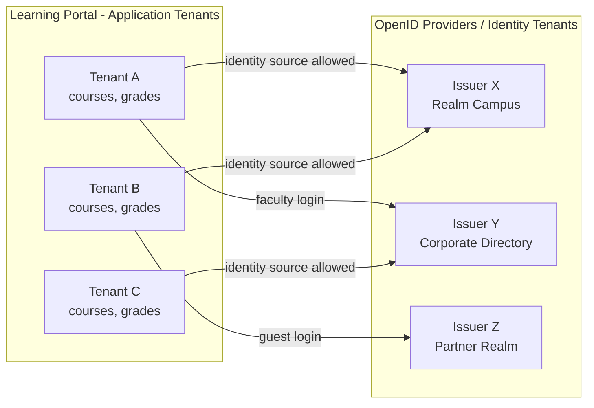
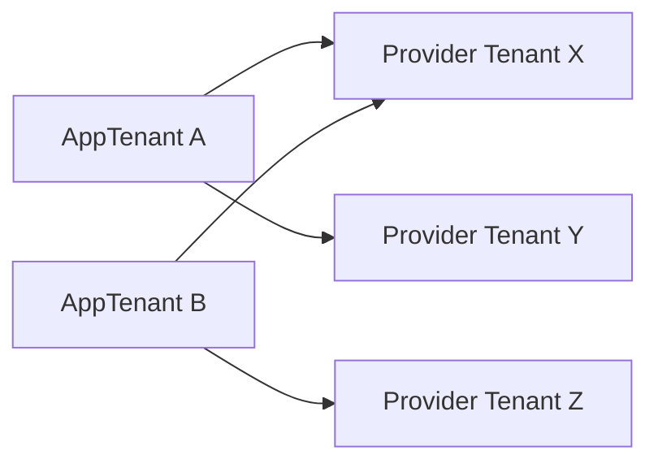
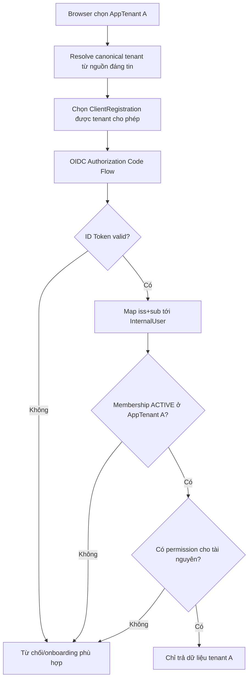

# 26.1. Phân biệt tenant của ứng dụng và tenant tại provider

## Mục tiêu bài học

Trong chủ đề **Spring Security OAuth 2.0/OIDC Client đa tenant**, cùng một từ *tenant* có thể chỉ hai ranh giới hoàn toàn khác nhau. Sau bài này, bạn sẽ:

- Phân biệt **application tenant** (tenant dữ liệu/quyền của ứng dụng) với **provider tenant**, **realm**, **directory** hoặc **organization** của OpenID Provider (OP).
- Giải thích vì sao `appTenantId` không nhất thiết trùng với `tid`, `iss`, `realm`, `clientRegistrationId` hoặc `clientId`.
- Thiết kế ánh xạ một–một, một–nhiều, nhiều–một và nhiều–nhiều giữa tenant SaaS và hệ thống danh tính.
- Hiểu vì sao **OIDC authentication thành công không tự động cấp quyền truy cập dữ liệu của một application tenant**.
- Dùng cặp **`(iss, sub)`** làm khóa external identity OIDC và ánh xạ sang internal user/membership.
- Chọn `ClientRegistration` có kiểm soát, lưu **login intent** xuyên suốt Authorization Code Flow và tránh cross-tenant login/issuer confusion.
- Phân quyền theo tenant ở controller, service, database, cache, Resource Server, authorized-client store và các flow chuyển tenant.
- Phân biệt mô hình multi-tenant thông dụng với tenant-independent authority như `/common` trong Microsoft Entra ID.
- Kiểm thử đúng các trường hợp guest users, nhiều OP, login nhiều tab, cấp quyền tenant, account linking và cross-tenant data isolation.

---

## 1. Bối cảnh: một SaaS, nhiều tổ chức, nhiều dịch vụ đăng nhập

Giả sử **Learning Portal** là ứng dụng Spring Boot cho nhiều trường đại học thuê sử dụng:

```text
Learning Portal (một nền tảng SaaS)
│
├── AppTenant T-UNIV-A: Đại học A
│   ├── Khóa học/điểm số của A
│   ├── Sinh viên, giảng viên của A
│   └── Quyền STUDENT, TEACHER, TENANT_ADMIN của A
│
└── AppTenant T-UNIV-B: Đại học B
    ├── Khóa học/điểm số của B
    ├── Sinh viên, giảng viên của B
    └── Quyền STUDENT, TEACHER, TENANT_ADMIN của B
```

Mỗi tổ chức đăng nhập bằng hệ thống IAM riêng:

```text
Đại học A -> Campus Identity, realm university-a
Đại học B -> Enterprise Directory, directory university-b
```

Một sinh viên thuộc A nhận ID Token:

```json
{
  "iss": "https://idp.example.org/realms/university-a",
  "sub": "student-7e04",
  "aud": "learning-portal-client-a",
  "iat": 1893456900,
  "exp": 1893457200
}
```

Hệ thống cần trả lời **hai câu hỏi độc lập**:

1. **Ai đã được xác thực?** OP/issuer nào phát hành ID Token, subject là ai, chữ ký/audience/nonce có hợp lệ không?
2. **Người đó được phép làm gì trong tenant nào của Learning Portal?** Có active membership và quyền tương ứng không? Tài nguyên thuộc tenant nào?

Một token OIDC hợp lệ của một trường **không mặc nhiên** cho phép user xem dữ liệu của mọi tenant trong SaaS.

> **Nguyên tắc:** **Provider tenant** là ranh giới quản trị danh tính và xác thực. **Application tenant** là ranh giới dữ liệu, membership, chính sách và phân quyền nghiệp vụ của ứng dụng. Có thể map hai khái niệm với nhau, nhưng không được coi chúng luôn giống nhau.

### 1.1. Sơ đồ liên hệ



Một **issuer có thể phục vụ nhiều application tenants**, và một **application tenant có thể tin nhiều issuers**. Vì vậy chọn ứng dụng tenant từ một claim duy nhất thường là không đủ.

## 2. Application tenant là gì?

**Application tenant** là đơn vị logic mà nền tảng SaaS sử dụng để phân vùng dữ liệu và áp dụng chính sách nghiệp vụ.

Ví dụ:

```text
appTenantId     = T-UNIV-A
displayName     = Đại học A
slug            = university-a
subscription    = Enterprise
dataPartition   = courses, grades, enrollments của A
roles           = STUDENT, TEACHER, TENANT_ADMIN
status          = ACTIVE
```

Tenant ứng dụng có thể tương ứng với:

- Một trường đại học.
- Một khách hàng doanh nghiệp.
- Một workspace độc lập.
- Một phòng ban phải tách dữ liệu theo hợp đồng.
- Một organization có billing, chính sách retention và quyền riêng.
- Một đơn vị pháp lý có yêu cầu data residency.

Định danh chuẩn nên do **ứng dụng sở hữu**, chẳng hạn UUID hoặc một khóa bất biến. Tên hiển thị, slug hoặc tên miền có thể thay đổi.

### 2.1. Tenant ứng dụng là ranh giới dữ liệu

Một khóa học:

```json
{
  "id": "COURSE-428",
  "tenantId": "T-UNIV-A",
  "title": "Spring Security"
}
```

Nếu browser gọi:

```http
GET /t/university-b/api/courses/COURSE-428 HTTP/1.1
Cookie: SESSION=<session>
```

thì hệ thống phải so:

```text
Requested AppTenant = T-UNIV-B
Course AppTenant    = T-UNIV-A
```

Nếu khác nhau, chỉ được trả dữ liệu khi có **workflow chia sẻ liên tenant** được thiết kế và phê duyệt. Việc người dùng có OIDC session hợp lệ không loại bỏ bước này.

### 2.2. Tenant app không nhất thiết có OP riêng

Có thể:

```text
Tenant A ─┐
Tenant B ─┼──> một Shared Identity Provider
Tenant C ─┘
```

Cả ba tenant có chung `iss` và thậm chí user có chung `sub`. Dữ liệu vẫn phải tách biệt bởi `appTenantId` và membership.

## 3. Provider tenant/realm/directory là gì?

**Provider tenant** là một đơn vị hay namespace do Identity Provider quản lý. Tùy sản phẩm, nó có tên:

```text
tenant
directory
realm
organization
identity pool
identity partition
```

Nó có thể quyết định:

- Account directory và nguồn xác thực.
- Password/MFA/Conditional Access.
- Chính sách đăng ký OAuth client và consent.
- OIDC issuer, Authorization Endpoint, Token Endpoint, JWKS.
- Guest/B2B invitation.
- Client registration và redirect URIs.
- Signing keys, token claims và vòng đời OP SSO session.

Một realm của OP có thể có issuer riêng:

```text
https://login.example.org/realms/university-a
https://login.example.org/realms/university-b
```

**Không mặc định mọi provider có cùng mô hình realm và issuer.** Một số OP có một issuer cho nhiều organizations; một số có tenant-specific issuers; một số hỗ trợ tenant-independent sign-in authority.

### 3.1. OIDC `iss` là issuer identifier

Ví dụ:

```json
{
  "iss": "https://login.example.org/realms/university-a"
}
```

`iss` là một claim chuẩn của ID Token và phải được xác minh theo **ClientRegistration/trust policy** của flow.

Hai giá trị:

```text
https://login.example.org/realms/university-a
https://login.example.org/realms/university-b
```

là **hai issuer khác nhau**, dù hostname giống nhau. OIDC Core xem path trong issuer URI là một phần của định danh issuer.

Không thay issuer matching bằng:

```java
issuer.startsWith("https://login.example.org")
```

### 3.2. `tid` là provider-specific, không phải claim bắt buộc của mọi OP

Một nhà cung cấp như Microsoft Entra có thể phát:

```json
{
  "tid": "directory-guid-1234"
}
```

Nhưng không có quy tắc OIDC chung buộc Keycloak, Auth0, Cognito hoặc mọi OP khác đều phải dùng cùng claim `tid`.

Dùng những tên phân biệt:

```text
appTenantId          = khóa của Learning Portal
providerTenantId     = khóa tenant theo contract của OP
issuer               = claim OIDC iss
subject              = claim OIDC sub
```

## 4. Bảng so sánh hai loại tenant

| Tiêu chí | Application tenant | Provider tenant |
| --- | --- | --- |
| Bên sở hữu | SaaS/Learning Portal | OpenID Provider/IAM |
| Mục đích | Chia dữ liệu, billing, nghiệp vụ, roles | Chia/quản trị identities, authentication policy |
| Định danh | `appTenantId` nội bộ | Realm, directory GUID, organization ID, issuer |
| Users | Membership của app | Accounts/guests của IdP |
| Rights | STUDENT/TEACHER của từng workspace | IdP groups, MFA, admin/guest settings |
| Trust boundary | Authorization + data isolation | Authentication + token signing/trust |
| Liên hệ `iss` | Không nhất thiết một–một | Có thể quyết định issuer theo provider contract |
| Liên hệ `registrationId` | Có thể dùng mapping | ClientRegistration là cấu hình OAuth client |
| Xóa tenant | Data lifecycle riêng | Identity lifecycle riêng |
| Test quan trọng | Cross-tenant access/IDOR | Issuer, signature, audience, state/nonce |

### 4.1. Bảy định danh dễ bị nhầm

Giả sử:

```text
appTenantId             = T-UNIV-A
appTenantSlug           = university-a
providerId              = campus-identity
providerTenantId        = realm-university-a
oidcIssuer              = https://login.example.org/realms/university-a
clientRegistrationId    = campus-a
oauthClientId           = learning-portal-client-a
```

Các giá trị trên có **vai trò khác nhau**. Đừng đặt tất cả vào một biến mơ hồ tên `tenantId`.

Một kiểu dữ liệu rõ hơn:

```java
record AppTenantId(String value) {}
record ProviderTenantId(String value) {}
record ExternalIdentityKey(String issuer, String subject) {}
record OAuthClientRegistrationKey(String value) {}
```

Kiểu nội bộ có thể là UUID/ULID hoặc ID opaque phù hợp. Tên kiểu giúp giảm lỗi truyền nhầm tham số khi lập trình.

## 5. Mối quan hệ một–một và nhiều–nhiều

### 5.1. Một–một

```text
AppTenant A -> OP Realm A
AppTenant B -> OP Realm B
```

Đây là trường hợp đơn giản, nhưng **không phải tính chất cố định** của đa tenant.

### 5.2. Nhiều AppTenants cùng một Provider Tenant

```text
AppTenant A ─┐
AppTenant B ─┼──> Corporate Identity Realm
AppTenant C ─┘
```

Một tập đoàn có thể dùng một Entra directory cho ba công ty con, mỗi công ty con thuê workspace riêng trong SaaS.

Trong trường hợp này, mọi user có thể nhận cùng `iss` hoặc `tid`, nhưng role/permissions trong A, B, C khác nhau.

### 5.3. Một AppTenant cho phép nhiều Provider Tenants

```text
Faculty OP ──┐
             ├──> AppTenant A
Student OP ──┘
```

Một trường có thể cho giảng viên và sinh viên đăng nhập qua hai nguồn khác nhau.

### 5.4. Nhiều–nhiều



Không thể dùng:

```java
appTenantId = idToken.getClaimAsString("tid");
```

như quy tắc phổ quát để tìm tenant ứng dụng.

### 5.5. Một user có thể thuộc nhiều AppTenants

```text
User U-504:
    Membership Tenant A = STUDENT
    Membership Tenant B = TEACHER
```

Cùng một OIDC Authentication, user phải có quyền **khác nhau theo tenant**. Không tạo `ROLE_TEACHER` toàn cục rồi dùng nó để cho phép sửa điểm ở mọi workspace.

## 6. Phân biệt External Identity, Internal User và Membership

Mô hình đề xuất:

```text
ExternalIdentity (iss, sub)
              |
              v
        InternalUser (userId)
          /             \
         v               v
 Membership A       Membership B
 role STUDENT       role TEACHER
```

Ba khái niệm:

- **ExternalIdentity:** account được OP xác minh, khóa `(iss, sub)` trong OIDC.
- **InternalUser:** user ID ổn định của ứng dụng, có thể liên kết nhiều external identities đã được xác minh.
- **Membership:** quan hệ giữa user nội bộ và app tenant, mang role, status, permissions.

### 6.1. `(iss, sub)` là khóa danh tính OIDC

Ví dụ:

```text
(https://idp.example/realms/a, student-42)
(https://idp.example/realms/b, student-42)
```

**Không mặc nhiên là cùng một identity.** `sub` được hiểu trong phạm vi issuer.

Nếu OP dùng **pairwise subject identifiers**, cùng con người còn có thể nhận những `sub` khác nhau giữa client/sector identifiers. Cần account linking được xác minh, không suy diễn từ cùng tên hoặc email.

### 6.2. Email không phải identity key xuyên provider

Hai tokens:

```json
{
  "iss": "https://issuer-x.example",
  "sub": "x-1",
  "email": "student@example.edu",
  "email_verified": true
}
```

và:

```json
{
  "iss": "https://issuer-y.example",
  "sub": "y-9",
  "email": "student@example.edu",
  "email_verified": true
}
```

không đủ chứng minh hai identity nên được **tự động hợp nhất**.

Email có thể đổi, được tái cấp, là alias, không có trong ID Token, hoặc được xử lý khác nhau ở các OP. Account linking phải có quy trình chứng minh quyền sở hữu phù hợp.

### 6.3. Provider account tồn tại không tự tạo Membership

Một user có thể đăng nhập qua OP hợp lệ nhưng chưa được SaaS mời vào tenant.

```text
Token valid = TRUE
External identity recognized = TRUE
Membership in AppTenant A = FALSE
```

Kết quả **không được truy cập tài nguyên A**, trừ khi chính sách onboarding cho phép tạo membership qua bước có kiểm soát.

## 7. Mô hình database minh họa

Schema có thể gồm:

```sql
CREATE TABLE app_tenant (
    tenant_id     VARCHAR(64) PRIMARY KEY,
    slug          VARCHAR(120) NOT NULL UNIQUE,
    display_name  VARCHAR(255) NOT NULL,
    status        VARCHAR(30) NOT NULL
);

CREATE TABLE identity_provider (
    provider_id   VARCHAR(64) PRIMARY KEY,
    name          VARCHAR(255) NOT NULL
);

CREATE TABLE identity_source (
    identity_source_id  VARCHAR(64) PRIMARY KEY,
    provider_id         VARCHAR(64) NOT NULL,
    issuer_uri          VARCHAR(500) NOT NULL,
    provider_tenant_key VARCHAR(255),
    registration_id     VARCHAR(150) NOT NULL,
    FOREIGN KEY (provider_id)
        REFERENCES identity_provider(provider_id)
);

CREATE TABLE app_tenant_identity_source (
    tenant_id          VARCHAR(64) NOT NULL,
    identity_source_id VARCHAR(64) NOT NULL,
    enabled            BOOLEAN NOT NULL,
    PRIMARY KEY (tenant_id, identity_source_id),
    FOREIGN KEY (tenant_id)
        REFERENCES app_tenant(tenant_id),
    FOREIGN KEY (identity_source_id)
        REFERENCES identity_source(identity_source_id)
);
```

User và membership:

```sql
CREATE TABLE app_user (
    user_id VARCHAR(64) PRIMARY KEY,
    status  VARCHAR(30) NOT NULL
);

CREATE TABLE external_identity (
    identity_id    VARCHAR(64) PRIMARY KEY,
    user_id        VARCHAR(64) NOT NULL,
    issuer_uri     VARCHAR(500) NOT NULL,
    subject_value  VARCHAR(500) NOT NULL,
    UNIQUE (issuer_uri, subject_value),
    FOREIGN KEY (user_id) REFERENCES app_user(user_id)
);

CREATE TABLE tenant_membership (
    tenant_id VARCHAR(64) NOT NULL,
    user_id   VARCHAR(64) NOT NULL,
    role      VARCHAR(100) NOT NULL,
    status    VARCHAR(30) NOT NULL,
    PRIMARY KEY (tenant_id, user_id, role),
    FOREIGN KEY (tenant_id) REFERENCES app_tenant(tenant_id),
    FOREIGN KEY (user_id) REFERENCES app_user(user_id)
);
```

Mục đích là biểu diễn **mapping một–nhiều**, không phải copy nguyên schema làm production database. Khi triển khai cần cân nhắc:

- Khóa định danh ổn định và constraints hợp đồng.
- Index, unique constraints, tránh race provisioning.
- Audit cho thay đổi tenant-to-provider mapping.
- Membership status `ACTIVE`, `REVOKED`, `PENDING`.
- Encryption/token store riêng.
- Data retention, quyền quản trị và tenant lifecycle.
- Query luôn scoped tenant; không chỉ lọc sau khi đọc dữ liệu.

## 8. `ClientRegistration` của Spring Security là gì?

Spring Security định nghĩa:

```java
ClientRegistration
```

để mô tả cấu hình một OAuth2/OIDC Client với provider, gồm:

```text
registrationId
clientId
clientSecret hoặc client authentication khác
authorizationGrantType
redirectUri
scopes
authorizationUri
tokenUri
jwkSetUri
issuerUri
userInfoEndpoint
```

`ClientRegistration` không tự đại diện cho một AppTenant. Một registration có thể phục vụ nhiều application tenants hoặc một tenant có nhiều registrations.

### 8.1. YAML với hai OIDC registrations

```yaml
spring:
  security:
    oauth2:
      client:
        registration:
          campus-a:
            provider: campus-a-op
            client-id: ${CAMPUS_A_CLIENT_ID}
            client-secret: ${CAMPUS_A_CLIENT_SECRET}
            client-authentication-method: client_secret_basic
            authorization-grant-type: authorization_code
            redirect-uri: "{baseUrl}/login/oauth2/code/{registrationId}"
            scope:
              - openid
              - profile
              - email

          campus-b:
            provider: campus-b-op
            client-id: ${CAMPUS_B_CLIENT_ID}
            client-secret: ${CAMPUS_B_CLIENT_SECRET}
            client-authentication-method: client_secret_basic
            authorization-grant-type: authorization_code
            redirect-uri: "{baseUrl}/login/oauth2/code/{registrationId}"
            scope:
              - openid
              - profile

        provider:
          campus-a-op:
            issuer-uri: https://login.example.edu/realms/a
          campus-b-op:
            issuer-uri: https://login.example.edu/realms/b
```

Nghĩa là:

```text
registrationId campus-a
    -> OAuth Client ID từ CAMPUS_A_CLIENT_ID
    -> issuer https://login.example.edu/realms/a

registrationId campus-b
    -> OAuth Client ID từ CAMPUS_B_CLIENT_ID
    -> issuer https://login.example.edu/realms/b
```

**Chưa có thông tin** app tenant A/B nào được phép dùng registration đó. Cần quy tắc routing/authorization ứng dụng.

### 8.2. `registrationId` khác `clientId`

```text
registrationId = campus-a
clientId       = learning-portal-client-a
```

Giá trị đầu do Spring application đặt để tra cứu config. Giá trị sau được OP/AS cấp trong client registration.

### 8.3. `registrationId` khác `iss`

```text
registrationId = campus-a
issuer         = https://login.example.edu/realms/a
```

OIDC ID Token thường **không có claim `registrationId`**. Spring Security biết registration qua OAuth2 authorization transaction.

### 8.4. Một registration phục vụ nhiều app tenants

Nếu `campus-shared` được dùng cho Tenant A, B, C:

```text
AppTenant A ─┐
AppTenant B ─┼──> registration campus-shared
AppTenant C ─┘
```

thì:

```java
String appTenantId =
    authentication.getAuthorizedClientRegistrationId();
```

là sai: registration không xác định một duy nhất app tenant.

## 9. Authentication không phải Authorization theo tenant

OIDC Login thành công nghĩa là Spring Security đã nhận một Authentication sau flow:

```text
Authorization Code exchange
ID Token signature/claims validation
state/nonce checks theo flow
OidcUser/OAuth2AuthenticationToken
```

Nhưng **chưa đủ** để cho phép đọc dữ liệu của một app tenant.

Một chuỗi quyết định an toàn:



**Không** rút gọn thành:

```text
ID Token issuer đúng -> được vào mọi workspace dùng issuer đó
```

### 9.1. User ở hai app tenants có hai vai trò

```text
U-504, Tenant A -> STUDENT
U-504, Tenant B -> TEACHER
```

Một `ROLE_TEACHER` toàn cục không đủ nếu nó vốn chỉ có hiệu lực ở B.

Phân quyền nên xem xét:

```text
(internalUserId, appTenantId, permission, resourceId)
```

Ví dụ:

```text
(U-504, T-A, GRADE_WRITE) = DENY
(U-504, T-B, GRADE_WRITE) = ALLOW
```

### 9.2. OAuth scopes không chứng minh membership

Access Token chứa:

```text
scope = courses.read
```

có nghĩa token được cấp quyền API theo contract AS/RS. Nó **không tự nói** user có quyền đọc mọi khóa học của tất cả application tenants.

Resource Server cần kiểm tra tenant membership, ownership và resource authorization riêng.

## 10. Chọn tenant khi bắt đầu login

Ứng dụng có thể chọn app tenant dựa trên:

- Subdomain đã được đăng ký, ví dụ `university-a.portal.example.org`.
- Path được map server-side, ví dụ `/t/university-a`.
- Workspace selection trong UI.
- Invitation token được ký/tra cứu server-side.
- Tenant discovery service với cấu hình allowlist.

### 10.1. Tenant slug chỉ là locator

Một URL:

```http
GET /t/university-b/api/courses HTTP/1.1
```

không chứng minh user có membership ở B. Backend phải:

```text
Resolve "university-b" -> canonical T-UNIV-B
Read authenticated user
Check active membership in T-UNIV-B
Authorize action/resource
```

### 10.2. Host và forwarded headers phải được tin cậy đúng

Không tin `Host`, `X-Forwarded-Host`, `Forwarded` do browser tự khai nếu chúng có thể làm đổi tenant, `redirect_uri` hoặc OP.

Khi reverse proxy được phép thiết lập forwarded headers, cần:

- Proxy xóa/ghi đè headers từ client chưa tin cậy.
- Hostname được allowlist và map tới tenant qua repository.
- HTTPS/scheme/port public callback đúng đăng ký OP.
- Không cho một host chưa đăng ký chọn arbitrary registration.

### 10.3. Không dùng email domain như authorization

Ví dụ:

```text
student@university-a.edu
```

có thể giúp hiển thị **gợi ý đăng nhập** nếu tổ chức đã cấu hình domain discovery. Nhưng email không chứng minh active membership, role hoặc resource ownership.

## 11. Tenant-to-provider mapping phải do backend kiểm soát

Một service minh họa:

```java
public record TenantLoginRoute(
    String appTenantId,
    String registrationId,
    String expectedIssuer
) {}

public interface TenantIdentityRoutingService {
    TenantLoginRoute resolve(
        String appTenantId,
        String providerAlias
    );
}
```

Implementation khái niệm:

```java
@Service
class TenantIdentityRoutingServiceImpl
        implements TenantIdentityRoutingService {

    private final TenantRepository tenants;
    private final IdentitySourceRepository identitySources;

    TenantIdentityRoutingServiceImpl(
            TenantRepository tenants,
            IdentitySourceRepository identitySources) {
        this.tenants = tenants;
        this.identitySources = identitySources;
    }

    @Override
    public TenantLoginRoute resolve(
            String appTenantId,
            String providerAlias) {

        Tenant tenant = tenants.findActiveById(
            appTenantId
        ).orElseThrow(() ->
            new AccessDeniedException(
                "Unknown or inactive app tenant"
            )
        );

        IdentitySource source =
            identitySources.findEnabled(
                tenant.id(), providerAlias
            ).orElseThrow(() ->
                new AccessDeniedException(
                    "Provider is not allowed for tenant"
                )
            );

        return new TenantLoginRoute(
            tenant.id(),
            source.registrationId(),
            source.expectedIssuer()
        );
    }
}
```

`TenantRepository`, `IdentitySourceRepository`, `Tenant` và `IdentitySource` là abstractions ứng dụng, không phải class Spring Security mặc định.

Quan trọng:

- User có thể chọn provider alias, **không** được phép tự chỉ định issuer/JWKS tùy ý.
- Mapping phải được admin phê duyệt và có trạng thái `ACTIVE`.
- Không fallback sang provider đầu tiên nếu mapping không tồn tại.
- Không để tenant bị suspend tiếp tục mở authorization flow mới.
- Nếu provider registration bị disable, phải có chính sách clear cache/token state.

## 12. Ví dụ routing OIDC login trên Servlet

Giả sử browser truy cập:

```text
https://portal.example.org/t/university-a/login
```

Controller:

```java
@Controller
class TenantLoginController {

    private final TenantDirectory directory;
    private final TenantIdentityRoutingService routing;

    TenantLoginController(
            TenantDirectory directory,
            TenantIdentityRoutingService routing) {
        this.directory = directory;
        this.routing = routing;
    }

    @GetMapping("/t/{slug}/login")
    String login(
            @PathVariable String slug,
            @RequestParam(defaultValue = "campus")
            String providerAlias) {

        String appTenantId =
            directory.requireActiveIdForSlug(slug);

        TenantLoginRoute route =
            routing.resolve(appTenantId, providerAlias);

        String registrationId =
            route.registrationId();

        // Registration đã được chọn từ allowlist backend.
        // Ví dụ chỉ trình bày routing; còn cần liên kết
        // appTenantId với OAuth2 authorization transaction.
        return "redirect:/oauth2/authorization/" +
            UriUtils.encodePathSegment(
                registrationId, StandardCharsets.UTF_8
            );
    }
}
```

**Cảnh báo:** ví dụ này mới chọn đúng OAuth2 registration. Để bảo đảm login callback gắn đúng app tenant, cần **login intent được ràng buộc theo `state`**. Không hoàn thành tính năng multi-tenant chỉ bằng redirect.

### 12.1. Không lấy app tenant từ query callback chưa xác minh

Sai:

```text
GET /login/oauth2/code/campus-a?code=...&state=...&tenant=b
```

rồi:

```java
String tenant = request.getParameter("tenant");
```

để tự cấp quyền tenant B.

Một callback parameter có thể bị browser/attacker thay đổi. Nó chỉ được xem là dữ liệu input, không phải bằng chứng tenant ban đầu.

## 13. `state`, `nonce` và login intent

**`state`** liên kết OAuth2 Authorization Response với Authorization Request; **`nonce`** ràng buộc OIDC ID Token với Authentication Request trong flow áp dụng.

```text
state:
    authorization request <-> authorization response

nonce:
    ID Token <-> OIDC authentication request
```

### 13.1. Login intent theo từng transaction

Một bản ghi server-side:

```json
{
  "stateKey": "random-opaque-key",
  "appTenantId": "T-UNIV-A",
  "registrationId": "campus-a",
  "expectedIssuer": "https://login.example.edu/realms/a",
  "createdAt": "2026-11-16T03:00:00Z",
  "expiresAt": "2026-11-16T03:05:00Z"
}
```

Nó phải được:

- Tạo sau khi tenant/provider mapping hợp lệ.
- Gắn với `state` của chính Authorization Request.
- Lưu server-side hoặc bảo vệ tính toàn vẹn/mã hóa theo threat model.
- Có thời hạn và chống replay.
- Được consume khi callback kết thúc.
- Không để user sửa app tenant của transaction sau khi OP redirect.
- Đồng bộ giữa các node nếu app chạy cluster.

Spring Security có `OAuth2AuthorizationRequestRepository` ở Servlet và repository tương ứng ở Reactive để quản lý Authorization Request. Ứng dụng có thể mở rộng cơ chế đó hoặc có store riêng gắn transaction ID đáng tin cậy.

### 13.2. Lỗi nhiều tab nếu chỉ lưu `currentTenant`

Hai tab cùng browser:

```text
Tab A:
  bắt đầu login Tenant A
  session.currentTenant = A

Tab B:
  bắt đầu login Tenant B
  session.currentTenant = B

Tab A:
  callback tới sau
  session.currentTenant hiện là B
```

Nếu dùng `session.currentTenant` làm nguồn duy nhất cho callback, app có thể gắn danh tính của flow A vào B.

**Khắc phục:** login intent phải **gắn với từng `state`**, không phải biến singleton “tenant cuối cùng được chọn”.

### 13.3. Không dùng nonce thay state

Có thể OP gửi `nonce` trong ID Token, nhưng nonce không thay thế toàn bộ OAuth2 `state` và request repository. Cần giữ **cả hai** khi flow yêu cầu.

## 14. `OAuth2AuthorizationRequestResolver` và danh sách registration

Spring Security Servlet có extension point:

```java
OAuth2AuthorizationRequestResolver
```

Thường dùng:

```java
DefaultOAuth2AuthorizationRequestResolver
```

Ví dụ cấu hình resolver riêng (giả định bean `resolver` đã kiểm soát tenant mapping):

```java
@Bean
SecurityFilterChain security(
        HttpSecurity http,
        OAuth2AuthorizationRequestResolver resolver)
        throws Exception {

    http
        .authorizeHttpRequests(auth -> auth
            .requestMatchers(
                "/", "/t/{slug}/login", "/assets/**"
            ).permitAll()
            .anyRequest().authenticated()
        )
        .oauth2Login(oauth2 -> oauth2
            .authorizationEndpoint(endpoint -> endpoint
                .authorizationRequestResolver(resolver)
            )
        );

    return http.build();
}
```

Không cho resolver tự tạo registration từ URL do anonymous user cung cấp.

### 14.1. Cẩn thận với dynamic issuer

Sai:

```text
GET /oauth2/start?issuer=http://127.0.0.1/internal
```

rồi server gọi OIDC Discovery trực tiếp với issuer này.

Rủi ro:

- SSRF đến mạng nội bộ/metadata endpoints.
- Token endpoint/JWKS bị trỏ tới máy attacker.
- Chọn sai issuer hoặc gửi credential ra ngoài.
- Trust confusion giữa ClientRegistrations.

Cần onboarding IdP có review, egress restrictions, HTTPS, allowlist và issuer validation theo provider contract.

### 14.2. Callback URI phải được OP đăng ký

Ví dụ:

```text
{baseUrl}/login/oauth2/code/{registrationId}
```

Tùy thiết kế, callback có thể dùng domain chung hoặc domain tenant. Đừng giải quyết “nhiều tenants” bằng redirect URI wildcard/open redirect thiếu kiểm soát.

## 15. Phân quyền sau OIDC callback

Sau khi Spring Security xác thực ID Token, ứng dụng có thể:

1. Nhận authenticated `OidcUser` và `OAuth2AuthenticationToken`.
2. Đọc login intent gắn đúng authorization transaction.
3. Đối chiếu registration và issuer đã xác thực với mapping của app tenant.
4. Map `(iss, sub)` đến user nội bộ.
5. Kiểm tra user và app tenant đều active.
6. Kiểm tra active membership và allowed roles.
7. Tạo tenant-aware context đã được kiểm soát.
8. Chuyển browser về URL của tenant (không open redirect).

### 15.1. Token hợp lệ nhưng không có membership

Ví dụ:

```text
Intended AppTenant: T-UNIV-A
Registration: campus-a
ID Token: valid, issuer a, subject guest-99
Membership guest-99/T-UNIV-A: NONE
```

Kết quả:

```text
Authentication at OP: succeeded
Authorization to AppTenant A: denied/onboarding
```

Không tự cấp `TENANT_ADMIN` chỉ vì issuer đúng.

### 15.2. Phân biệt các loại lỗi

| Bước | Lỗi | Phản ứng đúng |
| --- | --- | --- |
| State/nonce | Transaction mismatch | Từ chối login |
| ID Token | Signature/issuer/audience sai | Không tạo authenticated identity |
| Registration | Provider không allowed cho app tenant | Từ chối login route |
| Identity mapping | External identity chưa được liên kết | Controlled provisioning |
| Membership | Không thuộc app tenant | Từ chối tenant data |
| Tenant status | Tenant suspended | Từ chối access |
| Resource ownership | Resource thuộc tenant khác | 403/404 theo policy |
| Scope | Access Token thiếu API scope | Cấp quyền API hợp lệ hoặc 403 |

## 16. Ví dụ đọc identity đã xác thực trong Spring MVC

```java
@RestController
class IdentityController {

    @GetMapping("/api/me/identity")
    Map<String, String> identity(
            @AuthenticationPrincipal OidcUser user,
            OAuth2AuthenticationToken authentication) {

        return Map.of(
            "issuer",
            user.getIdToken().getIssuer().toString(),
            "subject",
            user.getSubject(),
            "registrationId",
            authentication.getAuthorizedClientRegistrationId()
        );
    }
}
```

Ví dụ chỉ để học/test, cần route authenticated và tránh trả raw identity metadata trong production nếu không cần.

`issuer`, `subject`, `registrationId` **không tự bằng `appTenantId`**.

### 16.1. External identity key

```java
record ExternalIdentityKey(
    String issuer,
    String subject
) {}

ExternalIdentityKey key(OidcUser user) {
    return new ExternalIdentityKey(
        user.getIdToken().getIssuer().toString(),
        user.getSubject()
    );
}
```

Chỉ đọc từ `OidcUser` được tạo **sau OIDC validation**, không tự Base64URL decode raw JWT rồi coi claims là đáng tin.

## 17. Authorization ở controller và service

Giả sử ứng dụng có:

```java
interface TenantDirectory {
    String requireActiveIdForSlug(String slug);
}

interface IdentityService {
    String requireInternalUserId(ExternalIdentityKey key);
}

interface TenantAuthorization {
    void requirePermission(
        String userId, String appTenantId, String permission
    );
}
```

Một controller:

```java
@RestController
class CourseController {

    private final TenantDirectory tenants;
    private final IdentityService identities;
    private final TenantAuthorization authorization;
    private final CourseService courses;

    CourseController(
            TenantDirectory tenants,
            IdentityService identities,
            TenantAuthorization authorization,
            CourseService courses) {
        this.tenants = tenants;
        this.identities = identities;
        this.authorization = authorization;
        this.courses = courses;
    }

    @GetMapping("/t/{slug}/api/courses")
    List<CourseDto> list(
            @PathVariable String slug,
            @AuthenticationPrincipal OidcUser user) {

        String tenantId =
            tenants.requireActiveIdForSlug(slug);

        String userId = identities.requireInternalUserId(
            new ExternalIdentityKey(
                user.getIdToken().getIssuer().toString(),
                user.getSubject()
            )
        );

        authorization.requirePermission(
            userId, tenantId, "COURSE_READ"
        );

        return courses.findForTenant(tenantId);
    }
}
```

Trong production, DTOs/repositories, validation, paging, exception handling và auditing phải do project bổ sung. **Điểm chính:** tenant là kết quả resolve đáng tin + membership, không phải claim tùy ý.

### 17.1. Tenant-scoped query

Đúng:

```sql
SELECT *
FROM course
WHERE tenant_id = :authorizedTenantId
  AND course_id = :courseId;
```

Không đủ:

```sql
SELECT *
FROM course
WHERE course_id = :courseId;
```

rồi hi vọng client không đoán course ID của tenant khác. Đây là **IDOR/cross-tenant data exposure**.

### 17.2. Defense in depth

Có thể bảo vệ ở nhiều lớp:

```text
Controller -> require authenticated identity
Service -> require tenant membership + permission
Repository -> tenantId predicate
Database -> row-level security/schema isolation nếu áp dụng
Cache -> tenant-aware key
```

Không dùng dữ liệu request header tùy ý để chọn database schema hoặc tenant ID.

## 18. `X-Tenant-Id` và host/path không tự đáng tin

Sai:

```java
String tenantId = request.getHeader("X-Tenant-Id");
return repository.findByTenantId(tenantId);
```

Browser có thể đổi header để thử lấy dữ liệu tenant B.

Trong kiến trúc gateway/BFF, header tenant có thể được dùng như **thông tin truyền nội bộ** khi:

- Gateway đã xác thực caller.
- Header phía client không đáng tin bị gateway loại bỏ/ghi đè.
- Downstream vẫn kiểm tra tenant/resource permission.
- Có mTLS/signed internal token/trust policy giữa services khi cần.
- Audit phân biệt tenant requested và tenant authorized.

### 18.1. WebFlux dùng Reactor context

Ở WebFlux không nên dùng một `static ThreadLocal` làm tenant context cho async request chain. Tenant context có thể truyền qua `Reactor Context` hoặc tham số explicit, nhưng phải dựa trên identity đã xác thực và membership.

### 18.2. Cache phải scoped theo tenant

Sai:

```text
cache key = courseId
```

Đúng hơn:

```text
cache key = (appTenantId, courseId, permissionContext)
```

Nếu cache trả dữ liệu theo user-specific policy, còn cần xem user ID/role/policy version khi tạo key.

## 19. Scope, group, roles và app permissions

### 19.1. OAuth scopes không tương đương tenant roles

```json
{
  "scope": "courses.read"
}
```

Scope do AS cấp cho API theo contract. Nó không tự chứng minh user có membership ở tenant A hay quyền xem course X.

Một policy đầy đủ:

```text
Bearer token signature/introspection valid
issuer/audience valid
required scope valid
app tenant membership valid
resource ownership valid
```

### 19.2. Group từ IdP không tự là role SaaS

Provider có thể phát:

```json
{
  "groups": ["faculty", "students"]
}
```

Nhưng không thể tự đồng nhất:

```text
IdP group faculty -> TENANT_ADMIN trong mọi tenant
```

Cần mapping do tenant/platform admin quản trị:

```text
(issuer, externalGroupId, appTenantId)
    -> application role/permission
```

Dữ liệu group có thể không đầy đủ trong token vì size/overage; phải áp dụng contract và freshness policy.

### 19.3. Method security theo tenant

Ví dụ ý tưởng:

```java
@PreAuthorize(
    "@tenantAuth.canManage(authentication, #tenantId)"
)
public void updateTenantSettings(
        String tenantId, UpdateTenantRequest request) {
    // Thực hiện thao tác sau policy
}
```

Bean `tenantAuth` phải kiểm tra **tenant-specific permission**, không đọc mỗi `hasRole('ADMIN')` toàn cục.

## 20. Microsoft Entra ID: một ví dụ đa tenant đặc thù

Microsoft Entra ID có:

```text
directory tenant
tenant ID (tid)
tenant-specific authority
/common hoặc /organizations authority
guest/B2B users
multi-tenant app registration
```

Learning Portal vẫn có `AppTenantId` riêng. Không ép hai giá trị giống nhau.

### 20.1. `/common` là entrypoint, không phải issuer cho mọi user

Một Entra multi-tenant app có thể bắt đầu authorization tại:

```text
https://login.microsoftonline.com/common
```

hoặc:

```text
https://login.microsoftonline.com/organizations
```

Theo contract Entra, đây là **tenant-independent authority** dùng để tiếp nhận user từ nhiều directories. Issuer claim thực tế trong token liên quan tenant đã xác thực.

Không đặt một quy tắc ngây thơ:

```text
Expected iss == https://login.microsoftonline.com/common
```

rồi bỏ issuer validation khi thấy không khớp.

### 20.2. Validate issuer theo tài liệu provider

Với tenant-independent metadata, Microsoft hướng dẫn kiểm tra liên kết giữa:

```text
tid
iss
issuer của signing key
metadata/token version
```

cũng như tenant allowlist của ứng dụng. Không dùng `jwt.getIssuer() != null` là đủ.

Nếu SaaS chỉ cho phép một số directories, nên có allowlist những provider tenants đã được phê duyệt cho mỗi app tenant.

### 20.3. Guest/B2B user

Một user có thể là guest trong directory của đối tác dù email thuộc tổ chức khác. `tid`, issuer và identity context cần được hiểu theo OP contract; không suy ra **app tenant** từ email domain.

Cần phân biệt:

```text
home directory
resource directory
application workspace
```

và kiểm tra guest membership/permissions trước khi cấp quyền dữ liệu.

## 21. Ví dụ Keycloak realms

Một OP như Keycloak thường có issuer theo realm:

```text
https://sso.example.org/realms/students
https://sso.example.org/realms/faculty
```

Nhưng:

```text
AppTenant University-A
    -> Students realm
    -> Faculty realm
```

hoặc:

```text
AppTenant A ─┐
AppTenant B ─┼──> Shared Faculty realm
```

đều có thể hợp lệ nếu app mapping cho phép.

**Không** tự tách đoạn cuối issuer URI để làm `appTenantId`:

```java
String appTenant =
    issuer.substring(issuer.lastIndexOf('/') + 1);
```

Tên realm và tenant slug có thể đổi hoặc không khớp, đặc biệt khi dùng identity broker.

## 22. `OAuth2AuthorizedClient` cũng phải phân vùng đúng

Spring Security OAuth2 Client lưu:

```java
OAuth2AuthorizedClient
```

với:

```text
ClientRegistration
principalName
Access Token
optional Refresh Token
```

Nhiều authorized-client stores khóa theo:

```text
(registrationId, principalName)
```

hoặc lưu theo browser session.

### 22.1. Hai issuers cùng `sub`

Nếu dùng principal key chỉ bằng `"student-42"` cho cả hai issuers, store có thể gây identity confusion khi thiết kế registration/storage sai.

Dùng:

```text
(issuer, subject)
```

để map external identity, rồi internal user ID ổn định có kiểm soát. Token store vẫn phải phân biệt **registration và delegation context**.

### 22.2. Cùng registration, nhiều app tenants

Một user có thể có Access Token `shared-op` dùng cho nhiều workspaces nếu provider contract cho phép, nhưng **app membership vẫn phải được kiểm tra từng request**.

Nếu authorization grant/token được phát theo từng app tenant khác nhau, khóa mặc định `(registration, principal)` có thể không đủ; cần tách registration, principal/grant binding hoặc repository strategy.

### 22.3. Client Credentials cho từng tenant

```text
Tenant A -> client_credentials A -> Access Token A
Tenant B -> client_credentials B -> Access Token B
```

Không dùng cùng một token service account toàn cục nếu thực tế credential/audience/permissions phải tách theo tenant.

### 22.4. Không gửi token nhầm Resource Server

Một access token được AS của Provider A phát hành không tự dùng được cho API B. Cần đúng:

```text
issuer
audience
scope
tenant binding
Resource Server trust
```

ID Token phục vụ OIDC Client login, **không thay Access Token** để gọi API.

## 23. Chuyển tenant trong cùng session

Một user có membership:

```text
Tenant A: STUDENT
Tenant B: TEACHER
```

Có thể chuyển workspace:

```text
A -> B
```

nhưng phải:

1. Resolve canonical tenant B.
2. Kiểm tra active membership U/B.
3. Tính lại tenant-specific roles/permissions.
4. Gắn tenant context đã được xác thực.
5. Làm mới/invalidate tenant-scoped cache khi cần.
6. Điều hướng đến các URLs của B.
7. Đảm bảo API và database queries vẫn scoped B.

### 23.1. Có cần OIDC login lại?

Không nhất thiết nếu cùng identity được phép vào cả hai app tenants. Nhưng có thể cần reauthentication/step-up nếu Tenant B:

- Chỉ chấp nhận Provider B.
- Yêu cầu MFA/assurance cao hơn.
- Yêu cầu consent/grant khác.
- Chưa được account linking.
- Chỉ cho phép identities theo một issuer cụ thể.

Không xem đổi tenant chỉ là sửa một field `activeTenantId` trong session rồi giữ toàn bộ permissions cũ.

### 23.2. Không kế thừa role của tenant trước

Sai:

```text
activeTenant A, role TEACHER
switch to B
role vẫn TEACHER
```

Đúng:

```text
switch to B
load/check roles & membership cho B
```

Một session có thể chứa tenant context nhưng **không thay thế policy evaluation** ở các hành động nhạy cảm.

## 24. Provisioning, invitation và deprovisioning

Cách cấp membership có thể là:

1. Tenant admin mời user.
2. Provisioning qua SCIM/HR/SIS.
3. Approval workflow dựa trên chứng minh tổ chức.
4. Auto-provisioning **có chính sách rõ** cho issuer/group/domain đã verify.
5. Guest membership có thời hạn và role hạn chế.

**Không** tự cấp role admin khi user có email domain trông giống tenant.

### 24.1. Khi user bị remove khỏi tenant

Nếu user đã đăng nhập rồi membership bị revoke, một session còn sống không nên tiếp tục có quyền đến vô hạn.

Chọn freshness strategy:

```text
Membership check mỗi request
Short-lived authorization cache
Version/epoch invalidation
Event-driven session cleanup
```

Tenant `SUSPENDED` cũng phải được áp dụng ngay theo policy.

### 24.2. Account linking phải có proof

Cùng email ở hai OP không đủ để gộp accounts. Một workflow linking nên:

- Xác minh identity hiện có.
- Xác minh identity mới bằng flow hợp lệ.
- Kiểm tra conflict với user khác.
- Có audit và quyền phê duyệt nếu cần.
- Không tự thay memberships của tenant khác.

## 25. Logout trong mô hình nhiều provider

Khi user đăng nhập qua Provider X nhưng đang xem AppTenant B, OIDC RP-Initiated Logout phải dựa trên **authenticated registration của phiên đăng nhập**, không đơn giản lấy issuer của active app tenant.

Sai:

```text
User login Issuer X
Switch to AppTenant B (có mapping Issuer Y)
Logout -> gửi ID Token X đến Issuer Y
```

Rủi ro: **gửi ID Token/hint sang provider sai**, có thể làm lộ token hoặc logout thất bại.

Đúng:

```text
Logout local session theo policy
Nếu thực hiện OP logout:
    xác định OP từ OIDC Authentication/ClientRegistration đã xác thực
```

Tách:

```text
Switch workspace
Local logout
OP SSO logout
Token revocation
Authorized-client cleanup
```

Mỗi thao tác có phạm vi riêng.

## 26. Dynamic ClientRegistration và provider onboarding

Với vài OP cố định, YAML và `InMemoryClientRegistrationRepository` có thể đủ. Với hàng trăm customer-managed IdPs, có thể cần registry động.

Những giá trị phải được quản trị:

```text
registrationId
clientId
client secret/private key reference
issuerURI
authorizationURI
tokenURI
jwkSetURI
redirectURI
scopes
allowed application tenants
status/configVersion
```

### 26.1. Nguy cơ SSRF trong OIDC Discovery

Không để anonymous user truyền arbitrary URL vào:

```java
ClientRegistrations.fromIssuerLocation(
    userSuppliedIssuer
);
```

mà server lập tức tải metadata. Có thể gây SSRF, truy cập mạng nội bộ và token/credential confusion.

Nên có:

- Admin-managed onboarding và approval.
- HTTPS và TLS verification.
- Host/port allowlist hoặc egress controls.
- Chặn mạng private/link-local/reserved nếu threat model yêu cầu.
- Timeout và redirect restrictions.
- Validate issuer metadata theo trust policy.
- Secret vault, rotation và audit.
- Disable/revoke policy khi tenant/provider bị offboard.

### 26.2. Không giữ cache cũ vô hạn

Client secret, issuer metadata và allowed mappings có thể bị thay đổi. Nếu mọi node cache registration cũ vô thời hạn, một provider đã bị disable vẫn có thể được dùng.

Cần versioning/invalidation, đặc biệt khi tenant suspended hoặc IdP bị thu hồi.

## 27. `iss`, `sub`, `tid`, `oid` và `aud`

| Claim/key | Ý nghĩa | Có thể dùng | Không nên dùng làm |
| --- | --- | --- | --- |
| `iss` | OIDC issuer | Xác định nguồn external identity | App tenant ID tổng quát |
| `sub` | Subject trong issuer | Kết hợp `iss` định danh external identity | Global ID xuyên providers |
| `aud` | Audience của token | Đảm bảo token dành cho client/API | Membership của tenant |
| `azp` | Authorized party khi áp dụng | Kiểm tra OIDC client policy | Tenant application |
| `exp`, `iat` | Token time claims | Xác minh thời gian | Tenant role |
| `nonce` | OIDC transaction binding | Chống replay/mix-up theo flow | Quyền tenant |
| `tid` | Provider-specific tenant ID | Provider directory context theo contract | App tenant ID nếu chưa mapping |
| `oid` | Entra-specific object identifier | Object ID theo directory context | Global user ID không có issuer/tenant |
| `email` | OIDC optional profile claim | Liên hệ/hiển thị khi được phép | Auto-link identity |
| `groups` | Provider/profile-specific | Input policy được kiểm chứng | Quyền admin toàn cục |

Không có một claim thay thế đầy đủ:

```text
OIDC Authentication
   -> ExternalIdentity
   -> InternalUser
   -> AppTenant Membership
   -> Permission
   -> Resource Ownership
```

## 28. Kiểm thử tenant mapping và authorization

Dữ liệu mẫu:

```text
AppTenant A:
    allowed issuers = [X, Y]

AppTenant B:
    allowed issuers = [X]

User U1:
    identity = (X, sub=1)
    membership = [A:STUDENT, B:TEACHER]

User U2:
    identity = (Y, sub=2)
    membership = [A:VISITOR]
```

Test matrix:

| Case | Kỳ vọng |
| --- | --- |
| U1 login X vào A | Role STUDENT ở A |
| U1 login X vào B | Role TEACHER ở B |
| U2 login Y vào A | Chỉ quyền VISITOR |
| U2 login Y vào B | Từ chối vì Y không được phép cho B |
| Issuer X hợp lệ, user chưa có membership A | Từ chối/onboarding |
| Cùng `sub=1`, khác issuer | Không tự gộp identities |
| Cùng email, khác issuer | Không auto-link |
| Tenant A suspended | Chặn dù token vẫn valid |
| User bị revoke membership trong session | Chặn theo freshness policy |
| Chuyển A sang B | Tính lại roles/context |
| Đổi `/t/a` sang `/t/b` | Không vượt membership |
| Đổi `X-Tenant-Id` thủ công | Không vượt permission |
| Tab A login tenant A, tab B tenant B | Login intents không đè nhau |
| OP X ID Token trong callback registration Y | Reject issuer/transaction mismatch |
| Cùng `kid`, hai OP | Không trộn JWKS |
| Logout sau switch tenant | Không gửi ID Token sai OP |
| Authorized client M2M của A được chọn ở B | Không dùng nhầm grant/token |

### 28.1. Unit test identity key

```java
@Test
void sameSubjectAtDifferentIssuerIsNotSameIdentity() {
    ExternalIdentityKey one =
        new ExternalIdentityKey(
            "https://idp.example/realms/a", "123"
        );

    ExternalIdentityKey two =
        new ExternalIdentityKey(
            "https://idp.example/realms/b", "123"
        );

    assertThat(one).isNotEqualTo(two);
}
```

### 28.2. Unit test role theo tenant

```java
@Test
void teacherInTenantBIsNotTeacherInTenantA() {
    String userId = "U-504";

    assertThat(policy.canAccess(
        userId, "T-B", "GRADE_WRITE"
    )).isTrue();

    assertThat(policy.canAccess(
        userId, "T-A", "GRADE_WRITE"
    )).isFalse();
}
```

### 28.3. Unit test membership fail closed

```java
@Test
void validIdentityWithoutMembershipIsDenied() {
    String userId = "U-NEW";

    assertThatThrownBy(() ->
        authorization.requirePermission(
            userId, "T-A", "COURSE_READ"
        )
    ).isInstanceOf(AccessDeniedException.class);
}
```

Các code snippets giả định các service/test fixtures và imports của ứng dụng; không phải class framework dựng sẵn.

## 29. Kiểm thử OIDC Login end-to-end

Để test toàn bộ flow, có thể dựng OP stubs X và Y với:

```text
/.well-known/openid-configuration
/authorize
/token
/jwks
```

Test các bước:

1. Browser chọn tenant A.
2. Backend map A tới registration X.
3. Tạo authorization request với `state`, nonce, PKCE theo config.
4. Lưu login intent gắn `state`.
5. OP X trả callback code/state.
6. Token Endpoint phát ID Token có chữ ký hợp lệ.
7. Spring Security verify ID Token và transaction.
8. Mapping `(iss, sub)` tới internal user.
9. App kiểm tra membership A.
10. Browser được truy cập **chỉ dữ liệu A**.

### 29.1. Trộn `state` giữa hai flows

Tạo login intent A và B trong hai tab, sau đó tráo callback code/state.

**Kỳ vọng:** login không gắn sai tenant; state/nonce/registration policy từ chối khi không phù hợp.

### 29.2. Cùng token hợp lệ nhưng tenant khác

Token OP X đúng chữ ký/issuer/audience, nhưng mapping cho AppTenant B không cho phép X.

**Kỳ vọng:** không cho login tenant B; không fallback sang provider khác.

### 29.3. Mock OIDC principal không đủ test token validation

`oidcLogin()` trong MockMvc hoặc `mockOidcLogin()` trong WebFlux giúp test authorization dưới principal mô phỏng; chúng **không chạy thật** Token Endpoint, JWS validation, state/nonce callback.

Cần phân lớp:

```text
Unit: tenant mapping, membership, identity linking
MockMvc/WebTestClient: controller/filter authorization
Integration: OIDC provider, state/nonce, token validation
Browser E2E: login redirects, cookies, switch tenant
```

Không tuyên bố test token validation đã thành công chỉ vì test mocked OidcUser trả HTTP 200.

## 30. Một số tình huống thực tế

### Tình huống A — Hai workspaces chung một issuer

Tenant A và B dùng OP X. U1 thuộc cả hai nhưng quyền khác nhau.

**Kết quả:** một Authentication có thể dùng chung nhưng phải kiểm tra memberships/roles mỗi tenant; `iss=X` không xác định A/B.

### Tình huống B — Một workspace cho faculty và student IdPs

Tenant A cho phép Issuer Faculty và Issuer Students.

**Kết quả:** cả hai OP phải được allowlist, ID Token mỗi flow được verify riêng, rồi user được map/membership theo policy.

### Tình huống C — Guest của Entra

User là guest trong directory B nhưng email thuộc A.

**Kết quả:** không suy app tenant A bằng email; dùng validated token issuer/provider contract và app membership.

### Tình huống D — Cùng `sub` ở hai realms

Issuer A/sub 42 và Issuer B/sub 42.

**Kết quả:** hai external identities khác nhau; muốn cùng internal user phải link có chứng minh.

### Tình huống E — Dynamic provider do customer tự nhập

Một user không có quyền gửi issuer dẫn tới `http://127.0.0.1/...`.

**Kết quả:** từ chối onboard trước khi server gọi discovery. Không tạo SSRF risk.

### Tình huống F — Đổi tenant bằng query/header

User đã login A nhưng gửi `X-Tenant-Id=B`.

**Kết quả:** không truy cập B nếu không có membership B; API enforce tenant predicates.

### Tình huống G — Token có scope đúng nhưng tenant sai

Access Token `courses.read` hợp lệ cho Course API. Course thuộc tenant B, user chỉ thuộc A.

**Kết quả:** từ chối. Scope không thay thế membership/ownership.

### Tình huống H — Đăng xuất khi vừa switch tenant

User login OP X, sau đó switch AppTenant B liên kết OP Y.

**Kết quả:** OIDC logout không gửi ID Token X sang OP Y; OP logout dùng authenticated registration.

## 31. Các lỗi phổ biến

| Lỗi | Hậu quả | Hướng xử lý |
| --- | --- | --- |
| `appTenantId = token.tid` | Lẫn provider tenant và SaaS tenant | Mapping nội bộ |
| `appTenantId = token.iss` | Không hỗ trợ 1 issuer nhiều tenants | Membership + tenant context |
| `userId = sub` | Collision across issuers | `(iss, sub)` |
| Gộp user theo email | Account takeover | Verified account linking |
| Tin tenant URL/header là quyền | Cross-tenant IDOR | Authorization per request |
| Cho nhập issuer/JWKS bất kỳ | SSRF/trust confusion | Approved IdP registry |
| Dùng `/common` rồi bỏ issuer validation | Chấp nhận user sai directory | Vendor-specific validation, tenant allowlist |
| `ROLE_ADMIN` dùng toàn cục | Role của A bị dùng ở B | Tenant-scoped permissions |
| Login intent chỉ lưu `lastTenant` | Multi-tab login mix-up | State-bound intent |
| Token store dùng principal chung | Token collision/cross-user | Stable identity + registration isolation |
| Query repository không filter tenant | Data leakage | Tenant predicate/RLS |
| Cache chỉ key `resourceId` | Cache leak giữa tenants | Tenant-aware keys |
| Logout theo active tenant | Gửi token tới sai OP | Logout theo authenticated registration |
| Tenant disabled nhưng session còn | Quyền stale | Freshness/revocation |
| Dùng ID Token thay Access Token | Token purpose/audience sai | Access Token đúng API |
| Một `kid` global cho mọi OP | Key confusion | JWKS bound to issuer |
| OIDC Login test mocked đủ làm production assurance | Bỏ lỡ issuer/state bugs | Full flow integration tests |

## 32. Quy trình chẩn đoán

Khi user báo đăng nhập thành công nhưng thấy sai workspace:

1. Request đi vào **hostname/path** nào?
2. Tenant slug map tới **canonical `appTenantId`** nào?
3. Tenant đó cho phép provider/registration nào?
4. Authorization request có đúng `state`, `nonce`, `redirect_uri` không?
5. Callback có khớp authorization transaction không?
6. ID Token đã được verify signature/issuer/audience/time/nonce chưa?
7. `(iss, sub)` map tới user nội bộ nào?
8. Login intent thuộc app tenant nào, có bị multi-tab ghi đè không?
9. User có active membership trong tenant đó không?
10. Role/permissions có đúng theo tenant không?
11. API có kiểm tra request tenant và resource ownership không?
12. DB query có tenant predicate không?
13. Cache có tenant-aware keys không?
14. Authorized-client store có lấy token sai registration/principal không?
15. Sau tenant switch, có giữ role/token cũ không?
16. Có log token, secret hoặc danh sách tenant nhạy cảm không?

Không sửa lỗi bằng cách bỏ issuer validation, hard-code tenant mặc định hoặc cấp role admin toàn cục.

## 33. Bài tập thực hành

### Bài tập 1 — Phân biệt tenant

```text
AppTenant = T-ACME-HR
Provider Tenant = directory-123
Issuer = https://login.example.org/realms/acme
```

**Đáp án:** Ba định danh thuộc ba phạm vi, không bắt buộc bằng nhau.

### Bài tập 2 — Một issuer, hai tenants

**Câu hỏi:** Có thể dùng `iss` để quyết định user đang ở A hay B?

**Đáp án:** Không. Cần login intent/tenant selection và membership.

### Bài tập 3 — Một tenant, nhiều issuers

**Câu hỏi:** Khi user có token Issuer Y được phép cho A, họ có tự động có quyền vào A?

**Đáp án:** Không. Identity source allowed chỉ là một điều kiện; còn cần membership/authorization.

### Bài tập 4 — Trùng `sub` giữa hai OP

**Đáp án:** `(iss=X, sub=42)` khác `(iss=Y, sub=42)`. Không auto-link.

### Bài tập 5 — Trùng email

**Đáp án:** Không tự gộp internal users. Dùng workflow account linking có proof.

### Bài tập 6 — Hai tab login

**Đáp án:** Gắn appTenant login intent vào **state riêng của mỗi flow**, không dùng `session.lastTenant`.

### Bài tập 7 — Entra `/common`

**Đáp án:** Đây là entrypoint tenant-independent. Validate issuer thực và `tid`/signing key theo vendor contract, kết hợp allowlist.

### Bài tập 8 — User là guest

**Đáp án:** Không suy app tenant từ home email domain. Kiểm tra token/context và membership được phê duyệt.

### Bài tập 9 — Role xuyên tenant

**Đáp án:** `TEACHER` ở A không tự cho quyền ghi điểm ở B.

### Bài tập 10 — Query chứa course ID của tenant khác

**Đáp án:** Service/repository phải kiểm tra ownership/predicate tenant, dù token/Authentication hợp lệ.

### Bài tập 11 — Job M2M chung `system`

**Đáp án:** Tách grant và token store theo registration/principal/tenant context; không dùng chung token nếu policies khác nhau.

### Bài tập 12 — Logout sau switch tenant

**Đáp án:** OP logout từ authenticated registration, không tự chọn theo active appTenant.

## 34. Câu hỏi ôn tập

**1. Application tenant là gì?**

> Đơn vị phân vùng dữ liệu, membership và quyền nghiệp vụ do SaaS quản lý.

**2. Provider tenant là gì?**

> Đơn vị danh tính/IAM như realm, directory hoặc organization thuộc OP.

**3. Hai loại tenant có bắt buộc quan hệ một–một không?**

> Không. Có thể một–nhiều hoặc nhiều–nhiều.

**4. OIDC claim nào nói nguồn phát hành?**

> `iss`.

**5. OIDC claim nào dùng với issuer để định danh external user?**

> `sub`, tạo `(iss, sub)`.

**6. `tid` có bắt buộc trong OIDC Core không?**

> Không; provider-specific.

**7. `clientRegistrationId` có phải AppTenant ID không?**

> Không. Nó là khóa cấu hình OAuth Client trong Spring Security.

**8. Một OIDC token hợp lệ có cấp membership SaaS không?**

> Không. Membership và permission do app quyết định.

**9. Có thể dùng email để account link tự động không?**

> Không nên; cần chứng minh và liên kết có kiểm soát.

**10. `state` giúp gì với multi-tenant login?**

> Gắn callback với authorization request và login intent đã tạo.

**11. Vì sao không chỉ lưu `currentTenant` trong session lúc login?**

> Hai tab/flows đồng thời có thể ghi đè, làm callback gắn nhầm tenant.

**12. `/common` của Entra là gì?**

> Authority tenant-independent, không phải issuer thực của mọi ID Token.

**13. Access Token có `courses.read` có đọc mọi tenant không?**

> Không. Cần app membership và resource ownership.

**14. Vì sao `X-Tenant-Id` từ browser không đáng tin?**

> Browser tự sửa được; backend phải verify context + permission.

**15. Cần kiểm tra gì khi switch tenant?**

> Active membership, role/permissions mới và tenant-scoped cache/data.

**16. Một OP realm có thể phục vụ hai app tenants không?**

> Có. Hai app tenants vẫn phải cách ly dữ liệu.

**17. Logout nên dùng OP của tenant hiện tại hay OP của login?**

> OP gắn với authenticated OIDC registration/identity của phiên, không chọn tùy ý theo workspace.

**18. Dynamic registration cần rào chắn nào?**

> Admin approval, allowlist/egress/TLS/issuer validation, credential protection và audit.

**19. JWT `aud` có là appTenant ID không?**

> Không mặc định; nó là token audience cho client/API.

**20. Ranh giới chống rò dữ liệu quan trọng nhất là gì?**

> Binding giữa authenticated user, canonical app tenant, tenant-specific permission và resource ownership ở API/database.

---

## Ghi nhớ

Trong **Spring Security OAuth 2.0/OIDC Client đa tenant**, **application tenant** là ranh giới **dữ liệu, membership, role, billing và chính sách SaaS**, còn **provider tenant/realm/directory** là ranh giới **xác thực, issuer, account directory và token signing** tại OP. Không mặc định `appTenantId = tid`, `appTenantId = iss` hay `appTenantId = clientRegistrationId`.

Một flow an toàn phải thực hiện: **resolve app tenant đáng tin → chọn allowed ClientRegistration → giữ login intent gắn `state` → xác minh OIDC token → map `(iss, sub)` tới internal user → kiểm tra membership/permission theo tenant → enforce resource isolation tại API và database**. Khi user đổi tenant, đổi provider, account linking hoặc logout, phải bảo toàn các ranh giới đó. OIDC Authentication hợp lệ **luôn phải đi kèm application authorization** trước khi truy cập dữ liệu của khách hàng.

## Tài liệu tham khảo

- [Spring Security — OAuth2 Login Servlet](https://docs.spring.io/spring-security/reference/servlet/oauth2/login/index.html): OIDC/OAuth2 login và ClientRegistration.
- [Spring Security — OAuth2 Client](https://docs.spring.io/spring-security/reference/servlet/oauth2/client/index.html): authorized client, registration, token management.
- [Spring Security — Advanced OAuth2 Login](https://docs.spring.io/spring-security/reference/servlet/oauth2/login/advanced.html): authorization request resolver và extension points.
- [Spring Security — Reactive OAuth2 Login](https://docs.spring.io/spring-security/reference/reactive/oauth2/login/index.html): WebFlux OAuth2/OIDC login.
- [OpenID Connect Core 1.0](https://openid.net/specs/openid-connect-core-1_0.html): issuer, subject, pairwise identifiers và ID Token validation.
- [OpenID Connect Discovery 1.0](https://openid.net/specs/openid-connect-discovery-1_0.html): issuer và metadata.
- [RFC 9700 — OAuth 2.0 Security Best Current Practice](https://www.rfc-editor.org/rfc/rfc9700): bảo vệ Authorization Code Flow, redirect và mix-up.
- [Microsoft Learn — Convert single-tenant app to multitenant](https://learn.microsoft.com/en-us/entra/identity-platform/howto-convert-app-to-be-multi-tenant): `/common`, `/organizations` và multi-issuer.
- [Microsoft Learn — Access tokens and multitenant issuer validation](https://learn.microsoft.com/en-us/entra/identity-platform/access-tokens): issuer, `tid`, signing-key issuer.
- [Microsoft Learn — Claims Validation](https://learn.microsoft.com/en-us/entra/identity-platform/claims-validation): tenant/subject context.
- [OWASP — Authorization Cheat Sheet](https://cheatsheetseries.owasp.org/cheatsheets/Authorization_Cheat_Sheet.html): deny by default, least privilege và object ownership.
