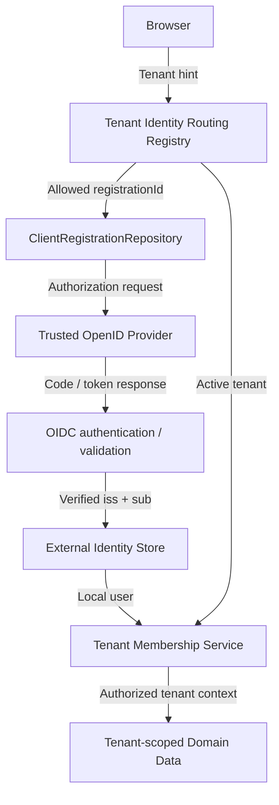
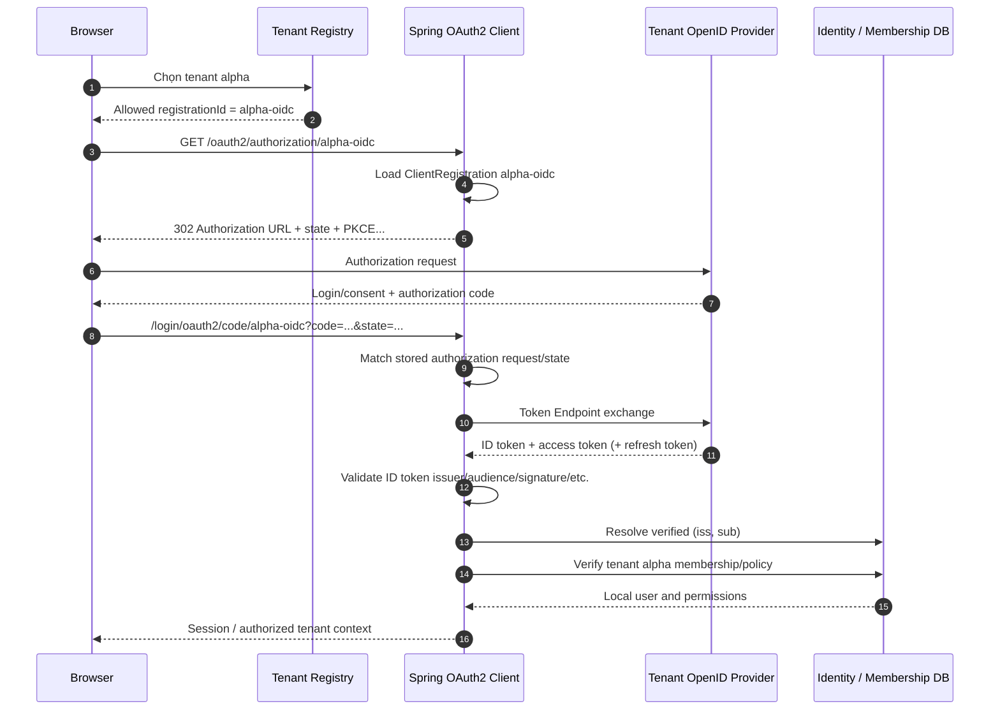

# 26.2. Thiết kế registration theo tenant và issuer

Khi ứng dụng **Spring Security OAuth 2.0/OIDC Client** phục vụ nhiều tổ chức, khách hàng doanh nghiệp hoặc môi trường độc lập, không thể mặc định rằng mọi người dùng đều đăng nhập qua cùng một **OpenID Provider (OP)** và cùng một **OAuth client registration**.

Ví dụ một nền tảng SaaS có các khách hàng:

- **Tenant Alpha** đăng nhập bằng IdP riêng của công ty Alpha.
- **Tenant Beta** sử dụng IdP thuộc hệ thống Beta.
- **Tenant Gamma** dùng chung một OpenID Provider với Beta nhưng có **client ID, chính sách scopes và redirect URI** khác.
- Một khách hàng lớn có thể có nhiều phương thức SSO, hoặc đổi nhà cung cấp danh tính khi migration.

Nếu chọn sai issuer, ứng dụng có thể thất bại khi xác minh ID Token. Nghiêm trọng hơn, nếu tenant selection và authorized client storage không được ràng buộc đúng, ứng dụng có thể trộn **identity, session, token và quyền truy cập dữ liệu** giữa các tenant.

Bài này tập trung vào cách thiết kế ba khái niệm chính:

1. **Tenant** — ranh giới tổ chức và phân quyền của hệ thống nghiệp vụ.
2. **ClientRegistration/registrationId** — cấu hình OAuth2/OIDC client mà Spring Security sử dụng để khởi tạo và hoàn tất login.
3. **Issuer (iss)** — định danh của OP phát ID Token, dùng để xác minh nguồn xác thực.

**Nguyên tắc cốt lõi:** tenant, registration và issuer có quan hệ với nhau nhưng **không đồng nhất**. Phải thiết kế mapping rõ ràng, xác minh OIDC đúng issuer và kiểm soát quyền ở tầng nghiệp vụ thay vì suy ra tenant chỉ từ domain hoặc email người dùng.

---

## 1. Bài toán multi-tenant OIDC Client

Giả sử ứng dụng SaaS:

```text
https://app.saas.example
```

phục vụ ba khách hàng:

| Tenant | Domain người dùng | OP/issuer | OAuth client |
|---|---|---|---|
| alpha | `alpha.example` | `https://id.alpha.example` | `alpha-portal-client` |
| beta | `beta.example` | `https://login.identity.example/realms/beta` | `beta-portal-client` |
| gamma | `gamma.example` | `https://login.identity.example/realms/beta` | `gamma-portal-client` |

Ở ví dụ này:

- Tenant **beta** và **gamma** có cùng issuer nhưng client IDs khác nhau.
- Tenant **alpha** có issuer khác.
- Email domain là dữ liệu hỗ trợ **gợi ý IdP**, không phải một bằng chứng đủ để cấp quyền vào tenant.
- Mỗi tenant có thể yêu cầu scopes, claims, consent và logout policy khác nhau.

Một ánh xạ đúng ở cấp thiết kế có thể là:

```text
tenant alpha
    |
    +-- allowed registrations
          |
          +-- alpha-oidc
                 |
                 +-- issuer = https://id.alpha.example
                 +-- client_id = alpha-portal-client
                 +-- scopes = openid profile email

tenant beta
    |
    +-- beta-oidc
          |
          +-- issuer = https://login.identity.example/realms/beta
          +-- client_id = beta-portal-client

tenant gamma
    |
    +-- gamma-oidc
          |
          +-- issuer = https://login.identity.example/realms/beta
          +-- client_id = gamma-portal-client
```

### 1.1. Vấn đề thật sự không phải chỉ là nhiều URLs

Một hệ thống có thể dễ dàng lưu nhiều `issuer-uri` trong YAML. Tuy nhiên, kiến trúc multi-tenant còn phải trả lời:

1. Tenant được chọn **trước login** như thế nào?
2. Registration nào được phép sử dụng cho tenant đó?
3. Spring Security làm sao ràng buộc callback với authorization request ban đầu?
4. Nếu cùng issuer phục vụ nhiều tenants, ứng dụng biết user đang thuộc tenant nào?
5. Nếu hai issuers cùng phát `sub=123`, làm sao tránh trộn user?
6. Access token của tenant A có thể bị gửi nhầm API của tenant B không?
7. Client credentials/redirect URIs có được cô lập không?
8. Khi tenant bị khóa hoặc thay IdP, phiên và tokens cũ được xử lý thế nào?

Vì vậy, thiết kế phải bao phủ **identity selection, protocol validation, data authorization và token lifecycle**.

## 2. Phân biệt tenant, registrationId và issuer

### 2.1. Tenant là khái niệm nghiệp vụ

Tenant có thể là:

```text
tenant_id = alpha
display_name = Alpha Corporation
data_partition = alpha
billing_account = ...
status = ACTIVE
```

Tenant quyết định ranh giới dữ liệu, quota, policy và những user/workload nào được phép truy cập tài nguyên.

**OIDC không tự tạo tenant nghiệp vụ cho ứng dụng.** OP xác thực subject; việc subject đó được vào tenant nào thuộc hệ thống SaaS và những nguồn ủy quyền đã được tin cậy.

### 2.2. registrationId là khóa nội bộ Spring Security

Ví dụ:

```yaml
spring:
  security:
    oauth2:
      client:
        registration:
          alpha-oidc:
            ...
```

`alpha-oidc` là một **registrationId**. Nó được Spring Security sử dụng để:

- Tra `ClientRegistration`.
- Chọn OP endpoints/client credentials.
- Khởi tạo authorization request.
- Ghép callback và authorization context.
- Tra/lưu `OAuth2AuthorizedClient`.
- Hỗ trợ phân biệt nhiều registrations cùng issuer.

Registration ID **không phải** client ID do OP cấp, không phải issuer URL và không tự chứng minh tenant ownership.

### 2.3. Issuer là định danh của OpenID Provider

Ví dụ:

```text
iss = https://id.alpha.example
```

ID Token của OIDC chứa claim `iss`. RP phải xác minh nó khớp **issuer tin cậy của registration đã chọn**.

Issuer có thể chứa path:

```text
https://login.identity.example/realms/beta
```

Hai URLs cùng hostname nhưng khác path có thể là **hai issuers khác nhau**. Không cắt bỏ path hoặc so sánh bằng hostname duy nhất.

### 2.4. Client ID là danh tính OAuth client tại OP

Ví dụ:

```text
registrationId = alpha-oidc
clientId       = alpha-portal-client
issuer         = https://id.alpha.example
```

Trong OIDC ID Token, `aud` thường liên quan **clientId**, không phải `registrationId`.

Một registration có thể dùng `client_secret_basic`, `private_key_jwt`, mTLS hoặc phương thức khác tùy OP/client contract.

## 3. Cardinality: một tenant không nhất thiết bằng một issuer

Các quan hệ phổ biến:

| Quan hệ | Tình huống | Thiết kế |
|---|---|---|
| 1 tenant → 1 registration → 1 issuer | Mỗi khách hàng có IdP riêng | Một registration cố định cho tenant |
| N tenants → 1 issuer → nhiều registrations | Shared OP, client ID/policy khác nhau | Tách registrations dù issuer giống nhau |
| N tenants → 1 registration → 1 issuer | Một login client chung, SaaS phân quyền tenant sau login | Có thể phù hợp nếu identity mapping/authorization rõ |
| 1 tenant → nhiều registrations/issuers | Tenant dùng nhiều enterprise IdPs hoặc migration | Allowlist registrations theo tenant |
| 1 issuer → nhiều `sub` thuộc nhiều tenants | Shared enterprise directory | Phải kiểm tra tenant membership |
| 1 subject → nhiều tenant memberships | User là consultant của nhiều khách hàng | Chọn **active tenant** sau authentication và reauthorize |

**Không ép kiến trúc theo quy tắc “tenant ID luôn bằng issuer” hoặc “tenant ID luôn bằng registrationId”.** Dùng một registry/mapping xác định rõ quan hệ.

### 3.1. Một issuer phục vụ nhiều tenants

Ví dụ `https://login.identity.example/realms/shared` cấp ID Tokens cho toàn bộ nhân viên/khách hàng.

Token:

```json
{
  "iss": "https://login.identity.example/realms/shared",
  "sub": "user-725",
  "aud": "saas-portal",
  "exp": 1794803600
}
```

Chỉ từ `iss` và `sub`, RP xác định external identity. Nhưng nếu user có thể thuộc cả tenant alpha và tenant gamma, **đang chọn tenant nào** là một quyết định nghiệp vụ khác, thường do membership service và active tenant context xác minh.

### 3.2. Một tenant dùng nhiều issuers

Ví dụ tenant alpha dùng một OP cho nhân viên và một OP khác cho đối tác.

```text
alpha
  |-- alpha-employees -> issuer company
  |-- alpha-partners  -> issuer partners
```

Một user có email giống nhau ở hai issuers không tự được coi là cùng local account. Nếu muốn account linking, cần quy trình bảo mật riêng.

### 3.3. Một tenant đổi issuer

Migration từ issuer cũ sang issuer mới không chỉ là thay một URL:

```text
old issuer = https://id-old.alpha.example
new issuer = https://id-new.alpha.example
```

External identity `(iss,sub)` thay đổi. RP cần migration/linking policy; nếu tự bỏ `iss` khỏi identity key, có thể liên kết sai accounts.

## 4. Mô hình thiết kế registry: tách config khỏi quyền nghiệp vụ

Một kiến trúc rõ ràng có thể dùng hai logical registries.

### 4.1. Tenant/Identity Routing Registry

```text
TenantIdentityConfig
  tenantId
  status
  allowedRegistrationIds
  defaultRegistrationId
  permittedLoginDomains (optional hints)
  loginPolicy
  identityMappingPolicy
```

Registry này trả lời **tenant nào được phép đăng nhập qua registration nào**.

### 4.2. OAuth Client Registration Registry

```text
ClientRegistration
  registrationId
  provider/issuer
  clientId
  clientAuthenticationMethod
  authorizationGrantType
  redirectUri
  scopes
  provider endpoints/JWKS metadata
```

Registry này phục vụ **giao thức OAuth2/OIDC của Spring Security**.

### 4.3. Local Identity/Membership Registry

Một tầng riêng:

```text
ExternalIdentity
  issuer
  subject
  linkedLocalUserId

TenantMembership
  localUserId
  tenantId
  status
  roles / permissions
```

Sau authentication, app kiểm tra external identity và tenant membership. Không cho `ClientRegistration` tự quyết định toàn bộ quyền tenant chỉ vì đăng nhập từ đúng IdP.



Đường **tenant hint** có thể do browser cung cấp, nhưng quyết định membership nằm **sau khi identity đã được xác minh**.

## 5. Đặt tên registrationId ổn định và không mơ hồ

Ví dụ tốt:

```text
alpha-oidc
beta-employees
beta-partners
gamma-oidc
```

Không bắt buộc registration ID phải mang tên tenant. Một thiết kế tốt cần:

- Unique trong toàn RP.
- Ổn định qua thời gian, hoặc có migration policy.
- Không chứa client secret, private data hoặc raw URL không chuẩn hóa.
- Có mapping đến issuer/clientId rõ ràng.
- Có trạng thái enabled/disabled.
- Có quy tắc xử lý khi tenant bị xóa hoặc đổi OP.
- Không để request parameter tự tạo registration mới.

### 5.1. Tránh dùng email làm registration ID

```text
registrationId = alice@alpha.example
```

là sai abstraction vì registration mô tả OAuth client/OP chứ không phải user.

### 5.2. Registration ID không phải nguồn duy nhất để chọn active tenant

Một registration `shared-idp` có thể phục vụ nhiều tenants. Sau login, app cần biết user muốn thao tác trong tenant nào và xác minh membership. Không suy ra tenant từ chuỗi registration khi mapping không phải 1:1.

### 5.3. Không tái sử dụng registration ID cho issuer khác mà không migration

Nếu `alpha-oidc` trước trỏ issuer A, sau chuyển sang issuer B, những authorized clients/session mappings cũ có thể còn gắn với `alpha-oidc`. Cần invalidation/migration có kiểm soát; không sửa issuer âm thầm rồi tiếp tục sử dụng token state cũ.

## 6. Cấu hình tĩnh nhiều registrations bằng Spring Boot

Đây là bước khởi đầu dễ quan sát nhất.

```yaml
spring:
  security:
    oauth2:
      client:
        registration:
          alpha-oidc:
            provider: alpha
            client-id: ${ALPHA_CLIENT_ID}
            client-secret: ${ALPHA_CLIENT_SECRET}
            client-authentication-method: client_secret_basic
            authorization-grant-type: authorization_code
            redirect-uri: "{baseUrl}/login/oauth2/code/{registrationId}"
            scope:
              - openid
              - profile
              - email

          beta-oidc:
            provider: beta
            client-id: ${BETA_CLIENT_ID}
            client-secret: ${BETA_CLIENT_SECRET}
            client-authentication-method: client_secret_basic
            authorization-grant-type: authorization_code
            redirect-uri: "{baseUrl}/login/oauth2/code/{registrationId}"
            scope:
              - openid
              - profile
              - email
              - groups

        provider:
          alpha:
            issuer-uri: https://id.alpha.example
          beta:
            issuer-uri: https://login.identity.example/realms/beta
```

**Ý nghĩa các nhãn:**

- `registration.alpha-oidc`: registration ID cục bộ.
- `provider: alpha`: tham chiếu sang provider metadata configuration.
- `client-id`/`client-secret`: credentials của RP với OP tương ứng.
- `issuer-uri`: issuer tin cậy để discovery/validation.
- `scope: openid`: yêu cầu OIDC login, nhận ID Token.
- `redirect-uri`: callback của Spring Security, phải trùng cấu hình được OP cho phép.

Không để secret ở source repository. Các ví dụ `${...}` biểu diễn Spring property placeholders dùng environment/secrets configuration khi triển khai.

### 6.1. Provider name không phải issuer ID

Trong YAML:

```yaml
provider:
  beta:
    issuer-uri: https://login.identity.example/realms/beta
```

`beta` chỉ là tên key cục bộ. Claim `iss` trong ID Token phải khớp issuer URI thực tế, không phải literal `beta`.

### 6.2. Cùng issuer, client ID khác

```yaml
spring:
  security:
    oauth2:
      client:
        registration:
          beta-oidc:
            provider: shared-op
            client-id: ${BETA_CLIENT_ID}
            client-secret: ${BETA_CLIENT_SECRET}
            authorization-grant-type: authorization_code
            redirect-uri: "{baseUrl}/login/oauth2/code/{registrationId}"
            scope: openid,profile

          gamma-oidc:
            provider: shared-op
            client-id: ${GAMMA_CLIENT_ID}
            client-secret: ${GAMMA_CLIENT_SECRET}
            authorization-grant-type: authorization_code
            redirect-uri: "{baseUrl}/login/oauth2/code/{registrationId}"
            scope: openid,profile

        provider:
          shared-op:
            issuer-uri: https://login.identity.example/realms/shared
```

Hai registrations có cùng issuer nhưng khác client IDs. OP sẽ xác minh client và redirect URI theo từng registration; Spring xác minh ID Token audience theo client ID đã chọn.

**Một issuer chung không đồng nghĩa được dùng token của registration beta để gọi API của registration gamma.**

## 7. Cấu hình SecurityFilterChain Servlet

Với ứng dụng Spring MVC:

```groovy
dependencies {
    implementation 'org.springframework.boot:spring-boot-starter-web'
    implementation 'org.springframework.boot:spring-boot-starter-security'
    implementation 'org.springframework.boot:spring-boot-starter-oauth2-client'
}
```

Security config:

```java
import org.springframework.context.annotation.Bean;
import org.springframework.context.annotation.Configuration;
import org.springframework.security.config.Customizer;
import org.springframework.security.config.annotation.web.builders.HttpSecurity;
import org.springframework.security.web.SecurityFilterChain;

@Configuration
public class WebSecurityConfig {

    @Bean
    SecurityFilterChain appSecurity(HttpSecurity http) throws Exception {
        http
            .authorizeHttpRequests(auth -> auth
                .requestMatchers(
                    "/", "/login", "/choose-tenant", "/error",
                    "/css/**", "/js/**")
                    .permitAll()
                .anyRequest().authenticated())
            .oauth2Login(Customizer.withDefaults());

        return http.build();
    }
}
```

`oauth2Login()` cho phép Spring xử lý OAuth2/OIDC Authorization Code Flow. Nó **không tự tạo tenant authorization policy** và không tự kiểm tra user có quyền truy cập dữ liệu tenant được chọn hay không.

### 7.1. URL bắt đầu authorization

Với registration `alpha-oidc`:

```text
/oauth2/authorization/alpha-oidc
```

Với `beta-oidc`:

```text
/oauth2/authorization/beta-oidc
```

Spring dùng registration ID trên path này để lấy đúng `ClientRegistration`.

### 7.2. Callback URL

Ví dụ:

```text
/login/oauth2/code/alpha-oidc
/login/oauth2/code/beta-oidc
```

Đây là endpoint callback của Spring Security. Không tự viết controller để lấy `code` từ query nếu framework đã quản lý flow; nó cần xác minh `state`, client registration, token response và ID Token.

## 8. Luồng đăng nhập theo tenant



Hai thời điểm quan trọng:

**Trước khi xác thực:** tenant được chọn chỉ là **hint/routing intent**, không phải quyền đã được chứng minh.

**Sau khi xác thực:** RP dựa vào issuer/subject đã xác minh và dữ liệu membership có thẩm quyền để quyết định user có thể vào tenant không.

## 9. Chọn tenant trước login bằng cách nào?

Có nhiều nguồn tenant hint.

| Nguồn hint | Ví dụ | Ưu điểm | Rủi ro |
|---|---|---|---|
| Subdomain | `alpha.app.example` | UX tự nhiên theo customer | Host header/proxy trust, DNS, custom domains |
| URL path | `/t/alpha/login` | Dễ route một domain | User tự thay path, phải allowlist |
| Tenant picker | User chọn Alpha/Beta | Rõ ràng | User có thể chọn tenant không thuộc quyền mình |
| Email domain | `user@alpha.example` | Hỗ trợ IdP discovery UX | Domain không chứng minh membership, email có thể giả |
| Invitation link | Link onboarding xác thực | Gắn vào tenant cụ thể | Token link cần ký, expiry, chống replay |
| Enterprise domain mapping | `login.alpha.example` | Hỗ trợ white-label | DNS ownership và host validation |
| Query string | `?tenant=alpha` | Đơn giản | Dễ bị sửa, chỉ dùng làm routing hint |

Dù chọn cách nào, **nguồn hint không được tự biến thành authorization**.

### 9.1. Tenant picker

Người dùng chọn một tenant được cấu hình:

```html
<a href="/login/tenant/alpha">Đăng nhập vào Alpha</a>
<a href="/login/tenant/beta">Đăng nhập vào Beta</a>
```

RP tra tenant registry, xác định registration được phép rồi redirect tới endpoint Spring OAuth2 authorization.

### 9.2. Email domain discovery chỉ là gợi ý

Đừng làm:

```text
User nhập ceo@alpha.example
=> tự cấp tenant=alpha và ROLE_ADMIN
```

Email người dùng nhập chưa được xác minh. Ngay cả email claim sau OIDC cũng có thể thay đổi và không đủ chứng minh membership theo mọi provider.

Chỉ dùng domain để gợi ý registration/OP khi đã có mapping đáng tin; membership phải được xác nhận riêng.

### 9.3. Tenant dưới custom domain

Với:

```text
https://login.alpha-customer.example
```

reverse proxy có thể chuyển request vào cùng SaaS backend. Ứng dụng cần xác định tenant từ **hostname được quản lý/đã chứng minh ownership**, không từ `Host` hoặc `X-Forwarded-Host` tùy ý không qua trusted proxy.

## 10. Ví dụ chọn registration bằng allowlist server-side

Một controller không nên nhận trực tiếp issuer URL hoặc client ID từ browser. Thay vào đó, nhận tenant key, tra **trusted mapping**.

### 10.1. TenantLoginRoute

```java
public record TenantLoginRoute(
    String tenantId,
    String registrationId,
    boolean enabled
) {}
```

### 10.2. Registry đơn giản

```java
import java.util.Map;
import java.util.Optional;

public final class TenantLoginRegistry {

    private final Map<String, TenantLoginRoute> routes = Map.of(
        "alpha", new TenantLoginRoute(
            "alpha", "alpha-oidc", true),
        "beta", new TenantLoginRoute(
            "beta", "beta-oidc", true)
    );

    public Optional<TenantLoginRoute> resolve(String tenantKey) {
        if (tenantKey == null) {
            return Optional.empty();
        }

        return Optional.ofNullable(routes.get(tenantKey))
            .filter(TenantLoginRoute::enabled);
    }
}
```

Đây là mapping minh họa. Production có thể dùng database/cache nhưng phải có authorization khi thay đổi mapping và validation trước khi đưa cấu hình vào hoạt động.

### 10.3. Controller bắt đầu login

```java
import java.net.URI;

import org.springframework.http.HttpStatus;
import org.springframework.http.ResponseEntity;
import org.springframework.web.bind.annotation.GetMapping;
import org.springframework.web.bind.annotation.PathVariable;
import org.springframework.web.bind.annotation.RestController;

@RestController
public final class TenantLoginController {

    private final TenantLoginRegistry tenants;

    public TenantLoginController(TenantLoginRegistry tenants) {
        this.tenants = tenants;
    }

    @GetMapping("/login/tenant/{tenantKey}")
    public ResponseEntity<Void> start(
            @PathVariable String tenantKey) {

        var route = tenants.resolve(tenantKey);

        if (route.isEmpty()) {
            return ResponseEntity.notFound().build();
        }

        String registrationId = route.get().registrationId();

        // Chỉ registration IDs cố định và được validate
        // trong trusted registry, không phải URL user cung cấp.
        URI destination = URI.create(
            "/oauth2/authorization/" + registrationId);

        return ResponseEntity
            .status(HttpStatus.FOUND)
            .location(destination)
            .build();
    }
}
```

Ví dụ giả định `registrationId` được registry cấp sẵn và có định dạng an toàn, chẳng hạn `[a-z0-9-]+`. Nếu mapping đến từ DB, validate registration ID lúc onboarding để tránh path injection/invalid redirect.

**Không lấy `tenantKey` rồi nối trực tiếp thành issuer URL** như `https://{tenantKey}.idp.example` nếu chưa có allowlist và trust policy.

### 10.4. Chọn tenant không có nghĩa đã xác minh quyền

Sau khi OAuth2 Login thành công, app phải kiểm tra user có membership trong `route.tenantId()`. Không lưu tenant chosen từ request vào session rồi mặc định coi đó là một role đã được xác minh.

## 11. Những thông tin nào cần gắn với authorization request?

Nếu tenant được chọn trước login, callback có thể đến vài phút sau. Trong khoảng đó user có thể:

- Mở tab đăng nhập tenant khác.
- Đổi active tenant.
- Hủy và bắt đầu lại authorization request.
- Bị redirect từ OP trở lại bằng một request với URL khác.

RP cần **liên kết tenant intent với authorization transaction đã khởi tạo**, không chỉ đọc “current tenant” từ một session variable dễ bị ghi đè.

### 11.1. OIDC state binding

Spring Security dùng `state` ngẫu nhiên để liên kết response callback với authorization request đã được lưu.

```text
Authorization request A:
  state = random-A
  registration = alpha-oidc
  tenantIntent = alpha

Authorization request B:
  state = random-B
  registration = beta-oidc
  tenantIntent = beta
```

Khi callback A đến, cần dùng context của **request A**, không dùng session field “tenant cuối cùng user đã chọn” do request B vừa thay đổi.

### 11.2. Không tự đặt state bằng tenant ID

Sai:

```text
state=alpha
```

`state` phải là giá trị correlation đủ ngẫu nhiên/khó đoán theo thiết kế của framework. Tenant ID không thay thế `state`.

### 11.3. Thêm application context an toàn

Khi cần giữ tenant hint, có thể:

- Lưu trong một authorization request repository có correlation bằng state.
- Dùng server-side transaction record keyed by state/internal nonce.
- Sử dụng extension point `OAuth2AuthorizationRequestResolver` được Spring hỗ trợ.
- Khi làm custom, giữ nguyên state/PKCE/nonce validation và tránh thay callback.

Không nhồi raw untrusted tenant URL vào state rồi decode và coi đó là authorization. Nếu cần stateless encoded state, phải bảo vệ tính toàn vẹn, chống replay và ràng buộc đúng transaction theo thiết kế.

### 11.4. Nhiều tab login cùng lúc

Một default authorization request repository có thể có giới hạn về số pending login attempts mỗi session tùy implementation/version. Nếu yêu cầu nhiều tab, cần test và có repository/keying theo state phù hợp, không giả định mọi phiên bản tự hỗ trợ concurrent flows không giới hạn.

## 12. Callback, redirect URI và registration binding

Một authorization request của `alpha-oidc` thường có:

```text
client_id=alpha-portal-client
redirect_uri=https://app.saas.example/login/oauth2/code/alpha-oidc
response_type=code
scope=openid profile email
state=<random>
code_challenge=<pkce-if-used>
code_challenge_method=S256
```

Callback:

```text
https://app.saas.example/login/oauth2/code/alpha-oidc
  ?code=...
  &state=...
```

RP cần kiểm tra callback thuộc đúng **authorization request và registration**. Nếu một attacker cố đem authorization response của OP B sang callback dành cho OP A, các ràng buộc registration/issuer/PKCE/state phải ngăn đăng nhập sai.

### 12.1. Distinct callback paths có ích

`/login/oauth2/code/{registrationId}` giúp nhận biết registration trên callback. Đây là thiết kế mặc định hữu ích, nhưng **đường dẫn không tự thay thế state và issuer validation**.

### 12.2. Callback URI phải được OP đăng ký

AS/OP phải cho phép redirect URI theo client registration. Hạn chế wildcard và domain tùy ý:

```text
Không an toàn:
  https://*.example.org/*
```

Nếu có custom domains cho tenant, cần một giải pháp đăng ký redirect URI rõ ràng hoặc một callback domain tập trung, có correlation/redirect-back policy an toàn.

### 12.3. Không redirect ngược tới URL tùy ý sau login

Không nhận:

```text
/login/tenant/alpha?returnTo=https://attacker.example
```

rồi đưa browser tới `returnTo` sau login mà không kiểm tra. Đây là nguy cơ **open redirect** và có thể làm rò rỉ authorization-related data tùy flow.

Chỉ cho phép relative paths nội bộ hoặc allowlisted origins đã đăng ký; ràng buộc return target với authorization transaction nếu cần.

## 13. Issuer matching và bảo vệ mix-up attacks

**Authorization Server mix-up** xảy ra khi client nhầm AS/OP đang tham gia một authorization transaction, làm gửi code/token request sai destination hoặc xử lý response bằng cấu hình issuer khác.

Trong multi-issuer client, đây là một threat model trọng tâm.

### 13.1. Những lớp bảo vệ

- Registration được chọn **trước** redirect.
- Authorization request được lưu với `state`.
- Callback gắn với đúng registration/issuer.
- Token Endpoint được lấy từ `ClientRegistration` tin cậy.
- ID Token `iss` phải khớp issuer được cấu hình.
- ID Token `aud` phải bao gồm OAuth client ID đúng.
- Kiểm tra `azp` khi profile yêu cầu.
- PKCE verifier phải thuộc cùng authorization request.
- Không dùng JWKS của issuer khác.
- Không cho callback cung cấp issuer/token endpoint URL tùy ý.

### 13.2. Issuer parameter trong authorization response

OAuth 2.0 Authorization Server Issuer Identification (RFC 9207) mô tả tham số `iss` trong authorization response nhằm giảm nguy cơ mix-up khi được AS/client hỗ trợ.

Không nhầm `iss` trong authorization response với `iss` trong **ID Token**: chúng xuất hiện ở các giai đoạn khác nhau và có logic validation khác nhau.

Việc Spring Security hỗ trợ/kiểm tra một extension cụ thể còn tùy phiên bản và cấu hình provider. Dù có hoặc không có response `iss`, **OIDC ID Token issuer validation và state/registration binding vẫn là các yêu cầu quan trọng**.

### 13.3. Không chỉ so sánh hostname

Hai issuers:

```text
https://id.example.org/realms/alpha
https://id.example.org/realms/beta
```

có cùng hostname nhưng khác issuer ID. So:

```java
assertIssuerHostEquals("id.example.org");
```

là không đủ.

Phải match issuer identifier theo metadata/trust configuration, với xử lý normalization chỉ khi tuân thủ chính xác định nghĩa của spec và API đang dùng.

### 13.4. Không dùng email domain để chọn JWKS

Sai:

```text
JWT email = person@alpha.example
=> Fetch https://alpha.example/.well-known/jwks
=> Tin chữ ký token
```

Issuer/JWKS trust đến từ registration đã được cấu hình, không từ một claim do token chưa xác minh đưa ra.

## 14. Discovery, issuer-uri và ClientRegistrations

Khi provider hỗ trợ OpenID Connect Discovery, có thể dùng issuer URI để lấy metadata:

```text
https://id.alpha.example/.well-known/openid-configuration
```

Metadata có thể chứa:

```json
{
  "issuer": "https://id.alpha.example",
  "authorization_endpoint": "https://id.alpha.example/authorize",
  "token_endpoint": "https://id.alpha.example/token",
  "jwks_uri": "https://id.alpha.example/jwks",
  "userinfo_endpoint": "https://id.alpha.example/userinfo"
}
```

### 14.1. Metadata là một phần trust boundary

RP phải đảm bảo:

1. Issuer metadata đúng issuer được đăng ký.
2. Các endpoints đáp ứng provider/security contract.
3. TLS validation được bật.
4. Không lấy metadata từ host do request user tùy ý quyết định.
5. JWK keys được dùng trong ngữ cảnh **đúng issuer**.
6. Cache/refresh metadata và keys theo chính sách phù hợp.

### 14.2. Tạo ClientRegistration từ issuer

Spring Security cung cấp helper `ClientRegistrations.fromIssuerLocation(...)`.

```java
import org.springframework.security.oauth2.client.registration.ClientRegistration;
import org.springframework.security.oauth2.client.registration.ClientRegistrations;

ClientRegistration alpha = ClientRegistrations
    .fromIssuerLocation("https://id.alpha.example")
    .registrationId("alpha-oidc")
    .clientId(alphaClientId)
    .clientSecret(alphaClientSecret)
    .redirectUri("{baseUrl}/login/oauth2/code/{registrationId}")
    .scope("openid", "profile", "email")
    .build();
```

Ví dụ giả định OP hỗ trợ discovery và helper có thể lấy metadata tương thích với Spring version.

**Đây là thao tác có thể thực hiện HTTP I/O tại lúc xây registration.** Không thực hiện discovery từ URL tùy ý ngay trên login request mà không có rate limiting, network isolation, timeout và trusted issuer policy.

### 14.3. fromIssuerLocation không có nghĩa tự tin mọi issuer

Sai:

```java
ClientRegistrations.fromIssuerLocation(
    request.getParameter("issuer"))
    .build();
```

Browser có thể chọn:

```text
http://169.254.169.254/
http://localhost:...
https://attacker.example/...
```

dẫn tới **SSRF**, tin metadata độc hại, chuyển client secrets/assertions đến host khác hoặc gây resource exhaustion.

Không giải quyết bằng việc chỉ dùng `startsWith("https://")`. Cần registry allowlist, HTTPS, endpoint trust, validation, chặn mạng nội bộ theo threat model và onboarding approval.

## 15. Static repository: phù hợp số lượng tenants ít hoặc thay đổi hiếm

Spring Security Servlet sử dụng:

```java
ClientRegistrationRepository
```

Một implementation quen thuộc:

```java
InMemoryClientRegistrationRepository
```

Ví dụ:

```java
import org.springframework.context.annotation.Bean;
import org.springframework.context.annotation.Configuration;
import org.springframework.security.oauth2.client.registration.ClientRegistrationRepository;
import org.springframework.security.oauth2.client.registration.InMemoryClientRegistrationRepository;
import org.springframework.security.oauth2.client.registration.ClientRegistration;

@Configuration
public class MultiTenantRegistrationConfig {

    @Bean
    ClientRegistrationRepository clientRegistrationRepository(
            TenantRegistrationSettings settings) {

        ClientRegistration alpha =
            settings.alphaRegistration();

        ClientRegistration beta =
            settings.betaRegistration();

        return new InMemoryClientRegistrationRepository(
            alpha, beta);
    }
}
```

`TenantRegistrationSettings` là một abstraction ứng dụng minh họa để giữ cấu hình validated. Không có class này sẵn trong Spring.

### 15.1. Tại sao start tĩnh thường tốt?

- Mỗi registration được kiểm tra ngay lúc bootstrap.
- Secrets và issuer URLs rõ ràng.
- Dễ audit tenant onboarding.
- Không có network discovery tùy ý khi request đến.
- Khó phát sinh race thay đổi registration giữa các bước OAuth flow.
- Có thể dùng generated login page khi repository đáp ứng điều kiện liệt kê registrations.

### 15.2. Nhược điểm

- Thêm tenant có thể cần deploy/restart, tùy config source.
- Không thích hợp nếu hàng nghìn tenants thay đổi liên tục.
- Rotation secrets và issuer metadata cần quy trình cập nhật.
- Một lỗi discovery lúc startup có thể ảnh hưởng khởi động nếu không có cơ chế fallback/caching phù hợp.

Với số tenants không lớn, **tính đơn giản và auditability** có thể quan trọng hơn dynamic registration.

## 16. Dynamic ClientRegistrationRepository cho nhiều tenants

Khi tenants được onboard liên tục, ứng dụng có thể cần repository đọc từ một registry động.

### 16.1. Nhưng không nhất thiết phải “tạo từ issuer URL” mỗi request

Một cách tốt hơn:

```text
Tenant onboarding workflow
   -> Validate tenant ownership
   -> Approve issuer/client metadata
   -> Fetch/verify discovery
   -> Store trusted sanitized registration
   -> Publish active registry snapshot

Login request
   -> Lookup registrationId in trusted snapshot
   -> Start authorization immediately
```

Không dùng browser request làm nguồn cung cấp toàn bộ `issuerUri`, `clientId`, `clientSecret` và endpoints.

### 16.2. Repository tĩnh từ registry snapshot

Ví dụ Java:

```java
import java.util.Iterator;
import java.util.List;
import java.util.Map;
import java.util.function.Function;
import java.util.stream.Collectors;

import org.springframework.security.oauth2.client.registration.ClientRegistration;
import org.springframework.security.oauth2.client.registration.ClientRegistrationRepository;

public final class TenantClientRegistrationRepository
        implements ClientRegistrationRepository,
                   Iterable<ClientRegistration> {

    private final Map<String, ClientRegistration> byId;

    public TenantClientRegistrationRepository(
            List<ClientRegistration> trustedRegistrations) {

        this.byId = trustedRegistrations.stream().collect(
            Collectors.toUnmodifiableMap(
                ClientRegistration::getRegistrationId,
                Function.identity()
            )
        );
    }

    @Override
    public ClientRegistration findByRegistrationId(
            String registrationId) {
        return byId.get(registrationId);
    }

    @Override
    public Iterator<ClientRegistration> iterator() {
        return byId.values().iterator();
    }
}
```

Đoạn code đại diện cho **snapshot bất biến**. Trong hệ thống dynamic thật, registry có thể cung cấp atomic versioned snapshots/cache thay vì map cố định suốt đời process.

`Iterable<ClientRegistration>` hữu ích khi framework cần liệt kê registrations, ví dụ trang login sinh tự động. Tuy nhiên, với hàng nghìn tenants, **không nên liệt kê tất cả providers/tenants công khai trên login page**; dùng tenant picker/known route.

### 16.3. Repository động cần nhất quán theo request

Giả sử:

```text
T0: Login bắt đầu bằng registration alpha-v1
T1: Admin thay token endpoint và client secret
T2: Callback đến, repository trả alpha-v2
```

Có nguy cơ callback dùng cấu hình khác authorization request ban đầu.

Các chiến lược:

- Không thay issuer/client ID tùy tiện trong cùng registration ID.
- Version registration khi có thay đổi lớn, ví dụ `alpha-oidc-v2`.
- Giữ cấu hình cũ trong thời gian các authorization transactions đang tồn tại.
- Đồng bộ registry snapshots giữa nodes.
- Cấu hình dual-valid client credentials theo rotation policy khi AS hỗ trợ.
- Kiểm thử callback trong lúc rollout.

**Không thay issuer của registration hiện hành giữa authorization và token exchange** nếu không có migration/correlation strategy rõ.

## 17. Mô hình registry động có kiểm soát

Một schema khái niệm:

```text
Tenant:
  tenant_id
  display_name
  status

TenantIdentityProvider:
  tenant_id
  registration_id
  issuer_uri
  client_id
  client_secret_reference
  client_authentication_method
  allowed_scopes
  redirect_uri
  enabled
  configuration_version
  approved_at
```

Tách `client_secret_reference` khỏi raw secret. Registry lưu reference đến KMS/secret manager, không lưu secret plaintext dễ truy cập trong bảng cấu hình.

### 17.1. Workflow onboard một enterprise tenant

1. Admin đã được xác thực tạo request onboarding.
2. Xác minh domain/tenant ownership theo quy trình.
3. Tenant cung cấp issuer và OAuth client metadata.
4. Backend kiểm tra issuer URL có thuộc allowlist/network policy, HTTPS và trust contract.
5. Thực hiện OIDC discovery một cách có kiểm soát.
6. So `issuer` trong metadata với expected issuer.
7. Kiểm tra endpoints, JWKS, client auth method và redirect URI registration.
8. Lưu client secret trong secret manager.
9. Gán stable `registrationId`, scopes và token audience policy.
10. Kích hoạt sau approval và integration test.
11. Phát hành registry snapshot mới tới các instances.
12. Audit mọi thay đổi.

### 17.2. Chặn arbitrary discovery như một dịch vụ proxy

Nếu SaaS cho bất kỳ user nhập URL issuer và chạy discovery, app có thể bị lạm dụng để kết nối mạng nội bộ. Đây là **SSRF risk**. Cần phân biệt một **admin-controlled onboarding workflow** với login request của user chưa xác thực.

### 17.3. Cache metadata và khóa

Discovery/JWK retrieval có thể gây mạng I/O và rate limits. Registry nên:

- Cache configuration theo TTL/version.
- Cache JWKs theo HTTP và decoder policy.
- Hỗ trợ key rotation an toàn.
- Tránh request storm khi issuer tạm thời lỗi.
- Không dùng stale keys vô hạn khi issuer bị thu hồi.
- Theo dõi lỗi của từng provider riêng, không ảnh hưởng toàn bộ tenants.

## 18. OIDC user identity: khóa theo (iss, sub)

Một ID Token hợp lệ:

```json
{
  "iss": "https://id.alpha.example",
  "sub": "user-725",
  "aud": "alpha-portal-client",
  "exp": 1794803600,
  "iat": 1794800000,
  "email": "person@alpha.example",
  "email_verified": true
}
```

RP có thể lưu external identity:

```text
issuer = https://id.alpha.example
subject = user-725
```

### 18.1. Vì sao không dùng sub đơn lẻ?

Issuer Beta cũng có thể phát:

```text
sub = user-725
```

Hai `sub` giống nhau **không có nghĩa là cùng user**.

### 18.2. Vì sao không dùng email làm khóa?

Email có thể:

- Thay đổi.
- Được cấp lại cho người khác.
- Không xuất hiện.
- Chưa được xác minh.
- Giống nhau giữa providers khác trust levels.
- Không tương ứng đúng với membership tenant.

Ngay cả `email_verified=true` cũng không mặc định chứng minh user có quyền vào mọi tenant dùng email domain đó.

### 18.3. Cặp (iss, sub) và tenant membership

Một user có thể có external identity ở issuer chung nhưng thuộc hai tenants:

```text
ExternalIdentity:
  (issuer=shared, sub=user-725) -> localUserId=U42

Membership:
  U42 -> tenant-beta  [ACTIVE, VIEWER]
  U42 -> tenant-gamma [ACTIVE, ADMIN]
```

User chọn active tenant; app kiểm tra membership tương ứng. Không gán role ADMIN từ tenant gamma cho requests vào tenant beta.

### 18.4. Khi app cho phép account linking

Nếu một local user được liên kết với nhiều OIDC identities:

```text
LocalUser U42
  -> (issuer-A, sub-A)
  -> (issuer-B, sub-B)
```

Cần một quy trình linking có xác minh quyền sở hữu cả hai identities hoặc policy được doanh nghiệp phê duyệt. Không tự link chỉ vì hai ID Tokens có cùng email/name.

## 19. Lấy issuer và registrationId từ authentication đúng cách

Sau OIDC Login thành công trong Spring Security Servlet, `Authentication` thường là `OAuth2AuthenticationToken`, principal có thể là `OidcUser`.

```java
import java.util.Map;

import org.springframework.security.core.Authentication;
import org.springframework.security.oauth2.client.authentication.OAuth2AuthenticationToken;
import org.springframework.security.oauth2.core.oidc.user.OidcUser;
import org.springframework.web.bind.annotation.GetMapping;
import org.springframework.web.bind.annotation.RestController;

@RestController
public class IdentityController {

    @GetMapping("/whoami")
    public Map<String, String> whoami(Authentication auth) {

        if (!(auth instanceof OAuth2AuthenticationToken token)
                || !(token.getPrincipal() instanceof OidcUser user)) {
            throw new IllegalStateException(
                "Expected an authenticated OIDC user");
        }

        return Map.of(
            "registrationId", token.getAuthorizedClientRegistrationId(),
            "issuer", user.getIdToken().getIssuer().toString(),
            "subject", user.getSubject()
        );
    }
}
```

Ví dụ chỉ trả metadata minh họa. Trong production, cân nhắc không expose issuer/subject raw khi UI không cần, và dùng error handling phù hợp thay vì `IllegalStateException`.

### 19.1. Registration ID đã chọn không thay thế issuer verification

`token.getAuthorizedClientRegistrationId()` cho biết Spring đã xử lý login qua registration nào.

`user.getIdToken().getIssuer()` đến từ ID Token đã được framework xác minh.

Để có tenant identity đáng tin:

```text
registrationId -> trusted mapping to tenant(s)/issuer
verified issuer + subject -> local identity
local identity + active tenant -> membership/permissions
```

Không chỉ lấy registrationId rồi tự tạo local admin role.

### 19.2. OAuth2-only provider khác OIDC

Nếu registration không yêu cầu `openid`, principal có thể là `OAuth2User` chứ không phải `OidcUser`. Khi đó không có ID Token `iss/sub` theo OIDC Core để dùng mặc định.

Bài này tập trung OIDC; nếu cần hỗ trợ OAuth2-only providers, phải thiết kế identity namespace và trusted user info mapping riêng, không giả định mọi provider đều có cùng claims.

## 20. Tenant authorization sau login

Authentication trả lời câu hỏi:

> “Subject này đã được OP xác thực theo registration/issuer nào?”

Domain authorization trả lời:

> “Subject/local user này có được truy cập tenant X và tài nguyên Y không?”

Đây là hai bước khác nhau.

### 20.1. Service nghiệp vụ

```java
public interface TenantAccessService {

    boolean canAccessTenant(
        String localUserId,
        String tenantId
    );
}
```

Một service thực tế có thể truy vấn membership table, policy engine hoặc authoritative directory.

### 20.2. Kiểm tra context của request

Ví dụ domain route:

```text
GET /tenants/alpha/orders/742
```

Server cần:

1. Xác định authenticated local user.
2. Xác định tenant requested từ route.
3. Kiểm tra active membership với tenant alpha.
4. Kiểm tra role/scope/action.
5. Kiểm tra order 742 thuộc alpha.
6. Chỉ trả dữ liệu nếu mọi điều kiện đáp ứng.

Không tin `tenant=alpha` trong JWT custom claim nếu claim không nằm trong authoritative, validated contract, và cũng không cho quyền vượt chính sách nghiệp vụ.

### 20.3. Fail closed khi mapping thiếu

Nếu user đã xác thực OIDC nhưng không tìm thấy account/membership:

```text
OIDC authentication = SUCCESS
Tenant access       = DENIED or pending provisioning
```

Không tự coi họ là member của tenant vì đã tới từ issuer mà nhiều tổ chức cùng dùng.

## 21. Kiểu dữ liệu local identity và tenant mapping

Một schema khái niệm:

```sql
CREATE TABLE external_identity (
    issuer VARCHAR(500) NOT NULL,
    subject VARCHAR(255) NOT NULL,
    local_user_id VARCHAR(100) NOT NULL,
    created_at TIMESTAMP NOT NULL,
    PRIMARY KEY (issuer, subject)
);

CREATE TABLE tenant_membership (
    tenant_id VARCHAR(100) NOT NULL,
    local_user_id VARCHAR(100) NOT NULL,
    membership_status VARCHAR(30) NOT NULL,
    role_name VARCHAR(100) NOT NULL,
    PRIMARY KEY (tenant_id, local_user_id)
);
```

Đây là schema **minh họa**, không phải schema do Spring Security tạo.

Nếu user có nhiều roles trong một tenant, bảng cần điều chỉnh để hỗ trợ composite membership-role, unique constraint và audit.

### 21.1. Không dùng registrationId như khóa external identity duy nhất

Một issuer có thể có nhiều registrations nhưng cùng một user. Ngược lại, một registration có thể dùng issuer chung cho nhiều tenants.

Khóa external identity OIDC vẫn ưu tiên **`(iss, sub)`**. Registration ID là context của OAuth client/authorization transaction, không nhất thiết một namespace user độc lập.

### 21.2. Tenant ID phải ổn định

Tenant display name hoặc custom domain có thể đổi. Dùng một stable internal tenant ID để liên kết dữ liệu và memberships, không dùng domain làm primary key nếu domain có thể được chuyển cho customer khác.

### 21.3. Tenant context cần được kiểm soát ở service/repository

Không chỉ đặt tenant ID vào ThreadLocal rồi cho mọi database query dùng nó mà không kiểm tra membership. Với WebFlux, Reactor Context cần được truyền đúng; với Servlet, các async threads cũng cần rõ scope.

Kiến trúc có thể dùng:

```text
Authenticated principal
    +
Authorized tenant context (validated)
    |
    v
Tenant-scoped service/repository
    |
    v
Row/partition authorization
```

## 22. OAuth2AuthorizedClient storage trong multi-tenant

`OAuth2AuthorizedClient` thường được liên kết bằng:

```text
(clientRegistrationId, principalName)
```

Ví dụ:

```text
(alpha-oidc, user-725) -> AT-alpha, RT-alpha
(beta-oidc, user-725)  -> AT-beta, RT-beta
```

### 22.1. registrationId phải unique theo registration thực sự

Nếu cùng registration ID `company` bị tái sử dụng giữa tenants/issuers trong một shared store, authorized clients có thể bị trộn.

Trong multi-tenant deployment, cần đảm bảo ít nhất:

- Unique registration IDs theo toàn app hoặc namespace rõ ở storage.
- PrincipalName stable và không bị collision theo cách gây trộn tokens.
- Token state có source issuer/client ID/resource context phù hợp.
- Khi login session chuyển tenant, token của tenant trước không tự được dùng ở tenant sau.

### 22.2. PrincipalName có thể cần composite

Một lựa chọn là sử dụng external identity stable mapping tới local user ID.

```text
principalName = local-user-U42
```

Nhưng nếu app lưu tokens theo issuer/registration khác nhau, principal key cần bảo đảm không cho một local user dùng nhầm delegation của account linked khác.

Một số kiến trúc dùng:

```text
tenant_id + local_user_id + external_identity_id
```

ở storage custom. Tuy nhiên, `OAuth2AuthorizedClientService` API mặc định dùng registrationId/principalName; nếu có thêm dimensions, cần encode/mapping có kiểm soát, không nối chuỗi tùy tiện dễ collision.

### 22.3. Không cache theo issuer đơn lẻ

Sai:

```java
Map<String, String> tokenByIssuer;
```

Một issuer có thể có nhiều clients và nhiều users. Cache access token theo issuer là quá rộng, gây nguy cơ token leak/cross-user authorization.

### 22.4. Scope và audience

Access token dành cho API `orders-alpha` không mặc định hợp lệ cho `orders-beta`. Những providers khác nhau có thể cấp scopes giống tên nhưng khác ý nghĩa.

Dùng API-specific RestClient/WebClient và registration/policy rõ. Không dùng outbound HTTP interceptor toàn cục tự gắn Bearer token của user vào mọi API host được request chỉ định.

## 23. Access token audience trong thiết kế multi-tenant

Một RP có thể đăng nhập OIDC qua OP Alpha nhưng gọi:

```text
https://api.saas.example/tenants/alpha/orders
```

Resource Server cần kiểm tra:

- Access token issuer đúng nguồn tin cậy.
- Access token audience/resource đúng API.
- Token chưa hết hạn/bị revoke.
- Scope phù hợp operation.
- User/tenant membership và object authorization.

### 23.1. ID Token không thay access token

ID Token `aud=alpha-portal-client` dành cho RP. Không dùng ID Token làm Bearer access token chỉ vì nó chứa tenant/sub claims.

### 23.2. Các issuers khác nhau tại Resource Server

Nếu API chấp nhận access tokens từ nhiều trusted issuers, nó cần cơ chế **AuthenticationManagerResolver** hoặc reactive JWT decoder selection theo issuer và trust policy được cấu hình.

Đây là **Resource Server multi-issuer design**, khác bài toán **OAuth Client multi-registration** đang xét. Không copy thuật toán “đọc iss rồi chọn decoder” vào client login trước khi xác minh OIDC authorization request context.

### 23.3. Delegation và token exchange

Khi một user từ tenant Alpha cần gọi API thuộc một trust domain khác, có thể cần Token Exchange hoặc grant phù hợp do Authorization Server hỗ trợ.

Không gửi token có audience tenant Alpha đến tenant Beta API và bỏ qua audience validation để làm request hoạt động.

## 24. Nhiều tenants dùng cùng issuer: kiểm tra audience và tenant

Giả sử:

```text
beta-oidc:
  issuer = shared-op
  client_id = saas-beta-client

gamma-oidc:
  issuer = shared-op
  client_id = saas-gamma-client
```

Nếu callback của beta lại nhận ID Token:

```json
{
  "iss": "https://login.identity.example/realms/shared",
  "sub": "user-725",
  "aud": "saas-gamma-client"
}
```

thì `iss` có vẻ đúng nhưng **`aud` không đúng client ID beta**. RP phải từ chối ID Token nếu không đáp ứng OIDC audience rules.

### 24.1. azp khi có nhiều audiences

Trong OIDC, claim `azp` có thể được sử dụng để xác định authorized party khi token có nhiều audiences. Client cần kiểm tra theo OIDC rules và Spring Security validation được cấu hình.

Không coi `azp=registrationId` nếu registrationId khác `clientId`. `azp` thường được so với OAuth client ID thực tế.

### 24.2. Cùng issuer không tự chia sẻ browser session

OP có thể dùng SSO chung, nhưng mỗi RP client registration vẫn có authorization request và authorized client lifecycle riêng. Một user có thể đăng nhập tại cùng OP nhưng mỗi app/registration nhận ID Token hoặc access token khác.

### 24.3. OP tenant claim có cần thiết không?

Nếu OP phát claim:

```json
"tenant_id": "beta"
```

chỉ sử dụng nó làm authoritative tenant assignment khi có **contract rõ rằng OP đã xác minh quyền thuộc tenant đó** và token/claim đã được kiểm chứng. Trong shared OP đa tổ chức, một claim tự cấu hình hoặc user-editable không đủ làm căn cứ phân quyền.

## 25. Cách thay đổi active tenant sau khi đăng nhập

Một user có thể thuộc nhiều tenants:

```text
U42 memberships:
  alpha -> VIEWER
  beta  -> ADMIN
```

Không bắt buộc user đăng nhập lại OIDC mỗi khi chuyển tenant nếu identity và policy cho phép. Nhưng application phải **reauthorize** theo active tenant mới.

### 25.1. Server-side tenant switching

Flow:

```text
POST /switch-tenant
  tenantId=beta
     |
     v
Validate authenticated local user U42
     |
     v
Check active membership U42 -> beta
     |
     v
Update active tenant context in session
     |
     v
Apply beta-specific authorization on subsequent requests
```

Đổi tenant chỉ bằng cách sửa cookie/query ở browser mà không có server validation là không an toàn.

### 25.2. Đổi tenant có cần OAuth reauthorization?

Nếu tenant mới dùng **registration/issuer/clientId** khác và API cần token của registration đó, có thể phải thực hiện OAuth authorization/login theo registration phù hợp.

Nếu cùng registration/issuer và token resource/audience phù hợp nhưng user có membership nhiều tenants, app có thể chỉ đổi domain context theo policy.

Không suy ra chỉ từ việc tenant khác là bắt buộc có ID Token mới; điều quan trọng là security contract và token audience/authorization.

### 25.3. Token cache khi switch tenant

Sau switch:

- Không tự đưa token của tenant alpha đến API beta.
- Không thay token state registration alpha bằng token beta.
- Không dùng scope của beta để cho phép thao tác alpha.
- Nếu có logout/invalidate policy khi switch, dọn authorized clients đúng registration.
- Tránh stale async requests ghi đè active tenant context mới.

## 26. OIDC Login nhiều tab và session context

Trình duyệt có thể mở hai tabs:

```text
Tab A -> /login/tenant/alpha
Tab B -> /login/tenant/beta
```

Nếu application chỉ lưu:

```text
session.currentTenantHint = "alpha"
```

rồi Tab B ghi thành `beta`, callback A có thể bị gắn nhầm beta.

### 26.1. Ràng buộc theo authorization transaction

Mỗi pending authorization request nên gắn:

```text
state A -> registration alpha-oidc -> tenant alpha
state B -> registration beta-oidc  -> tenant beta
```

Nếu custom `AuthorizationRequestRepository`, cần đảm bảo concurrent pending states được quản lý đúng và cleanup sau callback/timeouts.

### 26.2. Sau login vẫn cần membership check

Dù tenant hint A được bảo toàn chính xác, chưa chắc người dùng qua issuer A có quyền tenant alpha. Kiểm tra local identity mapping sau khi OIDC xác minh.

### 26.3. Session fixation và rotation

Spring Security có các cơ chế session protection phù hợp với Servlet. Nếu session ID thay đổi sau authentication, custom correlation/index phải lưu session ID cuối cùng, không giữ stale pre-login session ID.

### 26.4. Browser logout không đồng nghĩa revoke mọi tenant grants

Nếu user logout RP session, các persistent authorized clients của nhiều tenant có thể tiếp tục tồn tại tùy storage. Cần chính sách logout/token revocation rõ, đặc biệt khi dùng offline access.

## 27. Bảo vệ secrets và cấu hình của từng tenant

Một tenant có thể có client secret riêng:

```text
alpha-oidc -> secret-alpha-v3
beta-oidc  -> secret-beta-v1
```

Không để tenant A truy cập secret của tenant B qua admin API, logs, dumps hoặc cache.

### 27.1. Secrets references

Một registry có thể lưu:

```text
tenantId=alpha
registrationId=alpha-oidc
secretRef=kms://oauth/alpha/client-secret
```

Ứng dụng nạp secret bằng identity service account được giới hạn. Không trả secret value trong tenant admin GET response.

### 27.2. Rotation policy

Khi rotate secret:

1. AS/OP chuẩn bị credential mới theo khả năng hỗ trợ.
2. Cập nhật secret manager.
3. Phát registry snapshot mới.
4. Đồng bộ app instances.
5. Đảm bảo pending authorization callbacks có thể đổi code hợp lệ.
6. Ngừng dùng secret cũ sau thời gian chuyển tiếp an toàn.
7. Audit lỗi `invalid_client` riêng theo registration.

### 27.3. Key/certificate rotation

Với `private_key_jwt` hoặc mTLS, dùng key/certificate theo từng registration/security boundary và quản lý vòng đời. Không dùng một private key được chia sẻ toàn bộ tenants nếu không có threat model/policy đặc biệt.

### 27.4. Không ghi ClientRegistration trực tiếp vào logs

`ClientRegistration` có thể chứa client secret. Không log/toString toàn bộ registration hoặc cấu hình binding ở log level DEBUG không được kiểm soát.

Nên log metadata không bí mật:

```text
registrationId=alpha-oidc
issuerAlias=alpha-sso
grantType=authorization_code
clientAuthMethod=client_secret_basic
```

Không log `client_secret`, raw ID Token/access token/refresh token.

## 28. Provider-specific metadata, scopes và claim mapping

Không phải hai issuers luôn có cùng profile response.

### 28.1. OIDC standard claims

Các claims như:

```json
{
  "sub": "user-725",
  "name": "Example User",
  "preferred_username": "employee725",
  "email": "user@alpha.example",
  "email_verified": true
}
```

có thể thiếu hoặc được cấp khác nhau theo scopes/provider policy.

### 28.2. Custom group/role claims

Một provider có thể trả:

```json
{
  "groups": ["team-a", "team-b"]
}
```

Provider khác:

```json
{
  "realm_access": {
    "roles": ["viewer", "editor"]
  }
}
```

Không ánh xạ tùy ý string `admin` từ một claim chưa có trust/claim policy thành `ROLE_ADMIN` trong toàn SaaS.

### 28.3. Adapter theo issuer/registration

Một architecture:

```text
Verified OIDC principal
    |
    v
ProviderProfileAdapter by trusted registration/issuer
    |
    v
NormalizedIdentity (iss, sub, displayName...)
    |
    v
LocalAccountMapping
    |
    v
TenantMembership / Authorization
```

Adapter normalize thuộc tính, còn role/tenant authorization thuộc authoritative policy.

### 28.4. Không bỏ OIDC validation khi provider trả custom JSON

Nếu UserInfo response có cấu trúc lạ, có thể cần custom user service/attribute mapper. Nhưng không bỏ kiểm tra **UserInfo `sub` phải khớp ID Token `sub`** hoặc issuer/audience validation để “hỗ trợ mọi tenant”.

## 29. Cấu hình đa tenant trong Reactive WebFlux

Trong WebFlux, các abstraction tương ứng:

| Mục tiêu | Servlet | Reactive |
|---|---|---|
| OAuth Client registration | `ClientRegistrationRepository` | `ReactiveClientRegistrationRepository` |
| Static registration repo | `InMemoryClientRegistrationRepository` | `InMemoryReactiveClientRegistrationRepository` |
| Security DSL | `HttpSecurity` | `ServerHttpSecurity` |
| Security chain | `SecurityFilterChain` | `SecurityWebFilterChain` |
| Login feature | `oauth2Login()` | `oauth2Login()` theo reactive DSL |
| Authorized client store | `OAuth2AuthorizedClientService` | `ReactiveOAuth2AuthorizedClientService` |
| Request-scoped authorized client repo | `OAuth2AuthorizedClientRepository` | `ServerOAuth2AuthorizedClientRepository` |
| Authorized client manager | `OAuth2AuthorizedClientManager` | `ReactiveOAuth2AuthorizedClientManager` |

### 29.1. WebFlux security config

```java
import org.springframework.context.annotation.Bean;
import org.springframework.context.annotation.Configuration;
import org.springframework.security.config.Customizer;
import org.springframework.security.config.annotation.web.reactive.EnableWebFluxSecurity;
import org.springframework.security.config.web.server.ServerHttpSecurity;
import org.springframework.security.web.server.SecurityWebFilterChain;

@Configuration
@EnableWebFluxSecurity
public class ReactiveMultiTenantSecurity {

    @Bean
    SecurityWebFilterChain security(ServerHttpSecurity http) {
        return http
            .authorizeExchange(exchanges -> exchanges
                .pathMatchers(
                    "/", "/login", "/choose-tenant", "/error")
                    .permitAll()
                .anyExchange().authenticated())
            .oauth2Login(Customizer.withDefaults())
            .build();
    }
}
```

### 29.2. Reactive registration lookup

```java
import org.springframework.security.oauth2.client.registration.ReactiveClientRegistrationRepository;
import org.springframework.security.oauth2.client.registration.ClientRegistration;
import reactor.core.publisher.Mono;

public final class ReactiveRegistrationLookup {

    private final ReactiveClientRegistrationRepository registrations;

    public ReactiveRegistrationLookup(
            ReactiveClientRegistrationRepository registrations) {
        this.registrations = registrations;
    }

    public Mono<ClientRegistration> find(String registrationId) {
        return registrations.findByRegistrationId(registrationId);
    }
}
```

Nếu registry đọc DB qua WebFlux request, không gọi blocking JDBC/HTTP discovery trên event-loop. Dùng reactive cache/repository hoặc offload legacy I/O có kiểm soát.

### 29.3. Authentication context trong WebFlux

WebFlux dùng `ReactiveSecurityContextHolder` và Reactor Context. Không truyền active tenant qua static variable/ThreadLocal tùy ý giữa reactive threads. Dùng trusted request-specific context và membership validation.

### 29.4. Cùng nguyên tắc identity

Dù Servlet hay Reactive:

```text
tenant hint -> trusted registration
registration -> verified issuer/client
(iss, sub) -> local user
(local user, tenant) -> membership
```

Khác biệt chủ yếu là API programming model, không phải yêu cầu bảo mật.

## 30. Multi-node, cache và registry consistency

Một SaaS nhiều replicas:

```text
Browser
   |
Load Balancer
   |
+-- Node A: registration snapshot v10
+-- Node B: registration snapshot v11
+-- Node C: registration snapshot v10
   |
Shared authorized-client/session stores
```

Nếu Node A bắt đầu login bằng `alpha-oidc` v10 nhưng callback đến Node B đã có v11 với issuer/clientId khác, login có thể thất bại hoặc gây nhầm lẫn nghiêm trọng.

### 30.1. Đồng bộ config versions

Cần một chiến lược:

- Atomic registry snapshot.
- Publish version cho toàn cluster.
- Cố định config trong thời gian pending auth flow nếu cần.
- Không đổi issuer/redirect/token endpoint bất ngờ dưới cùng registration ID.
- Rollback/disable policy rõ.
- Monitoring config skew giữa nodes.

### 30.2. Shared session/authorization request store

OAuth2 state thường cần truy xuất authorization request ban đầu ở callback. Nếu load balancer không sticky hoặc node có thể restart, cần session persistence/routing phù hợp.

Có shared session store không đồng nghĩa dynamic registration snapshots tự đồng bộ; hai bài toán tách biệt.

### 30.3. Authorized clients sau registration disable

Khi tenant admin disable SSO:

```text
registration alpha-oidc enabled=false
```

không có nghĩa mọi access token/refresh token đã bị revoke. Cần quyết định:

- Có xóa local authorized client records không?
- Có gọi AS token revocation không?
- Có invalidate sessions không?
- Có chặn tenant data access ngay không?
- Có cho pending callbacks hoàn tất không?

**Disable login** và **disable tenant access** phải được phân biệt. Nếu tenant bị đình chỉ, domain authorization phải từ chối truy cập ngay theo policy, kể cả token/session cũ.

## 31. Issuer thay đổi hoặc tenant chuyển IdP

Một kế hoạch migration có thể gồm hai registrations song song:

```text
alpha-oidc-old -> issuer old
alpha-oidc-new -> issuer new
```

### 31.1. Dual-run giai đoạn chuyển đổi

1. Tạo registration mới, không sửa issuer của registration cũ tức thì.
2. Kiểm tra login/claims/subject mapping với IdP mới.
3. Xây account linking được phê duyệt.
4. Cho tenant dùng registration mới theo rollout.
5. Giữ callback của flow cũ hợp lệ trong thời gian ngắn nếu policy cho phép.
6. Dọn authorized clients/sessions của registration cũ theo lịch.
7. Revoke credentials/tokens theo AS support.
8. Disable registration cũ và dọn secrets/metadata.

### 31.2. Không tự nối user bằng email

Issuer mới có thể phát `sub` khác. Việc mapping user cần identity proof hoặc admin-approved migration, không dựa email chung như bằng chứng duy nhất.

### 31.3. Tenant rollback

Nếu rollout IdP mới thất bại, có thể tạm quay về registration cũ nếu AS/credentials còn hợp lệ. Nhưng tokens và sessions từ cả hai issuers vẫn phải được quản lý riêng, không ghi đè vào một record không phân biệt source.

## 32. Những lỗi thiết kế thường gặp

### 32.1. Registration ID bị dùng thay tenant ID

```text
registrationId=shared-idp
tenant=shared-idp
```

Nếu cùng registration phục vụ hàng trăm tenants, mọi user có thể bị gán sai vào cùng một tenant.

### 32.2. Tenant được suy ra từ email chưa xác minh

Người dùng nhập email doanh nghiệp bất kỳ rồi được tự cấp membership. Đây là tenant authorization bypass.

### 32.3. Issuer được lấy từ request

```text
/login?issuer=https://attacker.example
```

rồi tải metadata và dùng issuer đó để login. Đây có thể là SSRF và trust confusion.

### 32.4. Chỉ so hostname

Bỏ path của issuer có thể trộn hai realms trên cùng domain.

### 32.5. Dynamic registry thay client secret/issuer giữa login và callback

Dễ gây `invalid_client`, `invalid_grant` hoặc wrong-issuer/token exchange.

### 32.6. Không lưu registration trong authorization state context

Callback dùng “tenant cuối cùng trong session”, gây race khi nhiều tabs login.

### 32.7. Dùng sub hoặc email làm identity key toàn hệ thống

Hai issuers có thể có cùng subject string/email, dẫn tới account collision.

### 32.8. Coi issuer đúng là đủ quyền tenant

Shared issuer có nhiều users/tenants; cần membership authorization.

### 32.9. Dùng token cache theo issuer

Token thuộc client/principal/resource; cache quá rộng có thể rò rỉ giữa tenants.

### 32.10. Dùng ID Token gọi API

ID Token dành cho RP, API phải nhận access token phù hợp resource audience.

### 32.11. Một HTTP client gắn Bearer token gửi tới arbitrary URL

Attacker có thể điều khiển target và lấy access token của tenant khác.

### 32.12. Cho custom domain quyết định mọi tenant policy

Host header có thể bị giả nếu proxy trust không chuẩn. Domain mapping phải thuộc registry đã xác minh ownership.

### 32.13. Tự động tạo ClientRegistration từ untrusted JWKS

JWT header `jku`/`kid` không được quyền thay trusted issuer metadata.

### 32.14. Đổi issuer mà giữ nguyên authorized client record

Token cũ có thể còn gắn với registrationId; cần migration/cleanup.

### 32.15. Log client secrets, tokens hoặc toàn bộ ClientRegistration

Có thể lộ credential và thông tin danh tính user.

## 33. Kiểm thử multi-tenant OAuth2 Login

Dù đây là bài thiết kế, việc triển khai production cần một bộ kịch bản rõ.

### 33.1. Positive path

```text
Tenant alpha -> alpha-oidc -> issuer Alpha
ID Token:
  iss=Alpha
  aud=alpha-client
  sub=user-725

Membership:
  user-725 -> alpha ACTIVE

Expected:
  Authentication success
  Active tenant alpha
  Correct local user and permissions
```

### 33.2. Wrong issuer

Bắt đầu login `alpha-oidc` nhưng ID Token có `iss` của Beta.

**Kỳ vọng:** reject authentication; không tự đổi sang beta registration dựa trên unverified claim.

### 33.3. Wrong audience

Issuer đúng, nhưng `aud` là client ID của tenant khác.

**Kỳ vọng:** reject ID Token.

### 33.4. Missing membership

OIDC login hợp lệ qua Alpha nhưng user không có membership tenant alpha.

**Kỳ vọng:** không cho vào dữ liệu tenant; xử lý onboarding/error theo policy.

### 33.5. Same sub across issuers

`(issuer-A, user-123)` và `(issuer-B, user-123)` không được map thành cùng user nếu chưa có account linking.

### 33.6. Multi-tab state separation

Tab A bắt đầu login alpha, Tab B bắt đầu login beta. Callback A phải liên kết với alpha transaction, callback B với beta hoặc bị từ chối an toàn nếu repository không hỗ trợ concurrent pending transactions.

### 33.7. Registration disabled mid-flow

Sau khi A bắt đầu login, admin disable registration. Callback phải được xử lý theo policy rõ; không cấp tenant access chỉ vì flow bắt đầu trước khi bị khóa.

### 33.8. Issuer discovery SSRF

User thử cung cấp issuer:

```text
http://127.0.0.1:8080
http://169.254.169.254
https://attacker.example
```

**Kỳ vọng:** không có network call đến các URLs này từ login input.

### 33.9. Token cache separation

Hai users cùng issuer nhưng khác principals; authorized clients không được trộn. Cùng user ở hai registrations cũng không dùng nhầm access token.

### 33.10. Tenant switch

User có quyền alpha nhưng không có quyền beta. Chọn `/tenants/beta` phải bị từ chối dù user vẫn authenticated tại OP.

### 33.11. Multi-node configuration skew

Start ở node snapshot v1, callback node v2. Hệ thống phải xử lý một cách an toàn và không dùng issuer/clientId mới để đổi code của transaction cũ.

### 33.12. Provider key rotation

OP rotate JWKs; login phải tiếp tục xác minh bằng cache/refresh theo policy, không bỏ chữ ký hoặc chấp nhận keys từ issuer khác.

## 34. Observability và audit theo tenant/registration

Các events nên phân biệt:

```text
event=oidc_login_started
tenantKey=alpha
registrationId=alpha-oidc
issuerAlias=alpha
configVersion=12
correlationId=<non-secret-id>
```

```text
event=oidc_login_completed
tenantKey=alpha
registrationId=alpha-oidc
issuerAlias=alpha
outcome=success
membershipCheck=passed
```

```text
event=oidc_login_failed
tenantKey=beta
registrationId=beta-oidc
reason=issuer_mismatch
```

**Không log**:

```text
client_secret=...
authorization_code=...
access_token=...
refresh_token=...
id_token=...
Authorization: Bearer ...
```

### 34.1. Metric cardinality

Có thể đo:

```text
oidc_login_total{
  registration="alpha-oidc",
  outcome="success"
}
```

Nếu có hàng trăm nghìn tenant/registration IDs, cardinality cao; cân nhắc aggregation theo provider class, region hoặc tier. Không dùng email, subject hoặc raw token làm metric labels.

### 34.2. Monitoring hữu ích

- Login success/failure theo trusted issuer alias.
- `invalid_client` sau secret rotation.
- Callback `state` mismatch, nonce mismatch và issuer mismatch.
- Discovery/JWKS latency, cache misses và errors.
- Tenant membership denials.
- Số registrations disabled/stale config.
- Authorized client refresh failures.
- Multi-node registry version skew.
- API 401 do wrong audience, API 403 do tenant authorization.

### 34.3. Không xem login success rate là tenant authorization success rate

OIDC authentication thành công mà membership bị từ chối là một kết quả **hợp lệ về bảo mật**, không phải nhất thiết lỗi IdP. Metrics nên phân biệt protocol failures và domain authorization failures.

## 35. Lựa chọn thiết kế theo quy mô

| Bối cảnh | Chiến lược khởi đầu |
|---|---|
| 2–10 enterprise tenants | Static YAML/`InMemoryClientRegistrationRepository` |
| 10–100 tenants, ít thay đổi | Config registry có kiểm soát, deploy versioned snapshots |
| Hàng nghìn tenants, onboard thường xuyên | Dynamic trusted registry/cache, immutable config versions |
| Nhiều tenants dùng chung OP/client | Một registration có thể phục vụ nhiều tenants; membership check là bắt buộc |
| Tenant có IdP riêng | Một hoặc nhiều registrations với issuer/client credentials riêng |
| Tenant có custom domain | Verified domain-to-tenant routing, trusted proxy headers |
| Tenant thường xuyên đổi OP | Versioned registrations, migration/account linking workflow |
| App vừa Servlet vừa scheduled jobs | Phân biệt web manager và service-based manager/token scope |
| WebFlux application | Reactive registration repository và non-blocking metadata/config load |

Không tối ưu dynamic registration phức tạp trước khi biết thật sự có bao nhiêu tenants và chu kỳ thay đổi cấu hình. Ngược lại, nếu app SaaS có hàng nghìn tenants, nhét tất cả vào `application.yml` rồi redeploy từng lần onboarding có thể tạo rủi ro vận hành và UX.

## 36. Checklist kiến trúc trước khi triển khai

1. **Tenant là gì?** Có stable tenant ID và domain authorization boundary rõ chưa?
2. **RegistrationId có unique không?** Có tránh tái sử dụng cùng ID cho issuer/client khác không?
3. **Issuer nào được tin?** Có allowlist/onboarding approval và exact issuer validation không?
4. **Một tenant có bao nhiêu registrations?** Có hỗ trợ many-to-many khi cần không?
5. **Một issuer phục vụ mấy tenants?** Có membership check độc lập không?
6. **Tenant hint trước login từ đâu?** Có coi nó chỉ là routing intent chưa?
7. **State có giữ context của authorization request không?** Có tránh cross-tab race không?
8. **Callback có ràng buộc đúng registration không?** Có kiểm tra state/PKCE/nonce và audience không?
9. **Redirect URI được OP đăng ký chính xác chưa?** Không wildcard/open redirect?
10. **Dynamic issuer/discovery có chống SSRF chưa?** Không fetch URL từ input tùy ý?
11. **Registry có versioning không?** Có tránh thay config giữa start/callback không?
12. **Secrets được quản lý thế nào?** KMS/secret references/rotation/audit?
13. **Identity key có dựa (iss,sub) không?** Có account linking policy rõ không?
14. **Tenant membership được xác minh từ nguồn nào?** Không chỉ email/group claim tự do?
15. **Authorized client storage có tách registration/principal không?** Không cache theo issuer đơn lẻ?
16. **Access token có đúng audience/scopes/resource không?** Không relay token sang host tùy ý?
17. **Active tenant switching có reauthorize không?** Không coi session field là quyền?
18. **Multi-node registry/session stores có nhất quán không?** Có version skew handling?
19. **Logout, disable tenant và token revocation tách biệt chưa?** Có xử lý tokens cũ?
20. **Monitoring có phân biệt issuer mismatch, state error và membership denial không?**
21. **Đã kiểm thử wrong-issuer, wrong-audience, same-sub, multi-tab và custom-domain attacks chưa?**
22. **Servlet/Reactive implementations có đúng API và thread model không?**

## 37. Tổng kết

Thiết kế **OIDC Client theo tenant và issuer** không chỉ là thêm nhiều mục `spring.security.oauth2.client.registration`. Cần tổ chức đồng thời ba lớp:

**Lớp 1 — Routing/configuration**

```text
tenant hint
  -> trusted tenant registry
  -> allowed registrationId
  -> ClientRegistration
  -> trusted issuer/clientId/redirectUri
```

**Lớp 2 — Protocol authentication**

```text
authorization state + registration binding
  -> OP authorization code
  -> Token Endpoint
  -> validate ID Token (iss, aud, signature, nonce, time)
  -> verified external identity (iss, sub)
```

**Lớp 3 — Domain authorization**

```text
verified external identity
  -> local user mapping
  -> active tenant membership
  -> tenant-specific permissions
  -> resource/object authorization
```

**Không tự gộp tenant, registrationId và issuer thành một biến duy nhất.** Một issuer có thể phục vụ nhiều tenants; một tenant có thể dùng nhiều issuers; và một registration là danh tính/configuration của OAuth client, không phải chứng cứ đầy đủ về membership của End-User.

Trong Spring Security, `ClientRegistrationRepository`/`ReactiveClientRegistrationRepository` giúp lựa chọn và quản lý các OAuth registrations. Nhưng trách nhiệm còn lại—trusted tenant routing, dynamic registry governance, đúng issuer/audience, tránh mix-up, quản lý authorized clients và **tenant data isolation**—phải được thiết kế rõ ở ứng dụng.

Khi những ranh giới này được giữ vững, kiến trúc có thể phát triển từ vài enterprise tenants dùng YAML đến SaaS đa issuer có onboarding tự động mà vẫn không đánh đổi an toàn xác thực và phân quyền.

## 38. Tài liệu tham khảo

- [Spring Security — OAuth 2.0 Login (Servlet)](https://docs.spring.io/spring-security/reference/servlet/oauth2/login/index.html): OIDC/OAuth2 Login, registration và callback.
- [Spring Security — OAuth 2.0 Client (Servlet)](https://docs.spring.io/spring-security/reference/servlet/oauth2/client/index.html): `ClientRegistrationRepository`, `ClientRegistration` và authorized client lifecycle.
- [Spring Security — OAuth 2.0 Login (Reactive)](https://docs.spring.io/spring-security/reference/reactive/oauth2/login/index.html): WebFlux login và reactive registration.
- [Spring Security — OAuth 2.0 Client (Reactive)](https://docs.spring.io/spring-security/reference/reactive/oauth2/client/index.html): reactive authorized clients và WebClient.
- [Spring Boot — Spring Security](https://docs.spring.io/spring-boot/reference/web/spring-security.html): các thuộc tính cấu hình client trong Boot.
- [OpenID Connect Core 1.0](https://openid.net/specs/openid-connect-core-1_0.html): ID Token, `iss`/`sub`/`aud`, `azp` và OIDC validation.
- [OpenID Connect Discovery 1.0](https://openid.net/specs/openid-connect-discovery-1_0.html): issuer discovery và OP provider metadata.
- [OpenID Connect Dynamic Client Registration 1.0](https://openid.net/specs/openid-connect-registration-1_0.html): client registration metadata và onboarding contract.
- [RFC 6749 — OAuth 2.0 Authorization Framework](https://www.rfc-editor.org/rfc/rfc6749): authorization code, redirect URI, state và client authentication.
- [RFC 7636 — Proof Key for Code Exchange](https://www.rfc-editor.org/rfc/rfc7636): PKCE và code interception defense.
- [RFC 9207 — OAuth 2.0 Authorization Server Issuer Identification](https://www.rfc-editor.org/rfc/rfc9207): response issuer identification và mix-up mitigation.
- [RFC 9700 — Best Current Practice for OAuth 2.0 Security](https://www.rfc-editor.org/rfc/rfc9700): authorization server mix-up, redirect URI, security best practices.
- [RFC 8707 — Resource Indicators for OAuth 2.0](https://www.rfc-editor.org/rfc/rfc8707): yêu cầu access token dành cho đúng API/resource audience.
- [RFC 8414 — OAuth 2.0 Authorization Server Metadata](https://www.rfc-editor.org/rfc/rfc8414): AS discovery metadata ngoài OIDC-specific Discovery.
