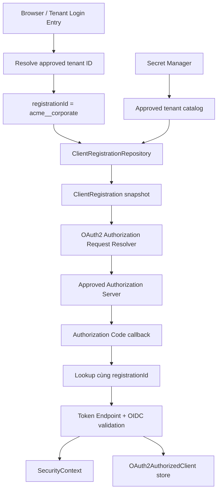
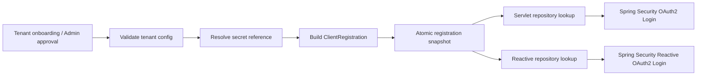

# 26.3. Tra cứu ClientRegistration bằng repository tùy chỉnh

## 1. Bài toán: một ứng dụng OAuth2/OIDC Client phục vụ nhiều tenant

Giả sử một ứng dụng Spring Boot tên **Workspace Portal** phục vụ nhiều khách hàng doanh nghiệp (*tenants*). Mỗi tenant có một nhà cung cấp danh tính (Identity Provider — IdP/OpenID Provider — OP) hoặc một client registration riêng trên cùng hệ thống SSO:

| Tenant | OpenID Provider | Client ID | Registration ID nội bộ |
| --- | --- | --- | --- |
| Acme | `https://id.acme.example/realms/staff` | `portal-acme` | `acme__corporate` |
| Beta | `https://login.beta.example/oidc` | `portal-beta` | `beta__corporate` |
| Gamma | `https://id.company.example/realms/gamma` | `portal-gamma` | `gamma__corporate` |

Khi số tenant ít, có thể khai báo tĩnh từng entry trong `application.yml`. Tuy nhiên, ở hệ thống SaaS, tenant có thể được onboard hoặc cập nhật cấu hình trong lúc ứng dụng đang chạy. Ta cần một cơ chế **tra cứu `ClientRegistration` theo khóa đáng tin cậy**, thay vì mặc định một file YAML có đầy đủ mọi tenant ngay từ lúc startup.

Spring Security OAuth2 Client dùng interface:

```java
org.springframework.security.oauth2.client.registration
    .ClientRegistrationRepository
```

Với ứng dụng Servlet; hoặc:

```java
org.springframework.security.oauth2.client.registration
    .ReactiveClientRegistrationRepository
```

Với WebFlux. Việc triển khai repository tùy chỉnh cho phép nạp registration từ database, hệ thống tenant catalog, secret manager hoặc bộ nhớ đệm đã được phê duyệt.

**Nhưng repository không chỉ là một map tra cứu.** Nó là ranh giới cấu hình của quá trình OAuth2/OIDC: nó quyết định **client nào**, **issuer nào**, **Authorization Endpoint/Token Endpoint nào**, **client secret nào**, **scope nào** và **redirect URI nào** được dùng để xác thực người dùng hoặc gọi API.

Một lỗi tra cứu có thể dẫn đến:

- Login của Tenant A bị gửi đến IdP của Tenant B.
- Authorization code được xử lý bằng nhầm client secret.
- Token của user thuộc tenant này bị lưu/đọc trong ngữ cảnh tenant khác.
- Ứng dụng truy vấn metadata theo URL attacker cung cấp, tạo **SSRF**.
- OIDC issuer/audience bị nhầm, gây **mix-up** giữa providers.
- `registrationId` thay đổi giữa lúc bắt đầu login và callback.
- Thay cấu hình giữa chừng gây login loop hoặc token endpoint failure.

> **Nguyên tắc:** tenant identifier có thể xuất phát từ URL/subdomain, nhưng `ClientRegistration` phải được lấy từ **catalog đáng tin cậy, có kiểm soát quyền**. Tuyệt đối không dựng issuer URI, token URI, client secret hoặc callback URL trực tiếp từ tham số HTTP tùy ý.

### 1.1. Mục tiêu bài học

Sau bài học, người học có thể:

1. Giải thích vai trò của `ClientRegistration` và hai repository interfaces Servlet/Reactive.
2. Chọn quy ước `registrationId` ổn định cho tenant và provider.
3. Phân biệt xác định tenant ở bước **login initiation**, bước **OAuth2 callback** và sau khi user đã được xác thực.
4. Triển khai repository Servlet tra cứu registration từ snapshot bất biến.
5. Tạo `ClientRegistration` từ dữ liệu được phê duyệt và bảo vệ client secret.
6. Triển khai reactive lookup bằng `Mono<ClientRegistration>`.
7. Kết nối repository với `oauth2Login()`, `oauth2Client()` và authorized-client manager.
8. Thiết kế cập nhật catalog, caching, secret rotation và sự nhất quán nhiều pods.
9. Ngăn cross-tenant token reuse, issuer mix-up, SSRF và open redirect.
10. Viết unit/integration/security tests cho cả tra cứu thành công và từ chối.

## 2. `ClientRegistration` chứa những gì?

`ClientRegistration` mô tả **OAuth2/OIDC Client được đăng ký với một Authorization Server**. Những thông tin thường gặp:

| Thuộc tính | Vai trò | Ví dụ |
| --- | --- | --- |
| `registrationId` | Khóa nội bộ để Spring Security tìm client | `acme__corporate` |
| `clientId` | Định danh OAuth client ở OP/AS | `portal-acme` |
| `clientSecret` | Secret nếu là confidential client và auth method yêu cầu | Từ secret manager |
| `clientAuthenticationMethod` | Cách client xác thực tại Token Endpoint | `client_secret_basic` |
| `authorizationGrantType` | Grant: `authorization_code`, `client_credentials`... | `authorization_code` |
| `redirectUri` | URI callback cho Authorization Code | `{baseUrl}/login/oauth2/code/{registrationId}` |
| `scopes` | Các scope được yêu cầu | `openid`, `profile`, `email` |
| `authorizationUri` | Authorization Endpoint | Theo metadata OP |
| `tokenUri` | Token Endpoint | Theo metadata OP |
| `jwkSetUri` | JWKS Endpoint dùng xác minh chữ ký | Theo metadata OP |
| `issuerUri` | Issuer identifier để kiểm tra OIDC identity | `https://id.acme.example/realms/staff` |
| `userInfoUri` | UserInfo Endpoint, nếu dùng | Theo metadata OP |
| `clientName` | Nhãn mô tả có thể hiển thị trong UI | `Acme SSO` |
| `providerConfigurationMetadata` | Metadata bổ sung của provider | `end_session_endpoint` nếu có |

Cần phân biệt:

- `registrationId` **không phải** `clientId`. Một RP có thể đặt tên `acme__corporate` cho registration nhưng OP dùng `portal-acme` làm client ID.
- `registrationId` **không phải** issuer. Nhiều registrations có thể chia sẻ cùng issuer, ví dụ hai clients khác scopes trên cùng IdP.
- `issuerUri` **không phải** API downstream base URL.
- `ClientRegistration` **không chứa** access token/refresh token của user. Token được lưu trong `OAuth2AuthorizedClient`.
- `ClientRegistrationRepository` **không thay thế** `OAuth2AuthorizedClientRepository` hoặc `OAuth2AuthorizedClientService`.

### 2.1. Ba loại repository thường bị nhầm

| Repository | Dữ liệu chứa | Mục đích |
| --- | --- | --- |
| `ClientRegistrationRepository` | Cấu hình client/OP | Tra registration theo `registrationId` |
| `AuthorizationRequestRepository` | Authorization request đang chờ callback, gồm `state` và PKCE metadata nếu có | Correlate redirect/callback |
| `OAuth2AuthorizedClientRepository` / Service | Access token, refresh token, registration, principal | Gọi API và token lifecycle |

Trong WebFlux, có các biến thể **Reactive** và **Server** tương ứng. Việc custom `ClientRegistrationRepository` **không tự thay thế** cơ chế quản lý state/nonce/PKCE hoặc lưu authorized clients.

### 2.2. Sơ đồ dữ liệu



Trên sơ đồ, hai bước lookup trước redirect và khi callback phải cùng ý nghĩa registration. Bước xác định tenant **không được lấy lại từ một input mới không liên quan** rồi vô tình chọn IdP khác.

## 3. Contract của repository Servlet

Interface `ClientRegistrationRepository` rất nhỏ:

```java
public interface ClientRegistrationRepository {

    ClientRegistration findByRegistrationId(String registrationId);
}
```

Trong những phiên bản Spring Security phổ biến, không tìm thấy registration thì phương thức trả **`null`**.

Không có parameter riêng tên `tenantId`, `HttpServletRequest`, `host` hoặc `Authentication`. Tất cả logic mapping đa tenant cần được giải quyết bằng:

- Quy ước một `registrationId` đủ phân biệt tenant/provider.
- Hoặc một resolver tin cậy khác chọn `registrationId` trước khi repository được gọi.
- Hoặc custom authorization request resolver/các components tương thích nếu nhu cầu phức tạp hơn.

### 3.1. Vì sao nên có registrationId phân biệt tenant?

Nếu tất cả tenants dùng cùng ID:

```text
registrationId = corporate
```

nhưng endpoint và client ID khác nhau theo tenant, lời gọi:

```java
repository.findByRegistrationId("corporate")
```

không chứa đủ thông tin để xác định tenant. Nếu repository cố đọc **ThreadLocal current request**, sẽ phát sinh lỗi khi code chạy trong token refresh job, callback, background task hoặc request qua thread khác.

Một chiến lược đơn giản hơn là:

```text
acme__corporate
beta__corporate
gamma__corporate
```

Trong đó:

- `acme`, `beta`, `gamma` là **mã tenant đã được phê duyệt**.
- `corporate` chỉ loại provider/login method.
- Toàn bộ ID là **duy nhất và ổn định**, kể cả khi client secret thay đổi.
- ID an toàn để đưa vào một **URL path segment**.
- Chỉ những ID tồn tại trong catalog mới được chấp nhận.

Không lấy raw email domain hoặc hostname chưa xác minh làm `registrationId` rồi tạo client trên thời điểm request.

### 3.2. Có cần parse registrationId trong repository không?

Không nhất thiết. Nếu repository dùng `Map<String, ClientRegistration>`, lookup bằng **toàn bộ ID** đơn giản và ít sai sót hơn:

```java
ClientRegistration registration =
    approvedMap.get(registrationId);
```

Việc split chuỗi theo `"__"` chỉ có ích nếu muốn logging/lookup tại catalog hoặc thao tác admin. **Không được coi việc parse ra `tenantId` là đã xác thực quyền user đối với tenant**.

### 3.3. `Iterable<ClientRegistration>` và trang đăng nhập mặc định

Một chi tiết Spring Security dễ bỏ sót: trang OAuth2 Login do `DefaultLoginPageGeneratingFilter` sinh có thể liệt kê các link tới registrations **chỉ khi repository cũng implement `Iterable<ClientRegistration>`**. Điều này được mô tả trong phần advanced OAuth2 Login docs.

Tức là class sau là đúng với contract lookup:

```java
final class TenantClientRegistrationRepository
        implements ClientRegistrationRepository {
    // findByRegistrationId(...)
}
```

nhưng **trang đăng nhập mặc định có thể không tự liệt kê các link**. Nếu bạn muốn các registrations hiện trong trang mặc định, có thể implement thêm:

```java
Iterable<ClientRegistration>
```

Tuy nhiên SaaS với hàng nghìn tenants **không nên công khai liệt kê toàn bộ IdPs/tenant names** trên trang đăng nhập. Khi đó, một **login page riêng** với tenant selection đã được kiểm soát thường phù hợp hơn; không cần tự động render mọi registration.

## 4. Contract của repository Reactive

WebFlux dùng:

```java
public interface ReactiveClientRegistrationRepository {

    Mono<ClientRegistration> findByRegistrationId(
        String registrationId);
}
```

Khi không tìm thấy registration, cách thực thi chuẩn là **`Mono.empty()`**, không phát một `ClientRegistration` null bên trong `Mono`.

Khác biệt:

| Servlet | Reactive WebFlux |
| --- | --- |
| `ClientRegistrationRepository` | `ReactiveClientRegistrationRepository` |
| `ClientRegistration findByRegistrationId(String)` | `Mono<ClientRegistration> findByRegistrationId(String)` |
| `return null` khi miss | `return Mono.empty()` khi miss |
| Dữ liệu có thể đến từ blocking source | Không block event loop để lấy dữ liệu |
| Thường với `HttpSecurity` | Với `ServerHttpSecurity` |
| `InMemoryClientRegistrationRepository` | `InMemoryReactiveClientRegistrationRepository` |

Không thực hiện:

```java
@Override
public Mono<ClientRegistration> findByRegistrationId(String id) {
    return Mono.just(blockingJdbcLookup(id)); // có nguy cơ block event loop
}
```

Nếu source thực sự blocking, phải dùng scheduler phù hợp hoặc thiết kế cached snapshots/persistence reactive. Trong phần sau ta chọn snapshot để lookup không cần network trong request path.

## 5. Kiến trúc đề xuất: approved tenant catalog và registration snapshot

Để tránh lookup phụ thuộc mạng và dữ liệu không được kiểm soát mỗi lần browser bắt đầu login:



Phân biệt **control plane** với **request plane**:

- **Control plane:** admin onboarding/cập nhật tenant, xác nhận IdP, kiểm tra issuer/endpoint/redirect URI, lấy secret từ vault, tạo registration, publish snapshot.
- **Request plane:** chỉ lookup bản registration **đã phê duyệt** bằng ID; nhanh, thread-safe, không đi theo URL chưa được kiểm soát.

Lợi ích:

1. Không fetch OIDC Discovery từ hostname user tự nhập.
2. Không truy vấn vault/database chậm trên mỗi HTTP request.
3. Có thể thay toàn bộ snapshot một cách nhất quán.
4. Có hành vi **fail closed** khi registration không tồn tại.
5. Dễ test và vận hành.
6. Giảm rủi ro cập nhật nửa chừng một registration.

### 5.1. Những yêu cầu cơ bản của catalog

Một entry cần có:

```text
tenantId
providerKey
registrationId
clientId
clientAuthenticationMethod
secretReference
authorizationGrantType
redirectUriTemplate
scopes
issuerUri
authorizationUri
tokenUri
jwkSetUri
userInfoUri nếu dùng
status: APPROVED / DISABLED
configVersion
```

Có thể có thêm resource/audience, network policy hoặc allowed callback domains tùy hệ thống.

**Dữ liệu quan trọng:** `secretReference` nên trỏ đến secret manager; tránh lưu secret plaintext trong tenant catalog hoặc logs. `ClientRegistration` có thể cần chứa secret value tại runtime để thực hiện client authentication; phải bảo vệ memory dump, diagnostic endpoints và quyền truy cập service.

### 5.2. Chỉ tin tenant catalog đã được phê duyệt

Không tạo registration theo kiểu:

```java
String issuer = "https://" +
    request.getParameter("tenant") +
    ".example.com";
```

và gọi discovery. Một giá trị input bị lạm dụng có thể làm ứng dụng truy cập localhost/metadata service/nội mạng hoặc một OP giả.

Khi onboarding IdP mới:

- Xác minh tenant ownership và quyền admin.
- Kiểm tra issuer canonical URI, HTTPS và hostname allowlist/egress policy.
- Kiểm tra DNS resolution và chống redirect/SSRF trong network layer.
- Đảm bảo OP metadata issuer khớp giá trị dự kiến.
- Lưu endpoints đúng và kiểm tra certificate/hostname.
- Ràng buộc allowed redirect URI và scope tối thiểu.
- Kiểm tra client credentials đã đăng ký tại OP.
- Kiểm soát config version, disable/revoke/rollback.

## 6. Ví dụ Java: tạo ClientRegistration từ cấu hình tin cậy

Để minh họa, định nghĩa một record đại diện entry đã được **control plane phê duyệt**:

```java
public record ApprovedOidcClient(
    String registrationId,
    String tenantId,
    String clientId,
    String clientSecret,
    String issuerUri,
    String authorizationUri,
    String tokenUri,
    String jwkSetUri,
    String clientName
) {}
```

Đây là **DTO nội bộ của ví dụ**, không phải class Spring Security. Trong production, `clientSecret` thường được resolve qua secret manager ở ranh giới build/update snapshot, không nên chứa plaintext trong database catalog.

### 6.1. Factory dựng ClientRegistration

```java
public final class TenantClientRegistrationFactory {

    public ClientRegistration build(ApprovedOidcClient cfg) {
        return ClientRegistration
            .withRegistrationId(cfg.registrationId())
            .clientId(cfg.clientId())
            .clientSecret(cfg.clientSecret())
            .clientAuthenticationMethod(
                ClientAuthenticationMethod.CLIENT_SECRET_BASIC)
            .authorizationGrantType(
                AuthorizationGrantType.AUTHORIZATION_CODE)
            .redirectUri(
                "{baseUrl}/login/oauth2/code/{registrationId}")
            .scope("openid", "profile")
            .authorizationUri(cfg.authorizationUri())
            .tokenUri(cfg.tokenUri())
            .jwkSetUri(cfg.jwkSetUri())
            .issuerUri(cfg.issuerUri())
            .clientName(cfg.clientName())
            .build();
    }
}
```

Các API ở đây thuộc Spring Security OAuth2 Client. Mục đích là xây registration **có issuer/OP endpoints cụ thể** thay vì nối endpoint path từ tenant input.

Ví dụ dùng OIDC scope `openid` và Authorization Code. Những cấu hình này phải phù hợp OP thật; nếu dùng `private_key_jwt`, mTLS, PKCE hoặc client authentication khác, phải tạo registration theo đúng hợp đồng của provider.

**Lưu ý OIDC:** `issuerUri` và `jwkSetUri` phải đến từ provider metadata/trust configuration đáng tin cậy. Không bỏ validation issuer để “cho nhiều tenant login”. Mỗi tenant phải được ràng buộc với **issuer mong đợi** và audience/client ID thích hợp.

### 6.2. Vì sao cần `issuerUri`?

Nếu cùng hệ thống hỗ trợ nhiều IdPs, chỉ xác minh chữ ký ID Token mà không ràng buộc `iss` và `aud` sẽ có nguy cơ **identity mix-up**.

OIDC Client cần kiểm tra:

- `iss` khớp issuer cấu hình của registration.
- `aud` chứa client ID phù hợp, và `azp` khi cần theo chuẩn.
- Token signature/algorithm và JWKS trust chính xác.
- Expiry, issued-at, nonce khi flow sử dụng.
- Các validation khác theo chính sách.

Bằng cách xây đúng `ClientRegistration`, Spring Security có cơ sở để thực hiện kiểm tra OIDC theo provider. Custom repository **không được bỏ trống issuer hoặc tráo JWKS URI tùy tiện** khi dùng OIDC.

### 6.3. Metadata discovery so với endpoints cấu hình trực tiếp

Một lựa chọn khác khi **issuer đã được duyệt** là dùng `ClientRegistrations.fromIssuerLocation(issuerUri)` tại **control plane** để xây builder từ metadata. Hành vi API và hỗ trợ discovery phụ thuộc Spring Security version/provider.

Nhưng lưu ý:

- Discovery là một **HTTP outbound request**.
- Không dùng issuer lấy trực tiếp từ user request để tự động fetch.
- Cần timeout, TLS, SSRF protection và egress policy.
- Metadata issuer phải được đối chiếu với expected issuer.
- Khi provider metadata đổi, cần version/refresh và có tính nhất quán.
- Không thực hiện unbounded discovery trong từng HTTP login request.

Nếu dùng cấu hình endpoints explicit từ approved catalog như ví dụ trên, vẫn phải kiểm tra chính xác các endpoints tại onboarding.

## 7. Repository Servlet với atomic snapshot

Đây là ví dụ một implementation thực tế, chỉ tra cứu các registrations đã được build/vetted.

```java
import java.util.Collection;
import java.util.Iterator;
import java.util.LinkedHashMap;
import java.util.Map;
import java.util.Objects;
import java.util.concurrent.atomic.AtomicReference;

import org.springframework.security.oauth2.client.registration
    .ClientRegistration;
import org.springframework.security.oauth2.client.registration
    .ClientRegistrationRepository;

public final class SnapshotClientRegistrationRepository
        implements ClientRegistrationRepository,
                   Iterable<ClientRegistration> {

    private final AtomicReference<Map<String, ClientRegistration>>
        current = new AtomicReference<>(Map.of());

    public SnapshotClientRegistrationRepository(
            Collection<ClientRegistration> approved) {
        replaceApproved(approved);
    }

    @Override
    public ClientRegistration findByRegistrationId(
            String registrationId) {

        if (registrationId == null) {
            return null;
        }

        return current.get().get(registrationId);
    }

    @Override
    public Iterator<ClientRegistration> iterator() {
        return current.get().values().iterator();
    }

    public void replaceApproved(
            Collection<ClientRegistration> approved) {

        Objects.requireNonNull(approved, "approved");
        Map<String, ClientRegistration> next =
            new LinkedHashMap<>();

        for (ClientRegistration registration : approved) {
            Objects.requireNonNull(registration, "registration");

            String id = registration.getRegistrationId();

            if (id == null || id.isBlank()) {
                throw new IllegalArgumentException(
                    "Missing registrationId");
            }

            if (next.putIfAbsent(id, registration) != null) {
                throw new IllegalArgumentException(
                    "Duplicate registrationId: " + id);
            }
        }

        current.set(Map.copyOf(next));
    }
}
```

**Vì sao chọn thiết kế này?**

- Lookup là phép đọc map, không truy vấn database/IdP trên login request path.
- `AtomicReference` cho phép **thay snapshot nguyên khối**.
- `Map.copyOf` tạo map không thể chỉnh sửa bằng API map thông thường.
- Multiple threads không nhìn thấy một map đang xây dở.
- Unknown ID → `null`, đúng contract repository Servlet.
- Implement `Iterable<ClientRegistration>` để hỗ trợ component cần iterate, gồm trang đăng nhập mặc định nếu được bật.
- Duplicate IDs bị từ chối thay vì âm thầm ghi đè một tenant.

**Giới hạn:** repository này chỉ quản lý snapshot trong **một JVM**. Nó không đảm bảo các pods có snapshot version giống nhau. Đồng thời `Iterable` ở đây có thể trả mọi registrations; ứng dụng SaaS nên dùng **login page tenant-specific** để không công khai tất cả.

### 7.1. Vì sao không mutate `ClientRegistration` đang dùng?

`ClientRegistration` được thiết kế để đại diện cho một bản cấu hình hoàn chỉnh. Khi refresh:

```text
Version 10:
  acme__corporate -> issuer A, clientSecret K1

Version 11:
  acme__corporate -> issuer A, clientSecret K2
```

Nên tạo **đối tượng mới**, validate và thay snapshot một lần. Không thay từng field trên shared object trong khi Spring Security đang xử lý redirect/token exchange.

### 7.2. `replaceApproved` không tự xác minh phê duyệt

Tên method nói rõ **đầu vào đã được approve**. Nó **không tự validate trust/policy** của endpoints hoặc client secret.

Trong production, chỉ service control plane có quyền gọi method đó. User/controller không được gọi `replaceApproved` bằng JSON vừa nhận từ browser. Trước khi publish snapshot cần kiểm tra:

- Allowed issuer/HTTPS/endpoint consistency.
- Redirect URI và scopes.
- Client authentication method.
- Tenant mapping và uniqueness.
- Source credentials/secret provenance.
- Trạng thái tenant (`ACTIVE`/`DISABLED`).
- Version/rotation policy.

## 8. Cấu hình Spring Boot để dùng custom repository

### 8.1. Tạo bean từ approved catalog

Ví dụ:

```java
@Configuration
class TenantOauthClientConfiguration {

    @Bean
    ClientRegistrationRepository clientRegistrationRepository(
            ApprovedTenantCatalog catalog,
            TenantClientRegistrationFactory factory) {

        var registrations = catalog.activeOidcClients()
            .stream()
            .map(factory::build)
            .toList();

        return new SnapshotClientRegistrationRepository(
            registrations);
    }

    @Bean
    SecurityFilterChain securityFilterChain(HttpSecurity http)
            throws Exception {

        http
            .authorizeHttpRequests(auth -> auth
                .requestMatchers("/", "/login/**", "/assets/**")
                    .permitAll()
                .anyRequest().authenticated())
            .oauth2Login(Customizer.withDefaults())
            .oauth2Client(Customizer.withDefaults());

        return http.build();
    }
}
```

`ApprovedTenantCatalog` là **interface/service của ứng dụng**:

```java
interface ApprovedTenantCatalog {
    Collection<ApprovedOidcClient> activeOidcClients();
}
```

Ví dụ coi catalog đã được provision từ database/secret manager ở control plane. Không có class `ApprovedTenantCatalog` sẵn trong Spring Security; team phải triển khai.

### 8.2. Cảnh báo quan trọng về Spring Boot auto-configuration

Spring Boot có auto-configuration tạo `ClientRegistrationRepository` từ:

```yaml
spring:
  security:
    oauth2:
      client:
        registration:
          ...
```

Nhưng nếu bạn **tự đăng ký một `ClientRegistrationRepository` bean**, auto-configuration có thể **back off**. Điều này có nghĩa:

- Các registrations từ YAML **không mặc nhiên được merge** với repository tự viết.
- Một registration static trước đây có thể biến mất khỏi lookup nếu không đưa vào custom repository.
- Các downstream `OAuth2AuthorizedClientManager` cũng có thể không tìm được registration cũ.
- Startup thành công không bảo đảm tất cả `registrationId` trong code vẫn tồn tại.

Hãy quyết định rõ:

1. Dùng **chỉ** custom catalog.
2. Hoặc hợp nhất một danh sách static đáng tin cậy với approved dynamic clients **có quy tắc chống trùng/đè**, rồi publish snapshot chung.

Không giả định Spring Boot sẽ tự nối hai repositories khi có nhiều beans.

### 8.3. Bean lifecycle và dependency

`ClientRegistrationRepository` được dùng bởi OAuth2 Login, authorization request resolver, token exchange và OAuth2 Client manager. Vì vậy repository nên sẵn sàng trong quá trình khởi tạo security infrastructure.

Nếu catalog bị lỗi mạng lúc startup, cần có policy:

- Fail startup nếu thiếu critical tenant configurations.
- Dùng last-known-good approved snapshot nếu kiến trúc và độ mới cho phép.
- Không trả một registration tự phỏng đoán từ URL.
- Không vô hiệu issuer validation để tạm thời đăng nhập.
- Ghi telemetry thiếu cấu hình mà không lộ secret.

## 9. Xác định tenant khi bắt đầu login

Một cách đơn giản: người dùng truy cập một URL nội bộ đã được ứng dụng kiểm soát:

```text
GET /login/acme
```

Ứng dụng ánh xạ tenant ID `acme` thành registration ID `acme__corporate` **từ approved catalog** rồi redirect:

```text
302 Location: /oauth2/authorization/acme__corporate
```

Spring Security dùng filter mặc định để bắt đầu Authorization Code flow:

```text
GET /oauth2/authorization/{registrationId}
```

### 9.1. Controller minh họa

```java
@Controller
class TenantLoginController {

    private final TenantLoginDirectory directory;

    TenantLoginController(TenantLoginDirectory directory) {
        this.directory = directory;
    }

    @GetMapping("/login/{tenantCode}")
    ResponseEntity<Void> login(
            @PathVariable String tenantCode) {

        String registrationId =
            directory.approvedRegistrationIdFor(tenantCode);

        if (registrationId == null) {
            return ResponseEntity.notFound().build();
        }

        URI target = URI.create(
            "/oauth2/authorization/" + registrationId);

        return ResponseEntity.status(HttpStatus.FOUND)
            .location(target)
            .build();
    }
}
```

`TenantLoginDirectory` là component **do ứng dụng định nghĩa**, chỉ trả những registration IDs có trong approved catalog và an toàn để dùng trong URL path:

```java
interface TenantLoginDirectory {
    String approvedRegistrationIdFor(String tenantCode);
}
```

**Không** tạo registration bằng cách nối tenantCode vào một issuer URL. Controller chỉ chọn trong tập đã approved.

### 9.2. Vì sao không tin `Host` hoặc `X-Forwarded-Host` tùy ý?

Một ứng dụng nhiều subdomains có thể muốn:

```text
https://acme.portal.example.com -> tenant=acme
https://beta.portal.example.com -> tenant=beta
```

Điều này hợp lý **chỉ khi hostname đã qua xác thực ở ingress/trusted proxy** và được đối chiếu với danh sách hostnames/tenants đã đăng ký.

Không dùng:

```java
String tenant = request.getHeader("Host").split("\\.")[0];
```

như cơ sở tin cậy duy nhất. Attacker có thể gửi Host/Forwarded headers giả trong nhiều môi trường, dẫn đến wrong-tenant login, open redirect hoặc discovery SSRF.

Thiết kế an toàn:

1. Ingress chặn hostnames ngoài allowlist.
2. Proxy loại bỏ/ghi đè forwarded headers từ client.
3. Backend ánh xạ **verified host → approved tenant**.
4. Tenant catalog quyết định `registrationId`.
5. Security flow dùng exact registration qua redirect/callback.
6. Sau login vẫn kiểm tra **user có quyền thuộc tenant đó hay không**.

### 9.3. Tenant discovery từ email domain

Có thể dùng email domain như một *hint* để tìm tenant:

```text
user@acme.example -> gợi ý Acme
```

Nhưng email người dùng nhập **không chứng minh quyền truy cập tenant**. Sau khi OIDC Login thành công, phải validate issuer, verified identity và membership/entitlement từ nguồn được phê duyệt.

Không cấp quyền theo string email domain **trước** khi OP xác thực.

## 10. Callback: giữ đúng registration đã dùng lúc redirect

Mặc định Authorization Code callback của Spring Security Servlet thường có dạng:

```text
GET /login/oauth2/code/{registrationId}?code=...&state=...
```

Ví dụ:

```text
GET /login/oauth2/code/acme__corporate
    ?code=FAKE_AUTHORIZATION_CODE
    &state=FAKE_RANDOM_STATE
```

Spring Security sử dụng authorization request đã lưu để đối chiếu `state` và các dữ liệu liên quan. Với OIDC, còn có kiểm tra ID Token issuer/audience/nonce theo flow.

### 10.1. Không tự resolve tenant từ query callback

Sai về thiết kế:

```text
/login/oauth2/code/acme__corporate?code=...&tenant=beta
```

rồi lấy `tenant=beta` để tra repository và đổi code tại Token Endpoint của Beta. Giá trị query này không đáng tin và không thuộc correlation request đã được thiết lập.

Đúng:

- Registration ID và authorization request phải khớp flow đã khởi tạo.
- `state` phải được kiểm tra trước khi tin authorization response.
- PKCE code verifier (nếu có) phải lấy từ authorization request được lưu.
- `redirect_uri` gửi lúc đổi code phải phù hợp URI đã dùng ban đầu/được đăng ký.
- OIDC `iss`/`aud`/nonce phải được xác minh theo expected registration.

**Không bỏ state validation hoặc sử dụng chung một registration trỏ sang issuer tùy request** để giảm số registrations.

### 10.2. Registration phải ổn định trong thời gian một login flow

Giả sử:

```text
10:00 acme__corporate -> clientId A, clientSecret K1, issuer A
10:01 browser bắt đầu login với registration trên
10:02 admin cập nhật registration: clientSecret K2
10:03 OP callback trả code được cấp cho clientId A
```

Nếu OP chưa công nhận K2 hoặc rotation đang giữa chừng, token request có thể thất bại.

Tương tự, nếu thay issuer/token URI giữa redirect và callback, flow có thể sai trust boundary.

Cần policy cho cập nhật:

- Secret rotation có cửa sổ chấp nhận hai credentials tại OP nếu hỗ trợ.
- Không thay issuer/clientId của một registration đang được dùng một cách không kiểm soát.
- Với thay đổi identity/provider lớn, có thể dùng **registrationId version mới**.
- Có kế hoạch chờ các flows đang chờ hết TTL trước khi loại registration cũ.
- Cache/snapshot version được quan sát trên mọi pods.
- Nếu cần rollback, dùng last-known-good approved config, không tự mở rộng trust.

### 10.3. Vì sao không thể luôn dùng một callback chung không có registrationId?

Có thể custom callback/authorization request resolver để sử dụng URI chung, nhưng cần **khôi phục chính xác registration** từ state/authorization request và đảm bảo client/provider binding.

Đó là customization vượt quá chỉ thay `ClientRegistrationRepository`. Với luồng mặc định, giữ callback:

```text
/login/oauth2/code/{registrationId}
```

giúp flow dễ đối chiếu hơn. Nếu OP không cho đăng ký hàng nghìn redirect URIs, cần xem lại kiến trúc client registrations/callback strategy, không đơn giản bỏ registration correlation.

## 11. Sau khi login, xác định tenant của Authentication thế nào?

Spring Security Servlet thường tạo `OAuth2AuthenticationToken`:

```java
OAuth2AuthenticationToken authentication = ...;

String registrationId =
    authentication.getAuthorizedClientRegistrationId();
```

`registrationId` có thể dùng để tra catalog xác định login đã đi qua tenant/OP nào.

Tuy nhiên **registrationId không tự chứng minh user được quyền truy cập tenant**, vì user có thể khởi tạo một login tới tenant khác hoặc cùng OP có nhiều users.

Cần thực hiện hai bước:

1. **Xác minh danh tính OIDC:** issuer, audience, signature, nonce và các claims theo protocol.
2. **Phân quyền tenant:** user subject/organization membership/roles/entitlements có quyền đối với tenant đang chọn không?

Ví dụ:

```text
registrationId = acme__corporate
OIDC issuer    = https://id.acme.example/realms/staff
OIDC subject   = user-481
tenant target  = acme

Authorization:
    Is (issuer, subject) a member of tenant Acme?
```

Chỉ khi membership/entitlement được xác minh mới được trả dữ liệu Acme. Việc tìm được `ClientRegistration` **không phải** authorization decision cuối cùng.

### 11.1. Subject không luôn globally unique

Claim `sub` thường unique **trong một issuer**, không nhất thiết trên toàn bộ IdPs.

Sai:

```text
userKey = sub
```

nếu có nhiều issuers với `sub="123"`.

Tốt hơn về mô hình danh tính:

```text
identityKey = (issuer, subject)
tenantMembershipKey = (tenantId, issuer, subject)
```

Với user-delegated authorized clients, đảm bảo cache/storage key không làm trộn users/issuers/tenants. `OAuth2AuthorizedClientService` cơ bản thường lưu theo `(registrationId, principalName)`; vì `registrationId` đã phân biệt tenant/provider, nó tạo một lớp cách ly, nhưng vẫn phải tránh sử dụng principalName chung cho mọi user.

## 12. Dùng repository cho OAuth2 Client outbound requests

Custom registration repository không chỉ phục vụ browser login. Một service cũng có thể gọi manager để lấy token cho downstream API:

```java
OAuth2AuthorizeRequest authorizeRequest =
    OAuth2AuthorizeRequest
        .withClientRegistrationId("acme__inventory_m2m")
        .principal("inventory-worker-acme")
        .build();

OAuth2AuthorizedClient authorized =
    authorizedClientManager.authorize(authorizeRequest);
```

Ở đây ví dụ là **machine-to-machine** registration riêng:

```text
acme__inventory_m2m -> client_credentials
```

Nó không phải OIDC interactive login của Acme. Cùng repository có thể chứa nhiều loại grant, nhưng **authorized-client provider chain** phải được cấu hình phù hợp từng grant.

Một nguyên tắc an toàn:

```text
registrationId + principalName + target/tenant policy
    -> authorized client phù hợp
```

Không xây HTTP client có default bearer token của Acme rồi cho phép code gửi đến API của Beta.

### 12.1. Một registration cho mỗi downstream khi cần

Ví dụ:

```text
acme__corporate       -> OIDC Login
acme__inventory_m2m   -> Inventory API M2M
acme__billing_m2m     -> Billing API M2M
beta__corporate       -> OIDC Login
beta__inventory_m2m   -> Inventory API M2M
```

Không có quy tắc bắt buộc “một tenant chỉ có một ClientRegistration”. Một tenant có thể có nhiều clients với grants, scopes, audiences và secrets khác nhau.

### 12.2. Không nhầm scope với tenant permission

Scope `inventory.read` chỉ thể hiện một loại quyền token. API vẫn cần xác minh audience/issuer/tenant/ownership và chính sách nghiệp vụ. Dùng sai registration có thể tạo token đúng chữ ký nhưng sai audience hoặc tenant.

## 13. Reactive lookup từ cùng snapshot

Nếu ứng dụng dùng Spring WebFlux, một implementation reactive đơn giản có thể delegate sang một **snapshot lookup không blocking**.

```java
import reactor.core.publisher.Mono;

import org.springframework.security.oauth2.client.registration
    .ClientRegistration;
import org.springframework.security.oauth2.client.registration
    .ReactiveClientRegistrationRepository;

public final class SnapshotReactiveClientRegistrationRepository
        implements ReactiveClientRegistrationRepository {

    private final SnapshotClientRegistrationRepository snapshot;

    public SnapshotReactiveClientRegistrationRepository(
            SnapshotClientRegistrationRepository snapshot) {
        this.snapshot = snapshot;
    }

    @Override
    public Mono<ClientRegistration> findByRegistrationId(
            String registrationId) {

        return Mono.defer(() ->
            Mono.justOrEmpty(
                snapshot.findByRegistrationId(registrationId)));
    }
}
```

Đây là ví dụ **shared lookup model**. Nếu triển khai cả Servlet và WebFlux trong cùng module, cần quản lý bean types rõ ràng; trong ứng dụng WebFlux thuần, bạn có thể viết một `AtomicReference<Map<String, ClientRegistration>>` riêng và truy cập map trực tiếp, không cần tạo Servlet repository bean.

Vì lookup chỉ là map read, `Mono.defer` cho phép tra snapshot khi publisher được subscribe. Không có I/O chặn Reactor event loop.

### 13.1. Nếu thật sự cần reactive database query

Ví dụ skeleton:

```java
@Override
public Mono<ClientRegistration> findByRegistrationId(
        String registrationId) {

    return approvedTenantStore
        .findApprovedByRegistrationId(registrationId)
        .flatMap(entry -> secrets.resolve(entry.secretReference())
            .map(secret -> factory.build(
                entry.toApprovedOidcClient(secret))));
}
```

Trong đó `approvedTenantStore`, `secrets.resolve(...)` và mapper đều là **application-defined reactive APIs**. Đây không phải đoạn có thể dùng trực tiếp nếu chưa có reactive database/secret client.

Giới hạn phải bảo đảm:

- Chỉ trả **approved** registration, deny disabled/unknown.
- Registration ID được validate/lookup chính xác, không chọn nearest match.
- Không truy vấn URLs theo user input.
- Có timeout/rate limiting/circuit breaker với catalog và vault.
- Không tự động lặp vô hạn khi secret manager timeout.
- Không cache failures theo cách giữ tenant mới không thể onboard quá lâu.
- Không log secret hoặc metadata nhạy cảm.
- Phải xác định gì xảy ra nếu catalog down giữa Authorization Code redirect/callback.

Không dùng JDBC blocking ngay trong `flatMap` rồi gọi đó là reactive.

### 13.2. `Mono.empty()` và `Mono.error(...)` khác nhau

Với unknown ID:

```java
return Mono.empty();
```

đúng nghĩa **không có registration**.

Nếu approved catalog/storage không thể truy cập do outage:

```java
return Mono.error(new RegistrationLookupUnavailableException(...));
```

sẽ mang nghĩa **lỗi hệ thống**, không phải tenant chưa tồn tại.

Phân biệt hai trường hợp giúp không biến outage thành 404 vô lý hoặc cố tạo registration fallback không an toàn.

Một số Spring Security components có thể map các tín hiệu này thành failure response theo implementation; cần kiểm thử khi tích hợp.

## 14. Cấu hình WebFlux với ReactiveClientRegistrationRepository

Ví dụ:

```java
@Configuration
@EnableWebFluxSecurity
class ReactiveTenantSecurity {

    @Bean
    ReactiveClientRegistrationRepository
    reactiveClientRegistrationRepository(
            ApprovedTenantCatalog catalog,
            TenantClientRegistrationFactory factory) {

        var registrations = catalog.activeOidcClients()
            .stream()
            .map(factory::build)
            .toList();

        var snapshot =
            new SnapshotClientRegistrationRepository(registrations);

        return new SnapshotReactiveClientRegistrationRepository(
            snapshot);
    }

    @Bean
    SecurityWebFilterChain securityWebFilterChain(
            ServerHttpSecurity http) {

        return http
            .authorizeExchange(exchanges -> exchanges
                .pathMatchers("/", "/login/**", "/assets/**")
                    .permitAll()
                .anyExchange().authenticated())
            .oauth2Login(Customizer.withDefaults())
            .oauth2Client(Customizer.withDefaults())
            .build();
    }
}
```

Giống Servlet, đây là một **phương án cấu hình thay thế**, không phải yêu cầu một app phải chạy đồng thời cả Servlet lẫn WebFlux.

Một WebFlux custom login page cần tạo link tới:

```text
/oauth2/authorization/{registrationId}
```

khi filter routes được giữ mặc định. Phải tránh expose danh sách mọi tenant nếu không cần.

## 15. Cache và thay đổi cấu hình: lookup nhanh nhưng không dùng dữ liệu sai

### 15.1. Các tầng cache khả thi

| Tầng | Cách dùng | Rủi ro |
| --- | --- | --- |
| Local immutable snapshot | Tốc độ lookup rất cao | Mỗi pod có thể khác version |
| Local TTL cache | Giảm tải DB/secret manager | Stale secret/issuer khi rotation |
| Shared distributed catalog | Đồng bộ cấu hình nhiều pods | Outage và consistency |
| Secret manager cache | Giảm số request vault | Rotation window và secret exposure |
| OIDC discovery metadata cache | Giảm tải metadata endpoints | Key/endpoint changes, stale issuer |
| Authorized-client token store | Dùng lại access/refresh tokens | Không phải registration cache; isolation riêng |

**Không cache `ClientRegistration` theo `(tenantId)` mà bỏ qua provider/client variant** nếu một tenant có nhiều registrations.

Một cache key an toàn thường là **exact registration ID**, còn dữ liệu có version. Không dùng raw Host header hoặc user-provided issuer làm key để tạo cache entry tự động.

### 15.2. Publish snapshot bằng một operation

Thay nhiều registrations từng dòng giữa requests có thể để lộ trạng thái nửa cập nhật:

```text
A đã dùng secret K2
B vẫn ở version cũ
C chưa có metadata
```

Mô hình snapshot:

```text
Catalog version 41 -> build & validate all entries
    |
    +-- if any invalid -> reject publication
    |
    +-- if all valid -> atomic swap snapshot(version=41)
```

Không đổi từng field của `ClientRegistration` đang được dùng trong flow. Với `AtomicReference`, mỗi lookup nhìn thấy một bản map hoàn chỉnh.

### 15.3. Single-node snapshot chưa giải quyết multi-pod consistency

Giả sử:

```text
Login initiation -> Pod A, config version 10
OIDC callback    -> Pod B, config version 11
```

Ngay cả khi authorization request/state được lưu trong shared session, Pod B có thể nhìn thấy registration **khác** nếu version 11 thay issuer/client ID/token endpoint.

Biện pháp:

- Publish catalog version đồng bộ theo quy trình.
- Có grace period cho breaking changes.
- Duy trì registration version cũ đủ thời gian các flow đang chờ hoàn tất nếu policy cho phép.
- Test callback cross-pod.
- Không thay OIDC issuer tùy tiện dưới cùng registration ID.
- Đồng bộ browser session/authorization request store khi chạy nhiều pods.
- Kiểm soát token cache/repository và secret rotation.

### 15.4. Không cache unknown registrations vĩnh viễn

Tenant có thể được onboard sau khi một request tìm ID chưa có. **Negative cache** không có TTL hoặc không được invalidated sẽ khiến registration mới vẫn bị báo unknown.

Nếu dùng local snapshot, lúc publish approved catalog phiên bản mới nên đồng thời thay data và invalidates negative results. Không cần tự tạo fallback registration cho cache miss.

## 16. Secret rotation và thay đổi client credentials

Trong môi trường doanh nghiệp, client secret được rotate định kỳ.

### 16.1. Quy trình tham khảo

1. OP cho phép cấp secret mới hoặc cơ chế rotate theo chính sách.
2. Control plane lưu reference mới vào secret manager.
3. Build `ClientRegistration` mới với secret hợp lệ.
4. Publish snapshot lên pods theo kế hoạch.
5. Xác minh Token Endpoint dùng secret mới.
6. Đợi các authorization flows đang chạy hoàn tất trong grace window phù hợp.
7. Thu hồi secret cũ tại OP.
8. Giám sát `invalid_client` và authorization failures.

Nếu provider chỉ cho một secret active tại mỗi thời điểm, có thể tồn tại khoảng chuyển tiếp gây lỗi; cần kế hoạch cutover, không hứa zero-downtime nếu OP không hỗ trợ.

### 16.2. Những thay đổi nên được xem là breaking

- `clientId` đổi.
- `issuerUri` đổi sang OP khác.
- `authorizationUri`/`tokenUri` đổi trust domain.
- `redirectUri` thay đổi.
- Client auth method đổi sang mTLS/private_key_jwt.
- Scope/consent rules đổi theo cách buộc user authorization lại.

Không để callback đã phát hành code cho client cũ được xử lý bằng một registration hoàn toàn khác. Khi thay OP/client identity có thể tốt hơn nếu **tạo `registrationId` mới** và phasing out ID cũ.

### 16.3. Disable tenant không được chỉ xóa map entry mù quáng

Khi tenant bị tạm dừng:

- Chặn **new logins**.
- Xem xét sessions đã tồn tại.
- Xem xét authorized clients/token reuse.
- Xem xét background jobs còn chạy.
- Có policy for revocation/data access.
- Ghi audit/config version.
- Không xóa tenant entry rồi kỳ vọng tất cả user sessions hoặc API tokens tự mất hiệu lực.

`ClientRegistrationRepository` là một phần **cấu hình authorization client**, không phải hệ thống revocation hoặc tenant access control đầy đủ.

## 17. Đa tenant và bảo mật: những ranh giới phải giữ

### 17.1. Tenant ID không phải bằng chứng membership

Một browser có thể tự mở:

```text
/oauth2/authorization/beta__corporate
```

Điều đó chỉ khởi tạo login qua registration của Beta (nếu public), **không chứng minh user có quyền đối với dữ liệu Beta**.

Sau OIDC login phải:

- Xác minh token OIDC theo issuer của Beta.
- Xác định subject đã xác thực.
- Kiểm tra membership/entitlements tại Beta.
- Gắn tenant context đã được xác minh vào authorization policies.
- Dùng tenant này khi query dữ liệu, không dùng `tenant` từ query parameter sau login.

### 17.2. Issuer mix-up và JWKS substitution

Không cho phép:

```text
registrationId=acme__corporate
issuerUri=https://attacker.example
jwkSetUri=https://attacker.example/keys
```

chỉ vì một admin API nhận raw fields mà không có approval. Nếu token từ một issuer khác được tin ngoài dự kiến, attacker có thể cố dùng token hợp lệ về chữ ký nhưng sai trust context.

Các trường cần ràng buộc:

```text
registrationId -> trusted issuer -> expected clientId/audience
               -> trusted Authorization/Token/JWKS endpoints
               -> allowed redirect URI and scope
```

OIDC validation phải giữ issuer/audience/signature/nonce checks; không chỉ decode JWT.

### 17.3. SSRF qua dynamic discovery

Một URL issuer do user điều khiển có thể trỏ đến:

```text
http://localhost:...
http://169.254.169.254/...
https://internal-admin.example/...
```

hoặc host public redirect tới mạng nội bộ. Nếu application fetch `/.well-known/openid-configuration` từ URL đó, nó có thể tạo SSRF.

Phòng vệ:

1. Approved catalog thay vì user-supplied URL.
2. HTTPS, domain/IP egress policy và DNS rebinding protection.
3. Không follow redirects tới unapproved origin.
4. Timeouts/body size limits và TLS validation.
5. Kiểm tra issuer/metadata consistency.
6. Không đưa client secret hoặc bearer token vào discovery request.
7. Chỉ administrator được phê duyệt mới đổi trust anchors.

### 17.4. Không gắn client secret sai tenant

Một lỗi đặc biệt nguy hiểm:

```text
registrationId = beta__corporate
clientId = beta-client
clientSecret = acme-secret
tokenUri = beta-token-endpoint
```

Thường token request sẽ thất bại, nhưng nguy cơ chính là **gửi bí mật Acme sang endpoint Beta hoặc một OP giả**. Cần kiểm tra tuple `issuer/clientId/secretRef/endpoints` được quản lý theo cùng approved catalog record, không ghép từ nhiều cache keys thiếu bảo vệ.

### 17.5. Logout cũng cần lookup chính xác

OIDC RP-Initiated Logout sử dụng issuer/`end_session_endpoint` từ registration. Nếu registration đa tenant bị nhầm, app có thể gửi ID Token hint của tenant A tới Logout Endpoint của tenant B.

Đừng chỉ kiểm thử login; cần xác minh logout handler chọn **đúng issuer/registration** và không leak ID Token hint.

## 18. Custom repository và các customization liên quan

Không phải mọi bài toán đa tenant chỉ cần `ClientRegistrationRepository`.

| Vấn đề | Điểm mở rộng thường gặp |
| --- | --- |
| Tra client config theo registration ID | `ClientRegistrationRepository` hoặc Reactive tương ứng |
| Chọn registration dựa trên route/host đã xác minh | Tenant Login Controller hoặc authorization request resolver |
| Sửa authorization request parameters | `OAuth2AuthorizationRequestResolver` / Reactive tương ứng |
| Lưu state/PKCE/nonce qua callback | Authorization Request Repository |
| Chọn callback base URI | OAuth2 Login redirection endpoint config |
| Lấy token/cấp lại token | `OAuth2AuthorizedClientManager` / Reactive manager |
| Lưu access/refresh token | Authorized Client Repository/Service |
| Xác định tenant sau xác thực | OIDC authentication + domain authorization service |
| Claim/role mapping | OIDC user service/authorities mapper, tenant authorization |
| OP logout endpoint | OIDC logout success handler + correct registration |
| Dữ liệu runtime thay đổi liên tục | Admin control plane, snapshot cache/invalidation |

Một dấu hiệu thiết kế chưa tốt là repository phải biết `HttpServletRequest`, parse headers, truy vấn external API, tạo access token và ghi session cùng lúc. Nên tách thành **resolver → repository → security flow → domain authorization**.

## 19. Unit tests cho lookup và tenant isolation

Dùng Spring Boot Test/JUnit 5 (hoặc JUnit thông thường) để kiểm thử repository mà không cần gọi OP.

### 19.1. Hai registrations độc lập

```java
class SnapshotClientRegistrationRepositoryTest {

    private static ClientRegistration registration(
            String id,
            String clientId,
            String issuer) {

        return ClientRegistration.withRegistrationId(id)
            .clientId(clientId)
            .clientSecret("FAKE_TEST_SECRET")
            .clientAuthenticationMethod(
                ClientAuthenticationMethod.CLIENT_SECRET_BASIC)
            .authorizationGrantType(
                AuthorizationGrantType.AUTHORIZATION_CODE)
            .redirectUri(
                "{baseUrl}/login/oauth2/code/{registrationId}")
            .scope("openid", "profile")
            .issuerUri(issuer)
            .authorizationUri(issuer + "/authorize")
            .tokenUri(issuer + "/token")
            .jwkSetUri(issuer + "/keys")
            .build();
    }

    @Test
    void resolvesExactRegistrationWithoutCrossTenantFallback() {
        var acme = registration(
            "acme__corporate",
            "portal-acme",
            "https://id.acme.example");

        var beta = registration(
            "beta__corporate",
            "portal-beta",
            "https://login.beta.example");

        var repository =
            new SnapshotClientRegistrationRepository(
                List.of(acme, beta));

        assertEquals(
            "portal-acme",
            repository.findByRegistrationId(
                "acme__corporate").getClientId());

        assertEquals(
            "portal-beta",
            repository.findByRegistrationId(
                "beta__corporate").getClientId());

        assertNull(
            repository.findByRegistrationId(
                "unknown__corporate"));

        assertNull(
            repository.findByRegistrationId(
                "acme__partner"));
    }
}
```

Các URLs `/authorize`, `/token`, `/keys` ở **test fixture** chỉ là chuỗi giả dùng để tạo object; trong production endpoints phải đến từ OP metadata đáng tin cậy, không nối từ issuer theo công thức chung.

### 19.2. Duplicate registrationId phải bị từ chối

```java
@Test
void duplicateRegistrationIdsAreRejected() {
    var first = registration(
        "acme__corporate",
        "portal-acme",
        "https://id.acme.example");

    var second = registration(
        "acme__corporate",
        "portal-other",
        "https://id.other.example");

    assertThrows(
        IllegalArgumentException.class,
        () -> new SnapshotClientRegistrationRepository(
            List.of(first, second)));
}
```

Nếu duplicate được âm thầm ghi đè, một tenant có thể bị chuyển sang IdP khác mà admin không phát hiện.

### 19.3. Atomic snapshot update

```java
@Test
void replacesSnapshotWithoutLeakingRemovedRegistration() {
    var oldRegistration = registration(
        "acme__corporate",
        "portal-acme-v1",
        "https://id.acme.example");

    var newRegistration = registration(
        "acme__corporate",
        "portal-acme-v2",
        "https://id.acme.example");

    var repository =
        new SnapshotClientRegistrationRepository(
            List.of(oldRegistration));

    repository.replaceApproved(
        List.of(newRegistration));

    assertEquals(
        "portal-acme-v2",
        repository.findByRegistrationId(
            "acme__corporate").getClientId());
}
```

Test này xác nhận phép thay snapshot cơ bản; concurrency test thực tế có thể chạy nhiều readers/writer để đảm bảo mỗi lookup trả một object hoàn chỉnh, không cần lock của caller.

### 19.4. Reactive lookup với StepVerifier

```java
@Test
void reactiveMissCompletesEmpty() {
    var servletSnapshot =
        new SnapshotClientRegistrationRepository(
            List.of());

    var reactiveRepository =
        new SnapshotReactiveClientRegistrationRepository(
            servletSnapshot);

    StepVerifier.create(
            reactiveRepository.findByRegistrationId(
                "unknown__corporate"))
        .verifyComplete();
}
```

Reactive hit:

```java
@Test
void reactiveHitReturnsCorrectRegistration() {
    var acme = registration(
        "acme__corporate",
        "portal-acme",
        "https://id.acme.example");

    var snapshot =
        new SnapshotClientRegistrationRepository(
            List.of(acme));

    var reactive =
        new SnapshotReactiveClientRegistrationRepository(
            snapshot);

    StepVerifier.create(
            reactive.findByRegistrationId(
                "acme__corporate"))
        .assertNext(found -> {
            assertEquals(
                "acme__corporate", found.getRegistrationId());
            assertEquals(
                "portal-acme", found.getClientId());
        })
        .verifyComplete();
}
```

`StepVerifier` thuộc `reactor-test`; khi test Spring WebFlux có thể thêm:

```gradle
testImplementation 'io.projectreactor:reactor-test'
```

## 20. Integration tests: toàn bộ Authorization Code/OIDC flow

Unit test repository chưa chứng minh login flow được nối đúng. Integration tests nên kiểm tra:

### 20.1. Login initiation

```text
GET /login/acme
    -> 302 /oauth2/authorization/acme__corporate

GET /oauth2/authorization/acme__corporate
    -> 302 Authorization Endpoint Acme
    -> Có client_id=portal-acme
    -> Có redirect_uri cho acme__corporate
    -> Có state ngẫu nhiên
    -> Có scope openid và PKCE nếu cấu hình hỗ trợ
```

Đồng thời:

```text
GET /oauth2/authorization/unknown__corporate
    -> Không tự tạo dynamic registration.
    -> Không redirect tới untrusted provider.
    -> Hành vi lỗi phù hợp security policy.
```

Với Servlet có thể dùng MockMvc + `spring-security-test`. Với WebFlux dùng WebTestClient + security test support. Test phải có fake OP endpoints, không cần client secrets thật.

### 20.2. Callback và issuer validation

Dùng OIDC test provider/sandbox:

- Bắt đầu Acme login, callback dùng **đúng state** → được xét tiếp theo flow.
- Bắt đầu Acme login, callback state sai → bị từ chối.
- Code thuộc Beta nhưng callback ràng buộc Acme → không được xác thực nhầm.
- ID Token issuer sai → bị từ chối.
- ID Token audience sai client ID → bị từ chối.
- ID Token nonce sai khi flow dùng nonce → bị từ chối.
- Client secret cũ/sai → Token Endpoint failure, không fallback sang tenant khác.
- Authorization request session hết hạn → không chấp nhận callback không có state.

**Không tạo một fake ID Token chưa xác minh rồi dùng nó làm bằng chứng E2E.** Nếu test security integration, cần test issuer/JWKS sandbox hoặc mock validators **chỉ trong test configuration**, không tắt OIDC validation production.

### 20.3. Cross-tenant authentication and authorization

Một user có thể đăng nhập thành công qua Acme OP nhưng không có entitlement với một workspace cụ thể.

Test:

```text
Tenant in registration = acme
OIDC subject           = user-12
Allowed workspace      = acme-team-1
Requested workspace    = beta-team-9

Expected:
    HTTP authorization denial.
    No beta data returned.
```

Điều kiện này thuộc **domain authorization**, không phải repository lookup. Nếu chỉ kiểm tra user có `OidcUser`, bạn chưa kiểm thử tenant isolation.

### 20.4. Callback cross-pod và config version

Một integration scenario quan trọng:

```text
Pod A có snapshot version 10.
Pod A tạo authorization request.
Browser tới OP.
Pod B có snapshot version 11.
OP callback tới Pod B.
```

Test cần xác minh:

- `state`/authorization request có thể được tải từ shared session/repository.
- Registration identity chưa bị thay nguy hiểm.
- Nếu secret rotation có grace period, Token Endpoint hoạt động.
- Nếu update là breaking, hệ thống từ chối an toàn/cho user retry, không đổi issuer/tenant.
- Không có token/session của tenant khác được lưu.

## 21. Ma trận kiểm thử bảo mật

| ID | Tình huống | Kỳ vọng |
| --- | --- | --- |
| S01 | Known approved registration | Trả đúng `ClientRegistration` |
| S02 | Unknown registration ID | `null`/`Mono.empty()`, không fallback |
| S03 | Disabled tenant | Không cho khởi tạo login mới |
| S04 | Duplicate ID trong catalog | Reject publication |
| S05 | Input như `../other` | Không chọn tenant ngoài allowlist |
| S06 | Host/X-Forwarded-Host giả | Không được chọn issuer/tenant tùy ý |
| S07 | Issuer URI là localhost/metadata host | Bị chặn tại onboarding/egress |
| S08 | ID Token sai issuer | OIDC validation thất bại |
| S09 | ID Token sai audience | OIDC validation thất bại |
| S10 | State/nonce mismatch | Login thất bại |
| S11 | Client secret của tenant A gắn tenant B | Không publish registration sai |
| S12 | Tenant A và B dùng cùng `sub` | Không trộn principal/permissions |
| S13 | User A xin vào tenant B | Membership check từ chối nếu không có quyền |
| S14 | Client credentials token của A gọi API B | API từ chối theo audience/tenant |
| S15 | Callback sau snapshot breaking update | Không login nhầm issuer |
| S16 | Missing/inaccessible catalog | Fail closed, không dùng untrusted default |
| S17 | Multi-pod snapshot mismatch | Cơ chế rollout/failure được kiểm thử |
| S18 | Unknown ID liên tục | Rate-limit/không làm lộ secret |
| S19 | Tenant onboarding khi có negative cache | Entry mới xuất hiện sau publish |
| S20 | Secret rotation | Có kế hoạch cutover và đúng secret ref |
| S21 | Logout user thuộc tenant A | Không gửi ID Token hint tới OP B |
| S22 | Listing default login page | Không leak danh sách tenants ngoài UX policy |
| S23 | Admin cập nhật issuer trái policy | Không publish/trust URL |
| S24 | Registry outages | Behavior ổn định và observable |
| S25 | Concurrent snapshot replacement | Lookup luôn trả object hoàn chỉnh |
| S26 | Người dùng nhập email domain giả | Không tự cấp quyền tenant |
| S27 | Expired authorized client | Manager xử lý token lifecycle riêng |
| S28 | Static YAML registration không được merge | Được phát hiện trong integration tests |

## 22. Observability không làm lộ secret

Những thông tin có ích:

```text
event=client_registration_lookup
registrationId=acme__corporate
result=hit
catalogVersion=41
lookupLatencyMs=1
```

Hoặc:

```text
event=client_registration_lookup
registrationIdClass=unknown
result=miss
```

Khi update:

```text
event=catalog_snapshot_publish
catalogVersion=42
tenantCount=180
registrationCount=210
result=success
```

Có thể đo:

- Lookup hit/miss/error rate.
- Catalog version đang chạy trên từng pod.
- Số registrations active/disabled.
- Tenant onboarding latency.
- Secret rotation failures.
- Token Endpoint `invalid_client` theo registration.
- OIDC issuer/audience validation failures (đã làm sạch).
- Callback mismatch, session/state not found.
- Rate of unrecognized registration IDs.
- Network/metadata/secret-manager availability.

**Không log**:

```text
clientSecret=<secret>
Authorization: Basic ...
id_token=<raw-id-token>
access_token=<raw-token>
refresh_token=<raw-token>
userEmail=<pii>
```

Khi registration IDs chứa tên tenant, cân nhắc privacy/metric cardinality. Không đưa raw user-submitted registrationId vào metric label có cardinality vô hạn.

## 23. Những lỗi triển khai thường gặp

### Lỗi 1 — Dùng một registration ID chung cho mọi tenant

`findByRegistrationId("corporate")` không đủ phân biệt Acme/Beta. Repository dựa vào ThreadLocal/Host từ request dễ chọn nhầm trong callback/background work.

**Giải pháp:** dùng registrationId duy nhất theo tenant+provider, hoặc một resolver có correlation thiết kế đầy đủ.

### Lỗi 2 — Dynamic discovery từ user input

Một request chứa `issuer=https://attacker.example` khiến app fetch metadata và tin JWKS mới.

**Giải pháp:** approved catalog/allowlist, SSRF protection và issuer validation.

### Lỗi 3 — Custom repository bean làm mất static YAML registrations

Spring Boot auto-config back off; static Google login không còn.

**Giải pháp:** hợp nhất các registrations theo policy rõ ràng và kiểm thử lookup từng ID.

### Lỗi 4 — Repository không implement Iterable nhưng trông đợi login page mặc định

`findByRegistrationId` hoạt động nhưng login page không liệt kê providers.

**Giải pháp:** implement Iterable hoặc tạo login page riêng (thường tốt hơn cho SaaS nhiều tenants).

### Lỗi 5 — Trả một registration mặc định khi lookup miss

Attacker yêu cầu `unknown__corporate`, repository trả Acme mặc định.

**Giải pháp:** fail closed. Return null/Mono.empty và error handling phù hợp.

### Lỗi 6 — Thay issuer giữa login start và callback

Dẫn đến ID Token issuer mismatch, Token Endpoint sai hoặc nguy cơ mix-up.

**Giải pháp:** versioned registrations, grace period/compatibility và đồng bộ pods.

### Lỗi 7 — Cache chỉ theo tenant, bỏ qua client variant

Acme đăng nhập và gọi inventory bằng cùng một `ClientRegistration` sai grant/scopes.

**Giải pháp:** exact registration ID per provider/grant/downstream khi cần.

### Lỗi 8 — Đọc blocking database trong reactive repository

Gây chặn Reactor event loop.

**Giải pháp:** non-blocking cache/reactive driver, hoặc boundedElastic adapter khi thật sự bắt buộc và có giới hạn.

### Lỗi 9 — Coi `sub` unique toàn hệ thống

User từ hai issuers có cùng `sub` được ánh xạ thành một tài khoản.

**Giải pháp:** identity key `(issuer, sub)` và tenant membership.

### Lỗi 10 — Chỉ validate tenant từ URL, không authorize user

User có thể cố chọn tenant bất kỳ từ login link.

**Giải pháp:** xác minh identity từ OP rồi kiểm tra tenant entitlements độc lập.

### Lỗi 11 — Xóa registration để revoke phiên đăng nhập

Repository lookup biến mất nhưng session cũ/token có thể vẫn còn hiệu lực.

**Giải pháp:** tenant suspension policy quản lý sessions, tokens và domain access riêng.

### Lỗi 12 — Lưu client secret plaintext trong logs

Log full `ClientRegistration`/catalog record hoặc debugger tự serialize.

**Giải pháp:** redaction, không log objects có secrets, vault và least privilege.

### Lỗi 13 — Dùng `registrationId` như tenant-specific HTTP host

Một method tự nối host API từ registrationId rồi đính bearer token.

**Giải pháp:** tách API downstream allowlist, audience binding và OAuth client registration.

### Lỗi 14 — Multi-pod snapshots khác nhau quá lâu

Một pod bắt đầu login, pod khác xử lý callback với cấu hình khác.

**Giải pháp:** kiểm soát catalog version, rollout coordination và shared state/callback tests.

### Lỗi 15 — Dùng một static client secret cho tất cả tenants vì dễ quản lý

Không nhất thiết sai nếu cùng OP/client đã được cấp quyền cho nhiều tenants, nhưng nếu trust boundaries khác nhau, có thể làm mất least privilege và gây blast radius lớn.

**Giải pháp:** đánh giá từng model (shared app registration hay per-tenant client), scope/audience/security posture và key rotation policy.

## 24. Các kịch bản thực hành

### Kịch bản A — Onboard tenant mới mà không restart service

**Bối cảnh:** Gamma được phê duyệt trong tenant catalog.

**Thiết kế:** build ClientRegistration từ approved data, resolve secret, validate issuer/endpoints/redirect URI, publish atomic snapshot. Login qua `gamma__corporate` bắt đầu hoạt động khi các pods được cập nhật đúng phiên bản.

### Kịch bản B — User gửi URL `/oauth2/authorization/evil__corporate`

**Kỳ vọng:** lookup miss → không tạo OP registration động; response failure phù hợp. Không fetch URL ngoài allowlist và không leak tenant catalog.

### Kịch bản C — Tenant dùng cùng OP nhưng client ID khác

**Bối cảnh:** Acme và Beta cùng issuer, mỗi tenant một client ID/secret.

**Giải pháp:** hai registration IDs vẫn cần khác, dù endpoints giống nhau. OIDC audience kiểm tra theo từng client ID.

### Kịch bản D — Tenant A và B có cùng `sub`

**Bối cảnh:** hai IdPs phát token cho subject `user42`.

**Giải pháp:** identity key dùng `(issuer, sub)`; authorization tenant khác nhau. Không gộp dữ liệu chỉ vì subject string giống nhau.

### Kịch bản E — Rotate secret khi browser đang tại IdP

**Bối cảnh:** authorization request dùng K1, callback đến sau khi repository đổi K2.

**Giải pháp:** tùy provider có thể cần overlap secrets/phiên bản ổn định; không tự đổi issuer/clientId, không dùng fallback sai tenant.

### Kịch bản F — WebFlux lookup phải gọi database chậm

**Bối cảnh:** mỗi login phát sinh một blocking JDBC call.

**Giải pháp:** approved snapshot/cache hoặc reactive DB; giữ event loop non-blocking, timeout và bounded requests.

### Kịch bản G — Spring Boot có static login và dynamic tenant clients

**Bối cảnh:** Google registration từ YAML biến mất sau khi thêm custom repository bean.

**Giải pháp:** build một combined approved snapshot có kiểm tra duplicate và thử mọi registrationId; đừng chờ Boot tự merge.

### Kịch bản H — Callback vào pod khác

**Bối cảnh:** Pod A khởi tạo login, Pod B xử lý callback.

**Giải pháp:** shared authorization request/session state, cùng registration config hoặc compatibility window; không bỏ `state` validation.

### Kịch bản I — Truy cập tài nguyên tenant khác sau login

**Bối cảnh:** User đã OIDC Login Acme, request `/tenant/beta/reports`.

**Giải pháp:** domain authorization kiểm tra user có Beta membership; không coi login Acme là quyền truy cập Beta.

### Kịch bản J — Một tenant bị suspend

**Bối cảnh:** Admin disable Acme.

**Giải pháp:** không cho login mới qua registration đó, đồng thời áp dụng session/token/domain access policy rõ ràng. Chỉ xóa repository entry không đủ để revoke mọi credential.

### Kịch bản K — OpenID Provider metadata bị thay đổi

**Bối cảnh:** OP đổi `token_endpoint` hoặc JWKS URI.

**Giải pháp:** fetch/validate metadata ở control plane, version và publish snapshot theo policy; không chấp nhận thay đổi tới untrusted host không qua duyệt.

### Kịch bản L — Tự tạo login page liệt kê mọi tenant

**Bối cảnh:** Trang mặc định liệt kê hàng nghìn tenant IdPs.

**Giải pháp:** tạo tenant selector công khai với thông tin tối thiểu hoặc user-initiated discovery đã kiểm soát. Không expose nội bộ organization names nếu không có yêu cầu.

## 25. Câu hỏi ôn tập

**1. `ClientRegistrationRepository` làm gì?**

Tìm cấu hình OAuth2/OIDC client theo `registrationId`, không lưu access token hoặc refresh token.

**2. Contract Servlet khi không tìm thấy registration là gì?**

`findByRegistrationId(...)` trả `null`.

**3. Contract Reactive khi không tìm thấy registration là gì?**

Trả `Mono.empty()`.

**4. Vì sao cần registrationId duy nhất theo tenant/provider?**

Để callback, token manager và lookup không cần đoán tenant từ dữ liệu không đáng tin trong HTTP request.

**5. `registrationId` có giống `clientId` không?**

Không. Một giá trị là khóa nội bộ của Spring Security; giá trị còn lại là client identifier đã đăng ký tại OP/AS.

**6. Tạo custom repository có tự cấu hình login entry/callback không?**

Không. OAuth2 Login vẫn cần SecurityFilterChain, client registration đúng, request/response correlation và provider callback URI đã đăng ký.

**7. Vì sao không build issuer URL từ tenant parameter?**

Có nguy cơ SSRF, tin OP giả và mix-up. Chỉ dùng approved catalog.

**8. Khi custom repository bean xuất hiện, Boot YAML registrations có còn tự được merge không?**

Không nên giả định. Auto-configuration có thể back off và bạn phải merge tường minh nếu cần.

**9. `Iterable<ClientRegistration>` hữu ích khi nào?**

Khi dùng trang đăng nhập mặc định cần liệt kê OAuth clients, nhưng SaaS nhiều tenants có thể muốn login page riêng.

**10. `ClientRegistration` có phải đối tượng chứa token của user không?**

Không. Đó là `OAuth2AuthorizedClient`.

**11. Đâu là ranh giới issuer trong OIDC multi-tenant?**

ID Token issuer phải khớp issuer đăng ký, audience phải dành cho client phù hợp, cùng chữ ký không có nghĩa mọi issuer đều được tin.

**12. Tenant được chọn qua URL có chứng minh user được quyền tenant không?**

Không. Sau login phải kiểm tra membership/entitlements.

**13. Vì sao identity key chỉ dùng `sub` có thể sai?**

`sub` có thể trùng ở hai issuers khác nhau. Dùng issuer+subject.

**14. Khi nào cần atomic snapshot?**

Khi tenant catalog được cập nhật đồng thời với login requests, để readers không thấy dữ liệu nửa cập nhật.

**15. AtomicReference có đồng bộ toàn bộ pods không?**

Không. Nó chỉ atomic trong một JVM. Nhiều pods cần distribution/rollout policy riêng.

**16. Vì sao không nên refresh issuer/clientId dưới cùng registrationId vô kiểm soát?**

Authorization Code flow đang chạy có thể bị chuyển OP/client, gây lỗi hoặc mix-up.

**17. Client secret nên lấy từ đâu?**

Secret manager/vault hoặc nguồn bảo mật tương đương; không từ browser input.

**18. Reactive repository có nên `.block()` để query DB không?**

Không trong request/event loop. Ưu tiên reactive source hoặc cache snapshot.

**19. `Mono.empty()` và `Mono.error()` khác nhau?**

Empty thể hiện không tìm thấy; error thể hiện lookup/storage failure, cần xử lý tách biệt.

**20. Có thể dùng chung repository cho login và client credentials không?**

Có thể chứa nhiều registrations, nhưng manager/provider và lưu token phải đúng grants, scopes, principal và tenant.

**21. Đổi registration map có tự đăng xuất mọi user không?**

Không. Sessions, authorized clients và token revocation là vòng đời khác.

**22. Nếu callback tới pod B khác version với pod A, có vấn đề gì?**

Có thể. Cần đồng bộ snapshot/compatibility, shared authorization request state và test callback cross-pod.

**23. Tại sao không nên ghi `ClientRegistration` nguyên object vào logs?**

Có thể lộ client secret hoặc dữ liệu trust endpoints nhạy cảm.

**24. Làm sao test custom repository?**

Test hit/miss, duplicate, tenant isolation, reactive empty, snapshot replacement, login initiation, callback state, OIDC issuer/audience, cross-pod update và security failures.

**25. Kiểm tra nào quan trọng sau khi OIDC login thành công?**

Domain authorization: user đã xác thực có quyền đối với tenant/tài nguyên đang truy cập hay không.

**26. `registrationId` có thể thay thế `state` của OAuth2 không?**

Không. Registration ID chọn client; `state` tương quan authorization response với request, bảo vệ callback.

**27. Khi tenant bị disable, chỉ remove registration đã đủ chưa?**

Chưa. Cần chính sách quản lý sessions, authorized clients, API access và token revocation nếu cần.

**28. Khi nào nên chọn static YAML thay custom repository?**

Khi số registrations nhỏ, ít thay đổi và dễ quản lý qua deployment. Custom repository đáng giá khi có catalog, onboarding/rotation runtime hoặc nhu cầu dynamic lookup rõ ràng.

## 26. Tài liệu tham khảo

- [Spring Security Reference — OAuth 2.0 Login Core Configuration (Servlet)](https://docs.spring.io/spring-security/reference/servlet/oauth2/login/core.html)
- [Spring Security Reference — Advanced OAuth 2.0 Login Configuration](https://docs.spring.io/spring-security/reference/servlet/oauth2/login/advanced.html)
- [Spring Security Reference — OAuth 2.0 Client (Servlet)](https://docs.spring.io/spring-security/reference/servlet/oauth2/client/index.html)
- [Spring Security Reference — OAuth 2.0 Login (Reactive)](https://docs.spring.io/spring-security/reference/reactive/oauth2/login/index.html)
- [Spring Security Reference — OAuth 2.0 Client Core (Reactive)](https://docs.spring.io/spring-security/reference/reactive/oauth2/client/core.html)
- [Spring Security API — ClientRegistrationRepository](https://docs.spring.io/spring-security/reference/api/java/org/springframework/security/oauth2/client/registration/ClientRegistrationRepository.html)
- [Spring Security API — ReactiveClientRegistrationRepository](https://docs.spring.io/spring-security/reference/api/java/org/springframework/security/oauth2/client/registration/ReactiveClientRegistrationRepository.html)
- [Spring Security API — ClientRegistration.Builder](https://docs.spring.io/spring-security/reference/api/java/org/springframework/security/oauth2/client/registration/ClientRegistration.Builder.html)
- [Spring Security API — InMemoryClientRegistrationRepository](https://docs.spring.io/spring-security/reference/api/java/org/springframework/security/oauth2/client/registration/InMemoryClientRegistrationRepository.html)
- [Spring Security API — InMemoryReactiveClientRegistrationRepository](https://docs.spring.io/spring-security/reference/api/java/org/springframework/security/oauth2/client/registration/InMemoryReactiveClientRegistrationRepository.html)
- [Spring Security API — DefaultOAuth2AuthorizationRequestResolver](https://docs.spring.io/spring-security/reference/api/java/org/springframework/security/oauth2/client/web/DefaultOAuth2AuthorizationRequestResolver.html)
- [OpenID Connect Core 1.0](https://openid.net/specs/openid-connect-core-1_0.html)
- [OpenID Connect Discovery 1.0](https://openid.net/specs/openid-connect-discovery-1_0.html)
- [RFC 6749 — OAuth 2.0 Authorization Framework](https://www.rfc-editor.org/rfc/rfc6749)
- [RFC 7636 — Proof Key for Code Exchange](https://www.rfc-editor.org/rfc/rfc7636)
- [RFC 9700 — OAuth 2.0 Security Best Current Practice](https://www.rfc-editor.org/rfc/rfc9700)

**Ghi nhớ:** **Custom `ClientRegistrationRepository` là lớp tra cứu cấu hình client đáng tin cậy**, không phải nơi tự cấp quyền tenant hay lưu access token. Thiết kế multi-tenant nên chọn `registrationId` ổn định và duy nhất theo tenant/provider, map vào approved catalog, bảo vệ issuer/client secret/endpoints và kiểm tra OIDC issuer/audience sau callback. Với Servlet, repository trả `ClientRegistration` hoặc `null`; với WebFlux, trả `Mono<ClientRegistration>` hoặc `Mono.empty()`. Có thể dùng atomic immutable snapshots để lookup nhanh, nhưng cần kiểm soát multi-pod consistency, rotations và authorization requests đang chờ. Không dùng user-supplied host/issuer để tự động trust provider, không gộp token giữa tenants và luôn kiểm tra user membership sau khi login thành công.
