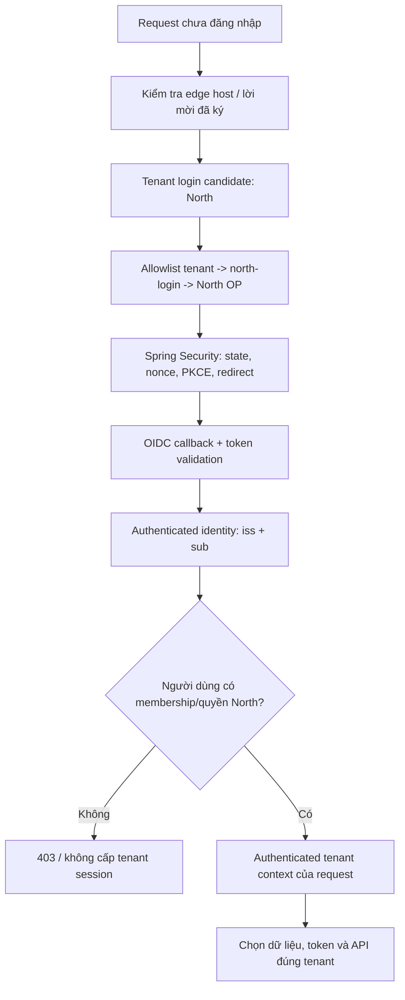
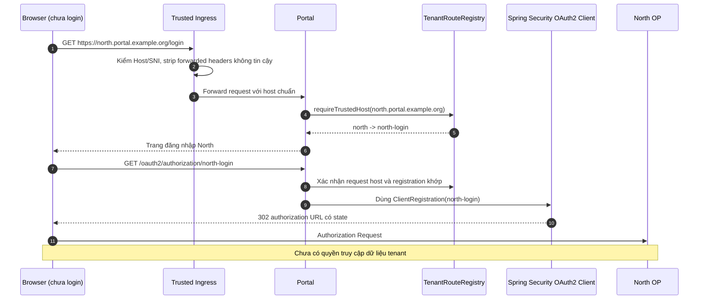
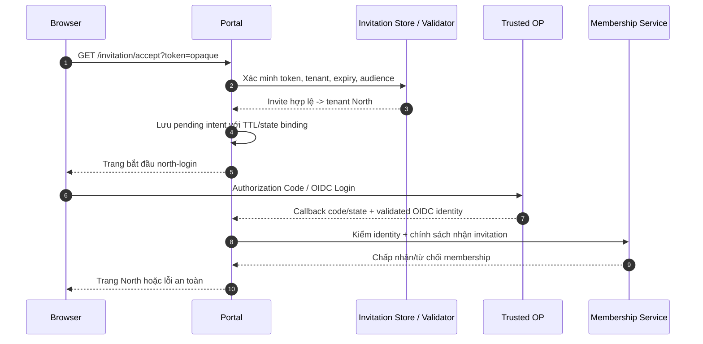
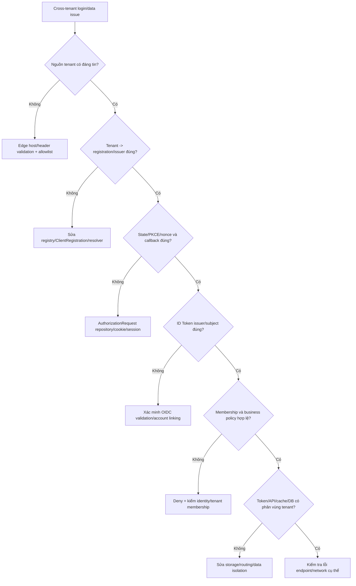

# 26.4. Chọn tenant từ ngữ cảnh request đã được xác minh

Trong hệ thống **Spring Security OAuth 2.0 / OpenID Connect (OIDC) Client** phục vụ nhiều tenant, ứng dụng thường phải xác định tenant để biết **đưa người dùng tới OpenID Provider nào**, **dùng client registration nào**, **tìm authorized client/token ở đâu**, và **áp dụng chính sách dữ liệu của tenant nào**. Vấn đề là tenant có thể xuất hiện ở nhiều nơi: subdomain, đường dẫn URL, header, tham số query, lời mời, session hoặc danh tính đã đăng nhập. Không phải nguồn nào cũng đáng tin.

Nguyên tắc của bài **“Chọn tenant từ ngữ cảnh request đã được xác minh”** là:

> **Không lấy một chuỗi `tenantId` do client tự khai rồi coi đó là tenant được ủy quyền.** Phải xác định nguồn của thông tin, kiểm tra ranh giới tin cậy, ánh xạ đến cấu hình server-side và **xác minh lại quan hệ giữa người dùng với tenant sau khi OAuth2/OIDC Login hoàn tất**.

Hai giai đoạn cần phân biệt rất rõ:

- **Trước khi đăng nhập:** chưa có danh tính người dùng được xác thực. Ứng dụng có thể xác định **tenant dự kiến cho quá trình login** từ host đã được gateway kiểm soát, một lời mời đã ký hoặc lựa chọn UI được đưa qua allowlist. Tenant này giúp **định tuyến tới registration/OP**, nhưng **chưa chứng minh người dùng có quyền thuộc tenant**.
- **Sau khi đăng nhập:** Spring Security đã xác minh response OIDC và tạo `Authentication`. Ứng dụng phải xác định external identity bằng **`(issuer, subject)`**, ánh xạ sang local identity, kiểm tra membership/quyền đối với tenant, rồi mới cho phép truy cập tài nguyên tenant hoặc sử dụng token phù hợp.

**Một host hợp lệ không phải bằng chứng user là thành viên tenant.** **Một ID Token hợp lệ không tự chứng minh user được xem mọi dữ liệu tenant.** **Một authorized client đã lưu không thay thế kiểm tra phân quyền tại Resource Server.**

## 1. Mục tiêu học tập

Sau bài này, bạn có thể:

1. Phân biệt `tenant hint`, `login tenant`, `authenticated tenant` và `resource tenant`.
2. Đánh giá độ tin cậy của host, forwarded headers, path, query, request header, cookie, signed invitation, session và authenticated principal.
3. Thiết kế allowlist `tenant → registrationId → issuer/authorization policy` phía server.
4. Tạo một tenant resolver dùng thông tin từ ingress/reverse proxy đã được kiểm soát.
5. Định tuyến OAuth2 Authorization Request tới đúng `ClientRegistration` trong Spring Security Servlet.
6. Phối hợp `DefaultServerOAuth2AuthorizationRequestResolver` trong WebFlux mà không blocking event loop.
7. Ràng buộc callback với `state`/request gốc; xác minh `iss`, `sub`, registration và membership sau login.
8. Hiểu vì sao `SecurityContext`, session, `OAuth2AuthorizedClientRepository`/`Service` và token cache cần ranh giới tenant.
9. Ngăn cross-tenant access, provider mix-up, confused deputy, open redirect, SSRF và token leakage.
10. Viết kiểm thử cả trường hợp hợp lệ lẫn các request cố tình thay tenant, host, issuer hoặc principal.

## 2. Bài toán: một Portal, nhiều tổ chức

Ví dụ một SaaS có hai doanh nghiệp khách hàng:

```text
https://north.portal.example.org
  └─ Tenant North
     └─ OIDC registration: north-login
        └─ Expected issuer: https://id.north.example.org/realms/employees

https://south.portal.example.org
  └─ Tenant South
     └─ OIDC registration: south-login
        └─ Expected issuer: https://id.south.example.org/realms/employees
```

Khi user truy cập host North, Portal muốn hiển thị nút “Đăng nhập North” và khởi động:

```text
GET https://north.portal.example.org/oauth2/authorization/north-login
```

Nhưng một attacker có thể thử:

```text
GET https://north.portal.example.org/oauth2/authorization/south-login
GET https://north.portal.example.org/login?tenant=south
Host: south.portal.example.org
X-Forwarded-Host: south.portal.example.org
```

Nếu ứng dụng chọn tenant chỉ vì có một tham số hoặc header mang tên “south”, attacker có thể ép Portal dùng client/issuer/token khác với tenant của request ban đầu. Sai sót này thường dẫn đến **tenant confusion**, **cross-tenant data access**, **token cache collision**, hoặc **provider mix-up**.

### 2.1. Tenant selection không phải tenant authorization



Tenant ở bước C chỉ giúp chọn **quy trình đăng nhập**. Quyền đối với dữ liệu được quyết định ở bước H và tiếp tục được kiểm tra khi user truy cập tài nguyên.

### 2.2. Bốn khái niệm tenant khác nhau

| Khái niệm | Ví dụ | Có thể tin trực tiếp không? |
|---|---|---|
| **Requested tenant** | `?tenant=north` hoặc `/t/north` | Không; đây là yêu cầu/lựa chọn, chưa có quyền |
| **Login-routing tenant** | Host được ingress gán sang North, mapping tới `north-login` | Có thể dùng **để chọn flow** sau khi kiểm tra nguồn/mapping; chưa chứng minh user membership |
| **Authenticated tenant** | Local user đã đăng nhập và membership North còn hiệu lực | Chỉ sau khi xác minh identity + policy server-side |
| **Resource tenant** | `/api/tenants/north/reports` | Phải so khớp với authenticated tenant/membership và authorization của tài nguyên |

Không nên gom cả bốn vào một biến thread-local tên `currentTenant` mà không biết nó đến từ đâu và mức độ tin cậy của nó.

## 3. Tại sao “đã được xác minh” là yêu cầu khó?

Một request HTTP có nhiều dữ liệu do client hoàn toàn có thể chủ động cung cấp. Tên field trông “nội bộ” không tự bảo đảm giá trị thật:

```http
GET /reports?tenantId=south HTTP/1.1
Host: north.portal.example.org
X-Tenant-ID: south
Cookie: preferredTenant=south
```

Trong ví dụ:

- `tenantId` query: do caller chỉnh.
- `X-Tenant-ID` header: do caller chỉnh nếu edge không chặn/ghi đè.
- `preferredTenant` cookie: có thể do browser chỉnh nếu không có integrity protection.
- `Host` header: có thể bị sửa nếu edge/backend không xác minh host được chấp nhận.
- `X-Forwarded-Host`: chỉ có ý nghĩa khi reverse proxy **tin cậy** xóa giá trị client gửi và tự đặt giá trị chuẩn.

Do đó, cần trả lời cả hai câu hỏi:

1. **Giá trị này có thực sự do thành phần đáng tin tạo/kiểm tra không?**
2. **Nếu đúng tenant được chọn, người dùng có quyền làm việc trong tenant đó không?**

Đây là hai lần xác minh khác nhau.

## 4. Ma trận nguồn xác định tenant

| Nguồn | Phù hợp để làm gì? | Điều kiện tin cậy / giới hạn |
|---|---|---|
| Subdomain đã kiểm soát | Định tuyến login tenant | Edge kiểm tra Host/SNI, allowlist, không cho truy cập backend trực tiếp hoặc giả mạo forwarded headers |
| Đường dẫn `/t/{tenant}` | Gợi ý tenant, định tuyến UX | Mapping allowlist; sau login kiểm tra membership; path tự nó không chứng minh quyền |
| Query `?tenant=...` | Gợi ý tenant khi chưa đăng nhập | Không dùng làm quyền; phải chuẩn hóa và kiểm tra chính sách |
| Header `X-Tenant-ID` | Định tuyến sau trusted gateway | Gateway phải strip/overwrite header từ Internet và xác thực caller nếu dùng làm quyền |
| Cookie `lastTenant` | Ghi nhớ lựa chọn UI | Không dùng làm bằng chứng quyền nếu không có integrity và membership check |
| Invitation link có chữ ký | Xác định tenant/flow dự kiến | Kiểm chữ ký, audience, thời hạn, nonce/one-time policy, không tự coi người mở link là member |
| Web session server-side | Giữ login intent hoặc tenant đã được kiểm tra | Session phải bảo vệ fixation/CSRF, có TTL, gắn với đúng Authentication |
| `SecurityContext.Authentication` | Xác định user đã login | Phải do Spring Security xác thực, không lấy từ header user tự khai |
| OIDC ID Token đã được xác minh | Nhận external issuer/subject | Kiểm iss/aud/exp/nonce/signature qua framework; membership vẫn phải kiểm tra |
| Membership database / policy service | Quyết định user có quyền tenant hay không | Truy vấn bằng local identity đã xác minh, quyền và trạng thái phải còn hiệu lực |
| `OAuth2AuthorizedClient` | Truy cập token đã được cấp | Không phải nguồn xác thực tenant; phải ràng buộc principal/registration/issuer/storage |

### 4.1. Tin cậy theo cấp độ, không theo tên biến

Ví dụ code:

```java
String tenant = request.getHeader("X-Verified-Tenant");
```

Header tên “Verified” vẫn **không tự được xác minh**. Chỉ có thể dựa vào nó nếu deployment bảo đảm:

- Browser không thể kết nối trực tiếp backend bằng đường khác.
- Gateway đã xác thực request hoặc host mapping.
- Gateway xóa header do client gửi, rồi ghi đè giá trị từ chính policy của gateway.
- Kết nối gateway → application được bảo vệ.
- App kiểm tra tenant ID vẫn thuộc allowlist.

Nếu không có những bảo đảm trên, hãy coi header như input không tin cậy.

### 4.2. Host cũng có trust boundary

Ngay cả `request.getServerName()` không phải “thật” trong mọi môi trường. Ở reverse proxy, nó có thể chịu ảnh hưởng của `Host` hoặc forwarded headers; một reverse proxy cấu hình yếu có thể chuyển tiếp host do attacker tự khai.

**Chỉ dùng host để định tuyến tenant sau khi edge đã chuẩn hóa và kiểm tra host được phục vụ.** Tốt nhất định nghĩa rõ virtual hosts được route và chặn mọi host lạ ngay tại ingress, đồng thời kiểm tra allowlist một lần nữa trong ứng dụng.

## 5. Thiết kế một Tenant Routing Registry phía server

Thay vì tự nối:

```java
String registrationId = tenantFromQuery + "-login";
```

hãy giữ mapping rõ ràng:

```text
Host đáng tin                Tenant ID     Registration     Expected issuer
-----------------------------------------------------------------------------------
north.portal.example.org     north         north-login     https://id.north.example.org/...
south.portal.example.org     south         south-login     https://id.south.example.org/...
```

Nhờ đó tenant được chọn **không thể tự quyết định issuer/token endpoint** chỉ bằng cách sửa một chuỗi URL.

### 5.1. Model cấu hình

```java
record TenantRoute(
        String tenantId,
        String externalHost,
        String registrationId,
        String expectedIssuer,
        String displayName) {}
```

Một registry đơn giản:

```java
import java.util.Locale;
import java.util.Map;
import org.springframework.security.access.AccessDeniedException;

final class TenantRouteRegistry {

    private final Map<String, TenantRoute> byHost = Map.of(
            "north.portal.example.org",
            new TenantRoute(
                    "north",
                    "north.portal.example.org",
                    "north-login",
                    "https://id.north.example.org/realms/employees",
                    "Tài khoản North"),

            "south.portal.example.org",
            new TenantRoute(
                    "south",
                    "south.portal.example.org",
                    "south-login",
                    "https://id.south.example.org/realms/employees",
                    "Tài khoản South"));

    TenantRoute requireTrustedHost(String externalHost) {
        if (externalHost == null) {
            throw new AccessDeniedException("Missing tenant host");
        }

        String canonical = externalHost.toLowerCase(Locale.ROOT);
        TenantRoute route = byHost.get(canonical);

        if (route == null) {
            throw new AccessDeniedException("Unsupported tenant host");
        }

        return route;
    }
}
```

Đây là **mẫu registry minh họa**, không thay thế cấu hình edge. Trong production cần chuẩn hóa hostname/IDN, loại bỏ trailing dot và xử lý port đúng chuẩn. Không làm `contains("north")` hoặc `endsWith("example.org")` một cách mơ hồ, dễ chấp nhận host giả như `north.portal.example.org.attacker.invalid`.

### 5.2. Đừng lưu credential trong view model

`TenantRoute` chỉ giữ metadata định tuyến. Secrets và private keys của OAuth2 client phải nằm trong cấu hình bí mật/`ClientRegistrationRepository`, không trả cho browser:

```text
TenantRoute:
  tenantId, externalHost, registrationId, expectedIssuer, displayName

ClientRegistration (server-side):
  clientId, clientSecret / private key, grant, scopes,
  authorizationUri, tokenUri, redirectUri, issuer metadata
```

Mỗi mapping được duyệt qua quy trình cấu hình đáng tin; không tạo ClientRegistration tùy ý từ `?issuer=https://...` hoặc host không thuộc allowlist.

## 6. Cấu hình Spring Boot OAuth2 Client cho các tenant

Một cách đơn giản là dùng **registration riêng cho mỗi tenant**:

```yaml
spring:
  security:
    oauth2:
      client:
        registration:
          north-login:
            provider: north-op
            client-id: "${NORTH_OIDC_CLIENT_ID}"
            client-secret: "${NORTH_OIDC_CLIENT_SECRET}"
            client-authentication-method: client_secret_basic
            authorization-grant-type: authorization_code
            client-name: "Tài khoản North"
            redirect-uri: "{baseUrl}/login/oauth2/code/{registrationId}"
            scope: [openid, profile, email]

          south-login:
            provider: south-op
            client-id: "${SOUTH_OIDC_CLIENT_ID}"
            client-secret: "${SOUTH_OIDC_CLIENT_SECRET}"
            client-authentication-method: client_secret_basic
            authorization-grant-type: authorization_code
            client-name: "Tài khoản South"
            redirect-uri: "{baseUrl}/login/oauth2/code/{registrationId}"
            scope: [openid, profile, email]

        provider:
          north-op:
            issuer-uri: "https://id.north.example.org/realms/employees"
          south-op:
            issuer-uri: "https://id.south.example.org/realms/employees"
```

Các endpoint/issuers là ví dụ giả định. Trong môi trường thật, phải kiểm tra OP discovery metadata, TLS, issuer chính xác, supported grant, redirect URIs và scopes. Client secrets đến từ secret manager hoặc environment variables; không đưa giá trị thật vào Git.

### 6.1. Vì sao chọn registration trước khi login?

`ClientRegistration` gắn với:

- Provider authorization endpoint/token endpoint.
- Client ID và phương thức xác thực client.
- Scopes, redirect URI, PKCE/nonce behavior theo flow.
- Issuer/JWK Set metadata cần cho OIDC validation.

Nếu chọn sai registration, có thể gửi user sang nhầm OP, bị callback mismatch, dùng client credential không phù hợp hoặc kết thúc với một authentication từ trust domain khác.

### 6.2. registrationId không phải tenantId

Ví dụ:

```text
tenantId:      north
registrationId:north-login
clientId:      reports-portal-north-prod
provider ID:   north-op
issuer:        https://id.north.example.org/realms/employees
```

Những chuỗi này khác nhiệm vụ. Có thể nhiều registrations cho cùng tenant; có thể nhiều tenants chung một OP. Không viết logic phân quyền kiểu `registrationId.startsWith(tenantId)` rồi coi đó là security invariant.

### 6.3. Shared OP không đồng nghĩa shared tenant permission

Một doanh nghiệp có thể dùng chung Corporate OP cho North và South:

```text
issuer = https://login.corporate.example.org
tenant North -> registrationId north-login
tenant South -> registrationId south-login
```

ID Token cùng issuer có thể xác thực một user, nhưng **user đó không nhất thiết là thành viên cả hai tenant**. Khi dùng một issuer chung, membership/roles của từng tenant càng phải lấy từ nguồn quyền đáng tin và kiểm tra sau login.

## 7. Chọn tenant trước đăng nhập: chỉ để định tuyến

Trước khi thực hiện OIDC Login, `SecurityContext` chưa có authenticated user. Ứng dụng có thể:

1. Xác định host đã được ingress chấp nhận.
2. Resolve thành `TenantRoute` qua server allowlist.
3. Hiển thị login page phù hợp.
4. Bắt đầu OAuth2 authorization cho registration đã được phê duyệt.
5. Để Spring Security tạo `state`/nonce/PKCE và lưu authorization request gốc.

**Chưa được cấp quyền đọc dữ liệu North** chỉ vì URL đang có host North.

### 7.1. Sơ đồ luồng tin cậy



### 7.2. Host chọn flow, không chọn identity

Với host North, user vẫn có thể là người không có tài khoản North. OP có thể báo lỗi, hoặc OP xác thực user nhưng ứng dụng **phải kiểm tra membership** trước khi cấp quyền vào Portal North.

Nếu hệ thống hỗ trợ invitation-only tenant, một lời mời có thể xác định tenant dự kiến. Nhưng người mở link phải hoàn tất xác thực và được ràng buộc với lời mời theo policy, không chỉ biết URL.

## 8. Cấu hình ingress/reverse proxy và forwarded headers

Ví dụ deployment:

```text
Browser
   |
   | HTTPS north.portal.example.org
   v
Ingress / API Gateway
   - chấp nhận đúng danh sách host
   - terminate TLS
   - xóa X-Forwarded-* do browser tự gửi
   - đặt metadata forwarded từ kết nối thực
   |
   | private network / mTLS khi cần
   v
Spring Boot Portal
```

Spring Boot có cấu hình xử lý forwarded headers, ví dụ:

```yaml
server:
  forward-headers-strategy: framework
```

**Chỉ bật/áp dụng theo kiến trúc có trusted proxy.** Nếu application cho phép client Internet tự gửi `Forwarded`/`X-Forwarded-Host` đến backend, forwarded-header processing có thể khiến client **giả mạo external host/scheme**. Cần loại bỏ incoming headers từ không đáng tin tại edge, giới hạn network path và xác minh host allowlist trước khi dùng nó cho tenant/redirect URI.

### 8.1. Tránh hostname matching yếu

Không nên:

```java
// KHÔNG AN TOÀN: client có thể dùng host giả cùng substring.
if (request.getServerName().contains("north")) {
    return "north";
}
```

Nên:

```java
// Sau khi edge bảo đảm host chuẩn:
TenantRoute route = registry.requireTrustedHost(
        request.getServerName());
```

với **exact match** tới một host server đã duyệt. Khi có port và scheme, chuẩn hóa bằng URL parser được tin cậy, không tự split chuỗi `Host` chứa IPv6, IDN hoặc dữ liệu bất thường.

### 8.2. Callback redirect URI phải được kiểm soát

Với:

```yaml
redirect-uri: "{baseUrl}/login/oauth2/code/{registrationId}"
```

Spring Security có thể dùng external scheme/host mà request thể hiện để xây redirect URI. Nếu nguồn host/proxy không đáng tin, attacker có thể tác động URL callback. Đây là lý do host validation quan trọng **cả cho lựa chọn tenant lẫn redirect URI**.

Một lựa chọn chặt chẽ hơn là dùng redirect URI cố định đã đăng ký theo tenant khi phù hợp:

```text
north-login:
  https://north.portal.example.org/login/oauth2/code/north-login

south-login:
  https://south.portal.example.org/login/oauth2/code/south-login
```

Phải bảo đảm cấu hình phía app và OP khớp; không dùng wildcard redirect URIs rộng để “hợp thức hóa” mọi hostname.

## 9. Spring MVC: hiển thị trang login theo host đã được kiểm soát

Với Servlet, có thể lấy external host từ `HttpServletRequest` **sau khi ingress đã xác minh/chuẩn hóa**, tra registry và render trang phù hợp.

### 9.1. Controller trang login

```java
import jakarta.servlet.http.HttpServletRequest;
import org.springframework.stereotype.Controller;
import org.springframework.ui.Model;
import org.springframework.web.bind.annotation.GetMapping;

@Controller
class TenantLoginController {

    private final TenantRouteRegistry routes;

    TenantLoginController(TenantRouteRegistry routes) {
        this.routes = routes;
    }

    @GetMapping("/login")
    String login(HttpServletRequest request, Model model) {

        // Chỉ an toàn khi ingress kiểm tra Host và forwarded headers.
        TenantRoute tenant =
                routes.requireTrustedHost(request.getServerName());

        model.addAttribute("tenantDisplayName", tenant.displayName());
        model.addAttribute("registrationId", tenant.registrationId());

        return "tenant-login";
    }
}
```

`TenantRouteRegistry` là một dependency do ứng dụng quản lý; trong ứng dụng Spring thực tế hãy đăng ký nó làm bean (@Bean/@Component) và cấu hình từ nguồn server-side đáng tin. Ví dụ chỉ tập trung vào logic chọn tenant.

### 9.2. Template Thymeleaf

```html
<!DOCTYPE html>
<html lang="vi" xmlns:th="http://www.thymeleaf.org">
<head>
  <meta charset="UTF-8" />
  <title>Đăng nhập tenant</title>
</head>
<body>
  <main>
    <h1 th:text="${tenantDisplayName}">Tenant Portal</h1>
    <p>Đăng nhập bằng tài khoản dành cho tổ chức này.</p>

    <a th:href="@{/oauth2/authorization/{id}(id=${registrationId})}">
      Đăng nhập bằng tài khoản tổ chức
    </a>

    <p th:if="${param.error}" role="alert">
      Đăng nhập chưa hoàn tất. Vui lòng thử lại.
    </p>
  </main>
</body>
</html>
```

Trang này không chứa client secret, access token, refresh token hay issuer URL do browser tự cung cấp. `registrationId` lấy từ registry server-side theo host được kiểm soát, không từ `?registrationId=...`.

### 9.3. Cấu hình SecurityFilterChain

```java
import org.springframework.context.annotation.Bean;
import org.springframework.security.config.annotation.web.builders.HttpSecurity;
import org.springframework.security.web.SecurityFilterChain;

@Bean
SecurityFilterChain securityFilterChain(HttpSecurity http)
        throws Exception {

    return http
            .authorizeHttpRequests(auth -> auth
                    .requestMatchers(
                            "/", "/login", "/error", "/css/**")
                    .permitAll()
                    .anyRequest().authenticated())
            .oauth2Login(oauth2 ->
                    oauth2.loginPage("/login"))
            .build();
}
```

Trang `/login` được public để browser chưa authenticated có thể chọn đúng OP. Nhưng **việc trang chỉ hiện `north-login` không ngăn người dùng gõ thủ công URL `/oauth2/authorization/south-login`**. Phải bảo vệ bước khởi động authorization request thực tế như mục tiếp theo.

## 10. Spring MVC: bảo vệ lựa chọn registration tại authorization endpoint

OAuth2 Login thông thường khởi động qua:

```text
/oauth2/authorization/{registrationId}
```

Khi nhiều tenants có registrations riêng, một user trên host North không nên được tùy ý yêu cầu khởi động registration South nếu policy cấm cross-tenant flow trên host đó.

`DefaultOAuth2AuthorizationRequestResolver` có thể được **bọc** để chỉ cho phép registration theo `TenantRoute` đã xác định.

### 10.1. Nguyên tắc của wrapper

```text
Incoming request:
  host = north.portal.example.org
  path = /oauth2/authorization/north-login

TrustedTenantRegistry:
  expected registration = north-login

Custom OAuth2AuthorizationRequestResolver:
  - path và expected registration khớp?
  - nếu không: từ chối
  - nếu có: delegate tới DefaultOAuth2AuthorizationRequestResolver
      -> framework tạo state, nonce, PKCE theo cấu hình
```

Không tự tạo toàn bộ `OAuth2AuthorizationRequest` nếu chỉ cần chặn registration sai; để Spring Security giữ phần protocol logic.

### 10.2. Ví dụ implementation Servlet

```java
import jakarta.servlet.http.HttpServletRequest;
import org.springframework.security.access.AccessDeniedException;
import org.springframework.security.oauth2.client.web
        .OAuth2AuthorizationRequestResolver;
import org.springframework.security.oauth2.core.endpoint
        .OAuth2AuthorizationRequest;

final class TenantBoundAuthorizationRequestResolver
        implements OAuth2AuthorizationRequestResolver {

    private static final String START = "/oauth2/authorization/";

    private final OAuth2AuthorizationRequestResolver delegate;
    private final TenantRouteRegistry routes;

    TenantBoundAuthorizationRequestResolver(
            OAuth2AuthorizationRequestResolver delegate,
            TenantRouteRegistry routes) {
        this.delegate = delegate;
        this.routes = routes;
    }

    @Override
    public OAuth2AuthorizationRequest resolve(
            HttpServletRequest request) {

        String path = request.getRequestURI()
                .substring(request.getContextPath().length());
        if (!path.startsWith(START)) {
            return null;
        }

        TenantRoute route =
                routes.requireTrustedHost(request.getServerName());
        String expectedPath = START + route.registrationId();

        if (!expectedPath.equals(path)) {
            throw new AccessDeniedException(
                    "Registration not allowed on tenant host");
        }

        return delegate.resolve(request, route.registrationId());
    }

    @Override
    public OAuth2AuthorizationRequest resolve(
            HttpServletRequest request,
            String clientRegistrationId) {

        TenantRoute route =
                routes.requireTrustedHost(request.getServerName());

        if (!route.registrationId().equals(clientRegistrationId)) {
            throw new AccessDeniedException(
                    "Registration does not match tenant host");
        }

        return delegate.resolve(request, clientRegistrationId);
    }
}
```

Đây là ví dụ **bảo vệ registration tại authorization initiation**, giả định ứng dụng mount ở context path bình thường và request URI đã được security filter xử lý nhất quán. Cần kiểm tra thêm URL normalization, path parameters, encoded separators, reverse proxy prefix, các matchers/custom base URI nếu hệ thống thay đổi chúng. Không tự split URL hoặc ghép chuỗi từ browser rồi xem đó là trusted registration.

Việc trả `null` cho đường không phải authorization initiation cho phép resolver không xử lý những request khác. Khi registration sai trên một host hợp lệ, ví dụ phát `AccessDeniedException` để policy/security exception handling từ chối; tránh trả ngầm về một OP mặc định khiến user bị đăng nhập nhầm tenant.

### 10.3. Đăng ký resolver vào OAuth2 Login

```java
import org.springframework.context.annotation.Bean;
import org.springframework.security.config.annotation.web.builders.HttpSecurity;
import org.springframework.security.oauth2.client.registration
        .ClientRegistrationRepository;
import org.springframework.security.oauth2.client.web
        .DefaultOAuth2AuthorizationRequestResolver;
import org.springframework.security.web.SecurityFilterChain;

@Bean
SecurityFilterChain tenantSecurityFilterChain(
        HttpSecurity http,
        ClientRegistrationRepository registrations,
        TenantRouteRegistry routes) throws Exception {

    var defaultResolver =
            new DefaultOAuth2AuthorizationRequestResolver(
                    registrations, "/oauth2/authorization");

    var tenantResolver =
            new TenantBoundAuthorizationRequestResolver(
                    defaultResolver, routes);

    return http
            .authorizeHttpRequests(auth -> auth
                    .requestMatchers("/login", "/error").permitAll()
                    .anyRequest().authenticated())
            .oauth2Login(oauth2 -> oauth2
                    .loginPage("/login")
                    .authorizationEndpoint(endpoint ->
                            endpoint.authorizationRequestResolver(
                                    tenantResolver)))
            .build();
}
```

Đây là **cấu hình thay thế** chain ở mục 9.3; ứng dụng chỉ nên triển khai chain phù hợp với routing của mình. Nếu có nhiều `SecurityFilterChain`, cần matcher/order rõ để tất cả đường authorization/callback liên quan đi vào đúng security flow.

### 10.4. Tại sao không chỉ kiểm tra trong controller /login?

Một controller `/login` có thể render đúng North nhưng không kiểm soát `/oauth2/authorization/south-login` do Spring Security filter xử lý. Attacker không cần bấm nút trên UI; họ có thể gửi HTTP request trực tiếp. **Bảo vệ registration phải đặt tại điểm authorization request thực sự được tạo**, không chỉ ở template.

### 10.5. 403 hay trang lỗi?

Request sai tenant nên bị từ chối có kiểm soát. Về UX, có thể hiện thông báo “Loại đăng nhập này không khả dụng tại tổ chức hiện tại”. Về vận hành, log registration ID và host canonical đã duyệt, không log credential, state, authorization code hoặc ID Token.

Không redirect user tới South OP như một “fallback tự động” nếu họ chọn sai registration trên North, trừ khi đó là flow chuyển tenant có chủ đích, được bảo vệ và giải thích rõ.

## 11. Xử lý authorization callback: không tin tenant từ query

Sau khi OP xác thực user, browser trở về:

```text
https://north.portal.example.org/login/oauth2/code/north-login
    ?code=<ONE_TIME_CODE>
    &state=<OPAQUE_STATE>
```

Ở thời điểm này, attacker có thể sửa query/cookie hoặc cố tạo callback đến host khác. Ứng dụng không nên xác định tenant từ:

```text
?tenant=north
?registrationId=north-login
X-Tenant-ID: north
```

thay vì các dữ liệu đã được Spring Security liên kết với **authorization request gốc**, client registration và OIDC token validation.

### 11.1. Vai trò của state

`state` liên kết authorization response với authorization request mà client đã khởi động. Spring Security dùng `OAuth2AuthorizationRequestRepository` (Servlet) hoặc `ServerAuthorizationRequestRepository` (Reactive) để giữ correlation context giữa redirect và callback.

Trong hệ thống đa tenant, cần bảo toàn:

- Registration ID đã được chọn ở request gốc.
- Callback host/URI được phép tương ứng registration.
- `state`/PKCE/nonce do framework sinh và kiểm tra.
- Tenant login intent ở nơi lưu server-side có integrity, nếu business cần đối chiếu riêng.

Đừng tự đặt `state="north"` hoặc `state=tenantId` để “truyền tenant qua OP”. State phải đủ ngẫu nhiên và được xử lý theo OAuth2; tenant metadata có thể được gắn với request state **server-side** bằng cơ chế được bảo vệ.

### 11.2. Nếu cần lưu tenant login intent qua redirect

Một thiết kế có thể lưu:

```text
OAuth2AuthorizationRequest:
  state = random opaque value
  registrationId = north-login
  application attribute:
      expectedTenantId = north
      expectedHost = north.portal.example.org
```

Những application attributes (nếu dùng `OAuth2AuthorizationRequest.attributes`) là dữ liệu nội bộ cần được repository lưu và bảo vệ; chúng **không tự biến thành query parameter gửi tới OP**. Cơ chế tiếp cận thuộc API của resolver/repository; việc lấy lại ở callback cần dựa trên flow đã được framework hỗ trợ hoặc custom correlation storage đáng tin.

**Cẩn thận với nhiều tabs/login attempts đồng thời.** Một session attribute duy nhất `pendingTenant=north` có thể bị lần login South ghi đè. Thiết kế phải ràng buộc theo state/authorization transaction và có TTL/cleanup.

### 11.3. Kiểm tra callback host

Nếu mỗi registration có callback host riêng:

```text
north-login -> north.portal.example.org/login/oauth2/code/north-login
south-login -> south.portal.example.org/login/oauth2/code/south-login
```

thì server phải từ chối callback bị đưa sang host không đúng mapping. Một cách thực hiện là bảo vệ callback route tại ingress và/hoặc security layer, rồi đối chiếu expected host với trusted mapping. Không chỉ so sánh query parameter “tenant”.

## 12. Sau login: xác minh identity và membership tenant

Khi Spring Security OIDC Login hoàn tất, authentication thường là `OAuth2AuthenticationToken` có principal là `OidcUser`. Token/claims đã đi qua OIDC validation của framework theo registration.

Ứng dụng có thể dùng:

```java
import org.springframework.security.oauth2.client.authentication
        .OAuth2AuthenticationToken;
import org.springframework.security.oauth2.core.oidc.user.OidcUser;

if (authentication instanceof OAuth2AuthenticationToken oauth2
        && oauth2.getPrincipal() instanceof OidcUser oidcUser) {

    String registrationId =
            oauth2.getAuthorizedClientRegistrationId();
    String issuer = oidcUser.getIdToken()
            .getClaimAsString("iss");
    String subject = oidcUser.getIdToken()
            .getClaimAsString("sub");

    // Lookup local identity bằng (issuer, subject),
    // rồi xác minh membership đúng tenant.
}
```

Không dùng `email`, `preferred_username` hoặc `name` làm định danh duy nhất xuyên nhiều issuers. OIDC `sub` chỉ có ý nghĩa cùng issuer. `clientRegistrationId` còn giúp biết user đã đi qua registration nào; nhưng bản thân registration name không phải bằng chứng user có vai trò admin.

### 12.1. Chuỗi xác minh đầy đủ

```text
OIDC Login thành công:
    client registration = north-login
    issuer             = https://id.north.example.org/...
    subject            = user-123
           |
           v
Identity registry:
    (issuer, subject) -> localUserId = 42
           |
           v
Membership policy:
    localUserId = 42
    tenantId    = north
    membership  = active
    roles       = REPORT_VIEWER
           |
           v
Request protected:
    resource.tenantId == north ?
    permission REPORT_VIEWER ?
           |
           v
Allow / Deny
```

### 12.2. Không suy luận membership từ login button

```java
// KHÔNG NÊN:
if (oauth2.getAuthorizedClientRegistrationId().equals("north-login")) {
    grantAllNorthPermissions();
}
```

Một người có thể đăng nhập vào OP North nhưng **không còn** membership trong Portal North, hoặc có membership nhưng chỉ được đọc dữ liệu của nhóm cụ thể. Registration chỉ xác định **cấu hình xác thực**, không cấp mọi quyền nghiệp vụ.

### 12.3. Claim tenant trong ID Token có tin được không?

Một OP có thể phát claim như:

```json
{
  "iss": "https://id.north.example.org/realms/employees",
  "sub": "user-123",
  "aud": "north-portal-client",
  "tenant_id": "north"
}
```

Claim này **chỉ có thể được coi là đáng tin theo contract của OP** sau khi ID Token đã được xác minh, issuer/audience phù hợp và ứng dụng đã xác định ý nghĩa của claim. Một claim `tenant_id` từ một issuer khác có thể không có cùng semantics.

Với phân quyền nhạy cảm, còn phải xét membership trạng thái hiện tại trong nguồn quyền của ứng dụng; ID Token có thể đã được phát trước khi user bị thu hồi quyền.

## 13. Mẫu kiểm tra tenant sau login trong Servlet

Để minh họa **điểm kiểm tra per-request**, ta dùng host đã được kiểm soát và `Authentication` do Spring Security cung cấp.

### 13.1. Service xác định tenant đã được ủy quyền

```java
import jakarta.servlet.http.HttpServletRequest;
import org.springframework.security.access.AccessDeniedException;
import org.springframework.security.core.Authentication;
import org.springframework.security.oauth2.client.authentication
        .OAuth2AuthenticationToken;
import org.springframework.security.oauth2.core.oidc.user.OidcUser;

record AuthorizedTenantContext(
        String tenantId,
        String localUserId,
        String registrationId) {}

interface LocalIdentityDirectory {
    String requireLocalUserId(String issuer, String subject);
}

interface TenantMembershipPolicy {
    boolean hasActiveMembership(String localUserId, String tenantId);
}

final class AuthorizedTenantResolver {

    private final TenantRouteRegistry routes;
    private final LocalIdentityDirectory identities;
    private final TenantMembershipPolicy memberships;

    AuthorizedTenantResolver(
            TenantRouteRegistry routes,
            LocalIdentityDirectory identities,
            TenantMembershipPolicy memberships) {
        this.routes = routes;
        this.identities = identities;
        this.memberships = memberships;
    }

    AuthorizedTenantContext requireForRequest(
            HttpServletRequest request,
            Authentication authentication) {

        TenantRoute route =
                routes.requireTrustedHost(request.getServerName());

        if (!(authentication instanceof OAuth2AuthenticationToken oauth2)
                || !(oauth2.getPrincipal() instanceof OidcUser oidc)) {
            throw new AccessDeniedException(
                    "Expected authenticated OIDC principal");
        }

        if (!route.registrationId().equals(
                oauth2.getAuthorizedClientRegistrationId())) {
            throw new AccessDeniedException(
                    "OIDC client registration differs from tenant route");
        }

        String issuer =
                oidc.getIdToken().getClaimAsString("iss");
        String subject =
                oidc.getIdToken().getClaimAsString("sub");

        if (!route.expectedIssuer().equals(issuer)) {
            throw new AccessDeniedException(
                    "Unexpected OIDC issuer for tenant");
        }

        String localUserId =
                identities.requireLocalUserId(issuer, subject);

        if (!memberships.hasActiveMembership(
                localUserId, route.tenantId())) {
            throw new AccessDeniedException(
                    "User is not a member of requested tenant");
        }

        return new AuthorizedTenantContext(
                route.tenantId(),
                localUserId,
                route.registrationId());
    }
}
```

`LocalIdentityDirectory` và `TenantMembershipPolicy` là **interfaces do ứng dụng triển khai**; ví dụ này không định nghĩa schema/local user provisioning. Với application có nhiều registrations cho cùng tenant hoặc policy cho phép user chuyển từ một OP khác, điều kiện registration/issuer phải được mở rộng bằng **mapping được phê duyệt**, không bỏ điều kiện hoàn toàn.

### 13.2. Dùng tại protected endpoint

```java
import jakarta.servlet.http.HttpServletRequest;
import org.springframework.security.core.Authentication;
import org.springframework.web.bind.annotation.GetMapping;
import org.springframework.web.bind.annotation.RestController;

@RestController
final class TenantReportsController {

    private final AuthorizedTenantResolver tenantResolver;
    private final ReportsService reports;

    TenantReportsController(
            AuthorizedTenantResolver tenantResolver,
            ReportsService reports) {
        this.tenantResolver = tenantResolver;
        this.reports = reports;
    }

    @GetMapping("/reports")
    ReportPage getReports(
            HttpServletRequest request,
            Authentication authentication) {

        AuthorizedTenantContext context =
                tenantResolver.requireForRequest(
                        request, authentication);

        return reports.findVisibleReports(
                context.tenantId(),
                context.localUserId());
    }
}
```

`ReportsService`/`ReportPage` là thành phần minh họa của ứng dụng. Service **vẫn phải phân quyền trên từng báo cáo** (đơn vị, bộ phận, người sở hữu, trạng thái), không chỉ lọc theo tenant ID. Tenant check là một lớp authorization, không phải tất cả.

### 13.3. Vì sao kiểm tra trên mỗi request?

Nếu một user bị thu hồi membership sau login, claims/session cũ có thể vẫn còn. Đối với tài nguyên nhạy cảm, cần bảo đảm policy/membership hiện tại được kiểm tra ở boundary phù hợp hoặc dùng cache có TTL/invalidation bảo đảm thời gian thu hồi quyền đáp ứng yêu cầu.

Chỉ kiểm tra tenant tại OAuth2 login success một lần rồi tin session mãi mãi có thể khiến quyền cũ tồn tại tới khi hết hạn session.

### 13.4. Tránh để session lưu tenant không kiểm soát

`session.setAttribute("tenantId", tenantId)` có thể hữu ích để giữ **lựa chọn UI**. Nhưng nếu tenant này được lấy từ query parameter và từ đó dùng trực tiếp làm filter trong SQL, attacker có thể đổi tenant chỉ bằng cách chọn lại UI.

Một session field được tin cậy để authorization cần:

1. Được tạo từ policy đã xác minh sau login.
2. Ràng buộc với `Authentication`/local identity tương ứng.
3. Có validation khi user switch tenant.
4. Được clear/update khi logout, đổi principal hoặc quyền bị thu hồi.
5. Không bị một request anonymous của browser ghi đè một cách tùy ý.

## 14. Chọn tenant từ signed invitation hoặc organization discovery

Không phải hệ thống nào cũng dùng subdomain riêng. Có hệ thống sử dụng một domain chung:

```text
https://portal.example.org/login?invite=<opaque-token>
```

Một invitation token có thể chỉ ra North và registration dự kiến. Nhưng muốn dùng nó làm nguồn đáng tin, server phải kiểm tra:

- Token được ký hoặc lưu server-side dưới dạng opaque reference.
- Chữ ký/MAC được xác minh bằng key bí mật.
- `issuer`/`audience` đúng cho Portal.
- `expiresAt`/`notBefore` và TTL hợp lý.
- `nonce`/one-time use, chống replay nếu flow yêu cầu.
- Không bị đổi `tenantId` hoặc registration bên trong mà vẫn hợp lệ.
- Mục đích invite không bị nhầm với bearer access token.
- Sau OIDC login, user identity phù hợp điều kiện nhận lời mời.

### 14.1. Quy trình invitation



**Invitation chỉ xác định quy trình mà người dùng muốn hoàn tất**, không mặc nhiên tạo quyền cho người đang cầm URL. Nếu lời mời dành cho một email hoặc danh tính cụ thể, phải kiểm chứng bằng hợp đồng xác thực/ownership phù hợp.

### 14.2. Tránh lộ invitation token qua telemetry

Nếu invitation có trong URL, nó có thể xuất hiện trong browser history, referrer, reverse proxy logs hoặc analytics. Ưu tiên opaque random token ngắn hạn, giới hạn scope, không đưa vào third-party scripts và chuyển sang server-side correlation sớm. Không sử dụng access token/refresh token làm invitation token.

### 14.3. Organization discovery theo email domain

Một màn hình có thể hỏi email để **gợi ý** tenant/OP:

```text
user nhập alice@north.example.org
-> ứng dụng gợi ý “Đăng nhập North”
```

Nhưng email **do user tự khai trước login** không được dùng làm bằng chứng rằng người đó sở hữu mailbox hoặc được cấp quyền ở North. Nó chỉ phục vụ UX/discovery, sau đó phải xác minh identity/issuer/membership.

## 15. Request Header do gateway thêm có đáng tin không?

Một số tổ chức dùng gateway xác thực request và gắn:

```http
X-Authenticated-Tenant: north
X-Authenticated-User: internal-user-42
```

Nếu Spring Security tiếp tục nhận request trực tiếp từ Internet, attacker có thể tự gửi y hệt headers. Chỉ sử dụng khi:

1. Gateway thực sự xác thực caller/identity theo contract.
2. Header user gửi từ ngoài bị strip, gateway phát header mới.
3. Backend chỉ nhận lưu lượng từ gateway đáng tin.
4. Kết nối nội bộ được bảo vệ và có service-to-service authentication nếu cần.
5. App vẫn validate tenant ID trong allowlist và ràng buộc với `Authentication`/local identity theo trust model.

Đối với **OIDC Login từ browser chưa authenticated**, một header `X-Authenticated-Tenant` thường không tồn tại và không nên được giả lập từ browser. Thiết kế này phù hợp hơn với API-to-API hoặc gateway đã xử lý authentication.

### 15.1. Tránh confused deputy

Confused deputy xuất hiện khi một service có credential mạnh thực hiện hành động cho request caller nhưng **không kiểm tra caller có quyền yêu cầu hành động đó trên tenant tương ứng**.

Ví dụ:

```text
Attacker gửi tenant=south
      |
      v
Portal dùng service token south-service
      |
      v
South Reports API trả dữ liệu
```

Đây vẫn là lỗi, ngay cả khi service token hợp lệ và South API có chữ ký JWT đúng. Portal phải xác minh user/membership/operation trước khi dùng credential mạnh của tenant South.

## 16. Tách login tenant khỏi resource tenant khi user có nhiều memberships

Một người có thể là member của North và South. Có hai thiết kế:

### Thiết kế A: tenant cố định theo host

```text
north.portal.example.org -> tenant north
south.portal.example.org -> tenant south
```

Request tại North **không được phép** đọc dữ liệu South chỉ vì user cũng là member South. User cần chuyển sang host South hoặc một route được kiểm soát rõ ràng.

### Thiết kế B: user chọn active tenant sau login

```text
portal.example.org
   |
   +-- user xác thực bằng Corporate OP
   +-- membership = [north, south]
   +-- user chọn active tenant = north
   +-- mỗi request phải kiểm tra active tenant và quyền
```

Ở mô hình này, “active tenant” có thể được giữ trong session/context sau khi server kiểm tra membership. Nếu user chuyển từ North sang South:

1. Server kiểm tra lại membership South.
2. Cập nhật active tenant trong state bảo vệ, không chỉ tin query.
3. Xóa/đổi những cache theo tenant.
4. Chọn đúng API/authorized client và scope/audience.
5. Đảm bảo không còn data của North trong response/cache mới.
6. Ghi audit sự kiện chuyển tenant khi cần.

**Đừng biến active tenant thành một thuộc tính toàn cục của JVM** hoặc thread-local có thể rò giữa concurrent requests.

### 16.1. Một login dùng nhiều tenant không có nghĩa access token dùng được mọi API

Nếu Corporate OP phát access token với audience `portal-api`, token đó không tự hợp lệ tại `north-reports-api` và `south-reports-api`. Cần hợp đồng cấp token phù hợp, ví dụ các registrations/scopes/resources khác nhau hoặc token exchange được nhà cung cấp hỗ trợ.

Việc cập nhật `activeTenant` trong session không tự đổi `aud`/`scope` của access token.

## 17. Spring WebFlux Reactive: chọn tenant phi blocking

Trong Spring WebFlux, request được biểu diễn bằng `ServerWebExchange`; security context đi qua Reactor Context. Không dùng `HttpServletRequest` hoặc thread-local `SecurityContextHolder` như nguồn bất biến cho mọi reactive callback.

### 17.1. Mapping host trong WebFlux

Một helper có thể lấy external host từ request đã đi qua **trusted ingress**:

```java
import org.springframework.web.server.ServerWebExchange;

final class ReactiveTenantRoutes {

    private final TenantRouteRegistry registry;

    ReactiveTenantRoutes(TenantRouteRegistry registry) {
        this.registry = registry;
    }

    TenantRoute requireLoginTenant(ServerWebExchange exchange) {
        String host = exchange.getRequest().getURI().getHost();

        // Trust boundary nằm ở gateway/forwarded header config.
        return registry.requireTrustedHost(host);
    }
}
```

`getURI().getHost()` không có “phép màu xác minh”: ứng dụng chỉ được dựa vào host khi ingress đã giới hạn và chuẩn hóa giá trị. Với HTTP Host chứa port/IDN hoặc custom deployment, cần canonicalization phù hợp.

### 17.2. Resolver Reactive bọc DefaultServerOAuth2AuthorizationRequestResolver

```java
import org.springframework.security.access.AccessDeniedException;
import org.springframework.security.oauth2.client.web.server
        .ServerOAuth2AuthorizationRequestResolver;
import org.springframework.security.oauth2.core.endpoint
        .OAuth2AuthorizationRequest;
import org.springframework.web.server.ServerWebExchange;
import reactor.core.publisher.Mono;

final class TenantBoundServerAuthorizationRequestResolver
        implements ServerOAuth2AuthorizationRequestResolver {

    private static final String START = "/oauth2/authorization/";

    private final ServerOAuth2AuthorizationRequestResolver delegate;
    private final ReactiveTenantRoutes routes;

    TenantBoundServerAuthorizationRequestResolver(
            ServerOAuth2AuthorizationRequestResolver delegate,
            ReactiveTenantRoutes routes) {
        this.delegate = delegate;
        this.routes = routes;
    }

    @Override
    public Mono<OAuth2AuthorizationRequest> resolve(
            ServerWebExchange exchange) {

        return Mono.defer(() -> {
            String path = exchange.getRequest().getPath()
                    .pathWithinApplication().value();

            if (!path.startsWith(START)) {
                return Mono.empty();
            }

            TenantRoute route = routes.requireLoginTenant(exchange);

            if (!path.equals(START + route.registrationId())) {
                return Mono.error(new AccessDeniedException(
                        "Registration not allowed for tenant host"));
            }

            return delegate.resolve(exchange, route.registrationId());
        });
    }

    @Override
    public Mono<OAuth2AuthorizationRequest> resolve(
            ServerWebExchange exchange,
            String registrationId) {

        return Mono.defer(() -> {
            TenantRoute route = routes.requireLoginTenant(exchange);

            if (!route.registrationId().equals(registrationId)) {
                return Mono.error(new AccessDeniedException(
                        "Wrong login registration for tenant"));
            }

            return delegate.resolve(exchange, registrationId);
        });
    }
}
```

`Mono.defer` giữ phép resolve trong reactive subscription. Ví dụ này dùng mapping đồng bộ in-memory rất ngắn; nếu tenant registry thực tế tra remote database, đổi helper thành `Mono<TenantRoute>` và compose `flatMap`. **Không `block()` trong resolver**.

Với custom path base, context path hoặc proxy prefix, cần đồng bộ matcher/path normalization. Không cho browser sửa đường host/path encoded để bypass exact registration check.

### 17.3. Đưa resolver vào SecurityWebFilterChain

```java
import org.springframework.context.annotation.Bean;
import org.springframework.security.config.web.server.ServerHttpSecurity;
import org.springframework.security.oauth2.client.registration
        .ReactiveClientRegistrationRepository;
import org.springframework.security.oauth2.client.web.server
        .DefaultServerOAuth2AuthorizationRequestResolver;
import org.springframework.security.web.server.SecurityWebFilterChain;

@Bean
SecurityWebFilterChain tenantWebFilterChain(
        ServerHttpSecurity http,
        ReactiveClientRegistrationRepository registrations,
        ReactiveTenantRoutes routes) {

    var defaultResolver =
            new DefaultServerOAuth2AuthorizationRequestResolver(
                    registrations);

    var tenantResolver =
            new TenantBoundServerAuthorizationRequestResolver(
                    defaultResolver, routes);

    return http
            .authorizeExchange(exchanges -> exchanges
                    .pathMatchers("/login", "/error").permitAll()
                    .anyExchange().authenticated())
            .oauth2Login(oauth2 -> oauth2
                    .loginPage("/login")
                    .authorizationRequestResolver(tenantResolver))
            .build();
}
```

Các class cần được đăng ký thành Spring beans theo cấu trúc dự án. Đây là cấu hình thay thế cho một chain WebFlux mặc định; **không dùng đồng thời nhiều chain trùng matcher** mà không xác định precedence.

### 17.4. Kiểm tra tenant authorization sau login Reactive

Một service reactive nên dùng nguồn `Authentication` của Reactor context và membership service phi blocking:

```java
import org.springframework.security.access.AccessDeniedException;
import org.springframework.security.core.Authentication;
import org.springframework.security.core.context
        .ReactiveSecurityContextHolder;
import reactor.core.publisher.Mono;

Mono<AuthorizedTenantContext> currentTenant(
        ServerWebExchange exchange) {

    TenantRoute route = routes.requireLoginTenant(exchange);

    return ReactiveSecurityContextHolder.getContext()
            .map(context -> context.getAuthentication())
            .switchIfEmpty(Mono.error(
                    new AccessDeniedException("Not authenticated")))
            .flatMap(authentication ->
                    reactiveTenantPolicy.requireMembership(
                            authentication, route));
}
```

`reactiveTenantPolicy.requireMembership(...)` là API **do ứng dụng triển khai**, trả `Mono<AuthorizedTenantContext>` sau khi xác minh registration/issuer/subject và local membership. Không ghi một biến static `currentTenant` hoặc tự lấy principal từ `request.getQueryParams()` để bỏ qua Reactor SecurityContext.

### 17.5. Reactor Context và ThreadLocal

Trong Reactive, luồng xử lý có thể chuyển scheduler. Dùng `ThreadLocal<Tenant>` mà không có cơ chế context propagation phù hợp có thể:

- Mất tenant trên callback khác thread.
- Đọc nhầm tenant còn sót từ request trước nếu cleanup không đúng.
- Gây cross-tenant data leaks khó tái hiện dưới tải.

Ưu tiên **truyền `AuthorizedTenantContext` tường minh** qua service methods hoặc dùng Reactor Context đã được cấu hình/kiểm soát. Bất kỳ context nào dùng cho authorization phải có nguồn đã xác minh và không được client tự ghi đè.

## 18. Lưu tenant context ở đâu sau login?

| Cách giữ | Ưu điểm | Giới hạn |
|---|---|---|
| Tính lại từ host + Authentication + membership | Bám sát policy, hạn chế stale state | Có thể tăng chi phí lookup |
| Immutable claim/authority đã được xác minh tại login | Dễ dùng trong request | Có thể stale khi quyền bị thu hồi |
| Server-side session attribute đã verify | Giữ active tenant theo user session | Phải invalidate/đổi khi switch/logout/revoke |
| Request attribute do filter đặt sau policy | Dễ truyền qua Servlet request | Chỉ có vòng đời request |
| Reactor Context do server đặt | Phù hợp Reactive chain | Phải quản lý propagation, không để input tùy ý |
| Tenant trong token đã được OP xác minh | Có thể phù hợp một contract cụ thể | Vẫn cần hiểu issuer, audience, semantics và freshness |
| Query/header/cookie tự khai | Tiện cho UX | Không phải authorization proof |

### 18.1. Dùng request-scoped context với trust level rõ

Một cấu trúc tốt có thể phân biệt bằng type:

```java
record RequestedTenant(String tenantId) {}

record LoginTenant(
        String tenantId, String registrationId) {}

record AuthorizedTenant(
        String tenantId, String localUserId) {}
```

Các type này chỉ là model hỗ trợ code readability. Chính type name không tự tạo bảo mật; chỉ có **quy trình tạo object sau xác minh** mới bảo đảm nguồn tin cậy.

### 18.2. Tránh truyền raw tenantId xuyên toàn bộ service

Thay vì:

```java
reportsDao.findReports(request.getParameter("tenantId"));
```

hãy dùng một context đã qua policy:

```java
AuthorizedTenantContext tenant =
        authorizedTenantResolver.requireForRequest(
                request, authentication);

reportsDao.findVisibleReports(
        tenant.tenantId(),
        tenant.localUserId());
```

DAO vẫn cần áp đúng điều kiện tenant trong câu truy vấn, tenant-aware database policy/RLS nếu có, và kiểm tra object-level authorization ở business layer.

## 19. Phân chia OAuth2AuthorizedClient và token store theo tenant

Sau OIDC Login, Spring Security có thể lưu `OAuth2AuthorizedClient` chứa access/refresh token. Phần này cần đặc biệt cẩn trọng trong multi-tenant.

`OAuth2AuthorizedClientService` thường tra cứu theo:

```text
(clientRegistrationId, principalName)
```

Không có `tenantId` làm thành phần khóa mặc định.

### 19.1. Trường hợp registrations riêng cho mỗi tenant

```text
(north-login, employee-42) -> North AT/RT
(south-login, employee-42) -> South AT/RT
```

Khi registrations khác nhau, cặp khóa service giúp phân biệt hai authorized clients. Nhưng vẫn phải kiểm tra principal identity, mapping issuer/subject và tenant authorization; chỉ vì chuỗi `employee-42` trùng nhau không chứng minh là cùng user.

### 19.2. Trường hợp một registration dùng chung cho nhiều tenant

```text
(company-login, employee-42) -> token nào?
```

Nếu North/South dùng **cùng registration và cùng principalName** nhưng token có tenant audience/claims khác nhau, store mặc định có thể bị ghi đè hoặc tái sử dụng nhầm.

Phương án cần cân nhắc:

1. Tách registrations khi thật sự có client config/token audience khác nhau.
2. Ánh xạ principal identity ổn định có phân vùng theo tenant theo một thiết kế được kiểm soát, bảo đảm manager và storage cùng dùng khóa.
3. Dùng custom storage/service với namespace tenant thực sự và contract rõ ràng.
4. Không dùng token có quyền tenant A để gọi API tenant B chỉ vì username giống nhau.
5. Xác minh token audience/scope/issuer tại Resource Server và điều phối đúng client ở BFF.

**Không tự nối `tenantFromQuery + ":" + principalName` rồi coi đã an toàn.** Trước tiên phải xác minh tenant và chủ thể. Ngoài ra, nếu Spring Security manager không hiểu khóa mới, bạn có thể làm save/load lệch nhau.

### 19.3. Client credentials cho mỗi tenant

Giả sử backend có:

```text
north-api-service -> token client_credentials North
south-api-service -> token client_credentials South
```

Một request user North yêu cầu xuất báo cáo không được tùy ý chọn `south-api-service` chỉ bằng `tenant=south`. Application phải kiểm tra user membership và permission, rồi định tuyến tới đúng service registration/URL ở server config.

Đối với background job không có browser session, dùng service manager (`AuthorizedClientServiceOAuth2AuthorizedClientManager` hoặc Reactive equivalent) với principal logic ổn định theo policy. Không lấy `SecurityContext` của một browser làm định danh của toàn bộ service token.

### 19.4. Redis/JDBC tenant isolation

Khi custom store có trường tenant:

```sql
-- Ví dụ schema ứng dụng, không phải schema mặc định Spring Security.
CREATE TABLE tenant_oauth2_authorized_client (
    tenant_id              varchar(100) NOT NULL,
    client_registration_id varchar(150) NOT NULL,
    principal_id           varchar(300) NOT NULL,
    encrypted_access_token bytea NOT NULL,
    encrypted_refresh_token bytea,
    token_expires_at       timestamptz,
    record_version         bigint NOT NULL DEFAULT 0,
    PRIMARY KEY (
        tenant_id,
        client_registration_id,
        principal_id
    )
);
```

Đây là schema **minh họa**, còn thiếu issuedAt/scopes/token type/schema version và metadata cần để tái dựng `OAuth2AuthorizedClient`. Khi tạo custom service, cần tích hợp nhất quán với `OAuth2AuthorizedClientManager`/repository và tránh mất token/refresh metadata.

Đừng lưu token plaintext. Dùng encryption at rest có quản lý keys, phân quyền DB/Redis, giới hạn backup/log và kiểm soát concurrent refresh token rotation bằng version/CAS hoặc single-flight.

## 20. Token không tự có quyền của tenant được chọn

Ngay cả khi một OIDC user đã đăng nhập và là member North, access token mà OP phát có thể:

```text
iss   = Corporate OP
aud   = portal-web
scope = openid profile
```

Trong khi Reports API yêu cầu:

```text
aud   = reports-api
scope = reports.read
tenant = north
```

Chọn tenant North trong request context **không tự đổi access token audience/scope**. Ứng dụng cần một OAuth2 client/grant/token exchange phù hợp contract của API. Resource Server phải xác minh token và phân quyền đối tượng tenant; không chỉ tin `X-Tenant-ID` do Portal gửi nếu chính API không kiểm chứng nguồn/policy.

### 20.1. Gọi downstream API bằng URL do server định tuyến

Đừng viết:

```java
// KHÔNG AN TOÀN: browser có thể đổi tenant và API host.
String tenant = request.getParameter("tenant");
String target = request.getParameter("url");
webClient.get().uri(target)
        .header("X-Tenant-ID", tenant)
        .retrieve();
```

Thay vào đó:

```java
record TenantApiTarget(
        String registrationId,
        String baseUrl) {}

Map<String, TenantApiTarget> apiTargets = Map.of(
        "north",
        new TenantApiTarget(
                "north-api-service",
                "https://reports.north.example.org"),
        "south",
        new TenantApiTarget(
                "south-api-service",
                "https://reports.south.example.org"));
```

Chỉ sau `AuthorizedTenantContext` được xác minh mới tra bảng và gọi đúng API. Không cho user tùy ý chọn URL để gửi bearer token; điều đó có thể gây **SSRF và token leakage**.

### 20.2. Một host chọn login không bảo vệ outbound token

Ngay cả khi auth login được định tuyến đúng issuer, code downstream vẫn có thể lấy authorized client khác nếu dùng default registration sai hoặc lưu token dưới principal trùng. Cần thống nhất mapping **tenant → downstream API → OAuth2 client/token → expected audience** trong một policy server-side.

### 20.3. Cache phải có tenant key

```text
KHÔNG NÊN:
  cacheKey = "reports:" + localUserId

NÊN đánh giá:
  cacheKey = "reports:" + verifiedTenantId + ":" + localUserId + ":" + scope
```

Khóa cache phải được thiết kế theo phạm vi dữ liệu thực tế (tenant, principal, resource, permission, version) để tránh một user chuyển tenant mà nhận response cache của tenant cũ. Không lấy `tenantId` từ query không được phép để tạo cache key.

## 21. Session, SecurityContext và việc chuyển tenant

Một web session có thể giữ:

```text
Authentication:
   issuer/subject -> localUserId

Authorized tenant context:
   tenantId = north
   membershipVersion = 18

Authorized clients:
   north-login / north-api-service ...
```

Nhưng có các nguy cơ:

- Session fixation hoặc login flow cũ lưu tenant từ trước khi xác thực.
- User switch tenant nhưng context/cache/token không được cập nhật.
- Hai tabs dùng cùng session và mỗi tab chọn tenant khác.
- Membership bị thu hồi trong khi session còn hoạt động.
- Một request chạy đồng thời vẫn giữ context của tenant cũ.

### 21.1. Multi-tab switching

```text
Tab A chọn tenant North
Tab B chọn tenant South
Cả hai dùng cùng HTTP session
```

Nếu session có một biến mutable `activeTenant` và các request dựa vào nó, Tab A có thể vô tình đọc dữ liệu South khi Tab B thay đổi context. Để giảm rủi ro:

1. Ưu tiên tenant xác định theo host/path của **mỗi request** và kiểm membership.
2. Nếu cần active tenant trong session, thiết kế version/context binding.
3. Cache/query/API routing dựa trên tenant đã xác minh của **request hiện tại**, không từ global mutable state.
4. Với các thao tác cập nhật dữ liệu, kiểm tenant tại commit boundary nếu có thể.

### 21.2. Login lại vào provider khác

User đăng nhập North rồi truy cập South host:

- North `SecurityContext`/session có thể không hợp lệ với South policy.
- Nếu session cookie dùng domain chung, browser có thể gửi cùng session sang cả hai hosts.
- BFF phải kiểm tra host → registration/issuer/tenant; không mặc định reuse authenticated principal từ North tại South.
- Nếu sản phẩm hỗ trợ SSO cross-tenant, phải có explicit authorization và account mapping, không chỉ gán activeTenant.

**Cookie domain rộng** (ví dụ `.portal.example.org`) có thể làm session cross-subdomain; cần thiết kế trust boundary và cookie scope cẩn thận. Nếu tenant là các trust domains tách biệt, host-only cookies hoặc session namespace riêng có thể an toàn hơn theo kiến trúc.

### 21.3. Logout và tenant context

Local logout nên xóa session/SecurityContext và những active tenant preferences được coi là nhạy cảm trong session. Nếu OAuth2AuthorizedClient được lưu trong DB thay vì session, nó có thể còn sau logout; cần cleanup/revocation policy riêng.

Không xóa tất cả token của tenant chỉ vì một người logout; phải xác định owner theo principal/registration. Một token `client_credentials` của background job cũng không tự thuộc user vừa logout.

## 22. Bảo vệ provider mix-up và issuer confusion

Multi-tenant thường có nhiều OIDC issuers. Một callback gửi về từ một OP khác với OP đã chọn có thể liên quan provider mix-up hoặc authorization response injection nếu ứng dụng tự xử lý không cẩn thận.

Spring Security OIDC Login cần được cấu hình với:

- `ClientRegistration` cho từng issuer/client chính xác.
- Authorization Request Repository và `state` correlation.
- PKCE khi áp dụng và nonce cho OIDC theo flow.
- Token endpoint/client authentication đúng registration.
- ID Token validation (signature, issuer, audience, expiry và claims cần thiết).
- Callback/redirect URI tương ứng registration.
- Mapping (`iss`, `sub`) tới local identity.

### 22.1. Không dùng email domain hoặc label để quyết định issuer

```java
// KHÔNG AN TOÀN để xác minh issuer:
String issuer = email.endsWith("@north.example.org")
        ? "https://id.north.example.org"
        : "https://id.south.example.org";
```

Email domain có thể là gợi ý UX, nhưng issuer/token validation phải dựa trên registration/OP đã tin cậy và response được xác minh, không do suy luận từ profile tự khai.

### 22.2. Ràng buộc login intent với callback

Nếu có nhiều tenant dưới cùng host, một `state` do Spring sinh vẫn giúp liên kết response với request. Khi ứng dụng cần tenant intent riêng, hãy lưu nó ở server-side correlation cùng flow, không dựa trên `?tenant=...` ở callback mà attacker có thể sửa.

Không vô hiệu `state`, `nonce`, PKCE hoặc issuer validation để “fix” lỗi callback nhiều tenant.

### 22.3. Cùng subject không có nghĩa cùng người

```text
North: iss=https://id.north.example.org, sub=000123
South: iss=https://id.south.example.org, sub=000123
```

Hai danh tính này chỉ có cùng string `sub`. Chỉ liên kết nếu có quy trình account linking được phê duyệt và chứng minh ownership theo policy; không tự gộp vì tên hoặc email giống nhau.

## 23. Authorization cần được áp trên mọi đường vào dữ liệu

Một ứng dụng có thể có:

```text
GET    /tenants/north/reports
GET    /tenants/south/reports
POST   /tenants/north/reports
GET    /documents/{documentId}
GET    /search?q=...
```

Kiểm tra membership ở login page không đủ. Nếu `/documents/{documentId}` đọc database chỉ bằng ID, cần xác minh document thuộc tenant user có quyền. Nếu `/search` truy vấn toàn bộ dữ liệu mà thiếu tenant filter, có thể rò dữ liệu cross-tenant.

### 23.1. Bảo vệ object-level authorization

Ví dụ service:

```java
Document document = repository.findById(documentId)
        .orElseThrow(NotFoundException::new);

if (!document.tenantId().equals(authorizedTenant.tenantId())) {
    throw new AccessDeniedException("Cross-tenant access denied");
}

authorizationPolicy.requireRead(
        authorizedTenant.localUserId(), document);

return document;
```

Các class/method `Document`, `NotFoundException`, `authorizationPolicy` là ví dụ thuộc ứng dụng. Tùy chính sách chống enumeration, API có thể trả 404 thay cho 403 khi user không được phép biết tài nguyên tồn tại. Dù code tổ chức thế nào, **kiểm tenant và object permission phải diễn ra trước khi trả dữ liệu**.

### 23.2. Database isolation

Ngoài application policy, có thể cân nhắc:

- Predicate `WHERE tenant_id = :verifiedTenantId` trong mọi query.
- Row-Level Security (RLS) của database với context từ server đã kiểm soát.
- Schema/database riêng theo tenant khi có yêu cầu tách biệt mạnh.
- Quyền DB cho background jobs, analytics và migrations theo least privilege.
- Integration tests chuyên cho cross-tenant access.

Không coi RLS là thay thế cho việc chọn đúng OAuth2 provider hoặc token audience; đây là các lớp phòng vệ khác nhau.

## 24. Những lỗi cần tránh trong implementation

1. **Lấy `tenantId` từ query/header/cookie rồi xem là authenticated tenant**.
2. **Tin `Host`/`X-Forwarded-Host` mà không kiểm soát ingress và header spoofing**.
3. **Dựng issuer/token endpoint động từ user input** mà không có allowlist/trust review.
4. **Tự ghép registration ID từ tenant string** và bỏ qua mapping server-side.
5. **Chỉ lọc nút trên UI**, cho phép gọi trực tiếp authorization endpoint của tenant khác.
6. **Dựa vào host để cho quyền xem dữ liệu**, không kiểm chứng user membership.
7. **Liên kết user từ nhiều OP chỉ theo email hoặc `sub` không kèm issuer**.
8. **Bỏ state/nonce/PKCE khi custom resolver** để đơn giản hóa multi-tenant flow.
9. **Dùng callback `?tenant=...` để quyết định provider/tenant sau token exchange**.
10. **Cho rằng có ID Token hợp lệ tức là có quyền admin của tenant**.
11. **Dùng access token issuer/audience tenant A để gọi API tenant B**.
12. **Chỉ dùng `principalName` để lưu token khi nhiều tenants cùng registration**, gây collision.
13. **Dùng session mutable active tenant cho mọi tabs**, tạo nhầm lẫn khi hai tabs chọn khác tenant.
14. **Dùng `ThreadLocal` cho tenant Reactive mà không propagation/cleanup**, làm rò context.
15. **Gửi service credential mạnh của tenant khác theo URL do caller nhập**, gây confused deputy.
16. **Không kiểm tra resource tenant trong SQL/search/cache**, dù controller đã xác minh login.
17. **Chấp nhận signed invitation đã hết hạn/replay**, hoặc coi invitation bearer là membership.
18. **Không xử lý membership revoked trong session dài**, tiếp tục cho quyền cũ.
19. **Ghi token, ID Token, PII hoặc raw authorization code vào logs**.
20. **Gọi blocking DB/service trong WebFlux event loop** để xác minh tenant.

## 25. Kiểm thử định tuyến tenant trước login

Một test suite phải có cả **positive** và **negative** cases.

| Request | Kỳ vọng |
|---|---|
| Host North + `/login` | Trang hiển thị North, registration `north-login` |
| Host South + `/login` | Trang hiển thị South, registration `south-login` |
| Host North + `/oauth2/authorization/north-login` | Redirect sang North OP, có `state` |
| Host North + `/oauth2/authorization/south-login` | Bị từ chối, không redirect sang South OP |
| Host lạ + `/login` | Bị từ chối, không tự tạo tenant mới |
| Host giả `north.portal.example.org.attacker.invalid` | Không khớp allowlist |
| Header `X-Forwarded-Host` giả do client gửi | Bị edge strip/chặn hoặc không ảnh hưởng chọn tenant |
| `?tenant=south` trên host North | Không đổi registration/issuer |
| Redirect URI khác host đã đăng ký | Bị từ chối trước/ở OP, không có fallback wildcard |
| Unknown registration | Không xây authorization URI tùy ý |

### 25.1. Ví dụ MockMvc cho routing

```java
import static org.springframework.test.web.servlet.request
        .MockMvcRequestBuilders.get;
import static org.springframework.test.web.servlet.result
        .MockMvcResultMatchers.status;
import static org.springframework.test.web.servlet.result
        .MockMvcResultMatchers.redirectedUrlPattern;

@Test
void northHostStartsOnlyNorthRegistration() throws Exception {
    mvc.perform(get("/oauth2/authorization/north-login")
                    .with(request -> {
                        request.setServerName(
                                "north.portal.example.org");
                        return request;
                    }))
            .andExpect(status().is3xxRedirection())
            .andExpect(redirectedUrlPattern(
                    "https://id.north.example.org/**"));
}
```

Đây là skeleton kiểm thử Spring Security filter chain với test registrations có authorization URI giả. Trong production test, nên assert cả `Location` chứa đúng `client_id`, `redirect_uri`, `response_type=code` và `state` không rỗng.

**Quan trọng:** `MockMvc` có thể tự đặt serverName theo fixture, nhưng điều đó **không chứng minh proxy production đã chống Host spoofing**. Cần kiểm thử ingress/gateway riêng.

### 25.2. Test registration mismatch

```java
@Test
void northHostCannotStartSouthRegistration() throws Exception {
    mvc.perform(get("/oauth2/authorization/south-login")
                    .with(request -> {
                        request.setServerName(
                                "north.portal.example.org");
                        return request;
                    }))
            .andExpect(status().isForbidden());
}
```

HTTP 403 là expectation nếu custom AccessDenied handling trả 403. Tùy security entrypoint/matcher, ứng dụng có thể trả response lỗi khác; contract quan trọng là **không redirect tới South OP**.

### 25.3. Test state không cố định

Hai lần khởi động flow:

```text
GET /oauth2/authorization/north-login -> state A
GET /oauth2/authorization/north-login -> state B
assert A != B
```

Không assert một state cụ thể. Nếu state luôn là `north` hoặc một string hằng, flow đã làm yếu correlation/CSRF protection.

### 25.4. Test callback cross-host

Giả lập authorization request trên North rồi đưa callback sang South với `state` không khớp hoặc registration/host sai. Flow phải từ chối thay vì tự kết luận “người dùng muốn South”. Integration test cần mô phỏng session/authorization request repository thực tế.

## 26. Kiểm thử membership và resource authorization

| Authenticated identity | Requested tenant | Membership | Kỳ vọng |
|---|---|---|---|
| North issuer + Alice | North | Active REPORT_VIEWER | Cho phép đọc báo cáo đúng quyền |
| North issuer + Alice | South | Không có | Từ chối |
| South issuer + Bob | North | Không có | Từ chối |
| North issuer + Alice | North | Đã revoked | Từ chối |
| North issuer + Alice | North | Active nhưng thiếu ADMIN | Không cho thao tác admin |
| Issuer không trong registry | North | Dù `sub` trùng user | Từ chối |
| Identity chỉ có email trùng | North | Không có mapping `iss/sub` hợp lệ | Không tự liên kết |
| User là member cả North/South | Tenant North host | Active cả hai | Chỉ truy cập North trong request này |
| Service `client_credentials` | North | User kích hoạt không được phép | Không thực hiện tác vụ thay user |

### 26.1. Test nhiều tabs

```text
Tab A: North reports
Tab B: South reports
Same browser session
```

Kiểm tra cả hai calls vẫn dùng tenant đã được xác minh của **chính request**, không bị một biến `activeTenant` global/session bị tab còn lại ghi đè.

### 26.2. Test token storage collision

Tạo fake authorized clients:

```text
(north-login, alice) -> fake-token-north
(south-login, alice) -> fake-token-south
```

Xác nhận WebClient/manager khi gọi North API dùng đúng token North. Nếu hệ thống dùng một registration chung, test custom tenant-key strategy và hành vi concurrent refresh để ngăn ghi đè.

### 26.3. Test quyền bị thu hồi

User login rồi bị xóa membership North. Request tiếp theo đến protected resource phải từ chối theo freshness/revocation policy. Không coi `SecurityContext.authentication.isAuthenticated()` là đủ để bỏ qua membership hiện tại.

### 26.4. Reactive test với WebTestClient

Với WebFlux, dùng `WebTestClient` và `StepVerifier` để kiểm tra:

- Host North ánh xạ đúng registration.
- Resolver trả `Mono.empty()` cho non-authorization path.
- Resolver từ chối registration khác tenant.
- Callback với issuer mismatch bị xử lý đúng.
- Membership service được compose bằng `flatMap`, không blocking.
- Khi policy service báo lỗi, request fail closed thay vì chuyển thành tenant mặc định.

Test với host đã mock chỉ chứng minh routing logic, không thay cho kiểm thử trusted proxy/ingress header stripping.

## 27. Quan sát, audit và bảo mật log

Logs/metrics nên phản ánh **tenant routing decision** và **authorization outcome**, nhưng không lộ credentials:

```text
event=tenant_login_started
trustedHost=north.portal.example.org
tenantId=north
registrationId=north-login
correlationId=generated-id

event=tenant_access_denied
tenantId=north
reason=membership_missing
correlationId=generated-id
```

Đây là event schema do ứng dụng thiết kế. Nên kiểm soát PII và cardinality; không đưa email, ID Token, session cookie, raw `state`, authorization code hay refresh token vào logs.

### 27.1. Một số metrics hữu ích

- Số OAuth2 authorization attempts theo registration/tenant allowlisted.
- Tỷ lệ login success/failure theo issuer đã cấu hình.
- Số registration mismatch trên tenant hosts.
- Số callback state/issuer mismatch.
- Số lần membership denied theo nhóm lý do.
- Số truy vấn tenant policy lỗi hoặc timeout.
- Số lần cross-tenant resource authorization bị từ chối.
- Cache/token storage collision hoặc refresh concurrency errors.

Không dùng `principalName`/email/subject/token ID làm metric labels có cardinality không giới hạn.

### 27.2. Không log raw forwarded headers

Forwarded headers có thể chứa hostname/path lạ hoặc dữ liệu do attacker cung cấp. Nếu cần điều tra, log host **sau chuẩn hóa/allowlist** cùng lý do từ chối. Tránh ghi toàn bộ raw request headers/cookies vào production logs mà không có redaction.

## 28. Chẩn đoán lỗi chọn tenant

| Triệu chứng | Nguyên nhân có thể | Hướng xử lý |
|---|---|---|
| Tenant North hiện trang South | Host routing/registry sai hoặc proxy gửi host sai | Kiểm tra ingress host validation, canonical host, mapping |
| Host lạ vẫn được chọn một tenant | Có fallback default không an toàn | Fail closed, reject unknown hosts |
| Browser tự đổi tenant bằng header | Gateway không strip/overwrite tenant header | Kiểm tra trust boundary gateway/backend |
| Login North redirect sang South OP | Registration bị chọn bằng query hoặc wrapper không được gắn | Kiểm tra authorization request resolver/filter chain |
| Callback `invalid_state` | Lost session/request repository, cross-host cookie, login attempts chồng | Kiểm tra state/PKCE/session/cookie SameSite |
| OP báo `redirect_uri_mismatch` | Host/proxy/redirect-uri không khớp | Dùng trusted headers và exact OP redirects |
| ID Token `issuer` không khớp | Sai provider/registration hoặc mix-up | Kiểm tra ClientRegistration issuer và validation |
| Login thành công nhưng 403 North | User không có membership hoặc mapping `iss/sub` thiếu | Kiểm tra identity registry/policy, không tự cấp quyền |
| Alice thấy dữ liệu South khi vào North | Query/cache thiếu tenant filter hoặc context mutable | Kiểm tra resource authorization/cache keys/DB policy |
| Token của North được gửi sang South API | WebClient dùng default authorized client hoặc routing URL sai | Chọn per-tenant registration/token/URL qua allowlist |
| R2DBC/WebFlux chậm khi lookup tenant | Gọi blocking DAO/`block()` | Dùng API Reactive/timeout và phù hợp load |
| Session chung cho hai hosts gây nhầm | Cookie domain rộng, context không ràng buộc tenant | Đánh giá host-only cookies và per-request validation |
| Membership bị revoked vẫn xem được | Chỉ kiểm tra quyền lúc login, cache stale | Kiểm lại quyền theo freshness policy |
| Một refresh của tenant A ghi đè tenant B | Authorized client storage key thiếu phân vùng | Thiết kế registration/principal/tenant isolation |

### 28.1. Quy trình điều tra



Không giải quyết bằng cách bỏ issuer check, tắt `state` hoặc chấp nhận tenant mặc định khi policy service lỗi. Hệ thống cần **fail closed** ở những boundary bảo mật.

## 29. Tình huống tổng hợp: SaaS hai tenant với OIDC và API riêng

Một SaaS có:

- North và South mỗi nơi một OP/registration.
- Spring MVC Portal sau trusted ingress.
- Session bằng Spring Session Redis.
- Authorized clients bằng JDBC được mã hóa.
- Reports API phân vùng theo tenant.
- Inventory service token `client_credentials` riêng cho mỗi tenant.

```text
Browser
  |
  v
Trusted Ingress
  |
  +-- north.portal.example.org
  |      -> TenantRoute(North, north-login, North OP)
  |
  +-- south.portal.example.org
         -> TenantRoute(South, south-login, South OP)

Portal:
  - Trước login: tenant routing theo trusted host
  - OIDC: state/nonce/PKCE + đúng ClientRegistration
  - Sau login: (iss,sub) -> localUserId
  - Membership: user thuộc tenant, role phù hợp?
  - SecurityContext: authenticated principal
  - Authorized Client Store: registration + principal / tenant isolation

Reports API:
  - Token issuer/audience/scope
  - Resource.tenantId == authorized tenant
  - Object-level permissions
```

Một request hợp lệ:

1. Browser vào North host; ingress chấp nhận host và chuyển tiếp host chuẩn.
2. Controller chọn North login từ registry.
3. Resolver chỉ cho phép `north-login` trên North host.
4. Spring Security tạo authorization request, giữ state/PKCE/nonce cần thiết.
5. Corporate/North OP xác thực; callback được kiểm theo request gốc.
6. Spring Security xác minh ID Token. Backend dùng (`iss`, `sub`) tìm local user.
7. Membership policy xác nhận quyền North; route/action/role được kiểm cho request.
8. Manager/WebClient lấy đúng authorized client và gọi đúng API với token audience/scope phù hợp.
9. Reports API kiểm tra token và resource tenant trước khi trả dữ liệu.
10. Nếu user chuyển South, tất cả bước tenant authorization và token routing được áp lại; không tự dùng token North.

### 29.1. Checklist triển khai production

| Câu hỏi | Quyết định cần rõ ràng |
|---|---|
| Trước login lấy tenant từ đâu? | Host allowlist / invitation đã ký / server-driven discovery |
| Gateway bảo vệ Host/forwarded headers thế nào? | Host validation, strip/overwrite, private backend route |
| Không nhận diện được tenant thì sao? | Từ chối, không default ngẫu nhiên |
| Tenant mapping tới registration/issuer ở đâu? | Server-side trusted registry |
| Mỗi tenant có OP riêng không? | Issuer/client validation, shared OP policy |
| Callback giữ tenant intent ra sao? | State correlation và server-side metadata an toàn |
| Identity được định danh bằng gì? | (`iss`, `sub`), ánh xạ local user |
| Membership được kiểm khi nào? | Sau login và tại resource boundary theo freshness policy |
| User đổi tenant được phép không? | Flow switch có quyền, không chỉ query flag |
| Authorized client có tách theo tenant không? | Registration/principal + custom isolation nếu cần |
| Service credentials có bị chọn từ input user không? | Server allowlist, policy before API call |
| Dữ liệu/cache/SQL có tenant filter không? | Verified tenant context, object-level checks |
| Có nhiều tabs/multiple sessions không? | Không dựa vào mutable global active tenant |
| Reactive flow có blocking không? | `Mono`/`Flux`, Reactor SecurityContext |
| Điều gì được log? | IDs đã allowlist, outcome, correlation, không token/PII |
| Test gì bắt buộc? | Host/header spoofing, registration mismatch, membership, cross-tenant resource access |

## 30. Câu hỏi ôn tập

1. Vì sao `tenantId` trong query parameter không thể tự là authenticated tenant?
2. “Tenant dùng để định tuyến login” khác “tenant user được phép truy cập” ở điểm nào?
3. Những điều kiện nào làm `Host` hoặc `X-Forwarded-Host` đáng tin?
4. Vì sao một header tên `X-Verified-Tenant` không tự mang tính xác thực?
5. Tại sao phải có mapping allowlist tenant → registration → issuer phía server?
6. Nếu request North cố dùng `south-login` thì cần chặn ở UI hay authorization request resolver? Vì sao?
7. `ClientRegistration`, `registrationId`, `clientId`, `issuer` và `tenantId` có nhiệm vụ khác nhau gì?
8. Vì sao authorization callback không nên tin `?tenant=north`?
9. `state`/nonce/PKCE bảo vệ những gì và có thể mang tenant metadata theo cách nào an toàn?
10. Nếu hai tabs cùng khởi động login cho hai tenants, một session attribute `pendingTenant` duy nhất có nguy cơ gì?
11. Sau OIDC Login, vì sao định danh user phải xét cả `iss` và `sub`?
12. Người có ID Token North hợp lệ có tự được quyền xem mọi Reports North không?
13. Nếu user là member North và South, chọn North host có cho phép đọc South API trong cùng request không?
14. Nếu provider có claim `tenant_id`, cần điều kiện gì trước khi dùng cho authorization?
15. `OAuth2AuthorizedClientService` mặc định tra theo khóa nào? Điều đó ảnh hưởng multi-tenant ra sao?
16. Khi một registration dùng chung cho nhiều tenants, làm thế nào tránh token cache collision?
17. Vì sao active tenant trong mutable web session có thể gây lỗi khi hai tabs chạy đồng thời?
18. Spring WebFlux nên truyền authenticated tenant qua cơ chế nào thay vì ThreadLocal tùy tiện?
19. Một client credentials token của South có được dùng vì user North yêu cầu `tenant=south` không?
20. Làm sao kiểm thử host/registration routing mà không liên hệ OP thật?
21. Vì sao MockMvc test đặt `serverName` không đủ chứng minh ingress chống Host spoofing?
22. Khi membership bị thu hồi sau login, cần policy gì để request tiếp theo không còn quyền?
23. Vì sao tenant filter chỉ ở controller chưa đủ nếu repository/search/cache bỏ qua tenant?
24. Những dữ liệu nào tuyệt đối không nên log khi debug tenant selection và OIDC flow?

## Tài liệu tham khảo

- [Spring Security Reference — OAuth2 Login (Servlet)](https://docs.spring.io/spring-security/reference/servlet/oauth2/login/index.html)
- [Spring Security Reference — OAuth2 Login Advanced Configuration](https://docs.spring.io/spring-security/reference/servlet/oauth2/login/advanced.html)
- [Spring Security Reference — OAuth2 Client Core Model](https://docs.spring.io/spring-security/reference/servlet/oauth2/client/core.html)
- [Spring Security Reference — Reactive OAuth2 Login](https://docs.spring.io/spring-security/reference/reactive/oauth2/login/index.html)
- [Spring Security Reference — Reactive OAuth2 Client](https://docs.spring.io/spring-security/reference/reactive/oauth2/client/index.html)
- [Spring Security Reference — Authorization (Servlet)](https://docs.spring.io/spring-security/reference/servlet/authorization/authorize-http-requests.html)
- [Spring Security API — ClientRegistration](https://docs.spring.io/spring-security/reference/api/java/org/springframework/security/oauth2/client/registration/ClientRegistration.html)
- [Spring Security API — DefaultOAuth2AuthorizationRequestResolver](https://docs.spring.io/spring-security/reference/api/java/org/springframework/security/oauth2/client/web/DefaultOAuth2AuthorizationRequestResolver.html)
- [Spring Security API — DefaultServerOAuth2AuthorizationRequestResolver](https://docs.spring.io/spring-security/reference/api/java/org/springframework/security/oauth2/client/web/server/DefaultServerOAuth2AuthorizationRequestResolver.html)
- [Spring Security API — OAuth2AuthenticationToken](https://docs.spring.io/spring-security/reference/api/java/org/springframework/security/oauth2/client/authentication/OAuth2AuthenticationToken.html)
- [Spring Security API — OAuth2AuthorizedClientService](https://docs.spring.io/spring-security/reference/api/java/org/springframework/security/oauth2/client/OAuth2AuthorizedClientService.html)
- [Spring Framework Reference — Forwarded Headers](https://docs.spring.io/spring-framework/reference/web/webmvc/filters.html)
- [Spring Boot Reference — Embedded Web Servers / Forwarded Headers](https://docs.spring.io/spring-boot/reference/how-to/webserver.html)
- [OpenID Connect Core 1.0](https://openid.net/specs/openid-connect-core-1_0.html)
- [RFC 6749 — OAuth2 Authorization Framework](https://datatracker.ietf.org/doc/html/rfc6749)
- [RFC 7636 — Proof Key for Code Exchange](https://datatracker.ietf.org/doc/html/rfc7636)
- [RFC 9700 — OAuth 2.0 Security Best Current Practice](https://www.rfc-editor.org/rfc/rfc9700.html)
