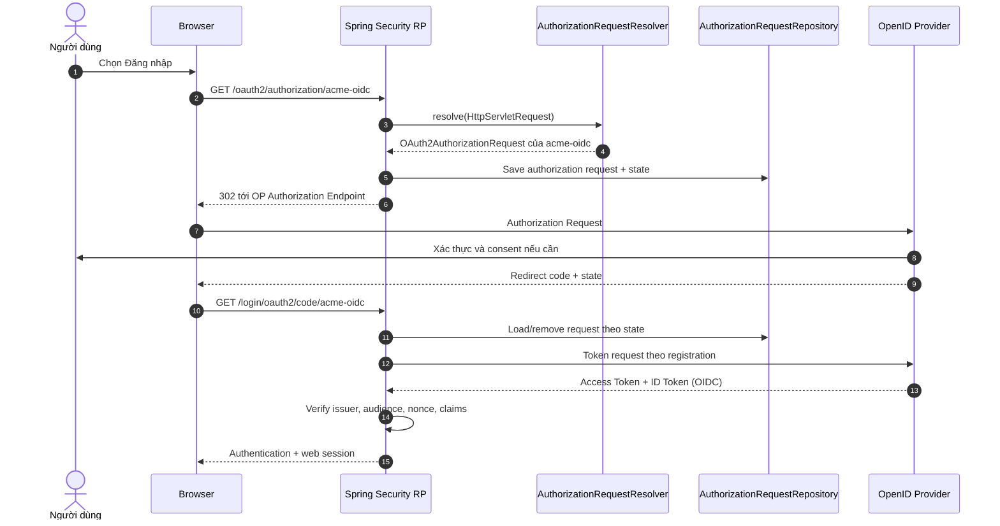

# 26.5. Resolver tùy chỉnh để chọn đúng registration

> **Module:** Spring Security OAuth 2.0 OIDC Client  
> **Chương:** 26. Đa tenant  
> **Trọng tâm:** Xây `OAuth2AuthorizationRequestResolver` tùy chỉnh trong Spring Security Servlet để chọn đúng `ClientRegistration` theo tenant, hostname hoặc route đã được kiểm soát; đảm bảo toàn bộ Authorization Code/OIDC Login sử dụng thống nhất registration, state và identity context.

Một ứng dụng SaaS hỗ trợ hàng chục tổ chức có thể cho mỗi tổ chức đăng nhập bằng một OpenID Provider (OP) khác nhau. Ví dụ: tenant `acme` sử dụng Keycloak của công ty, tenant `globex` sử dụng một nhà cung cấp OIDC khác. Một số tenant lại dùng chung OP nhưng có **Client ID**, **Client Secret**, **redirect URI** hoặc **scopes** riêng.

Khi người dùng mở:

```text
GET https://app.example.test/t/acme/login
```

ứng dụng cần chọn **đúng ClientRegistration** cho tenant `acme` trước khi tạo Authorization Request. Nếu chọn sai, browser có thể được đưa tới OP của tổ chức khác, Token Endpoint không chấp nhận code, validation ID Token báo sai issuer/audience hoặc — nguy hiểm hơn — ứng dụng vô tình gắn một identity vào tenant không đúng.

Spring Security cung cấp `DefaultOAuth2AuthorizationRequestResolver`, phù hợp khi registration ID đã nằm trong URL mặc định:

```text
/oauth2/authorization/{registrationId}
```

Với multi-tenant routing, ta có thể bọc resolver mặc định bằng một `OAuth2AuthorizationRequestResolver` riêng, ánh xạ một **tenant identifier đã được kiểm soát** sang **registration ID đã có trong ClientRegistrationRepository**.

**Điểm mấu chốt:** resolver tùy chỉnh phải **chọn registration nhất quán**, không chỉ sửa `authorizationUri` hoặc `client_id` trên request rồi bỏ qua Token Endpoint, callback, issuer validation và lưu authorized client. Nó cũng **không thay thế** kiểm tra user thực sự thuộc tenant nào sau khi OIDC Login thành công.

---

## 1. Mục tiêu học tập

Sau bài này, bạn có thể:

1. Giải thích vì sao nhiều tenant thường cần nhiều `ClientRegistration` hoặc một chính sách định tuyến registration.
2. Phân biệt tenant ID, registration ID, provider ID, OIDC issuer và OAuth2 `client_id`.
3. Mô tả nơi `OAuth2AuthorizationRequestResolver` tham gia vào Authorization Code/OIDC Login của Spring Security Servlet.
4. Phân biệt hai method `resolve(HttpServletRequest)` và `resolve(HttpServletRequest, String)`.
5. Dùng `DefaultOAuth2AuthorizationRequestResolver` làm delegate để giữ state, redirect URI và các extension points mặc định.
6. Viết resolver chọn registration từ route được allowlist, không cho browser tự cung cấp issuer hoặc token URL.
7. Đăng ký resolver vào `HttpSecurity.oauth2Login().authorizationEndpoint().authorizationRequestResolver(...)`.
8. Thiết kế ánh xạ `tenant -> registrationId` khi một tenant có một hay nhiều OP.
9. Hiểu cách `state` và `AuthorizationRequestRepository` liên kết giao dịch login với callback.
10. Tránh tin `Host`, `X-Forwarded-Host` hoặc query string chưa xác minh để chọn tenant.
11. Giải thích vì sao OIDC `iss/sub` và tenant membership phải được kiểm tra **sau** authentication.
12. Xác định các rủi ro mix-up, account linking sai, open redirect, SSRF qua dynamic discovery và confused deputy.
13. Hiểu cách xử lý đa tenant khi Client registrations được nạp động từ database hoặc control plane.
14. Phân biệt Servlet resolver với các interfaces tương đương trong WebFlux.
15. Viết unit/integration tests cho mapping, callback, sessions, nhiều tabs, đăng nhập sai tenant và thay đổi cấu hình khi login đang diễn ra.

## 2. Bài toán: “đúng registration” nghĩa là gì?

Ví dụ cấu hình:

```text
Tenant acme:
  registrationId = acme-oidc
  issuer         = https://login.acme.test/realms/employees
  clientId       = app-acme
  redirectUri    = https://app.example.test/login/oauth2/code/acme-oidc

Tenant globex:
  registrationId = globex-oidc
  issuer         = https://identity.globex.test/oidc
  clientId       = app-globex
  redirectUri    = https://app.example.test/login/oauth2/code/globex-oidc
```

Khi request bắt đầu bằng `/t/acme/login`, hệ thống phải:

1. Nhận diện tenant `acme` từ dữ liệu routing được kiểm soát.
2. Tra ánh xạ `acme -> acme-oidc` từ registry nội bộ.
3. Đảm bảo `acme-oidc` thực sự là registration đã được cấu hình/cho phép.
4. Tạo Authorization Request theo `ClientRegistration("acme-oidc")`.
5. Lưu Authorization Request cùng state trong repository.
6. Redirect browser tới Authorization Endpoint của **Acme OP**.
7. Khi callback, dùng cùng registration/context để đổi code và xác minh token.
8. Xác nhận principal vừa đăng nhập có quyền tham gia tenant `acme` trước khi cấp quyền ứng dụng.

Nếu bước 4 dùng Acme nhưng bước 7 lại dùng Globex, giao dịch không còn nhất quán. Nếu bước 8 bị bỏ qua, người dùng hợp lệ tại một OP có thể bị nhận nhầm là thành viên của tenant khác.

### 2.1. Một URL không phải bản thân registration

```text
/t/acme/login
```

chỉ là **đầu vào chọn tenant**. Nó không chứa đủ thông tin cho OIDC Login. `ClientRegistration` còn bao gồm Client ID, authentication method, authorization grant type, redirect URI, scopes, issuer và các provider endpoints.

## 3. Phân biệt năm loại định danh

| Thuật ngữ | Ví dụ | Ai định nghĩa? | Vai trò |
|---|---|---|---|
| Tenant ID | `acme` | Ứng dụng SaaS | Không gian dữ liệu/quyền của một tổ chức |
| Registration ID | `acme-oidc` | Ứng dụng Spring Security | Khóa tra `ClientRegistration` |
| Provider ID | `acme-op` | Ứng dụng Spring Boot | Tái sử dụng provider config cho registrations |
| Issuer `iss` | `https://login.acme.test/realms/employees` | OP | Định danh nguồn phát OIDC tokens |
| OAuth2 `client_id` | `app-acme` | AS/OP cấp cho RP | Nhận diện OAuth2 Client tại AS |
| Subject `sub` | `user-734` | OP | Định danh user trong phạm vi issuer |

Một issuer có thể có **nhiều registrations** vì từng tenant dùng Client ID riêng. Một Client registration thường thuộc một issuer/provider context cụ thể. Không suy ra tenant chỉ bằng tên provider hoặc domain email.

### 3.1. Registration ID phải ổn định và không nhập nhằng

Nếu mỗi tenant có một registration, convention như:

```text
acme-oidc
globex-oidc
initech-oidc
```

có thể dễ quản lý. Nhưng tên này vẫn chỉ là **khóa nội bộ**, không phải bằng chứng người dùng thuộc tenant. Nếu tenant đổi tên hoặc được chuyển OP, cần chiến lược migration, redirect URIs và session/authorized-client lifecycle.

### 3.2. Khi một tenant có nhiều phương thức đăng nhập

Một tenant có thể cho phép hai OPs:

```text
acme -> acme-employees-oidc
acme -> acme-partners-oidc
```

Khi đó hàm ánh xạ không thể chỉ nhận tenant; nó cần **lựa chọn login method đã allowlist** và policy tương ứng:

```text
(tenant, loginMethod) -> registrationId
```

Không cho browser truyền `registrationId` bất kỳ và coi đó là một login method được phép cho tenant.

## 4. Luồng Spring Security OAuth2 Login trước khi tùy chỉnh

Trên Servlet stack, luồng tiêu biểu:



Khi tùy chỉnh resolver, đoạn đầu có thể bắt đầu từ:

```text
GET /t/acme/login
```

sau đó resolver tự tra `acme-oidc`. **Các bước sau** phải tiếp tục dùng cùng registration và state một cách nhất quán.

## 5. Resolver nằm ở đâu trong Spring Security Servlet?

Interface:

```java
org.springframework.security.oauth2.client.web.OAuth2AuthorizationRequestResolver
```

Hợp đồng chính:

```java
OAuth2AuthorizationRequest resolve(HttpServletRequest request);

OAuth2AuthorizationRequest resolve(
    HttpServletRequest request,
    String clientRegistrationId);
```

Trong đó:

- Method không có registration ID xử lý tình huống resolver phải tự chọn.
- Method nhận `clientRegistrationId` có thể được các thành phần khác gọi khi registration đã được chỉ định.
- Resolver trả một `OAuth2AuthorizationRequest` phù hợp hoặc `null` nếu request không nằm trong phạm vi nó xử lý.
- Nó có thể ném lỗi OAuth2 phù hợp khi đầu vào cần từ chối theo policy, thay vì trả một request không an toàn.

### 5.1. DefaultOAuth2AuthorizationRequestResolver

Implementation mặc định:

```java
org.springframework.security.oauth2.client.web.DefaultOAuth2AuthorizationRequestResolver
```

Nó có thể được tạo với:

```java
new DefaultOAuth2AuthorizationRequestResolver(
    clientRegistrationRepository,
    "/oauth2/authorization"
);
```

Thông thường nó khớp:

```text
/oauth2/authorization/{registrationId}
```

và tạo Authorization Request từ cấu hình tương ứng. Nó còn cung cấp cơ chế customizer để điều chỉnh thêm request parameters.

**Đừng tự dựng lại toàn bộ Authorization Request** chỉ để đổi registration; tốt hơn là tìm đúng registration ID rồi ủy quyền cho resolver mặc định.

## 6. Chọn resolver hay chọn ClientRegistrationRepository?

Hai trách nhiệm khác nhau:

| Thành phần | Câu hỏi nó trả lời | Ví dụ |
|---|---|---|
| Tenant routing/policy | Request này muốn đăng nhập tenant nào? | `/t/acme/login` |
| Custom authorization request resolver | Client registration nào được dùng để bắt đầu OAuth2? | `acme-oidc` |
| `ClientRegistrationRepository` | Chi tiết Client registration đó là gì? | Client ID, secret, issuer, URLs |
| Authorization request repository | State và ngữ cảnh của transaction hiện tại là gì? | State ↔ authorization request |
| Authentication provider/token response client | Đổi code và xác minh đăng nhập | Token Endpoint, ID Token decoder |
| Account/tenant membership service | Principal vừa xác thực có thuộc tenant không? | `(issuer,sub) -> tenant membership` |

Tạo custom resolver không thay thế một repository đáng tin. Resolver chỉ **chọn khóa**; repository mới cung cấp thông tin đăng ký đầy đủ cho các bước sau.

### 6.1. Nếu Client registrations đã cố định

Chỉ cần `InMemoryClientRegistrationRepository` hoặc Boot auto-configuration kèm allowlisted mapping.

### 6.2. Nếu tenants được thêm trong runtime

Cần `ClientRegistrationRepository` có khả năng tra registrations đã được provisioning, kiểm soát cấu hình và cập nhật lifecycle; resolver chỉ dùng registrations đang **active/approved**. Không nên tự load issuer metadata từ URL được truyền trong request login.

## 7. Chọn tenant từ dữ liệu nào?

Những nguồn thường gặp:

1. **Path:** `/t/acme/login`.
2. **Subdomain:** `acme.app.example.test/login`.
3. **Định danh tenant sau một bước nhập email/domain:** discovery thuộc control plane.
4. **Deep link** do sản phẩm cung cấp, có state/signature.
5. **Tenant switcher** khi người dùng đã authenticated.
6. **Login method selection** trong một tenant.

Độ tin cậy của chúng khác nhau.

### 7.1. Path có thể do attacker lựa chọn

Bất kỳ browser nào có thể mở:

```text
/t/acme/login
```

Điều này không sai: login initiation thường là public entry point. Tuy nhiên **chọn Acme để đăng nhập không chứng minh user thuộc Acme**. Sau khi OP xác thực, hệ thống phải kiểm tra issuer/subject và tenant membership.

### 7.2. Hostname qua proxy cần trust boundary

Khi dùng `Host` hoặc `X-Forwarded-Host` để xác định tenant, cần:

- Chỉ nhận hostnames trong allowlist/tenant domain registry.
- Cấu hình reverse proxy xóa/ghi lại forwarded headers từ nguồn không đáng tin.
- Chỉ tin forwarded headers từ proxies được kiểm soát.
- Chuẩn hóa hostname, port, casing, Unicode/punycode theo policy.
- Tránh wildcard suffix match như `host.endsWith("example.test")` không có dấu chấm/boundary kiểm soát.
- Bảo vệ `{baseUrl}`/redirect-uri khỏi host header injection.
- Kiểm tra custom domain ownership và TLS trước khi kích hoạt.

Không dùng:

```java
String issuer = request.getParameter("issuer");
String authorizationUri = issuer + "/authorize";
```

để trực tiếp định tuyến OAuth2. Nó tạo rủi ro SSRF, discovery giả, token leakage và identity mix-up.

## 8. Thiết kế ánh xạ tenant → registration an toàn

Ví dụ registry nhỏ, tĩnh:

```java
Map<String, String> routes = Map.of(
    "acme", "acme-oidc",
    "globex", "globex-oidc"
);
```

Các giá trị registration phải tồn tại trong `ClientRegistrationRepository`.

Quy tắc:

- Tenant ID được kiểm tra cú pháp với allowlist.
- Registration ID không đến trực tiếp từ browser.
- Unknown tenant không rơi về “default admin tenant”.
- Disabled tenant không được bắt đầu login flow như active.
- Nếu tenant có nhiều login methods, key nên gồm method đã được allowlist.
- Đổi tenant/provider cần chính sách cho sessions và in-flight authorization requests.

### 8.1. Không dùng default registration cho tenant không biết

Phản ví dụ:

```java
return map.getOrDefault(tenant, "super-admin-oidc");
```

Một typo hoặc tenant giả sẽ bị chuyển tới registration rộng quyền. Tốt hơn, trả lỗi định tuyến rõ ràng (404/4xx theo UX) và không phát Authorization Request.

## 9. Cấu hình hai Client registrations trong Spring Boot

```yaml
spring:
  security:
    oauth2:
      client:
        registration:
          acme-oidc:
            provider: acme-op
            client-id: acme-portal
            client-secret: ${ACME_OIDC_CLIENT_SECRET}
            client-authentication-method: client_secret_basic
            authorization-grant-type: authorization_code
            redirect-uri: "{baseUrl}/login/oauth2/code/{registrationId}"
            scope:
              - openid
              - profile
              - email
          globex-oidc:
            provider: globex-op
            client-id: globex-portal
            client-secret: ${GLOBEX_OIDC_CLIENT_SECRET}
            client-authentication-method: client_secret_basic
            authorization-grant-type: authorization_code
            redirect-uri: "{baseUrl}/login/oauth2/code/{registrationId}"
            scope:
              - openid
              - profile
        provider:
          acme-op:
            issuer-uri: https://login.acme.test/realms/employees
          globex-op:
            issuer-uri: https://identity.globex.test/oidc
```

Tên miền và values đều để minh họa. Trong production:

- Issuer phải trùng metadata OIDC OP thật.
- Client secrets nằm ở secret manager/environment; không commit.
- Redirect URI phải được đăng ký với từng OP.
- TLS, forwarded headers và externally visible base URL cần nhất quán.
- Registration names phải ổn định cho callback routing.

### 9.1. Tại sao redirect URI có registrationId?

Một callback phổ biến:

```text
/login/oauth2/code/acme-oidc
/login/oauth2/code/globex-oidc
```

cho phép Spring Security tra registration trong quá trình xử lý callback, cùng với authorization request đã được lưu trước đó.

Không chỉ sửa URL Authorization Endpoint của Acme trong khi callback vẫn dùng registration của Globex.

## 10. Viết TenantAwareOAuth2AuthorizationRequestResolver

Ví dụ dưới đây chọn registration từ route:

```text
/t/{tenant}/login
```

Mỗi tenant có đúng một registration và mapping được khai báo tĩnh trong lab.

```java
package example.security;

import java.util.Map;
import java.util.Objects;
import java.util.regex.Matcher;
import java.util.regex.Pattern;

import jakarta.servlet.http.HttpServletRequest;

import org.springframework.security.oauth2.client.registration.ClientRegistrationRepository;
import org.springframework.security.oauth2.client.web.DefaultOAuth2AuthorizationRequestResolver;
import org.springframework.security.oauth2.client.web.OAuth2AuthorizationRequestResolver;
import org.springframework.security.oauth2.core.endpoint.OAuth2AuthorizationRequest;

public final class TenantAwareAuthorizationRequestResolver
        implements OAuth2AuthorizationRequestResolver {

    private static final Pattern LOGIN_ROUTE =
        Pattern.compile("^/t/([a-z0-9][a-z0-9-]{0,31})/login$");

    private final OAuth2AuthorizationRequestResolver delegate;
    private final Map<String, String> routes;

    public TenantAwareAuthorizationRequestResolver(
            ClientRegistrationRepository registrations,
            Map<String, String> tenantRegistrations) {

        this.delegate = new DefaultOAuth2AuthorizationRequestResolver(
            registrations,
            "/oauth2/authorization"
        );
        this.routes = Map.copyOf(tenantRegistrations);
    }

    @Override
    public OAuth2AuthorizationRequest resolve(HttpServletRequest request) {
        String tenant = tenantFromRequestPath(request);
        if (tenant == null) {
            return null;
        }

        String registrationId = routes.get(tenant);
        if (registrationId == null) {
            return null; // Không tự chọn một default registration.
        }

        return resolve(request, registrationId);
    }

    @Override
    public OAuth2AuthorizationRequest resolve(
            HttpServletRequest request,
            String clientRegistrationId) {

        String tenant = tenantFromRequestPath(request);
        if (tenant == null) {
            return null;
        }

        String allowedRegistrationId = routes.get(tenant);
        if (allowedRegistrationId == null
                || !Objects.equals(
                    allowedRegistrationId,
                    clientRegistrationId
                )) {
            return null;
        }

        OAuth2AuthorizationRequest result =
            delegate.resolve(request, allowedRegistrationId);

        if (result == null) {
            return null;
        }

        // Gắn ngữ cảnh nội bộ vào authorization request đã có.
        // Giữ nguyên state, redirect-uri và PKCE/nonce do delegate xử lý.
        return OAuth2AuthorizationRequest.from(result)
            .attributes(attributes ->
                attributes.put("app_tenant", tenant)
            )
            .build();
    }

    private static String tenantFromRequestPath(
            HttpServletRequest request) {

        String uri = request.getRequestURI();
        String context = request.getContextPath();

        if (!uri.startsWith(context)) {
            return null;
        }

        String applicationPath = uri.substring(context.length());
        Matcher matcher = LOGIN_ROUTE.matcher(applicationPath);

        return matcher.matches() ? matcher.group(1) : null;
    }
}
```

### 10.1. Giải thích từng phần

- `LOGIN_ROUTE` chỉ chấp nhận đường dẫn có tenant slug theo format được phép, tránh lấy một URL tự do.
- `Map.copyOf(...)` giữ snapshot mapping không bị caller sửa trực tiếp trong lab.
- `resolve(request)` nhận diện tenant và gọi overload thứ hai bằng registration đã allowlist.
- `resolve(request, registrationId)` kiểm tra lại registration được yêu cầu có thuộc tenant trong route hay không.
- `delegate.resolve(request, allowedRegistrationId)` để Spring Security tạo Authorization Request từ registration đúng.
- `OAuth2AuthorizationRequest.from(result)` bảo toàn các thuộc tính quan trọng của request gốc.
- Attribute `app_tenant` chỉ là dữ liệu nội bộ cho transaction; không tự làm user trở thành member của tenant đó.
- Nếu route không thuộc resolver hoặc tenant không có mapping, trả `null` để không tự phát redirect tới một provider mặc định.

### 10.2. Quy tắc cho unknown tenant

Trong ví dụ, resolver trả `null` nên request tiếp tục tới các filters/controller khác; tùy ứng dụng nó có thể trả 404 hoặc đi vào authorization entry point khác. **Với production, cần định nghĩa rõ UX/error handler** để unknown/disabled tenant không bị redirect tới một registration ngầm.

### 10.3. Resolver không chịu trách nhiệm kiểm tra account membership

Nếu user mở `/t/acme/login` rồi OP Acme phát ID Token hợp lệ, đó mới chứng minh một identity được xác thực bởi Acme OP. Ứng dụng vẫn phải ánh xạ `(issuer, sub)` và kiểm tra người đó có quyền vào tenant Acme hay không.

### 10.4. Không sửa state bằng giá trị dễ đoán

Không thay `state` của delegate bằng `"acme"` hay `"globex"`; state phải là giá trị khó đoán để bảo vệ correlation/CSRF của OAuth2 Authorization Code Flow. Nếu cần nhớ tenant, hãy để trong server-side authorization request attributes hoặc state được thiết kế/kiểm tra độc lập.

## 11. Wiring resolver vào SecurityFilterChain

Ví dụ Spring Security Servlet:

```java
package example.security;

import java.util.Map;

import org.springframework.context.annotation.Bean;
import org.springframework.context.annotation.Configuration;
import org.springframework.security.config.Customizer;
import org.springframework.security.config.annotation.web.builders.HttpSecurity;
import org.springframework.security.oauth2.client.registration.ClientRegistrationRepository;
import org.springframework.security.oauth2.client.web.OAuth2AuthorizationRequestResolver;
import org.springframework.security.web.SecurityFilterChain;

@Configuration
public class MultiTenantSecurityConfig {

    @Bean
    OAuth2AuthorizationRequestResolver tenantAuthorizationRequestResolver(
            ClientRegistrationRepository registrations) {

        return new TenantAwareAuthorizationRequestResolver(
            registrations,
            Map.of(
                "acme", "acme-oidc",
                "globex", "globex-oidc"
            )
        );
    }

    @Bean
    SecurityFilterChain securityFilterChain(
            HttpSecurity http,
            OAuth2AuthorizationRequestResolver tenantAuthorizationRequestResolver)
            throws Exception {

        return http
            .authorizeHttpRequests(auth -> auth
                .requestMatchers("/", "/error", "/t/*/login")
                    .permitAll()
                .anyRequest().authenticated()
            )
            .oauth2Login(login -> login
                .authorizationEndpoint(endpoint -> endpoint
                    .authorizationRequestResolver(
                        tenantAuthorizationRequestResolver
                    )
                )
            )
            .build();
    }
}
```

Cấu hình minh họa cho Spring Security Servlet 6.x và Jakarta Servlet stack. Trong môi trường production, thêm authorization checks, CSRF, session management, headers và các routes nghiệp vụ theo policy ứng dụng.

### 11.1. Điều gì xảy ra với URL mặc định?

Vì resolver trên chỉ nhận `/t/{tenant}/login`, đường:

```text
/oauth2/authorization/acme-oidc
```

có thể **không còn được xử lý như trước**. Đây có thể là chủ đích để buộc tất cả login đi qua tenant routing. Nếu cần giữ URL mặc định cho nội bộ, hãy viết policy cụ thể, không mở một đường bypass multi-tenant mapping.

### 11.2. Vì sao custom baseUri của delegate vẫn là /oauth2/authorization?

Ở ví dụ, code gọi overload `delegate.resolve(request, registrationId)` với registration ID đã lựa chọn. Delegate lo tạo `OAuth2AuthorizationRequest`; outer resolver lo nhận route khác. Nếu thay route semantics hoặc Spring Security version, cần xác nhận method overload và filter behavior qua integration test.

Không đặt hai cơ chế mapping cạnh nhau mà không biết request nào sẽ được match trước.

## 12. Resolver phải hỗ trợ cả hai overload

Một lỗi hay gặp:

```java
@Override
public OAuth2AuthorizationRequest resolve(HttpServletRequest request) {
    // Có logic tenant.
}

@Override
public OAuth2AuthorizationRequest resolve(
        HttpServletRequest request,
        String clientRegistrationId) {
    return delegate.resolve(request, clientRegistrationId);
}
```

Nếu overload thứ hai bỏ qua kiểm tra tenant, một component có thể yêu cầu registration không thuộc tenant đang hiện trên route. Hãy áp **cùng policy allowlist** trong cả hai methods.

Một thiết kế tốt có thể tách hàm:

```text
parseTenant(request)
  -> lookupAllowedRegistration(tenant, loginMethod)
  -> verifyRequestedRegistration(optional)
  -> delegate.resolve(request, allowedRegistration)
```

Và test cả hai overload, không chỉ request GET qua browser.

## 13. Không tự xây Authorization Request từ đầu khi không cần

Một Authorization Request bao gồm nhiều tham số bảo mật:

- `client_id`;
- `response_type=code`;
- `scope`;
- `state`;
- `redirect_uri`;
- `nonce` cho OIDC trong flow thích hợp;
- `code_challenge` và `code_challenge_method` khi dùng PKCE;
- provider-specific parameters đã được cấu hình;
- attributes nội bộ của Spring Security.

Nếu copy thủ công vài tham số rồi bỏ state/nonce/PKCE, có thể làm login lỗi hoặc giảm bảo vệ.

Đúng hướng:

```java
OAuth2AuthorizationRequest base =
    delegate.resolve(request, selectedRegistrationId);

return OAuth2AuthorizationRequest.from(base)
    .attributes(attrs -> attrs.put("app_tenant", tenant))
    .build();
```

Việc dùng `from(base)` giữ request đã được framework tạo, thay vì dựng mới với builder thiếu dữ liệu.

## 14. AuthorizationRequestRepository và state

Spring Security lưu authorization request đã tạo trước khi redirect browser tới OP. Trên Servlet stack, một repository phổ biến là:

```java
HttpSessionOAuth2AuthorizationRequestRepository
```

Nó phục vụ việc khôi phục request khi callback mang `code` và `state` quay lại.

### 14.1. Tại sao cần giữ registration trong request được lưu?

Ví dụ:

```text
Login start: /t/acme/login
Selected: acme-oidc
Generated state: unpredictable-value-91...
Callback: /login/oauth2/code/acme-oidc?code=...&state=...
```

Khi callback, Spring Security cần đối chiếu `state` và authorization request được lưu, rồi xử lý code với registration tương ứng. Nếu tenant/provider bị thay giữa chừng, không được lấy URL mới của user để ghi đè thông tin đã gắn với giao dịch.

### 14.2. Không tin callback query tenant

Phản ví dụ:

```text
/login/oauth2/code/acme-oidc?code=...&state=...&tenant=globex
```

Nếu app cho `tenant=globex` ghi đè context đã chọn trước redirect, đây là điểm gây cross-tenant confusion. Tenant context phải đến từ transaction đã được bảo vệ và identity mapping đáng tin, không phải query parameter thêm vào sau.

### 14.3. Nhiều tabs và concurrent logins

Một browser session có thể có hai tabs cùng bắt đầu OIDC Login cho hai tenants. Session-based authorization request repository và cách lưu state cần được kiểm thử; một số implementation/chính sách chỉ giữ request gần nhất hoặc có những ràng buộc khiến transaction cũ không còn.

Nếu sản phẩm yêu cầu nhiều login attempts song song:

- Thiết kế/reuse repository có correlation theo state.
- Có TTL, one-time consume và chống replay.
- Không lưu raw authorization request chứa secrets tại browser.
- Không dùng một shared mutable `currentTenant` trên toàn session như nguồn duy nhất.
- Kiểm tra callback tương ứng đúng attempt dù tabs redirect khác nhau.

Không hứa multi-tab login an toàn chỉ vì resolver biết chọn registration đúng ở bước đầu.

## 15. Callback URL và registration consistency

Thông thường:

```yaml
redirect-uri: "{baseUrl}/login/oauth2/code/{registrationId}"
```

trong từng `ClientRegistration`.

Khi callback:

```text
/login/oauth2/code/acme-oidc
```

framework cần có cùng registration `acme-oidc`. Nếu callback bị sửa thành `globex-oidc` hoặc `state` không khớp, phải từ chối.

### 15.1. Đừng chọn registration mới ở callback từ Host/query

Resolver tùy chỉnh trong bài chủ yếu chạy **trước redirect tới OP**. Không nên ở callback lấy một `tenant` mới từ query/Host rồi tùy ý đổi registration mà framework đã dùng cho authorization request gốc.

### 15.2. Khi reverse proxy đổi host hoặc scheme

Một ứng dụng sau reverse proxy có thể nhìn thấy:

```text
Internal: http://service:8080
External: https://acme.app.example.test
```

`{baseUrl}` phải được xử lý an toàn để redirect URI khớp giá trị đã đăng ký tại OP. Chỉ tin forwarded headers từ trusted proxies, không nhận `X-Forwarded-Host` của client tùy tiện.

Sai forwarded headers có thể gây redirect mismatch, open redirect hoặc host header injection.

## 16. OIDC xác thực không thay tenant authorization

Khi OP trả ID Token, Spring Security cần xác minh:

- Chữ ký/JWK trust.
- `iss` khớp issuer của registration.
- `aud`/Client ID và các yêu cầu audience tương ứng.
- `exp`, `iat`, clock skew.
- `nonce` khi được sử dụng.
- Các điều kiện OIDC khác theo flow.

Sau đó, ứng dụng cần kiểm tra **user có được phép vào tenant hay không**.

Ví dụ:

```text
Requested tenant: acme
Registration: acme-oidc
Verified issuer: https://login.acme.test/realms/employees
Verified subject: user-734
Internal tenant membership: acme -> active member?
```

Một ID Token hợp lệ không tự chứng minh quyền mở mọi workspace hay dữ liệu trong Acme. OIDC xác thực danh tính; tenant membership và business authorization phải do policy ứng dụng quyết định.

### 16.1. Dùng issuer + subject làm khóa identity

Trong OIDC, `sub` có phạm vi issuer:

```text
(issuer=Acme, sub=123)
(issuer=Globex, sub=123)
```

không mặc nhiên là cùng người. Không ghép account theo `sub` đơn lẻ hoặc email chưa được xác minh.

### 16.2. Không chỉ dựa vào claim groups

Một OP có thể trả `groups` hoặc `roles`, nhưng điều đó không tự cấp quyền `ROLE_ADMIN` của ứng dụng. Cần kiểm tra nguồn claims, tenant, tenant-specific scopes và ánh xạ permissions đúng quy định.

## 17. Resolver theo hostname thay vì path

Một SaaS có thể dùng:

```text
https://acme.app.example.test/login
https://globex.app.example.test/login
```

Luồng:

```text
Trusted Host
    -> canonical domain registry
    -> tenant ID
    -> allowlisted registration ID
    -> DefaultOAuth2AuthorizationRequestResolver delegate
```

### 17.1. Vì sao phải có domain registry?

Không nên tự lấy phần trước dấu chấm đầu tiên rồi coi đó là tenant:

```java
// PHẢN VÍ DỤ, không có domain validation:
String tenant = request.getServerName().split("\\.")[0];
```

Ứng dụng có thể có:

- custom domains như `login.customer.example`;
- `www`, `api`, `localhost` hoặc internal hostnames;
- reverse proxy forwarded headers;
- tenant aliases;
- domains trùng/mất ownership;
- Unicode domain names.

Dùng registry đã xác minh ownership:

```text
acme.app.example.test  -> tenant acme
globex.app.example.test -> tenant globex
login.customer.test    -> tenant customer-x
```

### 17.2. Không đọc X-Forwarded-Host trực tiếp ở resolver

Nếu proxy chưa sanitize header, attacker có thể tự gửi giá trị và điều hướng registration/redirect-uri. Hãy thiết lập trusted proxy handling tại hạ tầng/Spring config phù hợp rồi xác thực canonical hostname bằng registry.

### 17.3. Path và hostname đồng thời

Một ứng dụng có thể nhận:

```text
Host: acme.app.example.test
Path: /t/globex/login
```

Phải có policy rõ: từ chối mismatch hoặc chọn nguồn duy nhất được phép. Không âm thầm ưu tiên query/path ở một bước rồi Host ở bước khác, vì dễ tạo mix-up.

## 18. Resolver theo login method trong cùng tenant

Ví dụ tenant Acme có:

```text
/t/acme/login/employee
/t/acme/login/partner
```

Registry:

```java
record LoginRoute(String tenant, String method) {}

Map<LoginRoute, String> registrations = Map.of(
    new LoginRoute("acme", "employee"), "acme-employees-oidc",
    new LoginRoute("acme", "partner"), "acme-partners-oidc"
);
```

Lưu ý:

- `method` là một enum/allowlisted slug, không phải raw issuer URL.
- UX có thể cho user chọn login method, nhưng membership/roles được kiểm tra sau authentication.
- Provider `partner` không mặc nhiên có quyền nhân viên nội bộ.
- Nếu một provider bị vô hiệu hóa, registry phải từ chối login mới.
- Khi cập nhật registration, xác định số phận các in-flight login attempts và active sessions.

## 19. Multi-tenant dynamic ClientRegistrationRepository

Khi khách hàng mới được thêm runtime, Spring Boot `application.yml` không đủ cho mọi cấu hình động. Một kiến trúc có thể tách:

```text
Tenant onboarding / admin control plane
    |
    v
Validate issuer metadata, endpoints, clientId, secret reference
    |
    v
Approve tenant provider configuration
    |
    v
Versioned ClientRegistration registry
    |
    v
TenantRoutingResolver -> registration ID
    |
    v
OAuth2 Login pipeline
```

Custom `ClientRegistrationRepository.findByRegistrationId(...)` có thể đọc từ cache/config store đáng tin. Việc lưu secrets nên thông qua vault/secret manager, không nhúng vào client-visible URLs.

### 19.1. Không tự resolve arbitrary issuer-uri khi browser gửi request

Phản ví dụ:

```text
GET /login?issuer=http://169.254.169.254/...
```

Nếu server fetch OIDC discovery từ giá trị này, nó có thể gây SSRF, truy cập internal metadata endpoints hoặc tin JWK giả. Chỉ chấp nhận providers đã được onboarding/approved, dùng HTTPS, allowlist/network egress và metadata validation thích hợp.

### 19.2. Cấu hình động phải đồng bộ trên nhiều instances

Một request login có thể bắt đầu ở instance A và callback trở lại instance B. Cả hai phải tìm được cùng registration version hoặc một snapshot phù hợp với transaction.

- Shared control-plane registry/cache.
- Replication/versioning.
- Sticky sessions không thay thế config consistency.
- Có kế hoạch rotate Client secret/keys.
- Không xóa registration đang có active callback mà không có migration policy.
- Audit thay đổi issuer, Client ID, redirect URI và allowed scopes.

## 20. Một tenant có dùng chung registration với tenant khác được không?

Có thể nếu kiến trúc và OP hỗ trợ một Client ID/issuer dùng cho nhiều tenants. Ví dụ app có một OIDC registration cho corporate shared IdP, sau login mapping user → workspace riêng.

Lúc này:

```text
acme -> shared-oidc
globex -> shared-oidc
```

Resolver không đủ để phân tách tenant data access; cả hai routes dùng cùng OAuth2 Client. Cần **state-bound tenant context và membership checks** để ngăn một user chuyển sang workspace không được cấp quyền.

### 20.1. Khi nào nên tách registrations?

Có thể cần registration riêng theo tenant nếu:

- Mỗi tenant có Client ID/secret riêng.
- Redirect URI/issuer khác nhau.
- OP/tenant policy riêng.
- Scopes/claims, token audience hoặc consent khác.
- Billing/quota/audit theo tenant.
- Cần revoke/rotate credential độc lập.

Đừng nhân số registrations chỉ để phân quyền resource tại RP nếu một shared Client đúng thiết kế vẫn đáp ứng; cũng đừng gom registrations của những issuers khác nhau thành một để “đơn giản hóa” callback.

## 21. Lưu tenant context ở đâu cho callback?

Tenant được chọn trước redirect nhưng callback diễn ra ở request khác. Các lựa chọn:

- **Authorization request attributes server-side** gắn với `state`.
- Session/transaction store riêng keyed by secure state.
- Context trong redirect URI chỉ khi có đăng ký và kiểm soát rõ, không tin raw query.
- Một key transaction do application tự quản lý với TTL/one-time consume.

### 21.1. Attributes không tự thay Authentication

Trong ví dụ resolver:

```java
OAuth2AuthorizationRequest.from(result)
    .attributes(a -> a.put("app_tenant", tenant))
    .build();
```

chỉ lưu thêm dữ liệu trong authorization request được Spring Security xử lý. Nó **không tự động** xuất hiện dưới dạng `Authentication.getAuthorities()` hay membership đã xác minh. Nếu cần dùng trong post-login checks, phải có integration đáng tin để lấy transaction context và đối chiếu user identity.

### 21.2. Không đưa tenant nhạy cảm vào state ở dạng plaintext

`state` nên được xem là correlation token khó đoán và được kiểm tra. Không dùng `state=tenant-id`; nếu cần opaque state chứa dữ liệu, phải có ký/mã hóa/nonce, expiry, one-time use và chống tampering thích hợp. Server-side state lookup thường đơn giản và ít rủi ro hơn.

## 22. Mix-up attack và cross-tenant confusion

Khi RP liên hệ nhiều Authorization Servers, có thể xuất hiện nhầm **AS/OP của authorization response** nếu Client không duy trì sự liên kết đúng giữa request ban đầu, issuer, callback và state.

Ví dụ sai:

```text
Start: tenant acme -> OP A
Callback: code from OP B
Application: chọn OP B vì query provider=b
Token exchange: gửi nhầm code/client secret
```

Cách ngăn:

1. Chọn registration trước redirect từ allowlisted registry.
2. Lưu authorization request/correlation state an toàn.
3. Không cho callback override registration bằng param tùy ý.
4. Dùng redirect URI/registration binding đúng.
5. Xác minh OIDC issuer, audience, nonce theo framework.
6. Đảm bảo secrets/token requests chỉ tới configured Token Endpoint.
7. Kiểm tra support cho OAuth2 Authorization Server issuer identification khi applicable.
8. Không tự bỏ các checks của Spring Security khi tùy biến.

### 22.1. Issuer của OP không phải tenant ID

Một issuer có thể phục vụ nhiều tenants; một tenant có thể dùng nhiều issuers. Định tuyến login và kiểm tra membership có thể dựa trên hai mô hình khác nhau; cần một mapping chính thức và test được.

## 23. Open redirect và redirect-uri injection

Nếu resolver tự tạo redirect URI theo user input:

```java
// PHẢN VÍ DỤ:
String redirectUri = request.getParameter("redirect_uri");
```

và đưa trực tiếp vào OAuth2AuthorizationRequest, Client có nguy cơ bị redirect sai miền, leak code hoặc bị OP từ chối redirect mismatch.

Nguyên tắc:

- Sử dụng redirect URI template đã đăng ký trong `ClientRegistration`.
- Nếu hỗ trợ custom domain, chỉ dùng các domains đã verify ownership.
- Không lấy giá trị Host/Forwarded trực tiếp từ nguồn không tin cậy.
- Không dùng wildcard redirect URI thiếu kiểm soát.
- Nếu có return-to URL sau login, kiểm tra allowlist/internal-path rules và lưu trong transaction state an toàn, không biến nó thành redirect_uri OAuth2.

## 24. Không thay issuer/provider endpoints theo query request

Một số developer sửa:

```java
OAuth2AuthorizationRequest.from(existing)
    .authorizationUri(userInputUrl)
    .build();
```

để “đổi provider”. Nhưng Client registration vẫn có Token Endpoint, JWKS URI, issuer, Client ID và secret của provider ban đầu. Kết quả có thể là login lỗi hoặc mix-up nghiêm trọng.

**Đổi registration thì chọn đúng ClientRegistration từ đầu.** Không chỉ sửa một URI đơn lẻ.

Nếu cần dynamic provider onboarding, xác minh cấu hình tại control plane, tạo registration hợp lệ và để framework dùng nó xuyên suốt Authorization Code Flow.

## 25. Không suy authorization từ registration ID

Một người dùng có thể đăng nhập thành công qua `acme-oidc` nhưng chỉ được phép xem tenant `acme` với role `VIEWER`.

Không dùng:

```java
if ("acme-oidc".equals(registrationId)) {
    grant("ROLE_ADMIN");
}
```

Registration xác định **Client và OP** đã dùng, không phải business role của user. Cần tra membership/permissions từ nguồn tin cậy; kiểm tra account disabled, tenant suspended, user deprovisioned và các giới hạn authorization khác.

### 25.1. Account linking

Một internal user có thể liên kết:

```text
(issuer A, sub A-123) -> internalUser U42
(issuer B, sub B-987) -> internalUser U42
```

nhưng việc liên kết phải được xác minh và có audit. Cùng email giữa hai issuers không đủ tự động liên kết. Một resolver chọn đúng issuer không làm account linking trở nên hợp lệ.

## 26. Session và principal trong môi trường nhiều tenant

Sau OIDC Login, Spring Security Servlet có thể lưu `OAuth2AuthenticationToken`/`OidcUser` trong `SecurityContext` của HTTP session.

Cần phân biệt:

- **Login tenant:** tenant mà user đã chọn để xác thực.
- **Identity issuer/subject:** cặp OIDC identity đã xác minh.
- **Active workspace:** workspace/tenant mà UI đang thao tác.
- **Authorization tenant:** tenant đã được policy cho phép truy cập tài nguyên.
- **Authorized client:** OAuth2 credentials dùng gọi API thay user, có thể gắn với registration/principal.

Không dùng một `HttpSession.setAttribute("tenant", queryValue)` chưa xác minh để cấp quyền. Mọi request cross-tenant cần authorization check; UI tenant switcher không phải authentication event.

### 26.1. Session fixation

Spring Security có cơ chế chống session fixation có thể thay session ID sau login. Nếu lưu tenant transaction state trong một session trước callback, cần kiểm tra tương tác giữa authorization request repository, session rotation và cấu hình phiên.

Không dựa vào một session ID cố định xuyên suốt mọi bước login.

### 26.2. Logout và đổi tenant

Khi user đổi tenant, ứng dụng có thể yêu cầu:

- Chuyển workspace nếu identity có membership tương ứng;
- Bắt đầu OIDC Login mới với registration của tenant khác;
- Giữ session hiện tại và authorization cho nhiều workspaces theo policy;
- Logout khỏi phiên cũ trước khi login lại.

Không coi thay đổi active tenant là thay đổi registration được áp ngược vào authorization request đang xử lý.

## 27. AuthorizedClientRepository và nguy cơ dùng token sai tenant

Sau login, Client có thể lưu `OAuth2AuthorizedClient` theo registration ID/principal name.

Nếu multi-tenant dùng chung một registration hoặc principal naming không có namespace rõ, có nguy cơ lấy token của tenant khác khi code tự gọi:

```java
authorizedClientService.loadAuthorizedClient(
    registrationId,
    principalName
);
```

Điểm cần giữ:

- Registration đúng API target và tenant context.
- Principal key được suy từ Authentication/identity đã xác minh.
- Nếu tenant là thành phần tách biệt của authorization context, storage design phải phân vùng tương ứng.
- Không lấy principal name từ query parameter của browser.
- Không chuyển access token có audience A sang Resource Server B.
- Không để token cache key chỉ chứa Client ID khi nhiều users/tenants dùng chung Client.

Resolver đúng ở login là cần thiết nhưng chưa đủ cho token storage isolation.

## 28. Provider-specific parameters không phải registration selection

Các tham số như:

- `prompt`;
- `login_hint`;
- `hd` (provider-specific);
- `domain_hint` (provider-specific);
- `acr_values`;
- `max_age`;

có thể điều chỉnh trải nghiệm đăng nhập nhưng **không đồng nghĩa** chọn Client registration đúng.

Ví dụ `login_hint=alice@acme.test` không phải chứng cứ người đăng nhập thuộc tenant Acme. `domain_hint` có thể bị OP bỏ qua và phải được dùng theo contract.

### 28.1. setAuthorizationRequestCustomizer

Nếu đã biết registration đúng, Spring Security hỗ trợ customizer trên `DefaultOAuth2AuthorizationRequestResolver` trong những version phù hợp, ví dụ để thêm tham số đã được validate.

Đó là **bước sau** selection. Đừng thay việc chọn registration bằng một `login_hint` rồi bỏ tenant membership check.

## 29. Khi một tenant bị disabled hoặc đổi OP

Giả sử admin vô hiệu hóa Acme tenant trong lúc user đang login:

```text
T0: /t/acme/login -> acme-oidc
T1: Authorization Request được lưu, browser sang OP
T2: Tenant acme bị disabled
T3: Callback code/state quay lại
```

Nếu callback chỉ kiểm tra ID Token mà không kiểm tra tenant state, một user có thể được đăng nhập vào tenant vừa disabled.

Cần:

- Đánh giá tenant/account status tại login success hoặc trước cấp quyền.
- Chính sách khi registration bị rotate/disable giữa giao dịch.
- Giữ registration snapshot đủ lâu cho active callback nếu được phép hoặc reject có chủ đích.
- Invalidate sessions/authorized clients khi tenant offboarding.
- Chặn background jobs thuộc tenant disabled.
- Không để in-flight attempt ghi lại state active đã revoked.

## 30. Cache và performance của tenant mapping

Một SaaS lớn có thể có nhiều registrations, nhưng không nên mỗi request login đồng bộ gọi remote control plane mà không cache/timeout.

Cân nhắc:

- Cache allowlisted mapping với TTL/version.
- Negative caching thận trọng cho unknown tenant.
- Invalidation khi tenant disabled, provider rotated hoặc domain ownership changed.
- Không cache lỗi network thành “default provider”.
- Không cache secrets ở unencrypted shared cache.
- Giới hạn concurrency và chống login request flooding.
- Metrics để phân biệt resolver lookup latency và Token Endpoint latency.

### 30.1. Cache key phải phân vùng đúng

Nếu selection phụ thuộc hostname + tenant + login method, cache key phải chứa tất cả thông số liên quan. Không dùng chỉ `tenantSlug` nếu cùng slug tồn tại trong nhiều environments/organizations.

## 31. Chuyển hướng đăng nhập từ URL mặc định sang URL tenant-aware

Một kiến trúc đơn giản hơn custom resolver hoàn chỉnh có thể là:

1. MVC controller nhận `/t/{tenant}/login`.
2. Kiểm tra tenant trên server.
3. Redirect tới `/oauth2/authorization/{allowedRegistrationId}`.
4. Default resolver xử lý.

Ưu điểm:

- Ít tùy biến Spring Security internals.
- Dễ hiểu với registrations tĩnh.
- Dễ test URL mapping.

Hạn chế:

- Có thể để lộ URL mặc định và cho caller bỏ qua bước tenant policy nếu không kiểm soát.
- Nếu tenant context cần được gắn chặt với authorization request, cần thiết kế state binding.
- Host-based routing/customized parameters có thể phức tạp.
- Multi-provider selection vẫn cần policy chính thức.

**Khi yêu cầu chỉ là ánh xạ route -> registration, controller redirect có thể đủ**. Dùng custom resolver khi cần quản lý authorization initiation trực tiếp trong Spring Security hoặc tích hợp tenant context/params chặt chẽ.

## 32. Ưu tiên một nguồn sự thật cho tenant routing

Không đặt mỗi lớp một rule riêng:

```text
Controller: acme -> acme-oidc
Custom resolver: acme -> globex-oidc
Success handler: acme -> shared-oidc
Authorized client manager: acme -> default-m2m
```

Điều này tạo inconsistency và khó kiểm thử.

Nên có một `TenantIdentityRoutingService` hoặc registry phiên bản hóa với contract rõ:

```text
resolveLoginRegistration(tenantId, loginMethod)
resolveExpectedIssuer(registrationId)
resolveInternalTenant(issuer, subject)
isTenantActive(tenantId)
isIdentityMember(tenantId, issuer, subject)
```

Đây là các interface **ứng dụng tự thiết kế**, không phải các methods sẵn có của Spring Security. Mỗi hàm phục vụ một quyết định khác nhau; tránh trộn routing với authorization.

## 33. WebFlux có resolver riêng

Nếu ứng dụng chạy **Spring WebFlux**:

- Cấu hình bảo mật dùng `ServerHttpSecurity` và `SecurityWebFilterChain`.
- Client registrations dùng `ReactiveClientRegistrationRepository`.
- Request context là `ServerWebExchange` thay vì `HttpServletRequest`.
- Resolver tương ứng là `ServerOAuth2AuthorizationRequestResolver`; implementation mặc định là `DefaultServerOAuth2AuthorizationRequestResolver` ở phiên bản phù hợp.
- Resolver reactive trả `Mono<OAuth2AuthorizationRequest>` thay vì object đồng bộ.

Không dùng code:

```java
OAuth2AuthorizationRequestResolver servletResolver;
HttpServletRequest servletRequest;
HttpSecurity http;
```

để thay trực tiếp vào WebFlux. Hai stacks có API và storage khác nhau.

### 33.1. Không block event loop để tra tenant

Nếu tenant routing trong WebFlux cần Redis/R2DBC/API, dùng reactive data access và compose `Mono`. Tránh `block()` trong resolver reactive.

### 33.2. Các nguyên tắc bảo mật không đổi

Dù Servlet hay WebFlux:

- Chọn registration từ trusted mapping.
- Bảo toàn state/PKCE/nonce.
- Không nhận arbitrary issuer endpoints.
- Validate issuer/audience/subject.
- Kiểm tra tenant membership sau authentication.
- Phân vùng session/authorized clients đúng identity/tenant.

## 34. MockMvc test cho resolver

Unit test có thể gọi trực tiếp resolver với mock servlet request:

```java
import static org.assertj.core.api.Assertions.assertThat;
import org.junit.jupiter.api.Test;
import org.springframework.mock.web.MockHttpServletRequest;
import org.springframework.security.oauth2.core.endpoint.OAuth2AuthorizationRequest;

@Test
void selectsAcmeRegistration() {
    MockHttpServletRequest request =
        new MockHttpServletRequest("GET", "/t/acme/login");

    OAuth2AuthorizationRequest authorization =
        resolver.resolve(request);

    assertThat(authorization).isNotNull();
    assertThat(authorization.getClientId())
        .isEqualTo("acme-portal");
    assertThat(authorization.getAuthorizationUri())
        .isEqualTo("https://login.acme.test/realms/employees/protocol/openid-connect/auth");
}
```

Đoạn test giả định:

- `resolver` được tạo từ repository fixture với `acme-oidc`.
- Fixture có Authorization Endpoint đúng URL đã khẳng định.
- OP test metadata được cố định.

Không dựa vào URL của một OP thật nếu không có network test contract; trong unit test nên dùng `ClientRegistration.withRegistrationId(...)` để xây fixture rõ.

### 34.1. Test những gì ngoài client_id?

- `state` không rỗng và có tính ngẫu nhiên trong các lần gọi.
- `redirectUri` đúng registration/base URL.
- Scopes theo tenant.
- Callback registration/issuer phù hợp.
- Attributes `app_tenant` được gắn đúng.
- Request tenant unknown trả kết quả/error theo policy.
- Overload `resolve(request, registrationId)` không bypass tenant.
- Request ngoài `/t/{tenant}/login` không bị resolver bắt nhầm.

## 35. Integration test với MockMvc và test OP

MockMvc có thể kiểm tra redirect từ login entry:

```java
import static org.springframework.test.web.servlet.request.MockMvcRequestBuilders.get;
import static org.springframework.test.web.servlet.result.MockMvcResultMatchers.status;
import static org.springframework.test.web.servlet.result.MockMvcResultMatchers.header;
import static org.hamcrest.Matchers.startsWith;

mockMvc.perform(get("/t/acme/login"))
    .andExpect(status().is3xxRedirection())
    .andExpect(header().string(
        "Location",
        startsWith("https://login.acme.test/")
    ));
```

Đây là một kiểm thử initiation route, **chưa chứng minh** authorization code/token exchange hoặc ID Token validation.

Để kiểm tra end-to-end:

1. Dùng mock OP/Authorization Server cho hai issuers.
2. Ghi nhận URL authorization, Client ID, state, redirect URI.
3. Trả authorization code đúng registration.
4. Hoàn tất token exchange với Client authentication tương ứng.
5. Xác minh ID Token đúng issuer/audience/nonce.
6. Xác minh wrong issuer và wrong state bị từ chối.
7. Kiểm tra post-login tenant membership.
8. Kiểm tra session không nhận quyền của tenant khác.

### 35.1. mockOAuth2Login hoặc oidcLogin test có giới hạn

Spring Security Test có thể tạo mock Authentication để kiểm tra controllers/security rules. Nhưng mock login không tự đi qua custom Authorization Request Resolver hay OP/token exchange thật. Cần integration test riêng cho routing.

## 36. Các tình huống bảo mật nên test

| Tình huống | Kỳ vọng |
|---|---|
| `/t/acme/login` | Dùng `acme-oidc` |
| `/t/globex/login` | Dùng `globex-oidc` |
| Unknown tenant | Không fallback sang privileged/default registration |
| Malformed tenant slug | Không match; không bị decode sai |
| Request path khác login | Resolver trả null |
| Overload yêu cầu sai registration | Không trả Authorization Request |
| Query `?registrationId=globex-oidc` trên đường Acme | Không đổi registration |
| Query `?issuer=...` | Không fetch arbitrary discovery |
| Host/path tenant mismatch | Từ chối theo policy |
| Untrusted forwarded host | Không ảnh hưởng tenant/redirect URI |
| State bị thay đổi | Callback bị từ chối |
| Callback registration bị đổi | Không token exchange sang provider khác |
| ID Token sai issuer | Bị từ chối |
| ID Token sai audience | Bị từ chối |
| Identity từ OP hợp lệ nhưng không thuộc tenant | Không cấp quyền tenant |
| Cùng sub ở hai issuers | Hai identities tách biệt |
| Email giống ở hai issuers | Không auto-link |
| Tenant disabled trong login | Reject theo state hiện tại |
| Tenant registration bị rotate | Callback xử lý theo version policy |
| Two tabs login hai tenants | State/correlation không lẫn |
| Session fixation ID rotation | Không làm mất/nhầm login context |
| Token storage dùng sai principal | Không truy cập authorized client của tenant khác |

## 37. Lỗi thường gặp trong triển khai

| Triệu chứng | Nguyên nhân khả dĩ | Hướng xử lý |
|---|---|---|
| Login luôn tới OP mặc định | Resolver trả null hoặc config chưa được wiring | Kiểm tra filter chain/resolver matching |
| `authorization_request_not_found` | State/repository không khớp, cookie/session mất, multi-tab | Kiểm tra state, session, callback và request repository |
| `invalid_state_parameter` | State bị đổi hoặc dùng lại | Không bypass CSRF state validation |
| `invalid_redirect_uri` tại OP | URI không đăng ký, Host/forwarded headers sai | Kiểm tra trusted base URL và OP registration |
| `invalid_client` tại Token Endpoint | Client ID/secret/method của registration sai | Kiểm tra ClientRegistration của tenant |
| `invalid_grant` | Code dùng sai Client/redirect URI, hết hạn hoặc reused | Kiểm tra callback và token exchange binding |
| `invalid_id_token` | Issuer/audience/signature/nonce sai | Không bỏ validation, đối chiếu OP metadata |
| User của Globex truy cập Acme | Membership check thiếu | Kiểm tra issuer/sub và tenant authorization |
| Một tenant khác cùng sub bị nhận nhầm | Identity key chỉ có sub | Namespace theo issuer |
| Một request đi tới authorization URL lạ | Dynamic issuer/authorizationUri từ input | Chỉ dùng approved registrations |
| Resolver chọn đúng OP nhưng callback dùng sai Client | Callback/registration inconsistency | Giữ registration và state từ authorization request gốc |
| Dùng host spoof đổi redirect URI | Forwarded headers chưa trusted | Cấu hình proxy trust + host allowlist |
| Chạy được ở một pod, lỗi ở pod khác | Registration caches/session state không đồng bộ | Shared/versioned registry và session store |
| Login hai tabs bị lỗi ngẫu nhiên | Concurrent transaction state bị ghi đè | Đánh giá repository keyed by state |
| Spring Boot tự đổi sang MVC | Cùng WebFlux và MVC starters | Xác định application type và đúng resolver API |

## 38. Lab A — Hai tenants và một resolver

**Mục tiêu:** triển khai ví dụ `/t/{tenant}/login`.

1. Tạo hai Client registrations trong test environment.
2. Tạo map `acme -> acme-oidc`, `globex -> globex-oidc`.
3. Viết `TenantAwareAuthorizationRequestResolver` dùng delegate.
4. Gắn resolver vào `HttpSecurity.oauth2Login()`.
5. Gọi `/t/acme/login` và kiểm tra Location/Client ID.
6. Gọi `/t/globex/login` và kiểm tra registration khác.
7. Gọi `/t/unknown/login`; không redirect tới default provider.
8. Thử query thêm `registrationId=globex-oidc` ở Acme URL và xác nhận không đổi registration.

**Kết quả mong đợi:** routing tạo Authorization Request của Client đã được cho phép theo tenant, không tin override của browser.

## 39. Lab B — Bảo vệ callback và state

**Mục tiêu:** thấy selection đúng phải được giữ xuyên suốt flow.

1. Bắt đầu login Acme với test OP.
2. Lưu authorization request/state đúng repository.
3. Trả callback `code` và `state` hợp lệ.
4. Xác minh Token Endpoint của Acme được gọi và ID Token được validate.
5. Thay `state` trong callback; đăng nhập phải thất bại.
6. Thay callback registration ID thành Globex; không được dùng code Acme như Globex.
7. Thử hai tabs login Acme và Globex đồng thời.
8. Kiểm tra transaction repository có xử lý đúng multiple attempts hay không.

**Kết quả mong đợi:** state và registration binding chống callback mix-up, không chỉ kiểm tra URL ở bước đầu.

## 40. Lab C — Shared issuer, hai tenant registrations

**Mục tiêu:** phân biệt issuer với registration.

1. Dùng một OP test phục vụ Acme và Globex.
2. Đăng ký hai Client IDs khác nhau, cùng issuer.
3. Cấu hình `acme-oidc` và `globex-oidc`.
4. Xác minh resolver chọn đúng Client ID cho từng tenant.
5. Kiểm tra callback đổi code bằng Client authentication tương ứng.
6. Xác minh ID Token audience/client ID.
7. Không cấp quyền Acme cho user chỉ vì họ có identity hợp lệ tại cùng issuer.
8. Thử account disabled/tenant membership missing.

**Kết quả mong đợi:** cùng OP không có nghĩa chung registration hay quyền truy cập tenant.

## 41. Lab D — Host-based routing và reverse proxy

**Mục tiêu:** ngăn Host/forwarded-header injection.

1. Chuẩn bị registry `acme.app.test -> acme` và `globex.app.test -> globex`.
2. Gửi request với Host Acme hợp lệ, kiểm tra route.
3. Gửi Host không có trong allowlist, phải từ chối.
4. Gửi untrusted `X-Forwarded-Host: globex.app.test` và xác minh không đổi tenant.
5. Cấu hình trusted reverse proxy trong test network.
6. Kiểm tra externally visible `{baseUrl}` cho redirect URI.
7. Thử host/path mismatch và xem policy từ chối.
8. Không sử dụng metadata của OP URL do browser đưa vào.

**Kết quả mong đợi:** host routing chỉ dựa trên nguồn được xác minh, redirect URI không bị attacker điều khiển.

## 42. Lab E — User thuộc sai tenant

**Mục tiêu:** tách identity validation và membership authorization.

1. Bắt đầu OIDC Login qua Acme.
2. Test OP trả ID Token có issuer/audience hợp lệ.
3. Membership store báo user không thuộc Acme.
4. Ứng dụng từ chối vào workspace Acme hoặc không cấp tenant authorities.
5. Thử user được thêm membership và login lại.
6. Thử cùng `sub` từ Globex issuer.
7. Thử email giống nhau giữa hai issuers.
8. Kiểm tra logs không chứa raw tokens.

**Kết quả mong đợi:** chọn registration đúng không tự tạo quyền membership.

## 43. Lab F — Dynamic onboarding và config changes

**Mục tiêu:** xử lý lifecycle của registration trong SaaS lớn.

1. Provision một tenant mới ở control-plane registry.
2. Validate issuer metadata, redirect URI, Client ID/secret references và allowlist.
3. Publish approved registration cùng version.
4. Resolver dùng registration ID mới.
5. Bắt đầu login rồi rotate secret/config trước callback.
6. Xác minh policy xử lý in-flight flow.
7. Disable tenant trong lúc login và từ chối quyền ở bước post-auth.
8. Kiểm tra các pods có registration view nhất quán.

**Kết quả mong đợi:** dynamic registration có trust boundary, versioning và failure policy, không tự khám phá issuer từ request input.

## 44. Những hiểu lầm cần tránh

| Hiểu lầm | Cách hiểu đúng |
|---|---|
| “Resolver chọn tenant nghĩa user chắc thuộc tenant đó.” | Tenant membership phải xác minh sau authentication. |
| “Registration ID là issuer.” | Registration là khóa nội bộ, issuer do OP phát hành. |
| “Một issuer chỉ có một registration.” | Nhiều Client IDs/registrations có thể dùng chung issuer. |
| “Một tenant luôn có một OP.” | Tenant có thể nhiều login methods/providers. |
| “Chọn issuer chỉ bằng query là linh hoạt.” | Dễ gây SSRF/mix-up và tin untrusted OP. |
| “Chỉ cần sửa authorizationUri để đổi provider.” | Token Endpoint, client ID, issuer/JWKS và callback vẫn phải thống nhất. |
| “Query tenant trong callback đáng tin.” | Tenant context phải được bind với authorization transaction. |
| “State có thể là tên tenant.” | State cần ngẫu nhiên, khó đoán và được đối chiếu. |
| “Có OIDC ID Token hợp lệ là được vào mọi workspace.” | OIDC xác thực danh tính, không tự cấp tenant authorization. |
| “Cùng email từ hai OP là cùng một người.” | Không tự account-link bằng email. |
| “Custom resolver thay thế ClientRegistrationRepository.” | Resolver chọn key, repository trả configuration. |
| “Logout/login routing có thể dùng arbitrary Host.” | Host/forwarded headers phải được trusted và allowlisted. |
| “Spring Security auto-config tự biết mọi tenant runtime.” | Dynamic provisioning cần repository/registry riêng. |
| “Unit test mockOidcLogin chứng minh resolver đúng.” | Cần test initiation route và callback/token exchange. |
| “Hai tabs luôn an toàn vì state khác.” | Authorization request repository/concurrency phải được kiểm thử. |
| “WebFlux dùng nguyên Servlet resolver.” | Reactive stack có interface và request context khác. |

## 45. Câu hỏi tự kiểm tra

**Câu 1.** Interface dùng để tùy chỉnh bước tạo Authorization Request trên Servlet stack là gì?

*Gợi ý:* `OAuth2AuthorizationRequestResolver`.

**Câu 2.** Vì sao nên delegate sang `DefaultOAuth2AuthorizationRequestResolver`?

*Gợi ý:* giữ logic tạo request/state/redirect URI và những protocol parameters do framework quản lý.

**Câu 3.** Khi browser mở `/t/acme/login`, có chứng minh user là thành viên Acme không?

*Gợi ý:* không; đó chỉ là một request initiation có thể do ai cũng gửi.

**Câu 4.** Hai tenants cùng issuer có thể dùng hai registrations khác nhau không?

*Gợi ý:* có, nếu khác Client ID/secret/scope/redirect policies.

**Câu 5.** Nếu callback có query `tenant=globex` nhưng authorization request gốc chọn Acme, nên làm gì?

*Gợi ý:* không cho query ghi đè transaction context.

**Câu 6.** Vì sao không lấy `X-Forwarded-Host` trực tiếp từ browser để xác định tenant?

*Gợi ý:* có thể bị giả mạo nếu proxy trust chưa đúng.

**Câu 7.** Method overload thứ hai của resolver cần kiểm tra điều gì?

*Gợi ý:* registration ID được yêu cầu có thuộc allowlisted mapping của tenant không.

**Câu 8.** Chỉ thay Authorization Endpoint URL nhưng giữ Token Endpoint/JWK của registration cũ có vấn đề gì?

*Gợi ý:* issuer mix-up, token exchange thất bại hoặc rủi ro bảo mật.

**Câu 9.** Tại sao cặp `(issuer, sub)` cần được dùng trong account mapping?

*Gợi ý:* sub có phạm vi issuer.

**Câu 10.** Khi tenant bị disabled trong lúc callback đang chờ, có thể chỉ dựa trên ID Token hợp lệ để cho vào ứng dụng không?

*Gợi ý:* không; cần kiểm tra state/membership/tenant policy hiện tại.

**Câu 11.** Vì sao `OAuth2AuthorizedClientService.loadAuthorizedClient(...)` cần chính sách tenant isolation?

*Gợi ý:* phương thức nhận registration/principal, không tự biết request hiện tại có quyền đọc token không.

**Câu 12.** Một regression test nên đếm thông tin gì trong redirect tới OP?

*Gợi ý:* Client ID, Authorization Endpoint, state, scopes, redirect URI và provider của tenant được chọn.

## 46. Checklist áp dụng production

1. **Routing source:** Tenant lấy từ path/host/domain registry nào, có allowlist không?
2. **Provider mapping:** Mỗi tenant/login method ánh xạ đúng registration ID?
3. **Registration validation:** Client ID, secret, issuer, token endpoint, JWKS và redirect URI đã được approved?
4. **Default behavior:** Unknown tenant bị từ chối, không fallback sang privileged Client?
5. **Resolver overloads:** Cả hai `resolve(...)` đều enforce cùng tenant policy?
6. **State:** Authorization Request được lưu/đối chiếu đúng; không dùng raw tenant làm state?
7. **Callback:** Registration/issuer/client binding được giữ qua code exchange?
8. **OIDC validation:** Signature, issuer, audience, nonce và expiry không bị bypass?
9. **Membership:** Có kiểm tra `(issuer, sub)` thuộc tenant sau login?
10. **Host/proxy:** Forwarded headers được sanitized/trusted; redirect base URL an toàn?
11. **Account linking:** Có ngăn tự liên kết theo email?
12. **Token storage:** Authorized clients được phân vùng đúng principal/tenant/audience?
13. **Runtime changes:** Disabled tenant/config rotation có policy cho callbacks đang chạy?
14. **Multiple tabs:** Có test concurrent authorization requests/state repository?
15. **Multi-instance:** Shared registry/session store và version consistency?
16. **Security:** Không nhận arbitrary issuer/authorization_uri từ browser?
17. **Observability:** Có logging/metrics theo registration và kết quả không lộ token?
18. **Tests:** Có wrong issuer, wrong state, wrong registration, wrong tenant và untrusted host?

## 47. Tài liệu tham khảo

- [Spring Security Reference — OAuth 2.0 Login](https://docs.spring.io/spring-security/reference/servlet/oauth2/login/index.html): Authorization Code/OIDC Login trên Servlet.
- [Spring Security Reference — Advanced OAuth 2.0 Login](https://docs.spring.io/spring-security/reference/servlet/oauth2/login/advanced.html): Authorization Request Resolver và các điểm mở rộng.
- [Spring Security API — OAuth2AuthorizationRequestResolver](https://docs.spring.io/spring-security/reference/api/java/org/springframework/security/oauth2/client/web/OAuth2AuthorizationRequestResolver.html): hai overload của resolver.
- [Spring Security API — DefaultOAuth2AuthorizationRequestResolver](https://docs.spring.io/spring-security/reference/api/java/org/springframework/security/oauth2/client/web/DefaultOAuth2AuthorizationRequestResolver.html): resolver mặc định, base URI và customizer.
- [Spring Security API — OAuth2AuthorizationRequest](https://docs.spring.io/spring-security/reference/api/java/org/springframework/security/oauth2/core/endpoint/OAuth2AuthorizationRequest.html): authorization request và attributes.
- [Spring Security API — ClientRegistration](https://docs.spring.io/spring-security/reference/api/java/org/springframework/security/oauth2/client/registration/ClientRegistration.html): Client ID, issuer, endpoints, scope và redirect URI.
- [Spring Security API — ClientRegistrationRepository](https://docs.spring.io/spring-security/reference/api/java/org/springframework/security/oauth2/client/registration/ClientRegistrationRepository.html): lookup registration ID.
- [Spring Security API — HttpSessionOAuth2AuthorizationRequestRepository](https://docs.spring.io/spring-security/reference/api/java/org/springframework/security/oauth2/client/web/HttpSessionOAuth2AuthorizationRequestRepository.html): state và authorization request persistence.
- [Spring Security Reference — Reactive OAuth 2.0 Login](https://docs.spring.io/spring-security/reference/reactive/oauth2/login/index.html): phân biệt WebFlux resolver với Servlet.
- [Spring Security Reference — OAuth2 Client](https://docs.spring.io/spring-security/reference/servlet/oauth2/client/index.html): authorized-client lifecycle và storage.
- [OpenID Connect Core 1.0](https://openid.net/specs/openid-connect-core-1_0.html): issuer, subject, ID Token, nonce và authentication.
- [RFC 6749 — OAuth 2.0 Authorization Framework](https://www.rfc-editor.org/rfc/rfc6749): authorization request, code, state và token exchange.
- [RFC 7636 — PKCE](https://www.rfc-editor.org/rfc/rfc7636): code challenge/verifier.
- [RFC 9207 — OAuth2 Authorization Server Issuer Identification](https://www.rfc-editor.org/rfc/rfc9207): giảm rủi ro AS mix-up trong các kịch bản phù hợp.
- [RFC 9700 — OAuth2 Security Best Current Practice](https://www.rfc-editor.org/rfc/rfc9700): bảo vệ redirect, issuer/AS mix-up, Client và token lifecycle.

**Kết luận:** Một resolver multi-tenant an toàn **không phải hàm ghép URL tùy ý**. Nó là cổng quyết định login registration từ routing context và registry đã được kiểm soát, sau đó để Spring Security tạo Authorization Request chuẩn với state, redirect URI và OIDC/PKCE mechanisms phù hợp. Toàn bộ callback phải tiếp tục dùng đúng registration; issuer/subject sau xác thực phải được kiểm tra membership trước khi cấp quyền tenant. Dùng delegate mặc định, allowlist mapping, trusted proxy/domain handling và kiểm thử cả initiation lẫn callback để tránh identity mix-up, open redirect và cross-tenant token leakage.
