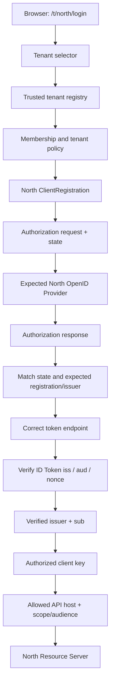
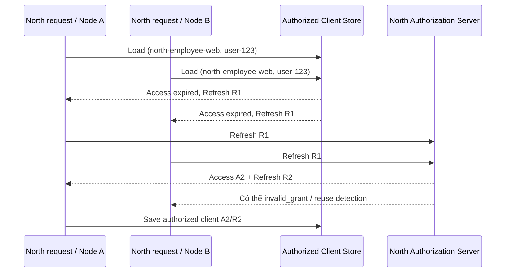

# 26.7. Ngăn nhầm lẫn issuer, client hoặc authorized client giữa các tenant

## 1. Bối cảnh: đăng nhập thành công nhưng token của tenant nào?

Một ứng dụng **Spring Security OAuth 2.0 / OpenID Connect (OIDC) Client** có thể phục vụ nhiều tổ chức (*tenants*). Mỗi tổ chức có thể dùng một OpenID Provider (OP) hoặc Authorization Server (AS) riêng, hoặc nhiều tenants cùng dùng một nhà cung cấp nhưng có realm/organization, client ID, scopes và Resource Server khác nhau.

Ví dụ **Employee Portal** phục vụ hai công ty:

| Thuộc tính | Tenant North | Tenant South |
| --- | --- | --- |
| Tenant ID nội bộ | `north` | `south` |
| OIDC issuer | `https://id.north.example.com/realms/staff` | `https://login.south.example.net/oidc` |
| Registration ID | `north-employee-web` | `south-employee-web` |
| OAuth client ID | `portal-north` | `portal-south` |
| API host | `https://api.north.example.com` | `https://api.south.example.net` |
| Quyền ví dụ | `employee.read` | `employee.read` |

Một người dùng có thể có account ở cả hai tổ chức. Vì vậy, dù cả hai ID Tokens có cùng `sub = "user-123"` hoặc cùng email, chúng **không mặc nhiên chứng minh cùng một danh tính**. Tương tự, một access token hợp lệ cho North API **không được gửi tới South API**, và một `OAuth2AuthorizedClient` được lưu dưới tên user không được tra cứu tùy ý chỉ vì HTTP request mới chứa chuỗi tên đó.

Các lỗi này thuộc nhiều dạng thường được gọi là **issuer mix-up, client confusion, tenant confusion, authorized-client/token mix-up**.

> **Quy tắc xuyên suốt:** Mỗi lần bắt đầu OIDC Login, đổi authorization code, tải authorized client hoặc gọi Resource Server, ứng dụng phải giữ được một quan hệ đáng tin cậy: **tenant → expected issuer → client registration → authenticated subject → authorized client → permitted API destination**.

Bài thuộc chương **26. Đa tenant** của module **Spring Security OAuth 2.0 OIDC Client**, tập trung vào cách thiết kế và kiểm tra quan hệ đó.

### Mục tiêu học tập

Sau bài, bạn có thể:

1. Phân biệt **tenant ID**, **issuer**, **client registration ID**, **OAuth client ID**, **subject** và **authorized client principal name**.
2. Nhận diện OAuth2 Authorization Server mix-up, OIDC ID Token mix-up và token bị gửi sai Resource Server.
3. Hiểu lý do `iss + sub` mới là định danh OIDC quan trọng, còn `sub` hoặc email đơn lẻ không đủ để tách mọi tenant.
4. Thiết kế bảng tenant-to-client mapping từ cấu hình đáng tin thay vì nhận token URI/issuer từ browser.
5. Dùng `ClientRegistrationRepository`, `OAuth2AuthenticationToken`, `OAuth2AuthorizedClientRepository` hoặc `OAuth2AuthorizedClientService` phù hợp trong Spring Security Servlet.
6. Gắn registration/principal đúng lúc gọi `OAuth2AuthorizedClientManager` hoặc `WebClient`/`RestClient`.
7. Tránh lỗi cache key `(registrationId, principalName)` khi có nhiều issuer, tenant, audience hoặc grant.
8. Kiểm tra authorization response, callback, token endpoint, ID Token và Resource Server theo đúng ngữ cảnh.
9. Xử lý migration, logout, refresh token rotation, multi-session, dynamic tenants và kiểm thử âm tính.
10. Xác định một kế hoạch vận hành giúp phát hiện cross-tenant access mà **không log token/secret**.

Ví dụ ưu tiên **Spring Boot 3.x, Spring Security 6.x, Java 17+, Spring MVC/Servlet**. Một số API chỉ xuất hiện hoặc thay đổi theo minor version; luôn đối chiếu BOM/framework đang triển khai. Phần cuối có ghi chú tương ứng cho WebFlux. Các tên host, issuer, client ID và token trong bài là **dữ liệu minh họa**.

---

## 2. Sáu khái niệm có thể trùng chuỗi nhưng không cùng ý nghĩa

### 2.1. Tenant ID

`tenantId` là định danh tổ chức trong **miền nghiệp vụ ứng dụng**:

```text
tenantId = north
tenantId = south
```

Tenant ID có thể xuất hiện trong URL như `/t/north/dashboard` hoặc tên miền riêng, nhưng giá trị do browser gửi **chưa chứng minh user là thành viên tenant đó**.

Tenant ID phải được ánh xạ qua cấu hình hoặc dữ liệu quản trị đáng tin và **kiểm tra membership/authorization** trước khi sử dụng để lấy dữ liệu hoặc token.

### 2.2. Issuer

OIDC issuer là danh tính của **OpenID Provider**, thể hiện qua `iss` trong ID Token và `issuer` của provider metadata.

```json
{
  "iss": "https://id.north.example.com/realms/staff",
  "sub": "user-123",
  "aud": "portal-north",
  "exp": 1770000000
}
```

Trong ví dụ, `iss` định danh OP phát hành token. Issuer không phải chỉ là hostname “gần giống” nhau; **issuer URL đầy đủ và chính xác** có ý nghĩa trong việc xác minh token và metadata.

Hai issuers khác nhau có thể dùng cùng `sub`. Một issuer cũng có thể phục vụ nhiều tenants, nên **issuer không luôn đủ để xác định tenant**.

### 2.3. `ClientRegistration.registrationId`

Spring Security dùng **registration ID** làm khóa nội bộ:

```text
north-employee-web
south-employee-web
```

`registrationId` chọn một `ClientRegistration` chứa client ID, grant, issuer/provider details, redirect URI, scopes và các thông tin khác.

Nó **không phải** client ID được OP cấp.

### 2.4. OAuth `client_id`

`client_id` là định danh ứng dụng **do Authorization Server cấp**. Ví dụ:

```text
North AS -> client_id=portal-north
South AS -> client_id=portal-south
```

Một AS có thể cấp nhiều client IDs cho cùng RP (web, backend, mobile, environments). Một client ID chuỗi giống nhau ở **hai issuers khác nhau** cũng không chứng minh đó là một client global duy nhất.

`client_id` thường không phải bí mật. `client_secret` hoặc private key dùng xác thực client mới cần được bảo vệ.

### 2.5. OIDC `sub` và danh tính user

`sub` là subject identifier do issuer cấp. OpenID Connect Core yêu cầu nó stable và unique **trong ngữ cảnh issuer** theo quy tắc provider.

Đối với identity correlation, dùng cặp đáng tin:

```text
(issuer, subject)
```

Ví dụ:

```text
(https://id.north.example.com/realms/staff, user-123)
(https://login.south.example.net/oidc, user-123)
```

Đây có thể là hai người hoàn toàn khác nhau.

**Email không phải identity key bất biến**: email có thể được thay đổi, tái sử dụng, chưa verified hoặc xuất hiện ở nhiều tổ chức.

### 2.6. `OAuth2AuthorizedClient.principalName`

`OAuth2AuthorizedClient` có:

```text
clientRegistration
principalName
accessToken
refreshToken (nullable)
```

`OAuth2AuthorizedClientService` thường lưu/tra cứu bằng:

```text
(registrationId, principalName)
```

Nó **không tự thêm issuer/tenant/audience vào key tiêu chuẩn**. Nếu application dùng một `registrationId` chung cho nhiều issuers hoặc principal name chưa được namespace, token của những ngữ cảnh khác nhau có thể bị ghi đè hoặc tra cứu nhầm.

### 2.7. Bảng đối chiếu

| Khái niệm | Ví dụ | Nguồn đáng tin | Không dùng để suy ra |
| --- | --- | --- | --- |
| `tenantId` | `north` | Tenant registry + membership policy | Không tự chứng minh issuer/token |
| `issuer` | `https://id.north...` | Trusted discovery/AS config + token validation | Không tự chứng minh membership |
| `registrationId` | `north-employee-web` | `ClientRegistrationRepository` được quản trị | Không phải OAuth client ID |
| `client_id` | `portal-north` | OP client registration | Không chứng minh user identity |
| `sub` | `user-123` | ID Token đã xác minh | Không unique xuyên mọi issuers |
| `principalName` | `user-123` hoặc internal key | Spring Security authenticated principal strategy | Không chứng minh quyền tenant |
| `aud` trong ID Token | `portal-north` | Validated ID Token | Không phải API audience mặc định |
| `aud` trong access token | `employee-api-north` | AS/Resource Server contract | Không suy ra từ ID Token audience |
| API host | `api.north.example.com` | Allowed API destination registry | Không chấp nhận arbitrary URL |

---

## 3. Những kiểu nhầm lẫn cần phòng ngừa

### 3.1. Authorization Server mix-up

Trong một OAuth2 Client hỗ trợ nhiều Authorization Servers, attacker có thể cố tác động để client **nhầm AS nào tương ứng với authorization response đang xử lý**.

Một dạng rủi ro cổ điển:

1. RP bắt đầu authorization flow với AS A.
2. Sau redirect/callback, RP lại xử lý response như đến từ AS B hoặc gửi authorization code đến sai Token Endpoint.
3. Mã ủy quyền, credentials hoặc token bị gửi tới một endpoint không phải nơi phát hành/được đăng ký.

Cần ràng buộc authorization request ban đầu với **expected issuer/registration** qua `state` và thông tin request được giữ tin cậy. Khi OP/AS hỗ trợ **RFC 9207 Issuer Identification**, `iss` ở authorization response giúp client phát hiện một số dạng mix-up trước khi đổi code.

**Không chỉ dựa vào callback query parameter hoặc tên path do caller thay đổi để quyết định Token Endpoint.**

### 3.2. ID Token issuer confusion

Giả sử app mong North issuer nhưng chấp nhận ID Token:

```json
{
  "iss": "https://login.south.example.net/oidc",
  "sub": "user-123",
  "aud": "portal-north"
}
```

Dù signature được xác minh bằng một JWKS nào đó, token vẫn **không đúng expected issuer**. Cần xác minh `iss` chính xác với issuer của registration đã được chọn.

Không triển khai logic “thử xác minh chữ ký bằng mọi JWKS của mọi tenant, cái nào pass thì chấp nhận” mà bỏ qua issuer/client context.

### 3.3. Client confusion

Hai registrations có cùng issuer nhưng khác OAuth clients:

```text
north-employee-web  -> client_id=portal-north-web
north-admin-tool    -> client_id=portal-north-admin
```

Nếu ID Token dành cho `north-admin-tool` bị chấp nhận khi xử lý login `north-employee-web`, ứng dụng đã bỏ qua **audience/client binding**. Với OIDC, ID Token `aud` phải chứa đúng client ID của RP đăng ký; `azp` cũng cần được xét theo quy tắc OIDC khi liên quan.

Không cho phép token dành cho một OAuth client thay thế token của OAuth client khác, dù cả hai do cùng AS phát hành.

### 3.4. Authorized-client mix-up

Nếu service load:

```java
authorizedClientService.loadAuthorizedClient(
        "shared-oidc", "user-123");
```

nhưng `shared-oidc` được tái sử dụng cho nhiều tenants và cả hai issuers có `sub=user-123`, token North có thể bị dùng ở South.

Cặp key mặc định `(registrationId, principalName)` không có tenant dimension riêng. **Tách registration IDs hoặc triển khai storage namespace đúng đắn** là yêu cầu thiết kế quan trọng.

### 3.5. Resource Server / destination confusion

Ngay cả khi lấy đúng access token, nếu app gửi:

```http
GET /v1/employees/me HTTP/1.1
Host: api.south.example.net
Authorization: Bearer <north-user-access-token>
```

thì token North đã được gửi tới nơi không được phép. Nếu Resource Server South từ chối do audience/issuer, hệ thống có thể vẫn đã tiết lộ credential cho sai đối tượng nhận.

Cần ràng buộc **registration + principal + access token + allowed API destination**, không chỉ token issuer.

### 3.6. Subject/account-linking confusion

User có cùng email trên North và South không nhất thiết là cùng một người hoặc được phép link accounts.

Ví dụ:

```text
North:
  iss=https://id.north.example.com/realms/staff
  sub=subject-91
  email=employee@example.com

South:
  iss=https://login.south.example.net/oidc
  sub=subject-17
  email=employee@example.com
```

Tự động hợp nhất hai accounts chỉ vì email giống nhau có thể tạo **account takeover/cross-tenant data access**. Account linking cần flow xác thực **cả hai tài khoản** hoặc quy tắc quản trị đáng tin, không dựa trên một claim email đơn lẻ.

### 3.7. Tenant membership confusion

Có issuer đúng, client đúng, token đúng vẫn **chưa đủ** nếu user không có quyền với tenant mà API đang truy cập.

Một issuer dùng chung cho North/South có thể phát hành ID Token hợp lệ cho mọi nhân viên. Tenant membership vẫn phải đến từ thông tin được xác minh hoặc application authorization store.

**Issuer validation xác minh nguồn token; tenant authorization xác minh quyền trong ứng dụng.**

---

## 4. Trust boundaries: từ browser đến Resource Server

### 4.1. Sơ đồ dòng tin cậy



Mỗi mũi tên có điều kiện:

- **Browser → Tenant selector:** tenant do browser đưa ra là request intent, chưa là quyền.
- **Tenant selector → Registry:** chỉ chấp nhận tenant có cấu hình được phép.
- **Registry → Registration:** mapping do backend quản lý, không từ user-supplied token URI.
- **Authorization request → Callback:** `state` phải được correlation với request đã lưu.
- **Callback → Token Endpoint:** chỉ gửi code và client credentials tới AS đã được lựa chọn.
- **Token Endpoint → ID Token:** issuer/audience/signature/expiry/nonce phải được xác minh đúng flow.
- **Identity → Store:** token gắn với namespace/registration/principal hợp lệ.
- **Store → API:** Resource Server destination, scopes và user membership phải được kiểm tra.

### 4.2. Không có một claim hay một URI thay được toàn bộ pipeline

| Kiểm tra | Phát hiện chủ yếu | Không thay thế được |
| --- | --- | --- |
| OAuth `state` | Correlation/CSRF của authorization flow | Issuer/audience validation |
| Authorization response `iss` (RFC 9207) | Một số AS mix-up trước token exchange | ID Token signature/claims validation |
| OIDC `nonce` | Binding ID Token với authorization request theo flow | Tenant membership |
| PKCE | Bảo vệ authorization code khỏi interception/replay theo cơ chế tương ứng | Issuer/client audience |
| ID Token signature | Tính toàn vẹn và nguồn khóa phù hợp | Exact expected issuer nếu không kiểm tra |
| ID Token `iss` | OP đã phát hành ID Token | Audience/`azp`/tenant membership |
| ID Token `aud`/`azp` | Token dành cho OAuth client nào | Quyền truy cập Resource Server |
| Access token audience | Token dành cho API nào | Browser tenant permission |
| Authorized-client key | Phân vùng local token record | Remote AS/resource authorization |
| API host allowlist | Giới hạn nơi gửi token | Token validation ở Resource Server |

---

## 5. OIDC issuer và client audience: xác minh đúng ngữ cảnh

### 5.1. Issuer phải khớp chính xác expected issuer

Giả sử OIDC discovery trả:

```json
{
  "issuer": "https://id.north.example.com/realms/staff",
  "authorization_endpoint": "https://id.north.example.com/realms/staff/protocol/openid-connect/auth",
  "token_endpoint": "https://id.north.example.com/realms/staff/protocol/openid-connect/token",
  "jwks_uri": "https://id.north.example.com/realms/staff/protocol/openid-connect/certs"
}
```

ID Token của login North phải có:

```json
{
  "iss": "https://id.north.example.com/realms/staff"
}
```

Không dùng `startsWith("https://id.north.example.com")` để chấp nhận realm khác, hay thay issuer URL bằng hostname duy nhất nếu provider sử dụng path/realm để phân tách tenants.

`https://example.com/tenant/A` và `https://example.com/tenant/B` là **hai issuer values khác nhau** nếu discovery/token contract quy định như vậy.

### 5.2. Chữ ký và JWKS phải gắn với issuer đã chọn

Một anti-pattern nguy hiểm:

```java
// PHẢN MẪU ý tưởng:
for (JwkSet jwks : allTenantsJwkSets) {
    if (verifySignatureWith(jwks, idToken)) {
        return accept(idToken); // Không kiểm tra expected issuer/client!
    }
}
```

Chữ ký chỉ có ý nghĩa khi gắn với **issuer và key source tin cậy**. Một hệ thống đúng phải:

1. Xác định registration/expected issuer từ authorization request đáng tin.
2. Tải JWKS đã cấu hình/discovered cho issuer đó.
3. Validate JWS signature, thuật toán được phép, `kid`/key selection theo policy.
4. Validate `iss`, `aud`/`azp`, `exp`, `iat` và `nonce`/các claims liên quan theo OIDC flow.
5. Chỉ sau đó dùng `sub`/claims để liên kết user.

Không chấp nhận arbitrary `jku`/`x5u`/JWKS URL do token header đề xuất mà không có trust policy; token header là dữ liệu do sender kiểm soát.

### 5.3. Audience của ID Token phải là đúng client ID

Ví dụ North ID Token:

```json
{
  "iss": "https://id.north.example.com/realms/staff",
  "sub": "user-123",
  "aud": "portal-north",
  "exp": 1770000000
}
```

Nếu current registration là `south-employee-web` với `client_id=portal-south`, token này **không được chấp nhận**, dù `sub` trùng và cả hai cùng nằm trong hệ thống Employee Portal.

OIDC Core yêu cầu `aud` chứa client ID của RP. Với ID Token có nhiều audiences, `azp` (authorized party) và các quy tắc liên quan phải được xử lý theo spec và OP contract. Không “bỏ qua `azp` cho dễ tương thích” khi một token được dùng ở nhiều clients.

### 5.4. `nonce` không xác định tenant

Nonce thường được dùng để liên kết ID Token với authorization request ban đầu và chống replay theo flow/protocol. Nhưng:

```text
nonce match = đúng request đã phát nonce
issuer match = đúng OP phát hành token
aud match = đúng OAuth client
membership check = user có quyền tenant được yêu cầu
```

Các điều kiện này bổ sung nhau. Nếu application lưu nonce rồi cho bất kỳ issuer/client nào ký ID Token có nonce đó, vẫn còn nguy cơ nhầm issuer/client.

### 5.5. `sub`, `sid` và email: đừng tráo đổi

- `sub`: subject do OP cấp, namespace theo issuer.
- `sid`: session identifier của OP khi được hỗ trợ, hữu ích cho OIDC logout/session management; không phải global user identity.
- `email`: profile/contact claim, không phải authentication key bất biến.
- Tenant ID: miền nghiệp vụ, có thể nằm trong claim riêng hoặc ứng dụng quản lý.
- Internal user ID: khóa account của chính ứng dụng, chỉ được liên kết sau xác minh issuer+subject và policy.

Một token có `sid` không đồng nghĩa user được phép truy cập mọi tenant của issuer đó.

---

## 6. RFC 9207 và OAuth 2.0 Authorization Server Mix-Up

### 6.1. Vấn đề xảy ra *trước khi* có ID Token

OIDC ID Token validation thường diễn ra **sau khi client đã gửi authorization code tới Token Endpoint**. Nếu code bị gửi nhầm AS, một số credential hoặc mã ủy quyền có thể đã lộ trước khi kiểm tra ID Token.

**RFC 9207 — OAuth 2.0 Authorization Server Issuer Identification** cho phép AS thêm tham số `iss` vào authorization response để client phát hiện nhầm AS sớm hơn.

Ví dụ:

```http
GET /login/oauth2/code/north-employee-web
    ?code=AUTH_CODE_VALUE
    &state=RANDOM_STATE
    &iss=https%3A%2F%2Fid.north.example.com%2Frealms%2Fstaff
```

Client cần so sánh issuer trong response với **expected issuer đã gắn với authorization request ban đầu**, không so với issuer do query/header tùy ý quyết định.

### 6.2. `iss` ở authorization response khác `iss` trong ID Token

| Vị trí | Thời điểm | Ý nghĩa |
| --- | --- | --- |
| Authorization response `iss` theo RFC 9207 | Callback trước token exchange | AS nào tạo authorization response |
| ID Token `iss` theo OIDC | Sau token exchange/ID Token validation | OP nào phát hành ID Token |
| Access token `iss` (nếu JWT) | Khi API nhận token | Token issuer theo Resource Server policy |

Đừng cho rằng một trong ba tự thay thế các kiểm tra khác.

### 6.3. Spring Security có tự áp RFC 9207 mọi phiên bản không?

**Không nên mặc định khẳng định như vậy.** Hỗ trợ issuer identification trong authorization response phụ thuộc Spring Security version, OAuth2 provider và cấu hình của application.

Trong tích hợp nhiều Authorization Servers:

- Xác định phiên bản framework thực tế và khả năng xử lý `iss` ở callback.
- Nếu AS hỗ trợ RFC 9207, đánh giá việc bật/kiểm thử hỗ trợ tương ứng.
- Nếu không, vẫn phải đảm bảo redirect URI strategy, `state` correlation, registration binding và token endpoint selection chống mix-up.
- Tách callback URIs theo issuer/registration có thể bổ sung binding, nhưng **không thay `state`/issuer verification**.
- Không tự chọn Token Endpoint bằng `iss` param chưa được kiểm tra với request đã lưu.
- Với authorization response không có `iss`, áp dụng chính sách explicit theo provider profile và threat model, không tự suy đoán issuer từ `Host` header.

### 6.4. Phản mẫu: callback quyết định registration từ query

```java
// PHẢN MẪU - không tự triển khai callback như vậy.
@GetMapping("/oauth/callback")
void callback(
        @RequestParam String code,
        @RequestParam String registrationId,
        @RequestParam String tenant) {

    // Không trao đổi code với tokenUri được lấy từ tenant/registration
    // do browser chỉ định mà không có stored authorization request.
}
```

Spring Security OAuth2 Login có sẵn authorization request repository và callback filters để correlation `state`. Hãy cấu hình flow chuẩn thay vì viết controller tự đổi code không có binding với request trước đó.

---

## 7. ClientRegistration phải có namespace rõ ràng theo tenant và mục đích

### 7.1. Registration ID là khóa lưu trữ, không chỉ tên hiển thị

Một quy ước dễ kiểm toán:

```text
<tenant>--<provider>--<purpose>
```

Ví dụ:

```text
north--staff-idp--web
south--corporate-idp--web
north--calendar--delegated
north--reports--m2m
```

Trong bài, để dễ nhìn, ta dùng `north-employee-web` và `south-employee-web`. Không có yêu cầu bắt buộc về format, nhưng **một registration ID phải không bị tái sử dụng để trỏ tới hai issuer/client khác nhau khi token cũ còn lưu**.

Nếu ứng dụng lưu token bằng `(registrationId, principalName)`, việc tái dùng registration `default` cho mọi tenant khiến store key không mang ranh giới issuer/client.

### 7.2. Spring Boot YAML tách registration

```yaml
spring:
  security:
    oauth2:
      client:
        registration:
          north-employee-web:
            provider: north-provider
            client-id: ${NORTH_OIDC_CLIENT_ID}
            client-secret: ${NORTH_OIDC_CLIENT_SECRET}
            client-authentication-method: client_secret_basic
            authorization-grant-type: authorization_code
            redirect-uri: "{baseUrl}/login/oauth2/code/{registrationId}"
            scope:
              - openid
              - profile
              - employee.read

          south-employee-web:
            provider: south-provider
            client-id: ${SOUTH_OIDC_CLIENT_ID}
            client-secret: ${SOUTH_OIDC_CLIENT_SECRET}
            client-authentication-method: client_secret_basic
            authorization-grant-type: authorization_code
            redirect-uri: "{baseUrl}/login/oauth2/code/{registrationId}"
            scope:
              - openid
              - profile
              - employee.read

        provider:
          north-provider:
            issuer-uri: https://id.north.example.com/realms/staff

          south-provider:
            issuer-uri: https://login.south.example.net/oidc
```

Các host/client ID/secret là dữ liệu minh họa. Với `issuer-uri`, Spring Boot có thể dùng OIDC discovery để cấu hình authorization/token/userinfo/JWKS endpoints. Hãy xác minh metadata/issuer thực tế của provider, không tự suy ra token URI bằng nối chuỗi.

Không đưa client secrets vào source control. Client authentication method, redirect URI và scopes phải khớp ứng dụng đã được đăng ký tại từng OP.

### 7.3. Tenant routing do backend quản trị

Ngoài OAuth registration, ứng dụng cần một bảng ánh xạ nghiệp vụ:

```yaml
app:
  tenants:
    north:
      registration-id: north-employee-web
      expected-issuer: https://id.north.example.com/realms/staff
      api-base-uri: https://api.north.example.com

    south:
      registration-id: south-employee-web
      expected-issuer: https://login.south.example.net/oidc
      api-base-uri: https://api.south.example.net
```

Tầng routing này phục vụ mục tiêu:

- Chỉ chấp nhận tenant ID từ **allowlist**.
- Tra chính xác registration của tenant.
- Biết expected issuer để phát hiện cấu hình lẫn lộn.
- Xác định API destination mà token được phép đi tới.
- Không cho browser chọn `token_uri`, `jwks_uri` hoặc `client_secret`.

Issuer không luôn đồng nghĩa tenant: hai tenants có thể dùng chung issuer nhưng client IDs, organization constraints, membership và API destinations khác nhau. Khi đó cần thêm policy tương ứng.

### 7.4. Bảng cấu hình và nguy cơ

| Phản mẫu | Rủi ro | Thiết kế thay thế |
| --- | --- | --- |
| Một registration ID `default` cho nhiều issuers | Token cache collision và wrong-client handling | IDs ổn định, phân vùng theo issuer/tenant |
| Issuer URL do query cung cấp | SSRF/discovery injection, arbitrary token/JWKS endpoint | Trusted registry |
| Registration của South dùng client secret North | Sai client authentication và lộ credentials | Secrets theo từng AS/client |
| Cùng `client_id` được hiểu là toàn cục | Trùng chuỗi khác issuer không có cùng danh tính | Bind client ID vào AS/registration |
| Cache registration theo tên issuer host bỏ path | Hai realms có thể bị trộn | Exact issuer + tenant + purpose |
| Dùng provider domain suffix match | Có thể chấp nhận host giả hoặc realm khác | Exact trusted endpoint mapping |
| Dựng redirect URI từ `Host` do user gửi | Open redirect/host header poisoning | Canonical base URL và trusted proxy config |
| Đổi issuer mà giữ token cũ | Old tokens được load dưới trust boundary mới | Migration/revoke/re-authorize rõ ràng |

---

## 8. Tenant registry và Spring Security Servlet

### 8.1. Registry bất biến minh họa

```java
package com.example.portal.tenancy;

import java.net.URI;
import java.util.Map;

import org.springframework.security.access.AccessDeniedException;
import org.springframework.stereotype.Component;

@Component
public final class TenantOidcRegistry {

    public record TenantRoute(
            String tenantId,
            String registrationId,
            URI expectedIssuer,
            URI apiBaseUri) {
    }

    private final Map<String, TenantRoute> routes = Map.of(
            "north", new TenantRoute(
                    "north",
                    "north-employee-web",
                    URI.create("https://id.north.example.com/realms/staff"),
                    URI.create("https://api.north.example.com")),
            "south", new TenantRoute(
                    "south",
                    "south-employee-web",
                    URI.create("https://login.south.example.net/oidc"),
                    URI.create("https://api.south.example.net")));

    public TenantRoute require(String tenantId) {
        TenantRoute route = routes.get(tenantId);

        if (route == null) {
            throw new AccessDeniedException("Unknown tenant");
        }

        return route;
    }
}
```

Đây là ví dụ với tenants tĩnh. Hệ thống SaaS thực tế có thể đọc registry từ database hoặc configuration service, nhưng cần validation khi onboarding và versioning khi cập nhật; **dữ liệu do browser cung cấp không được trở thành trusted ClientRegistration**.

### 8.2. Kiểm tra registry và ClientRegistration có cùng issuer

```java
import org.springframework.security.oauth2.client.registration.ClientRegistration;
import org.springframework.security.oauth2.client.registration.ClientRegistrationRepository;

public void verifyTenantRoute(
        TenantOidcRegistry.TenantRoute route,
        ClientRegistrationRepository registrations) {

    ClientRegistration registration =
            registrations.findByRegistrationId(route.registrationId());

    if (registration == null) {
        throw new IllegalStateException(
                "No registration for configured tenant");
    }

    String configuredIssuer =
            registration.getProviderDetails().getIssuerUri();

    if (!route.expectedIssuer().toString().equals(configuredIssuer)) {
        throw new IllegalStateException(
                "Tenant issuer does not match ClientRegistration");
    }

    if (!"https".equalsIgnoreCase(
            route.apiBaseUri().getScheme())) {
        throw new IllegalStateException(
                "Tenant API must use HTTPS");
    }
}
```

Đây là **fragment** phải được gọi bởi một bean validation/onboarding, không phải method tự chạy. Ở production còn cần validate API host/port, grants, scopes và URL canonicalization. Khi dùng OIDC issuer metadata, so sánh exact issuer string có ý nghĩa; với OAuth-only AS cần một trust contract tương ứng.

### 8.3. Chỉ chuyển tới OAuth login registration đã được allowlist

```java
package com.example.portal.web;

import com.example.portal.tenancy.TenantOidcRegistry;
import org.springframework.stereotype.Controller;
import org.springframework.web.bind.annotation.GetMapping;
import org.springframework.web.bind.annotation.PathVariable;

@Controller
public class TenantLoginController {

    private final TenantOidcRegistry tenants;

    public TenantLoginController(TenantOidcRegistry tenants) {
        this.tenants = tenants;
    }

    @GetMapping("/t/{tenantId}/login")
    public String startLogin(@PathVariable String tenantId) {
        var route = tenants.require(tenantId);

        return "redirect:/oauth2/authorization/"
                + route.registrationId();
    }
}
```

`/oauth2/authorization/{registrationId}` là endpoint bắt đầu OAuth2 Login phổ biến trong Spring Security. Registration ID ở đây đến từ registry, **không phải chuỗi path đã được nối vào issuer URL từ query chưa xác thực**.

Trước khi user đăng nhập, ứng dụng có thể chưa xác định được membership; **kiểm tra membership sau OIDC authentication** và trước khi trả dữ liệu tenant. Nếu sản phẩm có cơ chế invite/domain restriction ở bước login đầu, đó là policy bổ sung, không thay thế xác minh ID Token.

### 8.4. Phản mẫu login tự chọn issuer/client/token endpoint

```java
// PHẢN MẪU: đừng tự xây login bằng input chưa tin cậy.
@GetMapping("/start-login")
public String start(
        @RequestParam String issuer,
        @RequestParam String clientId,
        @RequestParam String redirectUri) {

    return "redirect:" + issuer + "/authorize?client_id=" + clientId;
}
```

Cách này mở đường cho SSRF, open redirect và client confusion, đồng thời bỏ qua các cơ chế `state`/PKCE/OIDC validation chuẩn.

---

## 9. Authorization request và callback phải ràng buộc cùng registration

### 9.1. Luồng OAuth2 Login đúng ngữ cảnh

```text
GET /t/north/login
       |
       v
Trusted registry chọn north-employee-web
       |
       v
GET /oauth2/authorization/north-employee-web
       |
       v
Create OAuth2AuthorizationRequest:
  client_id = portal-north
  redirect_uri = .../login/oauth2/code/north-employee-web
  state = unpredictable value
  scope = openid profile employee.read
       |
       v
Save authorization request in session/correlation repository
       |
       v
Redirect browser tới North Authorization Endpoint
       |
       v
Callback: code + state (+ iss khi RFC 9207 được hỗ trợ)
       |
       v
Correlate với authorization request đã lưu
       |
       v
Token request tới đúng North Token Endpoint
       |
       v
Validate North ID Token và user membership
```

Spring Security Servlet thường dùng `HttpSessionOAuth2AuthorizationRequestRepository` để lưu authorization request. Đây là **repository trước callback**, khác `OAuth2AuthorizedClientRepository` dùng access/refresh tokens sau khi authorization thành công.

### 9.2. Callback path không tự chứng minh issuer

Mặc định callback có dạng:

```text
/login/oauth2/code/{registrationId}
```

Nhưng caller có thể tự gọi URL chứa `south-employee-web` trong path. Chỉ thấy path đó **không đủ** kết luận mã ủy quyền đến từ South OP. Cần đối chiếu `state`/stored request, client registration, issuer response identifier khi có, token/ID Token validation.

### 9.3. Phản mẫu gửi code tới Token Endpoint do query chọn

```text
GET /oauth/callback
    ?code=SOME_CODE
    &state=SOME_STATE
    &token_uri=https://untrusted.example/token

Application:
    POST code + client_secret tới token_uri
```

Token URI/credentials phải được lấy từ `ClientRegistration` đáng tin, không phải query/header do caller chỉ định.

### 9.4. `state`, nonce, PKCE và response `iss` bổ sung nhau

- `state` liên kết callback với authorization request và ngăn CSRF/mix-up theo cơ chế chuẩn.
- OIDC `nonce` liên kết ID Token với request khi được sử dụng/yêu cầu.
- PKCE liên kết authorization code với verifier, giảm nguy cơ code interception.
- Authorization response `iss` (RFC 9207) giúp phát hiện một số AS mix-up trước token exchange.
- ID Token `iss/aud/azp` xác minh nguồn và intended client.
- Membership policy xác minh người dùng có quyền tenant.

Không bỏ issuer validation vì đã bật PKCE, hoặc bỏ membership vì state khớp. Các cơ chế bảo vệ **những ranh giới khác nhau**.

### 9.5. Reverse proxy, session và callback

Ở môi trường nhiều domain/nodes:

- Redirect URI đã đăng ký với OP phải khớp public callback.
- Chỉ tin `X-Forwarded-Host/Proto` từ trusted proxy; không để arbitrary `Host` quyết định `{baseUrl}`.
- Session cookie phải được gửi tới callback (Secure, SameSite, Path, Domain theo flow).
- OAuth authorization request repository cần nhất quán giữa authorization và callback.
- Multi-node phải dùng session store chung hoặc affinity theo thiết kế.
- Không log callback URL đầy đủ có `code`/`state`.
- Có cảnh báo cho state mismatch, callback issuer mismatch và thất bại token exchange.

---

## 10. Guard tenant sau khi Spring Security xác minh OIDC Login

### 10.1. Điều kiện kiểm tra khi user vào tenant

Giả sử request:

```http
GET /t/north/employees/me
```

Backend cần:

1. Authentication hiện tại đã được xác thực.
2. Login registration là `north-employee-web`.
3. ID Token issuer là North và đã qua OIDC validation.
4. `(issuer, sub)` map tới internal user account đúng.
5. User có membership/role phù hợp trong tenant North.
6. API resource ID thuộc phạm vi quyền tương ứng.

### 10.2. Example guard trong Servlet service

```java
package com.example.portal.tenancy;

import org.springframework.security.access.AccessDeniedException;
import org.springframework.security.core.Authentication;
import org.springframework.security.oauth2.client.authentication.OAuth2AuthenticationToken;
import org.springframework.security.oauth2.core.oidc.user.OidcUser;
import org.springframework.stereotype.Service;

@Service
public class TenantOidcAccessGuard {

    private final TenantOidcRegistry tenants;
    private final TenantMembershipService membership;

    public TenantOidcAccessGuard(
            TenantOidcRegistry tenants,
            TenantMembershipService membership) {
        this.tenants = tenants;
        this.membership = membership;
    }

    public TenantOidcRegistry.TenantRoute requireAccess(
            String tenantId, Authentication authentication) {

        var route = tenants.require(tenantId);

        if (!(authentication instanceof OAuth2AuthenticationToken oauth2)
                || !(oauth2.getPrincipal() instanceof OidcUser user)) {
            throw new AccessDeniedException("OIDC login required");
        }

        if (!route.registrationId().equals(
                oauth2.getAuthorizedClientRegistrationId())) {
            throw new AccessDeniedException(
                    "Wrong client registration for tenant");
        }

        String issuer =
                user.getIdToken().getClaimAsString("iss");

        if (!route.expectedIssuer().toString().equals(issuer)) {
            throw new AccessDeniedException(
                    "Wrong OIDC issuer for tenant");
        }

        String subject = user.getIdToken().getSubject();

        if (!membership.mayAccess(
                route.tenantId(), issuer, subject)) {
            throw new AccessDeniedException(
                    "No tenant membership");
        }

        return route;
    }
}
```

Business interface (do ứng dụng thực hiện):

```java
package com.example.portal.tenancy;

public interface TenantMembershipService {

    boolean mayAccess(
            String tenantId,
            String verifiedIssuer,
            String verifiedSubject);
}
```

**Guard trên nhận `Authentication` đã được Spring Security xác thực, không nhận JWT string từ browser.** Nó bổ sung tenant policy sau bước framework xác minh token; không thay thế OIDC signature/issuer/audience/nonce validation. Membership implementation phải dùng source đáng tin và fail closed, không cho phép chỉ vì email giống nhau.

### 10.3. Account ở nhiều tenants

Một user có thể có North và South accounts hợp lệ. Nhưng một `OAuth2AuthenticationToken` từ North login không tự cấp quyền South.

Muốn switch tenant:

- Thực hiện authorization/login cho South registration.
- Validate South issuer/ID Token và membership.
- Nếu cần giữ liên kết, dùng account-linking flow xác thực **cả hai** identities.
- Không tự thay `Authentication` từ North thành South dựa vào `tenantId` trong request.
- Không load South authorized client chỉ vì North principal name cũng là `user-123`.
- Kiểm soát redirect/saved-request để không vào nhầm tenant sau login.

### 10.4. Một issuer chung cho nhiều organizations

Khi cả North và South dùng **cùng issuer** nhưng khác organizations:

```text
issuer = shared
registrationId = north-web / south-web
client_id = portal-north / portal-south
organization claim = north / south
```

Issuer check là điều kiện cần nhưng **không đủ**. Cần kiểm tra:

- Registration và ID Token `aud`/`azp`.
- Organization/tenant claim được AS ký và ứng dụng hiểu đúng.
- Membership từ application store nếu claim không đủ.
- Resource Server scopes/audience và object-level authorization.

Nếu một provider cho phép một token dùng nhiều organizations, active tenant phải được ứng dụng chọn/kiểm tra riêng, không suy luận duy nhất từ issuer.

---

## 11. Authorized client có được phân vùng đúng hay chưa?

### 11.1. `OAuth2AuthorizedClient` chứa token nhưng không lưu tenant ID độc lập

Đối tượng Spring Security:

```text
OAuth2AuthorizedClient
├── ClientRegistration
│   ├── registrationId
│   ├── clientId
│   ├── authorizationGrantType
│   └── provider details
├── principalName
├── OAuth2AccessToken
│   ├── tokenValue
│   ├── expiresAt
│   └── scopes
└── OAuth2RefreshToken (optional)
```

Không có field chuẩn `tenantId` độc lập ở đây. Khi lưu qua `OAuth2AuthorizedClientService`, key thông thường là:

```text
(clientRegistrationId, principalName)
```

Ví dụ:

```text
(north-employee-web, user-123)
(south-employee-web, user-123)
```

Nhờ registration IDs khác nhau, các authorized clients được phân tách **dù principalName giống nhau**.

Nhưng nếu cả hai bị đưa vào:

```text
(shared-oidc, user-123)
```

thì không có khóa tenant để phân biệt token.

### 11.2. `principalName` không phải cách tự động chứng minh user được phép

Một service có thể gọi:

```java
OAuth2AuthorizedClient client =
        authorizedClientService.loadAuthorizedClient(
                "south-employee-web", "user-123");
```

Method tra cứu **không xác thực caller** là user nào, không kiểm tra membership và không xác nhận user đã login từ South issuer. Nó chỉ tìm bản ghi theo key.

Đó là lý do không được expose một endpoint như:

```java
// PHẢN MẪU: browser tự chọn key token của người khác.
@GetMapping("/debug/authorized-client")
public Object token(
        @RequestParam String registrationId,
        @RequestParam String principalName) {

    return authorizedClientService.loadAuthorizedClient(
            registrationId, principalName);
}
```

Đoạn code còn có thể vô tình trả raw token trong serialized object. Đây là nguy cơ lộ credential và quyền truy cập xuyên tenant.

### 11.3. Các chiến lược phân vùng token store

| Chiến lược | Khi phù hợp | Điểm cần kiểm soát |
| --- | --- | --- |
| **Registration ID theo tenant + issuer + purpose** | Một số tenants/clients được quản trị rõ | Không tái dùng ID khi issuer/client thay đổi |
| Principal name có namespace issuer/tenant | Nhiều account identity sources chia sẻ store | Cùng strategy lúc login/save/load/remove |
| Opaque internal account ID sau khi verify `(iss,sub)` | Cần account linking và internal user mapping | Mapping được xác thực, có uniqueness/ownership |
| Custom authorized-client store có dimension tenant/grant | Multi-tenant động, grants phức tạp | Không đánh mất tương thích với manager/repository |
| Session-bound authorized-client repository | Muốn token theo browser session | Session lifecycle và revoke/refresh riêng |
| Không persist token của context-specific grant | Token mỗi request/resource khác nhau | Không để manager reuse stale client từ key chung |

Với OIDC login có **một registration riêng cho mỗi tenant issuer/client**, strategy đầu tiên thường dễ kiểm toán nhất. Nhưng nếu một issuer và một registration phục vụ nhiều resource audiences, vẫn phải kiểm tra token audience/scope, và có thể cần tách registrations theo resource.

### 11.4. Một issuer và một user có thể vẫn có nhiều tokens

Giả sử cùng user North cần:

```text
Employee API:
  audience=employee-api
  scope=employee.read

Billing API:
  audience=billing-api
  scope=billing.write
```

Nếu hai token khác audience cùng dùng key:

```text
(north-oidc-shared, user-123)
```

thì manager/store có thể load token không dành cho API hiện tại. **Cặp issuer+sub cũng không đủ để phân biệt resource-specific access tokens**. Tách ClientRegistration/token profile theo API hoặc dùng custom store có resource dimension khi thực sự cần.

### 11.5. Phải đồng bộ cả luồng save/load/remove/refresh

Nếu bạn chỉ thêm tenant prefix trong một controller:

```java
String principalKey = tenantId + ":" + authentication.getName();
```

nhưng Spring Security `oauth2Login` vẫn save authorized client dưới `authentication.getName()`, code đó có thể không load được token.

Để chiến lược namespace hoạt động, các thành phần phải thống nhất:

1. Authentication name sau login.
2. `OAuth2AuthorizedClientRepository.saveAuthorizedClient`.
3. `OAuth2AuthorizedClientService.loadAuthorizedClient`.
4. `OAuth2AuthorizedClientManager` khi authorize/refresh.
5. Failure handler khi remove client invalid.
6. Logout/disconnect token cleanup.
7. Migration cho records cũ.
8. Background tasks dùng delegated tokens nếu có.

Không tùy biến một nơi rồi giả định Spring tự đổi keys ở các nơi còn lại.

---

## 12. `OAuth2AuthorizedClientRepository` và `OAuth2AuthorizedClientService` trong Servlet

### 12.1. Service-level storage

Interface:

```java
public interface OAuth2AuthorizedClientService {

    <T extends OAuth2AuthorizedClient> T loadAuthorizedClient(
            String clientRegistrationId, String principalName);

    void saveAuthorizedClient(
            OAuth2AuthorizedClient authorizedClient,
            Authentication principal);

    void removeAuthorizedClient(
            String clientRegistrationId, String principalName);
}
```

Các implementations phổ biến gồm `InMemoryOAuth2AuthorizedClientService`, `JdbcOAuth2AuthorizedClientService` và custom variants. Với JDBC, phải bảo vệ token values trong DB, backups, SQL logs và lifecycle.

### 12.2. Repository-level storage

`OAuth2AuthorizedClientRepository` có contract gắn với Servlet request:

```java
<T extends OAuth2AuthorizedClient> T loadAuthorizedClient(
        String clientRegistrationId,
        Authentication principal,
        HttpServletRequest request);

void saveAuthorizedClient(
        OAuth2AuthorizedClient authorizedClient,
        Authentication principal,
        HttpServletRequest request,
        HttpServletResponse response);

void removeAuthorizedClient(
        String clientRegistrationId,
        Authentication principal,
        HttpServletRequest request,
        HttpServletResponse response);
```

Một implementation thường gặp, `AuthenticatedPrincipalOAuth2AuthorizedClientRepository`, dùng service với principal authenticated và dùng session repository với anonymous branch theo cấu hình. `HttpSessionOAuth2AuthorizedClientRepository` lưu token trong session.

Nếu code xóa token ở một `OAuth2AuthorizedClientService` nhưng login thực sự lưu ở `HttpSessionOAuth2AuthorizedClientRepository`, thao tác xóa có thể không ảnh hưởng bản ghi đang dùng. Cần biết chính xác store được Spring Security và manager cấu hình.

### 12.3. `OAuth2AuthenticationToken` giúp xác định registration đã login

Trong Servlet MVC OIDC login:

```java
if (authentication instanceof OAuth2AuthenticationToken oauth2) {
    String registrationId =
            oauth2.getAuthorizedClientRegistrationId();

    String principalName = oauth2.getName();
}
```

**Dùng registration ID từ Authentication đã xác thực**, không đoán từ email hay hostname hiện tại.

Tuy nhiên một ứng dụng có nhiều linked OAuth accounts có thể sở hữu authorized clients thuộc registration khác ngoài login registration. Quyền sử dụng từng client vẫn phải được kiểm tra; **biết registration ID là chưa đủ để được dùng token**.

### 12.4. Không dùng `OAuth2AuthorizedClient` từ một session ở session khác

Với session-based repository:

```text
Session A / North login:
  authorized client North A

Session B / South login:
  authorized client South B
```

Đừng cache một authorized client lấy từ session A trong singleton service rồi dùng cho B, hoặc lưu raw access token vào static field. Bean `RestClient` có thể dùng chung, nhưng **token phải được chọn theo mỗi request/user/tenant**.

### 12.5. Khi logout, không xóa token của tenant khác theo suy đoán

Nếu user logout North:

```text
(company-oidc-north, user-123) -> cleanup theo policy

(company-oidc-south, user-123) -> token khác, không tự xóa
(reports-m2m-north, reports-worker) -> service token, không xóa
```

Logout một browser session có thể khác logout tất cả devices/tenants. Định nghĩa chính sách rõ rồi dùng exact registration/principal keys. Đừng dựa trên `lastUsedRegistration` trong singleton; giá trị có thể thuộc user khác.

---

## 13. Đưa token tới Resource Server đúng tenant

### 13.1. Một Access Token chỉ được gửi tới API phù hợp

Sau login, Spring Security có thể giữ access token trong `OAuth2AuthorizedClient`. Nhưng token đó chỉ được dùng ở Resource Server mà client/AS đã cấp quyền và ứng dụng cho phép.

Cần kiểm tra **hai lớp**:

- **Application routing:** token của registration North chỉ gửi tới API host North.
- **Resource Server validation:** API xác minh signature/introspection, issuer, audience, expiration, scope, tenant policy và object-level authorization.

Nếu API từ chối token North ở South bằng HTTP 401, đó là phòng thủ tốt từ Resource Server, nhưng **credential đã bị gửi tới sai nơi** vẫn có thể là sự cố bảo mật nếu South không thuộc phạm vi nhận token North.

### 13.2. Service dùng authorized client trong request đang authenticated

Một service minh họa không tự refresh token, để làm rõ kiểm tra **trước khi gắn Bearer header**:

```java
package com.example.portal.employee;

import com.example.portal.tenancy.TenantOidcAccessGuard;
import com.example.portal.tenancy.TenantOidcRegistry;

import jakarta.servlet.http.HttpServletRequest;
import org.springframework.security.access.AccessDeniedException;
import org.springframework.security.core.Authentication;
import org.springframework.security.oauth2.client.OAuth2AuthorizedClient;
import org.springframework.security.oauth2.client.web.OAuth2AuthorizedClientRepository;
import org.springframework.stereotype.Service;
import org.springframework.web.client.RestClient;

@Service
public class TenantEmployeeApiClient {

    private final TenantOidcAccessGuard accessGuard;
    private final OAuth2AuthorizedClientRepository clients;
    private final RestClient http;

    public TenantEmployeeApiClient(
            TenantOidcAccessGuard accessGuard,
            OAuth2AuthorizedClientRepository clients,
            RestClient.Builder builder) {

        this.accessGuard = accessGuard;
        this.clients = clients;

        // No default OAuth2 token attachment on this RestClient.
        this.http = builder.clone().build();
    }

    public String currentEmployee(
            String tenantId,
            Authentication authentication,
            HttpServletRequest request) {

        TenantOidcRegistry.TenantRoute route =
                accessGuard.requireAccess(tenantId, authentication);

        OAuth2AuthorizedClient authorized =
                clients.loadAuthorizedClient(
                        route.registrationId(),
                        authentication,
                        request);

        if (authorized == null) {
            throw new AccessDeniedException(
                    "No authorized client for active tenant");
        }

        if (!route.registrationId().equals(
                authorized.getClientRegistration().getRegistrationId())) {
            throw new AccessDeniedException(
                    "Authorized client registration mismatch");
        }

        if (!authentication.getName().equals(
                authorized.getPrincipalName())) {
            throw new AccessDeniedException(
                    "Authorized client principal mismatch");
        }

        String registrationIssuer = authorized
                .getClientRegistration()
                .getProviderDetails()
                .getIssuerUri();

        if (!route.expectedIssuer().toString().equals(
                registrationIssuer)) {
            throw new AccessDeniedException(
                    "Authorized client issuer mismatch");
        }

        // URI is derived from trusted application routing config.
        // Do not allow callers to supply arbitrary absolute URLs.
        return http.get()
                .uri(route.apiBaseUri().resolve("/v1/employees/me"))
                .headers(headers -> headers.setBearerAuth(
                        authorized.getAccessToken().getTokenValue()))
                .retrieve()
                .body(String.class);
    }
}
```

Đoạn code cố ý **load token snapshot** để minh họa registration/principal/issuer/destination checks. Nó **chưa có token refresh/error handling** và chưa cấu hình redirect/timeout cho HTTP connector. Với production, nên dùng `OAuth2AuthorizedClientManager` hoặc OAuth2 interceptor đúng request context để xử lý token lifecycle, kết hợp guards với token placement.

### 13.3. Những lớp phòng thủ còn thiếu trước khi production

- `RestClient` trong ví dụ cần connector không forward Authorization header tới host khác qua redirect.
- API base URIs phải được validate HTTPS, exact host/port và route allowlist khi load config.
- Không cho code khác reuse cùng RestClient với `setBearerAuth` rồi gọi arbitrary host.
- Resource Server phải kiểm tra token issuer/audience/scope; client không tự thay thế bước này.
- Token snapshot có thể hết hạn giữa load và outbound call.
- Khi API trả 401, phải phân loại expired/revoked/wrong audience, không fallback sang token của tenant khác.
- Khi API trả 403, không nâng quyền bằng cách đổi registration sang admin client.
- Logs/traces không được ghi `Authorization` hoặc full `OAuth2AuthorizedClient`.
- Khi muốn refresh, dùng manager cho đúng authenticated principal và repository, không tự dùng refresh token như raw API credential.

### 13.4. Chọn `OAuth2AuthorizedClientManager` đúng principal

Với Servlet HTTP request, `DefaultOAuth2AuthorizedClientManager` phối hợp `ClientRegistrationRepository` và `OAuth2AuthorizedClientRepository`. Một request authorize được diễn đạt bằng:

```java
OAuth2AuthorizeRequest authorizeRequest =
        OAuth2AuthorizeRequest
                .withClientRegistrationId(route.registrationId())
                .principal(authentication)
                .build();

OAuth2AuthorizedClient client =
        authorizedClientManager.authorize(authorizeRequest);
```

Đây là **fragment thuộc Servlet request** khi manager đã được cấu hình để nhận HTTP request/response context phù hợp. Không tự mang đoạn này vào scheduled job không có Servlet exchange, và không cho người dùng tự điều khiển `registrationId`/`authentication.getName()`.

Quan trọng:

- `authorize(...)` có thể refresh/cấp lại token theo provider chain phù hợp.
- Nếu chưa có delegated authorization code grant, **manager không thể tạo user token hợp lệ chỉ từ một tên principal tùy ý**.
- `client == null` không phải lý do lấy token người khác làm fallback.
- Nếu service principal hoặc grant M2M được yêu cầu, dùng registration/manager service-tier tách biệt.

### 13.5. Tránh default token trong HTTP clients dùng chung

Với `WebClient` trên Servlet, `ServletOAuth2AuthorizedClientExchangeFilterFunction` có lựa chọn `setDefaultOAuth2AuthorizedClient(true)`. Với `RestClient`, OAuth2 interceptor cũng có thể được cấu hình để chọn token theo request attributes.

Nếu cùng một HTTP client gọi nhiều tenants/hosts và tự lấy token mặc định, token có thể **đi nhầm destination**. Nên:

1. Tách HTTP client theo từng trusted API host hoặc xây wrapper chỉ cho phép routes cố định.
2. Lấy registration từ tenant registry sau authorization.
3. Lấy principal từ Authentication đã xác thực của request.
4. Không bật default user token cho generic outbound HTTP client.
5. Giới hạn redirects và outbound hosts tại HTTP connector/network policy.
6. Cấm arbitrary URL supplied by user khi request mang Bearer token.

---

## 14. Token audience, scopes và tenant authorization

### 14.1. ID Token `aud` khác access token `aud`

Trong OIDC Login:

```text
ID Token:
  aud = OAuth client_id (RP đang login)

Access Token:
  aud/resource = Resource Server theo AS/API policy
```

**Không suy từ ID Token `aud=portal-north` rằng access token tự động dành cho `api.north.example.com`.** API resource audience có thể khác hoàn toàn.

Một access token có thể là opaque string, không có JWT payload để client tự inspect. Hãy dựa vào grant configuration/API contract, và để Resource Server xác minh token đúng cách.

### 14.2. Scope không phải tenant membership

Token có:

```text
scope = employee.read
```

chỉ cho thấy AS đã cấp một scope theo chính sách. Nó không tự chứng minh người dùng được xem dữ liệu tenant South hoặc mọi nhân viên của North.

Resource Server cần kiểm tra tenant membership, object ownership hoặc domain-specific claims đáng tin tại từng endpoint.

### 14.3. Same issuer + same scopes vẫn có thể khác quyền

Hai tenants cùng issuer và cùng `scope=employee.read` có thể có dữ liệu độc lập:

```text
North employee.read -> chỉ đọc employees của North
South employee.read -> chỉ đọc employees của South
```

Việc API nhận token đúng issuer nhưng thiếu tenant binding có thể tạo lỗi cross-tenant authorization (IDOR/BOLA). Cần kiểm tra tenant trong authorization layer, không chỉ filter token theo scope.

### 14.4. Sender-constrained tokens không thay tenant isolation

Nếu hệ thống dùng DPoP hoặc mTLS-bound access tokens, attacker khó replay token mà không có key thích hợp. Nhưng client vẫn phải:

- Không gửi token tới sai destination.
- Không dùng token North để gọi South.
- Không lấy key/certificate cho tenant khác.
- Không bỏ issuer/client/subject/membership validation.

Sender constraint giảm một loại replay risk, không thay thế route/identity partitioning.

---

## 15. Đa tenant với Client Credentials và workload tokens

### 15.1. User OIDC token và service token không có cùng principal

Ví dụ:

```text
North user login:
  registration = north-employee-web
  principal = user-123
  grant = authorization_code

North reports job:
  registration = north-reports-m2m
  principal = north-reports-worker
  grant = client_credentials

South reports job:
  registration = south-reports-m2m
  principal = south-reports-worker
  grant = client_credentials
```

Không dùng registration `north-reports-m2m` và principal kỹ thuật `north-reports-worker` cho South job chỉ vì scope đều tên `reports.read`.

### 15.2. String principal không xác thực người dùng

```java
OAuth2AuthorizeRequest request =
        OAuth2AuthorizeRequest
                .withClientRegistrationId("north-reports-m2m")
                .principal("north-reports-worker")
                .build();
```

Trong `client_credentials`, principal kỹ thuật có thể là cache key cho authorized client store. Nó **không tạo browser Authentication**, không chứng minh user được cấp quyền và không chứa delegated consent của một nhân viên.

Nếu một controller user gọi backend Reports API bằng M2M token, backend vẫn phải kiểm tra **quyền user đối với tenant/report** trước khi thực hiện outbound call.

### 15.3. Tách manager theo execution context

| Ngữ cảnh | Manager Servlet phù hợp | Cách lưu |
| --- | --- | --- |
| User trong HTTP MVC request | `DefaultOAuth2AuthorizedClientManager` | `OAuth2AuthorizedClientRepository` |
| Scheduled job / message consumer | `AuthorizedClientServiceOAuth2AuthorizedClientManager` | `OAuth2AuthorizedClientService` |
| WebFlux request | `DefaultReactiveOAuth2AuthorizedClientManager` | `ServerOAuth2AuthorizedClientRepository` |
| Reactive background | `AuthorizedClientServiceReactiveOAuth2AuthorizedClientManager` | `ReactiveOAuth2AuthorizedClientService` |

Một worker service-tier không nên “mượn” SecurityContext của request user cuối cùng. Hãy chọn đúng registration/tenant/service principal từ job metadata đã được kiểm tra quyền.

### 15.4. Khi một job có tenantId trong queue message

Ví dụ message:

```json
{
  "tenantId": "north",
  "jobId": "report-4812"
}
```

`tenantId` trong queue message phải đến từ workflow đáng tin hoặc được xác minh với job ownership/authorization record. Không dùng một queue payload tùy ý để:

```text
tenantId -> create arbitrary ClientRegistration
          -> select other tenant's client secret
          -> call arbitrary API URL
```

Job cần một allowlist mapping tenant → M2M registration/API host và quyền nghiệp vụ để thực hiện công việc đó.

---

## 16. Dynamic tenant onboarding và xoay vòng cấu hình

### 16.1. Khi số tenants không còn cố định

Một SaaS platform có thể hỗ trợ “Bring Your Own Identity Provider” (BYO-IdP). Tại đây admin tenant đưa ra issuer/metadata và OAuth client credentials trong một quy trình onboarding.

**Không** hiểu “cho phép tenant cấu hình OP của họ” là cho phép bất kỳ HTTP caller cung cấp `issuer-uri` khi đăng nhập.

Một quy trình onboarding an toàn cần:

1. **Xác thực quyền tenant administrator** và tenant ownership.
2. Kiểm tra issuer URL HTTPS, không có userinfo/fragment, không tùy tiện có private-network destination.
3. Discovery metadata ở endpoint đáng tin với SSRF protection, timeout/response size limits.
4. So sánh exact discovered `issuer` với issuer admin đã đăng ký.
5. Kiểm tra authorization/token/JWKS endpoints thuộc trust policy của provider; không chỉ validate issuer URL rồi tin mọi endpoint được quảng cáo.
6. Kiểm tra ClientRegistration client ID, client auth method và redirect URI với AS.
7. Lưu client secret hoặc private key trong secret manager.
8. Tạo registration ID unique/immutable cho tenant + issuer + purpose.
9. Đánh dấu config version và chỉ cho phép dùng sau khi xác minh.
10. Có rollback/revocation plan khi OP bị thay hoặc bị compromise.
11. Audit ai đã cập nhật issuer/client/destinations.
12. Giới hạn nơi OP token được gửi tới bằng Resource Server destination policy.

### 16.2. Không thể chỉ dùng regex để chống SSRF

Một hostname trông hợp lệ vẫn có thể resolve đến private/link-local IP, hoặc upstream redirect sang một địa chỉ khác. Hệ thống cần:

- DNS/egress network restrictions.
- TLS hostname/certificate verification.
- Redirect policy cho discovery/token/JWKS HTTP clients.
- Allowlist hoặc chấp thuận provider endpoints phù hợp mô hình BYO-IdP.
- Giới hạn kích thước/caching và TTL của metadata/JWKS.
- Không cho client secret gửi sang host được user kiểm soát ngoài contract.

Một tenant IdP do khách hàng quản trị được phép phát hành identity cho tenant đó **không được trở thành trusted issuer cho các tenants khác**.

### 16.3. Không thay issuer phía sau một registration ID đang lưu token

Ví dụ trước:

```text
registrationId=north-employee-web
issuer=https://id.north.example.com/realms/staff
principalName=user-123
```

Sau khi thay OP:

```text
registrationId=north-employee-web
issuer=https://new-idp.north.example.org/oidc
principalName=user-123
```

Nếu vẫn dùng chung storage key, authorized client cũ có thể được load cho registration mới. Token cũ có thể:

- Bị Resource Server từ chối.
- Có khác scopes/audience.
- Chứa refresh token thuộc AS cũ.
- Dẫn tới request refresh nhầm token endpoint hoặc sự cố credential handling.

Phương án: **version registration/namespace**, tạm khóa login mới khi chuyển đổi, migrate account linking có xác minh, remove/revoke authorized clients cũ theo chính sách và yêu cầu reauthorization phù hợp. Đừng đổi một URL mà không xử lý token store.

### 16.4. Đổi client ID/secret cũng cần kế hoạch

Client secret rotation trong cùng client ID/AS có thể không yêu cầu xóa toàn bộ authorized clients, tùy provider. Nhưng khi đổi **client ID** hoặc grant/redirect policy, token family/refresh tokens cũ có thể không còn tương thích.

Cần phân biệt:

- **Rotate secret cho cùng client:** cập nhật runtime secret và đánh giá token validity theo OP.
- **Replace client ID:** cân nhắc registration version mới và reauthorization.
- **Replace issuer:** trust boundary mới, không coi subjects/keys đương nhiên giữ nguyên.
- **Change Resource Server audience:** phải xét token scopes/cache policy; token cũ có thể không dùng được.
- **Delete tenant:** vô hiệu hóa routing, remove/revoke authorized clients, bảo vệ retention/backups và không xóa nhầm tenant khác.

### 16.5. Nếu hai tenant admins chọn cùng custom slug?

Tenant slug không được là global authorization primitive nếu uniqueness chưa được đảm bảo. Hãy dùng tenant UUID nội bộ hoặc unique validated slug; registration namespace được tạo từ **immutable tenant identity** và không nhận string collisions.

Trong multi-tenant provisioning, concurrent onboarding có thể tạo duplicate registration IDs nếu không có DB uniqueness/locking. Cần kiểm tra uniqueness trước và sau transaction tạo config.

---

## 17. User identity mapping: `iss + sub` và internal account

### 17.1. Cặp định danh đã xác minh

Một bảng liên kết user nội bộ có thể lưu:

```text
oidc_identity
  internal_user_id = 7e79...
  issuer = https://id.north.example.com/realms/staff
  subject = user-123
  tenant_id = north
  verified_at = ...
```

Nếu issuer South cũng cấp `sub=user-123`, đó là row khác, trừ khi có quy trình link accounts đã xác minh.

Một unique constraint thích hợp có thể là:

```text
UNIQUE (issuer, subject, tenant_id)
```

Tùy mô hình một identity có thể liên kết nhiều tenants, unique constraint `(issuer, subject)` kết hợp bảng memberships riêng có thể hợp lý hơn. **Cấu trúc DB phải phản ánh định nghĩa identity/tenant membership**, không copy một schema duy nhất cho mọi sản phẩm.

### 17.2. Email match không đồng nghĩa account link

Phản mẫu:

```java
// PHẢN MẪU:
if (northUser.getEmail().equals(southUser.getEmail())) {
    linkAccountsWithoutVerification();
}
```

Nếu email chưa verified hoặc được tái sử dụng, attacker có thể gắn tài khoản không sở hữu. Khi link accounts, user phải chứng minh kiểm soát từng identity hoặc admin có thẩm quyền thực hiện theo policy với audit rõ.

### 17.3. Pairwise subject identifiers

OIDC OP có thể dùng **pairwise subject identifiers** để hai OAuth clients khác nhau nhận `sub` khác nhau cho cùng một human user.

Vì vậy:

- Không giả định cùng OP issuer → cùng `sub` ở mọi client IDs.
- Không dựa trên email làm fallback “tự ghép” khi subjects khác.
- Nếu sản phẩm cần liên kết hai registrations, dùng account linking hoặc authoritative identity mapping.
- Giữ `issuer` và `client/sector` context theo OP contract khi correlation identities.

### 17.4. Session active tenant không phải source of identity

Có thể lưu `activeTenantId=north` trong HTTP session để phục vụ UI. Nhưng biến này chỉ là **context lựa chọn**, không đủ thay thế:

- Authenticated OIDC identity.
- Registration issuer binding.
- Tenant membership.
- API route/destination policy.

Một browser request có thể thay session active tenant; nếu không kiểm tra membership và token selection khi đổi tenant, đó là đường dẫn cross-tenant access.

---

## 18. Refresh token và logout trong hệ thống multi-tenant

### 18.1. Refresh token phải về đúng Authorization Server

Với authorization code login, một user có thể được cấp refresh token. Khi access token hết hạn, `OAuth2AuthorizedClientManager` có thể dùng `RefreshTokenOAuth2AuthorizedClientProvider` để trao đổi refresh token theo grant và client registration phù hợp.

Nếu custom token store load token North dưới South registration:

```text
Authorized client cũ:
  issuer North
  refresh_token = North-R1

Manager hiện tại:
  registration South
  token_uri = South Token Endpoint
  client_id = South client

Nguy cơ:
  North-R1 bị gửi sang South AS.
```

Ngay cả khi South từ chối `invalid_grant`, **refresh token đã đi tới sai endpoint**. Nếu đó là một AS không đáng tin, credential đã bị lộ.

Điểm bảo vệ:

1. Mỗi authorized client được lưu với đúng registration/issuer.
2. Registration ID không bị tái sử dụng cho AS khác.
3. Mọi refresh token flow dùng manager/provider tương ứng.
4. Token URI đến từ cấu hình đáng tin.
5. Trước refresh khi config đã đổi, buộc reauthorization/migration thay vì gửi token cũ sang AS mới.
6. Không log refresh token hoặc Token Endpoint request body.

### 18.2. Refresh token rotation race nhiều nodes

Giả sử hai requests North cùng thấy access token sắp hết hạn:



Shared JDBC service không tự đảm bảo distributed single-flight refresh. Với multi-tenant, concurrency key phải **bao gồm ngữ cảnh token ownership**; lock theo `principalName=user-123` toàn cục có thể khóa nhầm hai tenants, còn lock quá hẹp có thể không tránh race ở cùng grant.

Cân nhắc locking/re-read, optimistic versioning và retry policy theo OP. Không retry refresh token đã rotation vô điều kiện.

### 18.3. Logout North không tự logout South

Một user có thể có hai OIDC sessions hoặc linked connections:

```text
North registration:
  north-employee-web, user-123

South registration:
  south-employee-web, user-123
```

Logout browser session North có thể:

- Xóa local SecurityContext/HttpSession North.
- Dùng OIDC RP-Initiated Logout tới North OP.
- Remove/revoke North authorized client theo policy.

Nhưng không được tự:

- Gửi South refresh token tới North revocation endpoint.
- Revoke South token vì `principalName` trùng chuỗi.
- Xóa M2M token của background worker.
- Đăng xuất mọi user thuộc email giống nhau ở mọi issuer.

Nếu sản phẩm có nút **“Logout all connected accounts”**, cần policy/ownership index đáng tin và xử lý từng issuer/registration riêng, đồng thời giải thích phạm vi ảnh hưởng.

### 18.4. Xóa token local khác revoke từ Authorization Server

`OAuth2AuthorizedClientService.removeAuthorizedClient(...)` chỉ xóa local storage. RFC 7009 revocation endpoint là HTTP operation riêng do provider có thể hỗ trợ.

Các trường hợp cần phân biệt:

| Tình huống | Kết quả |
| --- | --- |
| Remove North record | Backend không load lại North record đó theo key cũ |
| Revoke North refresh token tại North AS | Có thể ngăn North token issuance tiếp theo theo AS policy |
| Revoke North access token | Có thể giảm khả năng replay, tùy AS/RS enforcement |
| OIDC RP-Initiated Logout tới North OP | Kết thúc OP session theo OP policy |
| Remove South authorized client | Ảnh hưởng South, không phải hệ quả mặc định của North logout |
| Invalidate browser session | Không tự revoke mọi access tokens remote |

Một token JWT có thể vẫn được Resource Server chấp nhận đến `exp` nếu API chỉ xác minh offline và không có revocation state. Không đồng nhất logout UI với revocation success.

### 18.5. Concurrent logout và re-login

Nếu service lưu token theo một key cho mọi sessions của cùng principal:

```text
T0  Old North session bắt đầu logout.
T1  New North session login, save Token Y cùng key.
T2  Old logout gọi removeAuthorizedClient(key).
```

Old logout có thể xóa Token Y nếu không có compare-and-delete/versioning. Cần xác định chính sách “logout this session” vs “logout all devices”, và có session/grant version isolation nếu yêu cầu.

Tương tự, refresh request chưa kết thúc có thể save token mới **sau** local removal. Với yêu cầu security nghiêm ngặt, cần logout barrier/authorization epoch và kiểm tra tại persistence layer.

---

## 19. Quan sát sự cố mà không lộ token

### 19.1. Các trường log có ích

Nên log các trường **ít nhạy cảm và low-cardinality**:

```text
event=oauth2_login_callback_checked
tenant=north
registration_id=north-employee-web
expected_issuer_alias=north-staff-idp
result=success

event=tenant_access_denied
tenant=south
registration_id=north-employee-web
reason=registration_mismatch

event=authorized_client_rejected
expected_registration=south-employee-web
reason=principal_or_issuer_mismatch

event=outbound_oauth2_blocked
api=south-employee-api
reason=wrong_destination
```

`tenant`/`registration_id` có thể là dữ liệu nội bộ, vẫn cần tuân thủ privacy và logging policy. Nên tránh đưa nguyên user email, issuer URL động, user ID hoặc token giá trị vào metric labels có cardinality lớn.

### 19.2. Không ghi credentials/claims nhạy cảm

Tránh ghi:

- Raw ID Token, access token, refresh token.
- `Authorization: Bearer ...` hoặc client secret.
- Authorization code, PKCE verifier hoặc OAuth `state`.
- Toàn bộ `OAuth2AuthorizedClient`/`Authentication` object serialization.
- URL callback đầy đủ chứa `code`.
- Token Endpoint request/response body.
- Full dynamic issuer/JWKS URL có thể chứa attacker-controlled strings.
- Token fingerprint dễ đảo ngược hoặc dùng thay token; nếu cần correlation, dùng ID ngẫu nhiên riêng.

Thay vì log raw token để “xem token thuộc issuer nào”, log **expected issuer alias**, actual verified issuer category (match/mismatch), registration ID và correlation ID.

### 19.3. Metrics gợi ý

| Metric minh họa | Mục đích |
| --- | --- |
| `oauth2.login.issuer_mismatch` | Đếm callback/ID Token issuer không đúng |
| `oauth2.login.audience_mismatch` | Đếm ID Token không dành cho client đã chọn |
| `oauth2.login.state_mismatch` | Phân biệt state/session correlation failure |
| `oauth2.tenant.membership_denied` | Theo dõi application authorization |
| `oauth2.tenant.registration_mismatch` | Phát hiện active request sai tenant |
| `oauth2.authorized_client.load_miss` | Thấy lỗi key/migration/tokens missing |
| `oauth2.authorized_client.key_collision` | Cảnh báo collision do application phát hiện |
| `oauth2.authorized_client.refresh_failure` | Phân biệt invalid_grant/OP unavailable |
| `outbound.oauth2.destination_denied` | Ngăn gửi Bearer token sai host |
| `outbound.oauth2.401` | Lỗi token invalid ở API |
| `outbound.oauth2.403` | Lỗi scope/business permission ở API |

Đây là **tên metrics đề xuất**, không phải Spring Security tự tạo sẵn toàn bộ. Đừng dùng raw issuer URL từ internet/tenant onboarding như label không giới hạn cardinality.

### 19.4. Phân loại lỗi theo giai đoạn

```text
Tenant onboarding:
  invalid_issuer / metadata_endpoint_denied

Authorization initiation:
  tenant_unknown / registration_missing

Callback:
  state_mismatch / issuer_response_mismatch

ID Token validation:
  invalid_signature / wrong_issuer / wrong_audience

Application authorization:
  tenant_membership_denied / wrong_active_tenant

Authorized client store:
  principal_mismatch / registration_mismatch / missing_row

Token refresh:
  wrong_token_endpoint / invalid_grant / race

Resource Server:
  invalid_token / insufficient_scope / wrong_tenant
```

Một `invalid_grant` tại Token Endpoint có thể do sai refresh token/client/issuer, chứ không nhất thiết là “user đăng nhập sai mật khẩu”. Tách các giai đoạn giúp đội vận hành không sửa nhầm logic.

---

## 20. Những tình huống thực hành

Các trường hợp sau mô tả **hành vi mong đợi theo thiết kế**, không phải báo cáo kiểm thử thực tế đã chạy.

### 20.1. Case A — North user đăng nhập North registration

```text
Tenant requested:
  north

Stored authorization request:
  registrationId = north-employee-web
  issuer = https://id.north.example.com/realms/staff

Callback:
  state matches
  ID Token iss = North issuer
  ID Token aud contains North client_id

Expected:
  OIDC Login thành công nếu các validation khác hợp lệ.
  Tenant membership vẫn được kiểm tra khi vào dữ liệu North.
  Authorized client lưu theo North registration/principal.
```

### 20.2. Case B — South issuer gửi ID Token cho callback North

```text
Expected issuer:
  North OP

ID Token:
  iss = South OP

Expected:
  Token bị từ chối, không tạo Authentication North.
  Không lưu authorized client dưới North key.
```

### 20.3. Case C — Cùng `sub` ở hai issuers

```text
North:
  iss=North, sub=user-123

South:
  iss=South, sub=user-123

Expected:
  Không tự gộp danh tính.
  Hai accounts/authorized clients được phân vùng đúng.
```

### 20.4. Case D — Cùng email nhưng khác subjects

```text
North email=employee@example.com, sub=N-91
South email=employee@example.com, sub=S-17

Expected:
  Không tự động link account theo email.
  Mỗi identity cần xác minh issuer+subject và ownership.
```

### 20.5. Case E — Request tenant South với North Authentication

```text
HTTP:
  GET /t/south/employees/me

Authentication:
  registration=north-employee-web
  issuer=North

Expected:
  TenantOidcAccessGuard từ chối trước khi load South token.
  Không gửi North access token tới South API.
```

### 20.6. Case F — Client ID không khớp ID Token audience

```text
Expected client_id:
  portal-north-web

ID Token aud:
  portal-north-admin

Expected:
  OIDC validation từ chối token, dù issuer giống nhau.
```

### 20.7. Case G — Authorization response có `iss` sai

```text
Stored request:
  North registration / expected issuer North

Response:
  state matches
  iss = South issuer (RFC 9207 parameter)

Expected:
  Client có hỗ trợ RFC 9207 phải phát hiện mismatch
  trước khi gửi code/credentials tới Token Endpoint.
```

### 20.8. Case H — Registration ID bị tái sử dụng sau thay OP

```text
Old:
  registration=tenant-default
  issuer=North

New:
  registration=tenant-default
  issuer=South

Store:
  còn (tenant-default, user-123) của North

Expected:
  Chặn migration thiếu kiểm soát.
  Không refresh North token tại South token endpoint.
```

### 20.9. Case I — User cung cấp issuer URI lạ

```text
GET /login?issuer=https://attacker.example.net/oidc

Expected:
  Không tự tạo ClientRegistration từ URI đó.
  Chỉ chấp nhận tenant/issuer được onboarding và allowlist.
```

### 20.10. Case J — Same issuer nhưng North/South organization khác nhau

```text
ID Token:
  iss=shared corporate issuer
  aud=valid app client

Request:
  /t/south/... của user chỉ thuộc North

Expected:
  Membership/organization authorization từ chối.
  Issuer đúng chưa đủ.
```

### 20.11. Case K — Authorized client load sai principal

```text
Authenticated principal:
  north-user-4821

Authorized client loaded:
  principalName=north-user-9274

Expected:
  Không dùng token.
  Điều tra source của principal key và user isolation.
```

### 20.12. Case L — API bị chọn sai host

```text
Token:
  North Employee API token

Outbound request:
  https://api.south.example.net/v1/employees/me

Expected:
  Destination policy từ chối trước HTTP send.
  Không phụ thuộc hoàn toàn vào South API trả 401.
```

### 20.13. Case M — Access token scopes hợp lệ nhưng membership sai

```text
Token:
  scope=employee.read

Current user:
  không thuộc South

Expected:
  Backend và Resource Server từ chối South data,
  bất kể token có scope tên giống nhau.
```

### 20.14. Case N — North logout trong lúc South job chạy

```text
North browser:
  logout và cleanup north-employee-web token.

South background job:
  dùng south-reports-m2m, principal south-reports-worker.

Expected:
  Không xóa/revoke South M2M token do North browser logout.
```

### 20.15. Case O — Hai nodes cùng refresh North token

```text
Node A/B:
  Load cùng North refresh token R1.

OP:
  refresh-token rotation enabled.

Expected:
  Có thể gặp race/invalid_grant.
  Coordination theo đúng North authorized-client key.
```

### 20.16. Case P — Pairwise subjects giữa hai clients

```text
Same issuer, same human:
  client North gets sub=A1
  client South gets sub=B9

Expected:
  Không tự suy từ email rằng A1=B9.
  Account linking cần xác minh riêng.
```

### 20.17. Case Q — Logout session cũ sau login mới

```text
T0 Session S1 bắt đầu logout.
T1 Session S2 login và lưu Token Y cùng key.
T2 Logout S1 xóa key.

Expected:
  Thiết kế per-session/all-devices quyết định hậu quả.
  Nếu không muốn xóa Y, cần version isolation.
```

### 20.18. Case R — OP metadata bị thay đổi bất thường

```text
Registry:
  expected issuer North

Discovery:
  metadata issuer South hoặc JWKS/token endpoint host lạ

Expected:
  Onboarding/metadata refresh từ chối theo policy.
  Không tự thay trust boundary và tái dùng tokens cũ.
```

---

## 21. Test multi-tenant OIDC Client: kiểm thử các trường hợp từ chối

### 21.1. Unit test registry

Một unit test cần chứng minh:

- `north` trả đúng registration/issuer/API host.
- `south` trả đúng configuration riêng.
- Tenant không tồn tại bị từ chối.
- Không có string prefix trick: `north-attacker` không được map thành North.
- Hai registration IDs không trùng nhau trong bộ tenants đang cấu hình.
- Config issuer/route không bị sửa bởi caller.

Ví dụ JUnit 5:

```java
import static org.junit.jupiter.api.Assertions.*;

import org.junit.jupiter.api.Test;
import org.springframework.security.access.AccessDeniedException;

class TenantOidcRegistryTest {

    private final TenantOidcRegistry registry =
            new TenantOidcRegistry();

    @Test
    void returnsExpectedNorthRegistration() {
        var route = registry.require("north");
        assertEquals("north-employee-web", route.registrationId());
        assertEquals(
                "https://id.north.example.com/realms/staff",
                route.expectedIssuer().toString());
    }

    @Test
    void rejectsUnknownTenant() {
        assertThrows(
                AccessDeniedException.class,
                () -> registry.require("north-attacker"));
    }
}
```

Đây là ví dụ unit test, **không phải test đã được chạy** trong STEP 4.

### 21.2. Unit test guard với mismatched Authentication

Các negative tests quan trọng:

| Input | Kỳ vọng |
| --- | --- |
| Anonymous Authentication | Chặn |
| Form-login Authentication thay OIDC | Chặn cho endpoint yêu cầu OIDC |
| North OAuth2AuthenticationToken vào South | Chặn registration mismatch |
| North registration nhưng claim issuer South | Chặn issuer mismatch |
| Registration/issuer đúng nhưng subject không thuộc tenant | Chặn membership |
| Valid membership North | Cho phép North route, không tự cấp South |
| `sub` giống nhau từ issuers khác nhau | Không dùng chung account nếu chưa link |
| Email giống nhau | Không bypass membership |

Với Mockito có thể mock `OidcUser`/`OidcIdToken` và `OAuth2AuthenticationToken`, nhưng phải tạo test doubles theo interface/constructor thực tế của Spring Security version sử dụng. Test security integration nên xác nhận **ID Token validation của framework** riêng, không chỉ unit test guard.

### 21.3. Callback/OP integration tests với hai mock issuers

Một integration-test environment nên có:

```text
Mock North OP:
  issuer North
  token endpoint North
  JWKS North
  client_id portal-north

Mock South OP:
  issuer South
  token endpoint South
  JWKS South
  client_id portal-south
```

Kiểm thử:

1. Login North với code/ID Token North hợp lệ → thành công.
2. North authorization response có `iss=South` → bị từ chối khi RFC 9207 được hỗ trợ.
3. North callback với wrong/missing state → không đổi code.
4. ID Token ký bởi South key đưa vào North flow → bị từ chối.
5. North token có `aud=portal-south` → bị từ chối.
6. North ID Token có `iss=South` dù signature hợp lệ với JWKS khác → bị từ chối.
7. Unexpected algorithm/JWKS/header-controlled URL → bị từ chối.
8. Không gửi North code hoặc client secret tới South Token Endpoint.
9. Same issuer multi-org nhưng membership South không hợp lệ → access denied.
10. Logout/disconnect chỉ remove đúng authorized client key.

**Không dùng credentials hoặc tokens production trong mock fixtures**. Có thể dùng random test keys và deterministic local OP.

### 21.4. Test token store isolation

Với `OAuth2AuthorizedClientService` giả hoặc JDBC test DB:

```text
Save:
  (north-employee-web, user-123) -> TokenNorth
  (south-employee-web, user-123) -> TokenSouth

Load North:
  phải trả TokenNorth

Load South:
  phải trả TokenSouth

Remove North:
  North missing
  South vẫn còn

Load with different principal:
  không trả token của user-123
```

Nếu ứng dụng dùng custom store có tenant dimension, tests phải bao gồm key collision, migration và concurrency. Đây là **test contract**, không phải khẳng định Spring Security tự chạy những tests này.

### 21.5. Test outbound destination

Mock HTTP client/Resource Server để khẳng định:

- Token North chỉ gắn khi request tới North API host/path được phép.
- Không gửi Bearer header tới South host từ North call.
- Absolute URI override không bypass destination guard.
- HTTP redirect cross-origin không forward token.
- Error logs không chứa Authorization header.
- 401 không tự fallback sang token của tenant khác.
- 403 không tự nâng scopes bằng admin client.

### 21.6. Test dynamic onboarding và stale tokens

Cần kiểm thử ít nhất:

- Issuer metadata không khớp expected issuer → từ chối.
- Token URI/JWKS host không thuộc policy → từ chối.
- Duplicate registration ID/tenant slug → từ chối.
- Thay issuer nhưng token store còn row cũ → không được refresh cũ sang AS mới.
- Secret rotation cùng client/issuer được xử lý theo policy.
- OP key rotation hợp lệ không tự biến thành issuer mới.
- Disable tenant làm login/API routing bị chặn ngay theo TTL/policy.
- Concurrent update trên nhiều nodes không tạo hai trust configurations khác nhau.

---

## 22. Troubleshooting: triệu chứng và nguyên nhân

| Triệu chứng | Nguyên nhân thường gặp | Hướng xử lý |
| --- | --- | --- |
| User North thấy dữ liệu South | Tenant membership/object authorization thiếu | Chặn theo authenticated identity + tenant + resource |
| Login callback báo issuer mismatch | Mapping tenant/issuer sai hoặc AS mix-up | Kiểm tra stored registration và trusted discovery |
| Callback từ South bị dùng cho North | State/issuer response/client binding sai | Correlate request bằng state, RFC 9207 khi hỗ trợ |
| `invalid_client` tại Token Endpoint | Client ID/secret/auth method sai AS | Đối chiếu ClientRegistration theo tenant |
| `invalid_grant` khi code exchange | Code sai AS, redirect_uri/PKCE mismatch, code expired | Kiểm tra callback correlation và grant |
| ID Token `aud` khác client | Nhầm OAuth client/registration | Từ chối token, sửa registration |
| ID Token `iss` khác expected issuer | Nhầm realm/OP | Từ chối token, không trial-all-JWKS |
| Cùng email bị gộp accounts | Account linking theo email không verified | Dùng issuer+sub và linking có xác minh |
| Cùng `sub` nhưng hai tenants bị trùng key | `registrationId` chung hoặc principal namespace sai | IDs theo tenant/issuer/purpose hoặc custom key |
| Sau thay issuer app load token cũ | Reuse registration/storage key | Version config, purge/migrate/re-authorize |
| Sau login không thấy authorized client | Registration ID/principal name/store khác lúc save | Kiểm tra repository/service wiring |
| API nhận token sai principal | Cache singleton, browser-supplied principal | Lấy Authentication theo request |
| API 401 | Wrong issuer/audience/expired/revoked token | Sửa token/resource contract |
| API 403 | Scope/tenant membership/object permission | Đánh giá authorization, không đổi token privileged |
| Access token gửi nhầm host | Shared HTTP client default token/absolute URL/redirect | Dedicated client, destination allowlist |
| Background job dùng token user trước | ThreadLocal/static cache, manager sai | Service-tier manager + principal workload ổn định |
| Logout North xóa South token | Remove theo principal chung, thiếu registration | Cleanup exact keys, ownership policy |
| Refresh token North gửi sang South AS | Token store key/config issuer sai | Fail closed, không tái dùng registration |
| Refresh `invalid_grant` đột ngột | Rotation race hoặc wrong client/AS | Lock/re-read/OP analysis |
| Spring Boot không tìm được registration | Sai key dưới `registration.*` | Đối chiếu ID và provider mapping |
| Redirect URI được dựng thành host không đúng | Reverse proxy/forwarded-header config sai | Canonical URLs và trusted proxies |
| Login mất state trên nhiều nodes | Session store không shared/affinity sai | Session persistence/cookie policy |
| OP metadata trỏ host bất thường | Onboarding/discovery SSRF | Reject and alert, restrict egress |
| M2M job North dùng South credential | Tenant-to-workload registration mapping sai | Service registration namespace và allowlist |
| Logout rồi token xuất hiện lại | Refresh/login concurrent save | Logout barrier/versioned storage |
| API token có đúng issuer nhưng vẫn sai tenant | Shared issuer, thiếu membership/org policy | Object/tenant-level authorization |

### 22.1. Sơ đồ chẩn đoán theo thứ tự

```text
Request đang yêu cầu tenant T
      |
      v
Tenant T có trong trusted registry?
      |
      +-- Không -> reject, không xây dynamic issuer
      |
      v
Registration R của T có tồn tại và immutable?
      |
      +-- Không -> cấu hình/onboarding
      |
      v
Expected issuer I và OAuth client ID của R đúng?
      |
      +-- Không -> config mismatch/OP registration
      |
      v
OAuth authorization request có state/callback binding?
      |
      +-- Không -> login CSRF/session/mix-up
      |
      v
Authorization response issuer có khớp I nếu được hỗ trợ?
      |
      +-- Không -> reject trước token exchange
      |
      v
ID Token signature / iss / aud / azp / nonce hợp lệ?
      |
      +-- Không -> reject Authentication
      |
      v
Verified subject có membership tenant T?
      |
      +-- Không -> deny access
      |
      v
Authorized client key R + principal có đúng?
      |
      +-- Không -> stop, không dùng token người khác
      |
      v
Access token được cấp cho permitted API?
      |
      +-- Không -> sửa AS grants/audience/scope
      |
      v
HTTP destination nằm trong tenant T allowlist?
      |
      +-- Không -> không gửi Bearer token
      |
      v
Resource Server xác minh issuer/audience/scope/tenant?
      |
      +-- Không -> sửa Resource Server authorization
      |
      v
Trả dữ liệu trong phạm vi tenant T
```

---

## 23. WebFlux/Reactive: nguyên tắc giống nhau, API khác nhau

### 23.1. Tương ứng các lớp cơ bản

| Spring Security Servlet | Spring Security WebFlux |
| --- | --- |
| `SecurityFilterChain` / `HttpSecurity` | `SecurityWebFilterChain` / `ServerHttpSecurity` |
| `ClientRegistrationRepository` | `ReactiveClientRegistrationRepository` |
| `OAuth2AuthorizedClientService` | `ReactiveOAuth2AuthorizedClientService` |
| `OAuth2AuthorizedClientRepository` | `ServerOAuth2AuthorizedClientRepository` |
| `DefaultOAuth2AuthorizedClientManager` | `DefaultReactiveOAuth2AuthorizedClientManager` |
| `AuthorizedClientServiceOAuth2AuthorizedClientManager` | `AuthorizedClientServiceReactiveOAuth2AuthorizedClientManager` |
| `HttpSession` | `WebSession` |
| `SecurityContextHolder` thường gắn với thread | `ReactiveSecurityContextHolder` trong Reactor Context |

Dù implementation khác, trust chain vẫn là:

```text
tenant -> expected issuer -> registration -> verified subject
       -> authorized client -> allowed Resource Server
```

### 23.2. Reactive client registration ID vẫn cần namespace

`ReactiveClientRegistrationRepository.findByRegistrationId(...)` trả `Mono<ClientRegistration>`. Nếu cùng ID dùng cho nhiều tenants và mapping phụ thuộc vào request context không ổn định, nguy cơ key collision/mix-up vẫn còn.

Không chọn reactive registration bằng arbitrary issuer string từ request:

```java
// PHẢN MẪU ý tưởng:
return webClient.get()
        .uri(untrustedIssuer + "/.well-known/openid-configuration")
        .retrieve()
        .bodyToMono(ProviderMetadata.class);
```

Nếu cho phép BYO-IdP, onboarding vẫn cần SSRF protection và trusted configuration. Không xây một discovery pipeline internet-facing chạy mỗi login dựa trên input chưa kiểm soát.

### 23.3. `ServerOAuth2AuthorizedClientRepository` cũng cần đúng principal

Reactive request repository load client theo:

```java
repository.loadAuthorizedClient(
        registrationId,
        authentication,
        serverWebExchange);
```

`AuthenticatedPrincipalServerOAuth2AuthorizedClientRepository` có thể ủy quyền authenticated branch cho `ReactiveOAuth2AuthorizedClientService`, còn anonymous branch dùng WebSession repository theo cấu hình.

Token store vẫn thường tách theo **registration + principal**; không tự có một tenant dimension riêng. Với custom reactive service có dimension tenant, cùng chiến lược phải áp dụng xuyên save/load/remove và manager success/failure handling.

### 23.4. Không đánh mất SecurityContext trong Reactor

Trong WebFlux, không dựa vào một static `Authentication` hoặc ThreadLocal được set ở request trước để lấy token cho request sau. Dùng Authentication từ reactive security context hoặc exchange đã xác thực.

Các service trả `Mono`/`Flux` cần compose đúng:

```java
return reactiveAuthorizedClientManager.authorize(request)
        .switchIfEmpty(Mono.error(
                new AccessDeniedException("No authorized client")))
        .flatMap(client ->
                authorizedApiCall(client, verifiedTenantRoute));
```

Đây là fragment minh họa; `authorizedApiCall` và `verifiedTenantRoute` do business layer xác minh, không phải method Spring có sẵn.

**Không gọi `block()` trong WebFlux event loop** để tra token hoặc fetch issuer metadata. Reactive không làm giảm nghĩa vụ validate issuer/client/tenant.

### 23.5. Reactive WebClient cũng có nguy cơ gửi token sai host

`ServerOAuth2AuthorizedClientExchangeFilterFunction` có thể gắn Bearer token cho outbound WebClient. Nếu bật default authorized client trên WebClient đa dụng, token của user/tenant đang active có thể đi theo request tới API khác.

Các lớp bảo vệ tương tự Servlet:

- Dedicated WebClient theo Resource Server.
- Chọn client registration/principal đúng ngữ cảnh.
- Filter kiểm tra exact HTTPS origin trước OAuth2 token attachment.
- Không follow cross-origin redirect kèm Bearer token.
- Không nhận arbitrary URL từ browser.
- Resource Server vẫn phải validate issuer/audience/scope/tenant.

---

## 24. Bộ nguyên tắc thiết kế để tránh tenant mix-up

### 24.1. Bảy binding phải được xem như một giao kèo

| Binding | Điều kiện bắt buộc |
| --- | --- |
| **Tenant → registration** | Mapping từ cấu hình/registry đáng tin |
| **Registration → issuer** | Exact trusted issuer và AS endpoints |
| **Authorization request → callback** | State/correlation và issuer response khi hỗ trợ |
| **ID Token → registration** | Signature + issuer + audience/azp + nonce/expiry |
| **Issuer/subject → tenant membership** | Identity đã xác minh, authorization policy riêng |
| **Registration/principal → authorized client** | Storage key không trộn tenants/grants |
| **Authorized client → API host/resource** | Audience/scope và destination allowlist |

Một lỗi ở bất kỳ binding nào có thể làm OAuth2 Login “chạy được” nhưng nghiệp vụ cross-tenant không an toàn.

### 24.2. Chính sách tại từng chặng

**Lúc tenant onboarding**

- Chỉ admin có quyền được đăng ký issuer/client.
- Validate exact issuer, metadata issuer, endpoints và redirect URIs.
- Tạo registration ID immutable/unique.
- Không nhận user-supplied secrets/URL trực tiếp mỗi login.
- Bảo vệ client secret/private key.

**Lúc bắt đầu login**

- Chọn tenant từ allowlist.
- Build authorization request bằng registration đã xác minh.
- Lưu `state` và data correlation an toàn.
- Không đưa arbitrary callback/tokenUri vào request.

**Lúc callback**

- Chỉ xử lý response khớp stored authorization request.
- Kiểm tra AS mix-up theo framework/AS support, RFC 9207 nếu có.
- Redeem code tại đúng Token Endpoint đã liên kết.
- Validate ID Token đúng issuer/client/key/nonce.

**Lúc tạo Authentication**

- Liên kết identity theo issuer+subject.
- Không tự merge theo email.
- Kiểm tra tenant membership trước khi cấp quyền dữ liệu tenant.
- Có policy khi user yêu cầu switch/link account.

**Lúc lưu hoặc load token**

- Registration/namespace ổn định.
- Principal key đáng tin và dùng nhất quán.
- Không dùng authorized client của user/tenant khác.
- Không reuse token khác audience/scopes chỉ vì còn hạn.
- Không cache raw token global.

**Lúc gọi Resource Server**

- URI host/port/path từ policy.
- Không gửi token tới arbitrary URL hoặc redirect cross-origin.
- Resource Server validate token và permissions.
- Không fallback sang admin/M2M token để vượt qua 401/403.

**Lúc logout, revoke, migrate**

- Xóa đúng key/tenant/token family.
- Không revoke workload/tenant khác theo email trùng.
- Đảm bảo config versioning nếu issuer/client thay.
- Kiểm soát race refresh/login/logout.
- Ghi nhận remote revocation riêng local removal.

### 24.3. Những quyết định nên ghi thành ADR hoặc security policy

Một bản Architecture Decision Record (ADR) có thể trả lời:

1. Tenant ID có phải immutable UUID, slug hay cả hai?
2. Issuer có thể được chia sẻ giữa nhiều tenants không?
3. Mỗi tenant có OAuth client ID riêng không?
4. Cách ánh xạ verified `(iss,sub)` thành internal user identity là gì?
5. Có cho account linking/switch tenant không, và cần chứng minh ownership ra sao?
6. Authorized client store được chia theo registration, principal, session hay grant?
7. Khi issuer/client thay, có version key và token migration/revocation nào?
8. API audiences/scopes và destination allowlist được khai báo ở đâu?
9. Khi OP discovery/JWKS thất bại, application fail closed hay dùng cache hợp lệ theo policy?
10. Khi login/refresh/logout đồng thời, hệ thống tránh cross-session token reuse ra sao?
11. Ai có thể thay tenant registry, rotate secrets và xem audit logs?
12. Incident response sẽ revoke/disable tenant như thế nào nếu OP bị compromise?

Đặc biệt với BYO-IdP, một issuer do tenant quản trị có thể là **nguồn đáng tin cho identity của tenant đó** nhưng **không được tin để xác thực users của tenant khác**.

---

## 25. Câu hỏi thường gặp

### 25.1. `issuer` và `tenantId` có luôn tương ứng 1–1 không?

**Không.** Một issuer có thể phục vụ nhiều organizations, realms khác nhau có thể có issuer riêng, hoặc nhiều tenants cùng dùng một OP. Cần định nghĩa mapping và membership theo hệ thống thực tế.

### 25.2. Hai ID Tokens có cùng `sub` thì là cùng user?

**Không nếu issuers khác nhau.** OIDC subject được xác định trong ngữ cảnh issuer. Cặp `(iss,sub)` đã xác minh mới là điểm bắt đầu phù hợp để phân biệt identity.

### 25.3. Email giống nhau có đủ để link North/South accounts không?

Không. Email có thể thay đổi, tái sử dụng hoặc chưa verified. Account linking cần xác thực quyền kiểm soát cả hai accounts hoặc authoritative admin process.

### 25.4. `registrationId` và OAuth `client_id` khác gì?

`registrationId` là khóa cấu hình nội bộ Spring Security; `client_id` là định danh do Authorization Server cấp. Hai registrations có thể trỏ cùng client ID nếu kiến trúc cho phép, nhưng phải đảm bảo storage/authorization policy phân vùng đúng.

### 25.5. Nếu issuer đúng nhưng `aud` không chứa client ID thì sao?

**Từ chối ID Token.** Issuer đúng không khiến token dành cho OAuth client khác trở thành hợp lệ. Kiểm tra `aud` và `azp` theo OIDC rules.

### 25.6. Dùng PKCE rồi có cần kiểm tra issuer và `state` nữa không?

Có. PKCE bảo vệ authorization code theo một cơ chế riêng. `state`/issuer/client/ID Token validation vẫn cần để chống CSRF, AS mix-up, client confusion và identity errors.

### 25.7. Authorization response `iss` theo RFC 9207 có giống ID Token `iss` không?

Không. Authorization response `iss` xuất hiện ở callback **trước token exchange**, còn ID Token `iss` nằm trong token được OP phát hành sau đó. Hai giá trị có thể cùng định danh AS/OP nhưng ở hai thời điểm/kiểu kiểm tra khác nhau.

### 25.8. Spring Security có tự bảo vệ khỏi mọi AS mix-up không?

Không nên giả định một câu trả lời tuyệt đối. Spring Security cung cấp OAuth2 Login flow, state correlation và ID Token validation; khả năng hỗ trợ RFC 9207 phụ thuộc phiên bản/provider. Ứng dụng vẫn chịu trách nhiệm trusted registrations, tenant membership và token routing.

### 25.9. Vì sao ID Token chữ ký hợp lệ vẫn không được chấp nhận?

Vì nó còn phải khớp **expected issuer, client audience, nonce/expiry và profile rules**. Chữ ký hợp lệ với key của một OP khác không chứng minh token thuộc current tenant registration.

### 25.10. Chỉ đổi URL issuer trong `application.yml` có an toàn không?

Không nếu có authorized clients cũ trong store hoặc account mappings dựa trên issuer cũ. Cần versioning/migration/revoke/reauthorization policy, không chỉ đổi URI.

### 25.11. `OAuth2AuthorizedClientService` có lưu theo tenantId không?

Không tự có tenant dimension chuẩn. Thông thường load/remove dùng `registrationId + principalName`. Phân vùng tenant phải nằm trong registration namespace, principal naming hoặc custom store đúng cách.

### 25.12. Có nên dùng `tenantId + ":" + sub` làm principalName?

Có thể, nhưng **chỉ khi** quy tắc đó được áp dụng nhất quán ở authentication, save, load, refresh, remove và được tạo từ identity đã xác minh. Không tự thêm prefix ở một controller duy nhất.

### 25.13. Dùng registration riêng cho mỗi tenant có đủ chống cross-tenant access không?

Chưa. Cần kiểm tra tenant membership, account linking, Resource Server audience/scopes/object-level permissions và destination API. Registration namespace chỉ giải quyết một phần token isolation.

### 25.14. Nếu nhiều tenants cùng issuer và client ID thì sao?

Ứng dụng phải có identity/organization context và token store routing riêng, kiểm tra membership/claims theo hợp đồng OP. Có thể cần thêm một dimension trong authorized client key hoặc tách client registrations để tránh reuse sai context.

### 25.15. Nếu một user có hai linked accounts, có thể dùng `OAuth2AuthenticationToken.getName()` chung không?

Không nên coi tên chung là bằng chứng quyền của cả hai. Mỗi authorized client phải có owner/registration/account-linkage được xác minh, và API action phải chọn account đúng.

### 25.16. Tại sao `loadAuthorizedClient` không xác minh quyền tenant?

Vì đó là API lưu trữ/token lifecycle, không phải authorization engine. Caller phải có Authentication/ownership/tenant policy hợp lệ trước khi gọi.

### 25.17. WebClient/RestClient có tự biết token nào được gửi tới host nào không?

Không tự thân. OAuth2 interceptor/manager có thể gắn token, nhưng destination allowlist và route-level policy là trách nhiệm ứng dụng/hạ tầng.

### 25.18. Nếu Resource Server trả 401 khi token sai tenant, đã an toàn chưa?

Đó là một lớp phòng thủ tốt, nhưng token có thể đã được **gửi tới sai endpoint**. Client phải ngăn token leak trước outbound HTTP request.

### 25.19. API token có scope đúng nhưng user không có quyền tenant thì sao?

Từ chối ở application/Resource Server authorization. Scope không thay thế tenant membership hoặc object-level permissions.

### 25.20. Logout North có nên revoke South token không?

Không mặc định. Cần phân biệt logout one tenant, logout all connected accounts và revoke per-user/per-device grants. Không chỉ dựa trên email/sub trùng.

### 25.21. Dynamic BYO-IdP có phải cho phép bất kỳ issuer URL nào không?

Không. Issuer phải được onboarding bởi admin có quyền, validated discovery/trust endpoints, SSRF protection, TLS/egress policy và registration immutable.

### 25.22. Có thể dùng một JWKS chung cho mọi issuer không?

Chỉ nếu đó là **một phần hợp đồng tin cậy hợp lệ của các issuers** và token vẫn được kiểm tra exact issuer/client. Không lấy “chữ ký pass với một JWKS bất kỳ” làm tiêu chí duy nhất chấp nhận ID Token.

### 25.23. Có nên dùng JwtIssuerAuthenticationManagerResolver trong OAuth2 Login không?

`JwtIssuerAuthenticationManagerResolver` là cơ chế thường dùng ở **Servlet OAuth2 Resource Server** để chọn authentication manager theo issuer của **inbound bearer JWT**. Nó **không phải** một replacement trực tiếp cho `ClientRegistrationRepository`, OAuth2 Login callback correlation hoặc OIDC Client authorized-client storage.

Client và Resource Server là hai vai trò khác nhau; không dùng một API giải quyết inbound JWT để “sửa” multi-AS OAuth2 Client mix-up.

### 25.24. Có nên cho một user chọn arbitrary principalName để xem authorized clients không?

Không. Principal key phải được lấy từ Authentication đã xác thực hoặc một quản trị workflow có kiểm tra quyền. Nếu không, có thể lộ access/refresh token của user/tenant khác.

### 25.25. Test quan trọng nhất nên bắt đầu ở đâu?

Bắt đầu bằng **negative tests**: wrong issuer, wrong audience, wrong registration, same sub different issuer, same email, wrong tenant membership, stale authorized-client key và token gửi sai API host. Đó là các lỗi có thể không lộ ra khi chỉ chạy happy-path login.

---

## 26. Tổng kết

Ngăn nhầm lẫn issuer, OAuth client và authorized client trong **Spring Security OAuth 2.0 OIDC Client đa tenant** cần một mô hình nhất quán, không chỉ một cấu hình YAML hoặc một lệnh kiểm tra token:

- **Tenant** là ranh giới nghiệp vụ; phải có membership/authorization độc lập.
- **Issuer** định danh OP/AS; ID Token phải khớp expected issuer, không chỉ một domain gần giống.
- **ClientRegistration** định danh OAuth client configuration của Spring; nên có registration ID ổn định và phân vùng theo tenant/issuer/purpose khi cần.
- **OIDC subject** phải được hiểu trong ngữ cảnh **`(iss,sub)`**, không dùng email hoặc `sub` xuyên issuer để tự động hợp nhất.
- **Callback** phải được correlation với authorization request bằng `state` và expected registration/issuer; đánh giá RFC 9207 khi AS/framework hỗ trợ.
- **ID Token** phải được xác minh chữ ký, issuer, audience/`azp`, nonce/expiry và các OIDC rules tương ứng.
- **Authorized client** thường được lưu theo **`(registrationId,principalName)`**; tự thiết kế namespace hoặc custom persistence khi cần tenant/resource dimensions khác.
- **Access token** phải được gửi đến đúng Resource Server và Resource Server vẫn phải kiểm tra issuer/audience/scope/tenant/object permissions.
- **Refresh/logout/migration** phải dùng đúng registration/principal/AS/token ownership; không gửi refresh token cũ sang issuer mới.
- **Observability/tests** phải tập trung vào các trường hợp **cross-tenant denial** mà không làm lộ token/secret.

Sơ đồ ngắn nhất cần nhớ:

```text
Browser selects tenant (untrusted intent)
                 |
                 v
Trusted tenant registry
                 |
                 v
ClientRegistration + expected issuer
                 |
                 v
Authorization request + state
                 |
                 v
Expected AS, callback correlation
                 |
                 v
Verified ID Token: iss / aud / azp / nonce
                 |
                 v
Verified identity: issuer + subject
                 |
                 v
Tenant membership authorization
                 |
                 v
Authorized client: registration + principal
                 |
                 v
Allowed Resource Server host + access token audience/scope
                 |
                 v
Resource Server tenant/object authorization
```

**Kết luận:** Một access token được ký hợp lệ vẫn có thể thuộc **sai issuer, sai client, sai principal, sai tenant hoặc sai Resource Server**. An toàn đa tenant đến từ việc **ràng buộc và xác minh các ngữ cảnh đó liên tục**, không từ việc chọn token nào “có vẻ dùng được”.

### Tài liệu tham khảo

- [Spring Security — OAuth 2.0 Login (Servlet)](https://docs.spring.io/spring-security/reference/servlet/oauth2/login/index.html)
- [Spring Security — OAuth 2.0 Client Core Interfaces (Servlet)](https://docs.spring.io/spring-security/reference/servlet/oauth2/client/core.html)
- [Spring Security — OAuth 2.0 Client Authorized Clients (Servlet)](https://docs.spring.io/spring-security/reference/servlet/oauth2/client/authorized-clients.html)
- [Spring Security — OAuth 2.0 Client Authorization Grants (Servlet)](https://docs.spring.io/spring-security/reference/servlet/oauth2/client/authorization-grants.html)
- [Spring Security — OAuth 2.0 Client (Reactive)](https://docs.spring.io/spring-security/reference/reactive/oauth2/client/index.html)
- [Spring Security API — ClientRegistration](https://docs.spring.io/spring-security/reference/api/java/org/springframework/security/oauth2/client/registration/ClientRegistration.html)
- [Spring Security API — OAuth2AuthenticationToken](https://docs.spring.io/spring-security/reference/api/java/org/springframework/security/oauth2/client/authentication/OAuth2AuthenticationToken.html)
- [Spring Security API — OAuth2AuthorizedClientService](https://docs.spring.io/spring-security/reference/api/java/org/springframework/security/oauth2/client/OAuth2AuthorizedClientService.html)
- [Spring Security API — OAuth2AuthorizedClientRepository](https://docs.spring.io/spring-security/reference/api/java/org/springframework/security/oauth2/client/web/OAuth2AuthorizedClientRepository.html)
- [OpenID Connect Core 1.0 — ID Token, issuer, subject and audience](https://openid.net/specs/openid-connect-core-1_0.html)
- [RFC 9207 — OAuth 2.0 Authorization Server Issuer Identification](https://www.rfc-editor.org/rfc/rfc9207)
- [RFC 6749 — The OAuth 2.0 Authorization Framework](https://www.rfc-editor.org/rfc/rfc6749)
- [RFC 7636 — Proof Key for Code Exchange (PKCE)](https://www.rfc-editor.org/rfc/rfc7636)
- [RFC 8414 — OAuth 2.0 Authorization Server Metadata](https://www.rfc-editor.org/rfc/rfc8414)
- [RFC 9700 — OAuth 2.0 Security Best Current Practice](https://www.rfc-editor.org/rfc/rfc9700)
- [RFC 6750 — OAuth 2.0 Bearer Token Usage](https://www.rfc-editor.org/rfc/rfc6750)
- [OWASP — OAuth 2.0 Cheat Sheet](https://cheatsheetseries.owasp.org/cheatsheets/OAuth2_Cheat_Sheet.html)
- [OWASP — Server Side Request Forgery Prevention Cheat Sheet](https://cheatsheetseries.owasp.org/cheatsheets/Server_Side_Request_Forgery_Prevention_Cheat_Sheet.html)
