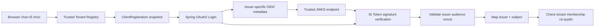
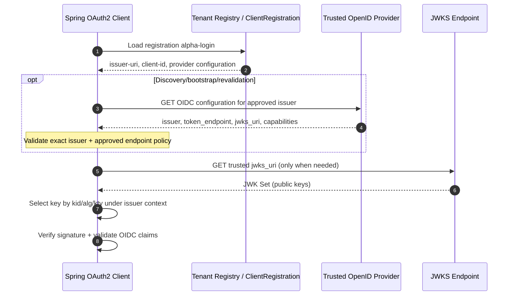
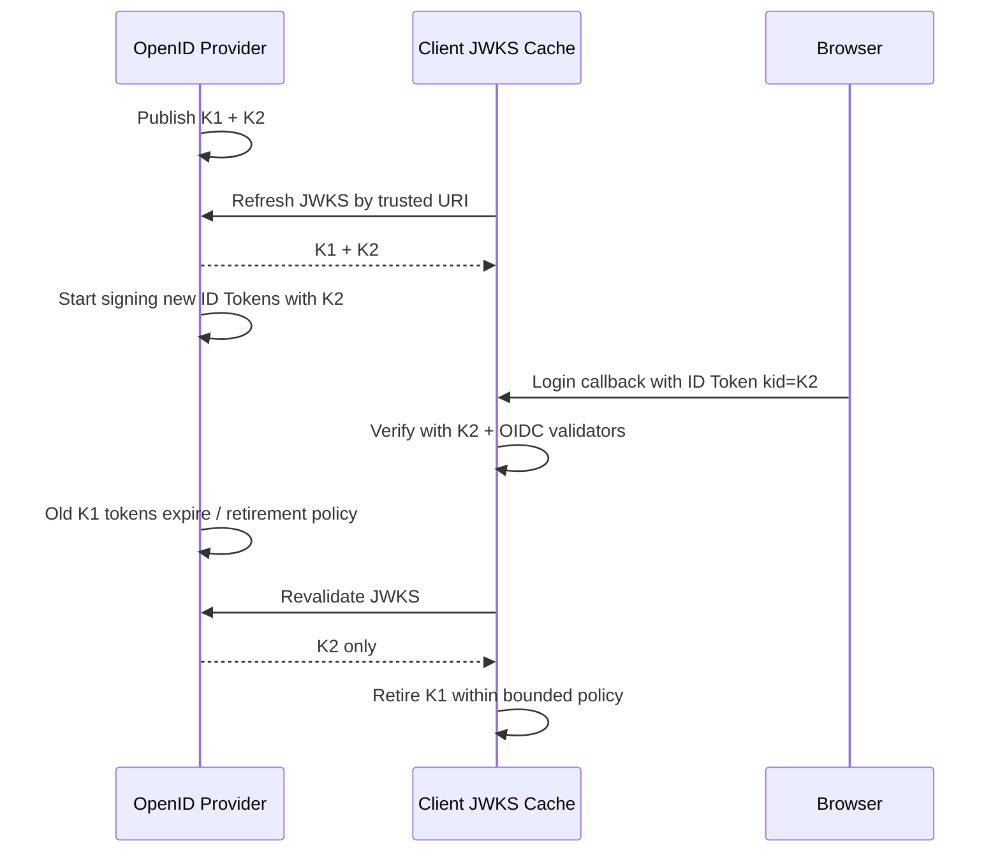
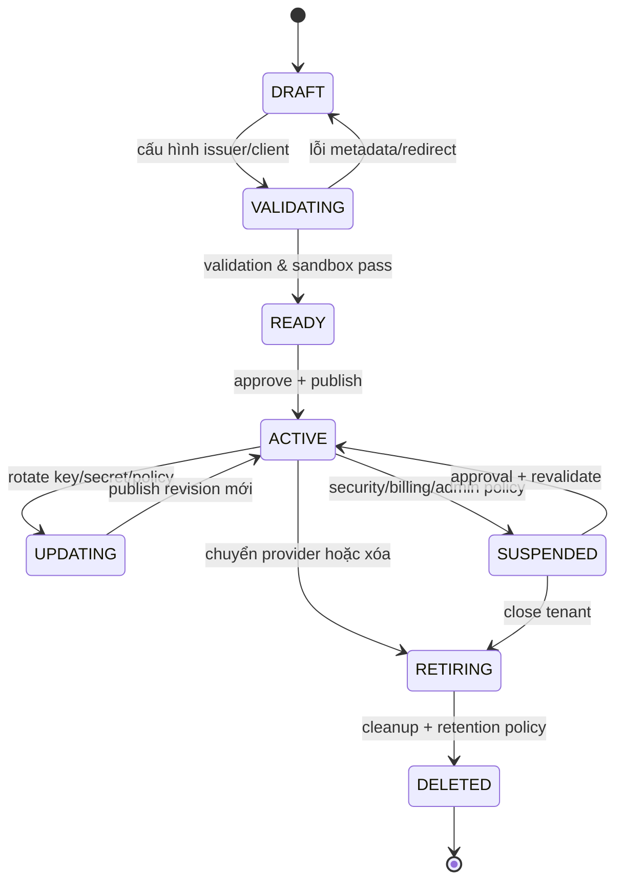

# 26.8. Cache metadata, JWKS và vòng đời cấu hình tenant

Trong một ứng dụng **Spring Security OAuth 2.0 / OpenID Connect (OIDC) Client đa tenant**, mỗi tổ chức có thể sử dụng một OpenID Provider (OP), một issuer, một OAuth2 client ID, redirect URI và chính sách đăng nhập riêng. Khi số lượng tổ chức tăng, ứng dụng thường không thể gọi lại OIDC Discovery hoặc tải JWKS từ Internet ở **mọi request**. Nó cần cache để giảm độ trễ và giảm phụ thuộc vào sự sẵn sàng của OP.

Nhưng cache trong xác thực không giống cache hình ảnh hoặc dữ liệu báo cáo. Một bản ghi **issuer sai, JWKS cũ, client secret đã rotate hoặc mapping tenant không còn hợp lệ** có thể khiến hệ thống đăng nhập thất bại, dùng nhầm danh tính, hoặc tiếp tục tin một khóa đã bị thu hồi. Ngược lại, một chính sách làm mới cache quá tích cực có thể tạo **cache stampede**, khiến hàng trăm request cùng tải JWKS và làm sự cố OP lan sang ứng dụng.

Bài học tập trung vào **“Cache metadata, JWKS và vòng đời cấu hình tenant”** thuộc chương **26. Đa tenant** của module **Spring Security OAuth 2.0 OIDC Client**. Các ví dụ dựa trên **Spring Boot 3.x, Spring Security 6.x**, có phân biệt **Servlet** và **WebFlux/Reactive**. Vì cơ chế cache cụ thể thay đổi giữa các phiên bản Spring Security và thư viện JOSE/JWT bên dưới, hãy xem cách thiết kế ở đây là **nguyên tắc và mẫu kiến trúc**; khi cấu hình API cache cho production cần đối chiếu **Javadoc của phiên bản đang dùng**.

> **Nguyên tắc cốt lõi:** Cache được phép làm tăng hiệu năng, nhưng không được thay đổi **trust boundary**. Tenant phải được phê duyệt trước, issuer phải khớp đúng metadata, khóa ký phải đến từ JWKS của issuer đáng tin cậy, và việc xác minh chữ ký không bao giờ thay thế kiểm tra `iss`, `aud`, `exp`, `nonce` cùng policy tenant.

## 1. Mục tiêu học tập

Sau bài này, bạn có thể:

1. Phân biệt **cache registry tenant**, **cache OIDC Discovery metadata**, **cache JWKS/JWK**, **cache decoder/key selector**, và **authorized client/token storage**.
2. Giải thích dữ liệu nào có thể chia sẻ giữa tenants và dữ liệu nào bắt buộc tách theo issuer/client/registration/principal.
3. Hiểu `issuer-uri`, `.well-known/openid-configuration`, `jwks_uri`, `kid` và `alg` trong việc xác minh ID Token.
4. Thiết kế TTL, conditional requests (`ETag`/`Last-Modified`), refresh, invalidation và bounded negative caching.
5. Vận hành **JWKS key rotation** với giai đoạn chồng lấn khóa, nhận biết `kid` mới và chống cache stampede.
6. Xử lý lỗi OP metadata/JWKS khi cache có hoặc không có dữ liệu, áp dụng **fail closed** cho tenant/issuer không tin cậy.
7. Quản lý cấu hình tenant từ onboarding tới active, rotate, suspend, retire và delete mà không trộn tài khoản.
8. Đánh giá tác động của việc thay `client_id`, client secret, issuer, redirect URI và registration ID lên các authorization requests đang chạy.
9. Triển khai một repository đọc **snapshot cấu hình bất biến** trong Servlet hoặc Reactive.
10. Thiết kế invalidation event, version, reconciliation và nhất quán nhiều instances.
11. Kiểm thử OIDC issuer/JWKS rotation, account isolation, đồng thời, outage, SSRF và logging.
12. Có runbook kiểm tra sự cố mà không in access token, ID Token, refresh token hoặc client secret.

## 2. Một hệ thống đa tenant điển hình

Giả sử ứng dụng cung cấp cổng làm việc cho ba tổ chức:

| Tenant | Registration ID | Issuer | Client ID |
| --- | --- | --- | --- |
| Alpha | `alpha-login` | `https://login.alpha.example/oidc` | `portal-alpha-web` |
| Beta | `beta-login` | `https://id.beta.example/realms/beta` | `portal-beta-web` |
| Gamma | `gamma-login` | `https://login.shared.example/tenant/gamma` | `portal-gamma-web` |

Các URL đều là ví dụ. Mỗi OP có thể công bố metadata tại đường dẫn discovery tương ứng issuer, bao gồm authorization endpoint, token endpoint và JWKS URI.



Những thao tác trong sơ đồ không phải lúc nào cũng xảy ra tuần tự ở mỗi request. Registration và metadata có thể đã được chuẩn bị trước; JWKS có thể được lấy từ bộ nhớ và chỉ được refresh khi cần. Sơ đồ thể hiện **mối quan hệ tin cậy**, không phải lời hứa rằng từng mũi tên tương ứng một HTTP call.

### 2.1. Vấn đề khi có hàng trăm tenants

Nếu mỗi tenant sử dụng một OP riêng, các tình huống dễ xuất hiện gồm:

- 300 client registrations và 300 issuer URLs.
- Mỗi instance có cache JWKS riêng.
- Nhiều replicas khởi động đồng thời, cùng fetch OIDC metadata.
- OP rotate khóa ký trong khi ứng dụng đang có cache cũ.
- Một tenant đổi client secret hoặc ngừng dịch vụ.
- Một tenant được disable nhưng browser sessions cũ vẫn còn.
- OP trả JWT với `kid` chưa từng xuất hiện.
- Hai tenants cùng dùng issuer/JWKS nhưng khác client IDs.
- Cấu hình tenant version A ở node 1 và version B ở node 2.
- Authorization flow bắt đầu với registration cũ nhưng callback quay về sau khi cấu hình đã bị đổi.

Một cache policy tốt phải giải quyết **vừa hiệu năng vừa tính chính xác** trong những trường hợp này.

## 3. Phân biệt các loại cache và nơi lưu trạng thái

Câu hỏi đầu tiên không phải “TTL bao nhiêu?”, mà là **“Đang cache object nào?”**

| Lớp dữ liệu | Khóa logic gợi ý | Dữ liệu | Độ nhạy cảm | Vòng đời |
| --- | --- | --- | --- | --- |
| **Tenant routing registry** | Tenant ID, domain được duyệt, policy revision | Map tenant → registration ID | Nhạy cảm về cấu hình/quyền | Do quản trị thay đổi |
| **ClientRegistration** | Registration ID + revision | Client ID, secret reference, issuer, redirect, scopes | Có thể chứa **client secret** | Khi enrollment/rotation |
| **OIDC Discovery metadata** | Trusted issuer + metadata generation | Authorization/token/JWKS endpoints, supported features | Public metadata nhưng **toàn vẹn cực kỳ quan trọng** | Theo provider/revalidation policy |
| **JWKS/JWK set** | Trusted issuer hoặc approved JWKS URI + cache version | Khóa công khai được OP dùng ký JWT | Thường public; độ tin cậy nguồn rất quan trọng | Key rotation/HTTP cache |
| **Decoder/key selector** | Trust configuration + registration/issuer + revision | Decoder và các key/alg/validator bindings | Security-critical | Theo revision/cấu hình runtime |
| **OIDC authorization request** | Random `state`/browser session | Redirect/client request, PKCE, nonce correlation | Nhạy cảm, **ngắn hạn** | Một login attempt |
| **OAuth2AuthorizedClient** | Registration + principal + context | Access token, refresh token, expiry | **Secret** | Token lifecycle/logout/revoke |
| **SecurityContext/WebSession** | Browser session | Authentication và session state | Nhạy cảm | Session lifecycle |

**Không dùng một cache chung chỉ key bằng `tenantId` để chứa mọi thứ.** Tenant registry, metadata, keys, user tokens và session là những tài nguyên khác nhau với chính sách invalidation, quyền truy cập và TTL khác nhau.

### 3.1. Cấu hình client không phải token của user

`ClientRegistrationRepository` và `ReactiveClientRegistrationRepository` trả metadata OAuth2 client. `OAuth2AuthorizedClientRepository`, `ServerOAuth2AuthorizedClientRepository` hoặc authorized client service lưu access/refresh token đã cấp cho principal.

Cache `ClientRegistration` không có nghĩa đã cache token của tất cả users. Ngược lại, làm mới JWKS **không tự làm mới** access token của user, và xóa registration cache **không tự revoke** refresh token ở OP.

### 3.2. Metadata là public nhưng không được coi là không nguy hiểm

Một discovery document có thể chứa:

```json
{
  "issuer": "https://login.alpha.example/oidc",
  "authorization_endpoint": "https://login.alpha.example/oidc/authorize",
  "token_endpoint": "https://login.alpha.example/oidc/token",
  "jwks_uri": "https://keys.alpha.example/oauth2/jwks",
  "response_types_supported": ["code"],
  "id_token_signing_alg_values_supported": ["RS256", "ES256"]
}
```

`jwks_uri` có thể nằm ở host khác issuer theo cấu hình provider hợp lệ. Nhưng vì **mọi endpoint trong metadata đều ảnh hưởng tới luồng xác thực**, chỉ nhận chúng qua một issuer được cấu hình/phê duyệt và kết nối HTTPS đáng tin cậy. Không để input của người dùng quyết định nơi backend fetch metadata hoặc gửi client credentials.

## 4. OIDC Discovery và JWKS khác nhau như thế nào?

**OIDC Discovery metadata** trả lời: “OP này là ai và các endpoints/capabilities hợp lệ của nó ở đâu?”

**JWKS** trả lời: “Những public keys nào được OP công bố để verifier kiểm tra chữ ký của token thuộc trust context này?”



### 4.1. Discovery không nhất thiết chạy mỗi lần đăng nhập

Khi Spring Boot cấu hình:

```yaml
spring:
  security:
    oauth2:
      client:
        provider:
          alpha-op:
            issuer-uri: https://login.alpha.example/oidc
```

Spring Boot/Spring Security có thể **resolve provider metadata khi tạo `ClientRegistration`**, ví dụ trong giai đoạn khởi tạo application context. `ClientRegistration` thường là object cấu hình ổn định; việc OP đổi metadata **không làm object đang chạy tự thay đổi ngay**.

Vì vậy cần phân biệt:

- **Built-in discovery lúc bootstrap**.
- **Một custom metadata cache** nếu ứng dụng quản lý tenants động.
- **Một vòng đời cập nhật client registration** nếu provider đổi endpoints/algorithms/client information.
- **JWKS lookup/refresh** trong quá trình xác minh JWT.

Không giả định “Spring tự refresh mọi discovery metadata trong background sau X phút” khi chưa kiểm chứng đúng implementation và version.

### 4.2. JWKS có thể thay đổi dù issuer không đổi

OP thường rotate signing keys mà vẫn dùng cùng issuer, authorization endpoint và client ID. Lúc đó, **JWK Set** cần được cập nhật nhưng **ClientRegistration** không nhất thiết cần rebuild.

Ngược lại, nếu issuer/token endpoint/redirect policy thay đổi, chỉ refresh JWKS **không đủ**.

## 5. Các thành phần Spring Security liên quan

| Thành phần | Trách nhiệm |
| --- | --- |
| `ClientRegistration` | Cấu hình OAuth2 client và provider details |
| `ClientRegistrationRepository` | Servlet lookup theo registration ID |
| `ReactiveClientRegistrationRepository` | Reactive lookup trả `Mono<ClientRegistration>` |
| `ClientRegistrations.fromIssuerLocation(...)` | Tạo builder từ issuer discovery, có thể phát sinh HTTP I/O |
| `oauth2Login()` | Điều phối Authorization Code/OIDC Login trên Servlet |
| `oauth2Login()` với `ServerHttpSecurity` | OIDC Login trên WebFlux |
| `OidcIdTokenDecoderFactory` | Tạo JWT decoder cho OIDC ID Token ở Servlet theo registration |
| JWT/JWK implementation bên dưới | Tải/giữ public keys và kiểm tra chữ ký theo decoder |
| `OAuth2AuthorizedClientManager` | Cấp/làm mới OAuth2 authorized client (Servlet) |
| `ReactiveOAuth2AuthorizedClientManager` | Tương ứng trong Reactive |
| Authorized client service/repository | Lưu access/refresh token theo principal/context |
| `WebSession`/`HttpSession` | Lưu browser session/correlation khi được cấu hình |

**Lưu ý quan trọng:** Một cấu hình `NimbusJwtDecoder` dành cho **Resource Server JWT validation** không tự áp dụng cho **OIDC ID Token validation của OAuth2 Login**. Đây là hai integration paths khác nhau. Nếu muốn thay cache/decoder/algorithm của OIDC Client, phải hiểu factory/manager tương ứng trong phiên bản đang dùng.

### 5.1. Spring giữ JWK như thế nào?

Các decoder dựa trên JOSE/JWK library có thể cache key sets và refresh khi cache hết hiệu lực hoặc khi gặp key ID chưa biết, tùy builder, thư viện và version. Không được mặc định tất cả decoder:

- Cùng dùng một global cache.
- Đọc HTTP `Cache-Control` giống nhau.
- Tự refresh ngay mỗi khi `kid` lạ.
- Dùng đúng một TTL cố định.
- Chia sẻ cache giữa Servlet login và Resource Server.
- Có thể invalidate bằng một application event tùy ý.

Để đưa ra cam kết vận hành, phải đọc **source/Javadoc của đúng phiên bản Spring Security/Nimbus** và kiểm thử bằng OP fixture thực tế.

## 6. Trust boundary: phải xác định tenant trước khi lấy khóa

Một lỗi thiết kế nguy hiểm là lấy `iss`/`kid`/`jku` từ JWT chưa được xác minh rồi cho chúng quyết định URL HTTP mà backend sẽ gọi.

**Sai về ý tưởng:**

```text
Nhận JWT chưa kiểm tra
        |
        v
Parse iss hoặc jku do JWT tự khai
        |
        v
GET URL đó để tải JWKS
        |
        v
Dùng public key nhận được để xác minh JWT
        |
        v
Tin JWT
```

Attacker có thể tự tạo token, tự chỉ tới JWKS do mình kiểm soát và khiến chữ ký “hợp lệ” với **chính khóa của attacker**, hoặc dùng `jku`/`x5u` gây SSRF.

**Cách đúng:**

```text
Trusted tenant selection + approved ClientRegistration
        |
        v
Trusted issuer & approved JWKS endpoint
        |
        v
Nhận ID Token từ đúng authorization/token flow
        |
        v
Chọn key trong JWKS thuộc issuer đã được duyệt
        |
        v
Verify JWS signature
        |
        v
Validate iss, aud, exp, iat, nonce, ...
        |
        v
Map verified (issuer, subject) + tenant membership
```

### 6.1. `kid` chỉ là gợi ý chọn khóa

JWT protected header có thể có:

```json
{
  "alg": "RS256",
  "kid": "signing-key-2026-11",
  "typ": "JWT"
}
```

`kid` **không phải chứng cứ tin cậy** và không có tính duy nhất toàn cầu. Hai issuers khác nhau đều có thể dùng `kid="key-1"`. Cache không được key **chỉ bằng `kid`**.

Một key lookup an toàn tối thiểu bị giới hạn bởi:

```text
trusted issuer / JWK source
  +
approved algorithm/key type policy
  +
kid (nếu có)
```

Nếu token không có `kid`, verifier có thể cần áp dụng key-selection behavior của JOSE library nhưng **vẫn phải giới hạn trong trusted JWK Set**; không đi tìm khóa từ URI do token cung cấp.

### 6.2. Chữ ký đúng chưa đủ

Ngay cả khi JWT ký bằng khóa hợp lệ của OP Alpha, ID Token vẫn phải có:

- `iss` khớp issuer đã cấu hình/được tin cậy.
- `aud` chứa client ID đúng của registration.
- `azp` được xử lý theo quy tắc OIDC khi áp dụng.
- `exp`/`iat`/`nbf` theo validators và clock policy phù hợp.
- `nonce` khớp authorization request khi flow yêu cầu.
- `sub` hợp lệ.
- Thuật toán JWS được phép theo chính sách client/OP.
- Những validations OIDC khác theo profile.

**Không lấy một decoder chỉ verify signature rồi xem đó là OIDC login hoàn chỉnh.**

## 7. Cấu hình tĩnh cho ít tenants: giải pháp đơn giản nhất

Nếu ứng dụng có vài OP cố định, hãy bắt đầu từ Spring Boot properties thay vì tạo một lớp cache discovery tùy biến.

### 7.1. Dependencies

Maven:

```xml
<dependencies>
  <dependency>
    <groupId>org.springframework.boot</groupId>
    <artifactId>spring-boot-starter-web</artifactId>
  </dependency>
  <dependency>
    <groupId>org.springframework.boot</groupId>
    <artifactId>spring-boot-starter-security</artifactId>
  </dependency>
  <dependency>
    <groupId>org.springframework.boot</groupId>
    <artifactId>spring-boot-starter-oauth2-client</artifactId>
  </dependency>
</dependencies>
```

Nếu ứng dụng **WebFlux**, sử dụng `spring-boot-starter-webflux` thay cho `spring-boot-starter-web` và các API reactive. Không thêm cả hai starter tùy tiện nếu kiến trúc chỉ cần một web stack.

### 7.2. `application.yml`

```yaml
spring:
  security:
    oauth2:
      client:
        registration:
          alpha-login:
            provider: alpha-op
            client-id: ${ALPHA_OIDC_CLIENT_ID}
            client-secret: ${ALPHA_OIDC_CLIENT_SECRET}
            client-authentication-method: client_secret_basic
            authorization-grant-type: authorization_code
            redirect-uri: "{baseUrl}/login/oauth2/code/{registrationId}"
            scope:
              - openid
              - profile
          beta-login:
            provider: beta-op
            client-id: ${BETA_OIDC_CLIENT_ID}
            client-secret: ${BETA_OIDC_CLIENT_SECRET}
            client-authentication-method: client_secret_basic
            authorization-grant-type: authorization_code
            redirect-uri: "{baseUrl}/login/oauth2/code/{registrationId}"
            scope:
              - openid
              - profile
        provider:
          alpha-op:
            issuer-uri: ${ALPHA_OIDC_ISSUER_URI}
          beta-op:
            issuer-uri: ${BETA_OIDC_ISSUER_URI}
```

```text
GET /oauth2/authorization/alpha-login
GET /oauth2/authorization/beta-login
```

Đây là các login start URLs khi dùng cấu hình OAuth2 Login mặc định. `registrationId`, `client-id` và `issuer-uri` là ba giá trị khác nhau.

### 7.3. Không đặt JWKS URI tùy tiện chỉ để bỏ qua discovery

Nếu OP hỗ trợ chuẩn discovery qua `issuer-uri`, ưu tiên dùng metadata được kiểm chứng. Nếu provider không hỗ trợ discovery và dự án bắt buộc cấu hình endpoints thủ công, cần lấy URI từ **tài liệu tin cậy của OP** và xác minh tính nhất quán của issuer, token endpoint, JWKS.

Không lấy `jwks_uri` từ browser input, không cho bất kỳ tenant user nào tự chỉnh OP URL khi chưa qua onboarding và security review.

## 8. Metadata cache: identity và key cần chính xác

Một cache metadata có thể lưu bản đã xác thực:

```json
{
  "issuer": "https://login.alpha.example/oidc",
  "authorization_endpoint": "https://login.alpha.example/oidc/authorize",
  "token_endpoint": "https://login.alpha.example/oidc/token",
  "jwks_uri": "https://keys.alpha.example/oauth2/jwks",
  "fetched_at": "2026-11-16T02:00:00Z",
  "validated_at": "2026-11-16T02:00:00Z",
  "configuration_revision": 17
}
```

Các trường `fetched_at`, `validated_at` và `configuration_revision` là metadata **do ứng dụng quản lý cache tự thêm**, không phải trường chuẩn do OIDC Discovery luôn cung cấp.

### 8.1. Cache key hợp lý

```text
discovery:<approvedIssuerId>:<configurationRevision>
```

Không nên:

```text
discovery:<emailDomain>
discovery:<untrusted-iss-from-token>
discovery:<kid>
```

Một email domain có thể map sang nhiều tenants; một issuer có thể phục vụ nhiều clients; một `kid` không xác định discovery document.

Nếu dùng issuer URI làm một phần key, hãy canonicalize **theo quy tắc đăng ký issuer của bạn** nhưng vẫn giữ so sánh `issuer` chính xác theo chuẩn. Không tự bỏ path, trailing slash hoặc đổi host nếu kết quả làm hai issuer khác nhau bị nhập làm một.

### 8.2. Dữ liệu nào cần validate trước khi cache?

- Issuer đã được phê duyệt.
- TLS certificate và hostname verification đúng.
- Metadata `issuer` khớp **issuer mong đợi** theo quy tắc của OIDC.
- Authorization endpoint và token endpoint có URI hợp lệ theo provider contract.
- `jwks_uri` hợp lệ, được phê duyệt về đích mạng và scheme.
- Redirects ở HTTP client được kiểm soát, không rơi sang internal/untrusted host.
- Capabilities thực sự đáp ứng flow, algorithm và client policy.
- Không vô tình đưa metadata từ tenant khác vào snapshot hiện tại.

Một metadata document **tải thành công HTTP 200** nhưng có issuer không khớp phải bị từ chối; không đưa vào cache “để dành”.

### 8.3. TTL metadata có nên giống TTL JWKS không?

Không nhất thiết. Metadata endpoints thường ổn định hơn JWKS; key signing có thể rotate thường xuyên hơn endpoint URLs. Nhưng **không có TTL chuẩn duy nhất cho mọi OP**.

Một chính sách cần dựa trên:

1. `Cache-Control`/`Expires` nếu OP công bố và client library hỗ trợ.
2. SLA/cadence thay đổi metadata và JWK của provider.
3. Tần suất tenant onboard/reconfigure.
4. Khả năng refresh chủ động hoặc invalidation event.
5. Mức chịu rủi ro khi dùng metadata/key cũ.
6. Tính sẵn sàng của OP và mục tiêu latency.

Đừng đặt `forever` cho metadata hoặc JWKS và quên key rotation.

## 9. HTTP caching: `Cache-Control`, `ETag`, `Last-Modified`

Một JWKS endpoint có thể trả:

```http
HTTP/1.1 200 OK
Content-Type: application/jwk-set+json
Cache-Control: public, max-age=300
ETag: "jwks-revision-42"

{"keys":[...]}
```

HTTP cache-control cho biết phản hồi có thể được coi là fresh trong khoảng thời gian tương ứng, **nếu client và chính sách sử dụng HTTP cache đúng cách**. Không suy ra rằng Spring/Nimbus sẽ tự dùng giá trị này y hệt trong mọi cấu hình.

Khi revalidation, client có thể gửi:

```http
GET /jwks HTTP/1.1
Host: keys.alpha.example
If-None-Match: "jwks-revision-42"
```

Nếu không đổi:

```http
HTTP/1.1 304 Not Modified
ETag: "jwks-revision-42"
Cache-Control: public, max-age=300
```

Khi đó cache có thể tiếp tục dùng JWK Set đã validate, cập nhật freshness theo HTTP semantics và policy.

### 9.1. Những thuộc tính cần tách

| Thuộc tính | Ý nghĩa | Không được hiểu nhầm thành |
| --- | --- | --- |
| **TTL/freshness** | Thời gian có thể dùng dữ liệu trước khi cần refresh | Bằng chứng key chưa bị compromise |
| **ETag** | Validator của representation tại một endpoint | Chữ ký mật mã xác thực JWKS |
| **Last-Modified** | Thời gian sửa representation theo HTTP | Cam kết mọi thay đổi key đều có timestamp hợp lệ |
| **HTTP 304** | Representation chưa thay đổi theo validator | Xác thực token đã thành công |
| **Cache invalidation event** | Tín hiệu ứng dụng cần revalidate/lấy snapshot mới | Cho phép bỏ các kiểm tra issuer/alg |
| **Cache miss** | Không có dữ liệu local | Permission để tải từ URL không tin cậy |

ETag không chứng minh issuer đáng tin cậy; **TLS, issuer pinning, approved endpoint và JWT validation** vẫn bắt buộc.

### 9.2. Có nên dùng stale-while-revalidate?

Có thể cân nhắc đối với **known-good metadata/key đã xác minh nguồn gốc**, nhưng phải đánh giá kỹ:

- Khóa cũ có thể vừa bị thu hồi khẩn cấp.
- Không được dùng stale **vô thời hạn**.
- Không được chấp nhận token ký bằng khóa mới chưa xác minh.
- Không được dùng stale policy để cho phép tenant đã bị disable.
- Không được bỏ qua expected issuer/audience/nonce khi dùng key cũ.
- Có deadline, alert và operational override để invalidate nhanh.

Một số kiến trúc chọn **fail closed** ngay khi dữ liệu JWKS hết hạn và không thể refresh; một số cho phép khoảng ngắn với key đã biết theo chính sách được phê duyệt. Không nên tuyên bố một lựa chọn luôn đúng với mọi mức rủi ro.

## 10. JWKS và vòng đời khóa ký

JWKS là một JSON Web Key Set, ví dụ minh họa rút gọn:

```json
{
  "keys": [
    {
      "kty": "RSA",
      "kid": "alpha-2026-11",
      "use": "sig",
      "alg": "RS256",
      "n": "<public-RSA-modulus-base64url>",
      "e": "AQAB"
    }
  ]
}
```

**JWKS dùng xác minh chữ ký thường chứa khóa công khai**, không phải private key của OP. Tuy nhiên, nếu attacker có thể sửa cache JWKS hoặc metadata, họ có thể đưa khóa giả vào trust path. Vì vậy JWKS cache phải được bảo vệ **tính toàn vẹn**, không chỉ giữ bí mật.

### 10.1. Không chọn key chỉ bằng `alg` hoặc `kid`

Một token header tự khai `alg="RS256"` không cho phép client tự động chấp nhận RS256 khi policy chỉ cho phép ES256. `kid` chỉ là identifier trong phạm vi JWKS.

Verifier cần kết hợp:

- JWS algorithm allowlist đã phê duyệt.
- Key type/curve/usage phù hợp (`kty`, `crv`, `use`/`key_ops` khi có).
- Trusted issuer/JWKS source.
- `kid` (nếu có).
- Chữ ký hợp lệ.
- OIDC claims validators.

**Không chấp nhận `alg=none` hoặc chuyển từ asymmetric sang HMAC chỉ vì header token yêu cầu.**

### 10.2. Lịch key rotation minh họa

```text
T0:
  JWKS = {K1}
  OP ký ID Tokens bằng K1

T1:
  JWKS = {K1, K2}
  OP tiếp tục ký bằng K1
  Ứng dụng có thời gian nhận K2

T2:
  JWKS = {K1, K2}
  OP bắt đầu ký bằng K2
  Tokens còn hiệu lực ký bởi K1 vẫn cần được xử lý

T3:
  Tokens K1 đã hết hiệu lực theo policy
  JWKS = {K2}
  K1 được gỡ sau giai đoạn chuyển tiếp
```

Nếu OP gỡ K1 trước khi các tokens ký bằng K1 hết hiệu lực, verifier có thể từ chối những tokens đó. Ngược lại, giữ K1 mãi khiến khóa đã ngừng sử dụng tiếp tục được chấp nhận.

**Giai đoạn chồng lấn key phải được OP và ứng dụng thống nhất** theo token lifetime, propagation, cache TTL, clock skew và incident response policy. Khi key compromise, OP có thể cần thu hồi sớm bất chấp việc gây gián đoạn.

### 10.3. Timeline trực quan



Không phải OP nào cũng áp dụng chính xác timeline này. Đây là **một quy trình rotation lý tưởng**, cần kiểm thử với provider thật.

## 11. Token mang `kid` mới: phải làm gì?

Giả sử cache hiện chỉ chứa K1 nhưng OP đã ký token bằng K2. Khi verifier gặp `kid=K2`:

1. Kiểm tra token có đến từ **login flow/issuer đang được tin cậy** không.
2. Không dùng `kid` để chọn một issuer mới.
3. Nếu decoder/key source hỗ trợ, **revalidate JWKS từ approved URI** theo policy.
4. Giới hạn số lần refresh; tránh nhiều calls cho cùng một miss.
5. Chỉ nhận K2 khi JWK Set tải về qua trust path hợp lệ và signature/claims đều hợp lệ.
6. Nếu không có key phù hợp, **từ chối token**, không tạm bỏ signature validation.

### 11.1. Không refresh vô hạn trên mọi `kid` lạ

Attacker có thể gửi JWTs với:

```text
kid = random-1
kid = random-2
kid = random-3
...
```

Nếu mỗi token khiến backend tải JWKS, OP và ứng dụng có thể gặp denial-of-service.

Một **bounded unknown-key policy** có thể dùng:

- Cache TTL hợp lý.
- **Single-flight refresh** theo trusted issuer/JWKS URI.
- Rate limit cho lần fetch bổ sung khi có `kid` lạ.
- Negative caching cực ngắn/giới hạn đối với key IDs không tồn tại, nếu phù hợp.
- Cảnh báo khi unknown `kid` tăng bất thường.
- Không tạo cache entry không giới hạn cho mọi chuỗi `kid`.

**Không cache “token bị reject” như một token đã được xác thực.** Negative caching chỉ là công cụ giảm tải lookup, tuyệt đối không thay đổi kết quả kiểm tra bảo mật.

### 11.2. Ví dụ coordinator — pseudocode

```text
function selectVerificationKey(trustedIssuer, tokenHeader):
    require trustedIssuer is registered and ACTIVE
    require tokenHeader.alg in allowedAlgorithms(trustedIssuer)

    cached = jwksCache.get(trustedIssuer)
    if cached has compatible key for tokenHeader.kid:
        return key

    if not issuerRefreshBudget.allowsRequest(trustedIssuer):
        return VERIFICATION_FAILURE

    with singleFlight(trustedIssuer):
        latest = jwksCache.recheck()
        if latest already has compatible key:
            return key

        fresh = fetchFromApprovedJwksUri(trustedIssuer)
        require validTlsAndEndpoint(fresh.source)
        require jwksMatchesTrustPolicy(fresh)

        jwksCache.atomicReplace(trustedIssuer, fresh)
        return selectCompatibleKeyOrFailure(fresh, tokenHeader)
```

Đây là **mẫu kiến trúc**, không phải hàm Spring Security cung cấp sẵn. Nếu decoder/Nimbus của phiên bản đang dùng đã có key source caching/refetch, hãy **tận dụng nó và cấu hình/giới hạn đúng** thay vì tạo thêm một cache song song gây lệch.

## 12. Cache stampede trong hệ thống nhiều instances

Ví dụ 50 WebFlux/Servlet replicas cùng nhận ID Token ký bằng K2:

```text
Node 01: cache K1 -> unknown kid K2 -> GET JWKS
Node 02: cache K1 -> unknown kid K2 -> GET JWKS
...
Node 50: cache K1 -> unknown kid K2 -> GET JWKS
```

Nếu OP có rate limit hoặc mạng chập chờn, cả cluster có thể thất bại cùng lúc.

### 12.1. Biện pháp theo cấp độ

| Cấp | Biện pháp | Giới hạn |
| --- | --- | --- |
| Trong một process | Single-flight hoặc lock theo issuer/JWKS source | Không điều phối được các instances |
| Trong cluster | Shared cache hoặc distributed refresh lease | Cần fencing, TTL và kiểm soát stale writes |
| Với OP | Conditional GET, tôn trọng HTTP cache headers | Provider có thể không hỗ trợ |
| Khi deploy | Warm-up giới hạn concurrency cho tenants active | Không bảo đảm mọi key mới xuất hiện trước |
| Khi lỗi | Backoff + jitter + circuit breaker | Không được làm mềm verification |
| Theo bảo mật | Allowlist issuer trước lookup | Không giảm tấn công nếu cho tải arbitrary URLs |

Một shared JWKS cache có thể hợp lý vì JWKs là public, nhưng **không làm mọi tầng xác minh dùng chung state mù**. Dữ liệu chung phải được lưu theo trusted source, kiểm soát freshness, version và integrity; validators vẫn là **per registration/per issuer policy**.

### 12.2. Chống sự cố lan truyền từ một OP

Giả sử OP Alpha unavailable. Login Alpha có thể thất bại hoặc dùng key cache hợp lệ trong giới hạn policy, nhưng **Beta và Gamma không nên bị ảnh hưởng** bởi một circuit breaker toàn cục hay một cache lock toàn hệ thống.

Giới hạn concurrency, timeout, retry budget và breaker **theo trusted issuer hoặc provider group**. Không dùng một lock global cho tất cả tenants.

## 13. Cache key và khả năng chia sẻ giữa tenants

### 13.1. Mô hình namespace

```text
tenant-routing:<approvedTenantId>:<policyRevision>
registration:<registrationId>:<configRevision>
discovery:<approvedIssuerId>:<metadataRevision>
jwks:<approvedJwksSourceId>:<cacheGeneration>
oidc-decoder:<registrationId>:<configRevision>
authorized-client:<registrationId>:<trustedPrincipalId>:<context>
```

Đây là gợi ý **logic keys**, không phải các khóa Redis mà Spring tự tạo. Cần thiết kế tránh PII/secret trong key và không đặt raw session IDs hoặc access token values vào metrics/logs.

### 13.2. Một issuer dùng cho nhiều clients

Ví dụ:

```text
Tenant Alpha -> issuer=https://login.shared.example
                 clientId=alpha-portal

Tenant Beta  -> issuer=https://login.shared.example
                 clientId=beta-portal
```

Hai clients có thể chia sẻ **nguồn public JWKS** theo issuer nếu cùng trust config. Nhưng **ID Token validation không được dùng chung audience policy**:

```text
Alpha ID Token:
  iss = https://login.shared.example
  aud = alpha-portal

Beta ID Token:
  iss = https://login.shared.example
  aud = beta-portal
```

Một decoder/shared cache chỉ verify signature mà không kiểm `aud` có thể chấp nhận token cho sai OAuth2 client. Vì vậy nếu chia sẻ **JWK fetching**, phải giữ **validators ràng buộc ClientRegistration** riêng.

### 13.3. Hai issuers cùng có `kid`

```text
Issuer Alpha: kid=key-1, RSA public key A
Issuer Beta:  kid=key-1, RSA public key B
```

Cache toàn cục `kid -> key` sẽ tạo collision nguy hiểm. `kid` chỉ có ý nghĩa trong **JWK source/trust boundary**; không dùng làm khóa định danh độc lập.

### 13.4. Issuer giống nhau không chứng minh tenant membership

Một OP chung có thể dùng cùng `iss` cho nhiều organizations. `(iss, sub)` là khóa ổn định cho identity tại OP, nhưng **quyền thuộc tenant** phải kiểm tra từ account mapping/tenant membership hoặc claims đã được chính sách phê duyệt. Không suy tenant chỉ vì client ID hoặc login URL đã chọn.

## 14. Vòng đời cấu hình tenant: một state machine cần thiết

Một tenant không chỉ có trạng thái “có” hoặc “không”. Quản lý lifecycle rõ ràng giúp thay đổi an toàn.



Đây là một **mẫu state machine ứng dụng**, không phải các enum do Spring Security định nghĩa sẵn.

### 14.1. Ý nghĩa từng trạng thái

| State | Login mới | Metadata/JWKS | Tokens/sessions hiện có |
| --- | --- | --- | --- |
| **DRAFT** | Chưa cho phép | Có thể validate trong sandbox quản trị | Không có hoặc không được sử dụng |
| **VALIDATING** | Chưa cho phép | Tải và xác minh có giới hạn từ approved issuer | Không sinh login user thật |
| **READY** | Chưa công bố | Warm-up theo policy | Chưa public |
| **ACTIVE** | Được phép theo routing policy | Cache/refetch bình thường | Theo token/session policy |
| **UPDATING** | Thường giữ revision hiện hành | Xây revision mới song song | Flow đang chạy phải có version binding |
| **SUSPENDED** | Mặc định chặn login mới | Chỉ dùng cho xử lý có chủ đích | Chính sách explicit: invalidate hay tạm giữ |
| **RETIRING** | Không mở flow mới với revision cũ | Giữ tối thiểu để hoàn tất/đóng flow hợp lệ theo deadline | Cleanup/reconnect/migration |
| **DELETED** | Không | Dọn config/cache theo retention | Hủy access theo policy; token revocation nếu có |

**Suspended/Deleted không nên chỉ là xóa một entry trong in-memory map.** Sessions và authorized clients đã cấp có thể còn tồn tại. Chính sách “chặn login mới” khác “chặn mọi truy cập ứng dụng” và khác “thu hồi token tại OP”.

## 15. Onboarding tenant mới: trình tự đúng

Một quy trình đáng tin cậy:

1. **Chủ thể quản trị được xác thực** yêu cầu thêm tenant.
2. Xác minh tổ chức, quyền sở hữu domain/issuer và quan hệ với OP theo chính sách.
3. Tạo hoặc nhận **OAuth2 client registration từ OP** qua quy trình chính thức.
4. Lưu `client_secret` hoặc khóa client authentication trong **secret manager**.
5. Chỉ định issuer URI chính xác, approved metadata/JWKS endpoints và network egress policy.
6. Tải discovery metadata từ trusted URI với timeout, TLS và SSRF controls.
7. Kiểm tra metadata `issuer` khớp issuer mong đợi, response capabilities, `jwks_uri`, algorithms.
8. Kiểm tra redirect URI, scopes, client authentication method, login flow và OP contract.
9. Thực hiện integration tests với sandbox/tenant test account.
10. Xây `ClientRegistration` và caches theo **revision mới**.
11. Warm-up có giới hạn để tránh 100 instances cùng fetch.
12. Công bố mapping tenant/domain → registration ID sau khi cấu hình đã sẵn sàng.
13. Quan sát lỗi/latency, có rollback nếu cần.

```text
Admin approval -> Trusted config -> Validated metadata
                                 -> JWKS available
                                 -> ClientRegistration built
                                 -> Policy snapshot published
                                 -> Login route ACTIVE
```

Không cho phép người dùng chưa xác thực gửi `issuer=https://arbitrary-host` rồi backend tự tải metadata và tạo client ngay. Điều đó có thể thành **SSRF, open redirect, provider confusion hoặc client credential leakage**.

### 15.1. Egress controls cho discovery/JWKS

Metadata có thể đưa ra `jwks_uri` khác host của issuer. Điều đó **không tự động sai**, nhưng cần:

- HTTPS và certificate validation.
- Kiểm soát DNS/IP ranges, chặn loopback/link-local/metadata service/internal-only destinations nếu không có ngoại lệ được duyệt.
- Kiểm soát HTTP redirects.
- Allowlist hoặc admin-approved endpoint policy.
- Giới hạn timeout/response size/JSON depth.
- Không sử dụng HTTP proxy gây lộ client secret.
- Giới hạn số requests/tenants được onboard đồng thời.

Đừng tin chỉ bằng cách chặn chuỗi hostname `localhost`; SSRF có thể dùng IP, DNS rebinding, IPv6 hoặc redirect.

## 16. Thay đổi cấu hình: chia nhóm theo mức độ ảnh hưởng

Không phải mọi thay đổi tenant config đều có tác động ngang nhau.

| Thay đổi | Ảnh hưởng kỹ thuật | Cách triển khai đề xuất |
| --- | --- | --- |
| Tên hiển thị/branding | UI, không ảnh hưởng token validation | Publish policy revision, invalidate UI cache |
| Mapping domain → registration | Routing login mới | Update allowlist có version; không thay auth state đang chạy |
| Scope yêu cầu | Consent/token issuance | Test, khả năng re-consent; không tự mở rộng quyền |
| Client secret rotation | Token Endpoint client authentication | Overlap/secret manager/update; xác minh issuer/clientId vẫn đúng |
| Client ID thay đổi | ID Token `aud`, authorized client identity, OP registration | Tạo versioned registration/flow, thường cần reauthorization |
| Redirect URI thay đổi | Authorization request/callback matching | Đăng ký URI mới trước, giữ callback cũ trong transition |
| Issuer thay đổi | **Thay trust boundary** và `(iss,sub)` identity | Coi là migration OP có kiểm soát, không chỉ flush JWKS |
| JWKS URI thay đổi | Nguồn khóa chữ ký | Validate discovery/endpoint policy rồi rebuild decoder/key source |
| Accepted JWS algorithms thay đổi | Signature acceptance policy | Security review, migration key types |
| Tenant suspended | Authorization/routing policy | Chặn login mới, quyết định sessions/tokens cũ |
| Tenant deleted | Config, sessions, tokens, audit/retention | Retire → cleanup → revoke/expire → delete |

### 16.1. Thay client secret không giống thay issuer

Nếu OP rotate `client_secret` nhưng giữ cùng `client_id` và issuer:

- ID Tokens cũ thường vẫn được xác minh với issuer/public JWKS.
- Token Endpoint requests mới phải sử dụng secret hợp lệ.
- Browser sessions đã login có thể còn hiệu lực theo chính sách.
- Refresh token usage có thể chịu ảnh hưởng nếu client authentication thất bại.

Không cần tự động xóa JWKS cache chỉ vì client secret rotate. Tuy nhiên, nếu phương thức xác thực client hoặc key binding thay đổi, cần kiểm tra profile và dependencies liên quan.

### 16.2. Đổi issuer là sự kiện khác cấp độ

Nếu Alpha đổi từ:

```text
https://old-id.alpha.example/oidc
```

sang:

```text
https://new-id.alpha.example/oidc
```

thì **hai issuer là hai trust identities** trừ khi có quy trình migration/account linking được phê duyệt. Không:

- Dùng khóa của issuer cũ để tin ID Token issuer mới.
- Tự sửa claim `iss`.
- Gộp accounts vì `sub` hoặc email giống nhau.
- Mặc định refresh token cũ còn dùng được ở OP mới.
- Chấp nhận token có issuer không khớp trong “grace period”.

Có thể triển khai song song hai registrations/issuers với state riêng, buộc người dùng reauthenticate hoặc account-link theo quy trình đã xác minh.

## 17. Phiên bản hóa cấu hình: tránh callback dùng sai revision

Một tình huống tinh vi:

```text
T0: User bắt đầu login alpha-login phiên bản V1
    - clientId = alpha-v1
    - redirectUri = /login/oauth2/code/alpha-login
    - issuer = OP-A

T1: Admin thay ClientRegistration cùng ID sang V2
    - clientId = alpha-v2
    - redirectUri không đổi

T2: OP trả authorization code của request V1

T3: App tra registration ID alpha-login nhưng chỉ thấy V2
    - Token Endpoint đổi code bằng client alpha-v2
    - Có thể lỗi invalid_grant/invalid_client
```

Đây không nhất thiết là lỗi cache: **cấu hình đang thay giữa hai nửa của một transaction OIDC**.

### 17.1. Dùng versioned registrations khi đổi tham số protocol

Một phương án:

```text
alpha-login-v1 -> V1 (RETIRING)
alpha-login-v2 -> V2 (ACTIVE)

Login routing của Alpha:
  sau rollout -> /oauth2/authorization/alpha-login-v2

Callback V1 đang bay:
  /login/oauth2/code/alpha-login-v1

Callback V2:
  /login/oauth2/code/alpha-login-v2
```

Lưu ý:

- OP phải cho phép redirect URIs cho cả hai registrations trong giai đoạn chồng lấn.
- Repository phải giữ V1 đủ lâu cho các flow hợp lệ đang chờ callback.
- `state`, PKCE và nonce vẫn cần correlation đúng.
- Authorized clients lưu theo `registrationId` có thể còn dùng V1; cần retention/reconnect policy riêng.
- Không tự chuyển token V1 sang V2 nếu client ID, issuer hoặc quyền khác nhau.
- Sau deadline và migration policy, mới retire V1.

**Versioning registration ID chỉ là một chiến lược**, không bắt buộc mọi thay đổi đều tạo registration mới. Nó đặc biệt hữu ích khi thay client ID, issuer hoặc thông số ảnh hưởng authorization request/callback.

### 17.2. Tránh chỉ giữ một biến `currentTenantConfig` cho tất cả flow

Trong nhiều tabs:

1. Tab A bắt đầu login với OP Alpha.
2. Tab B bắt đầu login với OP Beta.
3. Tenant Alpha được rotate.
4. Callback về theo thứ tự bất kỳ.

Nếu tự ghi đè một session attribute `currentIssuer` hoặc `currentClientId` duy nhất, các flows có thể nhầm OP. Giữ **registration/state binding của Spring** và snapshot/correlation theo từng authorization request; không dùng global mutable selected provider làm nguồn xác minh callback.

## 18. Snapshot bất biến cho repository Servlet

`ClientRegistrationRepository` của Servlet có phương thức đồng bộ `findByRegistrationId(...)`. Nếu cần registry động, một pattern phù hợp là **đọc snapshot bất biến đã được validate**, thay vì gọi database/HTTP discovery trên mỗi login.

### 18.1. Mô hình revisioned snapshot

```java
import java.util.Map;
import java.util.Objects;
import java.util.concurrent.atomic.AtomicReference;

import org.springframework.security.oauth2.client.registration
        .ClientRegistration;
import org.springframework.security.oauth2.client.registration
        .ClientRegistrationRepository;

public final class SnapshotClientRegistrationRepository
        implements ClientRegistrationRepository {

    public record Snapshot(
            long revision,
            Map<String, ClientRegistration> byRegistrationId) {

        public Snapshot {
            byRegistrationId = Map.copyOf(
                    Objects.requireNonNull(byRegistrationId));
        }
    }

    private final AtomicReference<Snapshot> current;

    public SnapshotClientRegistrationRepository(Snapshot initial) {
        this.current = new AtomicReference<>(
                Objects.requireNonNull(initial));
    }

    @Override
    public ClientRegistration findByRegistrationId(String id) {
        return current.get().byRegistrationId().get(id);
    }

    // Chỉ config administration component được quyền publish.
    public void publishValidatedSnapshot(Snapshot next) {
        Snapshot previous = current.get();

        if (next.revision() <= previous.revision()) {
            throw new IllegalArgumentException(
                    "New snapshot must have a greater revision");
        }

        current.set(next);
    }
}
```

Đây là **mẫu repository** để giải thích atomic read. Phương thức `publishValidatedSnapshot` **giả định** bên ngoài đã xác minh issuer/metadata/client secret/policy. Nó không phải security review hay tenant enrollment workflow hoàn chỉnh.

**Giới hạn đồng thời:** Việc kiểm tra revision bằng `get()` rồi `set()` có thể gặp race nếu hai publishers đồng thời. Khi đó cần CAS loop hoặc **một publisher duy nhất**:

```java
public void publishValidatedSnapshot(Snapshot next) {
    current.updateAndGet(previous -> {
        if (next.revision() <= previous.revision()) {
            throw new IllegalArgumentException(
                    "Stale snapshot revision");
        }
        return next;
    });
}
```

Chỉ dùng một trong hai triển khai method ở trên; snippet thứ hai là **bản thay thế** khi có nhiều publishers. Để tránh reload sai phiên bản trên nhiều nodes, revision còn cần được quản lý bởi **authoritative configuration store**, không phải local counter độc lập.

### 18.2. Tại sao không fetch discovery trong `findByRegistrationId`?

`findByRegistrationId` được gọi trong đường xử lý login. Nếu mỗi lần gọi đều làm DNS/HTTPS request đến OP:

- Login latency phụ thuộc trực tiếp vào OP metadata.
- OP outage có thể khiến thread request bị giữ lâu.
- Cache stampede nếu nhiều requests đồng thời.
- Untrusted registration IDs có thể kích hoạt I/O vô hạn nếu code thiếu allowlist.
- Rất khó đảm bảo cùng revision xuyên suốt callback.

Thay vào đó, build/validate config bằng **background administration workflow**, rồi publish snapshot cho hot path.

### 18.3. Repository custom có thể thay Boot auto-configuration

Khi tự khai báo bean `ClientRegistrationRepository`, Spring Boot có thể không tạo in-memory repository từ application properties nữa. Nếu snapshot chỉ chứa Alpha, Beta/Gamma trong YAML có thể không còn truy cập được như dự kiến.

Phải chủ động **gộp đầy đủ approved registrations** vào snapshot hoặc tiếp tục dùng Boot defaults. Không khai báo custom bean chỉ để thử nghiệm một tenant mà bỏ các registrations còn lại.

## 19. Snapshot bất biến cho Reactive/WebFlux

Trong WebFlux, interface là:

```java
ReactiveClientRegistrationRepository
```

và trả:

```java
Mono<ClientRegistration> findByRegistrationId(String id)
```

Nếu repository chỉ đọc một snapshot in-memory, không có lý do sử dụng `block()`.

### 19.1. Mẫu reactive repository

```java
import java.util.Map;
import java.util.Objects;
import java.util.concurrent.atomic.AtomicReference;

import org.springframework.security.oauth2.client.registration
        .ClientRegistration;
import org.springframework.security.oauth2.client.registration
        .ReactiveClientRegistrationRepository;

import reactor.core.publisher.Mono;

public final class SnapshotReactiveClientRegistrationRepository
        implements ReactiveClientRegistrationRepository {

    private final AtomicReference<Map<String, ClientRegistration>> snapshot;

    public SnapshotReactiveClientRegistrationRepository(
            Map<String, ClientRegistration> approved) {

        this.snapshot = new AtomicReference<>(
                Map.copyOf(approved));
    }

    @Override
    public Mono<ClientRegistration> findByRegistrationId(
            String registrationId) {

        return Mono.defer(() ->
                Mono.justOrEmpty(
                        snapshot.get().get(registrationId)));
    }

    public void publishApproved(
            Map<String, ClientRegistration> approved) {

        snapshot.set(Map.copyOf(
                Objects.requireNonNull(approved)));
    }
}
```

Đây là triển khai **đọc non-blocking vì dữ liệu đã nằm trong memory**. `publishApproved` phải được gọi từ trusted config workflow; ví dụ lược bỏ revision/CAS để tập trung vào Reactor contract. Production cần quản lý revision và các đăng ký đang retiring giống phần Servlet.

### 19.2. Nếu dữ liệu gốc nằm trong database/config service?

Có thể dùng R2DBC hoặc WebClient cho I/O reactive. Nhưng **không nên biến mọi login thành remote config lookup** nếu có thể dùng cache snapshot ổn định.

Sai:

```java
// Sai: lời gọi blocking đã xảy ra trước khi tạo Mono.
return Mono.just(jdbcTemplate.queryForObject(...));
```

Tốt hơn:

```text
Trusted config event / scheduled reconciliation
       |
       v
Reactive I/O fetch + validate
       |
       v
Build immutable snapshot
       |
       v
Publish revision atomically
       |
       v
WebFlux request: fast in-memory Mono lookup
```

Nếu buộc gọi SDK blocking, tách sang bounded scheduler/service với concurrency limits và timeout; không chạy trên event-loop.

## 20. Cách dựng `ClientRegistration` từ metadata đã được duyệt

Một API thường gặp:

```java
import org.springframework.security.oauth2.client.registration
        .ClientRegistrations;
import org.springframework.security.oauth2.client.registration
        .ClientRegistration;

ClientRegistration alpha =
        ClientRegistrations.fromIssuerLocation(
                "https://login.alpha.example/oidc")
            .registrationId("alpha-login-v2")
            .clientId("portal-alpha-web")
            .clientSecret(secretFromVault)
            .redirectUri(
                "{baseUrl}/login/oauth2/code/{registrationId}")
            .scope("openid", "profile")
            .build();
```

Ví dụ minh họa API build từ issuer. **`secretFromVault` là biến ứng dụng lấy từ secret manager**, không phải tên API Spring. Trong ứng dụng thực cần cấu hình đúng `clientAuthenticationMethod`, grant, scopes, redirect URI và provider details theo profile OP.

**Quan trọng:** `ClientRegistrations.fromIssuerLocation(...)` có thể thực hiện HTTP Discovery trong quá trình tạo builder (tùy implementation/version). Không gọi nó trực tiếp từ **WebFlux event-loop** hoặc từ đường hot path `findByRegistrationId`. Chỉ gọi với **issuer đã phê duyệt**, timeout/network policy chặt chẽ, và kiểm chứng metadata/OP trước khi publish.

### 20.1. Không tin một URL chỉ vì có dạng HTTPS

HTTPS chứng minh kết nối tới host phù hợp certificate, **không chứng minh host ấy là OP mà tổ chức đã chấp thuận**. Nếu issuer đến từ query parameter do attacker tạo, attacker vẫn có thể sở hữu HTTPS certificate hợp lệ cho domain của mình.

Trusted enrollment phải tạo allowlist/config record trước khi discovery được chạy.

## 21. Caching metadata/JWKS không đồng nghĩa cache decoder forever

Một decoder có thể giữ:

- Key source.
- JWS algorithm policy.
- Issuer-specific configuration.
- Client/registration-specific claim validators.
- Cache của JWK Set bên dưới.

Nếu tenant thay issuer, client ID hoặc accepted algorithm mà bạn chỉ xóa raw metadata cache, **decoder đang giữ reference tới cấu hình cũ vẫn có thể được tái sử dụng**.

Một mẫu invalidation theo revision:

```text
Tenant config revision V2 được duyệt
           |
           v
Rebuild ClientRegistration V2
           |
           v
Refresh/associate discovery metadata V2
           |
           v
Rebuild decoder/key-source binding nếu policy/issuer/URI đổi
           |
           v
Publish config snapshot V2 atomically
           |
           v
Retire V1 theo session/callback/token deadlines
```

**Không cố sửa field bên trong một `ClientRegistration` hoặc decoder đã publish mà không có bảo đảm thread-safety.** Prefer immutable objects và replace-by-revision.

### 21.1. JWKS key rotation thông thường không cần thay registration ID

Nếu issuer và client identity giữ nguyên, OP publish K2 trong cùng trusted JWKS URI:

- Cập nhật key set theo decoder/cache behavior.
- Không nhất thiết rebuild `ClientRegistration`.
- Không cần tạo registration ID mới.
- Vẫn xác minh cùng issuer/audience/nonce.

Chỉ tạo versioned registration khi thay **parameters ảnh hưởng OAuth2 flow/client identity/trust**. Đừng làm tenant configuration churn cho mỗi lần JWKS refresh.

## 22. Cơ chế invalidation khi có sự kiện thay đổi

Trong hệ thống nhiều instances, có thể dùng **config events** từ một nguồn quản trị duy nhất:

```json
{
  "eventType": "TENANT_CONFIG_PUBLISHED",
  "tenantId": "alpha",
  "revision": 18,
  "changedFields": [
    "clientSecretReference",
    "redirectUri"
  ],
  "occurredAt": "2026-11-16T02:30:00Z"
}
```

Đây là **mẫu event của ứng dụng**, không phải event tiêu chuẩn Spring Security. Không đặt secret/token thật trong message broker.

### 22.1. Các bước consumer

1. Nhận event và xác minh nguồn/permission.
2. Kiểm tra revision lớn hơn bản hiện tại.
3. Fetch config record từ authoritative store, không tin mọi field trong event.
4. Validate issuer/client/redirect/security policy.
5. Chuẩn bị metadata/key/ClientRegistration mới.
6. Publish snapshot bất biến bằng CAS/version guard.
7. Giữ các phiên bản cũ theo migration window nếu cần.
8. Ghi metrics/alerts và xác nhận rollout.
9. Nếu event bị mất, scheduled reconciliation phát hiện revision khác và tự hội tụ.

### 22.2. Event không bảo đảm mọi node cập nhật cùng lúc

Trong distributed systems, node A có thể ở V17 và node B ở V18 trong một khoảng ngắn. Cần đặt giới hạn:

- Chỉ publish V18 khi tất cả dữ liệu critical của V18 đã sẵn sàng.
- Có revision/generation trong metrics.
- Khi routing/callback yêu cầu strong consistency, dùng giải pháp versioned registration hoặc coordinated rollout.
- Có health/readiness policy nếu một node thiếu revision bắt buộc.
- Không để node cũ trở lại với snapshot V16 và ghi đè V18.
- Không dùng wall-clock timestamp thay cho revision monotonic nếu dễ bị clock skew.

Một distributed cache không tự đảm bảo atomicity giữa routing registry, metadata và decoder trên tất cả process; **versioned snapshot** giúp nhận biết và kiểm soát sự không đồng bộ.

## 23. Failure policy: dùng cache cũ hay fail closed?

Khi OP hoặc cache store bị lỗi, cần phân biệt **tenant đã được phê duyệt**, **metadata còn fresh**, **key đã được biết**, **issuer có bị disable/revoke không**, và **request đang ở bước nào**.

| Tình huống | Hành động đề xuất |
| --- | --- |
| Tenant ID không có trong approved registry | **Từ chối**; không tự discovery |
| Tenant đã SUSPENDED | **Chặn flow mới** theo policy, không fallback issuer khác |
| Metadata fetch lần đầu thất bại | Không activate tenant; báo cấu hình/OP outage |
| Metadata cache còn fresh, OP tạm unavailable | Có thể dùng metadata đã validate theo policy |
| Metadata quá hạn, cần đổi endpoint nhưng OP lỗi | Fail closed cho flow cần endpoint mới; không đoán URI |
| JWKS còn fresh và có key tương thích | Có thể tiếp tục verify theo validators |
| Token có `kid` mới nhưng JWKS fetch thất bại | **Không chấp nhận token chưa verify** |
| JWKS stale nhưng chỉ có key cũ | Quyết định theo security policy có deadline; không dùng vô hạn |
| OP thông báo key compromise/revocation | Invalidate/retire key ngay theo incident plan; không chờ TTL |
| Client secret vừa rotate, Token Endpoint trả `invalid_client` | Điều tra config revision/secret; không retry vô hạn |
| Issuer trong metadata không khớp | **Reject**; không đưa vào cache |
| JWKS URI chuyển tới internal/untrusted host | **Reject**; điều tra SSRF/metadata |
| Một tenant gặp lỗi | Cô lập tenant đó, tránh tác động các OP khác |

### 23.1. Đừng dùng `stale-if-error` cho quyền truy cập tenant

Đối với ảnh hoặc CSS, stale-if-error có thể hợp lý. Với **tenant bị suspend vì sự cố bảo mật**, không được để một cache cũ có `ACTIVE=true` tiếp tục cho đăng nhập vô hạn.

Nên tách:

- **Security policy trạng thái tenant** từ authoritative control plane.
- **Metadata/JWKS cache** thuộc OP.
- **Authorized client/session state** thuộc user token lifecycle.

Một outage của OP không phải lý do bỏ qua disable event hay tự động trust issuer mới.

### 23.2. Không chuyển sang OP khác khi cache miss

Nếu Alpha JWKS unavailable, không thử Beta JWKS hoặc “global fallback JWKS”. Việc chấp nhận khóa từ provider khác phá issuer trust boundary.

**Fail closed** cho token không verify được; UX có thể hiển thị trang lỗi OP tạm thời thay vì buộc người dùng thử một provider không tương đương.

## 24. Token cache và session: vòng đời độc lập

Khi user đã OIDC login:

- `Authentication` trong SecurityContext phản ánh phiên ứng dụng.
- `OAuth2AuthorizedClient` có thể chứa access token, refresh token.
- `HttpSession` hoặc `WebSession` chứa state tùy cấu hình.
- Tenant registry có thể đổi revision.
- OP có thể revoke tokens hoặc session.
- JWKS có thể rotate.

**Một login session không tự được cập nhật chính sách** chỉ vì JWKS cache đã refresh.

### 24.1. Tenant suspend có chấm dứt mọi session không?

Không tự động. Nếu nghiệp vụ yêu cầu suspend ngay:

1. Chặn login requests mới ở routing policy.
2. Định nghĩa có cần vô hiệu hóa SecurityContext/session của user thuộc tenant không.
3. Dừng background jobs dùng delegated tokens nếu cần.
4. Xóa authorized clients hoặc gọi revocation API theo policy/provider.
5. Giữ audit trail cần thiết theo retention.
6. Ngăn session cũ truy cập tài nguyên qua authorization middleware, không chỉ chặn nút login.

**Dùng ID Token đã xác minh lúc login không tự có cơ chế báo mọi thay đổi tenant sau đó.** Với policy thu hồi ngay, Resource Server/ứng dụng cần kiểm tra entitlement/session version hoặc một cơ chế invalidation đã thiết kế.

### 24.2. Refresh token rotation khác JWKS rotation

Hai loại “rotation” dễ bị nhầm:

| Rotation | Cái gì đổi? | Nơi diễn ra | Cache/store liên quan |
| --- | --- | --- | --- |
| **JWKS signing key rotation** | Public/private signing key của OP | OP phát ID Token/JWT | JWKS/key source/decoder |
| **Refresh token rotation** | Refresh token của một authorized client | Token Endpoint khi refresh | OAuth2AuthorizedClientService/repository |
| **Client secret rotation** | Credential của OAuth2 client | OP client registration/secret manager | ClientRegistration/config revision |
| **mTLS/private_key_jwt key rotation** | Client auth key/certificate | Client + OP | Key store, client auth config |
| **Session ID rotation** | Session identifier browser | RP session management | Web session store |

Không giải quyết `invalid_grant` do reuse refresh token bằng cách xóa JWKS cache. Không giải quyết `kid` mới bằng cách đăng nhập lại user khi chỉ cần key refresh hợp lệ.

### 24.3. Đồng thời refresh token và tenant update

Nếu worker A refresh RT1, trong khi admin disable tenant hoặc đổi registration:

```text
A: load authorized client (tenant ACTIVE, revision 17)
B: publish tenant SUSPENDED, revision 18
A: refresh token thành công
A: save AT2/RT2
```

Không để việc save token của worker A vô tình **hồi sinh quyền truy cập tenant**. Token store và entitlement policy là hai lớp khác nhau; khi sử dụng token mới phải kiểm tra trạng thái tenant hiện hành và quyền của principal theo policy.

Cần conditional persistence/versioning khi storage yêu cầu, đặc biệt với refresh token rotation và nhiều replicas.

## 25. Security của cache và secret

### 25.1. JWKS công khai vẫn cần integrity

JWKS public không cần giữ bí mật như refresh token, nhưng cần:

- Chỉ tải từ trusted OP/JWKS URI.
- TLS và certificate validation.
- Chống cache poisoning/injection.
- Không dùng untrusted token header làm fetch URL.
- Hạn chế cache mutation quyền admin/worker.
- Không chấp nhận algorithm bị downgrade.
- Audit/invalidation khi provider key compromise.
- Không trộn các issuer/tenant key namespaces.

### 25.2. Client secret không thuộc cache UI

`ClientRegistration` chứa hoặc tham chiếu client secret. Không serialize nguyên object lên browser, không đặt trong general-purpose distributed cache có quyền đọc rộng, không log khi debug.

Nếu muốn lưu cache client metadata:

- Dùng secret manager/reference và kiểm soát quyền.
- Encryption at rest/transport theo yêu cầu.
- Rotate secret theo revision, tránh plaintext trong events.
- Không lưu trong metrics labels, URL hoặc error messages.
- Đảm bảo retention/backups phù hợp.
- Không đưa `clientSecret` vào JS frontend/localStorage.

### 25.3. Access token và refresh token không nên nằm trong cùng cache metadata

Tokens là credentials theo principal, có TTL/rotation/revocation và isolation khác. Dùng authorized client service/repository được thiết kế phù hợp; không nhét token users vào cache metadata dùng chung theo issuer.

### 25.4. Các loại dữ liệu không được log

- Raw ID Token, access token, refresh token.
- Client secret/private key, token endpoint assertion.
- `Authorization` header và cookie session.
- Authorization code, `state`, PKCE verifier, nonce.
- Full `Location` redirect có token/hint nhạy cảm.
- Raw JWKS download URL nếu chứa credential/query không mong muốn.
- User email/subject ở metric labels.
- Toàn bộ `ClientRegistration` hoặc session object.

Dùng correlation ID không bí mật, tenant alias đã được phép log, revision và error code đã chuẩn hóa.

## 26. Observability: cache và key lifecycle phải nhìn được

### 26.1. Metrics gợi ý

| Metric | Ý nghĩa |
| --- | --- |
| `tenant_config_revision` theo node | Phát hiện drift giữa instances |
| Tenant ACTIVE/SUSPENDED/RETIRING counts | Tình trạng config lifecycle |
| Metadata cache hits/misses/refreshes | Hiệu quả cache discovery |
| JWKS cache hits/misses | Hiệu quả key lookup |
| Unknown `kid` rate theo approved issuer alias | Nhận biết rotation hoặc attack |
| JWKS fetch HTTP failures/latency | OP/network problems |
| ETag 304 ratio nếu HTTP client hỗ trợ | Hiệu quả revalidation |
| Signature verification failures | Token/key mismatch hoặc attack |
| OIDC issuer/audience/nonce validation failures | Trust boundary issues |
| Configuration publish/reconcile failures | Control plane health |
| Snapshot revision lag | Node chưa nhận config mới |
| Circuit breaker trips/retry budget exhausted | OP outage/cache stampede |
| Login callback failure sau rotation | Registration V1/V2 mismatch |
| Unauthorized login blocked vì SUSPENDED | Kiểm chứng enforcement |
| Token refresh/revocation failures | Tách khỏi JWKS problems |

Không lấy `kid` không giới hạn, issuer URL tự khai hoặc email làm metric labels nếu cardinality không kiểm soát. Dùng **approved issuer alias** và mã lỗi.

### 26.2. Log an toàn

```text
event=oidc_jwks_refresh
issuerAlias=alpha-op
configRevision=18
reason=scheduled_revalidation
httpStatus=304
outcome=unchanged
durationMs=68
correlationId=opaque-req-id
```

Khi thất bại:

```text
event=oidc_jwks_refresh
issuerAlias=alpha-op
reason=unknown_kid_bounded_refresh
outcome=network_failure
retryAllowed=false
```

Không ghi JWT/raw `kid` từ untrusted token vào field có khả năng chứa ký tự điều khiển/PII nếu chưa sanitize; tốt hơn là chỉ log một mã phân loại hoặc hash có kiểm soát khi cần điều tra.

## 27. Kiểm thử vòng đời tenant và cache

Đừng chỉ kiểm tra login thành công với một khóa cố định. Test cần chứng minh system xử lý **thay đổi theo thời gian**.

### 27.1. Ma trận kiểm thử

| Test | Setup | Kết quả mong đợi |
| --- | --- | --- |
| T1: Onboard Alpha | Issuer/meta/JWKS hợp lệ | READY → ACTIVE, routing được enable |
| T2: Metadata issuer mismatch | Đăng ký issuer A, response metadata ghi issuer B | Không publish tenant |
| T3: Invalid TLS/hostname | Discovery/JWKS cert sai | Từ chối, không trustAll |
| T4: SSRF metadata URI | `jwks_uri` trỏ localhost/link-local | Không thực hiện fetch không được duyệt |
| T5: Initial JWKS K1 | ID Token ký K1, issuer/audience đúng | Login được xác minh |
| T6: K2 xuất hiện | OP publish K1+K2, token dùng K2 | Fetch/revalidate theo policy; verify K2 |
| T7: K1 retire | OP chỉ còn K2 | Không chấp nhận K1 ngoài validity/retirement policy |
| T8: Unknown random `kid` flood | Nhiều bad tokens | Bounded refresh, không gọi OP vô hạn |
| T9: JWKS cache stale | OP unavailable | Fail closed hoặc dùng stale giới hạn đã được duyệt |
| T10: Metadata ETag | `If-None-Match` trả 304 | Giữ representation đã validate, update freshness |
| T11: Wrong issuer token | Token ký key khác OP nhưng claim issuer sai | Bị từ chối |
| T12: Wrong audience | Same issuer/JWKS, token cho client Beta | Alpha login từ chối |
| T13: Algorithm confusion | JWT `alg=none` hoặc alg ngoài allowlist | Bị từ chối |
| T14: Shared `kid` | Issuer Alpha/Beta cùng `kid=K1` | Không trộn khóa |
| T15: Shared issuer | Tenant Alpha/Beta dùng chung JWKS, khác client ID | Validators aud/tenant tách |
| T16: Config revision | Node A V17, node B V18 | Không ghi đè revision mới; có drift metrics |
| T17: Callback in-flight | Login V1, publish V2 trước callback | V1 vẫn hoàn tất theo transition policy hoặc fail có kiểm soát, không trộn V2 |
| T18: Client ID rotation | V1 audience cũ, V2 mới | Không tự chấp nhận token của client khác |
| T19: Issuer migration | Old issuer → new issuer | Không tự gộp `sub`/email, yêu cầu linking |
| T20: Tenant SUSPENDED | Session cũ + request login mới | Login mới bị chặn; session policy được thực thi |
| T21: Tenant DELETED | Config/token/session cleanup | Không re-create qua cache stale |
| T22: Two instances | Đồng thời refresh JWKS | Single-flight/bounded requests theo policy |
| T23: OP outage | Alpha metadata/JWKS fail | Không làm Beta/Gamma fail toàn cụm |
| T24: Refresh token rotation | RT1 → RT2 trong user token store | Không dùng lại RT1 vì race |
| T25: Logs/APM DEBUG | Token/secret fixtures hiện diện | Không bị ghi raw credential |
| T26: Reactive I/O | Discovery slow | Event-loop không bị block |
| T27: Session/account switch | User A logout, B login | Không dùng authorized client A |
| T28: Config rollback | Rollback V18 về approved V17 | Có control-plane revision mới và rollback có chủ đích, không stale overwrite |

### 27.2. Dùng fake OP và JWKS fixture

Một integration environment nên có OP giả lập hoặc HTTP test double cho:

- Discovery endpoint trả `issuer`/`jwks_uri` đã kiểm chứng.
- JWKS responses với `ETag`/`Cache-Control` tùy test.
- Hai cặp RSA/EC keys giả K1, K2.
- ID Tokens đã ký tương ứng và claims hợp lệ/không hợp lệ.
- Token Endpoint/Authorization Code callback simulation khi cần full OIDC flow.
- Thay đổi JWKS tại runtime không restart ứng dụng.
- Timeouts/5xx/429 và key compromise events giả định.

**Chỉ dùng test keys và tokens**, không đưa private key production/refresh token thật vào fixture. Khi test key rotation phải xác nhận **chữ ký và claims**, không chỉ xem HTTP 200.

### 27.3. Ví dụ test logic snapshot repository

```java
import static org.junit.jupiter.api.Assertions.assertEquals;
import static org.junit.jupiter.api.Assertions.assertNull;

import java.util.Map;
import org.junit.jupiter.api.Test;
import org.springframework.security.oauth2.client.registration
        .ClientRegistration;

class SnapshotRepositoryTest {

    @Test
    void newRevisionReplacesLookupWithoutPartialState() {
        ClientRegistration v1 = fixtureRegistration(
                "alpha-login-v1", "alpha-v1-client");
        ClientRegistration v2 = fixtureRegistration(
                "alpha-login-v2", "alpha-v2-client");

        var repository = new SnapshotClientRegistrationRepository(
                new SnapshotClientRegistrationRepository.Snapshot(
                        17, Map.of("alpha-login-v1", v1)));

        assertEquals("alpha-v1-client",
                repository.findByRegistrationId(
                        "alpha-login-v1").getClientId());

        // Trong production có thể giữ v1 RETIRING đến deadline.
        repository.publishValidatedSnapshot(
                new SnapshotClientRegistrationRepository.Snapshot(
                        18, Map.of(
                                "alpha-login-v1", v1,
                                "alpha-login-v2", v2)));

        assertEquals("alpha-v2-client",
                repository.findByRegistrationId(
                        "alpha-login-v2").getClientId());

        assertNull(repository.findByRegistrationId("unknown"));
    }

    // fixtureRegistration(...) tạo ClientRegistration từ
    // test metadata, không gọi OP production.
}
```

**Giới hạn:** `fixtureRegistration` là test helper cần triển khai; đây là mẫu unit test logic snapshot chứ không phải một test class đầy đủ có thể chạy ngay. Test auth flow phải dùng Spring Security filters/OP fixture thật hoặc test double riêng.

### 27.4. Test bảo mật cần kiểm tra negative cases

Một bài test “JWT K2 verify được” **chưa đủ** nếu cũng có thể verify token từ issuer lạ hoặc audience khác. Bắt buộc test:

```text
signature=valid, issuer=wrong          -> reject
signature=valid, audience=other-client -> reject
signature=invalid, issuer=expected     -> reject
kid=unknown, JWKS unavailable         -> reject
alg=none or unsupported algorithm     -> reject
tenant=SUSPENDED                      -> block according to policy
```

Với user có nhiều sessions, còn phải test login/logout/account switching và token store isolation.

## 28. Vận hành key rotation không làm gián đoạn hàng loạt

Một runbook chuẩn bị trước ngày rotate:

1. Xác nhận OP issuer, `jwks_uri`, signing alg policy và danh sách key hiện tại.
2. Xác nhận OP có **overlap window** K1/K2 hoặc một kế hoạch emergency rotation khác.
3. Xác định cache TTL thực tế trong phiên bản decoder đang dùng.
4. Chuẩn bị metrics unknown `kid`, JWKS fetch errors và login failures.
5. Nếu có warm-up, refresh theo trusted issuer với concurrency giới hạn.
6. Kiểm tra xác minh ID Token bằng K2 trong sandbox/staging.
7. Quan sát login failures khi OP bắt đầu ký K2.
8. Không tắt signature verification khi unknown `kid`.
9. Khi K1 bị retire, xác nhận policy của token còn hiệu lực; xử lý theo OP contract.
10. Nếu key compromise, dùng emergency invalidation và session/token response plan, không dựa hoàn toàn TTL.

### 28.1. Quy trình khi OP rotate đột ngột

```text
Alert: unknown kid tăng đột biến
    |
    v
Xác minh issuer alias và tenant ACTIVE
    |
    v
Kiểm tra JWKS source/HTTP status/TLS
    |
    +--> JWKS mới có K2 hợp lệ
    |       |
    |       v
    |   Invalidate/refresh trusted key cache có giới hạn
    |       |
    |       v
    |   Verify chữ ký + OIDC claims
    |
    +--> Không tải được/không có key hợp lệ
            |
            v
       Fail closed, báo lỗi OP/key rotation
       Không dùng issuer/URI khác
```

Nếu có triệu chứng signature mismatch kèm thông báo key compromise, ưu tiên incident response hơn mục tiêu availability ngắn hạn.

## 29. Troubleshooting thường gặp

| Triệu chứng | Nguyên nhân có thể | Hướng điều tra |
| --- | --- | --- |
| Login một tenant lỗi ngay khi startup | Issuer discovery unavailable hoặc metadata sai | Kiểm tra trusted issuer, TLS, metadata và startup timing |
| `Unknown kid` sau OP rotate | JWKS cache chưa cập nhật | Xem key source policy, TTL, bounded refetch |
| Refresh JWKS rồi vẫn lỗi | Issuer/audience/alg/nonce khác hoặc OP key set sai | Không mặc định key là nguyên nhân duy nhất |
| Cache JWKS hit cao nhưng Alpha nhận token Beta | Dùng chung decoder validator hoặc sai registration | Tách `aud`/issuer/client trust policy |
| Redis có JWKS nhưng một node vẫn dùng K1 | Decoder giữ local key source/cache riêng | Xác định cache thực tế, không chỉ Redis |
| Cả cluster tải JWKS liên tục | Stampede hoặc unknown kid flood | Single-flight, rate limit, conditional GET |
| OP trả 304 nhưng cache vẫn miss | Không lưu validated body/ETag | Kiểm tra conditional cache implementation |
| Tenant mới không login dù registry đã có | Chưa publish ClientRegistration hoặc metadata validation fail | Xem revision/READY/ACTIVE |
| Tenant bị suspend vẫn login được | Routing cache stale hoặc session policy thiếu | Invalidate policy cache; chặn ở authz |
| Callback sau client ID rotation bị `invalid_grant` | Flow V1 dùng registration V2 | Versioned registration/overlap window |
| Sau đổi issuer user bị coi là user cũ | Mapping theo email/sub đơn lẻ | Dùng issuer+subject, account linking |
| `invalid_client` sau secret rotate | Secret manager/revision drift | Kiểm tra token endpoint client auth |
| WebFlux latency tăng | Blocking discovery trong event-loop | Bootstrap/cache snapshot, reactive I/O |
| JWKS URI trỏ private network | Metadata/issuer không được duyệt hoặc SSRF | Từ chối, kiểm tra enrollment/egress |
| Một OP outage làm toàn site chậm | Global lock/circuit breaker/chung timeout budget | Tách per issuer/provider |
| Refresh token reuse detected | Concurrent RT rotation, không liên quan JWKS | Kiểm tra authorized client concurrency |
| User logout nhưng cached tokens còn | Service-backed authorized clients | Cleanup/revocation policy |
| Debug log có ID Token/client secret | Serialization/tracing quá rộng | Redaction và log minimization |
| Authorization code callback sai provider | State/registration binding bị phá trong reload | Giữ in-flight snapshot/flow correlation |
| Restart làm mất tenants | Snapshot chỉ in-memory, không reload authoritative state | Build/publish từ trusted config store |

### 29.1. Trình tự điều tra an toàn

1. Xác định **tenant ID được phê duyệt, registration ID, issuer alias và config revision**.
2. Phân biệt lỗi xảy ra lúc **discovery**, **JWKS fetch**, **ID Token validation**, **Token Endpoint** hay **business authorization**.
3. Xác nhận tenant state là ACTIVE và routing mapping đúng.
4. Kiểm tra metadata `issuer` và approved endpoints.
5. Kiểm tra decoder/key source và TTL của **phiên bản thực tế**.
6. Kiểm tra `kid`/`alg` mà không log nguyên JWT; dùng fixture giả nếu cần.
7. Kiểm tra signature và claims validators: `iss`, `aud`, `exp`, `nonce`.
8. Kiểm tra cache hit/miss, ETag, HTTP status, rate limit.
9. Kiểm tra distributed snapshot revision và in-flight callbacks.
10. Nếu OP unavailable hoặc trust data sai, fail closed và xử lý theo incident/runbook; **không bypass validation**.

## 30. Anti-pattern quan trọng

### 30.1. Cache JWKS toàn cục chỉ bằng `kid`

`kid` không unique toàn Internet. Hai issuers có thể trùng ID nhưng khác keys. Luôn giới hạn key lookup trong trusted issuer/JWK source.

### 30.2. Dùng `iss` từ JWT chưa xác minh để tải metadata tùy ý

Cho attacker điều khiển trust source và SSRF. Chỉ dùng issuer đã được phê duyệt bởi tenant registry và protocol flow đã được ràng buộc.

### 30.3. Coi HTTP 200 metadata là đủ tin

Issuer trong response phải khớp expected issuer; endpoints/JWKS phải tuân theo trust/network policy. Một HTTPS host bất kỳ không trở thành IdP tin cậy chỉ nhờ có certificate.

### 30.4. Đặt TTL vô hạn cho JWKS

OP rotate key, key compromise cần retire. Cache “vĩnh viễn” làm giảm khả năng vận hành an toàn.

### 30.5. Xóa toàn bộ key cache khi một tenant đổi branding

Tạo tải không cần thiết và làm các tenants khác chịu ảnh hưởng. Invalidate theo loại dữ liệu/namespace đã đổi.

### 30.6. Bỏ signature validation khi JWKS timeout

Không được. Với key mới chưa verify, fail closed. Với cached key cũ chỉ dùng trong chính sách stale có giới hạn được duyệt.

### 30.7. Thay issuer của registration hiện tại ngay giữa login

Callback cũ có thể bị xử lý bằng client ID/issuer mới. Versioning/in-flight transition policy cần rõ ràng.

### 30.8. Coi invalidate tenant config cache là đã revoke sessions/tokens

Người dùng đang login và background workers có thể vẫn có authorized clients. Cần session/authorization/revocation plan riêng.

### 30.9. Dùng chung validators của một client cho mọi tenants

JWKS source có thể chia sẻ, nhưng `aud`, expected issuer, allowed algorithms và tenant policy không được nhập nhằng.

### 30.10. Cài một custom JWKS cache mà không hiểu library cache sẵn có

Hai lớp cache có TTL/refresh khác nhau có thể gây stale key, khó debug. Kiểm tra Spring Security/Nimbus version, test behavior rồi mới thêm abstraction.

### 30.11. Để HTTP request trực tiếp chọn `issuer-uri` của config loader

Dẫn đến SSRF/provider confusion. Tenant enrollment cần admin approval và approved issuer registry.

### 30.12. Dùng `block()` trong WebFlux để tải metadata mỗi callback

Gây event-loop stalls. Build snapshots trước và dùng reactive I/O đúng boundary.

## 31. Bài tập thực hành

**Bài 1 — JWKS hay metadata?** OP Alpha vẫn dùng issuer/token endpoint cũ nhưng vừa bổ sung signing key K2. Có nhất thiết tạo ClientRegistration mới?

> Không nhất thiết. Với issuer/client identity và policy giữ nguyên, cần làm mới trusted JWKS/key source; ClientRegistration có thể giữ nguyên.

**Bài 2 — Unknown `kid`.** Một JWT chưa xác minh khai `kid="new-key"` và `jku="https://unknown.example/keys"`. Có được dùng URL này không?

> Không. JWK chỉ lấy từ approved issuer/JWKS endpoint. Unknown `kid` có thể kích hoạt bounded refetch từ nguồn tin cậy, không từ `jku` do token tự khai.

**Bài 3 — Shared issuer.** Alpha và Beta dùng cùng issuer/JWKS nhưng client IDs khác nhau. Token cho Alpha có thể dùng đăng nhập Beta chỉ vì signature hợp lệ không?

> Không. Beta cần xác minh `aud` khớp Beta client ID và các OIDC validators/tenant policy khác.

**Bài 4 — ETag.** OP trả `304 Not Modified` cho JWKS. Điều này có chứng minh token mới đã được verify không?

> Không. Nó chỉ liên quan revalidation representation HTTP; token vẫn phải được xác minh chữ ký và claims.

**Bài 5 — Secret rotate.** Client secret của Alpha đổi nhưng OP không đổi signing key. Có cần invalidate toàn bộ JWKS cache không?

> Thường không. Client secret thuộc Token Endpoint client authentication, JWKS thuộc token signature verification; kiểm tra profile đặc thù nếu có.

**Bài 6 — Issuer rotate.** Alpha chuyển sang issuer mới và vẫn giữ `sub="123"`. Có thể tự coi đó là cùng account không?

> Không. Issuer mới là trust identity khác. Cần migration/account-linking process đã được xác minh.

**Bài 7 — Callback in flight.** Browser bắt đầu Authorization Code Flow bằng client ID V1; admin thay config cùng registration ID sang V2 trước callback. Rủi ro?

> Callback có thể dùng sai client ID/redirect/token endpoint và thất bại hoặc tạo confusion. Cần transition plan, ví dụ versioned registrations và overlap window.

**Bài 8 — Tenant suspended.** Admin disable tenant nhưng JWKS vẫn fresh. Có cho user login tiếp không?

> Không theo default suspend policy. Cache JWKS còn fresh không thay thế policy tenant ACTIVE. Existing sessions phải được xử lý theo quy tắc suspend của sản phẩm.

**Bài 9 — Cache stampede.** 50 instances cùng thấy K2 mới, mỗi node fetch JWKS 10 lần. Biện pháp?

> Single-flight theo trusted issuer, rate limit/budget, backoff, shared cache hoặc distributed refresh lease, kiểm thử thực tế.

**Bài 10 — Fail closed.** JWKS fetch thất bại, token có `kid` mới chưa có trong cache. Có thể tạm bỏ signature check rồi cho đăng nhập không?

> Không. Không có khóa tin cậy để xác minh, phải từ chối hoặc báo lỗi tạm thời.

**Bài 11 — Reactive.** `ReactiveClientRegistrationRepository.findByRegistrationId` gọi JDBC blocking trong request thread. Có đúng WebFlux không?

> Không phù hợp. Dùng snapshot non-blocking hoặc reactive data source, không block event-loop.

**Bài 12 — OP outage.** Alpha OP lỗi, Beta OP bình thường. Toàn ứng dụng có cần fail không?

> Không mặc định. Cô lập cache/breaker/timeout theo issuer/tenant, chỉ Alpha chịu ảnh hưởng nếu không có dependency chung bắt buộc.

**Bài 13 — Token rotation.** Worker dùng RT1 hai lần gây `invalid_grant`. Refresh JWKS có chữa được không?

> Không. Refresh token rotation là token lifecycle/concurrency, khác với JWKS signing key rotation.

**Bài 14 — Metadata spoofing.** Discovery trả `issuer` khác issuer được admin đăng ký. Có thể cache và cho login vì `jwks_uri` có HTTPS không?

> Không. Reject metadata do issuer mismatch; HTTPS riêng lẻ không xác nhận trust identity.

**Bài 15 — Negative caching.** Attacker gửi hàng nghìn `kid` ngẫu nhiên. Có nên lưu vô hạn từng missing key không?

> Không. Giới hạn key cardinality, TTL/refresh budget; không tạo unbounded negative cache dựa trên untrusted inputs.

**Bài 16 — Authorized client.** Invalidate cache ClientRegistration có làm refresh tokens ở database biến mất không?

> Không. Authorized client service/repository có vòng đời riêng, cần cleanup/revocation policy.

**Bài 17 — Client ID rotation.** Alpha từ client ID A sang B, issuer không đổi. ID Token `aud=A` có nên được dùng cho B không?

> Không. Audience validation vẫn ràng buộc đúng client. Cần login mới/transition theo OP contract.

**Bài 18 — Không log dữ liệu nhạy cảm.** Để debug unknown `kid`, developer muốn log toàn bộ ID Token.

> Không nên. Ghi issuer alias, registration ID, loại lỗi, request ID và metadata tối thiểu; dùng token giả trong test.

**Bài 19 — Version drift.** Node 1 V17, node 2 V18; user login qua node 1 rồi callback về node 2. Nên làm gì?

> Thiết kế versioned registration/in-flight correlation và rollout nhất quán; đo revision drift, không đơn giản ghi đè config trong lúc callback.

**Bài 20 — Khi nào shared JWKS cache hợp lý?** Hai registrations cùng trust issuer và approved JWKS URI.

> Có thể chia sẻ public JWK fetching/cache theo nguồn tin cậy, nhưng không chia sẻ audience/registration-specific validators và không chấp nhận issuer khác.

## 32. Tổng kết

```text
Trusted Tenant Registry
  |  tenant lifecycle, issuer/client approval, revision
  v
Immutable ClientRegistration Snapshot
  |  registrationId -> trusted issuer + client configuration
  v
OIDC Login Flow
  |  state, PKCE, nonce, callback correlation
  v
OIDC Discovery Metadata Cache
  |  expected issuer, approved endpoints, fresh/revalidated data
  v
JWKS / JWK Cache
  |  trusted URI, kid/alg/key type, bounded refresh, rotation
  v
ID Token Verification
  |  signature + iss + aud + exp + nonce + policy
  v
Verified (issuer, subject)
  |  map internal identity
  v
Tenant Membership / Authorization
  |  ACTIVE policy, role, entitlements
  v
Access permitted or denied

Independent lifecycles:
  - OP signing key rotation
  - OAuth2 client secret/registration revision
  - refresh token rotation and authorized client storage
  - browser session and logout
  - tenant suspend/retire/delete
```

### Những nguyên tắc quan trọng

1. **Cache metadata, JWKS, ClientRegistration và authorized client là các tầng khác nhau.** Không dùng một TTL/key/invalidation policy cho tất cả.
2. **Issuer phải đến từ tenant registration đã được phê duyệt**; không lấy trust source từ token chưa verify hoặc browser input.
3. **JWKS cache có thể chia sẻ theo trusted issuer/JWKS source**, nhưng audience, nonce, issuer và tenant authorization validators vẫn phải đúng registration.
4. **`kid` không unique toàn cầu** và không cho phép fetch `jku` tùy ý; unknown `kid` phải được xử lý bằng bounded trusted refetch.
5. **JWKS rotation cần overlap hoặc một emergency retirement policy**, không cache key vô hạn và không bỏ signature verification khi cache miss.
6. **OIDC discovery thường được dùng khi tạo `ClientRegistration`**, không được mặc định là tự refresh trên mọi phiên bản Spring.
7. **Versioned snapshots và transition window** giúp tránh callback dùng client ID/issuer khác lúc khởi tạo flow.
8. **Tenant SUSPENDED/DELETED là quyết định security policy**, không thể bị stale cache hoặc session cũ vô hiệu hóa.
9. **Servlet dùng `ClientRegistrationRepository`; WebFlux dùng `ReactiveClientRegistrationRepository`.** Không block event-loop để discovery trên mỗi request.
10. **Multi-instance cần revision, reconciliation, rate limit, single-flight và metrics**; shared Redis không tự làm mọi decoder/key store nhất quán.
11. **Token/session/secret rotation khác JWKS rotation**, cần quy trình cleanup và revocation riêng.
12. **Kiểm thử cả positive và negative security cases**, không chỉ thấy login 200: wrong issuer, wrong audience, signature mismatch, unknown `kid`, key compromise, callback V1/V2, SSRF, outage và tenant suspension.

### Tài liệu tham khảo

- [Spring Security Reference — OAuth2 Login, Servlet](https://docs.spring.io/spring-security/reference/servlet/oauth2/login/index.html).
- [Spring Security Reference — OAuth2 Client, Servlet](https://docs.spring.io/spring-security/reference/servlet/oauth2/client/index.html).
- [Spring Security Reference — OAuth2 Login, Reactive](https://docs.spring.io/spring-security/reference/reactive/oauth2/login/index.html).
- [Spring Security Reference — OAuth2 Client, Reactive](https://docs.spring.io/spring-security/reference/reactive/oauth2/client/index.html).
- [Spring Security API — ClientRegistrations](https://docs.spring.io/spring-security/reference/api/java/org/springframework/security/oauth2/client/registration/ClientRegistrations.html).
- [Spring Security API — ClientRegistration](https://docs.spring.io/spring-security/reference/api/java/org/springframework/security/oauth2/client/registration/ClientRegistration.html).
- [Spring Security API — OidcIdTokenDecoderFactory](https://docs.spring.io/spring-security/reference/api/java/org/springframework/security/oauth2/client/oidc/authentication/OidcIdTokenDecoderFactory.html).
- [Spring Security API — ReactiveClientRegistrationRepository](https://docs.spring.io/spring-security/reference/api/java/org/springframework/security/oauth2/client/registration/ReactiveClientRegistrationRepository.html).
- [Spring Security Reference — JWT Resource Server](https://docs.spring.io/spring-security/reference/servlet/oauth2/resource-server/jwt.html) — để phân biệt resource-server decoder với OIDC client decoder.
- [OpenID Connect Core 1.0](https://openid.net/specs/openid-connect-core-1_0.html).
- [OpenID Connect Discovery 1.0](https://openid.net/specs/openid-connect-discovery-1_0.html).
- [RFC 7517 — JSON Web Key (JWK)](https://www.rfc-editor.org/rfc/rfc7517).
- [RFC 7518 — JSON Web Algorithms (JWA)](https://www.rfc-editor.org/rfc/rfc7518).
- [RFC 7519 — JSON Web Token (JWT)](https://www.rfc-editor.org/rfc/rfc7519).
- [RFC 8725 — JSON Web Token Best Current Practices](https://www.rfc-editor.org/rfc/rfc8725).
- [RFC 9111 — HTTP Caching](https://www.rfc-editor.org/rfc/rfc9111).
- [RFC 9110 — HTTP Semantics](https://www.rfc-editor.org/rfc/rfc9110).
- [RFC 9700 — OAuth 2.0 Security Best Current Practice](https://www.rfc-editor.org/rfc/rfc9700).
- [OWASP OAuth2 Cheat Sheet](https://cheatsheetseries.owasp.org/cheatsheets/OAuth2_Cheat_Sheet.html).
- [OWASP SSRF Prevention Cheat Sheet](https://cheatsheetseries.owasp.org/cheatsheets/Server_Side_Request_Forgery_Prevention_Cheat_Sheet.html).
