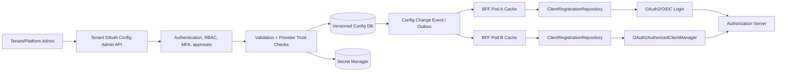
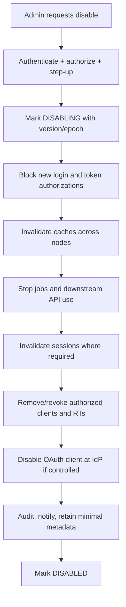

# 26.9. Đăng ký, cập nhật và vô hiệu hóa cấu hình client theo tenant

## 1. Bài toán: Mỗi tenant có một OAuth2/OIDC client configuration riêng

Trong một nền tảng SaaS **Spring Security OAuth 2.0/OIDC Client**, nhiều tổ chức sử dụng cùng ứng dụng, nhưng mỗi tổ chức có thể dùng một Identity Provider (IdP) hoặc một bộ OAuth2 client credentials khác nhau.

Ví dụ:

```text
                     SaaS Portal / Spring Boot
                               |
                +--------------+--------------+
                |              |              |
                v              v              v
           Tenant Alpha   Tenant Beta    Tenant Gamma
                |              |              |
        Corporate OIDC    Azure-like OIDC  External OAuth2
        client_id=A       client_id=B      client_id=C
        issuer=A          issuer=B         auth/token URLs=C
                |              |              |
                +--------------+--------------+
                               |
                   ClientRegistrationRepository
                   tra registration theo tenant
```

Đối với doanh nghiệp nhiều tenant, việc chỉ khai báo tất cả OAuth2 clients trong một file `application.yml` có thể không đủ:

- Tenant mới cần **onboarding** mà không redeploy toàn bộ hệ thống.
- Quản trị viên tenant cần cập nhật `client_id`, client authentication method, scopes hoặc redirect URI theo quy trình có kiểm duyệt.
- Client secret hết hạn cần **rotation** mà không phá các đăng nhập đang diễn ra.
- Một tenant bị khóa, rời nền tảng hoặc vi phạm chính sách cần **vô hiệu hóa** cấu hình OAuth2 client.
- Nền tảng chạy nhiều pods: mọi instances phải nhìn thấy phiên bản cấu hình nhất quán.
- Cấu hình provider có thể bị thay đổi hoặc xóa, trong khi vẫn còn OAuth2 Login callbacks, sessions, authorized clients và refresh tokens cũ.

Bài này giải thích cách quản lý **vòng đời cấu hình OAuth2/OIDC Client theo tenant**, không chỉ cách đọc YAML.

> **Nguyên tắc quan trọng:** `ClientRegistration` là cấu hình kỹ thuật để thực hiện một OAuth2 flow; **trạng thái cho phép tenant đăng nhập hoặc sử dụng token là quyết định bảo mật bổ sung của ứng dụng**. Việc xóa một registration khỏi cache không tự revoke tokens, logout sessions hoặc tắt OAuth client tại Authorization Server.

### Mục tiêu

Sau bài học, bạn có thể:

1. Phân biệt tenant, provider, issuer, client registration và authorized client.
2. Xây khóa `registrationId` không va chạm giữa tenants.
3. Thiết kế mô hình `DRAFT → VALIDATING → ACTIVE → SUSPENDED/DISABLED` có kiểm soát.
4. Đăng ký cấu hình tenant mới qua database/secret manager và repository động.
5. Tùy chỉnh `ClientRegistrationRepository` hoặc `ReactiveClientRegistrationRepository`.
6. Validate issuer discovery, authorization/token/JWKS endpoints, redirect URI, scopes và TLS.
7. Cập nhật cấu hình theo version và xử lý OAuth2 login đang diễn ra.
8. Rotate client secret/certificate/JWK mà không vô tình làm mất tất cả sessions.
9. Vô hiệu hóa một tenant hoặc một registration có tác động tới login, refresh và API calls theo chính sách.
10. Thiết kế cache invalidation, multi-node consistency, transaction và rollback.
11. Bảo vệ hệ thống khỏi SSRF, IdP mix-up, tenant confusion và token leakage.
12. Tích hợp Spring Security OAuth2 Login/OIDC và authorized client manager.
13. Xử lý các hệ quả tới `OAuth2AuthorizedClientRepository/Service`, token rotation và logout.
14. Kiểm thử happy path, lỗi, cạnh tranh quản trị và tình huống vận hành.

Các domain, tenant IDs, registration IDs và credentials trong bài là ví dụ. Mẫu mã tập trung vào **Spring Security Servlet/MVC**; phần reactive trình bày sau. Những interfaces tùy chỉnh được đánh dấu rõ là do ứng dụng cần triển khai.

---

## 2. Phân biệt các khái niệm trong đa tenant

| Khái niệm | Ví dụ | Ý nghĩa |
|---|---|---|
| Tenant | `tenant-alpha` | Tổ chức/vùng dữ liệu được ứng dụng phân quyền |
| Provider | `corporate-oidc` | Một nhà cung cấp OAuth2 hoặc OpenID Connect |
| Issuer | `https://id.alpha.example/realms/workforce` | Namespace, nguồn phát hành token/metadata của AS/OP |
| Client registration ID | `t_alpha__workforce` | Khóa tra cấu hình nội bộ của Spring Security |
| Client ID | `portal-app-alpha` | ID mà Authorization Server cấp cho OAuth client |
| Client secret/key | Secret trong vault | Credential dùng để xác thực OAuth2 client khi cần |
| OAuth2AuthorizedClient | Registration + principal + access/refresh token | Token đã được cấp, không phải config gốc |
| SecurityContext | Authentication của user hiện tại | Danh tính/authorities gắn với session/request |
| Resource Server | `orders-api` | API xác minh access token và quyền truy cập |
| Tenant policy | `LOGIN_ENABLED`, `API_ALLOWED`... | Quyết định chức năng nào của tenant được phép thực thi |

### 2.1. `registrationId` không phải `clientId`

Ví dụ:

```text
registrationId = t_alpha__workforce
clientId        = portal-app-prod
issuer          = https://id.alpha.example
```

`registrationId` do **ứng dụng Spring** chọn để tìm đúng `ClientRegistration`; `clientId` là định danh do AS cấp/đăng ký.

Hai tenants có thể dùng cùng một provider host nhưng **client IDs khác nhau**, hoặc cùng client ID trong những AS realms khác nhau. Không coi `clientId` là khóa duy nhất của tenant.

### 2.2. Cấu hình client khác bản ghi token

`ClientRegistration` mô tả:

```text
clientId, clientSecret, grantType, redirectUri,
authorizationUri, tokenUri, jwkSetUri,
issuerUri, scopes, clientAuthenticationMethod...
```

`OAuth2AuthorizedClient` chứa:

```text
clientRegistration + principalName +
accessToken + refreshToken (nếu có)
```

Cập nhật `ClientRegistration` trong DB không có nghĩa mọi `OAuth2AuthorizedClient` cũ được tự động xóa hoặc cập nhật.

### 2.3. Một tenant có thể có nhiều registrations

Ví dụ:

```text
tenant-alpha:
  workforce-login    -> authorization_code / OIDC
  reporting-service  -> client_credentials
  inventory-exchange -> token-exchange, nếu AS hỗ trợ
```

Việc disable `workforce-login` không nhất thiết disable `reporting-service`. Phải quyết định rõ **disable tenant toàn bộ** hay **disable một registration cụ thể**.

---

## 3. Static YAML và đăng ký động khác nhau thế nào?

### 3.1. Cấu hình tĩnh quen thuộc

```yaml
spring:
  security:
    oauth2:
      client:
        registration:
          alpha-workforce:
            provider: alpha-idp
            client-id: ${ALPHA_CLIENT_ID}
            client-secret: ${ALPHA_CLIENT_SECRET}
            authorization-grant-type: authorization_code
            redirect-uri: "{baseUrl}/login/oauth2/code/{registrationId}"
            scope:
              - openid
              - profile
        provider:
          alpha-idp:
            issuer-uri: https://id.alpha.example
```

Spring Boot có thể bind cấu hình vào `ClientRegistration` và đăng ký `ClientRegistrationRepository` mặc định, thường là `InMemoryClientRegistrationRepository`.

Cách này tốt cho số tenant ít, cấu hình ổn định và vận hành qua infrastructure-as-code.

### 3.2. Yêu cầu runtime onboarding

Khi tenant mới được tạo sau khi server đã chạy:

```text
Admin:
  POST /admin/tenants/t-beta/oauth-clients

Application:
  validate -> persist -> activate -> invalidate cache

Spring Security:
  findByRegistrationId("t_beta__workforce")
  -> trả ClientRegistration mới mà không cần redeploy
```

Muốn vậy cần **repository implementation động**, không chỉ đổi thuộc tính trong file YAML.

### 3.3. `InMemoryClientRegistrationRepository` không phải CRUD admin API

Spring Security cung cấp implementation đơn giản để giữ tập registrations trong memory. Nó không cung cấp contract CRUD tenant configuration, approval flow, secret rotation hoặc multi-node propagation.

`ClientRegistrationRepository` phía Servlet cơ bản chỉ có:

```java
ClientRegistration findByRegistrationId(String registrationId);
```

Nếu cần tạo/sửa/khóa tenant clients, **ứng dụng** phải xây administrative service/store và triển khai repository dùng store đó.

### 3.4. “Đăng ký client” có hai ý nghĩa

1. **Đăng ký cấu hình trong ứng dụng SaaS**: lưu `ClientRegistration` để Spring Security biết cách nói chuyện với một AS đã đăng ký.
2. **Đăng ký OAuth2 client tại Authorization Server**: AS tạo `client_id`, secret, redirect URIs và quyền grant, có thể qua console/API hoặc một giao thức như **RFC 7591 Dynamic Client Registration** nếu AS hỗ trợ.

Chúng là **hai bước khác nhau**. Việc tạo row trong database SaaS **không tự tạo OAuth2 client ở IdP**.

---

## 4. Kiến trúc vòng đời cấu hình theo tenant



**Các trách nhiệm nên tách:**

- **Admin API**: xác thực admin, authorization, CSRF nếu dùng cookie, kiểm toán thay đổi.
- **Validation service**: phân tích cấu hình/metadata và áp provider allowlist.
- **Secrets vault**: lưu client secret/private keys, không để nguyên văn trong bảng audit.
- **Configuration store**: giữ tenant, registration, trạng thái, version và metadata.
- **Runtime repository**: chỉ trả registration **được phép sử dụng** trong đúng tenant context.
- **Cache + invalidation**: cập nhật toàn bộ nodes theo version.
- **Session/token policy service**: quyết định tác động của update/disable lên các login sessions và authorized clients.

Không gộp tất cả vào một mutable static map được chỉnh trực tiếp từ web request.

## 5. Các trạng thái nên có

Một state machine ứng dụng có thể là:

```mermaid
stateDiagram-v2
    [*] --> DRAFT
    DRAFT --> VALIDATING: Submit
    VALIDATING --> ACTIVE: Approved and verified
    VALIDATING --> REJECTED: Validation failed
    REJECTED --> DRAFT: Edit
    ACTIVE --> UPDATING: Proposed new version
    UPDATING --> ACTIVE: Publish new version
    UPDATING --> ACTIVE: Reject update; keep old version
    ACTIVE --> SUSPENDED: Temporarily block usage
    SUSPENDED --> ACTIVE: Explicit re-enable
    ACTIVE --> DISABLED: Decommission
    SUSPENDED --> DISABLED: Decommission
    DISABLED --> [*]: Retention/archive policy
```



Đây là **application-specific model**; Spring Security không tự cung cấp enum hay schema này.

| Trạng thái | Ý nghĩa | Runtime policy khuyến nghị |
|---|---|---|
| `DRAFT` | Chưa kiểm tra/duyệt | Không dùng cho login/token calls |
| `VALIDATING` | Đang xác minh cấu hình | Không dùng |
| `REJECTED` | Không qua validation | Không dùng |
| `ACTIVE` | Được phép thực thi | Repository trả cấu hình, policy tiếp tục kiểm tra |
| `UPDATING` | Có phiên bản mới đang kiểm tra | Phiên bản **ACTIVE cũ** tiếp tục theo policy |
| `SUSPENDED` | Khóa tạm thời | Chặn login/authorize/API usage theo yêu cầu bảo mật |
| `DISABLED` | Ngừng sử dụng registration | Chặn mới; cleanup tokens/sessions theo chính sách |
| `ARCHIVED` | Giữ dữ liệu audit sau decommission | Không cho runtime dùng |

### 5.1. Tại sao `UPDATING` không nên thay cấu hình đang chạy ngay?

Admin vừa thay issuer URI hoặc secret; nếu runtime lập tức dùng bản mới trước khi validation hoàn tất, có thể làm hỏng tất cả tenants hoặc gửi credentials tới endpoint không tin cậy.

Nên có:

```text
ACTIVE v12 -> mọi request đang dùng v12

Candidate v13:
    validate -> approve -> publish atomically

ACTIVE v13 -> requests mới nhận v13
```

### 5.2. “Suspended” khác “Disabled”

`SUSPENDED` có thể cho phép phục hồi nhanh mà giữ audit/configuration. `DISABLED` thường biểu thị decommission và có thể kéo theo removal/revocation.

Tác động cụ thể phải được ghi thành policy; không dựa vào tên trạng thái để giả định tokens đã bị revoke.

---

## 6. Định danh tenant trước khi chọn registration

Một rủi ro rất lớn trong SaaS là **tenant confusion**: request của tenant A khiến backend chọn cấu hình client B.

### 6.1. Các nguồn tenant context

Một số kiến trúc chọn tenant từ:

- Subdomain được platform quản lý, ví dụ `alpha.portal.example`.
- Path segment cố định, ví dụ `/t/alpha/...`.
- Tenant membership đã xác thực ở backend.
- Lựa chọn trong session sau khi kiểm tra quyền.
- Mã lời mời/organization identifier đã được kiểm chứng.

**Không tự tin một header/query tùy ý**, ví dụ:

```http
X-Tenant-Id: tenant-beta
```

nếu backend chưa xác thực quyền dùng tenant đó.

### 6.2. Luồng login trước khi có principal

Trước OAuth2 Login, user có thể chưa có authentication. Vì vậy tenant được chọn để bắt đầu login phải đến từ nguồn có chính sách tin cậy:

```text
https://alpha.portal.example
    -> platform-managed hostname maps to tenant-alpha
    -> tenant-alpha permits workforce login
```

Không có local authenticated principal không đồng nghĩa được phép chọn provider bất kỳ.

### 6.3. Host header có thể bị giả mạo

Nếu app dựa vào `Host` hoặc `X-Forwarded-Host`, phải xác minh request đi qua reverse proxy đáng tin và host nằm trong allowlist đã được quản lý.

Không dùng raw public `Host` header để tạo redirect URI, thực hiện issuer discovery hoặc chọn tenant có credentials mạnh mà không kiểm tra.

### 6.4. Registration ID cần namespace toàn cục

Spring Security thường nhận route:

```text
/oauth2/authorization/{registrationId}
```

và callback:

```text
/login/oauth2/code/{registrationId}
```

Một `registrationId` như `"google"` không đủ phân biệt:

```text
tenant-alpha/google
tenant-beta/google
```

**Thiết kế thường dễ kiểm soát hơn:**

```text
registrationId = opaqueTenantKey + "__" + providerAlias
```

Ví dụ:

```text
t_3f9a__workforce
t_a71d__workforce
```

Không dùng email hoặc tên tenant dễ đổi làm phần duy nhất của ID. Cần validate regex, độ dài và tránh path injection, percent-encoding surprises, reserved characters.

### 6.5. Version nên nằm ở DB, không bắt buộc đưa vào registrationId

Ví dụ:

```text
registrationId = t_3f9a__workforce
activeVersion  = 12
```

Sau update:

```text
registrationId = t_3f9a__workforce
activeVersion  = 13
```

Registration ID ổn định giúp routing và token lookup dễ quản lý. Nhưng phiên bản mới có thể thay đổi client_id/issuer nghiêm trọng; phải có policy migration/tokens chứ không chỉ đổi version pointer.

Nếu cần nhiều client IDs cùng tồn tại trong giai đoạn cutover, có thể dùng **versioned registration IDs** theo kế hoạch rõ và cleanup sau; đây là một trade-off kiến trúc.

---

## 7. Mô hình database minh họa

Một schema SQL để quản lý cấu hình theo tenant:

```sql
CREATE TABLE tenant (
    id UUID PRIMARY KEY,
    slug VARCHAR(100) NOT NULL UNIQUE,
    status VARCHAR(24) NOT NULL,
    created_at TIMESTAMP WITH TIME ZONE NOT NULL
);

CREATE TABLE tenant_oauth_client (
    id UUID PRIMARY KEY,
    tenant_id UUID NOT NULL REFERENCES tenant(id),
    registration_id VARCHAR(160) NOT NULL UNIQUE,
    provider_alias VARCHAR(100) NOT NULL,
    active_version BIGINT,
    lifecycle_status VARCHAR(24) NOT NULL,
    updated_at TIMESTAMP WITH TIME ZONE NOT NULL,
    updated_by VARCHAR(200),
    CONSTRAINT uq_tenant_provider UNIQUE (tenant_id, provider_alias)
);

CREATE TABLE tenant_oauth_client_version (
    client_id UUID NOT NULL REFERENCES tenant_oauth_client(id),
    version BIGINT NOT NULL,
    issuer_uri VARCHAR(1024),
    authorization_uri VARCHAR(1024),
    token_uri VARCHAR(1024) NOT NULL,
    jwk_set_uri VARCHAR(1024),
    user_info_uri VARCHAR(1024),
    oauth_client_id VARCHAR(512) NOT NULL,
    secret_ref VARCHAR(512),
    auth_method VARCHAR(100) NOT NULL,
    grant_type VARCHAR(160) NOT NULL,
    redirect_uri_template VARCHAR(1024) NOT NULL,
    scopes_json TEXT NOT NULL,
    created_at TIMESTAMP WITH TIME ZONE NOT NULL,
    validated_at TIMESTAMP WITH TIME ZONE,
    validation_status VARCHAR(24) NOT NULL,
    PRIMARY KEY (client_id, version)
);
```

Đây không phải schema mặc định của Spring Security. Các columns là ví dụ để diễn đạt kiến trúc.

### 7.1. Vì sao có hai bảng?

`tenant_oauth_client` giữ **stable identity** và trỏ tới `active_version`.

`tenant_oauth_client_version` giữ **snapshot bất biến** cho từng phiên bản được đề xuất/duyệt. Mô hình này hỗ trợ:

- So sánh thay đổi.
- Audit.
- Atomic active version switch.
- Rollback có kiểm soát.
- Điều tra lỗi từ những request đang chạy bằng version cũ.
- Theo dõi validation status.

### 7.2. Không lưu raw client secret trong bảng thường

Có thể lưu:

```text
secret_ref = vault://oauth/tenant-alpha/workforce/v13
```

và chỉ truy vấn secret khi tạo runtime `ClientRegistration`, theo quyền của ứng dụng.

Secret reference cũng không nên lộ ra public API hoặc logs; vault paths có thể tiết lộ metadata nội bộ.

### 7.3. Unique constraints

Bảng nên ngăn:

- Hai registrations có cùng `registrationId`.
- Hai records cùng `(tenant_id,provider_alias)` nếu business chỉ cho một.
- Cùng `(client_id,version)` bị ghi đè.

Nếu một tenant được phép có nhiều registrations tới cùng provider, thay unique constraint theo business rule và sử dụng một stable client config ID riêng.

### 7.4. Optimistic version update

Khi hai admins cùng sửa:

```text
Admin A đọc active_version=12
Admin B đọc active_version=12

Admin A publish v13
Admin B publish v14 với dựa trên v12
```

B cần nhận conflict hoặc phải rebase, không tự âm thầm ghi đè A.

Có thể dùng:

```sql
UPDATE tenant_oauth_client
SET active_version = :new_version,
    updated_at = CURRENT_TIMESTAMP
WHERE id = :id
  AND active_version = :expected_old_version
  AND lifecycle_status = 'ACTIVE';
```

Nếu `rows_updated=0`, phát **version conflict**. Đây là CAS ở DB, khác cơ chế refresh token rotation.

---

## 8. Quy trình tạo registration mới

### 8.1. Các bước onboarding

1. **Xác thực admin** và kiểm tra quyền quản lý tenant.
2. Nhận form cấu hình theo **allowlist fields**, không nhận serialized `ClientRegistration` object tùy ý.
3. Tạo record `DRAFT`.
4. Lưu client secret/private key an toàn trong vault.
5. Validate tenant, redirect URI, provider discovery/metadata, grant, scopes và authentication method.
6. Có thể kiểm tra connectivity bằng phép thử bảo vệ credentials; không bắt buộc xin token thật chỉ để kiểm tra syntactic config.
7. Yêu cầu approval/step-up theo chính sách.
8. Publish phiên bản được duyệt dưới trạng thái `ACTIVE` bằng transaction.
9. Phát configuration event sau commit.
10. Các pods tải/sử dụng version mới.
11. Chạy test login hoặc service token với test account/permissions.
12. Ghi audit và thông báo cho tenant administrator.

### 8.2. API quản trị minh họa

```http
POST /admin/tenants/t-3f9a/oauth-clients HTTP/1.1
Content-Type: application/json
Cookie: SESSION=...
X-CSRF-TOKEN: ...

{
  "providerAlias": "workforce",
  "issuerUri": "https://id.alpha.example",
  "clientId": "portal-alpha",
  "clientAuthenticationMethod": "client_secret_basic",
  "grantType": "authorization_code",
  "redirectUriTemplate": "{baseUrl}/login/oauth2/code/{registrationId}",
  "scopes": ["openid", "profile", "email"]
}
```

**Không nên đưa secret vào JSON response**. Khi secret được nhập, dùng một secured one-time submission path hoặc vaulted credential reference; không persist plaintext trong request logs, APM hoặc audit.

### 8.3. Kết quả API

```json
{
  "registrationId": "t_3f9a__workforce",
  "status": "VALIDATING",
  "candidateVersion": 1
}
```

Có thể cần asynchronous validation workflow trong application, nhưng một worker của hệ thống quản trị mới được cấp quyền publish. Đừng tự cho tất cả tenant admins thay đổi issuer sang host tùy ý mà không có policy.

---

## 9. Validate cấu hình trước khi activate

### 9.1. Validate nội bộ

Kiểm tra:

- `tenantId` tồn tại và được phép onboarding.
- `registrationId` không trùng, đúng format.
- `grantType` thuộc tập được ứng dụng hỗ trợ.
- Client auth method được STS/IdP đăng ký.
- `clientId` hợp lệ về format/length.
- Scopes không vượt tổ chức/tenant policy.
- Redirect URI thuộc host/route mà platform đã đăng ký.
- Secret/key reference tồn tại và có quyền truy cập.
- Issuer/provider nằm trong allowlist/trust configuration.
- Token/JWKS/UserInfo endpoints dùng HTTPS theo deployment security policy.

### 9.2. Validate issuer

Với OIDC:

```text
issuer_uri = https://id.alpha.example
```

Sau OIDC discovery, trường `issuer` trong provider metadata cần **khớp chính xác với issuer được kỳ vọng** theo protocol. Không chọn một issuer đã khám phá được chỉ vì hostname gần giống.

Cần xác minh authorization endpoint, token endpoint, JWK Set URI và supported client authentication/grants trong khả năng provider công bố.

### 9.3. Validate redirect URI

Redirect URI không được là URL tùy ý tenant admin nhập:

```text
https://attacker.example/receive-code
```

Policy có thể cho các host dành riêng cho tenant đã xác minh, nhưng phải:

- Chỉ cho allowed schemes và hosts.
- Kiểm soát reverse proxy/forwarded headers.
- Đăng ký redirect URI tại AS.
- Tránh open redirect.
- Không cho wildcard subdomain không an toàn.
- Giữ callback route nhất quán với Spring Security.

### 9.4. Validate scopes và audience

OIDC Login dùng `openid` scope nhưng downstream API cần access token có audience/scope phù hợp. Không cho tenant admin thêm privileged scopes không được business policy chấp nhận.

### 9.5. Validate metadata theo ứng dụng, không chỉ theo HTTP 200

Metadata endpoint trả 200 không chứng minh server đáng tin. Phải kiểm tra:

- Issuer đã allowlist/pinned.
- TLS certificate/hostname.
- Metadata field types.
- JWK URI thuộc trust policy.
- Token endpoint được chấp nhận.
- Redirects không đi sang địa chỉ private/loopback/metadata service.
- IdP capability có tương thích với registration settings không.

---

## 10. SSRF và rủi ro discovery tự động

Một tính năng nguy hiểm là:

```text
Tenant admin gửi issuerUri tùy ý
    |
    v
ClientRegistrations.fromIssuerLocation(issuerUri)
    |
    v
Ứng dụng tự kết nối HTTP đến URL được cung cấp
```

Vì discovery **có network I/O**, đây có thể là SSRF nếu ứng dụng truy vấn địa chỉ không được kiểm soát.

### 10.1. Rủi ro

- Truy cập cloud instance metadata như `169.254.169.254`.
- Truy cập localhost/admin interfaces.
- DNS rebinding.
- Follow redirects sang IP private.
- Endpoint token URI được cấu hình trỏ tới host attacker.
- Gửi client secret tới IdP/token endpoint không được trust.
- Server-side port scanning qua validation.

### 10.2. Biện pháp

- Chỉ cho phép issuers được onboarding/approve.
- Validate scheme/host/port và dùng HTTPS.
- DNS resolution và kiểm soát destination IP ở layer network/HTTP client.
- Chặn private/loopback/link-local ranges nếu không được phép.
- Hạn chế redirects.
- Dùng egress proxy/allowlist cho metadata/TLS.
- Giới hạn timeout và kích thước response.
- Không gửi client secret khi đang thử issuer chưa được duyệt.
- Có approval riêng cho IdP mới ngoài allowlist.
- Theo dõi changes của DNS/metadata theo chính sách.

### 10.3. `ClientRegistrations` là convenience API, không là trust boundary

Spring Security có API:

```java
ClientRegistrations.fromIssuerLocation(issuerUri)
```

để tạo builder từ metadata provider. Điều đó giúp hạn chế viết endpoint URIs thủ công, nhưng **không tự bảo đảm issuer URI là đáng tin hay network requests không thể SSRF**.

Nếu platform đã có metadata được validated và lưu version, có thể build `ClientRegistration` từ snapshot đã được approve để giảm dependency vào network discovery trên mỗi login.

---

## 11. ClientRegistrationRepository động trong Servlet

Spring Security interface:

```java
package org.springframework.security.oauth2.client.registration;

public interface ClientRegistrationRepository {
    ClientRegistration findByRegistrationId(String registrationId);
}
```

`findByRegistrationId` trả `ClientRegistration` nếu tìm được, ngược lại `null`.

Có thể triển khai bằng một **versioned tenant configuration service** do ứng dụng viết.

### 11.1. Kiến trúc các interfaces

```java
// Application-specific interface, KHÔNG phải Spring Security API.
public interface TenantClientRegistrationCatalog {
    Optional<ClientRegistration> findActiveByRegistrationId(
        String registrationId
    );
}
```

Runtime repository:

```java
import org.springframework.security.oauth2.client.registration.ClientRegistration;
import org.springframework.security.oauth2.client.registration.ClientRegistrationRepository;

public final class TenantAwareClientRegistrationRepository
        implements ClientRegistrationRepository {

    private final TenantClientRegistrationCatalog catalog;

    public TenantAwareClientRegistrationRepository(
            TenantClientRegistrationCatalog catalog) {
        this.catalog = catalog;
    }

    @Override
    public ClientRegistration findByRegistrationId(String registrationId) {
        return catalog.findActiveByRegistrationId(registrationId)
            .orElse(null);
    }
}
```

`TenantClientRegistrationCatalog` là abstraction ứng dụng cần implement:

```text
registrationId
    -> validate canonical format
    -> read active metadata/version from cache/DB
    -> confirm tenant/registration status ACTIVE
    -> resolve client secret from vault
    -> construct immutable ClientRegistration
    -> return snapshot
```

### 11.2. Đăng ký bean

```java
import org.springframework.context.annotation.Bean;
import org.springframework.context.annotation.Configuration;
import org.springframework.security.oauth2.client.registration.ClientRegistrationRepository;

@Configuration
public class DynamicTenantClientConfig {

    @Bean
    ClientRegistrationRepository clientRegistrationRepository(
            TenantClientRegistrationCatalog catalog) {

        return new TenantAwareClientRegistrationRepository(catalog);
    }
}
```

Đây là **bean thay thế** default repository auto-configured trong cấu hình ứng dụng thông dụng.

Nếu dự án đồng thời có registrations tĩnh `application.yml`, **không tự giả định** Spring Boot sẽ tự merge chúng vào custom repository. Cần composite/chain rõ ràng nếu muốn vừa hỗ trợ static system registrations vừa dynamic tenant registrations.

### 11.3. Tại sao nên để registrationId tự chứa tenant namespace?

Trong OAuth2 callback, Spring Security biết `registrationId` từ authorization request/redirect. Nếu repository chỉ dựa vào một `TenantContext` ThreadLocal được suy từ host của request hiện tại, callback có thể không có đúng tenant context, nhất là nếu dùng shared callback host.

Với globally unique registration ID:

```text
t_3f9a__workforce
```

repository có thể resolve từ server-side mapping mà không phải tin một header tenant bất kỳ.

**Dù vậy vẫn phải validate tenant binding**: một callback với registration ID hợp lệ chưa chứng minh request thuộc đúng tenant/session/user. Spring Security `state` và business tenant checks tiếp tục cần thiết.

### 11.4. Repository query không đồng nghĩa tenant authorization

Một application internal service có thể yêu cầu:

```java
repo.findByRegistrationId("t_beta__workforce")
```

và thấy cấu hình Beta trong backend. Điều đó không cho phép user thuộc Alpha thực hiện OAuth2 login hoặc API calls bằng Beta.

Tenant-specific login initiation cần một **resolver/policy** xác minh host/path/session/tenant membership trước khi nhận registration ID.

---

## 12. Tạo ClientRegistration từ metadata đã kiểm chứng

Một ví dụ build OIDC registration từ metadata đã duyệt:

```java
import org.springframework.security.oauth2.client.registration.ClientRegistration;
import org.springframework.security.oauth2.client.registration.ClientRegistrations;

public ClientRegistration buildRegistration(
        ValidatedTenantOAuthConfig cfg,
        String decryptedSecret) {

    return ClientRegistrations
        .fromIssuerLocation(cfg.issuerUri())
        .registrationId(cfg.registrationId())
        .clientId(cfg.oauthClientId())
        .clientSecret(decryptedSecret)
        .redirectUri(cfg.redirectUriTemplate())
        .scope(cfg.scopes().toArray(String[]::new))
        .build();
}
```

`ValidatedTenantOAuthConfig` là **custom record/type** do ứng dụng định nghĩa. API `fromIssuerLocation` thực hiện discovery khi gọi, không chỉ đọc cached metadata.

**Quan trọng:** đoạn minh họa trên chỉ nên được dùng khi `cfg.issuerUri()` đã được allowlist và HTTP egress đã kiểm soát SSRF. Nếu app lưu metadata snapshot validated, hãy xây `ClientRegistration` từ những fields được approve mà không bắt buộc gọi discovery trong hot path.

### 12.1. Không discovery trên mọi request

Nếu mỗi call `findByRegistrationId` đều gọi OIDC discovery, một request login có thể kéo theo nhiều HTTP calls tới IdP, tăng latency và mở khả năng DoS hoặc làm login phụ thuộc vào metadata endpoint outage.

Ưu tiên cache immutable `ClientRegistration` snapshot theo:

```text
(registrationId, activeVersion)
```

và invalidation theo event/TTL/fencing.

### 12.2. ClientRegistration không chứa `enabled` flag

Spring `ClientRegistration` không có field chung mang business state như `ACTIVE`/`DISABLED` theo tenant.

Đừng cố serialize `enabled=true` vào Spring type rồi mong filter chain tự chặn mọi flows. Runtime repository và policy enforcement phải xử lý trạng thái riêng.

### 12.3. Không mutate client secret trên object đã dùng

`ClientRegistration` được xây theo builder với cấu hình cụ thể. Đối với rotation/update, tạo **snapshot mới** thay vì chia sẻ một mutable global object rồi sửa fields trong lúc request đang chạy.

---

## 13. Bật OAuth2 Login với dynamic repository

Ví dụ Spring MVC/Servlet:

```java
import org.springframework.context.annotation.Bean;
import org.springframework.context.annotation.Configuration;
import org.springframework.security.config.Customizer;
import org.springframework.security.config.annotation.web.builders.HttpSecurity;
import org.springframework.security.web.SecurityFilterChain;

@Configuration
public class OAuth2SecurityConfiguration {

    @Bean
    SecurityFilterChain securityFilterChain(HttpSecurity http)
            throws Exception {

        http
            .authorizeHttpRequests(authorize -> authorize
                .requestMatchers("/", "/login", "/assets/**").permitAll()
                .anyRequest().authenticated()
            )
            .oauth2Login(Customizer.withDefaults())
            .oauth2Client(Customizer.withDefaults());

        return http.build();
    }
}
```

Khi container có custom `ClientRegistrationRepository` bean, OAuth2 Login có thể tìm registration động qua repository đó.

Tuy nhiên, đây chỉ là **framework wiring**. Trong SaaS, phải bổ sung:

- Tenant-aware login initiation.
- Registration allowlist.
- Session/state/PKCE handling.
- Host/redirect URI validation.
- Tenant binding của callback.
- Disabled tenant enforcement.
- Failure handling và audit.

### 13.1. Link đăng nhập theo tenant

Có thể hiển thị:

```text
Alpha login page:
    /oauth2/authorization/t_3f9a__workforce

Beta login page:
    /oauth2/authorization/t_a71d__workforce
```

Nhưng nếu tất cả URLs công khai và repo trả cả Alpha/Beta, attacker có thể cố bắt đầu Beta login từ Alpha host. OAuth2 login initiation cần security policy đảm bảo **registration ID được phép với tenant context**.

### 13.2. `Iterable<ClientRegistration>` và trang login mặc định

Spring Security login page generation có thể liệt kê registrations khi repository implement `Iterable<ClientRegistration>`.

Một dynamic repository chỉ implement `ClientRegistrationRepository` có thể **không tự hiển thị tất cả links** trên generated default login page.

Đối với SaaS, thường tốt hơn là **custom tenant login page** liệt kê những providers được phép theo host/tenant, thay vì enumerate toàn bộ registrations của mọi doanh nghiệp.

Không nên implement `Iterable` trả toàn bộ tenant registrations nếu login page có thể lộ tenants/IdP metadata không thuộc user hiện tại.

### 13.3. Custom AuthorizationRequestResolver

Spring Security có:

```java
DefaultOAuth2AuthorizationRequestResolver
```

Có thể bọc resolver để kiểm tra registration trước khi tạo authorization redirect:

```text
Inbound /oauth2/authorization/{registrationId}
    |
    +-- Resolve tenant từ trusted host/path
    +-- Verify registration belongs to tenant
    +-- Check tenant+registration ACTIVE
    +-- Delegate to Spring OAuth2AuthorizationRequestResolver
    +-- Bind tenant/version metadata vào server-side intent
```

Không tự tạo OAuth2 `state` tĩnh hoặc bỏ qua PKCE để đưa tenant context vào redirect.

### 13.4. Callback phải kiểm tra lại

Ngay cả khi initiation hợp lệ lúc T0, registration có thể bị disable trước callback lúc T1. Policy phải quyết định:

```text
T0: Alpha login started with registration v12
T1: Security admin disables Alpha
T2: Callback arrives with code/state
```

Với **emergency disable**, nên từ chối callback ngay cả khi `state` hợp lệ, không chỉ tin quyết định tại T0.

---

## 14. Pending authorization request và config version

Trong Authorization Code Flow, trình duyệt có thể mất vài phút tại IdP trước khi callback quay về.

```text
T0: App xây authorize URL theo config v12
T1: Admin cập nhật config -> v13
T2: IdP callback trả authorization code
T3: App gọi Token Endpoint
```

Nếu v13 đã đổi:

- `client_id`.
- `client_secret`.
- Redirect URI.
- Token Endpoint.
- Issuer.

thì Token Exchange ở T3 dùng v13 có thể **không phù hợp** với authorization request ở T0.

### 14.1. Rủi ro của hot-swap

Ví dụ:

```text
Authorize:
    client_id = client-A
    redirect_uri = https://portal.example/login/oauth2/code/t_3f9a__workforce

Token request:
    client_id = client-B
```

Authorization code được cấp cho client-A, nên việc đổi bằng client-B thường thất bại.

### 14.2. Chính sách dành cho in-flight callbacks

Có các lựa chọn:

1. **Grace period/drain:** giữ config v12 và client credentials v12 trong một khoảng đủ xử lý callbacks cũ, rồi chuyển v13.
2. **Version-pinned request:** lưu version/snapshot reference trong trusted authorization request context, dùng đúng version cho callback nếu custom pipeline hỗ trợ.
3. **Reject và restart login:** từ chối callbacks bắt đầu trước cutover, hướng dẫn user đăng nhập lại.
4. **Dual registrations:** dùng registration IDs/version IDs khác nhau trong cutover phức tạp.

**Quan trọng:** default Spring OAuth2 Login wiring không tự bảo đảm phiên bản `ClientRegistration` được pin trong suốt custom dynamic updates. Nếu yêu cầu version-pinning, phải thiết kế và kiểm thử callback/token exchange integration riêng, không chỉ lưu một số version vào session rồi giả định framework sẽ dùng.

### 14.3. Emergency disable ưu tiên bảo mật hơn UX

Nếu client secret bị compromise hoặc tenant bị khóa khẩn, không tiếp tục cho phép callback theo v12 chỉ để giảm lỗi đăng nhập.

Khi cần, **fail closed**, revoke credential tại AS và yêu cầu login lại với cấu hình mới.

---

## 15. Cập nhật cấu hình: phân loại theo mức độ ảnh hưởng

Không phải mọi update đều có rủi ro giống nhau.

| Trường thay đổi | Mức ảnh hưởng | Tác động điển hình |
|---|---|---|
| Display name/logo | Thấp | Login UI và audit metadata |
| Scopes | Trung bình–cao | Authorization consent và downstream API permissions |
| Redirect URI | Cao | Authorization callbacks đang diễn ra |
| Client secret | Cao | Token Endpoint client authentication, refresh requests |
| Client ID | Rất cao | Đổi OAuth2 client identity, code binding và tokens cũ |
| Client auth method | Cao | Basic/Post/private_key_jwt/mTLS compatibility |
| Issuer URI | **Rất cao** | Trust domain và OIDC subject namespace |
| Authorization URI | Cao | Redirect trust và IdP mix-up |
| Token URI | **Rất cao** | Có thể gửi credentials và code tới sai host |
| JWK Set URI | **Rất cao** | ID Token signature validation |
| UserInfo URI | Cao | Identity attributes và endpoint trust |
| Grant type | Cao | OAuth2 flow semantics và manager providers |
| Tenant routing/host | Cao | Callback domain, cookie/session binding |
| Disable/enable | Rất cao | Login, refresh, API access, sessions |

### 15.1. Issuer đổi không phải “chỉnh URL nhỏ”

OIDC identity thường được khóa bằng:

```text
(issuer, subject)
```

Nếu issuer đổi, cặp identity cũng thay đổi dù `sub` tình cờ bằng nhau. Không tự merge accounts từ issuer mới vào issuer cũ.

Có thể cần migration/federation plan và explicit verified identity linking, chứ không chỉ update record.

### 15.2. Scope tăng có thể cần user consent mới

Nếu admin thêm `calendar.write`, access token/refresh token cũ không tự có scope mới.

Phải đánh giá user reauthorization và scope mapping của provider, không đơn giản lưu `scope` vào DB rồi tin rằng OAuth2AuthorizedClient đã được nâng quyền.

### 15.3. Thay client authentication method

Chuyển từ `client_secret_basic` sang `private_key_jwt` hoặc mTLS yêu cầu HTTP token response client, key material và IdP registration được cấu hình đúng. Cập nhật metadata không đủ nếu Spring client runtime chưa hỗ trợ phương thức mới theo version.

---

## 16. Rotate client secret và credentials

### 16.1. Rotation an toàn hơn sửa trực tiếp

Một quy trình:

```text
Config v12:
    client_id = client-A
    secretRef = vault://alpha/old

Provider:
    tạo new client secret nếu AS hỗ trợ nhiều secrets đồng thời

Config v13:
    client_id = client-A
    secretRef = vault://alpha/new

Publish v13
    |
    +-- New auth/token requests dùng secret mới
    +-- Old in-flight flows theo grace policy
    +-- Verify refresh and client_credentials calls

Provider:
    revoke old secret khi an toàn

Vault:
    retire old secret theo retention policy
```

### 16.2. Provider có hỗ trợ multiple active secrets không?

**Không phải mọi AS đều cho phép hai secrets cùng hợp lệ.** Có provider khi rotate sẽ vô hiệu hóa secret cũ ngay.

Trong trường hợp đó, phải chuẩn bị:

- Maintenance/retry window.
- Fail-closed behavior.
- Reauthorization UX.
- Cập nhật all pods nhanh.
- Monitor `invalid_client`.
- Rollback khả thi hay không (nếu old secret đã bị revoke thì rollback không dùng lại được).

### 16.3. Private key JWT/mTLS

Với `private_key_jwt`, rotate private keys/JWK references, JWK ID và AS trusted keys. Với mTLS, rotate client certificates/trust chains; lifetime và key rollover có thể khác secret rotation.

Không lưu private key trong `ClientRegistration` plaintext JSON hoặc logs. Cần key vault/HSM hoặc policy phù hợp.

### 16.4. Secrets khác authorized clients

Rotating client secret có thể làm **refresh token grant** thất bại nếu client authentication chưa cập nhật, nhưng không nhất thiết làm mọi access token cũ hết hiệu lực.

Ngược lại, một AS có thể revoke toàn bộ tokens của client khi client registration đổi. Phải kiểm tra provider lifecycle contract.

---

## 17. Cache immutable registrations theo version

Một runtime repository động đọc DB/secret vault trên **mọi login step** có thể chậm hoặc gây quá tải. Dùng cache có kiểm soát:

```text
registrationId = t_3f9a__workforce
activeVersion  = 13

Cache key:
    (registrationId, activeVersion)

Cache value:
    immutable ClientRegistration snapshot
```

### 17.1. Vì sao cache theo version?

Nếu admin publish v14, cache v13 vẫn có thể tồn tại ở một pod khác. Cache cần biết đó không còn là active version cho **requests mới**.

Một thiết kế:

```text
Lookup registrationId
    -> đọc trạng thái/version mới nhất từ local policy snapshot
    -> nếu DISABLED: trả null / deny
    -> nếu ACTIVE v14:
           cache.get(registrationId,v14)
           hoặc load/build v14
```

### 17.2. Invalidation trong nhiều pods

Options:

- DB change event + outbox + message bus.
- Redis pub/sub hoặc event streams.
- Polling metadata versions với interval ngắn.
- TTL cache làm safety net.
- Version check ở central store cho operations nhạy cảm.

**Không chỉ dùng event best-effort** nếu disable khẩn yêu cầu hiệu lực tức thì. Một pod bị mất event có thể tiếp tục dùng config cũ.

### 17.3. TTL không thay emergency deny policy

Nếu cache TTL là 5 phút và tenant bị khóa vì incident, pod chưa nhận event có thể tiếp tục login/refresh trong 5 phút.

Với yêu cầu nghiêm ngặt, cần một **central denial/policy check** hoặc cơ chế cache invalidation có consistency guarantee rõ và fail-closed khi control plane không thể xác minh trạng thái.

### 17.4. Không cache decrypted secret vô hạn

Có thể phải giữ secret trong memory trong lúc dùng `ClientRegistration`, nhưng:

- Không ghi secret vào logs.
- Không serialize cache object sang untrusted endpoints.
- Không đưa secret vào metrics.
- Xóa/expire old snapshots theo cutover policy.
- Không coi garbage collection là biện pháp xóa memory secret tuyệt đối.
- Giới hạn quyền đọc secret của pods.

---

## 18. Repository phải phân biệt ACTIVE và DISABLED

Một implementation concept:

```java
public ClientRegistration findByRegistrationId(String registrationId) {
    ActiveRegistrationSnapshot snapshot =
        configService.findRuntimeSnapshot(registrationId);

    if (snapshot == null || !snapshot.isActive()) {
        return null;
    }

    return snapshot.clientRegistration();
}
```

**Các types `ActiveRegistrationSnapshot` và `configService` là custom application abstractions.**

Với disabled registration, `ClientRegistrationRepository.findByRegistrationId` có thể trả `null` để ngăn Spring Security khởi tạo flow mới theo registration đó.

Tuy nhiên, việc trả `null` **không tự làm**:

- Những OAuth2 sessions đã đăng nhập hết hạn.
- Token được Resource Server chấp nhận bị revoke.
- Authorized client trong DB biến mất.
- Background job đang có token ngừng gọi API.
- Callback đang thực hiện bị chặn nếu đã có snapshot trong pipeline.
- WebClient đang gắn Bearer token được gửi sau đó không chạy nữa.

Vì vậy repository-only disable **chưa đủ** cho một chính sách vô hiệu hóa toàn diện.

### 18.1. Deny ở nhiều điểm

Có thể cần kiểm tra trạng thái tenant/registration tại:

1. Login initiation.
2. OAuth2 callback trước khi tạo local authenticated session.
3. Authorization manager/token acquisition.
4. Resource API gateway trước khi dùng authorized client.
5. Background jobs.
6. Sensitive endpoints khi session cũ vẫn active.
7. Service token usage.
8. Admin re-enable.

### 18.2. Chọn mode disable rõ ràng

**Mode A — Chặn login mới:** chỉ ngăn bắt đầu sign-in bằng provider đó; existing sessions/API integrations có thể vẫn chạy theo policy.

**Mode B — Chặn mọi token usage:** ngăn refresh, outbound API calls và service jobs; có thể revoke/cleanup authorized clients.

**Mode C — Khóa toàn tenant:** chặn mọi login methods và business access của tenant, tùy sản phẩm.

Trạng thái DB cần mô tả mode và hiệu lực, không dùng một boolean `enabled=false` rồi để các teams suy đoán.

---

## 19. Vô hiệu hóa config không giống disable client ở Authorization Server

Giả sử platform đổi:

```text
tenant_oauth_client.lifecycle_status = DISABLED
```

điều đó chỉ thay **cấu hình nội bộ SaaS**. OAuth2 client tại IdP có thể vẫn còn active:

```text
client_id = portal-alpha
secret = old-secret
refresh_token RT1 vẫn hợp lệ tại AS
```

Để khóa triệt để, có thể cần:

- Disable/delete OAuth2 client tại IdP qua console/API riêng.
- Revoke refresh tokens/authorizations theo khả năng provider.
- Remove authorized clients trong store của SaaS.
- Invalidate sessions theo policy.
- Stop scheduled jobs/webhooks liên quan.
- Remove credentials khỏi secret manager khi không còn cần.
- Audit và thông báo khách hàng.

**RFC 7591 Dynamic Client Registration** và OAuth2 Token Revocation (RFC 7009) là những API có thể liên quan khi provider hỗ trợ; không mặc định provider nào cũng cho self-service register/delete/revoke.

---

## 20. Authorized clients sau update/disable

Một authorized client được lưu theo:

```text
(registrationId, principalName)
```

Ví dụ:

```text
registrationId = t_3f9a__workforce
principalName  = alice-901
accessToken    = AT1
refreshToken   = RT1
```

### 20.1. Update client secret

Sau khi secret đổi, `AT1` có thể còn hạn nhưng refresh `RT1` có thể fail nếu provider không còn chấp nhận client authentication cũ.

Một số providers ràng buộc refresh token với client ID/credential; hành vi phải được xác minh theo deployment.

### 20.2. Update issuer/client ID

Đây là thay đổi trust/client identity. Tokens cũ có thể thuộc issuer/client cũ và **không nên tự reuse** với registration mới chỉ vì `registrationId` giữ nguyên.

Phải định nghĩa migration:

```text
Old registration v12:
    issuer = A
    clientId = X

New registration v13:
    issuer = B
    clientId = Y
```

Cách làm an toàn có thể là **invalidate/reconnect** authorized clients và xem lại identity mapping, không chỉ sửa một row.

### 20.3. Disable registration

`OAuth2AuthorizedClientService` có thể vẫn chứa AT/RT cũ. Nếu application trực tiếp:

```java
authorizedClientService.loadAuthorizedClient(
    registrationId, principalName
);
```

rồi gắn Bearer header, nó có thể tiếp tục dùng token dù repo đã trả `null` cho config.

Phải enforce runtime tenant policy **trước khi dùng token**, không chỉ tại login initiation.

### 20.4. Spring Session và multiple nodes

Nếu user đăng nhập trên pod A rồi admin disable tenant ở pod B, session của user có thể còn hoạt động trong shared session store.

Disable policy cần tác động tới **authenticated business requests**, không chỉ cập nhật login page. Có thể dùng session invalidation, account disable checks và short-lived authorization cache.

---

## 21. Refresh token rotation, concurrency và disable

Các requests cùng tenant/authorized client có thể đồng thời refresh:

```text
AT1 gần hết hạn, RT1 hiện có

Request A:
    refresh RT1 -> AT2 + RT2

Request B:
    refresh RT1 -> invalid_grant
```

Nếu AS dùng refresh token rotation và replay detection, race có thể gây revoke token family.

### 21.1. Các tình huống nguy hiểm khi disable

```text
Thread A: kiểm tra tenant ACTIVE
Thread A: gửi refresh request RT1

Admin:
    disable tenant
    remove authorized client

Thread A:
    nhận AT2/RT2
    save authorized client trở lại store
```

Một refresh response đến muộn có thể **tái tạo token sau disable**.

### 21.2. Nguyên tắc giải quyết

- Enforce policy trước authorization/refresh.
- Recheck tenant state/version trước khi lưu token mới.
- Dùng version/fencing hoặc conditional write để ngăn stale operation resurrect.
- Dùng distributed coordination nếu có nhiều pods và strict rotation.
- Re-read authorized client sau lock.
- Không cho failure handler của refresh stale xóa token mới.
- Xác định rõ disable deadline/consistency SLA.
- Nếu khẩn cấp, revoke tại Authorization Server vì local cache có thể chưa kịp cập nhật.

### 21.3. Không coi một database transaction là lock HTTP grant

Một transaction JDBC thông thường không đảm bảo atomic toàn bộ:

```text
load RT1 -> call remote AS -> save RT2
```

trong môi trường nhiều instances, đặc biệt khi lock timeout, network latency và failures. Thiết kế token lifecycle concurrency riêng.

---

## 22. API quản trị: authentication, authorization và audit

Các endpoints quản trị cấu hình OAuth2 cần được bảo vệ nghiêm ngặt:

```text
POST  /admin/tenants/{tenant}/oauth-clients
PATCH /admin/tenants/{tenant}/oauth-clients/{clientId}
POST  /admin/tenants/{tenant}/oauth-clients/{clientId}/validate
POST  /admin/tenants/{tenant}/oauth-clients/{clientId}/activate
POST  /admin/tenants/{tenant}/oauth-clients/{clientId}/suspend
POST  /admin/tenants/{tenant}/oauth-clients/{clientId}/disable
POST  /admin/tenants/{tenant}/oauth-clients/{clientId}/rotate-secret
```

### 22.1. Không tin tenantId từ path

Một admin của tenant Alpha không được phép chỉ đổi URL thành:

```text
/admin/tenants/t-beta/oauth-clients
```

rồi sửa Beta.

Authorization phải kiểm tra:

```text
authenticatedAdmin
    -> có quyền quản lý tenant?
    -> có quyền loại thay đổi này?
    -> có yêu cầu step-up/approval?
```

### 22.2. CSRF protection

Nếu admin API dùng cookie session, các operations đổi trạng thái cần CSRF protection. `state` của OAuth2 login không thay CSRF token của admin console.

### 22.3. Approval tách người tạo và người duyệt

Với enterprise, thay issuer/client secret có thể cần:

- Tenant admin đề xuất.
- Security/platform admin duyệt.
- Validation service chạy với egress allowlist.
- Publish version atomically.
- Audit immutable.
- Rollback được kiểm soát.

### 22.4. Không trả secrets về frontend

Admin UI có thể nhận thông báo:

```json
{
  "registrationId": "t_3f9a__workforce",
  "activeVersion": 13,
  "hasCredential": true,
  "status": "ACTIVE"
}
```

Không trả:

```json
{
  "clientSecret": "...",
  "privateKey": "..."
}
```

Đặt `clientSecret="********"` trong DTO dễ gây nhầm; tốt hơn là **không trả field**, chỉ có `hasCredential` và nút rotate/update.

---

## 23. Versioned update và transactional publish

Một quy trình cập nhật an toàn:

```text
1. Admin đọc v12 kèm ETag/version.
2. Admin tạo candidate v13, không sửa v12.
3. Validation service xác minh metadata và policy.
4. Approval cho v13.
5. Transaction:
       assert activeVersion == 12
       set activeVersion = 13
       write outbox event CONFIG_ACTIVATED(v13)
6. Commit.
7. Event consumers invalidate/reload cache.
8. Requests mới sử dụng v13 theo policy.
9. Verify health và client login.
10. Decommission v12 sau grace hoặc khẩn cấp.
```

### 23.1. Vì sao outbox event?

Nếu DB commit rồi process crash **trước** khi gửi cache invalidation event, các pods có thể tiếp tục dùng cấu hình cũ.

Transactional outbox cho phép lưu thay đổi và event cùng transaction, rồi gửi lại event sau commit.

### 23.2. Event idempotency

Nhiều pods có thể nhận event trùng/lệch thứ tự:

```text
CONFIG_ACTIVATED(v13)
CONFIG_ACTIVATED(v12)  // đến muộn
```

Consumer không được làm active version lùi về v12 chỉ vì event muộn. Chỉ chấp nhận version mới hơn theo control plane hoặc re-read active version từ DB.

### 23.3. Rollback cũng là một lần publish

Nếu v13 gây lỗi, rollback về v12 cần record/audit operation và kiểm tra credentials v12 vẫn hợp lệ. Không xóa v13 mà không lưu audit.

Trong trường hợp issuer/client ID đã đổi, rollback có thể làm tokens mới không dùng được. Cần migration/reconnect policy phù hợp.

---

## 24. Tenant-aware routing và callback security

### 24.1. Initiation phải chọn đúng tenant

Luồng:

```text
Browser at alpha.portal.example
    |
    v
Tenant resolver: tenant-alpha (trusted host mapping)
    |
    v
Allowed registration = t_3f9a__workforce
    |
    v
/oauth2/authorization/t_3f9a__workforce
```

Không cho request ở Alpha chủ động chọn registration Beta chỉ vì biết ID.

### 24.2. Callback registrationId không đủ

Một callback có thể tới shared host:

```text
https://portal.example.com/login/oauth2/code/t_3f9a__workforce
```

Spring Security cần state tương ứng authorization request; ứng dụng còn phải kiểm tra tenant/session binding và status.

### 24.3. `state`, PKCE, nonce

| Cơ chế | Bảo vệ |
|---|---|
| OAuth2 `state` | Correlate authorization response với request, chống login CSRF |
| PKCE | Liên kết authorization code với verifier |
| OIDC `nonce` | Liên kết ID Token với login request |
| Tenant binding | Không để callback/login từ tenant khác nhập nhằng |
| Version binding | Xác định config dùng cho in-flight flow |
| Admin CSRF | Bảo vệ thay đổi cấu hình |
| Issuer validation | Chống IdP mix-up và token từ issuer không được trust |

Không dùng một `state` cố định chỉ chứa tenant ID, và không tắt `state` validation để tiện custom registration routing.

### 24.4. Không lấy tenant chỉ từ email claim

Email domain có thể đổi hoặc không verified. Tenant selection trước login phải có policy riêng; tenant membership sau login cần kiểm tra lại dựa trên internal account/trusted organization claims.

### 24.5. Multi-issuer identity mapping

OIDC external identity nên được khóa theo:

```text
(verified iss, verified sub)
```

Không dùng `sub` trần hoặc email để ghép user giữa tenant IdPs.

Nếu tenant đổi issuer URI, identity mapping phải được đánh giá như thay đổi trust domain, không tự giữ account mapping chỉ vì subject giống nhau.

---

## 25. Tránh token leakage qua registration update

Cấu hình nguy hiểm:

```text
Tenant admin đổi tokenUri:
    https://attacker.example/collect

Runtime:
    gửi authorization code + client_secret
    tới tokenUri mới
```

Đây là lý do **tokenUri** không được update chưa được duyệt.

### 25.1. Các endpoint nhạy cảm

- Authorization Endpoint: browser redirect target.
- Token Endpoint: nhận authorization code, refresh token, client credentials.
- JWKS URI: ảnh hưởng validation ID Token.
- UserInfo Endpoint: nhận access token; nếu đổi sang host attacker có thể leak.
- Revocation/Introspection endpoints nếu sử dụng.
- Redirect URI: nơi nhận authorization code.

Tất cả phải được validate theo provider trust policy và được phiên bản hóa.

### 25.2. OIDC metadata có thể bị thay đổi

Metadata discovery nên được xem như input từ remote server đã được trust theo issuer, không phải nội dung được phép thay đổi trust policy tùy ý.

Một issuer có thể hợp lệ nhưng metadata mới đưa `token_endpoint` tới host khác; cần chính sách allowed destinations, TLS và kiểm soát metadata update, nhất là với IdP self-hosted/enterprise.

### 25.3. Hạn chế quyền admin tenant

Một tenant admin có thể được phép cấu hình IdP của tenant **theo chính sách** nhưng không nên có quyền:

- Đổi issuer của tenant khác.
- Ghi secret reference của platform super-admin client.
- Bỏ TLS verification.
- Tự allow private/loopback discovery hosts.
- Cấp mọi scopes/roles cho mọi tenants.
- Vô hiệu hóa platform security chain.

Không để “tenant admin” tương đương “root operator của identity platform”.

---

## 26. Gắn policy vào OAuth2AuthorizedClientManager

Một `OAuth2AuthorizedClientManager` bình thường xử lý:

```text
registration -> principal -> grant provider -> token
```

Nhưng không tự biết `tenant_oauth_client.lifecycle_status` trong custom DB.

### 26.1. Cần policy gate

Concept:

```java
public final class TenantAuthorizedClientGateway {

    private final TenantOAuthPolicy policy;
    private final OAuth2AuthorizedClientManager manager;

    public TenantAuthorizedClientGateway(
            TenantOAuthPolicy policy,
            OAuth2AuthorizedClientManager manager) {
        this.policy = policy;
        this.manager = manager;
    }

    public OAuth2AuthorizedClient authorize(
            String tenantId,
            String registrationId,
            Authentication principal) {

        policy.requireActiveForTokenUse(
            tenantId, registrationId, principal
        );

        OAuth2AuthorizeRequest request =
            OAuth2AuthorizeRequest
                .withClientRegistrationId(registrationId)
                .principal(principal)
                .build();

        OAuth2AuthorizedClient client =
            manager.authorize(request);

        policy.requireActiveForTokenUse(
            tenantId, registrationId, principal
        );

        return client;
    }
}
```

`TenantOAuthPolicy` là **custom application service**, phải kiểm tra tenant membership, registration ownership, effective status và disable mode; `Authentication` import từ Spring Security.

### 26.2. Hai lần check chưa tạo atomic isolation

Giữa check thứ hai và việc gửi HTTP request, admin vẫn có thể disable tenant. Với một hệ phân tán, không thể đảm bảo tức thì chỉ bằng hai synchronous checks.

Các hệ thống có yêu cầu **emergency disable** cần revocation tại AS, central denial checks, transactional fencing hoặc short TTL policies đúng risk model.

### 26.3. Không cho người dùng chọn registration tùy ý

Không dùng:

```java
String id = request.getParameter("registrationId");
manager.authorize(
    OAuth2AuthorizeRequest.withClientRegistrationId(id)
        .principal(authentication)
        .build()
);
```

mà không kiểm tra id thuộc đúng tenant/operation, vì có thể sử dụng token của registration khác.

---

## 27. Background jobs và client_credentials theo tenant

Một service có thể có job:

```text
tenant-alpha/reporting-service
    -> client_credentials
    -> reporting API
```

Trong background job không có Servlet request principal. Cần service-oriented manager:

```java
AuthorizedClientServiceOAuth2AuthorizedClientManager
```

với `OAuth2AuthorizedClientService` và `ClientRegistrationRepository` phù hợp.

### 27.1. Principal name của service phải namespace theo tenant

Ví dụ:

```text
registrationId = t_3f9a__reporting
principalName  = svc:tenant-3f9a:reporting
```

Không dùng một principalName `system` cho mọi tenants nếu token storage lookup/policy có thể lẫn hoặc bị reuse sai.

### 27.2. Disable phải chặn scheduled work

Một job đang chạy sau khi tenant bị disable không được tiếp tục gọi API chỉ vì token cache còn access token chưa hết hạn nếu policy yêu cầu khóa hoàn toàn.

Cần check tenant status tại scheduling/execution và HTTP API call, xử lý in-flight behavior cùng cleanup.

### 27.3. Manager cho background khác manager Servlet

Không giữ `HttpServletRequest` hoặc SecurityContext của một user cũ trong job chạy nền. Sử dụng stable service principal cùng secret/key của đúng tenant.

---

## 28. Vô hiệu hóa và offboarding tenant

Một luồng decommission có thể gồm:



### 28.1. Vì sao có trạng thái `DISABLING`?

Các hành động gồm DB updates, cache propagation, token revocation, session invalidation và IdP admin API. Chúng khó cùng nằm trong một transaction duy nhất.

State `DISABLING` có thể **chặn truy cập sớm** trong khi cleanup bất đồng bộ đang chạy. Sau khi hoàn tất hoặc ghi nhận partial failures, mới chuyển `DISABLED`.

### 28.2. Partial failure

Ví dụ:

```text
Local DB: DISABLING
Cache invalidation: success
Token revocation at IdP: HTTP 503
```

Không đánh dấu toàn bộ quá trình “đã revoke” khi external API lỗi. Giữ retry/alert và security state fail closed.

### 28.3. Re-enable không chỉ flip boolean

Khi re-enable:

- Credentials còn hợp lệ không?
- Provider issuer/metadata có đổi không?
- Client ID còn được IdP đăng ký không?
- Redirect URIs có còn trong allowlist không?
- Sessions/authorized clients cũ có được phép hồi sinh không?
- Có cần bắt người dùng login lại không?

**Không tự phục hồi tokens bị revoke hoặc đã xóa** chỉ bằng đổi `DISABLED` thành `ACTIVE`.

### 28.4. Soft-disable và xóa vĩnh viễn

Có thể giữ metadata/tên registration để phục vụ audit, tránh `registrationId` bị tái sử dụng cho một tenant khác. Raw secrets và tokens phải được xử lý theo retention policy/luật áp dụng.

---

## 29. Monitoring và audit

Các event cần theo dõi:

- `TENANT_CLIENT_CREATED`.
- `TENANT_CLIENT_VALIDATION_FAILED`.
- `TENANT_CLIENT_ACTIVATED`.
- `TENANT_CLIENT_UPDATED`.
- `TENANT_CLIENT_SECRET_ROTATED`.
- `TENANT_CLIENT_SUSPENDED`.
- `TENANT_CLIENT_DISABLED`.
- `TENANT_CLIENT_REENABLED`.
- Login started/failed by registration and tenant.
- OAuth2 callback `invalid_state`, issuer mismatch, unknown registration.
- Token Endpoint errors `invalid_client`, `invalid_grant`.
- Resource API 401/403 after rotation.
- Cache version mismatch.
- Config propagation lag across pods.
- Session/authorized-client cleanup failures.
- Revocation API failures.
- Concurrent publish/version conflicts.

### 29.1. Audit record minh họa

```json
{
  "event": "TENANT_CLIENT_ACTIVATED",
  "tenantRef": "tenant-3f9a",
  "registrationId": "t_3f9a__workforce",
  "oldVersion": 12,
  "newVersion": 13,
  "actorRef": "platform-admin-opaque-id",
  "approvalId": "approval-924",
  "result": "SUCCESS"
}
```

Không log:

```text
client_secret
private_key
client_assertion
access_token
refresh_token
id_token
authorization_code
code_verifier
Authorization header
```

### 29.2. Metrics cardinality

Tenant IDs có thể có cardinality rất lớn. Giới hạn metrics labels, dùng sampling hoặc aggregation; không đưa raw email/subject vào metrics.

### 29.3. Cảnh báo

Ưu tiên cảnh báo khi:

- Nhiều tenants cùng login fail sau rollout.
- `invalid_client` tăng sau rotation.
- Issuer/JWK mismatch bất thường.
- Cache lag khiến disabled client còn hoạt động.
- Token revocation thất bại nhiều lần.
- Client endpoints đột nhiên trỏ sang host chưa được approve.

---

## 30. Kiểm thử đăng ký cấu hình mới

### 30.1. Repository unit tests

Một repository động phải đáp ứng:

| Trạng thái | `findByRegistrationId` |
|---|---|
| ACTIVE với valid snapshot | Trả đúng `ClientRegistration` |
| DRAFT | `null`/deny |
| VALIDATING | `null`/deny |
| SUSPENDED | `null`/deny theo policy |
| DISABLED | `null`/deny |
| Không tồn tại | `null` |
| Registration ID thuộc tenant khác | Deny tại tenant policy/login resolver |
| Cache cũ nhưng DB đã disable | Deny trong SLA yêu cầu |

### 30.2. Config validation tests

- Issuer HTTP thay vì HTTPS khi policy yêu cầu HTTPS.
- Issuer trỏ `localhost`, private IP, cloud metadata IP.
- Redirect URI sang host attacker.
- Token URI sang host không nằm trong allowlist.
- JWKS URI khác trust policy.
- Client auth method không được provider hỗ trợ.
- Grant/scopes không nằm trong allowlist.
- Secret reference không tồn tại hoặc không thể đọc.
- Discovery endpoint redirect sang host bị chặn.
- Provider metadata issuer không khớp requested issuer.

Không cần gọi Internet thật; dùng mock HTTP server và controlled DNS/HTTP client để kiểm tra SSRF guard.

### 30.3. Tests về multi-tenancy

- Tenant Alpha không thể bắt đầu login bằng Beta registration.
- Một callback Alpha không thể nhập vào session Beta.
- Two tenants dùng cùng client IDs không làm lẫn registrations.
- Registration IDs không collision sau rename tenant slug.
- Pending OAuth2 state được bind đúng tenant và registration.
- Login sau khi tenant bị disabled bị từ chối.

### 30.4. Tests update/versioning

- Admin A publish v13, Admin B publish v14 dựa trên v12: B bị conflict.
- Event v12 đến sau v13 không làm rollback cache.
- Mất event được phát hiện và cache vẫn refresh từ central source.
- Secret rotation đang trong grace period.
- Callback bắt đầu ở v12 xử lý theo policy khi v13 active.
- Emergency disable giữa authorization redirect và callback phải fail closed.

### 30.5. Tests authorized clients và session

- Token của tenant Alpha không được dùng cho Beta.
- Disable registration làm API service ngừng lấy/dùng token theo mode.
- Token cũ trong JDBC store không tự bypass policy.
- Concurrent refresh không resurrect record sau disable.
- Logout/session invalidation có hiệu lực theo policy.
- Re-enable không tự restore authorized clients bị revoke.
- Background job không tiếp tục chạy bằng token đã bị policy cấm.

---

## 31. Các lỗi thường gặp

| Triệu chứng | Nguyên nhân | Hướng xử lý |
|---|---|---|
| Tenant mới trong DB nhưng login không thấy | Repository vẫn InMemory từ startup | Thay bằng dynamic repository/composite rõ |
| Login page không hiện dynamic providers | Custom repository không implement Iterable | Dùng custom tenant login page |
| Bắt đầu login của tenant khác được | Chỉ tra registrationId, thiếu tenant policy | Kiểm tra trusted tenant context trước redirect |
| Callback `invalid_state` | Session/state lost hoặc routing/cookie sai | Kiểm tra state repository và callback binding |
| Callback `invalid_client` sau rotation | Secret/clientId đã đổi trong in-flight flow | Grace/version policy hoặc restart login |
| Login thành công trước disable vẫn API được | Session/token còn sống | Enforce disable tại business/token usage |
| Disabled client vẫn refresh | Authorized client service có RT cũ | Runtime policy, revoke/remove, fencing |
| Pod B còn config v12 | Invalidation event lost/TTL quá lâu | Version check, outbox, central deny |
| Tenant A nhận token tenant B | Key registration/principal không namespace | Tenant-aware ID và storage/policy |
| Update issuer làm login vào account lạ | Identity mapping dùng `sub` hoặc email | Validate `(iss,sub)`, migrate có kiểm soát |
| Discovery timeout gây login chậm | Discovery trên mỗi request | Cache validated snapshot và network timeout |
| Cấu hình bị SSRF | Arbitrary issuer/endpoint URLs | Allowlist, egress controls, TLS/redirect limits |
| API trả 401 sau scope change | Old token thiếu scope hoặc aud | User reauthorization/token refresh theo provider |
| `invalid_grant` trong dashboard | Refresh token rotation race | Single-flight/conditional writes |
| DB publish xong nhưng cache không đổi | Crash giữa commit và event | Transactional outbox |
| Re-enable nhưng provider vẫn từ chối | AS client/secret bị disable/revoked | Revalidate provider/client auth |
| Admin đổi client secret tenant khác | Missing tenant RBAC | Object-level admin authorization |
| Proxy redirect_uri sai | Forwarded headers không tin cậy/không đúng | Trusted reverse proxy config |
| Token URI gửi credential tới host lạ | Chưa validate endpoint changes | Approved issuer metadata/egress policy |
| User đăng nhập bị mất sau client update | Callback session/client registration mismatch | In-flight policy và stable registrationId |
| Client secret lộ logs | Config DTO/HTTP logging chứa secret | Redaction, secret vault, rotation |

### 31.1. Triệu chứng “vô hiệu hóa không có tác dụng”

Kiểm tra theo thứ tự:

1. DB đang `DISABLED` hay chỉ `SUSPENDED`?
2. Có `ACTIVE` snapshot cũ trong cache không?
3. `ClientRegistrationRepository` còn trả registration không?
4. Có custom login resolver kiểm tra tenant status không?
5. Authorization Code callbacks đã bắt đầu trước đó còn được nhận không?
6. `OAuth2AuthorizedClientManager` có policy gate không?
7. Authorized client cũ có bị dùng trực tiếp mà bỏ qua manager không?
8. Existing sessions có bị chặn/invalidate theo policy không?
9. Background jobs có còn gọi API không?
10. Token tại IdP/Resource Server đã được revoke hoặc còn sống tới expiry?

Không cần log raw access/refresh token để tìm nguồn lỗi.

---

## 32. Những tình huống vận dụng

### Tình huống A — Tenant mới onboard không restart

Admin thêm provider OIDC đã được allowlist; server lưu candidate, validate và publish version. Dynamic repository trả registration mới cho login request theo tenant.

### Tình huống B — Hai tenants cùng dùng `google`

Cả Alpha và Beta muốn provider alias `google`.

**Cách làm:** tạo globally unique registration IDs như `t_alpha__google`, `t_beta__google`; tenant policy quyết định registration nào được hiện trên login page.

### Tình huống C — Admin đổi issuer từ A sang B

**Vấn đề:** đây là đổi trust domain và có thể đổi `(iss,sub)` identities.

**Cách làm:** approval và account migration/relink plan, không tự coi mọi subject giống nhau.

### Tình huống D — Admin rotate secret lúc nhiều users login

**Vấn đề:** requests bắt đầu bằng v12, callback có thể dùng v13 sai credential.

**Cách làm:** grace/version-aware cutover nếu provider hỗ trợ; nếu khẩn, reject callbacks cũ và login lại.

### Tình huống E — Secret cũ đã bị revoke, rollback v12

**Vấn đề:** rollback metadata không phục hồi secret đã bị IdP revoke.

**Cách làm:** validate khả năng rollback và có kế hoạch client re-registration/recovery.

### Tình huống F — Tenant bị disable nhưng AT1 còn hạn

**Vấn đề:** Resource Server có thể vẫn chấp nhận AT1; local DB status không revoke token.

**Cách làm:** deny downstream calls, invalidate sessions nếu cần và revoke tại AS theo policy.

### Tình huống G — Một pod bị mất cache invalidation event

**Vấn đề:** pod đó có thể cho login bằng config cũ.

**Cách làm:** outbox, version check/TTL và central denial check cho security-critical disables.

### Tình huống H — Tenant admin gửi issuer URL nội bộ

**Vấn đề:** OIDC discovery trở thành SSRF.

**Cách làm:** issuer allowlist, network egress controls, DNS/redirect validation và approval.

### Tình huống I — Client credentials background job

**Vấn đề:** job không có Servlet user session nhưng vẫn cần registration riêng của tenant.

**Cách làm:** service authorized client manager với stable tenant-aware service principal và runtime policy gate.

### Tình huống J — Nhiều refresh requests sau disable

**Vấn đề:** response đến muộn save RT2 sau cleanup.

**Cách làm:** fencing/version checks, CAS và revoke đúng policy.

### Tình huống K — Admin bật lại sau decommission

**Vấn đề:** provider OAuth2 client đã xóa.

**Cách làm:** revalidate/re-register ở AS, không chỉ `enabled=true`.

### Tình huống L — Client Registration có cùng `clientId` giữa realms

**Vấn đề:** nếu dùng `clientId` làm identity key có thể collision.

**Cách làm:** dùng globally unique application `registrationId`, issuer và tenant-aware mapping.

### Tình huống M — Generated login page lộ mọi tenants

**Vấn đề:** repository `Iterable` trả tất cả client registrations.

**Cách làm:** custom tenant-specific login page và authorization policy.

### Tình huống N — Token URI được cập nhật sang host attacker

**Vấn đề:** client credentials và code có thể bị exfiltrate.

**Cách làm:** validate/canonicalize endpoints, approval và egress restrictions.

### Tình huống O — Provider không hỗ trợ Dynamic Client Registration

**Vấn đề:** SaaS đã lưu config nhưng client chưa được tạo tại AS.

**Cách làm:** admin tenant đăng ký client qua console/provider API rồi cấu hình SaaS. Không giả định RFC 7591 bắt buộc.

### Tình huống P — Scope được mở rộng nhưng users không thấy quyền mới

**Vấn đề:** authorized client cũ còn token scopes cũ.

**Cách làm:** reauthorization/consent theo AS policy; không tự xem metadata scopes là quyền thực cấp.

### Tình huống Q — Shared callback host và tenant context mất

**Vấn đề:** callback không còn hostname tenant ban đầu.

**Cách làm:** registrationId globally unique, trusted `state`/authorization request binding và server-side tenant validation.

### Tình huống R — Emergency incident disable

**Vấn đề:** các pods không đồng bộ trạng thái ngay.

**Cách làm:** fail-closed policy, central deny/fencing và revoke tại IdP; không chỉ chờ TTL.

---

## 33. Câu hỏi tự kiểm tra

**1. `ClientRegistration` lưu gì?**  
Cấu hình OAuth2/OIDC client: client ID, secret/auth method, grant, redirect, scopes, provider endpoints/metadata.

**2. `OAuth2AuthorizedClient` lưu gì?**  
Một authorization cụ thể với access token/refresh token (nếu có) và principal/registration.

**3. Vì sao không dùng mỗi `registrationId="google"` cho mọi tenants?**  
Dễ collision và chọn nhầm cấu hình giữa tenants; dùng namespace toàn cục.

**4. `ClientRegistrationRepository` Servlet có phương thức nào?**  
`findByRegistrationId(String)`, trả registration hoặc null.

**5. Dynamic repository có sẵn CRUD admin API không?**  
Không. Ứng dụng cần tự xây service/store, policy và lifecycle.

**6. Vì sao cập nhật YAML không tự thay runtime đăng ký?**  
Startup auto-binding thường tạo repository in-memory; runtime update cần custom repository/cache/invalidation.

**7. `DISABLED` trong DB có tự revoke tokens không?**  
Không. Cần cleanup/revocation và runtime deny checks riêng.

**8. Vì sao issuer thay đổi có rủi ro lớn?**  
Issuer là trust domain và namespace của external identity `(iss,sub)`.

**9. Vì sao cần validate `tokenUri`?**  
Token Endpoint nhận authorization code, refresh token và credentials; sai host có thể leak secrets.

**10. OIDC discovery từ URL admin nhập có thể gây gì?**  
SSRF nếu không có allowlist và egress controls.

**11. Vì sao cache theo `(registrationId, version)`?**  
Để publish snapshot mới mà không mutate cấu hình đang chạy và hỗ trợ invalidation.

**12. Một cache event có bảo đảm disable khẩn tức thì không?**  
Không nếu event bị mất/chậm; cần stronger central denial/fail-closed mechanism theo SLA.

**13. Thay client secret có thể làm callback cũ lỗi không?**  
Có. Authorization Code Flow đang chạy có thể cần đúng client credential của phiên bản trước.

**14. Vì sao không tự lưu version vào OAuth2 state rồi coi đã xong?**  
Default Spring pipeline không tự dùng version đó khi token exchange; cần integration có kiểm thử.

**15. Spring Session có tự xóa authorized clients khi disable không?**  
Không mặc định. Session và OAuth2AuthorizedClient storage có lifecycle riêng.

**16. `clientId` có phải khóa duy nhất của tenant không?**  
Không. Cùng client ID có thể có ở nhiều AS/realms; chọn key theo tenant+registration.

**17. Issuer metadata HTTP 200 có chứng minh đáng tin không?**  
Không. Phải validate expected issuer, endpoints, TLS, DNS/redirect và provider policy.

**18. `InMemoryClientRegistrationRepository` thích hợp khi nào?**  
Khi tập cấu hình nhỏ/ổn định và không cần CRUD tenant runtime.

**19. Khi admin đổi scope, token cũ có tự tăng quyền không?**  
Không. Có thể cần reauthorization/consent theo provider.

**20. Vì sao background job cần manager khác Servlet?**  
Nó không có `HttpServletRequest`; service-oriented manager phù hợp hơn.

**21. Vô hiệu hóa ở SaaS khác ở IdP thế nào?**  
Local disable chặn ứng dụng theo policy; IdP client/tokens có thể vẫn hoạt động nếu chưa được disable/revoke bên AS.

**22. Khi hai admins publish cùng lúc cần gì?**  
Optimistic version/CAS transaction và audit; không silent overwrite.

**23. Khi đăng ký provider mới, ai cấp `client_id`?**  
Authorization Server/provider, qua console/admin API hoặc Dynamic Client Registration nếu hỗ trợ.

**24. Vì sao không cho tenant admin chọn arbitrary redirect URL?**  
Có thể rò rỉ authorization code qua redirect sang host attacker.

**25. Vì sao custom repository không tự show login links?**  
Generated login page có thể cần iterable registrations; SaaS nên hiển thị custom tenant login page.

---

## 34. Ghi nhớ trọng tâm

| Thành phần | Vai trò |
|---|---|
| `ClientRegistration` | Snapshot cấu hình OAuth2 client |
| `ClientRegistrationRepository` | Lookup theo registration ID trong Servlet |
| `ReactiveClientRegistrationRepository` | Lookup reactive tương ứng WebFlux |
| `InMemoryClientRegistrationRepository` | Cấu hình in-memory/khởi động, không là tenant CRUD system |
| `registrationId` | Local globally unique key, nên tenant namespace |
| Issuer URI | Trust boundary của OIDC provider/identity |
| Tenant policy | Quyết định registration có được dùng trong tenant/context |
| Admin control plane | Tạo/sửa/disable cấu hình, approvals và audit |
| Versioned snapshot | Không mutate cấu hình ACTIVE trước validation |
| `ACTIVE` | Cho phép các flows theo policy |
| `SUSPENDED` | Khóa tạm thời |
| `DISABLED` | Ngừng sử dụng; cleanup tùy policy |
| `DISABLING` | Khóa access trong khi cleanup/revocation chưa xong |
| Secret manager | Lưu client secret/private keys an toàn |
| Metadata validation | Issuer/endpoint/TLS/grant/redirect checks |
| SSRF guard | Không discovery hoặc gửi secrets tới arbitrary hosts |
| Cache invalidation | Pods tải version mới |
| Transactional outbox | Không mất event khi DB commit |
| PKCE / state / nonce | Bảo vệ authorization code/OIDC login flow |
| Pending auth version | Xử lý callback khi config thay đổi |
| `OAuth2AuthorizedClientManager` | Authorize/refresh token theo registration/principal |
| Authorized client store | Lưu access/refresh tokens, không tự disable cùng config |
| Token revocation | Thao tác tại AS/STS nếu provider hỗ trợ |
| Central deny / fencing | Giảm stale usages và refresh-race sau disable |
| Spring Session | Session sharing, không thay thế tenant OAuth2 config store |
| IdP client registration | Bước riêng phía provider, có thể hỗ trợ RFC 7591 |
| Tenant offboarding | Disable, session/token cleanup, revocation, audit |

### Kết luận

Trong hệ thống **Spring Security OAuth 2.0/OIDC Client đa tenant**, việc tạo, cập nhật và vô hiệu hóa OAuth2 client configuration cần được thiết kế như **vòng đời có kiểm soát**, không phải chỉ cập nhật một chuỗi YAML.

Một kiến trúc vững cần:

1. Globally unique `registrationId` gắn với tenant và provider, nhưng version cấu hình quản lý riêng.
2. **ClientRegistrationRepository động** chỉ trả những snapshots đang được phép sử dụng.
3. Validation trước activation: issuer, metadata, endpoints, redirect URI, grants, scopes, TLS và secret storage.
4. Phân quyền/step-up/approval cho admin configuration changes.
5. Immutable versioned snapshots, transactional publish, cache invalidation và multi-node consistency.
6. Chính sách rõ cho OAuth2 callbacks, sessions và authorized clients đang tồn tại khi cấu hình cập nhật.
7. Khi disable, chặn login/token usage ở **nhiều điểm**, revoke/cleanup theo policy và không để stale refresh tạo lại token.
8. Với multi-tenant SaaS, không bao giờ tin một tenant ID hoặc IdP URI chưa được kiểm chứng từ browser.
9. Tách việc lưu cấu hình ở SaaS khỏi việc đăng ký/vô hiệu hóa OAuth2 client thực sự tại Authorization Server.

**Một trạng thái `DISABLED` chỉ có ý nghĩa bảo mật khi tất cả những đường đi có thể dùng cấu hình hoặc token đó đều tuân thủ quyết định vô hiệu hóa.**

## Tài liệu tham khảo

- [Spring Security — OAuth2 Login Core Configuration (Servlet)](https://docs.spring.io/spring-security/reference/servlet/oauth2/login/core.html) — `ClientRegistrationRepository`, OAuth2 login wiring.
- [Spring Security — Core Interfaces / Classes (Servlet OAuth2 Client)](https://docs.spring.io/spring-security/reference/servlet/oauth2/client/core.html) — `ClientRegistration`, `ClientRegistrationRepository`, authorized client types.
- [Spring Security — Servlet OAuth2 Client](https://docs.spring.io/spring-security/reference/servlet/oauth2/client/) — managers, providers và OAuth2 client configuration.
- [Spring Security — Reactive OAuth2 Client Core](https://docs.spring.io/spring-security/reference/reactive/oauth2/client/core.html) — `ReactiveClientRegistrationRepository`.
- [Spring Security — Reactive OAuth2 Client](https://docs.spring.io/spring-security/reference/reactive/oauth2/client/) — reactive authorized client manager.
- [Spring Security — OAuth2 Login Advanced Configuration](https://docs.spring.io/spring-security/reference/servlet/oauth2/login/advanced.html) — authorization request resolver, user service và callback customization.
- [OpenID Connect Discovery 1.0](https://openid.net/specs/openid-connect-discovery-1_0.html) — issuer discovery và OP metadata.
- [RFC 8414 — OAuth 2.0 Authorization Server Metadata](https://www.rfc-editor.org/rfc/rfc8414) — AS metadata discovery.
- [RFC 7591 — OAuth 2.0 Dynamic Client Registration](https://www.rfc-editor.org/rfc/rfc7591) — đăng ký client tại Authorization Server nếu hỗ trợ.
- [RFC 7009 — OAuth 2.0 Token Revocation](https://www.rfc-editor.org/rfc/rfc7009) — revoke access/refresh tokens nếu AS hỗ trợ.
- [RFC 7636 — PKCE](https://www.rfc-editor.org/rfc/rfc7636) — authorization code protection.
- [RFC 9700 — OAuth 2.0 Security Best Current Practice](https://www.rfc-editor.org/rfc/rfc9700) — OAuth2 security practices.
- [OWASP — Server Side Request Forgery Prevention Cheat Sheet](https://cheatsheetseries.owasp.org/cheatsheets/Server_Side_Request_Forgery_Prevention_Cheat_Sheet.html) — metadata discovery/URL validation security.
- [Spring Session](https://docs.spring.io/spring-session/reference/) — shared sessions trong deployment nhiều nodes.
