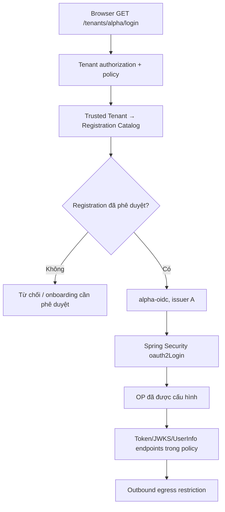
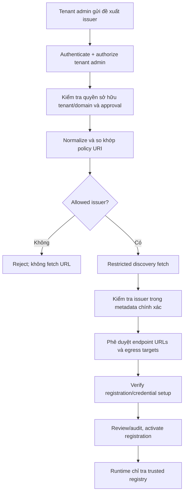

# 26.10. Giới hạn discovery URL và phòng ngừa SSRF

Trong ứng dụng **Spring Security OAuth 2.0 / OpenID Connect (OIDC) Client** có **nhiều tenant**, mỗi tenant có thể dùng một OpenID Provider (OP) riêng. Ứng dụng cần biết **issuer**, các endpoint của Authorization Server, URL lấy khóa ký, và những thông tin provider metadata khác để chạy `oauth2Login()` hoặc OAuth2 Client.

OIDC Discovery giúp giảm cấu hình thủ công bằng cách cho client lấy metadata từ một issuer đã biết. Tuy nhiên, khi ứng dụng biến thao tác này thành chức năng «người dùng nhập URL Identity Provider bất kỳ», **server sẽ chủ động gửi HTTP request tới đích do người ngoài quyết định**. Đó là điểm khởi đầu của **Server-Side Request Forgery (SSRF)**.

Một sai lầm nguy hiểm có dạng:

```text
POST /tenants/onboard-oidc
{
  "tenant": "alpha",
  "issuer": "https://some-url-from-user"
}

Backend:
  - ghép hoặc đọc URL do caller gửi
  - gọi discovery endpoint
  - lấy jwks_uri, token_endpoint, userinfo_endpoint
  - tiếp tục kết nối tới các URL nằm trong metadata
```

Nếu không có chính sách chặt chẽ, kẻ tấn công có thể khiến backend gửi request tới **loopback, private network, cloud metadata service, Kubernetes/service control plane hoặc host do attacker kiểm soát**; trong một số trường hợp còn có thể **làm lộ client credentials, authorization code hoặc token** khi ứng dụng sử dụng những endpoint được metadata khai báo.

Bài học này xây dựng thiết kế an toàn cho **tenant → provider → issuer → discovery → endpoints** trong Spring Security: phân biệt danh tính provider với URL kết nối, allowlist issuer đã được phê duyệt, giới hạn HTTP egress, kiểm soát redirect/DNS/IP, validate metadata, giảm rủi ro JWKS/Refresh Token, và minh họa bằng Spring Boot Servlet, WebFlux, Java cùng runbook vận hành.

> **Nguyên tắc quan trọng nhất:** user chọn **tenant/provider ID đã được cấp phép**, không được biến input request thành **URL mạng bất kỳ** mà ứng dụng sẽ fetch. Ngay cả issuer đã được phê duyệt cũng chưa đủ: **từng URL trong metadata và từng kết nối thực tế** phải chịu chính sách outbound phù hợp.

## 1. OIDC Discovery hoạt động như thế nào?

Một OpenID Provider thường có một **Issuer Identifier**, ví dụ:

```text
https://id.alpha.example/realms/main
```

Client sử dụng issuer đó để truy xuất metadata theo cơ chế OIDC Discovery và/hoặc cơ chế được Spring Security hỗ trợ. Một URL OIDC metadata thường có dạng:

```text
https://id.alpha.example/realms/main/.well-known/openid-configuration
```

Metadata trả về có thể như sau:

```json
{
  "issuer": "https://id.alpha.example/realms/main",
  "authorization_endpoint": "https://id.alpha.example/realms/main/protocol/openid-connect/auth",
  "token_endpoint": "https://id.alpha.example/realms/main/protocol/openid-connect/token",
  "jwks_uri": "https://keys.alpha.example/oidc/jwks",
  "userinfo_endpoint": "https://id.alpha.example/realms/main/protocol/openid-connect/userinfo",
  "end_session_endpoint": "https://id.alpha.example/realms/main/protocol/openid-connect/logout"
}
```

Đây là dữ liệu **minh họa**, không đại diện cho mọi sản phẩm OP. Một provider có thể đặt JWKS hoặc endpoint khác trên host riêng; do đó **không thể mặc định mọi endpoint phải cùng hostname với issuer**, nhưng cũng **không được tự tin mọi URL được trả về**.

### 1.1. Những request nào do server thực hiện?

Trong một OIDC login:

1. Browser gọi `/oauth2/authorization/{registrationId}` ở RP.
2. RP cần `ClientRegistration` và provider metadata tương ứng.
3. Browser được chuyển tới OP `authorization_endpoint`.
4. RP nhận authorization code ở callback.
5. **Backend RP** gọi `token_endpoint` để đổi code.
6. RP hoặc các thành phần xác minh ID Token có thể gọi `jwks_uri` để lấy public keys.
7. RP có thể gọi `userinfo_endpoint` khi cấu hình/flow cần.
8. Những lần sau, backend có thể gọi token endpoint để refresh Access Token.

**SSRF là nguy cơ ở những HTTP requests do backend gửi**. Việc Browser được redirect tới `authorization_endpoint` cũng có rủi ro **phishing/open redirect hoặc gửi user tới OP giả**, nhưng nó khác về cơ chế với SSRF từ server.

### 1.2. Discovery URL và Issuer khác nhau

`issuer-uri` là danh tính của OP mà application định tin. URL metadata là endpoint được suy ra/tra cứu từ issuer theo cơ chế discovery cụ thể.

Spring Security có các API như `ClientRegistrations.fromIssuerLocation(...)` để tạo registration từ issuer. Tùy phiên bản, API này có thể thử những vị trí well-known metadata được hỗ trợ; **không được giả định duy nhất một outbound URL sẽ được gọi**.

Muốn giới hạn SSRF, cần kiểm soát **mọi URL mà thư viện có thể thử**, mọi redirect và các endpoint metadata được dùng về sau, chứ không chỉ kiểm tra chuỗi `issuer-uri` ban đầu.

## 2. Vì sao multi-tenant làm tăng rủi ro SSRF?

Một ứng dụng đơn provider thường có issuer đặt sẵn trong cấu hình do operator kiểm soát:

```yaml
spring:
  security:
    oauth2:
      client:
        provider:
          company:
            issuer-uri: https://id.company.example/realms/main
```

Một hệ thống SaaS có thể cho mỗi tổ chức khách hàng kết nối OP riêng. Vì yêu cầu linh hoạt, team đôi khi thiết kế:

```http
POST /api/tenants/alpha/identity-provider
Content-Type: application/json

{
  "issuerUrl": "https://id-customer.example"
}
```

Vấn đề nằm ở **ranh giới tin cậy**: người quản trị tenant có quyền quản trị tài khoản trong sản phẩm **không mặc nhiên có quyền điều khiển outbound network từ backend của sản phẩm**.

Nếu backend không kiểm soát URL, attacker có thể cố truy cập:

- `http://127.0.0.1:...` hoặc `http://[::1]:...` — loopback services.
- `http://10.x.x.x`, `http://192.168.x.x` — private network.
- `http://169.254.169.254` — ví dụ một cloud metadata address.
- Các IP/link-local hoặc tên DNS chỉ resolve bên trong cluster.
- Service management endpoints mở cho backend nhưng không mở cho Internet.
- Host ngoài do attacker quản lý, có khả năng trả metadata độc hại.
- Một host ban đầu trông hợp lệ nhưng sau redirect/DNS rebinding lại tới đích nội bộ.

SSRF không nhất thiết dẫn tới đọc được response ở browser. **Chỉ cần backend phát request ngoài ý muốn** đã có thể gây hiệu ứng mạng hoặc tiết lộ thông tin qua timing/error; nếu response được trả lại caller, tác động có thể tăng mạnh.

### 2.1. Các điểm tấn công khác nhau

| Điểm nhập | Hành vi có nguy cơ | Phòng vệ trọng tâm |
|---|---|---|
| User nhập `issuerUrl` trực tiếp | Backend gọi discovery tới host bất kỳ. | Approved issuer registry, tách onboarding khỏi request thường. |
| User nhập tenant/subdomain | Code ghép tên miền thành issuer. | Map tenant ID → registration cố định, không ghép URL từ chuỗi tự do. |
| Discovery metadata chứa `jwks_uri` | Backend tải keys từ đích khác. | Endpoint allowlist + egress policy. |
| Metadata chứa `token_endpoint` | Backend gửi authorization code/client credential hoặc Refresh Token. | Chỉ dùng token endpoint đã phê duyệt theo registration. |
| Metadata chứa `userinfo_endpoint` | Backend gửi Access Token tới endpoint. | Kiểm soát audience/destination và transport. |
| HTTP redirect từ discovery/JWKS | Client tự theo Location tới private/foreign host. | Không auto-follow redirect hoặc validate lại từng hop. |
| DNS resolve sang private IP | Hostname hợp lệ trên bề mặt nhưng đích IP bị cấm. | Network egress + resolution/connect-time policy. |
| Token header chứa `jku`/`x5u` | Library/custom code fetch URL từ JWT header. | Không tin key URL do token chưa xác minh cung cấp. |

## 3. Phân biệt ba loại trust

Khi duyệt một OIDC provider, cần có **ba quyết định độc lập**:

1. **Danh tính issuer có được tin cậy không?** Một tổ chức/tenant có được sử dụng OP đó để chứng thực user?
2. **Các endpoint có được kết nối không?** Backend có được phép gửi HTTP tới các URL/IP đó không?
3. **Credential có được gửi tới endpoint đó không?** Token endpoint có được nhận client secret/Refresh Token? UserInfo endpoint có được nhận Access Token?

Một URL có chứng chỉ TLS hợp lệ không đồng nghĩa issuer được hệ thống tin; một issuer được tin không mặc định làm mọi `jwks_uri` hay `token_endpoint` trong metadata được phép; một endpoint mạng được phép không có nghĩa nó được nhận bất kỳ credential nào.

### 3.1. Issuer là identity boundary

Trong OIDC, `iss` trong ID Token phải khớp issuer được cấu hình/đã phê duyệt theo quy tắc xác minh OIDC.

```text
Approved issuer:
  https://id.alpha.example/realms/main

Metadata issuer:
  https://id.beta.example/realms/main
```

Đây là **mismatch** và phải bị từ chối, dù hai hosts đều có HTTPS hợp lệ.

### 3.2. Network boundary

Một URL `https://id.alpha.example` có thể resolve sang địa chỉ không được phép từ mạng của backend. DNS và routing là tầng khác với việc so chuỗi issuer.

### 3.3. Credential boundary

Nếu metadata chỉ dẫn tới:

```text
token_endpoint=https://receiver.attacker.example/token
```

và client tin metadata để làm token exchange, backend có thể gửi **client authentication và authorization code** tới đích không đáng tin. Nếu dùng refresh, còn có nguy cơ gửi Refresh Token.

**Đây là lý do SSRF và credential exfiltration phải được xử lý cùng nhau**, không chỉ chặn request tới địa chỉ private.

## 4. Kiến trúc an toàn: tenant chọn registration, không chọn URL

Cách đơn giản và dễ kiểm soát nhất là thiết lập **catalog các client registrations đã được phê duyệt**.

```text
Tenant alpha -> registration alpha-oidc -> issuer được phép A
Tenant beta  -> registration beta-oidc  -> issuer được phép B
Tenant gamma -> chưa được onboarding   -> không có OAuth2 login
```

Một request:

```text
GET /tenants/alpha/login
```

được server ánh xạ sang:

```text
/oauth2/authorization/alpha-oidc
```

**Không** suy diễn:

```text
https://alpha/.well-known/openid-configuration
```

hoặc lấy một query `?issuer=...` để xây outbound URL.

### 4.1. Sơ đồ an toàn



Lợi ích:

- Mọi login request chỉ chọn **key đã biết**.
- Có thể audit tenant nào dùng issuer nào.
- Không cần fetch metadata lại từ URL tự do trên mỗi request.
- Có thể giới hạn registration, scopes, issuer, endpoints và secret theo tenant.
- Dễ thu hồi một provider mà không thay đổi các tenant khác.

### 4.2. Không phải mọi tenant admin đều được onboard một issuer

Một user có quyền «quản trị thành viên tenant» không nhất thiết có quyền «thay đổi hệ thống xác thực của tenant». Nếu cho self-service enterprise SSO, cần một **quy trình onboarding có xác minh quyền sở hữu domain/tenant và phê duyệt provider**.

Ngay cả khi khách hàng hợp pháp, họ có thể cung cấp hostname cấu hình sai trỏ vào private network của chính bạn. Vì vậy vẫn phải áp dụng SSRF controls.

## 5. Spring Boot: cấu hình hai issuers cố định

Một ví dụ ban đầu:

```yaml
spring:
  security:
    oauth2:
      client:
        registration:
          alpha-oidc:
            provider: alpha-provider
            client-id: ${ALPHA_CLIENT_ID}
            client-secret: ${ALPHA_CLIENT_SECRET}
            client-authentication-method: client_secret_basic
            authorization-grant-type: authorization_code
            redirect-uri: "{baseUrl}/login/oauth2/code/{registrationId}"
            scope:
              - openid
              - profile
          beta-oidc:
            provider: beta-provider
            client-id: ${BETA_CLIENT_ID}
            client-secret: ${BETA_CLIENT_SECRET}
            client-authentication-method: client_secret_basic
            authorization-grant-type: authorization_code
            redirect-uri: "{baseUrl}/login/oauth2/code/{registrationId}"
            scope:
              - openid
              - profile

        provider:
          alpha-provider:
            issuer-uri: https://id.alpha.example/realms/main
          beta-provider:
            issuer-uri: https://login.beta.example/tenant/main
```

`alpha-oidc`, `beta-oidc` là **registration IDs**; `alpha-provider`, `beta-provider` là **provider keys** trong Spring Boot; issuer URI là danh tính OP.

Khi application khởi động và client registration được xây dựng từ metadata, Spring Security/Spring Boot có thể thực hiện discovery theo cấu hình. **Đây vẫn là outbound network activity**, nhưng nguồn URL đến từ **deployment configuration được kiểm soát**, không phải một request do browser quyết định.

### 5.1. Secret management không giải quyết SSRF

Thay client secret thật bằng `${ALPHA_CLIENT_SECRET}` qua secret manager là cần thiết, nhưng chưa đủ. Nếu một registration bị trỏ tới token endpoint do attacker kiểm soát, secret vẫn có thể bị gửi khi token exchange.

Bảo vệ credential cần đi cùng **endpoint pinning/approval, TLS và network egress restrictions**.

### 5.2. Không lấy issuer từ request host

Ví dụ ý tưởng sai:

```java
// KHÔNG được tạo issuer URL từ header Host của browser:
String issuer = "https://" + request.getHeader("Host") + "/oidc";
```

Header Host/Forwarded có thể bị ảnh hưởng bởi client hoặc proxy cấu hình sai. Nó dùng để định tuyến HTTP request, **không phải bằng chứng tenant được phép dùng một issuer**.

Tương tự, không lấy tenant subdomain rồi tự ghép thành `https://<tenant>.identity.example` nếu không có mapping/validation server-side đáng tin cậy.

## 6. Controller an toàn: redirect tới registration được map sẵn

Ví dụ Spring MVC controller không nhận trực tiếp issuer URL:

```java
import java.util.Map;

import org.springframework.http.HttpStatus;
import org.springframework.stereotype.Controller;
import org.springframework.web.bind.annotation.GetMapping;
import org.springframework.web.bind.annotation.PathVariable;
import org.springframework.web.server.ResponseStatusException;

@Controller
public class TenantLoginController {

    private static final Map<String, String> LOGIN_REGISTRATIONS =
        Map.of(
            "alpha", "alpha-oidc",
            "beta",  "beta-oidc"
        );

    @GetMapping("/tenants/{tenantId}/login")
    public String login(@PathVariable String tenantId) {
        String registrationId = LOGIN_REGISTRATIONS.get(tenantId);

        if (registrationId == null) {
            throw new ResponseStatusException(
                HttpStatus.NOT_FOUND,
                "Tenant identity provider is not configured"
            );
        }

        return "redirect:/oauth2/authorization/" + registrationId;
    }
}
```

Trong ví dụ:

- Client chọn `tenantId` nhưng **server mới quyết định** registration.
- Registration IDs là giá trị cố định do application quản lý, không lấy từ input URL.
- Không có outbound HTTP request tới một issuer tự do trong controller.
- Spring Security thực hiện Authorization Code/OIDC flow cho registration đã cấu hình.

Đây là **ví dụ minh họa đường đi**, chưa phải authorization policy cho mọi SaaS. Trong sản phẩm thật, ứng dụng còn phải xác minh quyền khởi động login cho tenant, trạng thái tenant, registration được phê duyệt và các quy tắc chống lạm dụng.

### 6.1. Tránh trả URL do user cung cấp

Sai:

```java
@GetMapping("/login")
public String login(@RequestParam String issuer) {
    return "redirect:" + issuer;
}
```

Đây có thể là **open redirect** trong browser và thường xuất hiện cùng thiết kế dynamic provider không an toàn. User nên chọn **tenant/registration ID đã được đăng ký**, không được chọn bất kỳ URL muốn redirect.

### 6.2. Đăng nhập SSO còn cần liên kết tenant với issuer

Khi nhận callback và xác minh ID Token, application phải biết **issuer nào được tenant này chấp nhận**. Không chỉ tin một user đã đăng nhập thành công ở issuer bất kỳ rồi cho truy cập tenant khác vì email hoặc `sub` trùng.

Tenant authorization phải dựa trên **mapping đáng tin cậy** và membership/account-linking policy.

## 7. Khi nào được phép Dynamic Discovery?

Có những SaaS enterprise cần khách hàng tự kết nối OP không có trong cấu hình lúc deploy. Không thể luôn hardcode mọi issuer. Nhưng nên tách:

- **Onboarding/configuration plane**: nơi một quản trị viên có thẩm quyền yêu cầu kết nối provider mới.
- **Runtime/login plane**: nơi người dùng thường chỉ chọn các registrations đã **được phê duyệt và kích hoạt**.

Một quy trình an toàn:



**Không thực hiện toàn bộ bước G–K đồng bộ mỗi lần user gửi login request**. Điều đó tăng bề mặt SSRF, tạo latency, khiến một attacker dùng login endpoint để liên tục scan mạng hoặc gây tải lên OP/JWKS.

### 7.1. Hai giai đoạn onboarding

**Giai đoạn đề xuất:** dữ liệu là *untrusted*, chưa được phép dùng trong authentication hay gửi credential. Cần xử lý trong hệ thống onboarding quyền hạn tối thiểu.

**Giai đoạn kích hoạt:** sau khi xác minh issuer, metadata/endpoints, client registration, ownership và policy; lưu vào catalog được kiểm soát. Chỉ registration ở trạng thái `ACTIVE` mới được dùng trong login.

### 7.2. Tenant admin không có quyền mạng tùy ý

Quyền «configure SSO» phải được giới hạn tới các provider đáp ứng policy, không phải quyền «điều khiển HTTP client backend». Ngay cả admin có MFA cũng có thể nhập URL sai hoặc bị chiếm tài khoản.

### 7.3. Quy trình phê duyệt thay đổi

Nếu issuer hoặc token endpoint thay đổi sau khi registration đã `ACTIVE`, nên coi đó là thay đổi **security-sensitive**, yêu cầu revalidation và audit; không âm thầm nhận metadata mới và mở rộng egress tới host chưa được phép.

## 8. Chính sách URL: allowlist thay vì chỉ denylist

Một chính sách dựa trên `String.startsWith("https://trusted.example")` rất dễ sai:

```text
https://trusted.example.attacker.example/path
```

cũng bắt đầu bằng chuỗi `https://trusted.example` nhưng **hostname hoàn toàn khác**.

Tốt hơn:

- Parse URL bằng thư viện URI chuẩn.
- Yêu cầu scheme `https` ở production (trừ ngoại lệ dev riêng).
- So khớp **scheme, host, port và issuer path** với danh sách đã phê duyệt.
- Không cho `userinfo` trong URI, ví dụ `https://user@host/...`.
- Không chấp nhận query/fragment bất thường trong issuer identifier.
- Có chính sách riêng đối với host Unicode/IDN, dấu chấm cuối, chữ hoa/thường và normalization.
- Không cho URL được thay bằng IP literal hoặc port tùy ý trừ khi đã có policy rõ.
- Không coi path prefix là đủ để phân biệt tenant/realm.
- Dùng giá trị issuer đã duyệt như **danh tính bất biến** theo cấu hình.

### 8.1. So sánh URI có cấu trúc

Ví dụ hai URL:

```text
https://trusted.example/oidc
https://trusted.example.attacker.example/oidc
```

khác hostname. Một comparison đúng phải so `URI.getHost()` sau khi parse, thay vì prefix string.

Tuy nhiên, với OIDC issuer, **so sánh issuer trong metadata/ID Token cần tuân theo quy tắc exact matching của chuẩn**, không tự ý normalize rồi coi các issuers khác nhau là tương đương.

### 8.2. Path cũng thuộc issuer boundary

```text
https://id.example.org/realms/alpha
https://id.example.org/realms/beta
```

cùng host nhưng là **hai issuer identifiers khác nhau**. Nếu tenant alpha được phép dùng realm alpha, không thể chỉ allowlist `id.example.org` rồi mặc định realm beta hợp lệ.

Vì vậy, allowlist issuer ở mức **full issuer URI**; allowlist outbound network có thể dùng hostname/CIDR phù hợp như một lớp riêng.

### 8.3. Không dựa vào suffix match đơn giản

Các kiểm tra dạng:

```text
hostname.endsWith("example.org")
```

có thể nhận cả `notexample.org` nếu không đặt ranh giới label chính xác. Nhưng ngay cả kiểm tra suffix đúng nhãn DNS cũng không đủ để biết một subdomain thuộc nhà cung cấp đáng tin và không bị tenant khác chiếm.

Với identity providers, **exact approved host/issuer** thường đáng tin cậy hơn wildcard subdomain nếu không có yêu cầu đặc biệt.

## 9. Kiểm tra URL trước khi gửi request là chưa đủ

Giả sử application kiểm tra:

```text
https://approved.example/.well-known/openid-configuration
```

và cho phép vì hostname nằm trong allowlist. Máy chủ trả:

```http
HTTP/1.1 302 Found
Location: http://127.0.0.1:8080/admin
```

Nếu HTTP client tự follow redirect, request thứ hai có thể tới địa chỉ loopback.

Hoặc DNS của `approved.example` trả IP công khai tại lúc validation nhưng IP private tại lúc connection.

Do đó, phòng ngừa SSRF cần nhiều thời điểm kiểm soát:

1. **Trước fetch:** issuer/URL có nằm trong trusted catalog/policy không?
2. **Khi resolve DNS:** tất cả các IP được xét có thuộc mạng cho phép không?
3. **Khi kết nối:** socket có thực sự đi đến IP được phép không?
4. **Khi nhận redirect:** redirect có bị chặn hoặc được kiểm tra lại hoàn chỉnh không?
5. **Sau khi đọc metadata:** các endpoint mới có được phê duyệt trước khi sử dụng không?
6. **Tại network infrastructure:** egress firewall/proxy có thực thi ranh giới độc lập với code không?

### 9.1. Không tự động follow redirect

Đối với HTTP fetch metadata nhạy cảm, một chính sách chặt là **không follow HTTP redirects** trừ khi có lý do rõ ràng. Nếu OP hợp lệ yêu cầu redirect, chỉ cho phép các hops đã xác minh và giới hạn hop count.

Đừng chỉ kiểm tra initial URL rồi giao quyền follow redirect vô điều kiện cho HTTP library.

### 9.2. DNS rebinding

DNS rebinding có thể khiến một hostname được cho phép trả những IP khác nhau qua thời gian. Nếu code:

```text
resolve -> kiểm tra IP -> vài mili giây sau HTTP library resolve lại
```

thì việc kiểm tra đầu tiên có thể không bảo đảm IP mà socket thực sự kết nối tới.

Giải pháp nên gồm **egress controls ở tầng mạng** và một HTTP transport/policy thực thi validation tại **connect-time** hoặc sử dụng resolver/pinning phù hợp. Không tự tin một đoạn `InetAddress.getAllByName(...)` trước khi gọi `RestTemplate` khác là đầy đủ.

### 9.3. DNS nhiều record

Một hostname có thể có nhiều A/AAAA records. Nếu một record là IP public và một record là private, application không được mặc định an toàn chỉ vì **một** record hợp lệ.

Transport cần chỉ kết nối tới các địa chỉ được phép và chính sách phải xét IPv4/IPv6 cùng khả năng DNS thay đổi.

## 10. Những mạng/địa chỉ cần hạn chế

Một chính sách outbound tới public OIDC providers thường phải đặc biệt lưu ý:

| Nhóm | Ví dụ | Vì sao nguy hiểm |
|---|---|---|
| **Loopback IPv4** | `127.0.0.0/8` | Dịch vụ chỉ mở cho localhost. |
| **Loopback IPv6** | `::1/128` | Tương tự trên IPv6. |
| **Private IPv4** | `10.0.0.0/8`, `172.16.0.0/12`, `192.168.0.0/16` | Dịch vụ nội bộ/VPC. |
| **Link-local IPv4** | `169.254.0.0/16` | Metadata/service endpoints trong một số cloud. |
| **Link-local IPv6** | `fe80::/10` | Dịch vụ nội bộ liên kết mạng. |
| **Unique-local IPv6** | `fc00::/7` | Mạng nội bộ IPv6. |
| **Unspecified/multicast/reserved** | `0.0.0.0`, `::`, nhóm reserved | Không phải đích public OP thông thường. |
| **IPv4-mapped IPv6** | `::ffff:127.0.0.1` | Có thể vượt kiểm tra chỉ xét IPv4 literal. |
| **Cluster/service DNS** | Tên nội bộ giải ra IP private | Có thể chạm control plane/service khác. |

Danh sách này **không phải denylist hoàn chỉnh cho mọi hạ tầng**. Các dải đặc biệt khác như carrier-grade NAT, benchmark ranges hoặc routing nội bộ công ty có thể cần bị chặn. Một hệ thống có OP nội bộ thật sự phải áp dụng **allowlist cụ thể cho mạng/đích OP đó**, không mở toàn bộ RFC 1918.

### 10.1. Cloud metadata service

Nhiều môi trường cloud có metadata endpoints truy cập được từ workload. Địa chỉ hoặc DNS cụ thể thay đổi theo cloud và cách cấu hình.

Nếu discovery URL bị điều khiển, backend có thể bị khiến truy cập metadata service. Do đó nên:

- Chặn truy cập metadata từ workloads không cần nó.
- Hạn chế metadata endpoints qua network/identity controls mà cloud hỗ trợ.
- Dùng workload identity phù hợp, không phát credential dài hạn không cần thiết.
- Không dựa duy nhất vào việc endpoint yêu cầu một HTTP header hoặc token khi code có thể bị mở rộng về sau.

### 10.2. IP literals, IPv6 và encoding

Một URL có thể dùng IP literal thay hostname, IPv6 bracket syntax, dạng số nguyên IPv4 hoặc encoding được parser/transport xử lý khác nhau.

Không tự viết URL parser bằng regex ngắn; dùng URI parser chuẩn, canonicalization có kiểm soát và policy ở tầng network. **Một allowlist hostname hẹp** giúp tránh nhiều trường hợp phức tạp hơn việc cố liệt kê mọi cách viết IP nguy hiểm.

### 10.3. DNS nội bộ trùng tên public

Split-horizon DNS có thể trả IP khác nhau trong mạng backend và trên Internet. Vì vậy việc operator mở URL bằng laptop thấy IP public không chứng minh app container sẽ connect cùng đích.

Điều tra phải dựa trên DNS và network path của **runtime thực tế**, nhưng không dùng ứng dụng login làm công cụ quét nội mạng.

## 11. Giới hạn HTTP transport của discovery

Ngay cả khi không thể truy cập private IP, một URL ngoài do attacker kiểm soát vẫn có thể:

- Trả JSON rất lớn gây tốn RAM.
- Trì hoãn response để giữ thread/connections.
- Redirect liên tục.
- Gửi chunked body không kết thúc.
- Trả metadata gây cascade nhiều JWKS/token/UserInfo calls.
- Trả headers bất thường gây lỗi parser.
- Dùng chứng chỉ/TLS cấu hình sai để kích thích developer tắt verification.

Vì vậy, HTTP client dùng discovery nên có:

- Connect timeout.
- Response/read timeout và overall request deadline.
- Redirect policy (ưu tiên disable; nếu cho phép thì bound + revalidate từng hop).
- Response body size limit và JSON nesting/depth limit khi có thể.
- Giới hạn concurrent requests, connection pool và rate.
- TLS certificate + hostname verification.
- Chỉ HTTPS cho production public providers.
- Không tự dùng system proxy có quyền mở mạng nội bộ ngoài policy.
- Không forward cookies, Authorization hoặc client secret tới metadata URL.
- Network egress allowlist độc lập với process.

### 11.1. Một custom downloader minh họa chính sách redirect

Ví dụ Java tiêu chuẩn:

```java
import java.net.http.HttpClient;
import java.time.Duration;

HttpClient discoveryHttpClient = HttpClient.newBuilder()
    .followRedirects(HttpClient.Redirect.NEVER)
    .connectTimeout(Duration.ofSeconds(2))
    .build();
```

Đoạn này **chỉ minh họa hai lựa chọn transport**, không phải SSRF-safe HTTP client hoàn chỉnh. Nó **không tự hạn chế IP kết nối, body size, TLS trust policy, JSON depth hoặc credential handling**, và **không tự thay HTTP transport mà Spring Security dùng để discovery**.

Muốn dùng cho production cần một downloader/gateway đã thực thi network policy và toàn bộ giới hạn, rồi tích hợp hợp lý với flow tạo `ClientRegistration`.

### 11.2. Timeout nên cân đối

Ví dụ connect 2 giây và tổng request 5 giây có thể phù hợp môi trường này nhưng không bắt buộc cho mọi OP. Hãy chọn theo latency/SLA, hạ tầng mạng và retry policy.

Quan trọng là **không để một tenant gây vô hạn outbound requests hoặc treo toàn bộ thread pool** bằng một discovery URL chậm.

### 11.3. Không tự retry vô hạn

Một user hoặc tenant admin có thể cố tạo nhiều registration failures. Retry discovery không giới hạn có thể làm tăng tải hoặc biến backend thành một nguồn HTTP traffic tới host ngoài.

Nên có exponential backoff có giới hạn, quota per tenant, circuit breaker khi phù hợp và cache kết quả đã được phê duyệt.

## 12. Metadata trả về phải được coi là dữ liệu chưa đáng tin

Một response JSON là **dữ liệu từ mạng ngoài**. HTTPS chỉ xác nhận kết nối tới hostname theo certificate chain, không chứng minh hostname đó được phép trở thành issuer của tenant hay mọi URL trong metadata đáng tin.

Những field quan trọng:

| Field | Mục đích | Rủi ro nếu không kiểm soát |
|---|---|---|
| `issuer` | Identity của OP. | Trộn issuer/tenant; sai trust boundary. |
| `authorization_endpoint` | Browser được redirect để login. | Phishing hoặc login tới OP giả. |
| `token_endpoint` | Backend đổi code/refresh token. | Rò client secret, code, Refresh Token. |
| `jwks_uri` | Backend tải public keys. | SSRF, key substitution và fetch amplification. |
| `userinfo_endpoint` | Backend gửi Access Token để lấy profile. | Rò Access Token tới host không phù hợp. |
| `end_session_endpoint` | Browser đến để logout. | Open redirect/phishing/misdirected logout. |
| `introspection_endpoint` | Endpoint API kiểm tra token khi áp dụng. | Rò client credentials/token nếu không kiểm soát. |
| `revocation_endpoint` | Thu hồi token nếu provider hỗ trợ. | Gửi token tới host không được phê duyệt. |

Không phải mọi ứng dụng sử dụng tất cả fields. Nhưng **chỉ cần một field được thư viện dùng** cũng tạo kết nối và ranh giới credential riêng.

### 12.1. Validate `issuer` trước khi tin metadata

Nếu issuer đã phê duyệt:

```text
https://id.alpha.example/realms/main
```

mà metadata trả:

```json
{
  "issuer": "https://id.beta.example/realms/main"
}
```

thì phải **fail closed**. Không chỉ kiểm tra hai URLs có cùng parent domain hoặc text gần giống.

Cần áp dụng quy tắc issuer validation của OIDC và Spring Security version đang dùng. Không tự bỏ qua validation để tương thích một provider cấu hình sai nếu chưa đánh giá tác động đến identity/token trust.

### 12.2. Endpoint hợp lệ có thể khác hostname issuer

Ví dụ:

```text
issuer:         https://login.example.org/tenant
jwks_uri:       https://keys.example-cdn.org/tenant/jwks
token_endpoint: https://token.example.org/tenant/oauth2/token
```

Có provider hợp lệ triển khai endpoints trên nhiều hosts. Vì thế chính sách không nhất thiết «chặn mọi host khác issuer». Thay vào đó:

1. Cho phép một **set endpoints/origins đã được phê duyệt** cho registration đó.
2. Có bằng chứng từ provider docs/onboarding đáng tin.
3. Ràng buộc endpoint đúng loại credential sẽ được gửi.
4. Bảo vệ tất cả kết nối bằng egress/TLS policy.
5. Revalidation khi endpoints thay đổi bất thường.

Đừng tự tin một host khác chỉ vì nó xuất hiện trong JSON được fetch từ issuer đã cho phép.

## 13. Rủi ro lớn nhất: `token_endpoint` và client credentials

Khi OAuth2 Client dùng Authorization Code Flow, backend gửi code tới token endpoint và xác thực client theo phương thức đã cấu hình.

Ví dụ conceptual:

```http
POST /oauth2/token HTTP/1.1
Host: token.id.example.org
Authorization: Basic <redacted-client-authentication>
Content-Type: application/x-www-form-urlencoded

grant_type=authorization_code&code=<redacted>&redirect_uri=<registered-uri>
```

Nếu backend dùng token endpoint từ metadata chưa được duyệt, có thể gửi:

- Client secret hoặc client assertion theo phương thức xác thực.
- Authorization code vừa nhận.
- Refresh Token trong grant sau này.
- Những thông tin yêu cầu token khác.

**Đây không còn chỉ là SSRF đến private IP; nó còn là credential exfiltration tới host bất kỳ.**

### 13.1. Không gửi client secret trong discovery GET

Thông thường client secret **không phải credential của metadata discovery GET**. Không nên đính thêm client secret vào query/header chỉ để fetch `.well-known/openid-configuration`.

Tuy nhiên, sau khi đăng ký token endpoint, chính cùng registration có thể dùng secret ở token exchange. Vì vậy cần kiểm tra **destination của token endpoint trước khi bất kỳ credential nào được gửi**.

### 13.2. Refresh Token còn nhạy cảm hơn với endpoint substitution

Refresh Token có thể cho phép lấy Access Token mới trong thời gian dài hơn Access Token, tùy chính sách. Nếu metadata thay đổi sang token endpoint ngoài ý muốn và manager tự refresh, Refresh Token có thể bị gửi tới nơi không đáng tin.

Do đó, endpoints liên quan token lifecycle cần được **pin/allowlist theo registration**, theo dõi thay đổi và không cập nhật tự động từ metadata tùy ý.

### 13.3. Không gửi token cho «endpoint cùng issuer» bằng đoán URL

Không dựng token endpoint bằng cách ghép:

```text
issuer + "/token"
```

nếu provider không công bố như vậy. Nhưng cũng không tin một `token_endpoint` lạ chỉ vì JSON có field đó. Hãy xác minh metadata, policy và provider contract.

## 14. `jwks_uri`, `kid` và bảo vệ key discovery

OIDC ID Tokens thường được ký bằng private key của OP. RP tải JWK Set (JWKS) để lấy **public keys** dùng xác minh chữ ký.

Một field metadata:

```json
{
  "jwks_uri": "https://keys.alpha.example/jwks.json"
}
```

có thể khiến runtime thực hiện HTTP GET tới host đó. Nếu attacker điều khiển `jwks_uri`, có hai nhóm rủi ro:

1. **SSRF**: request tới internal/cloud URL hoặc gây tải.
2. **Key trust confusion**: ứng dụng có thể xác minh token bằng keys không gắn với issuer được tin cậy.

### 14.1. Không lấy key URL từ JWT header chưa xác minh

Một JWT header có thể chứa các tham số như:

```json
{
  "alg": "RS256",
  "kid": "key-2026"
}
```

`kid` là **identifier lựa chọn key trong JWKS của issuer đã cấu hình**, không phải URL mạng. Không biến nó thành:

```text
GET https://keys.example.org/{kid}
```

nếu `kid` chưa được kiểm soát và không có mapping đáng tin cậy.

Một số JWT/JWS formats có header `jku` hoặc `x5u` trỏ tới URL key/certificate. **Không tự follow các URLs từ token chưa được xác minh** để lựa chọn trust root.

### 14.2. Unknown `kid` có thể gây request amplification

Khi một token có `kid` không có trong cache, một số components có thể thử refresh JWKS. Nếu attacker gửi hàng loạt token với các `kid` khác nhau, backend có thể tạo tải lớn tới JWKS endpoint.

Biện pháp:

- JWKS cache có TTL phù hợp.
- Rate limiting / refresh throttling.
- Giới hạn đồng thời/size/timeouts cho JWKS fetch.
- Chỉ fetch từ `jwks_uri` đã được phê duyệt.
- Không bỏ issuer/signature/audience validation vì chưa tìm thấy key.
- Quan sát số lần refresh bất thường theo registration.

### 14.3. JWKS phải gắn với issuer

Với hai tenants:

```text
Tenant alpha issuer A -> approved JWKS A
Tenant beta  issuer B -> approved JWKS B
```

Không gộp public keys vào một pool toàn cục rồi thử mọi key cho mọi token. Một token từ issuer B không được phép trở thành hợp lệ cho issuer A chỉ vì chữ ký xác minh được bằng một key từ B.

**Xác minh `iss`, `aud`, signature, thuật toán, thời gian và nonce/state theo ngữ cảnh OIDC** vẫn là điều bắt buộc bên cạnh SSRF protection.

## 15. Các endpoint khác cũng cần destination policy

### 15.1. UserInfo endpoint

Một OIDC Client có thể gửi Access Token đến `userinfo_endpoint`. Nếu URL ấy bị thay bằng attacker host, Access Token có thể bị tiết lộ.

Do đó, một metadata approval policy cần xác định **UserInfo endpoint có được phép nhận Access Token thuộc registration đó hay không**.

### 15.2. Token introspection/revocation

Ứng dụng hoặc Resource Server có thể dùng introspection/revocation endpoints khi provider hỗ trợ. Những requests này có thể chứa token và client credentials. Không cho các endpoint ấy được cập nhật bằng URL tùy ý.

### 15.3. OP logout endpoint

`end_session_endpoint` thường là nơi browser được redirect tới; đây không nhất thiết là backend SSRF, nhưng URL không đáng tin có thể dẫn browser tới website giả hoặc làm lộ `id_token_hint`.

Vẫn phải có policy cho OP logout endpoint và `post_logout_redirect_uri` đã đăng ký.

### 15.4. Authorization endpoint

`authorization_endpoint` thường nhận browser navigation, không phải HTTP GET trực tiếp từ backend trong Authorization Code login. Một URL độc hại tại đây có thể là phishing hoặc điều hướng sai OP, dù không phải SSRF backend.

**Endpoint trust validation cần đánh giá cả những URL backend fetch và những URL browser sẽ theo.**

## 16. Giải pháp ưu tiên: pre-provisioned ClientRegistrations

Với số tenant/provider hữu hạn hoặc onboarding được kiểm soát, ưu tiên:

- Đăng ký issuer/ClientRegistration qua configuration management.
- Validate từng registration trong deployment pipeline hoặc onboarding.
- Kích hoạt chỉ sau khi OP endpoints/redirect URIs đã được kiểm tra.
- Từ chối mọi request runtime muốn tạo issuer mới tùy ý.
- Dùng catalog tenant → registration ID đã được phê duyệt.
- Quản lý thay đổi issuer/metadata bằng quy trình review/audit.

Ví dụ:

```text
app.oidc.tenants:
  alpha:
    registrationId: alpha-oidc
    approvedIssuer: https://id.alpha.example/realms/main
  beta:
    registrationId: beta-oidc
    approvedIssuer: https://login.beta.example/tenant/main
```

Đây là **dữ liệu conceptual** của một trusted application catalog, không phải Spring Boot property built-in. Mục đích là không giao issuer selection cho input HTTP của browser.

### 16.1. Một registry Java đơn giản

```java
import java.net.URI;
import java.util.Map;

public final class ApprovedTenantOidcCatalog {

    public record Provider(
        String registrationId,
        URI issuer
    ) {}

    private static final Map<String, Provider> APPROVED = Map.of(
        "alpha",
        new Provider(
            "alpha-oidc",
            URI.create("https://id.alpha.example/realms/main")
        ),
        "beta",
        new Provider(
            "beta-oidc",
            URI.create("https://login.beta.example/tenant/main")
        )
    );

    public Provider requireApproved(String tenantId) {
        Provider result = APPROVED.get(tenantId);
        if (result == null) {
            throw new IllegalArgumentException(
                "Tenant has no approved OIDC provider"
            );
        }
        return result;
    }
}
```

Ví dụ này đảm bảo **không suy ra issuer bằng cách ghép user input**. Nó chưa giải quyết toàn bộ network egress, issuer validation, account linking hay tenant authorization; các lớp đó phải được triển khai ở nơi tương ứng.

### 16.2. Không coi enum là permission

Ngay cả khi tenant tồn tại trong `APPROVED`, caller chưa chắc có quyền đăng nhập/điều khiển cấu hình tenant ấy. Catalog trả lời «tenant đã có provider nào», không tự trả lời «user đang truy cập có quyền vào tenant này hay không».

## 17. Dynamic registration: `ClientRegistrations.fromIssuerLocation`

Spring Security có API tiện ích tạo `ClientRegistration.Builder` từ issuer location:

```java
import org.springframework.security.oauth2.client.registration.ClientRegistration;
import org.springframework.security.oauth2.client.registration.ClientRegistrations;
import org.springframework.security.oauth2.core.AuthorizationGrantType;

String approvedIssuer =
    "https://id.alpha.example/realms/main";

ClientRegistration registration =
    ClientRegistrations.fromIssuerLocation(approvedIssuer)
        .registrationId("alpha-oidc")
        .clientId("<client-id-from-secret-management>")
        .clientSecret("<client-secret-from-secret-management>")
        .authorizationGrantType(AuthorizationGrantType.AUTHORIZATION_CODE)
        .redirectUri("{baseUrl}/login/oauth2/code/{registrationId}")
        .scope("openid", "profile")
        .build();
```

**Cảnh báo về ví dụ:** `fromIssuerLocation(...)` thực hiện **network discovery**. Đoạn code chỉ thích hợp khi issuer đã đến từ **trusted/approved configuration** và runtime có SSRF/egress protections đầy đủ. Nó **không phải một URL validation function**.

Không bao giờ chuyển trực tiếp:

```java
ClientRegistrations.fromIssuerLocation(
    request.getParameter("issuer")
);
```

vào một endpoint public hoặc tenant admin API mà không có quy trình phê duyệt và kiểm soát outbound.

### 17.1. Không tự tin starter đã bảo vệ dynamic SSRF

Spring Security xác minh các điều kiện OAuth2/OIDC theo vai trò của nó; đừng giả định API discovery có sẵn **allowlist nội mạng riêng cho SaaS**, cloud metadata protection hoặc tenant onboarding policy của sản phẩm.

Nếu cần custom outbound HTTP transport, phải kiểm tra **API extension points của đúng phiên bản Spring Security** và áp dụng network enforcement ngoài code. Việc cấu hình WebClient cho downstream API **không tự thay đổi** HTTP client mà `ClientRegistrations.fromIssuerLocation` dùng để fetch metadata.

### 17.2. Dynamic provider onboarding không nằm ở path callback

Một số thiết kế nguy hiểm tự lấy provider/issuer từ:

```text
/login/oauth2/code/{issuer-from-user}
```

hoặc query `iss` do browser gửi. Callback chỉ được xử lý theo **authorization request đã bắt đầu, state/nonce và ClientRegistration đã xác định trước**.

Không tạo một provider hoàn toàn mới chỉ dựa trên query của callback mà chưa có trusted registration.

## 18. URL discovery và fallback endpoints trong Spring

OIDC Discovery và OAuth 2.0 Authorization Server Metadata có các quy tắc well-known URI khác nhau trong một số trường hợp. Một Spring Security helper có thể hỗ trợ **nhiều vị trí discovery** theo phiên bản.

Ví dụ về nguyên tắc:

```text
Issuer đã phê duyệt
  |
  +-> Vị trí metadata OIDC
  |
  +-> Một số vị trí well-known khác theo API/phiên bản
```

Nếu chỉ cấu hình egress hoặc URL guard cho duy nhất một path trong khi helper còn thử path khác, chính sách có thể không chặn hết network activity.

**Không xây policy SSRF dựa trên một giả định chưa xác minh rằng Spring chỉ gọi một exact URL.** Hãy ràng buộc tới **origin/IP và issuer approved**, kiểm tra hành vi của thư viện đang được deploy, và giữ egress controls độc lập với URL paths.

### 18.1. Về WebFinger

OIDC Discovery có thể được kết hợp với các cơ chế như WebFinger khi xác định issuer từ user identifier. **Spring Security OAuth2 Login không mặc nhiên phải chạy WebFinger chỉ vì bạn cấu hình `issuer-uri`**.

Nếu sản phẩm tự thêm bước «user nhập email → tìm issuer bằng WebFinger», đó là **một nguồn outbound URL và metadata khác cần thẩm định**. Không để email/domain chưa được kiểm soát biến backend thành client gọi arbitrary hosts.

### 18.2. Không dùng discovery như HTTP proxy

Một endpoint như:

```text
GET /api/oidc/discover?url=https://...
```

trả nguyên JSON metadata cho user có thể trở thành một **SSRF proxy**. Ngay cả khi nó «chỉ đọc JSON», attacker vẫn có thể dò cổng/mạng bằng response code, timing và error messages.

Đừng public endpoint fetch tùy ý chỉ để phục vụ UI setup. Nếu cần onboarding preview, dùng môi trường kiểm tra hạn chế, allowlist, quyền admin, quota và response không tiết lộ dữ liệu mạng nội bộ.

## 19. Strict validation không có nghĩa dựa riêng vào regex

Một validation policy có thể kiểm tra:

| Điều kiện | Hướng xử lý |
|---|---|
| URL parse thất bại | Reject. |
| Scheme không phải HTTPS ở production | Reject, trừ ngoại lệ dev quản lý riêng. |
| Userinfo hoặc fragment tồn tại | Reject trong issuer policy. |
| Host không thuộc approved catalog | Reject. |
| Port không được phê duyệt | Reject. |
| Issuer path khác đăng ký | Reject, dù cùng host. |
| Metadata `issuer` mismatch | Reject. |
| Endpoint URL mới không được duyệt | Không kết nối/sử dụng. |
| Host resolve private/loopback không được phép | Chặn tại network/connect-time. |
| Có redirect tới destination khác | Không follow, hoặc kiểm tra lại toàn bộ. |
| TLS certificate/hostname invalid | Reject; không disable verification. |
| Response vượt giới hạn | Abort safely. |

### 19.1. Chuẩn hóa URI cần cẩn trọng

Những biến thể như:

```text
https://id.example.org/realm
https://ID.EXAMPLE.ORG/realm
https://id.example.org:443/realm
https://id.example.org/realm/
```

có thể được thư viện URL xử lý khác nhau ở từng bước. Với OIDC, `issuer` trong metadata/ID Token cần được đối chiếu theo chuẩn; không tự coi mọi biến thể URI là một issuer duy nhất nếu provider không tuyên bố vậy.

Policy nên lưu **canonical approved issuer string** tại onboarding, dùng nhất quán khi đăng ký và xác minh.

### 19.2. Tránh parser disagreement

Một chuỗi URL có thể được Java `URI`, proxy, redirect handler và network transport phân tích khác nhau nếu chứa encoding/userinfo/backslash hay ký tự bất thường.

Không cố chấp nhận «mọi URL có thể parse». Với OIDC issuer trong production, thường an toàn hơn khi chỉ nhận định dạng **HTTPS URI chuẩn từ một catalog nhỏ đã duyệt**.

## 20. Network egress là lớp phòng vệ độc lập

Với multi-tenant discovery, **network egress controls** là một trong những lớp bảo vệ mạnh nhất vì nó không phụ thuộc vào việc developer nhớ kiểm tra mọi URL.

Các lựa chọn tùy hạ tầng:

- Container/Kubernetes network policies hoặc egress gateway.
- VPC/firewall policies cấm gọi private/cloud metadata endpoints trừ nhu cầu explicit.
- HTTP CONNECT proxy allowlist outbound domains và IP ranges.
- DNS policy/resolver kiểm soát, gắn với chính sách kết nối.
- Segmentation giữa workload xử lý onboarding và workload có credential production.
- Service mesh/egress authorization khi hỗ trợ.
- Workload identity và IAM giới hạn quyền cloud metadata/management APIs.

### 20.1. Deny-all-then-allow

Một chính sách lý tưởng về nguyên tắc:

```text
OIDC Client workload:
  outbound default = DENY

  ALLOW:
    - approved issuer/metadata endpoints
    - approved token endpoints
    - approved JWKS/UserInfo endpoints
    - approved Resource Servers

  DENY:
    - loopback/private/control-plane/metadata destinations
    - arbitrary Internet hosts
    - cross-tenant endpoints ngoài policy
```

Đây là **policy conceptual**, không phải cú pháp firewall thực tế. Cách enforce domain-based allowlist an toàn cần xét DNS rebinding, CDN, proxies và IP changes.

### 20.2. Egress theo domain đôi khi chưa đủ

Một policy chỉ so TLS SNI/Host header có thể bị sai nếu transport/proxy xử lý DNS, CONNECT target, redirect hoặc IP literals không đồng nhất. Cần bảo đảm **socket destination** cũng thuộc mạng được cho phép.

Đừng coi một DNS check trên application server là thay thế cho firewall/network isolation.

### 20.3. Tách onboarding worker

Nếu tenant self-service onboarding bắt buộc fetch metadata từ providers mới, cân nhắc xử lý nó trong **worker có quyền mạng hẹp**, không chứa production client secrets, không truy cập DB/token store và không có quyền cloud management.

Sau khi metadata được kiểm tra và phê duyệt, kết quả mới chuyển vào runtime registry. Điều này giảm tác động nếu onboarding fetch có SSRF.

## 21. Không mở rộng trust tự động khi metadata thay đổi

Provider metadata và JWKS có thể thay đổi trong vòng đời integration. Một OP có thể rotate keys hoặc chuyển endpoint sang host khác.

Cần phân biệt:

- **Key rotation trong JWKS URI đã được phê duyệt**: có thể được hỗ trợ bằng cache refresh theo chính sách.
- **Metadata thay `jwks_uri` sang origin mới**: có thể là thay đổi security boundary, cần revalidation/approval.
- **Metadata thay `token_endpoint` sang host mới**: có thể làm đổi nơi nhận client credentials, cần kiểm tra nghiêm.
- **Issuer thay đổi**: thường là identity migration, không phải thay đổi endpoint vô hại.

### 21.1. Không tự tin cache metadata mãi mãi

Cache có lợi cho hiệu năng và giảm outbound requests, nhưng nếu provider bị compromise hoặc cấu hình bị thu hồi, cache cũ có thể chứa endpoint/key không còn phù hợp.

Nên quản lý:

- TTL và refresh policy rõ.
- Provider change review.
- Audit versions của metadata/approved endpoints.
- Emergency disable registration.
- Key rotation/failure recovery.
- Không cho request thất bại vô hạn làm refresh metadata.

### 21.2. Tránh cache global theo hostname đơn lẻ

Hai issuers có thể cùng host nhưng khác realm/tenant. Cache registration, metadata và JWKS cần có key phù hợp issuer/registration, không trộn theo hostname nếu đó là ranh giới không đủ.

## 22. Tenant isolation và authorized client storage

Chặn SSRF không đủ nếu app có thể dùng nhầm token của tenant khác.

Spring Security `OAuth2AuthorizedClientService` thường lưu theo:

```text
(clientRegistrationId, principalName)
```

Với nhiều providers/tenants, cần bảo đảm registration ID và principal key **không va chạm**.

Ví dụ:

```text
Tenant alpha:
  registrationId = alpha-oidc
  issuer = https://id.alpha.example/main
  principal = alpha-sub-101

Tenant beta:
  registrationId = beta-oidc
  issuer = https://login.beta.example/main
  principal = beta-sub-101
```

Nếu cả hai dùng `registrationId="oidc"` và `principalName="101"` trong chung DB, token có thể bị lẫn nếu custom dynamic registration không phân vùng tenant/issuer.

### 22.1. Mối liên hệ với discovery SSRF

Khi tenant A được phép thay issuer của cùng `registrationId` từ OP A sang OP B, token store có thể vẫn giữ authorized client do OP A cấp. Nếu application tiếp tục dùng token cũ với metadata mới, nguy cơ:

- Refresh Token bị gửi nhầm token endpoint.
- Token issuer/audience mismatch.
- Kết quả account linking sai.
- Trộn principals từ hai issuers.
- Rò credential sang endpoint không thuộc authorization gốc.

Vì vậy, thay đổi issuer phải được xem là **migration/reauthorization có kiểm soát**, không chỉ cập nhật một URL trong database.

### 22.2. Các ranh giới cần được giữ cùng lúc

| Boundary | Cần xác định |
|---|---|
| Tenant | Tenant ID từ nguồn đã xác thực/ủy quyền. |
| Registration | ID duy nhất và gắn với client/provider policy. |
| Issuer | URI đã duyệt và exact validation. |
| Principal | Identity binding đáng tin cậy, ví dụ `(iss,sub)`. |
| Token store | Isolation, encryption, TTL và cleanup per key. |
| Outbound destination | Approved API/OP endpoints. |
| Resource Server | Audience, scopes, ownership, tenant policy. |

Không cho người dùng chọn `principalName`, `registrationId` hoặc issuer arbitrary rồi yêu cầu manager load token tương ứng.

## 23. Spring Security Servlet: hạn chế input tại `oauth2Login()`

Một `SecurityFilterChain` cơ bản:

```java
import org.springframework.context.annotation.Bean;
import org.springframework.context.annotation.Configuration;
import org.springframework.security.config.Customizer;
import org.springframework.security.config.annotation.web.builders.HttpSecurity;
import org.springframework.security.web.SecurityFilterChain;

@Configuration
public class SecurityConfiguration {

    @Bean
    SecurityFilterChain securityFilterChain(HttpSecurity http)
            throws Exception {

        http
            .authorizeHttpRequests(auth -> auth
                .requestMatchers(
                    "/", "/tenants/*/login", "/public/**"
                ).permitAll()
                .anyRequest().authenticated()
            )
            .oauth2Login(Customizer.withDefaults())
            .oauth2Client(Customizer.withDefaults());

        return http.build();
    }
}
```

Security chain này cho phép user truy cập start endpoint/login route, nhưng **quyền chọn tenant/provider vẫn do catalog và onboarding policy quyết định**.

Spring OAuth2 Login khởi động qua:

```text
GET /oauth2/authorization/{registrationId}
```

Nó tìm registration từ `ClientRegistrationRepository`, không cần request chứa `issuerUrl`.

### 23.1. Không tự viết controller gọi discovery khi login

Một anti-pattern:

```java
@GetMapping("/tenants/{tenantId}/login")
public String login(
        @PathVariable String tenantId,
        @RequestParam String issuerUrl) {

    // SAI nếu chưa kiểm soát:
    ClientRegistrations.fromIssuerLocation(issuerUrl);
    return "redirect:/oauth2/authorization/" + tenantId;
}
```

Vấn đề không chỉ ở syntax: browser **đã điều khiển URL mà server sẽ fetch**, và quá trình discovery có thể gây SSRF trước khi login hoàn tất.

Thay bằng trusted catalog và pre-provisioned registrations.

### 23.2. Callback phải gắn với authorization request ban đầu

Callback `/login/oauth2/code/{registrationId}` cần đi qua state/PKCE/nonce/session correlation của Spring Security. Không để callback quyết định một issuer mới từ query param chưa xác minh để đổi code hoặc tải JWKS.

Nếu hệ thống có nhiều security filter chains, bảo đảm login start và callback thuộc chain có OAuth2 Login support phù hợp.

## 24. WebFlux: tương tự về chính sách, khác về API

Trong Spring WebFlux, những abstraction tương ứng:

| Servlet | WebFlux |
|---|---|
| `HttpSecurity` | `ServerHttpSecurity` |
| `SecurityFilterChain` | `SecurityWebFilterChain` |
| `ClientRegistrationRepository` | `ReactiveClientRegistrationRepository` |
| `OAuth2AuthorizedClientRepository` | `ServerOAuth2AuthorizedClientRepository` |
| `OAuth2AuthorizedClientManager` | `ReactiveOAuth2AuthorizedClientManager` |
| `HttpSession` | `WebSession` |

Ví dụ:

```java
import org.springframework.context.annotation.Bean;
import org.springframework.context.annotation.Configuration;
import org.springframework.security.config.Customizer;
import org.springframework.security.config.annotation.web.reactive.EnableWebFluxSecurity;
import org.springframework.security.config.web.server.ServerHttpSecurity;
import org.springframework.security.web.server.SecurityWebFilterChain;

@Configuration
@EnableWebFluxSecurity
public class ReactiveSecurityConfiguration {

    @Bean
    SecurityWebFilterChain securityWebFilterChain(ServerHttpSecurity http) {
        return http
            .authorizeExchange(exchanges -> exchanges
                .pathMatchers(
                    "/", "/tenants/*/login", "/public/**"
                ).permitAll()
                .anyExchange().authenticated()
            )
            .oauth2Login(Customizer.withDefaults())
            .oauth2Client(Customizer.withDefaults())
            .build();
    }
}
```

Dù WebFlux dùng non-blocking APIs, **SSRF threat model không thay đổi**: mọi network client vẫn phải bị giới hạn destination.

### 24.1. WebClient không tự có SSRF allowlist

Một WebClient:

```java
WebClient.builder().build();
```

không tự biết tenant nào được phép kết nối tới provider nào. Nếu code dùng:

```java
webClient.get().uri(userProvidedUrl).retrieve();
```

thì vẫn có nguy cơ SSRF, dù đã dùng WebFlux.

Một `ServerOAuth2AuthorizedClientExchangeFilterFunction` còn có thể tự gắn Bearer token nếu configured default authorized client; đừng dùng nó trên WebClient gửi arbitrary URLs.

### 24.2. Reactive context không liên quan trực tiếp tới URL trust

`ReactiveSecurityContextHolder` giúp giữ authentication trong Reactor Context. Nhưng authentication đúng user **không biến URL do user nhập thành destination đáng tin**. Authorization để tạo integration và network egress policy phải độc lập.

## 25. Bảo vệ outbound WebClient gọi Resource Server

Trong ứng dụng có nhiều providers, ngoài OP endpoints còn có nhiều APIs nghiệp vụ. Một Access Token của tenant alpha không được gửi tới host API beta hoặc một URL do attacker kiểm soát.

Ví dụ:

```text
alpha-oidc -> https://api.alpha.example
beta-oidc  -> https://api.beta.example
```

Nên tạo HTTP client riêng theo API/domain hoặc thực thi destination allowlist chính xác. Khi dùng OAuth2 ExchangeFilterFunction:

- Chọn `OAuth2AuthorizedClient` explicit cho request cần token.
- Không bật default token cho WebClient dùng mọi URL nếu không có ràng buộc destination.
- Không nhận absolute URL từ query/body rồi gửi token.
- Kiểm soát cross-origin redirects và TLS.
- Resource Server phải xác minh issuer, audience, scopes và tenant/ownership.

**Chặn discovery SSRF không thay thế việc phòng ngừa SSRF ở các HTTP clients khác** trong cùng application.

## 26. Trường hợp OP hợp lệ dùng private network

Một số doanh nghiệp chạy OP trong mạng riêng, VPN, private link hoặc service mesh. Lúc đó quy tắc «chặn tất cả private IP» có thể không phù hợp.

Phương án an toàn không phải mở toàn bộ mạng nội bộ cho mọi tenant, mà là:

1. Xác minh doanh nghiệp/tenant và quyền kết nối private OP.
2. Phê duyệt exact issuer, network destination, port và protocol.
3. Tạo **network path riêng hoặc egress policy riêng** chỉ tới OP đó.
4. Tách tenant/workload khi yêu cầu isolation cao.
5. Không cho private OP route được tới cloud metadata hoặc management endpoints khác.
6. Không tự follow redirect sang dải private bất kỳ.
7. Giám sát lưu lượng và rotation/credential policy.
8. Có phương án disable integration khẩn cấp.

Đối với external public SaaS, default-deny private network vẫn là baseline. Ngoại lệ private OP phải được quản lý như một **kết nối đối tác được phê duyệt**, không phải quyền user nhập URL tự do.

## 27. Hostname, port và DNS ownership

Một issuer URL có thể dùng:

```text
https://id.customer.example:443/tenant
```

Điều cần kiểm tra:

- Domain thuộc khách hàng/provider thật sự hay không.
- DNS ownership và TLS certificate phù hợp.
- Port có nằm trong policy không.
- Public/private routing từ workload ra sao.
- Host có redirect tới đích khác không.
- Domain có thể bị takeover khi tenant ngừng sử dụng không.
- CAA/certificate rotation và operational controls theo chuẩn tổ chức nếu phù hợp.

### 27.1. Custom domain có thể thay chủ sở hữu

Nếu một tenant cấu hình OP qua custom domain rồi sau đó bỏ domain, domain có thể hết hạn hoặc trỏ tới host mới. Một catalog «đã approve mãi mãi» có thể trở nên không an toàn.

Cần review/reauthorize khi domain ownership/certificate/network destination thay đổi đáng kể; không cho credential gửi tới host mới mà không kiểm soát.

### 27.2. IP changes của CDN

Một provider thật có thể dùng CDN với nhiều IPs thay đổi. Egress allowlist theo IP có thể cần phối hợp với provider/managed gateway và secure DNS policy.

Không bỏ egress restrictions hoàn toàn vì IP thay đổi. Cân nhắc domain-aware egress proxy hỗ trợ DNS pinning/connect-time checks hoặc kết nối private được quản lý.

## 28. Không dùng error response như công cụ quét mạng

Nếu endpoint onboarding trả:

```json
{
  "error": "Connection refused on 10.0.0.4:8080"
}
```

thì attacker có thể suy ra trạng thái mạng nội bộ. Ngay cả khi metadata không được trả về, lỗi chi tiết và thời gian phản hồi có thể biến chức năng thành network scanner.

Nên:

- Trả mã lỗi chung như `PROVIDER_NOT_ALLOWED` hoặc `DISCOVERY_FAILED`.
- Không chứa raw internal hostname/IP trong thông báo caller.
- Rate limit onboarding attempts theo tenant/admin.
- Tách diagnostic chi tiết vào logs bảo vệ tốt và **không chứa credential**.
- Có audit đề xuất issuer nào bị từ chối vì policy.
- Không hiển thị toàn bộ response body của endpoint lạ.

### 28.1. Tránh log full URLs nhạy cảm

Discovery URL công khai có thể không chứa token, nhưng token endpoint requests và redirect URLs có thể có client credentials, code, Refresh Token hoặc state.

Không log raw `Authorization` header, token response, client secret, ID Token, Refresh Token, authorization code hoặc full callback URL trong production.

## 29. Giới hạn kích thước metadata/JWKS để chống DoS

Một OP metadata response bình thường tương đối nhỏ. Một endpoint độc hại có thể trả JSON hàng trăm MB hoặc JWKS với hàng nghìn keys.

Kiểm soát:

- HTTP response max bytes.
- JSON parse depth/property count limit nếu parser hỗ trợ.
- Max keys trong JWKS theo policy.
- Timeout toàn request và idle read.
- Giới hạn concurrency số registrations được onboard cùng lúc.
- Rate limit theo tenant/IP/user.
- Caching và backoff khi JWKS không khả dụng.
- Không retry không giới hạn vì một `kid` lạ.
- Circuit breaker cho provider thường xuyên lỗi.
- Memory/CPU quotas của onboarding worker.

Một response `Content-Length` nhỏ không đủ nếu server dùng chunked transfer hoặc header nói dối; phải thực thi giới hạn khi streaming bytes thực sự.

### 29.1. Đừng trust mọi thuật toán từ metadata

Metadata có thể công bố `id_token_signing_alg_values_supported`, nhưng application vẫn phải có policy thuật toán ký được chấp nhận. Không cho metadata tùy ý dẫn tới chấp nhận `none` hoặc algorithm confusion.

JWKS key selection phải dựa trên issuer/JWKS đã phê duyệt, `kid`, `alg`, key type và signature validation phù hợp.

## 30. Xử lý lỗi theo từng giai đoạn

Các lỗi khác nhau cần xử lý khác nhau:

| Giai đoạn | Triệu chứng | Hướng xử lý |
|---|---|---|
| Tenant lookup | Tenant không có registration. | Từ chối/đề nghị onboarding, không đoán issuer. |
| Issuer policy | URL không nằm trong approved registry. | Reject trước network call. |
| URL parse | Scheme/host/port/path bất thường. | Reject. |
| DNS/connect | Resolve private IP hoặc egress bị chặn. | Không mở egress tùy tiện; xem lại provider approval. |
| Discovery HTTP | Timeout, redirect, quá lớn, không phải JSON. | Thực thi HTTP limits; không tự follow arbitrary redirect. |
| Metadata issuer | `issuer` khác approved issuer. | Fail closed. |
| Metadata endpoints | `token_endpoint`/`jwks_uri` không approved. | Không dùng credential/fetch URL đó. |
| Client registration | `client_id`/grant/scopes sai. | Sửa trusted config, không nhận secret từ caller. |
| Browser authorization | Redirect tới OP sai. | Kiểm tra registration/authorization endpoint policy. |
| Login callback | `state`/nonce mismatch. | Kiểm tra session/cookie/flow; không bỏ validation. |
| Token exchange | `invalid_client`, `invalid_grant`. | Xem client credential/token endpoint từ approved registration. |
| JWKS | Unknown `kid`/timeout. | Cache/rotation, tránh fetch amplification và downgrade. |
| API downstream | 401/403. | Kiểm tra token audience/scope/tenant, không tắt security. |

### 30.1. Không xử lý mọi lỗi bằng cách cho URL tự do

Một sai lầm vận hành là cho phép tạm:

```text
app.oidc.allow-any-issuer=true
```

để demo hoặc sửa một khách hàng không đăng nhập được. Nếu property ấy khiến backend fetch arbitrary URL, nó có thể mở lại SSRF cho toàn bộ sản phẩm.

Giải pháp đúng là phê duyệt chính xác issuer/endpoints, sửa DNS/egress policy và có quy trình ngoại lệ an toàn nếu OP chạy private network.

## 31. Runbook khi phát hiện SSRF từ discovery

Khi thấy các request bất thường tới private network hoặc cloud metadata:

1. **Cô lập đường fetch không tin cậy:** tạm ngưng dynamic onboarding/discovery nếu cần.
2. **Chặn outbound destination** tại egress gateway/firewall, đặc biệt metadata/control-plane.
3. **Rà logs** theo request/tenant/registration/issuer alias, không in thêm raw token.
4. **Xác định endpoints bị liên quan:** discovery, JWKS, token, UserInfo hoặc endpoint khác.
5. **Đánh giá credential exposure:** token endpoint giả có thể đã nhận client secret/code/Refresh Token chưa?
6. **Rotate/revoke credential** nếu có khả năng đã bị gửi tới host không đáng tin.
7. **Kiểm tra tenant/issuer mappings** có bị thay đổi ngoài quy trình không.
8. **Kiểm tra DNS/redirect/proxy** để biết request vượt policy ở lớp nào.
9. **Xóa hoặc disable registration độc hại**, đồng thời xử lý sessions/authorized clients liên quan.
10. **Bổ sung regression coverage và guardrails** trong bước QA/security validation riêng.

Không chỉ nhìn thấy một HTTP 403/timeout rồi kết luận SSRF không gây tác động: một request GET tới internal endpoint có thể đã có side effect hoặc tiết lộ thông tin qua response/timing.

### 31.1. Nếu token endpoint bị thay sang host độc hại

Ưu tiên đánh giá:

- Client secret đã được gửi hay chưa.
- Authorization code/Refresh Token đã được gửi hay chưa.
- Có token responses giả được tin cậy không.
- Những users/tenants nào đã đăng nhập trong thời gian ảnh hưởng.
- Authorized client store có chứa token sai issuer không.
- Cần revoke/rotate client credentials và làm sạch authorization nào.

Vấn đề này không được giải quyết chỉ bằng cách thêm một regex check vào issuer string sau sự cố.

## 32. Các trường hợp thử nghiệm cần được hiểu

| Tình huống | Kết quả mong đợi |
|---|---|
| Tenant alpha dùng issuer đã duyệt | Có thể khởi động OAuth2 login đúng registration. |
| Tenant không tồn tại gửi login | Từ chối, không fetch issuer tự đoán. |
| Caller gửi `issuerUrl=http://127.0.0.1` | Không tạo network request tới loopback. |
| Caller gửi `issuerUrl=http://169.254.169.254` | Không tạo network request tới metadata endpoint. |
| URL có host bắt đầu bằng chuỗi trusted domain | Không qua exact host/issuer match nếu domain khác. |
| Hostname allowed resolve private IP | Egress/connect policy chặn. |
| DNS trả cả public và private IP | Transport không chọn IP private bị cấm. |
| Discovery 302 tới private host | Không follow arbitrary redirect. |
| Discovery JSON có `issuer` khác approved issuer | Reject metadata. |
| `jwks_uri` trỏ ngoài approved destinations | Không fetch, không tự nới policy. |
| `token_endpoint` trỏ tới attacker host | Không gửi client secret/code/Refresh Token. |
| `userinfo_endpoint` không approved | Không gửi Access Token. |
| Metadata response vượt size limit | Abort, không làm cạn RAM. |
| JWKS có hàng loạt unknown `kid` | Rate/caching/throttling; không fetch vô hạn. |
| OP dùng custom public CDN cho JWKS | Chỉ cho phép sau endpoint approval. |
| OP hợp lệ dùng private link | Kết nối qua exception/network path đã phê duyệt. |
| Issuer thay đổi sau onboarding | Revalidation/migration, không silent trust switch. |
| Tenant admin bị chiếm account | Không có quyền tự gây egress tới host tùy ý. |
| Same email ở hai issuers | Không tự account-link/merge authorized clients. |
| Login callback chứa query issuer lạ | Không dùng query để tạo provider mới. |
| Provider offline | Fail safely, có backoff; không fallback sang OP khác. |

Đây là những hành vi mong đợi để hiểu thiết kế; **việc chạy test tự động, Content QA hoặc audit code thực tế không thuộc bước soạn Markdown này**.

## 33. Các anti-pattern cần tránh

### 33.1. Dùng issuer từ request trực tiếp

```java
ClientRegistrations.fromIssuerLocation(userSuppliedIssuer);
```

Nếu input chưa được phê duyệt, backend có thể phát outbound requests tới attacker-selected endpoints.

### 33.2. Kiểm tra URL bằng prefix string

```java
url.startsWith("https://trusted.example")
```

có thể bị lách bằng hostname dài hơn hoặc URI encoding. Cần exact approved URI/origin policy.

### 33.3. Chỉ kiểm tra scheme HTTPS

`https://attacker.example` cũng có certificate TLS hợp lệ. HTTPS là cần thiết nhưng **không chứng minh OP được tin**.

### 33.4. Chỉ kiểm tra issuer URL, bỏ qua metadata endpoints

Issuer ban đầu có thể approved nhưng `jwks_uri` hoặc `token_endpoint` trỏ đến host chưa được phép. Kiểm soát từng destination.

### 33.5. Chỉ chặn RFC1918 bằng regex

Không đủ đối với IPv6, link-local, metadata services, DNS rebinding, internal DNS, proxy routing và các dải reserved khác.

### 33.6. Allow redirect vô điều kiện

Discovery/JWKS HTTP 302 có thể đưa client tới private IP hoặc host không được duyệt. Disable hoặc validate lại từng hop với egress enforcement.

### 33.7. Tự tạo metadata proxy public

`GET /discover?url=...` có thể trở thành SSRF scanner. Không fetch URL tùy ý cho browser.

### 33.8. Cho tenant tự nhập `token_endpoint`

Một endpoint độc hại có thể nhận client secret, code và Refresh Token. Token endpoints cần approval chặt.

### 33.9. Dùng chung một registrationId cho mọi issuer động

Nếu issuer thay đổi theo tenant nhưng token store không phân vùng, authorized clients có thể va chạm hoặc Refresh Token bị gửi sai nơi.

### 33.10. Fallback sang provider khác khi discovery lỗi

Một token do issuer A cấp không tự được chấp nhận thay token issuer B. Không chọn provider gần giống hoặc thử tất cả token endpoints.

### 33.11. Bỏ issuer/ID Token validation để tương thích provider

Metadata issuer mismatch là trust-boundary failure, không phải warning nên bỏ qua.

### 33.12. Cho WebClient mặc định gắn user token vào mọi request

Nếu client gọi arbitrary URLs, Access Token có thể bị gửi ngoài Resource Server hợp lệ. Chọn authorized client explicit và fixed destination.

### 33.13. Log raw discovery/token requests

Raw headers/body có thể chứa code, client secret, Refresh Token hoặc user data. Chỉ log metadata an toàn.

### 33.14. Đưa toàn bộ dynamic discovery vào login request đồng bộ

Dễ tạo SSRF/DoS và network scanning. Tách onboarding có phê duyệt khỏi runtime login.

## 34. Kiến trúc tham chiếu tổng thể

```text
                     Tenant Administrator
                             |
                       Request onboarding
                             |
                             v
                   OIDC Onboarding Service
                    (limited privilege)
                             |
           +-----------------+-----------------+
           |                                   |
           v                                   v
   Tenant ownership / access              URL / URI policy
     validation / audit                    approved issuers
           |                                   |
           +-----------------+-----------------+
                             |
                             v
                 Restricted discovery fetch
                      HTTPS / timeouts
               redirect, DNS, IP and egress
                             |
                             v
                   Validate OIDC metadata
                    exact issuer match
                    approve token/JWKS/
                    UserInfo endpoints
                             |
                             v
                   Trusted Provider Catalog
                   registration + issuer
                   endpoints + tenant state
                             |
                         Activate only
                             |
                             v
                          Browser
                             |
                   /tenants/alpha/login
                             |
                             v
                    Trusted tenant mapping
                             |
                             v
                  Spring OAuth2 Client Login
                      registration alpha
                             |
                             v
                 Approved Authorization Server
                   token / JWKS / UserInfo
                             |
                             v
                    OAuth2AuthorizedClient
                 registration + principal
                             |
                             v
                   Approved Resource Server
                    audience/scope/tenant

Independent protection throughout:
  Network egress controls
  Credential/secret isolation
  TLS and certificate verification
  Metadata/endpoint change review
  Per-tenant quotas and rate limits
  Token/cache/concurrency management
  Redacted logs and incident response
```

Thiết kế này cho phép hỗ trợ **nhiều OIDC providers** nhưng không biến HTTP backend thành một open proxy. Trách nhiệm được chia rõ: onboarding quyết định **provider nào được tin**, runtime login sử dụng **registration đã phê duyệt**, network policy quyết định **đích nào được kết nối**, và Resource Server quyết định **token nào được truy cập tài nguyên nào**.

## 35. Trình tự triển khai thực tế

Khi xây multi-tenant OIDC Client:

1. **Xác định tenant → issuer mapping** lấy từ nguồn đáng tin, không từ host/query tùy ý.
2. **Ưu tiên client registrations đã provisioned** trong config hoặc registry sau approval.
3. **Phân quyền onboarding riêng**, không coi tenant admin bình thường có quyền mạng vô hạn.
4. **Validate full issuer URI**, scheme/host/port/path, tránh string-prefix/suffix check.
5. **Chỉ cho HTTPS ở production** trừ private OP được phê duyệt có network path riêng.
6. **Chặn private/loopback/link-local/metadata destinations** bằng egress policy và ngoại lệ rõ.
7. **Kiểm soát DNS/connect-time**, không chỉ pre-resolve một lần.
8. **Không auto-follow redirects** hoặc phải validate lại từng hop.
9. **Đặt timeout, body-size, concurrency và rate limits** cho discovery/JWKS.
10. **Đối chiếu `issuer` metadata chính xác** với issuer đã phê duyệt.
11. **Duyệt toàn bộ endpoint URLs**, nhất là `token_endpoint`, `jwks_uri` và `userinfo_endpoint`.
12. **Không gửi credential đến endpoint chưa được phê duyệt**.
13. **Giữ key/JWKS binding đúng issuer** và throttling unknown `kid`.
14. **Chọn registration ID/authorized client per tenant/principal** để tránh token mixing.
15. **Tách onboarding plane và runtime login plane**, chỉ active registration sau approval.
16. **Audit thay đổi metadata/issuer/endpoints**, không nới trust tự động.
17. **Không dùng endpoint public fetch URL tự do** cho mục đích «test connection».
18. **Redact logs** và có kế hoạch revoke/rotate khi nghi ngờ credential bị gửi sai host.
19. **Thiết kế fallback an toàn** khi discovery bị từ chối: không lấy provider khác thay thế.
20. **Phân biệt SSRF controls với OIDC validation**: cần cả hai và thêm Resource Server authorization.

## 36. Tài liệu tham khảo

- [OpenID Connect Discovery 1.0](https://openid.net/specs/openid-connect-discovery-1_0.html)
- [OpenID Connect Core 1.0](https://openid.net/specs/openid-connect-core-1_0.html)
- [OAuth 2.0 Authorization Server Metadata — RFC 8414](https://www.rfc-editor.org/rfc/rfc8414)
- [OAuth 2.0 Security Best Current Practice — RFC 9700](https://www.rfc-editor.org/rfc/rfc9700)
- [Spring Security Reference — OAuth 2.0 Client (Servlet)](https://docs.spring.io/spring-security/reference/servlet/oauth2/client/index.html)
- [Spring Security Reference — OAuth 2.0 Login](https://docs.spring.io/spring-security/reference/servlet/oauth2/login/index.html)
- [Spring Security Reference — OAuth 2.0 Client (Reactive)](https://docs.spring.io/spring-security/reference/reactive/oauth2/client/index.html)
- [Spring Security API — ClientRegistrations](https://docs.spring.io/spring-security/reference/api/java/org/springframework/security/oauth2/client/registration/ClientRegistrations.html)
- [Spring Security API — ClientRegistration](https://docs.spring.io/spring-security/reference/api/java/org/springframework/security/oauth2/client/registration/ClientRegistration.html)
- [Spring Security API — OAuth2AuthorizedClient](https://docs.spring.io/spring-security/reference/api/java/org/springframework/security/oauth2/client/OAuth2AuthorizedClient.html)
- [OWASP SSRF Prevention Cheat Sheet](https://cheatsheetseries.owasp.org/cheatsheets/Server_Side_Request_Forgery_Prevention_Cheat_Sheet.html)
- [OWASP Unvalidated Redirects and Forwards Cheat Sheet](https://cheatsheetseries.owasp.org/cheatsheets/Unvalidated_Redirects_and_Forwards_Cheat_Sheet.html)
- [RFC 6750 — OAuth 2.0 Bearer Token Usage](https://www.rfc-editor.org/rfc/rfc6750)
- [RFC 7636 — Proof Key for Code Exchange](https://www.rfc-editor.org/rfc/rfc7636)

**Kết luận:** trong Spring Security OAuth2/OIDC Client đa tenant, **OIDC Discovery là một network trust boundary**, không phải tính năng «chỉ tải cấu hình JSON». Đừng đưa issuer URL từ browser vào `ClientRegistrations.fromIssuerLocation(...)` hoặc tự gọi `/.well-known/openid-configuration` theo host tùy ý. Thay vào đó, chọn **registration từ trusted tenant catalog**, chỉ cho **issuer đã phê duyệt**, kiểm tra **exact issuer và từng endpoint metadata**, bảo vệ **DNS/IP/redirect và network egress**, và không gửi **client credentials/Refresh Token/Access Token** tới destination chưa được phép. Tách onboarding khỏi runtime, giới hạn tải metadata/JWKS và bảo vệ principal/tenant token store. Khi những ranh giới ấy được thực thi đồng thời, ứng dụng có thể tích hợp nhiều OPs một cách linh hoạt mà không mở backend thành **SSRF proxy** hoặc làm rò credential sang provider không đáng tin.
