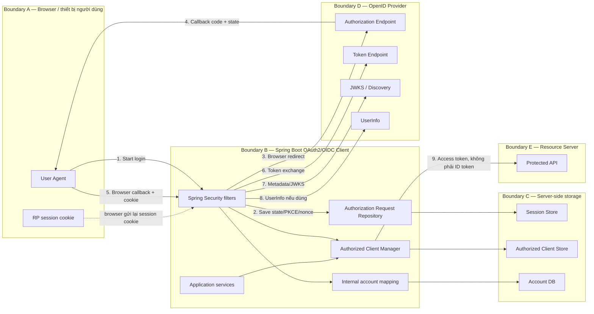
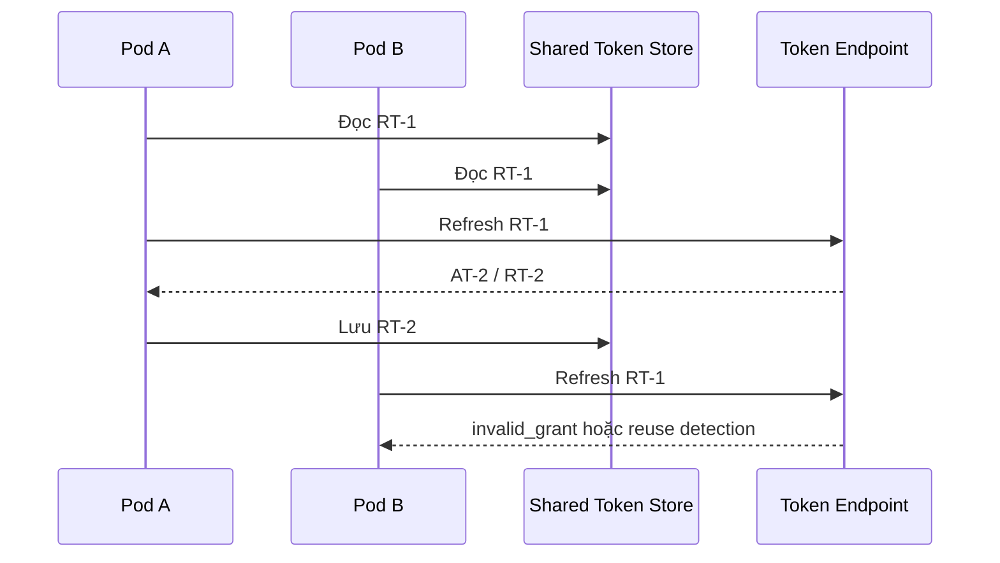
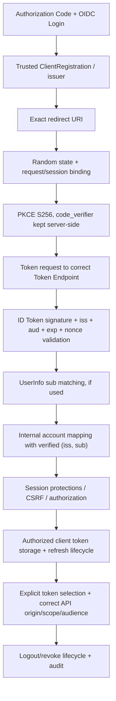

# 27.1. Threat model cho OAuth2 Client và OIDC Relying Party

Trong một ứng dụng **Spring Security OAuth 2.0/OIDC Client**, thành công của màn hình đăng nhập chỉ chứng minh rằng một luồng chức năng đã hoạt động; nó chưa chứng minh hệ thống đã chống được những tình huống như **login CSRF**, **authorization code injection**, **OAuth2 mix-up**, **đánh cắp token**, **dùng sai issuer**, **lẫn account giữa các provider**, hoặc **đăng xuất không triệt để**. Những rủi ro này đặc biệt quan trọng với ứng dụng web có thể gọi API thay mặt người dùng, lưu refresh token dài hạn, hỗ trợ nhiều nhà cung cấp danh tính hoặc phục vụ nhiều tenant.

**Threat modeling (mô hình hóa mối đe dọa)** là quá trình xác định tài sản cần bảo vệ, các tác nhân, các luồng dữ liệu, ranh giới tin cậy, kiểu tấn công, tác động và biện pháp kiểm soát. Mục đích không phải liệt kê toàn bộ lỗ hổng có thể tưởng tượng, mà là xây một mô hình **đủ chính xác để thiết kế, triển khai và kiểm thử** ứng dụng.

Bài học tập trung vào hai vai trò:

- **OAuth2 Client**: ứng dụng yêu cầu quyền, nhận và sử dụng access token/refresh token để gọi Resource Server.
- **OpenID Connect Relying Party (OIDC RP)**: ứng dụng sử dụng OIDC để xác thực người dùng qua OpenID Provider (OP), kiểm tra ID Token và thiết lập Authentication nội bộ.

Một ứng dụng Spring Boot có thể đồng thời đóng cả hai vai trò. Khi ấy **bề mặt tấn công trải rộng từ browser redirect, callback, HTTP session, Token Endpoint, UserInfo Endpoint, authorized client store cho đến downstream API**.

> **Luận điểm xuyên suốt:** Không có một cấu hình duy nhất như `oauth2Login()`, `state` hoặc PKCE có thể thay toàn bộ threat model. Bảo mật đến từ **nhiều kiểm soát phối hợp đúng ranh giới tin cậy** và được kiểm thử bằng cả luồng thành công lẫn luồng lỗi.

## 1. Mục tiêu học tập

Sau bài học, bạn có thể:

1. Phác họa data flow của OAuth2 Authorization Code + OIDC Login trong Spring Security.
2. Phân loại tài sản và actors: browser, RP, OP, Resource Server, proxy, session store, token store.
3. Xác định các trust boundaries và giả định không được phép bỏ qua.
4. Dùng STRIDE để phân tích rủi ro theo từng bước giao thức.
5. Giải thích cách `state`, PKCE, `nonce`, redirect URI và issuer validation giải quyết **những vấn đề khác nhau**.
6. Phân biệt nguy cơ trên access token, refresh token, ID Token, session cookie và authorization code.
7. Thiết kế biện pháp bảo vệ cho multi-provider, multi-tenant, account linking và logout.
8. Lập bảng ưu tiên rủi ro, xây security tests và xác định khả năng giám sát/sự cố.
9. Biết giới hạn của các cơ chế Spring Security cung cấp mặc định và những phần ứng dụng phải tự chịu trách nhiệm.

Bài không cung cấp một “công thức hack OAuth2”. Các tình huống là **mô phỏng phân tích phòng thủ** nhằm phát hiện và ngăn ngừa lỗi cấu hình hoặc lỗi triển khai.

## 2. Xác định phạm vi hệ thống trước khi phân tích

Threat model phải mô tả **một hệ thống cụ thể**. Cùng tên “OAuth2 Client” nhưng có nhiều kiến trúc:

| Kiến trúc | Cách nhận token | Điểm cần quan tâm |
|---|---|---|
| Spring MVC server-side web app | Authorization Code, confidential client | Session cookie, callback, server-side token store |
| Spring WebFlux server-side app | Authorization Code, reactive components | WebSession, Reactor context, non-blocking token storage |
| Backend for Frontend (BFF) | Backend giữ OAuth tokens, browser giữ session cookie | CSRF, SSRF, session boundary, token không lộ JS |
| SPA/public client | Browser sử dụng Authorization Code + PKCE | XSS, browser token handling, không có Client secret |
| Scheduled job | `client_credentials` hoặc user-delegated refresh | Service principal, token persistence, rotation/race |
| Multi-provider RP | Nhiều OIDC OPs | Mix-up, issuer/registration binding, account linking |
| Multi-tenant client | Issuer hoặc credentials khác nhau theo tenant | Tenant isolation, dynamic discovery, token confusion |

Trong bài này, **mô hình chính** là một **confidential Spring Boot web app/BFF**, có session phía server và Authorization Code Flow. Chúng ta cũng nêu các thay đổi khi dùng WebFlux, browser-only app hoặc background jobs.

### 2.1. Các giả định phải ghi thành văn bản

Ví dụ:

- Browser truy cập RP qua HTTPS; reverse proxy có thể chấm dứt TLS.
- RP tin một tập hợp issuer/OP đã cấu hình rõ.
- Client secrets/keys chỉ có ở backend và được bảo vệ.
- Redirect URIs được đăng ký chính xác tại OP.
- RP có database hoặc Redis để giữ session/authorized clients.
- OP có khả năng cung cấp OIDC Discovery/JWKS; có thể có nhiều tenants.
- Reports API là Resource Server riêng, xác minh access token.
- Người dùng có thể mở nhiều tabs và login/logout trong nhiều browser sessions.
- Một số users có external connections chạy background qua refresh token.

Nếu một giả định không đúng, threat model và cách chọn kiểm soát cần được sửa. Ví dụ **public SPA không thể bảo vệ Client secret như confidential backend**, còn một service-to-service job không có OIDC browser session để dựa vào.

## 3. Những tài sản cần bảo vệ

Threat model bắt đầu từ **assets**, không bắt đầu từ tên một thư viện.

| Tài sản | Giá trị và tác hại khi mất | Vị trí thường gặp |
|---|---|---|
| **Local authenticated session** | Chiếm quyền sử dụng tài khoản trong ứng dụng | Cookie + `HttpSession`/`WebSession` |
| **Authorization code** | Có thể bị dùng sai để đổi token nếu thiếu ràng buộc/PKCE | Browser callback, RP |
| **Authorization request và `state`** | Ràng buộc response với flow gốc, chống login CSRF | Session authorization request repository |
| **PKCE `code_verifier`** | Bằng chứng để đổi authorization code | RP, attributes của authorization request |
| **OIDC `nonce`** | Ràng buộc ID Token với authentication request | Authorization flow và ID Token |
| **ID Token** | Chứng cứ xác thực danh tính tại RP; có thể chứa PII | OIDC Authentication |
| **Access token** | Credential Bearer để gọi API | `OAuth2AuthorizedClient`, request outbound |
| **Refresh token** | Credential xin access token mới, thường tồn tại lâu hơn | Authorized client store |
| **Client secret/private key** | Định danh/xác thực confidential Client tại AS | Secret manager/backend |
| **External identity mapping** | Liên kết `(iss, sub)` với tài khoản nội bộ | Account/identity database |
| **Authorization policy** | Quyết định user có quyền đối với tài nguyên nào | Security configuration, business service |
| **Provider metadata/JWKS** | Nguồn để tìm endpoints/khóa xác minh token | Trusted issuer metadata/cache |
| **Audit/logs/backups** | Có thể chứa PII, token hoặc bằng chứng điều tra | Logging, monitoring, backup systems |

**Phân biệt đặc biệt quan trọng:** ID Token dùng xác minh authentication; access token dùng gọi Resource Server; refresh token dùng xin token mới; session cookie dùng khôi phục local session. Không được mặc định một credential dùng thay credential khác.

### 3.1. Mục tiêu bảo mật

Mục tiêu thường gồm:

- **Confidentiality:** token/secret/session không lộ cho actor không được phép.
- **Integrity:** callback, issuer, claim, account binding và permission không bị đánh tráo.
- **Authentication correctness:** local principal phản ánh danh tính OP đã xác minh.
- **Authorization correctness:** access token và business access không vượt quyền.
- **Session isolation:** user/tenant/provider khác không bị trộn trạng thái.
- **Availability:** login/refresh/API calls chống lỗi, abuse và rate exhaustion ở mức phù hợp.
- **Auditability:** có khả năng truy dấu sự kiện mà không ghi credential bí mật.

Không thể suy ra “login an toàn” chỉ từ việc ID Token có chữ ký hợp lệ; hệ thống còn phải áp dụng các điều kiện issuer, audience, session binding và business authorization.

## 4. Vẽ sơ đồ luồng dữ liệu (DFD) và trust boundaries



**Ranh giới tin cậy** là nơi dữ liệu từ vùng này sang vùng khác và cần xác minh/giới hạn đặc quyền. Ví dụ:

- Browser là môi trường **không được tin tuyệt đối**, kể cả khi request có cookie.
- OP là một hệ thống bên ngoài: RP tin **issuer đã đăng ký** và kết quả token đã xác minh, không tin mọi URL/JSON do browser đưa vào.
- Resource Server có thể là hệ thống khác, với audience và scope riêng.
- Redis/database/token store là hệ thống quản lý secrets, không phải “nơi lưu nào cũng tương đương”.
- Reverse proxy có thể làm sai scheme/host khiến redirect URI hoặc session cookie mất ràng buộc.

### 4.1. Vấn đề phải đặt tại mỗi trust boundary

| Boundary | Câu hỏi cần trả lời |
|---|---|
| Browser → RP | Có chống CSRF? Session cookie có Secure/HttpOnly/SameSite? Route nào được phép anonymous? |
| RP → Authorization Endpoint | Endpoint đến từ issuer tin cậy? Redirect URI/`state`/PKCE đúng? |
| OP → Browser → RP callback | Callback khớp request đã lưu? Có mix-up, code injection, missing state? |
| RP → Token Endpoint | TLS, client authentication, code_verifier và redirect URI có đúng? |
| RP ↔ Discovery/JWKS | Issuer/JWKS URI được ràng buộc, không lấy từ untrusted claim? |
| RP → UserInfo | Token đúng provider? Claim `sub` có khớp ID Token? |
| RP → token/session store | Keys, TTL, encryption, access controls, multi-node concurrency? |
| RP → API | Access token đúng resource, audience và scope? Có SSRF/token leakage? |
| RP → browser logout | Logout CSRF, open redirect, đúng `end_session_endpoint`, đúng ID Token hint? |

## 5. Tác nhân và khả năng của đối thủ

Một threat model tốt phải ghi rõ **attacker capabilities**. Ví dụ:

1. **Web attacker bên ngoài:** có thể tạo trang độc hại, khiến browser nạn nhân click/mở link và gửi cross-site requests; không thể tự đọc cookie HttpOnly của RP.
2. **Người dùng ác ý đã đăng nhập:** có tài khoản hợp lệ nhưng cố truy cập tài nguyên người khác hoặc registration/tenant không được phép.
3. **Người điều khiển một OP hoặc API không đáng tin:** cố khiến RP gửi token/ID Token tới endpoint do họ kiểm soát nếu RP cho phép dynamic discovery không được lọc.
4. **Attacker có XSS ở frontend:** có thể thực thi JS trong origin, gọi API bằng session cookie và tìm dữ liệu trên trang; HttpOnly hạn chế đọc cookie nhưng không loại bỏ XSS.
5. **Attacker có quyền đọc log/backup/DB:** có thể lấy raw refresh token hoặc session state nếu thiếu phân quyền/mã hóa.
6. **Attacker trên mạng hoặc proxy bị cấu hình sai:** có thể quan sát metadata/callback hoặc sửa forwarded headers nếu TLS và proxy trust sai.
7. **Tác vụ nội bộ bị lỗi/compromised:** có thể dùng principal/registration nhầm hoặc retry refresh token không kiểm soát.

Không nên giả định đối thủ có thể phá TLS hoặc chữ ký JWT chuẩn nếu không có bằng chứng. Ngược lại, không được giả định tất cả internal services hay browser inputs đều đáng tin chỉ vì “chúng ở trong hệ thống”.

### 5.1. Entry points cần kiểm kê

```text
GET  /oauth2/authorization/{registrationId}
GET  /login/oauth2/code/{registrationId}
POST /logout
GET  /signed-out
GET  /api/...
POST /connect/{provider}
POST /disconnect/{connectionId}
GET  /.well-known/...  (thuộc OP, ngoài RP)
POST /oauth2/token   (thuộc OP, ngoài RP)
GET  /userinfo        (thuộc OP, ngoài RP)
Outbound WebClient/RestClient calls
Background jobs, queue consumers
Admin-configured issuer/provider registration
Session store / authorized-client store
Log, tracing, backups, incident tooling
```

Không nhất thiết mỗi app có tất cả endpoint trên. Chỉ đánh dấu bề mặt **thực sự tồn tại** trong kiến trúc.

## 6. Áp dụng STRIDE vào OAuth2/OIDC Client

STRIDE là công cụ gợi ý lớp rủi ro:

| Nhóm | Ý nghĩa | Ví dụ OAuth2/OIDC |
|---|---|---|
| **S — Spoofing** | Mạo danh actor hoặc principal | ID Token sai issuer được chấp nhận; attacker-controlled principal mapping |
| **T — Tampering** | Sửa thông tin làm thay đổi ý nghĩa flow | Authorization callback không khớp `state`; sửa redirect URI |
| **R — Repudiation** | Phủ nhận thao tác vì thiếu audit | Không xác định được ai đã link provider hoặc revoke connection |
| **I — Information Disclosure** | Rò dữ liệu/credential | Access token trong log, ID Token hint trong URL, refresh token DB bị đọc |
| **D — Denial of Service** | Làm dịch vụ gián đoạn | Login storm, refresh storm, JWKS/Token Endpoint dependency outage |
| **E — Elevation of Privilege** | Vượt quyền | Account link sai user, token sai tenant, trust raw roles claim không được xác minh |

**STRIDE không thay OWASP ASVS, RFC hay test.** Nó là cách đặt câu hỏi có hệ thống để không chỉ tập trung vào mỗi “đánh cắp token”.

### 6.1. Xây threat statement cụ thể

Thay vì viết mơ hồ “OAuth có thể bị tấn công”, nên dùng mẫu:

> **Actor** có khả năng **điều khiển dữ liệu/bước nào**, khai thác **giả định hoặc thiếu kiểm soát gì**, khiến **tài sản nào** bị ảnh hưởng, với **tác động nghiệp vụ nào**?

Ví dụ:

> Một web attacker khiến browser nạn nhân gửi callback authorization của một flow do attacker kiểm soát; nếu RP không ràng buộc callback với authorization request và session gốc, nạn nhân có thể bị đăng nhập vào tài khoản của attacker (login CSRF), làm phát sinh hành động nhầm identity.

Từ threat statement, thiết kế kiểm soát: lưu authorization request theo session, `state` random và xác minh, PKCE, issuer binding, tests callback sai session/state.

## 7. Nhóm đe dọa 1 — login CSRF và session confusion

### 7.1. Login CSRF là gì?

Không phải mọi CSRF đều là “thay đổi mật khẩu”. Với **login CSRF**, attacker muốn nạn nhân hoàn tất một authentication flow không do nạn nhân khởi tạo hoặc gắn session nạn nhân vào **tài khoản khác**.

Một mẫu nguy cơ:

```text
Attacker khởi tạo OAuth2 flow cho account attacker
  -> Có một authorization response/code

Victim bị khiến gửi callback đến RP
  -> Nếu RP không kiểm tra state + authorization request
  -> RP có thể coi victim đã login như attacker
  -> Victim nhập dữ liệu nhạy cảm vào tài khoản attacker
```

Đây là mô hình lý thuyết để hiểu mục tiêu phòng thủ. Các chi tiết tấn công thực tế còn phụ thuộc client authentication, PKCE, session binding, callback processing và provider.

### 7.2. Kiểm soát bắt buộc cần giữ

- Sinh `state` có entropy đủ và ràng buộc với request đang chờ.
- Lưu `OAuth2AuthorizationRequest` trong repository an toàn, theo đúng browser session/context.
- Trên callback, xác minh `state` và flow correlation trước khi dùng `code`.
- Không fallback sang request gần nhất nếu `state` sai.
- Không chấp nhận callback khi request đã bị tiêu thụ/hết hạn.
- Giữ CSRF protection ở các endpoint browser-facing có thay đổi trạng thái theo chính sách.
- Không xóa authorization request repository chỉ vì muốn “stateless” nếu chưa có cơ chế tương đương được đánh giá bảo mật.

### 7.3. `state` không phải session ID

`state` thường xuất hiện trong authorization URL và callback; nó không thay thế session cookie hay authorization request metadata. Ngược lại, cookie hợp lệ không tự chứng minh callback `code` thuộc đúng flow.

```text
Session A -> authorization state=A1
Session B -> authorization state=B1

Callback state=A1 trong Session B:
  phải bị từ chối, không “lấy request của A vì state giống”
```

### 7.4. Kiểm thử

- Callback không có session cũ phải thất bại.
- Callback có `state` bất kỳ khác request đã lưu phải thất bại.
- Replay callback đã xử lý không được sinh session mới.
- Hai authorization flows trên cùng session được xử lý theo behavior thiết kế; nếu repository chỉ lưu một request, không được ghép callback A vào request B.
- Một custom authorization request repository không được trả request theo user-supplied key toàn cục mà bỏ session ownership.

## 8. Nhóm đe dọa 2 — authorization code interception và PKCE

Authorization Code đi qua front channel (browser redirect). Attacker có thể cố **chiếm, thay hoặc tái sử dụng** code nếu có lỗ hổng ở browser, URI handler, logs hoặc application routing.

PKCE (Proof Key for Code Exchange, RFC 7636) ràng buộc code với Client đã khởi tạo request:

```text
Client tạo code_verifier ngẫu nhiên
      |
      +--> tính code_challenge = BASE64URL(SHA256(verifier))
      |
Authorization request gửi code_challenge + method S256
      |
Authorization Server gắn challenge với code
      |
Token request gửi code_verifier
      |
Authorization Server đối chiếu trước khi phát token
```

### 8.1. PKCE giải quyết vấn đề nào?

PKCE giúp **authorization code bị lộ không đủ để đổi token** nếu attacker không có verifier tương ứng. Nó đặc biệt quan trọng với public clients, và OAuth2 Security BCP khuyến nghị sử dụng rộng rãi cho Authorization Code Flow khi hỗ trợ.

### 8.2. PKCE không thay `state`, `nonce` hoặc issuer validation

| Cơ chế | Nguy cơ chính được giảm |
|---|---|
| `state` | Callback/login CSRF và liên hệ response với request |
| PKCE `code_verifier` | Code interception/injection và việc đổi code ngoài flow hợp lệ theo bảo vệ áp dụng |
| OIDC `nonce` | Replay/substitution của ID Token theo OIDC authentication context |
| Issuer/registration binding | Authorization Server mix-up |
| Exact redirect URI registration | Authorization response chuyển về URI không đúng |
| Client authentication | Giới hạn Token Endpoint cho confidential Client |

Không viết một custom resolver chỉ giữ `state` rồi làm mất PKCE verifier hoặc nonce trong `OAuth2AuthorizationRequest`.

### 8.3. Vì sao dùng `S256`?

Với `S256`, code challenge là kết quả hash của verifier. Phương thức `plain` không cung cấp cùng mức che giấu verifier. Nên chọn `S256` khi AS hỗ trợ và theo chính sách hiện hành.

Không hard-code verifier hoặc tái sử dụng cùng một chuỗi cho mọi users/flows. Không log verifier, challenge cần xử lý như metadata giao thức, và không truyền verifier vào front-channel URL.

### 8.4. Test và vận hành

- Token exchange với verifier sai bị từ chối.
- Khi custom authorization request repository bị đổi, verifier vẫn được giữ đúng.
- Redirect URI trên token request phải tuân giao thức và khớp flow gốc.
- Authorization code không được xử lý hai lần sau callback.
- Không đưa code/raw callback URL chứa credentials vào public logs và analytics.
- Với native/mobile clients, kiểm tra deep-link redirect interception và PKCE.

## 9. Nhóm đe dọa 3 — redirect URI, open redirect và mix-up

### 9.1. Redirect URI là điểm kiểm soát quan trọng

Authorization Server cần giới hạn redirect URIs đã được đăng ký. Với web app:

```text
https://portal.example.test/login/oauth2/code/corp
https://portal.example.test/login/oauth2/code/partner
```

Một cấu hình quá rộng hoặc một open redirect ở RP có thể khiến authorization response rơi vào nơi không mong muốn.

Các nguyên tắc:

- Ưu tiên URI được đăng ký chính xác, theo quy tắc của AS/chuẩn.
- HTTPS cho browser-facing callbacks ở production.
- Không lấy redirect URI bất kỳ từ query param của user.
- Hạn chế wildcard và dynamic redirects, nhất là theo host.
- Không cho untrusted `Host`/`X-Forwarded-Host` ảnh hưởng URI public.
- Token Endpoint exchange phải gắn với redirect URI/request gốc theo policy.

### 9.2. Authorization Server mix-up trong multi-provider

Giả sử RP có hai providers `corp` và `partner`. Attacker cố khiến response đến từ provider A bị xử lý như provider B, hoặc khiến RP gửi authorization code/token request sai Authorization Server.

Thành phần cần được ràng buộc:

```text
authorization request state
  -> ClientRegistration ID
  -> expected issuer
  -> Authorization Endpoint
  -> Token Endpoint
  -> redirect URI
  -> OIDC ID Token issuer
```

Với OAuth2 hỗ trợ issuer identification trong authorization response, **RFC 9207 `iss` parameter** có thể giúp client chống mix-up khi được triển khai phù hợp. Với OIDC, ID Token issuer validation cũng rất quan trọng, nhưng nó **không cho phép bỏ qua liên kết authorization response/token endpoint trước đó**.

### 9.3. Không chọn provider chỉ từ path callback

Sai về ý tưởng:

```java
// Không an toàn nếu chỉ dựa vào user-controlled path:
String provider = request.getParameter("provider");
String tokenEndpoint = "https://" + provider + "/token";
```

Nếu muốn thay đổi ClientRegistration theo tenant, phải có **mapping server-side đã xác minh**, không chỉ ghép URL/issuer từ browser input.

### 9.4. Reverse proxy và host confusion

```text
Browser -> https://portal.example.test
Proxy   -> http://spring-app:8080
```

Nếu app không xử lý forwarded headers đúng cách, redirect URI có thể trở thành `http://spring-app:8080/login/oauth2/code/corp`. Ngược lại, nếu proxy tin header `X-Forwarded-Host` do Internet client tự gửi, attacker có thể ảnh hưởng URL do RP tạo.

**Kiểm soát:** sanitize headers tại edge proxy, chỉ tin proxies đã xác định, cấu hình Spring Boot forwarded-header strategy phù hợp và kiểm thử public base URL.

## 10. Nhóm đe dọa 4 — OIDC ID Token validation bị suy yếu

OIDC RP dựa vào ID Token để xác định user. Một JWT “trông có vẻ đúng” không có nghĩa là authentication hợp lệ.

### 10.1. Những điều kiện phải kiểm tra

Tùy flow và OP, ID Token validation bao gồm:

1. **Signature:** dùng thuật toán và key hợp lệ theo cấu hình tin cậy, không tin arbitrary header.
2. **Issuer `iss`:** khớp issuer của ClientRegistration/OP đã chọn.
3. **Audience `aud`:** chứa Client ID được cấp; xử lý `azp` khi tiêu chuẩn yêu cầu.
4. **Expiration `exp` và issued-at/time constraints:** token còn hợp lệ theo policy clock skew.
5. **`nonce`:** khớp giá trị được RP tạo khi flow sử dụng nonce.
6. **Token type/algorithm:** không chấp nhận `alg=none` hay thuật toán không được policy cho phép.
7. **Các ràng buộc flow liên quan** như hash claims khi chúng hiện diện và cần xác minh.
8. **UserInfo subject:** khi dùng UserInfo, `sub` phải khớp `sub` trong ID Token theo OIDC.

Không tự parse JWT payload rồi coi claim `email`/`groups` là bằng chứng authorization khi signature/issuer/audience chưa được xác minh.

### 10.2. `iss` và `sub` là định danh external identity

Hai ID Tokens:

```json
{"iss":"https://id.tenant-a.example.test","sub":"123"}
```

```json
{"iss":"https://id.tenant-b.example.test","sub":"123"}
```

không đại diện cùng external identity chỉ vì `sub` giống nhau. Khi link vào internal account, dùng **verified `(iss, sub)`**, không hợp nhất tự động theo email.

### 10.3. Token substitution và audience confusion

ID Token cấp cho Client A không được chấp nhận tại Client B chỉ vì chữ ký từ cùng issuer hợp lệ. `aud` cần liên hệ với Client ID của RP đang xác minh.

Tương tự, access token cấp cho `userinfo` không mặc nhiên hợp lệ với Reports API. **Không dùng ID Token làm access token** để gọi downstream API.

### 10.4. `nonce` không thay thế `state`

`nonce` liên kết ID Token với OIDC Authentication Request; `state` liên kết authorization response/callback với flow gốc. Một hệ thống cần cơ chế tương ứng ở mỗi bước.

Nếu custom authentication converter, resolver hay success handler làm mất nonce/state, lỗi không nên được “sửa” bằng cách tắt validation.

### 10.5. JWT signature validation và key rotation

OP có thể quay vòng JWKs. RP cần:

- Chỉ lấy JWKS từ issuer/provider metadata đáng tin.
- Không truy cập arbitrary JWK URLs theo giá trị user-controlled `jku`/`x5u` trong token.
- Kiểm tra key/algorithm phù hợp.
- Có cache/refresh JWKS theo thư viện/policy, không cache khóa bị thu hồi vĩnh viễn.
- Phân biệt lỗi OP key rotation tạm thời với token forgery.
- Không biến `kid` thành path/file/database query thiếu validation.

Ưu tiên sử dụng OIDC token validation mặc định của Spring Security/Nimbus theo các phiên bản hỗ trợ, không tự viết decoder cho ID Token chỉ bằng Base64.

## 11. Nhóm đe dọa 5 — discovery metadata và SSRF

OIDC Discovery giúp RP tìm Authorization Endpoint, Token Endpoint, JWKS, UserInfo và các capabilities từ issuer.

Một client với issuers cố định:

```yaml
spring:
  security:
    oauth2:
      client:
        provider:
          company-op:
            issuer-uri: https://identity.company.example.test/realms/main
```

có trust boundary đơn giản hơn một hệ thống cho phép user tùy ý nhập issuer.

### 11.1. Đe dọa dynamic discovery

Nếu RP nhận:

```text
POST /register-provider
{"issuer":"http://127.0.0.1:..."}
```

rồi backend tự tải metadata, JWKS và Token Endpoint mà không kiểm tra, có thể phát sinh SSRF và token/credential exfiltration.

Hãy coi tất cả endpoint URLs nằm trong metadata từ issuer **chưa tin cậy** là dữ liệu không tin cậy cho tới khi issuer đã được xác minh và policy chấp nhận.

### 11.2. Kiểm soát dynamic issuers

Nếu bắt buộc hỗ trợ tenant-managed issuers:

- Dùng allowlist domains/issuer patterns theo chính sách rõ.
- Ưu tiên HTTPS và xác thực TLS/hostname.
- Không cho endpoint trỏ vào loopback, link-local, metadata services hoặc mạng nội bộ không cần thiết.
- Kiểm soát DNS rebinding và redirect chains bằng HTTP client policy.
- Kiểm tra metadata `issuer` khớp issuer dự kiến.
- Giới hạn kích thước metadata/JWKS, timeout, redirects và số keys.
- Không gửi Client secret đến Token Endpoint từ một issuer chưa được approved.
- Chỉ cấp quyền cấu hình provider cho admin/tenant owner có thẩm quyền.
- Lưu audit về thay đổi issuer/ClientRegistration.

Một wildcard issuer matching rộng không thể thay thế issuer binding chính xác.

### 11.3. Token Endpoint có tính nhạy cảm đặc biệt

Trong confidential Client, Token Endpoint request có thể mang **Client secret/private-key assertion**, authorization code hoặc refresh token. Nếu endpoint bị thay bằng host attacker, hậu quả nghiêm trọng hơn một lỗi link UI.

Không xây Token Endpoint bằng string concatenation từ `iss` do browser gửi hoặc claim chưa xác minh.

## 12. Nhóm đe dọa 6 — token leakage trong Client và outbound HTTP

Access token dạng Bearer cho phép bên cầm token thực hiện các yêu cầu trong phạm vi quyền của nó. Một OAuth2 Client cần chống rò token qua:

- Browser JS/DOM, nếu kiến trúc không cần đưa token ra frontend.
- Query strings, URL fragments không phù hợp, redirect logs.
- `Authorization` header tới sai HTTP origin.
- Reverse proxy/access logs/APM/traces.
- Exception messages hoặc error responses trả về frontend.
- Token store, backup, heap dump hoặc debugging endpoints.
- Message queues chứa raw token.
- Redirect theo HTTP client có policy forwarding headers không an toàn.

### 12.1. WebClient chọn authorized client tường minh

Với Spring Security Servlet + WebClient:

```java
import org.springframework.context.annotation.Bean;
import org.springframework.security.oauth2.client.registration.ClientRegistrationRepository;
import org.springframework.security.oauth2.client.web.OAuth2AuthorizedClientRepository;
import org.springframework.security.oauth2.client.web.reactive.function.client.ServletOAuth2AuthorizedClientExchangeFilterFunction;
import org.springframework.web.reactive.function.client.WebClient;

@Bean
WebClient reportsWebClient(
        ClientRegistrationRepository registrations,
        OAuth2AuthorizedClientRepository authorizedClients) {

    var oauth2 = new ServletOAuth2AuthorizedClientExchangeFilterFunction(
        registrations, authorizedClients
    );

    return WebClient.builder()
        .baseUrl("https://reports-api.example.test")
        .apply(oauth2.oauth2Configuration())
        .build();
}
```

Gọi API:

```java
import static org.springframework.security.oauth2.client.web.reactive.function.client.ServletOAuth2AuthorizedClientExchangeFilterFunction.clientRegistrationId;

Mono<String> body = reportsWebClient.get()
    .uri("/v1/reports")
    .attributes(clientRegistrationId("reports"))
    .retrieve()
    .bodyToMono(String.class);
```

`reports` phải là ClientRegistration có scope/audience phù hợp và được user/service cấp quyền. Nếu registration hiện tại là `corp` mà API dùng token của `reports`, đây có thể là thiết kế đúng; không ép mọi API call dùng provider login.

### 12.2. Nguy cơ của default authorized client

```java
oauth2.setDefaultOAuth2AuthorizedClient(true);
```

có thể khiến WebClient tự gắn token của Authentication hiện tại vào requests không chọn authorized client. Với shared WebClient gọi nhiều domains, đó là nguy cơ gửi Bearer token tới đối tác không cần nó.

**Kiểm soát:** dùng WebClient chuyên biệt theo downstream host, registration rõ từng request, và không cho browser quyết định absolute URL tùy ý.

### 12.3. SSRF cộng token exfiltration

Mẫu rủi ro:

```java
// Không nên đưa untrusted absolute URL vào OAuth2-enabled WebClient.
webClient.get()
    .uri(userSuppliedUrl)
    .attributes(clientRegistrationId("company"))
    .retrieve();
```

Attacker không cần biết raw token nếu có thể khiến backend gửi token tới host họ kiểm soát. Restrict outbound destination, DNS/network egress và cross-origin redirects là các kiểm soát quan trọng.

### 12.4. Đừng log token, cookies hay callback URL nguyên dạng

Ví dụ log không an toàn:

```text
Authorization: Bearer eyJ...
refresh_token=...
id_token_hint=eyJ...
Cookie: JSESSIONID=...
GET /login/oauth2/code/company?code=...
```

Một log tốt hơn:

```text
event=oauth2_api_call
registrationId=reports
downstreamService=reports-api
httpStatus=401
oauthErrorCategory=invalid_token
traceId=independent-random-id
```

Không dùng token value, `state`, authorization code hoặc session ID làm trace ID. Metadata đăng nhập cũng cần giới hạn nếu chứa PII hoặc thông tin tenant nhạy cảm.

## 13. Nhóm đe dọa 7 — refresh token storage, rotation và replay

Refresh token có thể cho phép lấy access token mới sau khi browser session hết hạn. Nếu bị lộ, tác động có thể kéo dài hơn một access token ngắn hạn.

### 13.1. Chọn token store theo threat model

| Storage | Điểm mạnh | Rủi ro |
|---|---|---|
| `InMemoryOAuth2AuthorizedClientService` | Đơn giản, không có persistent DB | Mất token khi restart; mỗi pod riêng; heap dump |
| `HttpSessionOAuth2AuthorizedClientRepository` | Gắn authorized client với HTTP session | Cookie/session theft; session expiry; replication |
| `JdbcOAuth2AuthorizedClientService` | Persist qua restart, nhiều instances dùng chung | DB breach, backup, migration, concurrency |
| Reactive session/service implementations | Phù hợp WebFlux | Reactor context, shared store, serialization/timeout |

Chọn đúng store không tự giải quyết các lỗi principal ownership, provider mix-up hoặc refresh token replay.

### 13.2. Refresh token rotation

```text
RT-1 -> Token Endpoint -> AT-2 + RT-2
             |
             +-- RT-1 có thể bị vô hiệu hóa
```

Trong nhiều hệ thống, refresh token rotation giúp phát hiện reuse. Nhưng nếu hai pods đồng thời dùng RT-1:



Không mặc định một shared JDBC database tạo ra **single-flight refresh**. Có thể cần per-connection lock, optimistic versioning, distributed coordination và error handling không ghi đè token mới bằng token cũ.

### 13.3. Chống replay và token theft

- Protect refresh token bằng encryption at rest, least privilege và backup controls.
- Dùng refresh token rotation hoặc sender-constrained tokens nếu provider hỗ trợ và threat model yêu cầu.
- Hạn chế scopes và lifetime; dùng offline access chỉ khi cần.
- Xóa/invalidate đúng authorized client khi user disconnect/revoke.
- Không retry `invalid_grant` vô hạn bằng refresh token cũ.
- Phân biệt credential của service account với user-delegated tokens.
- Bảo vệ Token Endpoint Client authentication.

### 13.4. Token dạng sender-constrained

Các cơ chế như **mTLS** hoặc **DPoP** có thể ràng buộc token với key của Client, giảm khả năng lạm dụng raw Bearer token nếu provider/Resource Server hỗ trợ. Đây là khả năng tùy chọn, không tự xuất hiện chỉ vì dùng Spring Security OAuth2 Client.

Không tuyên bố đã có DPoP/mTLS nếu Client/OP/API chưa thực sự hỗ trợ và kiểm thử proof validation/key management.

## 14. Nhóm đe dọa 8 — session fixation, CSRF và cookie policy

Sau OIDC login, RP thường thiết lập local session. Nếu session bị chiếm, attacker có thể gọi các endpoint của RP như user, ngay cả khi không lấy được refresh token.

### 14.1. Cookie protection

- **`Secure`:** browser chỉ gửi cookie trên HTTPS.
- **`HttpOnly`:** hạn chế JavaScript đọc cookie, không loại bỏ XSS.
- **`SameSite`:** giảm một số cross-site cookie sends; cần phù hợp login redirect flow.
- **Path/Domain:** giới hạn nơi cookie được gửi, tránh phạm vi quá rộng.
- **Session timeout:** cân bằng UX và thời gian kẻ tấn công có thể lạm dụng session.
- **Session ID rotation/fixation protection:** tránh dùng một session identifier do attacker đã cố định trước authentication.

### 14.2. SameSite và OIDC callback

Authorization Code Flow thường callback bằng top-level GET, nên `SameSite=Lax` thường phù hợp. Nhưng nếu OP dùng `response_mode=form_post`, callback là cross-site POST và cookie Lax có thể không được gửi.

Không thay toàn bộ cookie thành `SameSite=None` mà không đánh giá CSRF, HTTPS, browser policy và khả năng hỗ trợ response mode. `SameSite=None` cần `Secure` theo chính sách browser hiện đại.

### 14.3. CSRF bảo vệ endpoint nào?

Một form POST:

```http
POST /settings/update
Cookie: SESSION=...
```

được browser tự gửi cookie; nếu endpoint không có CSRF protection phù hợp, attacker có thể dụ browser nạn nhân gửi thay đổi trạng thái.

BFF hoặc session-based RP nên giữ CSRF protection cho browser-facing state-changing endpoints. Việc outbound WebClient dùng Bearer token **không làm browser CSRF biến mất**.

### 14.4. Logout CSRF

Nếu logout được thực hiện bằng GET không có guard, attacker có thể khiến victim bị logout hoặc thao tác ngắt kết nối ngoài ý muốn. Với Spring Security có CSRF, thường dùng POST logout với token phù hợp. Không tắt CSRF chỉ để tạo một link logout đơn giản.

### 14.5. Session store phân tán

Nếu login bắt đầu ở pod A và callback đến pod B, authorization request/state phải được tìm đúng session; nếu local in-memory session không chia sẻ, login có thể thất bại. Dùng Spring Session/Redis hoặc routing/affinity phù hợp, đồng thời bảo vệ Redis ACL, TLS, serializer, namespace và TTL.

Shared session store **không tự** đồng nghĩa authorized client service đã chia sẻ; xác định đúng kho chứa token.

## 15. Nhóm đe dọa 9 — account linking và multi-provider identity confusion

Account linking thường nguy hiểm hơn “login thêm một provider” vì nó quyết định **tài khoản nội bộ nào sở hữu external identity và token nào**.

### 15.1. Kịch bản rủi ro

1. User đang đăng nhập internal account A.
2. User bấm “Connect Partner”.
3. Browser hoàn tất OAuth2/OIDC flow với external account B.
4. Ứng dụng **không ràng buộc callback với pending link context** hoặc tự dùng email.
5. External account B bị liên kết với internal account không đúng, hoặc user bị login-as B ngoài ý muốn.

Đây có thể là một dạng account-linking CSRF/mis-binding, dẫn tới lộ dữ liệu hoặc sai ownership.

### 15.2. Kiểm soát account linking

- Yêu cầu user đã xác thực; với liên kết nhạy cảm có thể reauthenticate.
- Tạo pending link context server-side gắn internal account, session, registration và mục đích.
- Giữ state/PKCE/nonce như một OAuth2/OIDC flow chuẩn.
- Xác minh external identity `(iss, sub)` trước khi liên kết.
- Không auto-link chỉ bằng email, kể cả `email_verified=true`.
- Không cho một external identity bị liên kết đồng thời vào hai internal accounts trái policy.
- Dùng unique constraints và transaction chống race.
- Tách **link external connection** khỏi **thay local login principal**.
- Có audit, notification, unlink/revoke và recovery path.

### 15.3. Khóa dữ liệu gợi ý

```sql
-- Mô hình khái niệm, điều chỉnh schema/dialect theo hệ thống thật.
CREATE TABLE external_identity (
    id BIGINT GENERATED ALWAYS AS IDENTITY PRIMARY KEY,
    internal_account_id BIGINT NOT NULL,
    issuer VARCHAR(1000) NOT NULL,
    subject VARCHAR(500) NOT NULL,
    UNIQUE (issuer, subject)
);
```

Unique constraint chống hai bản ghi cùng external identity, nhưng **không thay** bước xác minh ownership và authorization trước khi insert/update.

### 15.4. OAuth2 login registration khác API registration

Một user login portal qua `corp` và cấp quyền Calendar qua `google-calendar`:

```text
loginRegistrationId = corp
apiRegistrationId   = google-calendar
logoutProvider      = corp (nếu logout portal)
disconnectProvider  = google-calendar (nếu ngắt Calendar)
```

Không gửi Calendar token tới Corp Resource Server, không dùng Corp ID Token hint để logout Google, và không tự chuyển portal principal khi chỉ đang link API.

## 16. Nhóm đe dọa 10 — logout, revocation và vòng đời phiên

Đăng xuất có nhiều lớp:

1. **Local logout:** xóa SecurityContext/session của RP.
2. **RP-Initiated OIDC Logout:** browser được chuyển tới OP `end_session_endpoint` nếu provider hỗ trợ.
3. **Token revocation:** Client yêu cầu AS vô hiệu hóa token/grant qua revocation endpoint nếu hỗ trợ.
4. **Front-/back-channel logout:** OP thông báo tới các RPs khác khi được triển khai.
5. **Business disconnect:** ứng dụng xóa/quản lý external connection và token của một dịch vụ.

### 16.1. Các giả định nguy hiểm

- “Xóa local session đồng nghĩa OP SSO session đã mất.”
- “Gọi `end_session_endpoint` đồng nghĩa mọi refresh tokens đã revoke.”
- “Xóa token khỏi DB đồng nghĩa Resource Server từ chối access token cũ ngay.”
- “Một browser logout có thể logout mọi browser và thiết bị khác.”
- “Tất cả OIDC providers đều có `end_session_endpoint`.”

Những suy luận trên không phải bảo đảm của OIDC/OAuth2.

### 16.2. `end_session_endpoint` và `id_token_hint`

OIDC Discovery có thể công bố `end_session_endpoint` cho RP-Initiated Logout; field này **tùy chọn**. Spring có:

- Servlet: `OidcClientInitiatedLogoutSuccessHandler`.
- Reactive: `OidcClientInitiatedServerLogoutSuccessHandler`.

Handler cần xác định đúng OP theo Authentication/ClientRegistration. `id_token_hint` là **ID Token** gắn với OP đó; không được lấy access token hoặc ID Token từ issuer khác.

Một `post_logout_redirect_uri` thường cần được đăng ký/chấp thuận. Không nhận arbitrary redirect URI từ browser, tránh open redirect.

### 16.3. Có fallback local logout

Nếu OP không hỗ trợ RP-Initiated Logout, RP vẫn phải thực hiện local logout đúng và thông báo rõ phạm vi đăng xuất. Không tự ghép `issuer + "/logout"` hay bỏ session cleanup để chờ OP.

### 16.4. Threat model của logout cần bao gồm offline access

Nếu user cấp quyền background Calendar sync, có thể refresh token vẫn còn sau khi local session logout. Ứng dụng phải định nghĩa:

- Logout portal có tiếp tục giữ API connection không?
- Disconnect Calendar có phải gọi revocation endpoint không?
- Khi disable internal account, jobs/tokens nào phải ngừng?
- Khi refresh token bị revoke, UI có báo `RECONNECT_REQUIRED` không?
- Có bao lâu để access token cũ thực sự không còn được API chấp nhận?

## 17. Spring Security giúp gì — và không giúp gì?

Spring Security cung cấp nhiều thành phần làm đúng **protocol plumbing** khi cấu hình phù hợp:

- OAuth2 Authorization Code Login filters.
- Authorization request repositories.
- ClientRegistration metadata handling.
- OIDC ID Token validation qua configured decoder/validators.
- `OAuth2AuthenticationToken` và `OidcUser`.
- `OAuth2AuthorizedClientService`/repository/manager.
- OAuth2 integration cho WebClient/RestClient.
- Logout handlers cho session và OIDC RP-Initiated Logout.

Nhưng Spring Security **không tự biết**:

- Internal account A có sở hữu Calendar connection X không.
- External `(iss, sub)` có được phép gắn với một internal user không.
- Reports API cần audience/scope nào trong nghiệp vụ.
- Khi logout có phải revoke token của mọi external connections không.
- Token store có cần mã hóa/KMS/backup retention nào.
- Dynamic issuer từ tenant admin có an toàn không.
- Một URL do user nhập có phải downstream host được phép không.
- Refresh token rotation có cần distributed lock trên nhiều nodes không.

Threat model phải chia rõ **framework controls** và **application responsibilities**.

## 18. Spring Security Servlet: cấu hình cơ sở an toàn

Ví dụ Spring Boot 3.x với OIDC Login:

```yaml
spring:
  security:
    oauth2:
      client:
        registration:
          company:
            provider: company-op
            client-id: ${OIDC_CLIENT_ID}
            client-secret: ${OIDC_CLIENT_SECRET}
            client-authentication-method: client_secret_basic
            authorization-grant-type: authorization_code
            redirect-uri: "{baseUrl}/login/oauth2/code/{registrationId}"
            scope:
              - openid
              - profile
        provider:
          company-op:
            issuer-uri: https://identity.example.test/realms/company
```

Configuration:

```java
import org.springframework.context.annotation.Bean;
import org.springframework.context.annotation.Configuration;
import org.springframework.security.config.Customizer;
import org.springframework.security.config.annotation.web.builders.HttpSecurity;
import org.springframework.security.web.SecurityFilterChain;

@Configuration
public class SecurityConfiguration {

    @Bean
    SecurityFilterChain securityFilterChain(HttpSecurity http)
            throws Exception {

        return http
            .authorizeHttpRequests(authorize -> authorize
                .requestMatchers("/", "/error", "/signed-out").permitAll()
                .requestMatchers("/admin/**").hasRole("ADMIN")
                .anyRequest().authenticated()
            )
            .oauth2Login(Customizer.withDefaults())
            .oauth2Client(Customizer.withDefaults())
            .logout(logout -> logout
                .logoutSuccessUrl("/signed-out")
            )
            .build();
    }
}
```

Cấu hình này giữ các kiểm soát CSRF/session do Spring cung cấp theo mặc định thay vì vô hiệu hóa chúng. **Không nên coi snippet là cấu hình production hoàn chỉnh:** cần xác định authorization policies, cookie settings, authorized client store, proxy trust, monitoring và provider contracts.

### 18.1. Không tắt CSRF chỉ vì có OAuth2 Login

Không nên tự thêm:

```java
// Không khuyến nghị như một mặc định cho browser-session app:
http.csrf(csrf -> csrf.disable());
```

Một backend nhận request từ browser kèm cookie vẫn có bề mặt CSRF. Nếu có endpoints thực sự stateless dùng Bearer token, có thể dùng nhiều security chains và policy phù hợp, không tắt CSRF toàn hệ thống theo cảm tính.

### 18.2. Business authorization là lớp riêng

`hasRole("ADMIN")` là kiểm soát ở URL/method level, nhưng resource ownership vẫn cần được kiểm tra.

Ví dụ một user có quyền xem reports không có nghĩa họ được truy cập `/reports/{reportId}` của user khác. Controller/service phải kiểm tra account/tenant/ownership dựa trên principal đã xác minh.

### 18.3. Trong OIDC RP, đừng tự thay verified claims bằng email

Một custom `OidcUserService` có thể map user vào account nội bộ. Nếu tạo account mới hoặc link identity, cần dùng `(iss, sub)` từ ID Token đã được Spring xác minh và database uniqueness constraints; không auto-link chỉ vì email giống.

## 19. Spring WebFlux: những khác biệt về threat model

WebFlux có các thành phần tương ứng:

| Servlet Spring MVC | Reactive WebFlux |
|---|---|
| `SecurityFilterChain` | `SecurityWebFilterChain` |
| `HttpSecurity` | `ServerHttpSecurity` |
| `HttpSession` | `WebSession` |
| `HttpSessionOAuth2AuthorizationRequestRepository` | `WebSessionOAuth2ServerAuthorizationRequestRepository` |
| `OAuth2AuthorizedClientRepository` | `ServerOAuth2AuthorizedClientRepository` |
| `ServletOAuth2AuthorizedClientExchangeFilterFunction` | `ServerOAuth2AuthorizedClientExchangeFilterFunction` |
| `OidcClientInitiatedLogoutSuccessHandler` | `OidcClientInitiatedServerLogoutSuccessHandler` |
| Servlet SecurityContext holder conventions | `ReactiveSecurityContextHolder` / Reactor context |

### 19.1. Reactive security chain

```java
import org.springframework.context.annotation.Bean;
import org.springframework.security.config.Customizer;
import org.springframework.security.config.web.server.ServerHttpSecurity;
import org.springframework.security.web.server.SecurityWebFilterChain;

@Bean
SecurityWebFilterChain reactiveSecurity(ServerHttpSecurity http) {

    return http
        .authorizeExchange(exchanges -> exchanges
            .pathMatchers("/", "/error", "/signed-out").permitAll()
            .anyExchange().authenticated()
        )
        .oauth2Login(Customizer.withDefaults())
        .oauth2Client(Customizer.withDefaults())
        .build();
}
```

### 19.2. Reactor context là một ranh giới

Không đọc `SecurityContextHolder` ThreadLocal kiểu Servlet rồi giả định luôn có user Authentication trong mọi asynchronous operation. Khi background job chạy ngoài request, phải cấp trusted principal/connection context riêng.

Cũng không dùng `block()` trên Netty event-loop để lấy session, token hoặc issuer metadata. Một blocking token store không được bọc đúng có thể làm toàn bộ ứng dụng dễ bị DoS dưới tải.

### 19.3. Reactive authorized client storage

`WebSession`, reactive authorized-client service và shared Redis/DB có lifecycle khác nhau. Mất WebSession lúc callback có thể khiến flow thiếu authorization request, dù token service vẫn còn dữ liệu từ phiên cũ. Không sửa missing state bằng cách bỏ callback validation.

## 20. Threat registry: ưu tiên rủi ro có thể hành động

Để chọn việc nào phải làm trước, có thể dùng **likelihood × impact** định tính. Bảng sau là **ví dụ cho một BFF nhiều providers có refresh token persistence**, không phải kết luận về mọi ứng dụng.

| ID | Threat | Likelihood | Impact | Priority minh họa | Kiểm soát chính |
|---|---|---|---|---|---|
| T01 | Login CSRF / callback không được ràng buộc | Trung bình | Cao | Cao | `state`, session-bound authorization request, reject invalid callback |
| T02 | Authorization code bị lộ/đổi sai flow | Trung bình | Cao | Cao | PKCE S256, exact redirect URI, one-time code |
| T03 | Mix-up giữa các OPs | Trung bình | Cao | Cao | registration/issuer binding, ID Token `iss`, RFC 9207 khi hỗ trợ |
| T04 | ID Token validator bỏ `aud`/signature/nonce | Thấp–TB | Rất cao | Cao | Trusted decoder/validators, negative tests |
| T05 | SSRF qua dynamic discovery | Trung bình nếu có dynamic issuer | Rất cao | Cao | Allowlist issuer/endpoints, egress controls |
| T06 | Bearer token gửi tới API sai host | Trung bình | Cao | Cao | Explicit authorized client, base URL allowlist |
| T07 | Refresh token leak từ DB/logs | Trung bình | Rất cao | Cao | Encryption, access controls, redaction, rotation |
| T08 | Refresh rotation race | Trung bình | Trung bình–Cao | Trung bình/Cao | Single-flight/locking, storage versioning |
| T09 | Account linking theo email | Trung bình | Rất cao | Cao | Verified `(iss, sub)`, explicit linking, ownership |
| T10 | Session cookie bị chiếm | Trung bình | Cao | Cao | Secure/HttpOnly/SameSite, fixation protection, timeout |
| T11 | Logout tưởng đã revoke mọi token | Cao nếu hiểu nhầm | Trung bình–Cao | Trung bình/Cao | Phân biệt logout/revocation, policy và tests |
| T12 | JWKS/Token Endpoint outage tạo DoS | Trung bình | Trung bình | Trung bình | Timeouts, retries có giới hạn, monitoring |
| T13 | Tenant A dùng token của Tenant B | Thấp–TB | Rất cao | Cao | Tenant isolation, principal ownership, tests |
| T14 | Metadata PII/credentials trong telemetry | Trung bình | Cao | Cao | Data classification, log redaction, retention |

**Cách dùng:** điều chỉnh likelihood và impact theo kiến trúc thực tế, exposure, controls hiện hữu và nghiệp vụ. Không dùng số điểm giả chính xác để che giấu giả định chưa biết.

### 20.1. Ghi thành một risk record có owner

Một bản ghi nên có:

```yaml
id: T06
title: "Bearer token gửi tới wrong-origin API"
asset: "user access token"
entryPoint: "WebClient outbound request"
trustBoundary: "Spring backend -> external HTTP origin"
attackerCapability: "influence outbound URL"
preconditions:
  - "OAuth2 filter tự gắn token vào WebClient chung"
impact: "token disclosure, unauthorized API calls"
controls:
  - "WebClient per trusted origin"
  - "explicit clientRegistrationId or OAuth2AuthorizedClient"
  - "egress / redirect policy"
tests:
  - "absolute untrusted URL rejected"
  - "Authorization header never reaches another origin"
owner: "API integration team"
status: "mitigation planned"
```

Đây là **mẫu risk record**, không phải file YAML của hệ thống hay một tiêu chuẩn bắt buộc. Điểm quan trọng là có owner, kiểm soát và bằng chứng kiểm thử.

## 21. Mối quan hệ giữa controls: đừng kiểm tra một điểm rồi bỏ phần còn lại

Một OAuth2/OIDC flow an toàn cần nhiều lớp:



Thiếu một khâu có thể làm yếu toàn bộ hệ thống, dù các khâu khác vẫn có mặt.

Ví dụ:

- Có PKCE nhưng không kiểm tra `state` → còn nguy cơ callback/login CSRF tùy flow.
- Có chữ ký JWT nhưng bỏ `aud` → token cấp cho Client khác có thể bị chấp nhận.
- Có `state` nhưng token được gửi sang wrong-origin → access token vẫn bị lộ.
- Có session cookie HttpOnly nhưng tồn tại XSS → attacker có thể thực hiện hành động bằng chính session.
- Có JDBC encrypted at rest nhưng logs ghi refresh token → credential vẫn bị lộ.
- Có OP logout nhưng không revoke offline grants → background token có thể còn hiệu lực theo policy.

## 22. Kiểm thử bảo mật theo threat model

Security tests cần **negative scenarios**, không chỉ assert HTTP 302 và login thành công.

### 22.1. Tests cho authorization initiation/callback

- Một registration ID không tồn tại bị từ chối.
- Callback `state` sai hoặc thiếu bị từ chối.
- Callback từ session khác không tìm thấy authorization request.
- Authorization code không được dùng hai lần.
- PKCE verifier sai/mất khiến flow không được chấp nhận.
- Wrong redirect URI được phát hiện.
- Đúng code nhưng sai provider/issuer bị từ chối.
- Replay callback không tạo session mới.
- Multi-tab login có behavior được mô tả và kiểm thử.

### 22.2. Tests cho OIDC tokens và UserInfo

- ID Token sai signature bị từ chối.
- `iss` không khớp expected issuer bị từ chối.
- `aud` không chứa Client ID hợp lệ bị từ chối.
- Token hết hạn bị từ chối.
- Nonce sai bị từ chối trong flow cần nonce.
- `alg=none`/algorithm không được cho phép bị từ chối.
- UserInfo `sub` khác ID Token `sub` bị từ chối.
- Các claim role/email chưa được xác minh không thể tự nâng quyền.
- JWKS rotation được xử lý theo policy, không bỏ signature validation.

### 22.3. Tests cho session và authorization

- Cookie `Secure`, `HttpOnly`, `SameSite` phù hợp deployment.
- Login dẫn đến session fixation protection theo policy.
- POST state-changing endpoint không có CSRF token bị chặn khi policy yêu cầu.
- User A không thể đọc tài nguyên của user B.
- Tenant A không dùng authorized client của tenant B.
- Logout local thực sự xóa Authentication/session theo cấu hình.
- Trang `/signed-out` không gây auto-login loop.

### 22.4. Tests cho token/API integrations

- Public WebClient không có Bearer token.
- Token của API A không gửi sang host API B.
- API token sai audience/scope bị từ chối tại Resource Server.
- Refresh token rotation lưu token mới, không bị stale write.
- `invalid_grant` không bị retry vô hạn.
- Invalid/revoked connection chuyển sang reauthorize policy phù hợp.
- Background job không truy xuất token chỉ dựa trên principal do queue payload cung cấp.
- Logs/traces không chứa raw credentials.

### 22.5. Tests cho multi-provider/account linking

- Login Corp chọn đúng Corp Token Endpoint/issuer.
- Login Partner chọn đúng Partner Token Endpoint/issuer.
- ID Token Partner không được dùng tại Corp logout endpoint.
- Cùng `sub` khác issuer không được tự hợp nhất.
- Email giống nhau không tự link tài khoản.
- External identity đã link không thể bị attach vào account khác trái policy.
- Linking callback sai pending context bị từ chối.
- Đổi registration ID không làm token của Client khác bị tái sử dụng.

## 23. Ví dụ một test nhỏ với Spring Security Test

Đoạn sau minh họa bảo vệ **business endpoint** bằng authentication; test không thay thế kiểm thử OAuth2 protocol với mock OP.

```java
import org.junit.jupiter.api.Test;
import org.springframework.beans.factory.annotation.Autowired;
import org.springframework.boot.test.autoconfigure.web.servlet.AutoConfigureMockMvc;
import org.springframework.boot.test.context.SpringBootTest;
import org.springframework.test.web.servlet.MockMvc;

import static org.springframework.security.test.web.servlet.request.SecurityMockMvcRequestPostProcessors.oidcLogin;
import static org.springframework.test.web.servlet.request.MockMvcRequestBuilders.get;
import static org.springframework.test.web.servlet.result.MockMvcResultMatchers.status;

@SpringBootTest
@AutoConfigureMockMvc
class PortalAuthorizationTest {

    @Autowired
    MockMvc mvc;

    @Test
    void anonymousCannotReadPrivateReports() throws Exception {
        mvc.perform(get("/reports/private"))
            .andExpect(status().is3xxRedirection());
    }

    @Test
    void authenticatedUserCanReachReportsController() throws Exception {
        mvc.perform(get("/reports/private").with(oidcLogin()))
            .andExpect(status().isOk());
    }
}
```

**Đây là cấu trúc minh họa với giả định endpoint có thật, không phải test đã chạy.** Endpoint, rule và response codes thực tế có thể khác; `oidcLogin()` tạo mock authenticated principal chứ **không** kiểm thử ID Token signature, issuer, `state`, PKCE hoặc Token Endpoint thật.

Để test những cơ chế giao thức ấy, cần mock/stub OP/JWKS/Token Endpoint một cách có kiểm soát hoặc integration test end-to-end trên test tenant.

### 23.1. Vì sao mock login test không đủ?

`oidcLogin()` trong Spring Security Test rất hữu ích để mô phỏng principal cho controller/method authorization. Nhưng nó không thực hiện browser redirect, authorization code exchange và toàn bộ ID Token validation mặc định. Threat model cần **cả unit/method security tests lẫn protocol-flow tests**.

### 23.2. Cách kiểm thử callback ở mức integration

Một quy trình:

1. Gọi authorization initiation endpoint.
2. Ghi nhận session cookie và `state` thử nghiệm.
3. Mock OP trả authorization response/code.
4. Mock Token Endpoint/JWKS/ID Token hợp lệ cho success case.
5. Xác minh login tạo Authentication cho đúng issuer/sub/registration.
6. Tạo negative cases: state mismatch, wrong issuer, wrong audience, nonce mismatch, missing session.
7. Không dùng real tokens/secrets trong fixture hoặc logs.

## 24. Monitoring, audit và incident response

Một hệ thống có thể cần phát hiện sớm dấu hiệu sai cấu hình hoặc misuse:

| Tín hiệu | Điều có thể chỉ ra |
|---|---|
| Tăng đột biến `invalid_state` | Mất session, multi-tab contention hoặc callback abuse |
| Nhiều `invalid_grant` khi refresh | Token expired/revoked, rotation race hoặc reuse |
| Nhiều `invalid_token` tại API | Sai audience/issuer, token lifetime, credential misuse |
| Login redirect mismatch | Proxy/public URL sai hoặc registration drift |
| Nhiều accounts link cùng external identity | Race/policy violation |
| Provider metadata đổi đột ngột | Configuration drift hoặc issuer compromise |
| JWKS fetch thất bại liên tục | OP outage, DNS/TLS hoặc bad cache |
| Token Endpoint request spike | Retry storm, unauthorized clients hoặc rate exhaustion |
| Logout fail/SSO re-login loop | Session/OP mismatch hoặc signed-out routing |
| Bearer token từng được log | Rò credential, cần xử lý sự cố |

### 24.1. Audit nhưng không ghi secrets

Log có thể chứa:

```text
event=oidc_login_success
registrationId=corp
issuerCategory=enterprise-op
accountResolution=existing
flowCorrelationId=internal-random-uuid

event=oauth2_refresh_failure
registrationId=calendar
errorCategory=invalid_grant
connectionState=RECONNECT_REQUIRED

event=oidc_logout_started
loginRegistrationId=corp
opRedirectPrepared=true
```

Không lưu full authorization callback URL, refresh token, access token, ID Token, session cookie hoặc `code_verifier` vào audit.

### 24.2. Sự cố nghi lộ refresh token

Một playbook phòng thủ:

1. Giới hạn quyền truy cập và bảo toàn evidence an toàn.
2. Xác định token/Client/issuer/connection nào bị ảnh hưởng, **không đưa token vào ticket**.
3. Thu hồi token/grant tại OP khi hỗ trợ; kiểm tra refresh-token family policy.
4. Xóa/invalidate local authorized clients của những connections bị ảnh hưởng.
5. Rotate Client credentials nếu Client secret bị lộ.
6. Kiểm tra API access logs ở mức metadata, phát hiện truy cập bất thường.
7. Thông báo user/admin theo chính sách.
8. Vá nguồn rò: log redaction, storage ACL, outbound URL policy, proxy config.
9. Kiểm thử lại cơ chế bảo vệ và monitoring.
10. Rà soát backups/traces/caches nơi credential có thể còn tồn tại.

**Không coi xóa một DB row là biện pháp revoke duy nhất**, vì token đã bị sao chép có thể vẫn được AS/API chấp nhận cho tới khi bị thu hồi/hết hạn.

## 25. Workshop: tạo threat model cho một portal ba providers

Giả sử portal có:

```text
Portal:
  Spring Boot MVC, confidential OAuth2 Client
  Corp OIDC Login
  Partner OIDC Login
  Local sessions trong Redis

Integrations:
  Calendar API (user-delegated offline access)
  Reports API (client_credentials job)
  Authorized client store trong PostgreSQL

Infrastructure:
  Reverse proxy chấm dứt TLS
  3 app pods
  External OPs và APIs
```

### 25.1. Bước A — phân loại assets

Ghi:

- RP sessions.
- External identity mappings.
- Client secrets và KMS keys.
- ID Tokens, access/refresh tokens.
- API/tenant data.
- Authorization policy và audit.

### 25.2. Bước B — vẽ trust boundaries

Chọn năm vùng:

1. Browser.
2. Proxy/Spring app.
3. Redis/PostgreSQL.
4. Corp/Partner OPs.
5. Calendar/Reports APIs.

### 25.3. Bước C — đặt các threat statements

Ví dụ:

- T1: Browser callback sai session/state.
- T2: Partner ID Token được chấp nhận ở Corp registration.
- T3: User A link Calendar external account đã thuộc user B.
- T4: Calendar refresh token xuất hiện trong SQL logs.
- T5: Hai pods refresh cùng RT-1 và gây rotation reuse.
- T6: WebClient gửi Calendar token tới một URL do browser cung cấp.
- T7: Logout local nhưng tác vụ offline tiếp tục trái policy user đã đồng ý.
- T8: Proxy tin forwarded host từ bên ngoài làm sai redirect URLs.

### 25.4. Bước D — lập risk register

Mỗi threat có:

```text
ID
Asset/Impact
Threat actor/capability
Entry point/trust boundary
Preconditions
Existing control
Residual risk
Mitigation/owner
Test evidence
Monitoring signal
```

### 25.5. Bước E — xác định “done”

Một threat chỉ nên coi là có kiểm soát khi:

- Có cấu hình/implementation cụ thể.
- Có negative test hoặc bằng chứng tương đương.
- Có owner/đánh giá rủi ro còn lại.
- Có monitoring khi cần.
- Có kế hoạch xử lý khi provider/storage gặp lỗi.

Không đánh dấu “đã giải quyết” chỉ vì thư viện Spring Security có class mang tên phù hợp.

## 26. Các bài tập tự kiểm tra

### Bài 1: State và PKCE khác nhau thế nào?

Một developer nói “đã bật PKCE thì bỏ `state` cũng được”.

**Gợi ý:** PKCE bảo vệ code exchange theo verifier, còn `state` liên kết authorization response với client request/browser flow và chống login CSRF. Không bỏ correlation chỉ vì có PKCE.

### Bài 2: Hai providers cùng `sub`

Corp OP và Partner OP đều phát ID Token có `sub=123`.

**Gợi ý:** Hai identities không tự tương đương; phải xét verified issuer + subject và account linking policy.

### Bài 3: JWT có chữ ký hợp lệ nhưng sai `aud`

ID Token do OP tin cậy ký, nhưng `aud` chỉ định Client khác.

**Gợi ý:** Không chấp nhận ID Token cho RP hiện tại. Signature hợp lệ không thay audience validation.

### Bài 4: UserInfo khác `sub`

ID Token có `sub=A`, UserInfo response trả `sub=B`.

**Gợi ý:** Không dùng UserInfo response đó làm danh tính user của ID Token A. Phải kiểm tra subject matching.

### Bài 5: Bearer token bị gửi sai domain

WebClient dùng `setDefaultOAuth2AuthorizedClient(true)` và nhận URL từ browser.

**Gợi ý:** Nguy cơ SSRF/token exfiltration. Tách WebClient theo trusted origins, explicit token selection và kiểm soát redirects.

### Bài 6: Refresh token bị lộ qua SQL logs

Database đã có encryption at rest nhưng SQL binder logs ghi token plaintext.

**Gợi ý:** Encryption at rest không ngăn log leak. Cần redaction, quyền log, rotation/revoke nếu token đã lộ.

### Bài 7: Không có `end_session_endpoint`

OP hỗ trợ OIDC Login nhưng discovery không có logout endpoint.

**Gợi ý:** Đây là tình huống có thể xảy ra. Local logout vẫn phải hoạt động; không đoán `issuer + "/logout"`.

### Bài 8: Session cookie bị chặn khi callback POST

Provider dùng `response_mode=form_post`, browser không gửi cookie `SameSite=Lax`.

**Gợi ý:** Xem callback response mode, SameSite/HTTPS/CSRF và browser policy. Không bỏ state/session validation để flow chạy.

### Bài 9: Đồng bộ Calendar sau logout

User logout Portal, nhưng Calendar background job vẫn refresh token.

**Gợi ý:** Cần phân biệt local logout với offline consent và disconnect/revocation policy; xác định hành vi người dùng đã đồng ý.

### Bài 10: Dynamic issuer và SSRF

Admin tenant nhập issuer trỏ tới private IP và backend tự tải JWKS.

**Gợi ý:** Cần issuer allowlist/validation, HTTPS, DNS/egress controls, timeout và kiểm tra metadata issuer. Không cho untrusted endpoint truy cập mạng nội bộ.

### Bài 11: Two-pod refresh race

Hai pods cùng đọc RT-1; một pod nhận RT-2, pod còn lại gặp `invalid_grant`.

**Gợi ý:** Có refresh rotation race; cần coordination/optimistic versioning và không retry RT-1 vô hạn.

### Bài 12: OIDC logout nhầm issuer

User login Partner nhưng handler lấy Corp end-session endpoint.

**Gợi ý:** OP metadata phải gắn với verified login registration; không gửi Partner ID Token hint sang Corp.

### Bài 13: BFF cookie và CSRF

Browser không giữ access token vì BFF lưu phía server. Developer kết luận CSRF không còn.

**Gợi ý:** Browser vẫn tự gửi session cookie; state-changing endpoints cần CSRF protection theo architecture.

### Bài 14: Mock OIDC login test có đủ không?

Test dùng `oidcLogin()` rồi thấy controller trả 200.

**Gợi ý:** Test đó chứng minh controller hoạt động với mock principal, không kiểm thử authorization code, state, PKCE, JWKS hoặc ID Token validation.

### Bài 15: API 403 insufficient_scope

Một service muốn thử lần lượt các ClientRegistrations khác nhau để chọn token vượt qua 403.

**Gợi ý:** Không được dò quyền theo token. Cần scope/consent/authorization đúng API và ownership/tenant, không bypass policy.

## 27. Checklist threat model trước production

- [ ] Đã xác định kiến trúc: Servlet/WebFlux, BFF/SPA, session/stateless, service jobs.
- [ ] Đã vẽ DFD và ranh giới browser, RP, OP, stores, API, proxy.
- [ ] Đã phân loại assets: authorization code, state, verifier, nonce, ID/access/refresh tokens, session, secrets.
- [ ] Chỉ cho phép trusted issuer/ClientRegistration; không tự khám phá endpoint từ untrusted user input.
- [ ] Redirect URIs được đăng ký chính xác; proxy headers được sanitize.
- [ ] Authorization request được lưu theo đúng session/flow và tiêu thụ an toàn.
- [ ] `state`, PKCE S256 và OIDC `nonce` được áp dụng/kiểm tra đúng theo flow.
- [ ] Authorization Server/registration mix-up đã được xem xét.
- [ ] ID Token signature, issuer, audience, expiry và nonce được xác minh.
- [ ] UserInfo `sub` được so với ID Token `sub`.
- [ ] External identity mapping dùng verified `(iss, sub)`, không auto-link email.
- [ ] Session cookie có Secure/HttpOnly/SameSite phù hợp và fixation protection.
- [ ] Browser session endpoints có CSRF protection và business authorization.
- [ ] Authorized client store có least privilege, encryption, TTL/retention và backup controls.
- [ ] Refresh token rotation/replay/concurrency có chính sách và tests.
- [ ] WebClient/RestClient chọn registration tường minh và chỉ gọi trusted API origins.
- [ ] Access token audience/scope và tenant authorization được Resource Server kiểm tra.
- [ ] Không dùng ID Token làm access token.
- [ ] Logging/tracing không chứa token, code, verifier, nonce hoặc session cookie.
- [ ] OIDC logout chọn đúng OP, có fallback nếu thiếu `end_session_endpoint`.
- [ ] Logout, disconnect, revocation và global session termination được phân biệt.
- [ ] Background jobs không dùng user principal tùy tiện từ queue payload.
- [ ] Có negative security tests cho callback, token, session, storage và account linking.
- [ ] Có owner, risk registry, monitoring và incident response playbook.
- [ ] Các giả định chưa được xác minh được ghi rõ thay vì coi là an toàn mặc định.

## 28. Tài liệu tham khảo

1. [OAuth 2.0 Security Best Current Practice — RFC 9700](https://www.rfc-editor.org/rfc/rfc9700): các yêu cầu và khuyến nghị bảo mật OAuth2 hiện đại, PKCE, mix-up, refresh token protection.
2. [OAuth 2.0 Authorization Framework — RFC 6749](https://www.rfc-editor.org/rfc/rfc6749): roles, authorization code và token grant.
3. [Proof Key for Code Exchange — RFC 7636](https://www.rfc-editor.org/rfc/rfc7636): PKCE code verifier/challenge.
4. [OAuth 2.0 Authorization Server Issuer Identification — RFC 9207](https://www.rfc-editor.org/rfc/rfc9207): issuer identifier trong authorization response, giảm mix-up.
5. [OAuth 2.0 Bearer Token Usage — RFC 6750](https://www.rfc-editor.org/rfc/rfc6750): Bearer tokens, `invalid_token`, `insufficient_scope`.
6. [OAuth 2.0 Token Revocation — RFC 7009](https://www.rfc-editor.org/rfc/rfc7009): revoke access/refresh tokens.
7. [OAuth 2.0 Mutual-TLS Client Authentication — RFC 8705](https://www.rfc-editor.org/rfc/rfc8705): mTLS và certificate-bound access tokens.
8. [OAuth 2.0 Demonstrating Proof of Possession (DPoP) — RFC 9449](https://www.rfc-editor.org/rfc/rfc9449): sender-constrained tokens bằng DPoP.
9. [OpenID Connect Core 1.0](https://openid.net/specs/openid-connect-core-1_0.html): ID Token validation, nonce, UserInfo và subject.
10. [OpenID Connect Discovery 1.0](https://openid.net/specs/openid-connect-discovery-1_0.html): issuer/provider metadata.
11. [OpenID Connect RP-Initiated Logout 1.0](https://openid.net/specs/openid-connect-rpinitiated-1_0.html): `end_session_endpoint`, ID Token hint và post-logout redirect.
12. [Spring Security Reference — OAuth2 Login (Servlet)](https://docs.spring.io/spring-security/reference/servlet/oauth2/login/index.html): authorization code + OIDC login pipeline.
13. [Spring Security Reference — OAuth2 Client (Servlet)](https://docs.spring.io/spring-security/reference/servlet/oauth2/client/index.html): authorized clients, managers và downstream calls.
14. [Spring Security Reference — OAuth2 Client (Reactive)](https://docs.spring.io/spring-security/reference/reactive/oauth2/client/index.html): Reactive client infrastructure.
15. [Spring Security Reference — CSRF](https://docs.spring.io/spring-security/reference/servlet/exploits/csrf.html): browser-session CSRF defense.
16. [OWASP Application Security Verification Standard (ASVS)](https://owasp.org/www-project-application-security-verification-standard/): security controls và tiêu chí kiểm chứng.
17. [OWASP Threat Modeling Cheat Sheet](https://cheatsheetseries.owasp.org/cheatsheets/Threat_Modeling_Cheat_Sheet.html): threat modeling process và risk identification.

## 29. Tổng kết

**Threat model cho OAuth2 Client và OIDC Relying Party** phải mô tả đầy đủ các tài sản, actors và ranh giới tin cậy từ browser tới Spring app, OP, token/session store và Resource Server. Những rủi ro lớn không chỉ nằm ở một JWT sai chữ ký, mà còn ở **callback không ràng buộc session, authorization-code injection, mix-up giữa providers, token gửi tới sai host, ID Token sai issuer/audience, account linking nhầm người, refresh token rotation race và hiểu sai phạm vi logout**.

Spring Security cung cấp nhiều bộ phận quan trọng cho Authorization Code/OIDC Login, token validation và authorized-client lifecycle. Nhưng ứng dụng vẫn phải chủ động thiết kế **issuer trust, account ownership, business authorization, storage encryption, egress policy, refresh concurrency và logout/revoke semantics**.

Hãy xem threat model là một tài liệu sống: mỗi lần thêm provider, external API, tenant, logout flow, token store hoặc background job, hãy cập nhật **DFD → threat statements → controls → negative tests → risk owner**. Khi đó tích hợp OAuth2/OIDC không chỉ “đăng nhập được” mà còn kiểm soát được **đúng ai**, **bằng credential nào**, **tới resource nào** và **trong những điều kiện nào**.
