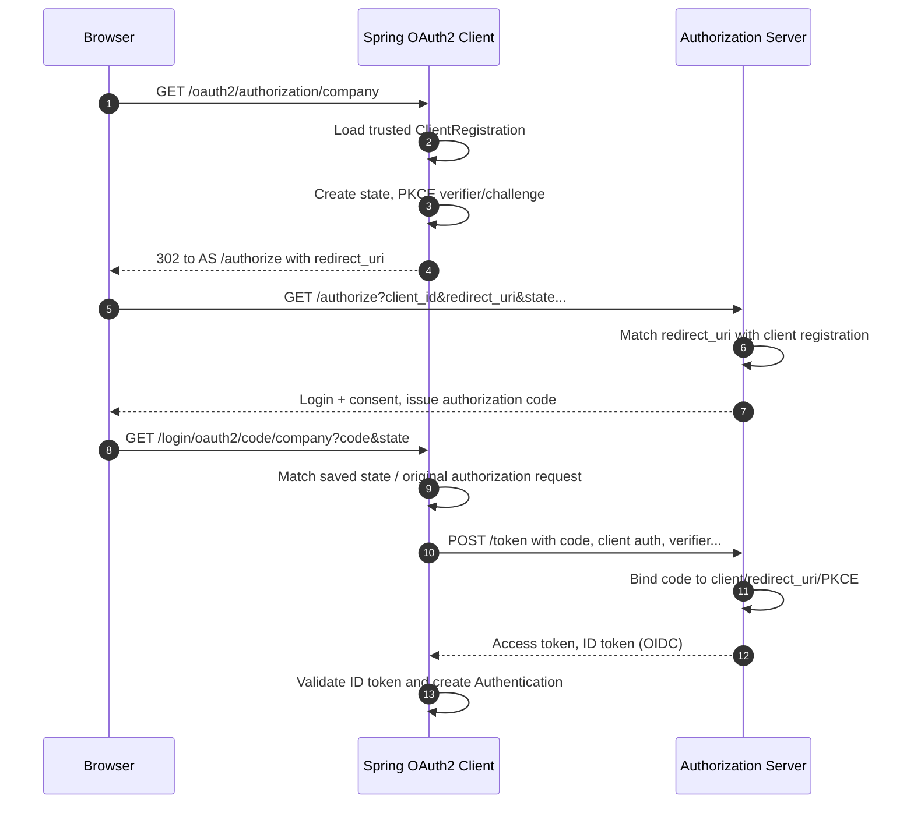
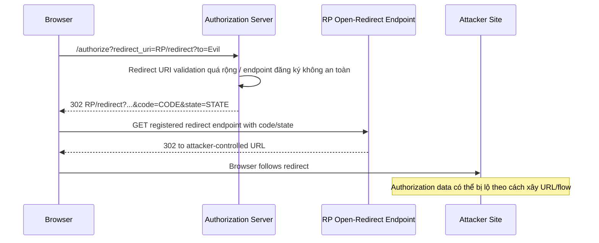
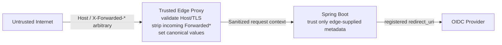
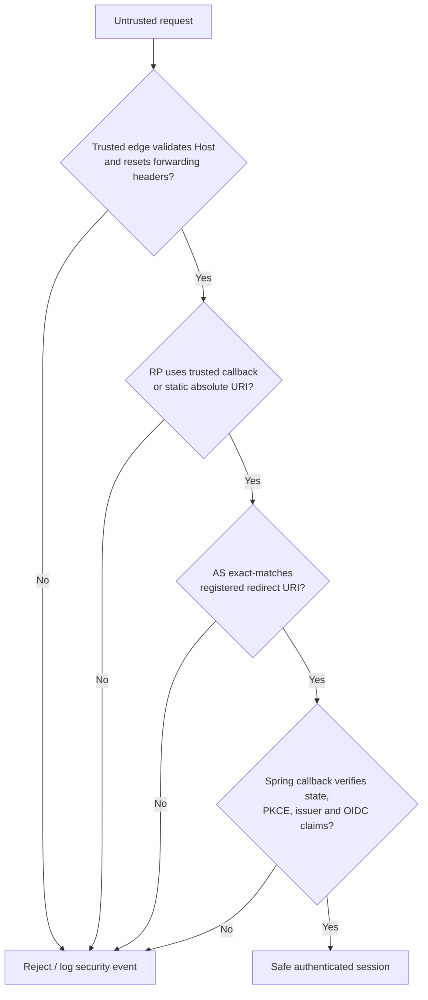

# 27.4. Redirect URI matching, open redirect và proxy header giả mạo

Trong **Spring Security OAuth 2.0/OIDC Client**, Authorization Code Flow thường bắt đầu bằng việc ứng dụng chuyển hướng trình duyệt tới Authorization Server (AS) hoặc OpenID Provider (OP), sau đó nhận lại authorization code qua một **redirect URI đã đăng ký**.

Ví dụ:

```text
https://portal.example.org/oauth2/authorization/company
    |
    v
https://login.example.org/authorize
    ?client_id=portal-web
    &redirect_uri=https%3A%2F%2Fportal.example.org%2Flogin%2Foauth2%2Fcode%2Fcompany
    &state=...
    |
    v
https://portal.example.org/login/oauth2/code/company
    ?code=...
    &state=...
```

Có ba nhóm rủi ro liên quan chặt chẽ nhưng khác nhau:

1. **Redirect URI matching sai**: AS chấp nhận callback không khớp đăng ký, hoặc client dùng callback sai origin/path, có thể làm authorization response được gửi tới địa điểm ngoài ý muốn.
2. **Open redirect**: một endpoint của RP hoặc AS cho phép kẻ tấn công điều khiển đích chuyển hướng; endpoint này có thể bị lợi dụng để đánh cắp authorization code/token trong một số cấu hình hoặc phục vụ phishing và login-flow confusion.
3. **Proxy header giả mạo**: ứng dụng đứng sau reverse proxy xây URL từ `Host`, `Forwarded` hoặc `X-Forwarded-*` không đáng tin; kẻ tấn công có thể khiến `{baseUrl}`, `redirect_uri` hoặc các URL tuyệt đối khác mang host/scheme do họ kiểm soát.

Ba vấn đề thường gặp cùng lúc vì Spring Security có khả năng xây callback bằng template:

```yaml
redirect-uri: "{baseUrl}/login/oauth2/code/{registrationId}"
```

`{baseUrl}` phụ thuộc góc nhìn của ứng dụng về URL public hiện tại. Nếu reverse proxy không được cấu hình nhất quán hoặc ứng dụng tin các forwarding headers từ bên không đáng tin, callback có thể bị **host poisoning**, sai `https/http` hoặc sai path prefix.

Bài học trình bày ranh giới tin cậy của redirect URI, cách Spring Security thực hiện OAuth2 Login, các mẫu cấu hình reverse proxy, cách chặn open redirect, các biến thể multi-tenant/custom domain, và quy trình xác minh bằng network traces mà không phải tắt `state`, PKCE hay OIDC validation.

---

## 1. Mục tiêu và nguyên tắc cốt lõi

Sau bài này, cần nắm được:

- Phân biệt **OAuth redirect URI**, URL bắt đầu authorization, URL sau login và OpenID Provider logout redirect.
- Hiểu vì sao AS phải đối chiếu redirect URI với danh sách đã đăng ký bằng quy tắc chặt chẽ.
- Hiểu cách callback được ràng buộc với `client_id`, `state`, PKCE và issuer.
- Nhận ra open redirect ở **endpoint callback** và ở **URL chuyển hướng sau đăng nhập**.
- Xác định lúc nào Spring mở rộng `{baseUrl}` từ request/proxy metadata.
- Không tin `Forwarded`, `X-Forwarded-Host`, `X-Forwarded-Proto` từ browser.
- Cấu hình reverse proxy, Spring Boot và `ClientRegistration` cùng một public origin đáng tin.
- Kiểm tra ứng dụng chạy sau ingress, nhiều load balancers hoặc có custom domains.
- Giữ đúng trust boundary khi muốn tùy chỉnh callback URL.

**Quy tắc thiết kế:** AS phát authorization response tới **callback đã đăng ký và phù hợp đúng client**; RP xây/nhận callback chỉ từ **cấu hình và request context đáng tin**; mọi redirect sau login phải được giới hạn tới **đích an toàn**.

## 2. Các loại redirect URL cần phân biệt

Một ứng dụng OIDC Login có nhiều URL mang chữ “redirect”:

| Loại URL | Ví dụ | Mục đích | Ai kiểm soát? |
|---|---|---|---|
| Authorization start URL | `/oauth2/authorization/company` | Bắt đầu authorization tại RP | Spring Security RP |
| Authorization Endpoint | `https://login.example.org/authorize` | OP xác thực/consent | OP/AS |
| **OAuth redirect URI** | `https://portal.example.org/login/oauth2/code/company` | Nhận authorization code/state | Đăng ký tại AS, xử lý bởi RP |
| Token Endpoint | `https://login.example.org/token` | Backend đổi code lấy token | OP/AS |
| Success/default target | `/app` | Trang RP hiển thị sau login | RP, có thể chịu input cần kiểm soát |
| Saved request target | `/orders/42` | Quay lại trang RP đã định vào trước login | RP/session, cần giới hạn |
| OP post-logout redirect | `https://portal.example.org/logged-out` | Quay về RP sau logout | RP/OP registration |
| Front-channel logout URI | `/oidc/front-channel-logout` | Nhận thông báo SLO qua iframe | RP/OP registration |

Hai URL rất dễ bị nhầm:

```text
/oauth2/authorization/company
/login/oauth2/code/company
```

URL thứ nhất **khởi đầu** flow; URL thứ hai là **callback**. Callback không phải nơi người dùng tự vào để bắt đầu đăng nhập.

### 2.1. Redirect URI không phải “returnTo”

`redirect_uri` trong OAuth authorization request là một tham số giao thức được kiểm tra bởi AS.

`returnTo=/dashboard` hoặc `next=/orders` là **đích ứng dụng** muốn đi tới sau khi đã hoàn thành callback. Nó không có quyền thay đổi nơi AS gửi authorization code.

Không dùng:

```text
redirect_uri = request.getParameter("returnTo")
```

Nếu request có `returnTo=https://attacker.example`, ứng dụng có thể biến một tham số UX thành callback security-critical.

## 3. Redirect URI matching tại Authorization Server

### 3.1. Đăng ký callback trước

Khi tạo OAuth client tại OP, nhà phát triển đăng ký một hoặc nhiều redirect URIs, ví dụ:

```text
https://portal.example.org/login/oauth2/code/company
https://staging.portal.example.org/login/oauth2/code/company
```

AS chỉ được chuyển authorization response đến callback đáp ứng quy tắc so khớp với tập đã đăng ký.

Đối với web OAuth clients hiện đại, thực hành bảo mật yêu cầu **exact redirect URI matching**; ngoại lệ được chuẩn hóa cho loopback IP redirect URIs của native apps có thể cho phép khác cổng theo RFC 8252. Không dùng ngoại lệ native-app đó để biện minh cho wildcard web callbacks.

### 3.2. Những điểm khác biệt không nên bị bỏ qua

Đăng ký:

```text
https://portal.example.org/login/oauth2/code/company
```

So sánh:

| Giá trị trong authorization request | Có thể coi như cùng URI không? | Lý do |
|---|---|---|
| Chính xác URL đã đăng ký | **Có** | Khớp registration |
| `http://portal.example.org/...` | **Không** | Scheme khác, hạ HTTPS |
| `https://portal.example.org.evil.test/...` | **Không** | Host khác |
| `https://evil.test/login/oauth2/code/company` | **Không** | Attacker-controlled host |
| `https://portal.example.org/login/oauth2/code/other` | **Không** | Path/registration khác |
| `https://portal.example.org/login/oauth2/code/company?next=...` | **Không**, trừ khi URI đầy đủ được đăng ký theo policy | Query thay đổi URI |
| `https://portal.example.org/login/oauth2/code/company/#x` | **Không phù hợp** | Fragment không phải phần callback authorization request hợp lệ |
| `https://portal.example.org/callback/../login/oauth2/code/company` | Không dựa vào path normalization tùy ý | Dễ khác biệt parser/proxy |
| `https://PORTAL.example.org/login/oauth2/code/company` | Không dựa vào case normalization để bỏ exact-match policy | Cần tuân thủ cách so khớp AS áp dụng |

Bảng đưa ra policy mong muốn cho web registrations. AS thực tế có thể chuẩn hóa URL theo quy tắc riêng; **đừng phụ thuộc vào các ngoại lệ lỏng lẻo** hoặc vào cách browser tự xử lý URL.

### 3.3. Vì sao wildcard nguy hiểm?

Một đăng ký như:

```text
https://*.example.org/*
```

có thể vô tình cho phép:

- Subdomain chưa được kiểm soát hoặc bị takeover.
- Ứng dụng phụ có open redirect.
- Callback nằm trên host tạm của môi trường thử nghiệm.
- Path dưới quyền một tenant khác.
- Những endpoints không có state/session correlation.

Nếu AS chấp nhận redirect URI do attacker kiểm soát, authorization code có thể đi sai nơi ngay từ bước redirect.

### 3.4. “Cùng domain” chưa đủ

`https://portal.example.org/login/oauth2/code/company` và `https://portal.example.org/redirect?next=...` nằm cùng domain nhưng khác mục đích. Nếu đăng ký URI thứ hai, một open redirect trên URI đó có thể biến thành điểm trung chuyển authorization response.

**Exact matching chỉ bảo đảm URI được gửi đúng địa chỉ đã đăng ký; nó không chứng minh endpoint được đăng ký không có open redirect.**

## 4. Tại sao Authorization Code Flow ràng buộc redirect URI?

Một flow điển hình:



Các chốt bảo vệ có trách nhiệm riêng:

- **Registered redirect URI:** AS không gửi code tới đích chưa cho phép.
- **`client_id` và client authentication:** AS biết client nào đang dùng grant.
- **`state`:** RP liên kết callback với authorization request đã khởi tạo, bảo vệ chống login CSRF/correlation mix-up.
- **PKCE:** code bị lấy cắp khó được đổi thành token nếu attacker không có verifier.
- **Issuer binding:** RP dùng đúng OP/AS của transaction, không tráo Token Endpoint.
- **OIDC ID Token validation:** kiểm tra issuer, signature, audience, expiration, nonce khi dùng.

### 4.1. Không dùng PKCE làm lý do nới redirect matching

PKCE là lớp bảo vệ quan trọng nhưng không giải quyết:

- Phishing qua open redirect.
- Rò rỉ authorization response metadata.
- Các flow/provider không hỗ trợ PKCE đúng.
- Token hoặc session confusion do sai issuer/registration.
- Open redirect sau login.
- Đối tượng nắm verifier do XSS/session compromise.

Không tuyên bố “có PKCE thì callback có thể là URL tùy ý”.

### 4.2. Token Endpoint cũng phải kiểm tra binding

Authorization code phải được AS ràng buộc với client và các tham số thích hợp. Nếu `redirect_uri` được dùng trong authorization request, token request phải tuân thủ yêu cầu tương ứng của OAuth và AS; AS cần xác minh không có code substitution.

Nếu RP tự thay redirect URI khi đổi code (ví dụ vì proxy host khác), Token Endpoint có thể trả:

```json
{
  "error": "invalid_grant"
}
```

Không sửa bằng cách bỏ redirect validation ở AS. Hãy sửa public URL/proxy configuration hoặc client registration.

## 5. Spring Security lấy redirect URI từ đâu?

Trong Spring Boot OAuth2 Client, một registration có thể khai báo:

```yaml
spring:
  security:
    oauth2:
      client:
        registration:
          company:
            provider: company
            client-id: ${OIDC_CLIENT_ID}
            client-secret: ${OIDC_CLIENT_SECRET}
            client-authentication-method: client_secret_basic
            authorization-grant-type: authorization_code
            redirect-uri: "{baseUrl}/login/oauth2/code/{registrationId}"
            scope:
              - openid
              - profile
              - email
        provider:
          company:
            issuer-uri: https://login.example.org
```

Ở đây:

- `company` là `registrationId`.
- `{registrationId}` được thay bằng `company`.
- `{baseUrl}` được mở rộng dựa trên URL public mà Spring nhìn thấy cho request.
- `/login/oauth2/code/{registrationId}` là callback mặc định được Spring Security xử lý.
- `issuer-uri` của provider quyết định OIDC discovery/trust, không quyết định application public host.

### 5.1. Ví dụ expansion bình thường

Browser truy cập:

```http
GET /oauth2/authorization/company HTTP/1.1
Host: portal.example.org
```

Khi ứng dụng nhận đúng request scheme/host/port/context path, callback có thể là:

```text
https://portal.example.org/login/oauth2/code/company
```

### 5.2. Sai khi thấy internal host

Sau proxy, app có thể thấy:

```text
http://app-service:8080
```

và tạo:

```text
http://app-service:8080/login/oauth2/code/company
```

OP có thể từ chối vì không đăng ký URI này hoặc browser không thể truy cập internal hostname.

### 5.3. Sai khi tin Host/Forwarded giả

Nếu kẻ tấn công ảnh hưởng request context:

```http
GET /oauth2/authorization/company HTTP/1.1
Host: attacker.example
X-Forwarded-Host: attacker.example
X-Forwarded-Proto: https
```

một cấu hình không có trust boundary đúng có thể sinh:

```text
https://attacker.example/login/oauth2/code/company
```

AS với exact matching đúng sẽ từ chối URI không đăng ký. Tuy nhiên, nếu AS có wildcard registration hoặc callback host được chấp nhận sai, hậu quả nghiêm trọng hơn. Ngoài ra, app còn có thể gặp **host-header poisoning** ở redirect links, emails và URL tuyệt đối khác.

## 6. Open redirect là gì?

**Open redirect** xảy ra khi một endpoint chuyển hướng browser đến một URL do caller kiểm soát mà không giới hạn hợp lý.

Ví dụ lỗi:

```java
@GetMapping("/go")
public String go(@RequestParam String next) {
    return "redirect:" + next;
}
```

Attacker gọi:

```text
https://portal.example.org/go?next=https://attacker.example
```

và nhận:

```http
HTTP/1.1 302 Found
Location: https://attacker.example
```

Endpoint này nằm trên domain tin cậy nhưng chuyển browser sang origin ngoài ý muốn.

### 6.1. Open redirect có thể gây hại thế nào?

- Phishing: người dùng thấy URL đầu tiên thuộc website uy tín.
- OAuth authorization code leakage khi endpoint nhận `code`/`state` rồi chuyển tiếp.
- Rò rỉ thông tin qua URL/query/referrer trong một số flows.
- Bỏ qua host allowlists dựa trên redirect chains.
- Session/login flow confusion.
- Lợi dụng URL allowlist của integrations hoặc email links.

Không phải mọi open redirect đều lập tức đánh cắp access token, nhưng **không nên đánh giá rủi ro chỉ qua việc có PKCE hay không**.

## 7. Open redirect tại một registered redirect URI

Giả sử OP đăng ký:

```text
https://portal.example.org/redirect
```

và RP có endpoint:

```java
@GetMapping("/redirect")
public String unsafeRedirect(
        @RequestParam(name = "to") String destination) {
    return "redirect:" + destination;
}
```

Kẻ tấn công tìm cách tạo authorization request có callback:

```text
https://portal.example.org/redirect?to=https://attacker.example
```

Nếu AS chấp nhận query tùy ý thay vì exact matching, hoặc đã đăng ký chính URL cho phép một tham số redirect nguy hiểm, authorization response có thể bị chuyển tiếp ngoài RP.

### 7.1. Ví dụ đường đi nguy hiểm



Không phải redirect tự động **luôn** chuyển query `code` tới attacker: điều đó phụ thuộc handler, cách ghép URL và browser behavior. Nhưng kết hợp **một redirect URI rộng hoặc một callback endpoint có redirect tùy ý** tạo bề mặt tấn công không cần thiết.

### 7.2. Hướng phòng vệ

- Đăng ký **callback chuyên biệt**, không dùng một open redirect endpoint.
- Exact-match redirect URI tại AS.
- Callback do Spring Security OAuth2 filter xử lý, không phải controller generic.
- Không chuyển tiếp `code`, `state`, ID Token hoặc token response vào `returnTo`.
- Nếu cần điều hướng sau login, chỉ làm **sau khi** callback được xác minh và token exchange thành công.
- Redirect sau login chỉ đến internal paths/allowlisted origins.

## 8. Open redirect sau khi đăng nhập thành công

Một mẫu nguy hiểm khác xuất hiện trong ứng dụng:

```java
@GetMapping("/login/success")
public String success(
        @RequestParam(name = "next", required = false) String next) {
    return "redirect:" + (next == null ? "/app" : next);
}
```

Giả sử người dùng hoàn tất OIDC Login và bị dẫn đến:

```text
/login/success?next=https://attacker.example/fake-portal
```

Dù authorization code đã được Spring xử lý, user vẫn có thể bị chuyển sang trang phishing. Tùy thiết kế, referral/navigation còn có thể làm lộ token đặt sai trong query.

### 8.1. Không lấy URL của caller làm OAuth redirect URI

```text
?next=/reports
```

chỉ nên là business return target và phải được validate/allowlist.

```text
?redirect_uri=https://attacker.example
```

không được dùng để ghi đè `ClientRegistration.redirectUri` từ bên ngoài.

### 8.2. Danh sách những đích nhìn “có vẻ relative” nhưng nguy hiểm

| Input | Nguy cơ |
|---|---|
| `https://attacker.example` | Absolute external URL |
| `//attacker.example/path` | Scheme-relative redirect, browser dùng scheme hiện hành |
| `\\attacker.example\path` | Một số browser/parser chuẩn hóa backslash theo URL authority |
| `/%2f%2fattacker.example` | Encoded slash/double decoding nếu xử lý không nhất quán |
| `/redirect?to=https://attacker.example` | Internal path nhưng chain tới external redirect |
| `https://portal.example.org@attacker.example` | Userinfo trick: host thực là attacker |
| `https://portal.example.org.attacker.example` | Suffix confusion |
| `https://portal.example.org.evil.test` | Host không phải portal.example.org |
| `/%0d%0aLocation:%20...` | Có thể khai thác header injection nếu framework/stack không chặn |

Không xây validation bằng:

```java
next.startsWith("/")
```

vì chuỗi `//evil.example` cũng bắt đầu bằng slash.

### 8.3. Cách đơn giản nhất: route key allowlist

Không nhận URL tùy ý. Chỉ nhận **tên đích** do backend định nghĩa:

```java
import java.util.Map;

public final class LoginDestinationPolicy {

    private static final Map<String, String> DESTINATIONS = Map.of(
        "home", "/app",
        "orders", "/orders",
        "reports", "/reports",
        "profile", "/profile"
    );

    public String resolve(String key) {
        return DESTINATIONS.getOrDefault(key, "/app");
    }
}
```

Input:

```text
?destination=reports
```

Kết quả:

```text
/reports
```

Browser không thể tự đổi target thành external origin chỉ bằng một chuỗi URL khác. Đây thường là hướng dễ audit hơn việc cố hỗ trợ mọi relative URL.

### 8.4. Khi cần return path động

Có thể chỉ cho phép một tập route nội bộ, ví dụ `/orders/{id}`, rồi validate **ID/path segment** riêng và xây path bằng route builder an toàn. Không lấy nguyên raw URL đưa vào `Location`.

Nếu bắt buộc cho arbitrary relative paths:

- Parse bằng một URL/URI parser phù hợp.
- Từ chối scheme, authority, control characters, backslash, fragment không mong muốn.
- Cấm `//` ở đầu.
- Chuẩn hóa/so sánh sau mọi lần decode theo đúng framework.
- Không cho path đi qua endpoint open redirect đã biết.
- Kiểm tra route-level authorization sau authentication.
- Áp dụng tests cho encoded/double-encoded variants.

Ngay cả vậy, một **destination key allowlist** thường đơn giản hơn và an toàn hơn.

## 9. Spring Security login success handling

Spring Security thường sử dụng saved-request logic để đưa người dùng về URL họ định vào trước login.

Một cấu hình đơn giản, ít bề mặt open redirect:

```java
import org.springframework.context.annotation.Bean;
import org.springframework.context.annotation.Configuration;
import org.springframework.security.config.annotation.web.builders.HttpSecurity;
import org.springframework.security.config.Customizer;
import org.springframework.security.web.SecurityFilterChain;

@Configuration
public class SecurityConfig {

    @Bean
    SecurityFilterChain webSecurity(HttpSecurity http) throws Exception {
        http
            .authorizeHttpRequests(auth -> auth
                .requestMatchers("/", "/error", "/assets/**").permitAll()
                .anyRequest().authenticated())
            .oauth2Login(oauth2 -> oauth2
                .defaultSuccessUrl("/app", true));

        return http.build();
    }
}
```

`true` khiến default success URL được ưu tiên thay vì saved request trong kiểu handler tương ứng. Đây là lựa chọn UX; ứng dụng có thể muốn dùng saved requests nhưng cần kiểm tra nơi URL được tạo và trusted host policy.

### 9.1. SavedRequest không xóa mọi rủi ro Host poisoning

Ngay cả khi app không có `next` param, một saved request có thể phản ánh request context. Nếu reverse proxy cho phép Host giả hoặc forwarded host giả, absolute URL được lưu/redirect có thể sai.

Cần giới hạn host ở **edge và application request context**, không chỉ thay custom success handler.

### 9.2. Tránh targetUrlParameter tùy ý

Một số success handler cho phép khai báo `targetUrlParameter` để client request quyết định đích. Nếu dùng, phải áp dụng allowlist và xử lý an toàn theo security requirements.

Không thiết lập một parameter tùy ý như:

```text
targetUrl=https://attacker.example
```

rồi cho handler redirect trực tiếp.

### 9.3. Không echo authorization code trong Location

Sau callback:

```text
/login/oauth2/code/company?code=abc&state=xyz
```

success handler không nên sao chép raw callback query vào URL đích. Authorization code và `state` là dữ liệu của transaction, không phải ứng dụng redirect metadata.

## 10. Spring Security OAuth2 Login: đúng start và callback endpoints

Cấu hình chuẩn:

```yaml
spring:
  security:
    oauth2:
      client:
        registration:
          company:
            provider: company
            client-id: ${OIDC_CLIENT_ID}
            client-secret: ${OIDC_CLIENT_SECRET}
            authorization-grant-type: authorization_code
            redirect-uri: "{baseUrl}/login/oauth2/code/{registrationId}"
            scope: openid,profile,email
        provider:
          company:
            issuer-uri: https://login.example.org
```

Browser bắt đầu:

```text
GET /oauth2/authorization/company
```

Callback:

```text
GET /login/oauth2/code/company?code=...&state=...
```

### 10.1. Tùy chỉnh callback path đúng hai phía

Nếu muốn:

```text
https://portal.example.org/auth/callback/company
```

phải cập nhật cả registration và Spring Security redirection endpoint:

```yaml
spring:
  security:
    oauth2:
      client:
        registration:
          company:
            redirect-uri: "{baseUrl}/auth/callback/{registrationId}"
```

```java
http.oauth2Login(oauth2 -> oauth2
    .redirectionEndpoint(redirection ->
        redirection.baseUri("/auth/callback/*")));
```

Và đăng ký URI đúng tại OP. Đây là snippet **phần thay đổi trong DSL**, chưa phải toàn bộ `SecurityFilterChain`.

Nếu chỉ đổi `redirect-uri` mà không đổi authentication filter matcher tương ứng, callback có thể không được Spring xử lý.

### 10.2. Không dùng controller custom để thay callback security filter

Một controller:

```java
@GetMapping("/auth/callback/company")
public String callback(@RequestParam String code) {
    // tự đổi code lấy token...
}
```

có thể bỏ qua các cơ chế state/PKCE/nonce/issuer validation. Nếu không có yêu cầu đặc biệt và hiểu đầy đủ framework extension points, hãy để Spring Security xử lý callback.

### 10.3. Multiple SecurityFilterChain

Nếu có API chain đứng trước web login chain, cần đảm bảo callback URL nằm trong **đúng chain có oauth2Login**. Một matcher chuyên biệt `/api/**` không nên chiếm `/login/oauth2/code/**`.

Không sửa routing bằng cách permit-all callback rồi bỏ filter xử lý authorization response.

## 11. Reverse proxy thay đổi góc nhìn URL như thế nào?

Ví dụ triển khai:

```text
Browser
   |
   | https://portal.example.org
   v
Load Balancer / Ingress (TLS termination)
   |
   | http://spring-app:8080
   v
Spring Boot MVC app
```

Từ browser, URL công khai là HTTPS trên `portal.example.org`. Nhưng kết nối nội bộ ứng dụng nhận được có thể là HTTP và host `spring-app:8080`.

Nếu không xử lý đúng reverse proxy:

```text
Spring sees:
  scheme=http
  host=spring-app
  port=8080

Correct external view:
  scheme=https
  host=portal.example.org
  port=443
```

Từ đó, `{baseUrl}` và redirect URI có thể sai.

### 11.1. Các forwarding headers thường gặp

```http
Forwarded: for=192.0.2.20;proto=https;host=portal.example.org
```

hoặc de facto headers:

```http
X-Forwarded-Proto: https
X-Forwarded-Host: portal.example.org
X-Forwarded-Port: 443
X-Forwarded-Prefix: /portal
```

Ý nghĩa:

| Header | Ý nghĩa thường dùng | Rủi ro khi không đáng tin |
|---|---|---|
| `Forwarded` | Chuẩn RFC 7239, chứa host/proto/for | Fake public host/scheme/client address |
| `X-Forwarded-Host` | Public host client đã truy cập | Host poisoning, giả callback |
| `X-Forwarded-Proto` | Public scheme `http/https` | Downgrade hoặc URL sai |
| `X-Forwarded-Port` | Public port | Redirect URI khác do port sai |
| `X-Forwarded-Prefix` | Path prefix do proxy rewrite | Callback path sai, bypass path/routing assumptions |
| `X-Forwarded-For` | Client IP chain | IP spoofing/rate limit bypass khi tin sai |

**Header là dữ liệu do HTTP caller có thể gửi** nếu không có proxy boundary loại bỏ/ghi đè. Chỉ cần tồn tại `X-Forwarded-Host` không có nghĩa nó do load balancer đáng tin tạo.

## 12. Proxy header spoofing: một ví dụ cụ thể

Giả sử ứng dụng có cấu hình mở forwarded headers cho tất cả request origins và ingress chuyển tiếp nguyên header browser gửi.

Attacker gửi:

```http
GET /oauth2/authorization/company HTTP/1.1
Host: portal.example.org
X-Forwarded-Host: attacker.example
X-Forwarded-Proto: https
```

Nếu Spring tin `X-Forwarded-Host` trong request context, nó có thể sinh:

```text
redirect_uri=https://attacker.example/login/oauth2/code/company
```

### 12.1. Bảo vệ đầu tiên: AS exact matching

Nếu OP chỉ đăng ký:

```text
https://portal.example.org/login/oauth2/code/company
```

thì authorization request dùng attacker host phải bị từ chối. Điều này có thể biểu hiện ở phía người dùng như lỗi `redirect_uri_mismatch` hoặc `invalid_request`.

Nhưng đó là **lớp phòng thủ tại AS**, không phải lý do để RP tiếp tục tin proxy headers giả. Các redirects, password-reset links, logout links, canonical URLs khác vẫn có thể bị poisoned.

### 12.2. Nguy hiểm hơn khi OP cho phép wildcard

Nếu AS dùng:

```text
https://*.example.org/*
```

và attacker có subdomain phù hợp, hoặc callback được đăng ký trên một endpoint/host mở redirect, AS có thể cho phép response đi sai nơi.

### 12.3. Không phải mọi forged-header request đều khai thác được

Khả năng ảnh hưởng phụ thuộc:

- Proxy có ghi đè inbound forwarding headers không?
- Spring Boot đã bật strategy nào?
- Ứng dụng có static absolute callback hay template `{baseUrl}`?
- AS có exact-match redirect URI không?
- Có host validation ở edge/app không?
- Proxy path rewriting và client registration như thế nào?

Cần mô tả exploit theo **cấu hình cụ thể**, không khẳng định một header giả luôn làm lộ code.

## 13. Ranh giới tin cậy tại reverse proxy

Thiết kế an toàn phổ biến:



### 13.1. Edge phải chặn host ngoài allowlist

Ví dụ chỉ cho:

```text
portal.example.org
```

Không chấp nhận mọi `Host` rồi để backend tự quyết định. Ở hệ thống nhiều domains, allowlist phải tương ứng domain đã được onboard/verified.

### 13.2. Edge phải loại bỏ hoặc ghi đè forwarding headers inbound

Nếu browser gửi:

```text
X-Forwarded-Host: attacker.example
```

proxy không nên giữ nguyên rồi thêm một giá trị mới theo kiểu app vô tình đọc phần attacker-controlled trước.

Phải xác định rõ **một chuỗi proxy tin cậy** và quy tắc reset/append headers. Các proxies đầu chuỗi cần loại bỏ header do untrusted client tự đặt; những proxies phía sau chỉ tin upstream đã được quản lý.

### 13.3. Backend không được public trực tiếp ngoài proxy

Nếu Spring Boot được thiết kế tin `X-Forwarded-Host` từ trusted edge nhưng port nội bộ `8080` lại được mở ra internet, attacker có thể gọi thẳng backend và gửi forged forwarding headers.

Network policy/firewall cần chỉ cho edge hoặc trusted network access backend.

### 13.4. Forwarded metadata chỉ phục vụ routing, không tạo authorization

Ngay cả khi `Host=alpha.example` đã được proxy xác minh, người dùng vẫn phải được OIDC xác thực và domain policy kiểm tra tenant membership.

Host không phải bearer proof, không thay access control.

## 14. Cấu hình Nginx minh họa cho một public origin

Giả định Nginx là trusted TLS termination point cho:

```text
https://portal.example.org
```

Và backend tại:

```text
http://spring-app:8080
```

Một cấu hình khái niệm:

```nginx
# Default vhost: reject unknown hosts.
server {
    listen 443 ssl default_server;
    server_name _;
    # TLS certificate configuration omitted.
    return 421;
}

server {
    listen 443 ssl;
    server_name portal.example.org;

    # TLS certificate/key and security configuration omitted.

    location / {
        proxy_pass http://spring-app:8080;

        # Fixed public origin for this vhost:
        proxy_set_header Host portal.example.org;
        proxy_set_header X-Forwarded-Host portal.example.org;
        proxy_set_header X-Forwarded-Proto https;
        proxy_set_header X-Forwarded-Port 443;

        # Do not pass an untrusted RFC 7239 value through.
        proxy_set_header Forwarded "";

        # Only set a prefix if proxy actually rewrites it.
        proxy_set_header X-Forwarded-Prefix "";
    }
}
```

**Đây là mẫu minh họa**, không phải cấu hình Nginx production đầy đủ: TLS, HTTP→HTTPS redirect, upstream timeouts, WebSocket, real client IP chain, port 80, SNI/default vhost và network isolation còn phải được xử lý riêng.

### 14.1. Vì sao dùng host literal?

Trong một vhost public cố định, `portal.example.org` là canonical host đáng tin. Ngược lại, cấu hình:

```nginx
proxy_set_header X-Forwarded-Host $http_x_forwarded_host;
```

có thể chuyển nguyên một header do browser giả mạo đến backend.

Kể cả `$host` lấy từ request `Host`, nếu không giới hạn virtual hosts/host allowlist thì nó chưa chắc an toàn để làm OAuth callback.

### 14.2. Nhiều custom domains

Nếu tenant dùng domains riêng, không thể hard-code một host duy nhất. Nhưng điều đó không có nghĩa cho phép mọi host.

Cần:

1. Xác minh domain ownership trong tenant onboarding.
2. Tạo/vận hành TLS certificate cho domain.
3. Ánh xạ domain tới tenant/registration server-side.
4. Chỉ nhận domains nằm trong registry active.
5. Đưa canonical public origin đã xác minh vào OAuth redirect design.
6. Khai báo exact redirect URI tương ứng tại OP.
7. Đồng bộ routing giữa tất cả replicas.

## 15. Spring Boot forwarded headers strategy

Trong Spring Boot, một thuộc tính cấu hình thường dùng:

```yaml
server:
  forward-headers-strategy: framework
```

Những lựa chọn phổ biến:

| Giá trị | Ý nghĩa tổng quát | Điều kiện cần lưu ý |
|---|---|---|
| `none` | Không áp dụng forwarded headers theo strategy này | App có thể thấy internal scheme/host |
| `native` | Để HTTP server/container xử lý forwarding headers | Cần cấu hình trusted proxies/behavior tương ứng |
| `framework` | Dùng hỗ trợ của framework như `ForwardedHeaderFilter` ở Servlet | **Không tự xác thực header origin** |

Sự hỗ trợ và mặc định theo platform/Spring Boot version có thể thay đổi; kiểm tra đúng runtime và deployment.

### 15.1. framework không có nghĩa “chỉ tin proxy uy tín”

Khi bật:

```yaml
server:
  forward-headers-strategy: framework
```

Spring có thể dùng `Forwarded` hoặc `X-Forwarded-*` để tái tạo public URL. Nhưng **framework không tự biết request nào đến từ trusted edge** nếu hạ tầng không thiết lập ranh giới này.

Do đó:

- Proxy phải sanitize forwarding metadata.
- Backend không được expose tới untrusted callers.
- Host allowlist phải được enforcement.
- Không có hai proxies tự đưa ra host/proto khác nhau mà app đọc nhầm thứ tự.

### 15.2. native cần cấu hình server cụ thể

Với embedded Tomcat/Jetty/Undertow hoặc Reactor Netty, behavior native khác nhau. Khi dùng strategy `native`, phải biết container có xử lý forwarded protocol/host/port bằng những headers nào và các trust-proxy patterns liên quan.

Không copy một property của Tomcat sang Netty và kỳ vọng cùng hành vi.

### 15.3. Khi không muốn tin forwarding headers

Nếu app có một public origin cố định và sử dụng **absolute redirect URI**, có thể không cần dùng proxy metadata để xây OAuth callback.

Tuy nhiên, những URLs khác do app sinh vẫn có thể cần public origin đúng. Phải chọn một chiến lược nhất quán chứ không trộn giữa static callback và dynamic links không kiểm soát.

## 16. ForwardedHeaderFilter và removeOnly

Spring Framework cung cấp `ForwardedHeaderFilter` cho Servlet, giúp xử lý forwarded headers trong những request wrappers khi trust boundary đã phù hợp.

Trong một số tình huống, muốn loại bỏ headers thay vì sử dụng chúng:

```java
import org.springframework.web.filter.ForwardedHeaderFilter;

ForwardedHeaderFilter filter = new ForwardedHeaderFilter();
filter.setRemoveOnly(true);
```

`removeOnly` nhằm **loại bỏ những forwarded headers** khỏi request context mà không áp dụng giá trị của chúng để thay public URL.

### 16.1. Khi nào removeOnly hữu ích?

- App không dùng proxy-derived public URL.
- Backend có một base URL được cấu hình rõ.
- Muốn tránh application components tình cờ dùng untrusted forwarded metadata.
- Chưa có trusted proxy chain hợp lệ.

### 16.2. Không bật hai chiến lược mâu thuẫn

Nếu Boot đã tự cấu hình forwarded header processing mà bạn lại thêm filter thủ công với semantics khác, kết quả phụ thuộc thứ tự filters. Cần chọn một strategy duy nhất hoặc cấu hình thứ tự được kiểm soát.

### 16.3. removeOnly không thay Host validation

`Host` là header HTTP cơ bản, không phải `X-Forwarded-Host`. Loại bỏ forwarding headers **không tự chặn request dùng Host giả**. Phải enforce host allowlist ở proxy hoặc app.

## 17. Static absolute redirect URI: chiến lược đơn giản khi có một domain

Với app production dùng đúng một public origin:

```yaml
spring:
  security:
    oauth2:
      client:
        registration:
          company:
            redirect-uri: "https://portal.example.org/login/oauth2/code/company"
```

Lợi ích:

- Redirect URI không phụ thuộc trực tiếp vào Host/Forwarded headers của request.
- Trùng với URI được đăng ký tại OP.
- Dễ so sánh khi reverse proxy TLS termination.
- Dễ audit thay đổi và hạn chế host poisoning tại điểm dựng OAuth callback.

### 17.1. Trade-off

- Khác nhau giữa staging/prod cần cấu hình riêng.
- Multi-tenant custom domains cần mapping theo registration.
- Nếu ứng dụng chạy dưới context path khác, URI phải khớp routing thực.
- Các links khác của ứng dụng vẫn có thể bị Host poisoning.

### 17.2. Dùng environment variable cho public origin

Ví dụ:

```yaml
app:
  public-base-url: "https://portal.example.org"

spring:
  security:
    oauth2:
      client:
        registration:
          company:
            redirect-uri: "https://portal.example.org/login/oauth2/code/company"
```

`app.public-base-url` là property do ứng dụng tự định nghĩa. Hai giá trị có thể được quản lý từ cùng một deployment configuration source bằng cơ chế binding/placeholders phù hợp; quan trọng là phải là **trusted server config**, không phải từ request query.

### 17.3. Không để user chọn absolute callback

Đừng cho:

```text
?callback=https://somewhere.example
```

ghi đè `ClientRegistration.redirectUri`. Nếu app cần nhiều callback domains, hãy tạo registrations và routing policy được phê duyệt trước.

## 18. Dynamic public origin cho custom domains và multi-tenant

Một số SaaS phục vụ:

```text
https://alpha.login.example.org
https://beta.login.example.org
https://sso.customer-domain.example
```

Nếu cùng một `ClientRegistration` cần callback thay đổi theo origin, phải xem lại khả năng đăng ký multiple exact redirect URIs tại OP và cách Spring chọn URI.

### 18.1. Kiến trúc ưu tiên: registration theo trusted origin khi cần

```text
Tenant alpha:
  registrationId=alpha-oidc
  publicOrigin=https://alpha.login.example.org
  redirectUri=https://alpha.login.example.org/login/oauth2/code/alpha-oidc

Tenant beta:
  registrationId=beta-oidc
  publicOrigin=https://beta.login.example.org
  redirectUri=https://beta.login.example.org/login/oauth2/code/beta-oidc
```

Public origin được lấy từ tenant/registration registry đã duyệt, không từ raw `Host`/`X-Forwarded-Host`.

### 18.2. Tập allowed origins

Một registry có thể lưu:

```text
registrationId: alpha-oidc
issuer: https://id.alpha.example
allowedCallbackOrigin:
  https://alpha.login.example.org
registeredRedirectUri:
  https://alpha.login.example.org/login/oauth2/code/alpha-oidc
status: ACTIVE
```

Khi user đi vào bằng custom domain, edge map domain đến tenant, RP chọn registration đã được allowlist và callback đã đăng ký.

### 18.3. Không nối chuỗi từ raw hostname

Sai:

```java
String redirect = "https://" + request.getHeader("Host")
    + "/login/oauth2/code/" + registrationId;
```

Đúng về nguyên tắc:

```java
String redirect = trustedTenantRegistry
    .getRegisteredRedirectUri(registrationId);
```

`trustedTenantRegistry` là abstraction ứng dụng minh họa, không phải Spring Security class có sẵn. Giá trị từ registry phải được validated và chỉ admin/trusted onboarding flow thay đổi.

### 18.4. Callback domain tập trung

Một số SaaS chọn:

```text
https://auth.saas.example/login/oauth2/code/{registrationId}
```

cho mọi tenants, rồi sau login quay về tenant domain theo một **validated return target**.

Cách này giảm số redirect origins cần đăng ký tại OP, nhưng yêu cầu quản lý:

- Cross-domain session/cookie strategy.
- State/tenant intent correlation.
- Safe final redirect allowlist.
- Không đưa token trong query.
- Trust boundary giữa auth domain và app domains.
- SameSite/browser constraints.
- Multi-tab và logout behavior.

Không coi callback domain tập trung là lý do cho phép final redirect bất kỳ.

## 19. Redirect URI và path prefix của reverse proxy

Một deployment có thể public URL:

```text
https://portal.example.org/app
```

nhưng proxy chuyển:

```text
/app/* -> backend /*
```

Nếu Spring nhìn thấy:

```text
contextPath = ""
```

nhưng public path thực tế có `/app`, callback có thể thiếu prefix.

### 19.1. Ví dụ

Public callback mong muốn:

```text
https://portal.example.org/app/login/oauth2/code/company
```

Backend nhận:

```text
http://spring-app:8080/login/oauth2/code/company
```

Một reverse proxy có thể gửi:

```http
X-Forwarded-Proto: https
X-Forwarded-Host: portal.example.org
X-Forwarded-Prefix: /app
```

Nếu Spring sử dụng header đáng tin đúng cách, `{baseUrl}` có thể phản ánh prefix. Nhưng behavior phụ thuộc proxy rewrite pattern, framework version và app context path.

### 19.2. Hai lỗi phổ biến

**Thiếu prefix:**

```text
https://portal.example.org/login/oauth2/code/company
```

**Prefix bị nhân đôi:**

```text
https://portal.example.org/app/app/login/oauth2/code/company
```

Cả hai có thể gây redirect_uri mismatch hoặc callback 404.

### 19.3. Không sửa bằng wildcard redirect URI

Đăng ký:

```text
https://portal.example.org/*
```

chỉ che dấu cấu hình sai và tăng nguy cơ security. Hãy xác định rõ một public callback và đồng bộ proxy, context path, registration và OP.

## 20. Host validation ở ứng dụng

Tốt nhất edge chặn host lạ. Khi muốn thêm lớp bảo vệ tại RP, app có thể dùng host allowlist.

### 20.1. Nguyên tắc validation

- So sánh host với **tập tên đã đăng ký**, không dùng suffix lỏng.
- Kiểm tra scheme và port theo deployment.
- Xử lý internationalized domains/IDNA với một canonical format.
- Không để dấu chấm cuối, chữ hoa/thường hoặc Unicode variants tạo bypass do parser inconsistencies.
- Kiểm tra cả forwarded host và raw Host theo trust strategy đã chọn.
- Không dùng regex wildcard quá rộng.

Ví dụ cho một deployment cố định:

```text
allowed public origin = https://portal.example.org
```

Một host attacker:

```text
portal.example.org.attacker.example
```

không hợp lệ chỉ vì chứa substring `portal.example.org`.

### 20.2. Ví dụ Servlet filter minh họa

```java
import jakarta.servlet.FilterChain;
import jakarta.servlet.ServletException;
import jakarta.servlet.http.HttpServletRequest;
import jakarta.servlet.http.HttpServletResponse;

import java.io.IOException;
import java.util.Set;

import org.springframework.web.filter.OncePerRequestFilter;

public final class AllowedHostFilter extends OncePerRequestFilter {

    private static final Set<String> ALLOWED_HOSTS =
        Set.of("portal.example.org");

    @Override
    protected void doFilterInternal(
            HttpServletRequest request,
            HttpServletResponse response,
            FilterChain chain)
            throws ServletException, IOException {

        String host = request.getServerName();

        if (!ALLOWED_HOSTS.contains(host)) {
            response.sendError(421, "Unexpected Host");
            return;
        }

        chain.doFilter(request, response);
    }
}
```

Đây là **minh họa policy**, không phải một filter security production hoàn chỉnh:

- `request.getServerName()` có thể đã được thay đổi bởi forwarding filter tùy thứ tự.
- Nếu filter chạy **trước** khi forwarded headers được áp dụng, nó nhìn raw internal host.
- Nếu filter chạy **sau** nhưng forwarding headers không đáng tin, nó có thể nhìn forged host.
- Cần kiểm tra scheme/port, canonicalization và trusted proxy routing.
- Cần đăng ký filter ở vị trí thích hợp trong filter chain.
- Với nhiều custom domains, allowlist phải dựa trusted registry.
- HTTP 421 là ví dụ phản hồi cho misdirected requests; proxy/app policy có thể chọn status khác.

**Không chỉ thêm filter này rồi coi proxy spoofing đã được xử lý.** Trust boundary ở edge vẫn là điểm chính.

### 20.3. Host và SNI

TLS SNI giúp edge chọn certificate/vhost; HTTP `Host` vẫn là một giá trị riêng. Một caller có thể thử gửi SNI/Host không nhất quán. Edge cần định nghĩa hành vi cho những trường hợp này thay vì tự động route tới default tenant.

## 21. Phân biệt Forwarded, X-Forwarded và Host header

### 21.1. Forwarded RFC 7239

```http
Forwarded: for=192.0.2.20;proto=https;host=portal.example.org
```

Một proxy chain có thể tạo nhiều phần tử:

```http
Forwarded: for=192.0.2.20;proto=https;host=portal.example.org,
           for=10.1.1.4;proto=http;host=internal.example
```

Nếu attacker được phép inject phần tử đầu, app cần biết proxy nào thêm phần tử nào và rule trust. Không chọn một phần tử tùy tiện rồi coi đó là canonical public host.

### 21.2. X-Forwarded-Host

```http
X-Forwarded-Host: portal.example.org
```

Chỉ nên dùng nếu proxy tin cậy đã ghi đè incoming value. Nếu ứng dụng chấp nhận forwarded host từ mọi request, một custom-header injection có thể thay absolute URLs.

### 21.3. X-Forwarded-Proto

```http
X-Forwarded-Proto: https
```

Nếu proxy TLS termination đúng, giá trị này giúp app biết public scheme là HTTPS. Nhưng attacker có thể giả thành `http` hoặc `https` nếu không sanitize, ảnh hưởng security redirects và cookie metadata.

### 21.4. X-Forwarded-Prefix

Header này đặc biệt rủi ro trong app dùng path-based tenancy nếu untrusted input có thể thay prefix.

Không dùng:

```text
X-Forwarded-Prefix: /other-tenant
```

làm căn cứ cho tenant authorization hoặc để bypass route checks. Path rewrite nên được thực thi/định nghĩa tại trusted proxy.

### 21.5. X-Forwarded-For

Ngoài redirect URI, IP chain có thể ảnh hưởng login rate limiting, anomaly detection và audit. Nếu đọc IP attacker-controlled sai thứ tự, policy chống brute force có thể bị bypass. Nhưng IP không thay identity proof; tránh dùng IP làm căn cứ duy nhất cho tenant hoặc user authorization.

## 22. Các trường hợp response/redirect phải cẩn thận

### 22.1. Location header chứa host giả

```http
HTTP/1.1 302 Found
Location: https://attacker.example/login
```

Nếu do poisoned Host/Forwarded tạo, user có thể bị dẫn ra ngoài mà không có query `next` nào trong request.

### 22.2. Email links

Các hệ thống đôi khi dùng `request.getRequestURL()` để tạo invitation/password reset links. Nếu host giả lọt vào email, URL reset có thể trỏ domain ngoài. OAuth callback là ví dụ dễ thấy nhưng **Host poisoning có phạm vi rộng hơn**.

### 22.3. Absolute vs relative redirects

Một relative redirect:

```http
Location: /app
```

thường giảm nhu cầu lấy host từ request cho điều hướng trong cùng origin.

Nhưng một số OAuth/OP integrations đòi callback absolute URI. Khi phải tạo absolute URL, ưu tiên trusted canonical origin, không ghép từ raw Host.

### 22.4. 301/302/303/307/308

Authorization Code browser redirects thường dùng 302 hoặc 303 tùy endpoint và protocol behavior. Không tự thay callback processing bằng redirect chain phức tạp. Đặc biệt cẩn thận 307/308 khi chuyển hướng từ endpoint nhận POST credentials vì browser có thể gửi lại request body sang đích mới.

## 23. OIDC issuer binding và redirect URI là hai lớp khác nhau

Ví dụ:

```text
Issuer:
  https://login.example.org

Client ID:
  portal-web

Callback:
  https://portal.example.org/login/oauth2/code/company
```

ID Token sau login:

```json
{
  "iss": "https://login.example.org",
  "sub": "user-725",
  "aud": "portal-web",
  "exp": 1794803600,
  "iat": 1794800000
}
```

RP phải kiểm tra ID Token theo OIDC Core và registration.

### 23.1. AS issuer không phải callback host

`login.example.org` là OP. `portal.example.org` là RP. Việc hai host khác nhau là bình thường.

Không cần ép `redirect_uri` cùng host với issuer; nó phải thuộc **RP origin đã đăng ký**.

### 23.2. Redirect URI đúng vẫn chưa đủ để xác thực ID Token

Ngay cả khi authorization code đến đúng callback, RP vẫn phải kiểm tra:

- ID Token signature.
- `iss` đúng provider.
- `aud` bao gồm client ID đúng.
- `azp` khi áp dụng.
- `exp`, `iat` và thời gian.
- `nonce` nếu đã dùng.
- UserInfo `sub` khớp ID Token `sub` khi sử dụng.

Không dùng callback URL như bằng chứng thay thế các kiểm tra token.

### 23.3. Mix-up attacks trong multi-issuer clients

Khi RP cấu hình nhiều OPs, một authorization response bị gắn nhầm registration có thể khiến code gửi đến sai token endpoint hoặc login với issuer không đúng.

State binding, callback/registration mapping, issuer identification (nếu AS hỗ trợ RFC 9207) và ID Token validation là các lớp bảo vệ bổ sung.

**Không dùng `iss` query tùy ý từ callback để chọn một issuer chưa được đăng ký**.

## 24. CSRF, state và callback session

`state` được Spring Security tạo/kiểm tra để liên kết authorization response với request đã khởi tạo.

### 24.1. State không phải return URL

Sai:

```text
state=https://attacker.example
```

hoặc:

```text
state=/orders?user=...
```

nếu dùng làm giá trị correlation không đủ ngẫu nhiên. `state` không nên chứa dữ liệu bí mật hoặc raw redirect target do browser định nghĩa.

### 24.2. Session/cookie mất trên callback

Khi browser quay từ OP về RP, session có thể không khôi phục được nếu:

- Cookie settings không tương thích redirect flow.
- Public hostname thay đổi.
- Callback http/https mismatch.
- Reverse proxy path prefix sai.
- RP dùng distributed sessions nhưng callback đến node không thấy state.
- User mở flow quá lâu, session/state đã hết hạn.

Lỗi state không đồng nghĩa phải tắt state validation.

### 24.3. SameSite

Browser cookie behavior phụ thuộc `SameSite`, HTTP method callback và cross-site navigation. Với Authorization Code Flow dùng top-level GET callback, `SameSite=Lax` thường có thể phù hợp hơn so với một cross-site POST callback, nhưng cần test đúng provider/response mode.

Không áp dụng `SameSite=None` cho mọi cookies chỉ để chữa một callback host bị cấu hình sai.

### 24.4. Nhiều tab login

Nếu nhiều authorization requests cùng tồn tại, return target và registration phải được ràng buộc theo đúng `state`/authorization request. Không dùng một session field `currentRedirectUri` bị tab khác ghi đè.

## 25. Multi-tenant và custom domains: redirect URI nào là đúng?

Giả sử SaaS có:

```text
alpha.portal.example.org
beta.portal.example.org
```

và mỗi tenant có issuer riêng.

Một mô hình:

```text
tenant alpha
  registrationId=alpha-oidc
  issuer=https://id.alpha.example
  redirectUri=https://alpha.portal.example.org/login/oauth2/code/alpha-oidc

tenant beta
  registrationId=beta-oidc
  issuer=https://id.beta.example
  redirectUri=https://beta.portal.example.org/login/oauth2/code/beta-oidc
```

### 25.1. Không lấy hostname request làm bằng chứng tenant

Một user có thể gửi raw HTTP:

```http
Host: alpha.portal.example.org
```

Không vì header đó mà user được quyền vào alpha. Edge có thể route, nhưng sau OIDC authentication app vẫn cần local tenant membership authorization.

### 25.2. Không cho wildcard để giảm việc onboard redirect URIs

Thay vì:

```text
https://*.portal.example.org/*
```

cần đăng ký exact URIs cho các tenant/client đã được phê duyệt. Nếu số lượng lớn, có thể cân nhắc một callback domain tập trung với trusted tenant state correlation.

### 25.3. Domain ownership và redirect URI lifecycle

Khi tenant xóa/custom domain chuyển chủ:

- Gỡ domain khỏi allowlist.
- Gỡ redirect URI khỏi OP registration theo quy trình.
- Revoke/rotate client credentials nếu cần.
- Invalidate pending authorization requests liên quan.
- Dọn/stabilize authorized client sessions theo policy.
- Chặn domain takeover khiến callback/links gửi tới domain bên thứ ba.

Không coi DNS hiện thời luôn thuộc cùng một khách hàng mãi mãi.

## 26. Tùy chỉnh OAuth2AuthorizationRequestResolver

Spring Security cung cấp `OAuth2AuthorizationRequestResolver` và implementation như `DefaultOAuth2AuthorizationRequestResolver` để tạo authorization request.

Khi cần thêm tenant hint, `prompt`, `login_hint` hoặc provider-specific parameters, có thể tùy chỉnh resolver theo extension point phù hợp.

### 26.1. Giữ nguyên redirect URI do trusted registration quyết định

Không làm:

```java
String redirectUri = request.getParameter("redirect_uri");
builder.redirectUri(redirectUri);
```

với request parameter do browser điều khiển.

### 26.2. Ví dụ extension point concept

```java
import org.springframework.security.oauth2.client.registration.ClientRegistrationRepository;
import org.springframework.security.oauth2.client.web.DefaultOAuth2AuthorizationRequestResolver;

public final class ResolverFactory {

    public DefaultOAuth2AuthorizationRequestResolver create(
            ClientRegistrationRepository registrations) {

        var resolver = new DefaultOAuth2AuthorizationRequestResolver(
            registrations, "/oauth2/authorization");

        resolver.setAuthorizationRequestCustomizer(builder -> {
            // Chỉ thêm parameters đã được server policy cho phép.
            // KHÔNG lấy raw request parameter để ghi đè redirectUri.
        });

        return resolver;
    }
}
```

Đoạn ví dụ minh họa cách tạo/cấu hình resolver, chưa tự gắn bean resolver vào `oauth2Login().authorizationEndpoint(...)` và chưa bổ sung parameters nào. Khi tích hợp thật, cần giữ behavior mặc định về state/PKCE/nonce và đảm bảo callback matcher đúng.

### 26.3. Tenant intent cần ràng buộc bằng state

Nếu registration được chọn theo tenant, có thể lưu tenant intent server-side cùng authorization request. Khi callback, kiểm tra tenant hiện hành/allowed registration/membership thay vì lấy `tenant` mới từ query.

### 26.4. Không dùng redirect_uri làm trường tùy biến chung

Nếu cần quay về `/orders` sau login, dùng saved request hoặc một validated server-side return target. Đừng repurpose OAuth `redirect_uri` vì nó là **registered callback**, không phải UI navigation target.

## 27. Ví dụ Spring Security cấu hình an toàn sau trusted reverse proxy

Giả sử:

- Public URL cố định: `https://portal.example.org`.
- Trusted TLS edge thực hiện Host allowlist, strip/set forwarded headers.
- Backend không public.
- AS đã đăng ký exact callback.
- Client secret từ environment/secret manager.

```yaml
server:
  forward-headers-strategy: framework

spring:
  security:
    oauth2:
      client:
        registration:
          company:
            provider: company
            client-id: ${OIDC_CLIENT_ID}
            client-secret: ${OIDC_CLIENT_SECRET}
            client-authentication-method: client_secret_basic
            authorization-grant-type: authorization_code
            redirect-uri: "https://portal.example.org/login/oauth2/code/company"
            scope:
              - openid
              - profile
              - email
        provider:
          company:
            issuer-uri: https://login.example.org
```

Java:

```java
@Configuration
public class OidcSecurityConfig {

    @Bean
    SecurityFilterChain webSecurity(HttpSecurity http) throws Exception {
        http
            .authorizeHttpRequests(auth -> auth
                .requestMatchers("/", "/error", "/assets/**").permitAll()
                .anyRequest().authenticated())
            .oauth2Login(oauth2 -> oauth2
                .defaultSuccessUrl("/app", true));

        return http.build();
    }
}
```

Các imports cho `@Configuration`, `@Bean`, `HttpSecurity` và `SecurityFilterChain` là những loại đã minh họa ở phần trước.

### 27.1. Vì sao vừa static redirect URI vừa xử lý forwarded headers?

Static redirect URI bảo vệ **một URL OAuth callback** khỏi việc phụ thuộc vào Host. Nhưng app còn có thể tạo links và cookie semantics dựa trên public scheme/host.

Vì vậy bật forwarded strategy **chỉ khi** proxy trust boundary đã được thiết lập. Không có yêu cầu bắt buộc phải bật strategy chỉ vì đã có static redirect URI.

### 27.2. Kịch bản tương đương không bật forwarded headers

Một app có thể đặt:

```yaml
server:
  forward-headers-strategy: none
```

và cấu hình tất cả public absolute URLs từ trusted deployment properties. Điều này giảm phụ thuộc forwarded headers nhưng cần đảm bảo routing, redirects, cookies và frameworks không còn chỗ nào vô tình dựa trên internal URL.

### 27.3. Production không copy demo secrets

Không commit:

```yaml
client-secret: my-production-secret
```

vào source. Host/redirect protections không thay secrets management và TLS.

## 28. Khi proxy header spoofing xuất hiện cùng open redirect

Một chuỗi rủi ro có thể là:

```text
1. Attacker kiểm soát X-Forwarded-Host trong request.
2. RP tin header và tạo absolute URL đến attacker host.
3. RP redirect user sang URL đó, hoặc đưa URL vào thông tin login.
4. AS có wildcard/sai matching nên có thể chấp nhận callback.
5. Authorization response bị chuyển tới đích ngoài ý muốn.
```

Nhưng không phải hệ thống nào cũng có đủ 5 điều kiện. Có hai mô hình phòng thủ quan trọng:

### 28.1. Layered defenses



Trong thực tế, không nhất thiết mỗi request qua tất cả bước ngay trong một HTTP exchange, nhưng các lớp này cần tồn tại trên toàn flow.

### 28.2. Không phụ thuộc một chốt duy nhất

Nếu OP exact-match tốt, RP vẫn phải sửa Host spoofing.

Nếu RP dùng static redirect URI tốt, OP vẫn phải exact-match.

Nếu có PKCE tốt, RP vẫn phải chặn open redirect.

Nếu đã sanitize forwarded headers, final success URL vẫn phải được allowlist.

**Defense in depth** là yêu cầu thiết kế, không phải sự thay thế cho chính sách từng lớp.

## 29. HTTP Host poisoning ngoài OAuth2 Login

Bài học tập trung callback, nhưng cùng lỗi có thể ảnh hưởng:

- Password reset links.
- Email verification links.
- Invitation URLs.
- OIDC RP-Initiated Logout `post_logout_redirect_uri`.
- Canonical `Location` headers.
- API pagination links.
- WebSocket endpoint URLs.
- Tenant discovery links.
- CORS allowlists được xây từ request host.
- Cookie domain calculations nếu application customizes cookies.

Không nên viết một utility `buildAbsoluteUrl(request)` dùng raw `Host` cho mọi chức năng mà không có canonical origin policy.

### 29.1. Password reset

Nếu app tạo:

```text
https://attacker.example/reset?token=...
```

từ Host giả trong request, email người dùng có thể dẫn tới domain attacker, gây rò rỉ reset token.

### 29.2. Logout redirects

Một `post_logout_redirect_uri` sai origin có thể làm user bị chuyển sang trang ngoài sau logout hoặc OP từ chối vì unregistered redirect. Áp dụng cùng quy tắc trusted origin/exact registration như callback, nhưng hiểu đây là **tham số logout khác OAuth redirect_uri**.

### 29.3. CORS không sửa redirect URI mismatch

Mở:

```http
Access-Control-Allow-Origin: *
```

không giải quyết redirect URI matching của AS. OAuth2 browser authorization redirect không phải một CORS XHR request thông thường. Không tắt CORS/CSRF để “cho OP redirect về”.

## 30. Troubleshooting: redirect_uri_mismatch

Triệu chứng:

```text
invalid_request: redirect_uri_mismatch
```

hoặc màn hình lỗi provider báo callback URI không khớp.

### 30.1. So sánh ba giá trị

1. URI **đã đăng ký tại OP**.
2. `redirect_uri` **thực sự nằm trong authorization request** mà browser được redirect tới.
3. URI **RP thực sự xử lý callback** sau khi proxy rewrite.

Ví dụ:

```text
Registered:
  https://portal.example.org/login/oauth2/code/company

Sent:
  http://spring-app:8080/login/oauth2/code/company

Public callback:
  https://portal.example.org/login/oauth2/code/company
```

Vấn đề nằm ở URL expansion/proxy configuration.

### 30.2. Kiểm tra từng thành phần

- Scheme `http` vs `https`.
- Host công khai vs internal host.
- Port `443`/`8443`/`8080`.
- Trailing slash.
- Path prefix `/app`.
- `registrationId`.
- Case/path characters.
- Query parameters.
- Percent encoding differences.
- Registered environment staging/prod.
- Reverse proxy multi-hop.
- Container context path.
- OP admin console client ID/registration mismatch.

### 30.3. Không đăng ký wildcard để chữa nhanh

Một giải pháp tạm nguy hiểm là mở rộng callback allowlist tới mọi subdomain/path. Cách đúng là sửa public origin hoặc chọn exact redirects tương ứng các môi trường.

## 31. Troubleshooting: callback không vào Spring Security

Triệu chứng:

- GET callback trả 404.
- Callback về login page và loop.
- State/authorization request không tìm thấy.
- Token exchange không được thực hiện.
- API chain trả 401 JSON cho OAuth callback.

Cần kiểm tra:

1. `redirect-uri` trong ClientRegistration khớp OP registration.
2. Spring `oauth2Login().redirectionEndpoint().baseUri(...)` matcher khớp path.
3. Reverse proxy rewrite path/prefix đúng.
4. Security filter chain chứa OAuth2 Login filter cho callback.
5. Browser gửi session cookie/state correlation phù hợp.
6. Shared session store hoặc sticky routing theo architecture.
7. Callback không bị controller tự viết chiếm mất.
8. `state` còn hạn và đúng request ban đầu.

### 31.1. Redirect loop

Nếu page `/login` tự bị bảo vệ và redirect về `/login`, có thể tạo vòng lặp. Cho phép đúng các public pages/login start endpoints theo config, không disable authorization toàn web app.

### 31.2. Session lost không phải redirect URI exploit

Một request từ OP về đúng callback nhưng mất session/state thường là cookie/proxy/session store issue. Không “sửa” bằng cách bỏ `state` verification.

## 32. Troubleshooting: Host/Forwarded spoofing

Triệu chứng:

- `Location` chứa attacker host hoặc internal hostname.
- Email links trỏ host lạ.
- OAuth authorization URL có `redirect_uri` sai host.
- Một số requests đúng, một số sai tùy load balancer.
- Chỉ phát sinh sau thêm proxy mới.
- Browser thấy redirect từ HTTPS sang HTTP.

### 32.1. Hỏi những câu đúng

- Backend có được truy cập trực tiếp không?
- Proxy đầu tiên từ internet đã strip inbound forwarding headers chưa?
- Có bao nhiêu proxy hops?
- Proxy nào tạo `Forwarded`, proxy nào tạo `X-Forwarded-*`?
- Có dùng `server.forward-headers-strategy` nào?
- Spring thấy `request.getScheme()`, `getServerName()` và `getServerPort()` là gì **sau trusted processing**?
- Host allowlist có được enforce trước khi request đến app không?
- Callback static hay template `{baseUrl}`?
- Có custom code tự dùng raw `Host` hay `X-Forwarded-Host` không?

### 32.2. Không log raw credentials để debug

Khi tracing browser login, có thể thấy `code`/`state` trên callback URL. Không xuất raw callback query, access token, refresh token, client secret hay ID Token vào shared logs.

Có thể log:

```text
event=oauth2_authorization_redirect_created
registrationId=company
publicOrigin=portal.example.org
redirectUriMatchedConfig=true
proxyConfigVersion=7
correlationId=<non-secret-id>
```

Không log:

```text
authorization_code=...
access_token=...
refresh_token=...
id_token=...
client_secret=...
```

## 33. Bảng kịch bản security cần kiểm thử

| Kịch bản | Kỳ vọng an toàn |
|---|---|
| URI chính xác đã đăng ký | AS cho phép tiếp tục flow |
| URI dùng attacker host | AS từ chối |
| URI wildcard-like subdomain | AS từ chối nếu chưa đăng ký exact |
| URI có thêm query `next=...` | Không cho thay đổi callback ngoài registration |
| Authorization response sai `state` | RP từ chối |
| Authorization code gửi callback của registration khác | RP/AS từ chối theo binding |
| ID Token sai issuer | RP từ chối |
| ID Token sai audience | RP từ chối |
| PKCE verifier sai | AS từ chối token exchange |
| `Host: attacker.example` | Edge/app từ chối hoặc không dùng tạo public redirects |
| `X-Forwarded-Host: attacker.example` | Proxy sanitize/overwrite; RP không dùng forged host |
| `Forwarded: proto=http;host=attacker.example` | Proxy sanitize/overwrite |
| `X-Forwarded-Prefix: /evil` | Không điều khiển callback path nếu không được trusted |
| Browser tới unknown custom domain | Edge từ chối |
| `next=https://attacker.example` | App chặn/fallback internal |
| `next=//attacker.example` | App chặn |
| Encoded/double-encoded redirect payloads | Không bypass allowlist |
| Known internal route key | Redirect tới internal path đã xác định |
| Login qua reverse proxy TLS | Public callback vẫn HTTPS/đúng host |
| 2 proxy hops và duplicate forwarded headers | Chỉ trusted canonical values có tác dụng |
| App backend port truy cập trực tiếp | Bị firewall/network policy chặn |
| OP redirect URI mismatch | Có lỗi rõ, không nới OP allowlist |
| Callback sau khi session/state hết hạn | Từ chối an toàn, không bỏ correlation |
| Tenant custom domain chuyển chủ | Callback/registration được disable/migrate |
| Multi-tab OIDC logins | State và return target không bị trộn |
| Post-login redirect tới internal route | Không lộ `code`/tokens ra query |
| Staging và production registrations | Callback đúng từng môi trường |

## 34. Minh họa các yêu cầu kiểm thử thủ công có kiểm soát

Các request dưới đây dùng một môi trường bạn sở hữu hoặc được phép kiểm thử. Mục đích là xác minh **cơ chế phòng vệ**, không phải tấn công bên thứ ba.

### 34.1. Kiểm tra Host ở edge

```bash
curl -i \
  -H 'Host: attacker.invalid' \
  https://portal.example.org/oauth2/authorization/company
```

Một trusted edge nên từ chối unknown Host hoặc không bao giờ khiến application tạo redirect dựa trên host `attacker.invalid`.

Lưu ý: TLS SNI và HTTP Host có thể khác nhau; kết quả phụ thuộc frontend TLS/vhost routing. Test trong môi trường kiểm soát.

### 34.2. Kiểm tra forwarded host

```bash
curl -i \
  -H 'X-Forwarded-Host: attacker.invalid' \
  -H 'X-Forwarded-Proto: http' \
  https://portal.example.org/oauth2/authorization/company
```

Kiểm tra response `Location` đến OP và giá trị `redirect_uri` bên trong sau URL decoding. Nó phải vẫn là callback đã đăng ký:

```text
https://portal.example.org/login/oauth2/code/company
```

Không được là:

```text
http://attacker.invalid/login/oauth2/code/company
```

### 34.3. Kiểm tra Forwarded RFC 7239

```bash
curl -i \
  -H 'Forwarded: for=192.0.2.1;proto=http;host=attacker.invalid' \
  https://portal.example.org/oauth2/authorization/company
```

Nếu edge chuẩn hóa đúng, thông tin forged trong request không thay canonical callback.

### 34.4. Kiểm tra open redirect return target

```bash
curl -i \
  'https://portal.example.org/login/success?next=https%3A%2F%2Fattacker.invalid'
```

Nếu endpoint này thực sự tồn tại, phản hồi không được chuyển browser tới attacker. Trong một ứng dụng dùng destination-key allowlist, invalid target được đưa về `/app` hoặc trả lỗi.

### 34.5. Test không đồng nghĩa khai thác đã thành công

Một request `curl` trả 302 chưa đủ kết luận. Cần xem `Location`, cách OP xử lý registered callbacks, browser semantics, proxy path rewriting và tính toàn vẹn OAuth transaction.

Không tắt `state`, PKCE hoặc client authentication chỉ để chạy thử một response không đúng contract.

## 35. Cấu hình theo môi trường: dev, staging và prod

Một setup phổ biến:

| Môi trường | Public origin | Callback |
|---|---|---|
| Local | `http://localhost:8080` | `http://localhost:8080/login/oauth2/code/company` |
| Staging | `https://staging.portal.example.org` | `https://staging.portal.example.org/login/oauth2/code/company` |
| Production | `https://portal.example.org` | `https://portal.example.org/login/oauth2/code/company` |

### 35.1. Không trộn dev/prod redirect origins tùy tiện

Lý tưởng dùng **OAuth clients riêng** cho staging/prod để giảm blast radius:

```text
portal-staging-client
portal-production-client
```

Nếu cùng một client có cả localhost và production callbacks, cần chấp nhận rủi ro configuration và kiểm soát rõ ai có thể dùng client credentials/redirects.

### 35.2. Localhost không phải lý do bật wildcard production

Một số native apps có ngoại lệ cho loopback redirect URIs. Spring Boot web confidential client local demo dùng `localhost` là một môi trường khác; không áp dụng biến thể này vào public production callback registration.

### 35.3. Ngăn staging nhận production tokens

Không chỉ kiểm tra hostname; client ID/secret, issuer, scopes, resource audiences và authorized client store nên được phân tách theo môi trường nếu security model yêu cầu.

## 36. Proxy header spoofing và OIDC logout

Nếu RP hỗ trợ RP-Initiated Logout, Spring có thể tạo `post_logout_redirect_uri` từ cấu hình:

```text
https://portal.example.org/logged-out
```

Host poisoning có thể tạo:

```text
https://attacker.example/logged-out
```

OP nên chỉ chấp nhận registered post-logout redirect URIs, và RP vẫn phải xây từ trusted public origin.

### 36.1. Logout callback không thay OAuth callback

`post_logout_redirect_uri` là URL sau OP logout; `redirect_uri` là callback nhận authorization code. Hai loại URI có registration/validation rules riêng.

### 36.2. Không phản hồi logout bằng open redirect

Một endpoint `/logout/success?next=...` cũng cần destination allowlist. Không vì user vừa logout mà được chuyển đến bất kỳ host.

## 37. Một số giả định nguy hiểm

### 37.1. “OP sẽ chặn hết, RP không cần xử lý.”

AS exact redirect matching là quan trọng, nhưng RP vẫn phải chặn open redirect và Host poisoning cho links/navigation khác.

### 37.2. “SameSite hoặc PKCE làm open redirect vô hại.”

Cả hai không giải quyết phishing hoặc mọi dạng URL leakage/confusion.

### 37.3. “X-Forwarded-Host luôn do load balancer tạo.”

Browser tự gửi HTTP header này được nếu edge không strip. Phải thiết lập trusted proxy chain.

### 37.4. “Đặt server.forward-headers-strategy=framework là đủ.”

Framework xử lý semantics header, không tự đảm bảo giá trị là trusted.

### 37.5. “Chỉ cần kiểm tra next.startsWith('/') là safe.”

`//attacker.example` và một số encoded/backslash variants có thể bypass naive logic.

### 37.6. “Cứ cho phép *.example.org là cùng công ty.”

Subdomains có thể thuộc ứng dụng/tenant/nhà cung cấp khác, bị takeover hoặc có open redirect.

### 37.7. “Host và issuer phải giống nhau.”

OP và RP thường là hai domains khác nhau. Cần kiểm tra đúng từng vai trò.

### 37.8. “RegistrationId bằng clientId.”

Registration ID là local Spring key; OAuth client ID là danh tính client tại AS. Không dùng chúng thay nhau trong callback/audience validation.

### 37.9. “Đổi redirect-uri YAML là đủ.”

Callback matcher của Spring Security và registered URI tại OP cũng phải khớp.

### 37.10. “HttpSession có state nên host giả không quan trọng.”

Host giả có thể làm authorization request bị từ chối, dẫn sai links hoặc góp phần tạo exploit chain, kể cả khi state tốt.

### 37.11. “401/403 trên callback thì nới security matcher toàn bộ.”

Trước hết kiểm tra filter chain, state/session, proxy path và registration; không permit-all mọi routes để sửa một callback issue.

### 37.12. “CORS cho phép redirect từ OP.”

OIDC browser redirect không cần wildcard CORS. Mở CORS không chữa callback mismatch.

## 38. Checklist triển khai production

1. **AS có exact-match redirect URI không?** Không wildcard callback web.
2. **Mỗi client có redirect URI cụ thể chưa?** Đúng scheme, host, port và path.
3. **Có phân biệt OAuth callback với returnTo/success URL không?**
4. **Spring callback matcher khớp redirect-uri configuration chưa?**
5. **Authorization Code Flow có state + PKCE và OIDC validation thích hợp không?**
6. **Issuer, audience và token endpoint được chọn từ trusted registration chứ không từ input không?**
7. **Proxy đầu tiên có chặn unknown Host/SNI mismatch chưa?**
8. **Inbound Forwarded/X-Forwarded headers đã bị strip/overwrite chưa?**
9. **Backend có bị truy cập trực tiếp từ internet không?**
10. **Boot forward-headers-strategy có khớp proxy/container runtime không?**
11. **`{baseUrl}` có tạo đúng public scheme/host/path prefix không?**
12. **Một deployment fixed-origin có nên dùng absolute callback không?**
13. **Custom domains có được verified/onboarded và exact-registered không?**
14. **Success handler có allowlist đích chuyển hướng không?**
15. **Có chặn `//`, backslash, encoded URL trick và redirect chaining không?**
16. **Có giữ code/state/tokens ra khỏi final redirect URLs và logs không?**
17. **Multi-tab/tenant login có ràng buộc state với đúng registration/return target không?**
18. **Session cookie có khớp HTTPS/custom-domain/OP callback method không?**
19. **Chạy nhiều nodes có shared authorization request state/config consistency không?**
20. **Proxy path prefix có được test cho missing/double prefix không?**
21. **Staging/prod credentials, callbacks và stores đã tách đúng chưa?**
22. **Post-logout redirect có canonical origin và OP registration đúng không?**
23. **Có kiểm thử các forged header variations trong môi trường kiểm soát không?**
24. **Có observability cho redirect mismatch, state mismatch và invalid host không?**
25. **Có đánh giá host poisoning cả với email/reset/invitation links không?**

## 39. Kết luận

**Redirect URI matching, open redirect và proxy header spoofing** cùng tác động đến nơi browser và các authorization responses được chuyển hướng, nhưng xuất hiện ở những lớp khác nhau.

- **Authorization Server** chịu trách nhiệm chỉ chấp nhận **registered redirect URIs đúng client** và ràng buộc authorization code với yêu cầu.
- **Spring Security OAuth2 Client** chịu trách nhiệm khởi tạo/khôi phục authorization transaction, xác minh `state`, PKCE, issuer, ID Token và xử lý callback đúng filter chain.
- **Reverse proxy/ingress** chịu trách nhiệm xác định public origin đáng tin, giới hạn `Host` và không chuyển tiếp headers do attacker tự đặt như metadata có thẩm quyền.
- **Ứng dụng RP** chịu trách nhiệm giới hạn mọi redirect sau login, tránh phishing/URL leakage và phân biệt final return target với protocol `redirect_uri`.

Với một public domain cố định, **static absolute redirect URI** là phương án dễ audit. Với nhiều tenants/custom domains, dùng **trusted registry và exact registered callbacks**, không lấy raw Host/Forwarded/issuer URL từ browser rồi tự xây URI tùy ý.

Khi gặp `redirect_uri_mismatch` hoặc callback lỗi, sửa **config và trust boundary**, không bỏ state/PKCE, không mở wildcard ở OP, không tắt OIDC validation và không coi forwarding headers là đáng tin chỉ vì chúng có tên “Forwarded”.

## 40. Tài liệu tham khảo

- [RFC 6749 — OAuth 2.0 Authorization Framework](https://www.rfc-editor.org/rfc/rfc6749): redirect URI registration, authorization request và token endpoint binding.
- [RFC 9700 — Best Current Practice for OAuth 2.0 Security](https://www.rfc-editor.org/rfc/rfc9700): exact redirect URI matching, mix-up và open redirect risks.
- [RFC 7636 — Proof Key for Code Exchange](https://www.rfc-editor.org/rfc/rfc7636): PKCE bảo vệ authorization code.
- [RFC 8252 — OAuth 2.0 for Native Apps](https://www.rfc-editor.org/rfc/rfc8252): loopback redirect URI và ngoại lệ cổng cho native clients.
- [RFC 9207 — OAuth 2.0 Authorization Server Issuer Identification](https://www.rfc-editor.org/rfc/rfc9207): giảm nguy cơ authorization server mix-up.
- [RFC 7239 — Forwarded HTTP Extension](https://www.rfc-editor.org/rfc/rfc7239): định dạng và semantics của `Forwarded` header.
- [OpenID Connect Core 1.0](https://openid.net/specs/openid-connect-core-1_0.html): OIDC ID Token issuer/audience/nonce validation.
- [Spring Security — OAuth 2.0 Login](https://docs.spring.io/spring-security/reference/servlet/oauth2/login/index.html): authorization endpoint, redirection endpoint và login flow.
- [Spring Security — OAuth 2.0 Client](https://docs.spring.io/spring-security/reference/servlet/oauth2/client/index.html): `ClientRegistration.redirectUri` và authorized clients.
- [Spring Security — OAuth 2.0 Login (Reactive)](https://docs.spring.io/spring-security/reference/reactive/oauth2/login/index.html): callback trên WebFlux.
- [Spring Framework — Forwarded Headers](https://docs.spring.io/spring-framework/reference/web/webmvc/filters.html): `ForwardedHeaderFilter` và request wrappers.
- [Spring Boot — Embedded Web Servers / Proxy Settings](https://docs.spring.io/spring-boot/reference/web/servlet.html): forwarded headers strategy và reverse proxy deployment.
- [OWASP — Unvalidated Redirects and Forwards Cheat Sheet](https://cheatsheetseries.owasp.org/cheatsheets/Unvalidated_Redirects_and_Forwards_Cheat_Sheet.html): nhận diện và ngăn open redirects.
- [OWASP — HTTP Headers / Host Header Injection](https://owasp.org/www-project-web-security-testing-guide/): kiểm thử Host header và các security boundaries.
