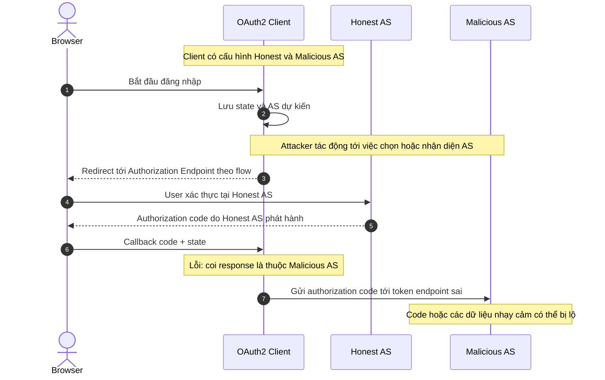
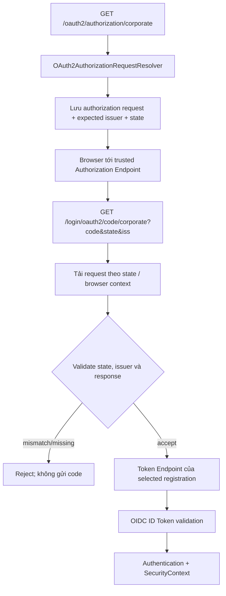

# 27.5. Authorization server mix-up và kiểm soát issuer

## 1. Vì sao một OAuth2 Client hỗ trợ nhiều nhà cung cấp đăng nhập cần bảo vệ bổ sung?

Một ứng dụng Spring Security OAuth 2.0/OIDC Client có thể cho người dùng đăng nhập qua nhiều **Authorization Servers (AS)** hoặc **OpenID Providers (OP)**:

```text
Workspace Portal
    ├── Corporate SSO: https://id.corporate.example/realms/staff
    ├── Partner SSO:   https://login.partner.example/oidc
    └── Customer SSO:  https://auth.customer.example/tenant-42
```

Ở luồng Authorization Code, browser được chuyển đến Authorization Endpoint của AS, sau đó mang **authorization code** và **state** quay lại **redirect URI** của ứng dụng. OAuth2 Client phải biết **AS nào thật sự phát hành authorization response** để chỉ gửi code và client credentials đến **Token Endpoint của cùng AS đó**.

Khi có từ hai AS trở lên, một lỗi liên kết giữa **request ban đầu**, **AS dự kiến**, **callback nhận được** và **Token Endpoint** có thể dẫn đến **Authorization Server Mix-Up Attack**. Trong tình huống này, một AS độc hại hoặc một cấu hình không đáng tin có thể khiến client nhầm AS phát hành response, từ đó đưa authorization code hoặc credential về sai endpoint.

Đây là vấn đề **bảo mật tích hợp** chứ không chỉ là lỗi đường dẫn login. Nó xuất hiện ở hệ thống nhiều provider, multi-tenant SaaS, kết nối IdP đối tác và các cơ chế dynamic provider onboarding.

**Nguyên tắc cốt lõi:**

> Trước khi đổi authorization code lấy token, OAuth2 Client phải biết chắc authorization response thuộc **đúng issuer** đã được chọn ở thời điểm khởi tạo request. Không chọn Token Endpoint chỉ từ một tham số callback chưa được tin cậy.

[RFC 9700, mục 4.4](https://www.rfc-editor.org/rfc/rfc9700#section-4.4) yêu cầu client tương tác với nhiều AS **phải có** biện pháp chống mix-up. Giải pháp được ưu tiên là **issuer identification** qua `iss` trong authorization response theo [RFC 9207](https://www.rfc-editor.org/rfc/rfc9207). Nếu không áp dụng được giải pháp issuer từ response, có thể dùng **distinct redirect URIs**, kèm validation, với những giới hạn được chuẩn nêu rõ.

### 1.1. Kết quả học tập

Sau bài học, bạn có thể:

1. Mô tả AS mix-up và ranh giới tin cậy bị nhầm.
2. Phân biệt **`registrationId`**, **`clientId`**, **authorization endpoint**, **token endpoint** và **issuer**.
3. Giải thích vì sao `state`, PKCE và việc xác minh ID Token sau code exchange **không tự thay thế** mix-up defense.
4. Hiểu tham số **authorization response `iss`** của RFC 9207.
5. Kiểm tra `iss` bằng so sánh chuỗi đơn giản với issuer dự kiến, và từ chối missing/mismatch theo chính sách provider.
6. Hiểu giới hạn của distinct redirect URI fallback và của JARM.
7. Thiết kế `ClientRegistration`/provider metadata tin cậy trong Spring Boot Servlet và WebFlux.
8. Gắn expected issuer với từng authorization request, không đọc lại từ query/Host header tùy ý.
9. Phân biệt kiểm tra issuer **trước Token Endpoint** và kiểm tra `iss` trong **OIDC ID Token** sau đó.
10. Tạo test matrix cho trường hợp sai issuer, alias issuer, mất state, stale metadata, multi-pod và provider độc hại.
11. Chẩn đoán lỗi thực tế mà không làm lộ authorization code, access token, ID Token hoặc client secret.

## 2. Các tên gần giống nhau nhưng không đồng nghĩa

| Thuộc tính | Ý nghĩa | Ví dụ |
| --- | --- | --- |
| `registrationId` | Khóa nội bộ của Spring Security để tìm `ClientRegistration` | `corporate` |
| `clientId` | Định danh OAuth2 Client được đăng ký tại AS | `portal-web` |
| `issuer` | Danh tính logic, duy nhất của Authorization Server | `https://id.corporate.example/realms/staff` |
| `authorizationUri` | Endpoint browser được chuyển tới để authorize | `.../protocol/openid-connect/auth` |
| `tokenUri` | Endpoint backend gửi authorization code để đổi token | `.../protocol/openid-connect/token` |
| `jwkSetUri` | JWKS endpoint để xác minh chữ ký token khi cần | `.../protocol/openid-connect/certs` |
| `redirectUri` | URI của client mà AS trả authorization response về | `https://portal.example.com/login/oauth2/code/corporate` |
| `state` | Giá trị correlation gắn authorization request với callback | Một chuỗi ngẫu nhiên, không đoán được |
| `nonce` | Giá trị OIDC gắn ID Token với một yêu cầu authentication | Một chuỗi ngẫu nhiên khác |
| PKCE `code_verifier` | Proof của bên đã khởi tạo authorization request | Giá trị bí mật gắn với code challenge |

Điểm phân biệt quan trọng:

- **Issuer** là định danh của AS, **không phải** URL của Token Endpoint.
- Cùng một AS có thể có nhiều registrations/client IDs nhưng vẫn **cùng issuer**.
- Hai AS khác nhau không được **giả vờ có cùng issuer** trong cấu hình client dùng RFC 9207.
- Một URL Authorization Endpoint đúng chưa đủ: metadata có thể trỏ Token Endpoint sang host khác. Vì vậy **chỉ lưu Authorization Endpoint URL** không đủ để phát hiện mix-up.
- Registration ID của Spring Security giúp chọn client, nhưng bản thân nó **không phải thông tin xác nhận nguồn gốc của response từ AS**.

### 2.1. Một ví dụ cấu hình dễ bị lẫn

```text
registrationId = company
clientId       = portal-prod
issuer         = https://login.company.example/realms/workforce
authorization  = https://login.company.example/realms/workforce/auth
tokenEndpoint  = https://login.company.example/realms/workforce/token
```

Trong thực tế các endpoint phụ thuộc provider metadata; không được giả định có thể suy ra `tokenEndpoint` chỉ bằng cách nối `/token` vào issuer.

Nếu browser callback cho flow trên lại được xử lý như thể do:

```text
issuer         = https://partner.example/oidc
tokenEndpoint  = https://partner.example/oauth2/token
```

thì client đang sử dụng sai **cặp Authorization Endpoint–Token Endpoint**. Đây là một điều kiện nền tảng mà mix-up defense phải ngăn.

## 3. Threat model: Authorization Server Mix-Up là gì?

### 3.1. Điều kiện điển hình

Mix-up attacks có ý nghĩa đặc biệt khi:

1. Client được thiết kế để dùng **nhiều Authorization Servers**.
2. Attacker có thể kiểm soát ít nhất một AS hoặc khiến client tin một AS/metadata bị cài cắm.
3. Client không buộc authorization response phải khớp **AS đã chọn lúc bắt đầu flow**.
4. Client có thể gửi code, token request hoặc credentials đến một Token Endpoint không đúng AS phát hành response.

Attacker có thể là một provider độc hại được thêm qua self-service dynamic provider registration, một IdP bị compromise, hoặc một cấu hình tenant thiếu kiểm soát.

Không cần giả định attacker kiểm soát server của nạn nhân hoặc toàn bộ TLS. Một lỗi chọn AS/Token Endpoint trong thiết kế multi-provider đã đủ tạo bề mặt tấn công.

### 3.2. Sơ đồ ý tưởng của một luồng bị mix-up



Đây là **sơ đồ mô hình hóa lỗi**, không phải một transcript duy nhất của mọi biến thể mix-up. Nhiều biến thể cụ thể tồn tại, nhưng kết quả bảo mật chung là **nhầm nguồn phát hành response và endpoint nhận code/token**.

### 3.3. Hậu quả có thể gồm

- **Rò authorization code** sang Token Endpoint do attacker kiểm soát.
- **Rò client credential** nếu client authentication được gửi nhầm đến endpoint độc hại.
- **Rò PKCE code verifier** nếu token request bị gửi sai kèm verifier.
- **Token substitution/issuer confusion** khi token từ AS này được gắn vào ngữ cảnh AS khác.
- **Đăng nhập sai tenant/IdP** hoặc lỗi phân quyền sau xác thực.
- **Phát sinh vòng lặp đăng nhập**, token exchange failures và khó điều tra nếu logs chỉ ghi `state` hợp lệ.

PKCE làm giảm khả năng attacker dùng một authorization code thiếu verifier, nhưng **không phải lý do để gửi code hoặc verifier tới endpoint không đáng tin**. Cần ngăn việc chọn nhầm endpoint ngay từ đầu.

## 4. Vì sao `state` không đủ để nhận biết issuer?

Trong Authorization Code flow, `state` thường là một giá trị ngẫu nhiên được lưu trước redirect và so sánh khi callback về:

```text
Authorization request:
  state = S123
  selectedRegistration = corporate
  selectedIssuer = https://id.corporate.example/realms/staff

Authorization response:
  code = C456
  state = S123
```

`state` cho biết callback có tương quan với một authorization request đã được client khởi tạo. Nhưng nếu implementation cho phép **thay đổi hoặc lấy lại issuer từ một nguồn không đáng tin** sau khi kiểm tra state, có thể vẫn chọn Token Endpoint sai.

Nói cách khác:

```text
state khớp
    ≠
authorization response chắc chắn đến từ đúng AS
```

Bộ dữ liệu được lưu phải có cả **issuer dự kiến**, và callback phải được kiểm tra issuer thực tế qua một trong các cơ chế chống mix-up hợp lệ.

### 4.1. `state` cần được ràng buộc với browser và giao dịch

Một thiết kế an toàn lưu:

```text
PendingAuthorization {
    state
    registrationId
    expectedIssuer
    expectedRedirectUri
    codeVerifier (nếu PKCE)
    nonce (nếu OIDC)
    createdAt/expiresAt
}
```

Record ở trên là **mô hình ứng dụng**, không phải class mặc định của Spring Security. Spring Security có `OAuth2AuthorizationRequest` và authorization request repositories giúp lưu nhiều dữ liệu cần thiết cho flow; nếu cần issuer guard riêng, cách gắn thêm phải tương thích với storage/callback flow đó.

Quan trọng: `expectedIssuer` **phải lấy từ approved `ClientRegistration`/metadata tại thời điểm khởi tạo**, không phải do browser callback gửi lên.

### 4.2. Nếu có PKCE và OIDC nonce thì sao?

| Cơ chế | Mục tiêu chính | Tự thay issuer check trước code exchange? |
| --- | --- | --- |
| OAuth2 `state` | Correlate request/response và CSRF protection | **Không tự động** |
| PKCE | Gắn authorization code với code verifier của request initiator | **Không** |
| OIDC `nonce` | Gắn ID Token với authentication request | **Không trong code-only callback** |
| Authorization response `iss` | Xác nhận issuer của response trước token exchange | **Có, nếu được kiểm tra đúng RFC 9207** |
| Distinct redirect URI per issuer | Ràng buộc issuer theo callback URI được chọn | Có thể, nếu match strict và đáp ứng điều kiện RFC 9700 |
| OIDC ID Token `iss` sau Token Endpoint | Xác minh issuer trong token nhận được | **Quá muộn để ngăn gửi code sai endpoint** |
| JARM/JWT response `iss` | Issuer trong authorization response JWT | Có thể, nếu response được xác minh **trước token exchange** |

Các cơ chế này nên được **kết hợp**, không dùng một cái để biện minh tắt những kiểm tra còn lại.

## 5. RFC 9207: Authorization Server Issuer Identification

[RFC 9207](https://www.rfc-editor.org/rfc/rfc9207) định nghĩa parameter **`iss`** trong **authorization response**.

Khi AS hỗ trợ RFC 9207, nó gửi `iss` trong response cho client, **kể cả authorization error responses**. Giá trị `iss` là issuer identifier của AS đã tạo response.

### 5.1. Response thành công có `code`, `state`, `iss`

Ví dụ:

```http
HTTP/1.1 302 Found
Location: https://portal.example.com/login/oauth2/code/corporate?code=FAKE_CODE&state=OPAQUE_STATE&iss=https%3A%2F%2Fid.corporate.example%2Frealms%2Fstaff
```

Sau khi decode form query:

```text
code  = FAKE_CODE
state = OPAQUE_STATE
iss   = https://id.corporate.example/realms/staff
```

Client **phải so sánh** issuer nhận được với issuer dự kiến trong pending authorization request trước khi đổi code.

### 5.2. Authorization error cũng có thể chứa `iss`

Ví dụ:

```http
HTTP/1.1 302 Found
Location: https://portal.example.com/login/oauth2/code/corporate?error=access_denied&state=OPAQUE_STATE&iss=https%3A%2F%2Fid.corporate.example%2Frealms%2Fstaff
```

Nếu AS đã quảng bá hỗ trợ RFC 9207, client phải xử lý/validate `iss` ở cả success và error responses. Với lỗi callback, **không nên mặc định tin** `error_description` là do AS mong đợi gửi nếu issuer chưa được xác minh.

Một response có `error=access_denied` nhưng `iss` là issuer lạ vẫn có thể là bằng chứng một request đang bị nhầm/cài cắm. Không gửi code vì flow đã lỗi; đồng thời không ghi raw error description chưa được tin vào logs hoặc UI.

### 5.3. Yêu cầu về hình thức issuer

Theo RFC 9207, `iss`:

- Là một URL có scheme **`https`**.
- **Không** chứa query component.
- **Không** chứa fragment component.
- Định danh **AS tạo authorization response**.
- Phải khớp `issuer` trong metadata theo RFC 8414 khi dùng metadata.
- Phải được so sánh **simple string comparison** sau form decoding.

Không tự chuyển issuer thành hostname rồi bỏ path. Ví dụ các giá trị dưới đây **khác nhau**:

```text
https://sso.example.com/tenant/a
https://sso.example.com/tenant/b
https://sso.example.com/tenant/a/
https://sso.example.com
```

**Một hostname có thể phục vụ nhiều issuers** thông qua realm/tenant path. Nếu chỉ so sánh host, rất dễ tạo **cross-realm/cross-tenant confusion**.

### 5.4. Chính sách so sánh `iss`

RFC 9207 quy định **simple string comparison** theo RFC 3986 §6.2.1; về logic Java, có thể mô tả:

```java
if (!expectedIssuer.equals(receivedIssuer)) {
    throw new IssuerMismatchException();
}
```

Giá trị `receivedIssuer` phải là chuỗi **sau khi decode `application/x-www-form-urlencoded` đúng một lần**. Framework Servlet/WebFlux thường đã parse/decode request parameters; không `URLDecoder.decode()` lần nữa lên giá trị đã được decode.

**Không** sửa khác biệt bằng:

- Chuyển mọi URI sang lowercase.
- Bỏ mọi trailing slash.
- Loại realm/path và chỉ so sánh `host`.
- Tự động theo redirect đến issuer mới.
- Tin `iss` rồi **chọn một registration khác** theo giá trị đó.
- Bỏ qua issuer mismatch vì client ID có vẻ giống nhau.

Nếu OP metadata và callback khác nhau vì cấu hình sai slash/case/path, **sửa cấu hình provider/issuer** và kiểm tra tài liệu AS; không nới logic so sánh.

## 6. Expected issuer phải được xác định từ đâu?

Đây là trung tâm của mix-up defense.

### 6.1. Trước khi redirect browser

Một client có các registrations đã được phê duyệt:

```text
corporate:
    issuer = https://id.corporate.example/realms/staff

partner:
    issuer = https://login.partner.example/oidc
```

Người dùng chọn đăng nhập qua Corporate. Client tra `ClientRegistration("corporate")`, lấy expected issuer từ trusted provider metadata/config, tạo Authorization Request và lưu:

```text
state=S1
registrationId=corporate
expectedIssuer=https://id.corporate.example/realms/staff
```

Điều quan trọng không chỉ là lưu string issuer, mà là **bind** nó với cùng flow/browser đã tạo `state`.

### 6.2. Khi callback trở về

Client:

1. Tải pending authorization request có `state` phù hợp và gắn với browser.
2. Lấy expected issuer đã lưu trong request context.
3. Đọc issuer được AS trả qua `iss` hoặc cơ chế hợp lệ khác.
4. Validate issuer đúng chính sách **trước khi gửi bất kỳ code/token request nào**.
5. Chỉ dùng Token Endpoint từ **registration/issuer đã được chọn và được tin**.
6. Nếu mismatch, reject, không “sửa” bằng cách chuyển issuer theo response.

Không làm:

```java
String issuer = request.getParameter("iss");
ClientRegistration selected =
    dynamicRepository.findByIssuer(issuer);
```

rồi dùng registration đó để đổi code. `iss` từ callback là giá trị **cần được kiểm chứng**, không phải lệnh để định tuyến code đến một Token Endpoint mới.

### 6.3. Không chỉ lưu Authorization Endpoint URL

RFC 9700 cảnh báo rằng lưu mỗi `authorizationUri` **chưa đủ**. Một AS độc hại có thể khai báo **Authorization Endpoint của AS trung thực** nhưng **Token Endpoint của attacker**. Nếu chỉ nhìn URL nơi browser được chuyển đến, client có thể không phát hiện tuple endpoints bị tráo.

Issuer là identifier gắn với **bộ metadata Authorization/Token Endpoint** đã được tin. Trong môi trường không có issuer metadata, cần một deployment-specific identifier **duy nhất cho từng bộ endpoint được tin**, và biện pháp tương quan chặt như distinct redirect URIs.

## 7. Metadata `authorization_response_iss_parameter_supported`

[RFC 9207 §3](https://www.rfc-editor.org/rfc/rfc9207#section-3) bổ sung một trường metadata:

```json
{
  "issuer": "https://id.corporate.example/realms/staff",
  "authorization_endpoint": "https://id.corporate.example/realms/staff/auth",
  "token_endpoint": "https://id.corporate.example/realms/staff/token",
  "authorization_response_iss_parameter_supported": true
}
```

Đây là **JSON mẫu**, không phải công thức endpoint của mọi OP.

Khi AS công bố hỗ trợ RFC 9207, nó phải quảng bá:

```json
"authorization_response_iss_parameter_supported": true
```

Theo RFC 9207, nếu field bị bỏ qua trong metadata thì mặc định **false**. Điều này **không tự chứng minh** response tuyệt đối không thể có `iss`: có providers phát `iss` nhưng không quảng bá metadata chính xác.

### 7.1. Chính sách với provider quảng bá `true`

Nếu cấu hình/metadata đã xác minh cho biết provider hỗ trợ RFC 9207:

- Callback có đúng một giá trị `iss` hợp lệ, khớp issuer → tiếp tục flow.
- Callback **thiếu** `iss` → **từ chối**.
- Callback `iss` khác expected issuer → **từ chối**.
- Callback `iss` malformed/duplicate → từ chối theo request validation policy.
- Kể cả error response → vẫn validate issuer trước khi tin origin của lỗi.

Đây không phải tình huống tùy ý “fallback sang AS khác” khi thiếu `iss`.

### 7.2. Với provider legacy không quảng bá `iss`

RFC 9207 cho phép policy phù hợp với deployment khi client làm việc cùng cả AS mới lẫn AS legacy.

Cần phân biệt:

1. **Quảng bá hỗ trợ `iss=true`:** thiếu `iss` bắt buộc reject.
2. **Không quảng bá `iss` và thật sự legacy:** client vẫn cần biện pháp **mix-up defense khác** khi hỗ trợ nhiều AS, chẳng hạn distinct redirect URIs được validate.
3. **Không quảng bá nhưng vẫn gửi `iss`:** RFC 9207 khuyến nghị client loại response hoặc chỉ chấp nhận theo local policy đã được kiểm soát. Không tự động trust mọi giá trị.
4. **Dự án yêu cầu `iss` cho tất cả providers:** có thể fail closed và không onboard provider legacy cho đến khi đạt yêu cầu.

**Không làm:**

```text
if (iss missing) {
    skip issuer check;
    send code to any configured token endpoint;
}
```

khi hệ thống multi-AS chưa có fallback defense độc lập.

### 7.3. Không cho hai Authorization Servers cùng khai báo issuer

RFC 9207 yêu cầu client **không cho phép nhiều AS khác nhau dùng cùng issuer identifier**.

Ví dụ nguy hiểm:

```text
Provider A:
    issuer=https://issuer.example.com
    authorization=https://issuer.example.com/auth
    token=https://issuer.example.com/token

Provider B:
    issuer=https://issuer.example.com
    authorization=https://another-provider.example/auth
    token=https://malicious.example/token
```

Hai providers này không thể được xem là hai AS hợp lệ chỉ vì `registrationId` khác nhau.

**Ngoại lệ cần hiểu đúng:** nhiều `ClientRegistration` khác nhau (client IDs khác nhau) **có thể dùng cùng một AS/issuer thật**, nếu chúng cùng tin cùng metadata AS và được tổ chức rõ ràng. Yêu cầu uniqueness áp dụng cho **định danh giữa các AS**, không cấm nhiều clients được đăng ký với cùng AS.

## 8. Distinct Redirect URIs: phương án thay thế có giới hạn

Khi không thể dùng issuer trong authorization response, [RFC 9700 §4.4.2.2](https://www.rfc-editor.org/rfc/rfc9700#section-4.4.2.2) mô tả phương án **distinct redirect URIs**.

Ví dụ:

```text
AS Corporate:
  redirect_uri=https://portal.example.com/oauth2/callback/corporate

AS Partner:
  redirect_uri=https://portal.example.com/oauth2/callback/partner
```

Với phương án này:

1. Client **phải** dùng một redirect URI khác nhau cho từng issuer.
2. Client lưu issuer/redirect URI dự kiến khi khởi tạo flow.
3. Khi nhận response, client so sánh **callback URI thực nhận** với URI gắn với issuer dự kiến.
4. Nếu không khớp → abort, **không đổi code**.

Đây **không phải** quy tắc “callback path có chữ `corporate` thì cứ tin Corporate”. Cần đối chiếu callback URI với **issuer của transaction ban đầu**, và mapping phải được cấu hình/đăng ký chính xác.

### 8.1. Vì sao distinct redirect URI ít được ưu tiên hơn?

RFC 9700 nêu các giới hạn:

- Cần một redirect URI **riêng cho mỗi issuer**.
- Có thể không khả dụng nếu cùng một client registration phải làm việc với nhiều issuers.
- Vận hành phức tạp với dynamic registration và số lượng tenant lớn.
- Có biến thể tấn công khi attacker có thể đăng ký một client khác tại honest AS với redirect URI client dành cho AS độc hại.
- Vì vậy nên ưu tiên **issuer identification** khi AS hỗ trợ.

### 8.2. Spring Security default callback có `registrationId` thì đã đủ chưa?

Với Spring Security OAuth2 Login, callback thường có dạng:

```text
/login/oauth2/code/{registrationId}
```

Nếu `registrationId` **duy nhất theo issuer**, đường dẫn có thể khác nhau cho mỗi provider:

```text
/login/oauth2/code/corporate
/login/oauth2/code/partner
```

Nhưng điều đó **không đủ để kết luận hệ thống đã triển khai đầy đủ RFC 9700**. Cần xác minh:

- Mỗi issuer có **distinct registered redirect URI** thật, không dùng một shared callback alias.
- Request state/registration mapping không thể bị thay đổi.
- Callback endpoint thực tế khớp URI gắn với expected issuer.
- Không dùng `Host`/`X-Forwarded-*` giả làm bằng chứng URI.
- Không có dynamic issuer mà callback path/registrationId bị tái sử dụng không kiểm soát.
- Không chọn Token Endpoint dựa trên callback path mà bỏ qua pending transaction.

Khi provider hỗ trợ `iss`, giải pháp rõ và mạnh hơn là **validate RFC 9207** thay vì chỉ dựa vào callback route.

## 9. So sánh ba cách đưa issuer đến client

| Cơ chế | Issuer đến client ở đâu? | Thời điểm client kiểm tra | Điểm chú ý |
| --- | --- | --- | --- |
| RFC 9207 `iss` | Query/form parameter trong authorization response | **Trước token exchange** | Ưu tiên cho multi-AS |
| OIDC front-channel ID Token | Claim `iss` của ID Token xuất hiện **ngay trong authorization response** ở flow hỗ trợ | **Trước token exchange** | Chỉ đúng nếu ID Token thật sự có ở front channel và được validate |
| JARM | Claim `iss` của **signed authorization response JWT** | **Trước token exchange** | Cần JARM support và JWT validation |
| OIDC ID Token từ Token Endpoint | Claim `iss` của ID Token nhận **sau khi đổi code** | **Sau token exchange** | Quan trọng cho OIDC Login, nhưng không thể ngăn code đã gửi sai endpoint |
| Distinct redirect URI | URI callback được chọn cho mỗi issuer | Trước token exchange | Fallback có giới hạn, phải match per issuer |

### 9.1. Trường hợp Authorization Code thuần OIDC

Đối với response mode `query` của Authorization Code thường gặp, browser mang:

```text
code=...
state=...
iss=... (nếu provider hỗ trợ RFC 9207)
```

**ID Token được nhận sau** khi backend gửi code tới Token Endpoint. Vì vậy việc kiểm tra `id_token.iss` sau đó là một lớp bảo vệ danh tính quan trọng, nhưng **không sửa được** tình huống code đã bị gửi tới AS độc hại trước khi token được trả.

### 9.2. Khi OIDC flow đưa ID Token về ngay ở front channel

Một số response types/modes có thể trả ID Token trong authorization response. Trong trường hợp đó, issuer claim của ID Token **có thể** cung cấp mix-up defense **nếu client xác minh trước token exchange** và áp dụng RFC 9207 semantics.

Không suy ra mọi `oauth2Login()` đều là một OIDC hybrid/front-channel flow.

### 9.3. JARM và ký authorization response

**JWT Secured Authorization Response Mode (JARM)** có thể đưa các authorization response parameters vào JWT được ký, trong đó có `iss`. Nếu client validate JWT/chữ ký/issuer/audience/expiry theo hợp đồng **trước khi sử dụng code**, nó có thể cung cấp bảo vệ mix-up mà không cần thêm `iss` ngoài JWT.

JARM **không tự được kích hoạt** chỉ bằng `scope=openid`. Client và AS phải hỗ trợ response mode và verification flow phù hợp.

## 10. Cấu hình nhiều OIDC registrations với Spring Boot

Một ví dụ hai issuers đã được approved:

```yaml
spring:
  security:
    oauth2:
      client:
        registration:
          corporate:
            provider: corporate-oidc
            client-id: ${CORPORATE_CLIENT_ID}
            client-secret: ${CORPORATE_CLIENT_SECRET}
            authorization-grant-type: authorization_code
            client-authentication-method: client_secret_basic
            redirect-uri: "{baseUrl}/login/oauth2/code/{registrationId}"
            scope:
              - openid
              - profile
              - email

          partner:
            provider: partner-oidc
            client-id: ${PARTNER_CLIENT_ID}
            client-secret: ${PARTNER_CLIENT_SECRET}
            authorization-grant-type: authorization_code
            client-authentication-method: client_secret_basic
            redirect-uri: "{baseUrl}/login/oauth2/code/{registrationId}"
            scope:
              - openid
              - profile

        provider:
          corporate-oidc:
            issuer-uri: https://id.corporate.example/realms/staff

          partner-oidc:
            issuer-uri: https://login.partner.example/oidc
```

Khi issuer discovery được hỗ trợ, Spring Boot/Spring Security có thể lấy Authorization/Token/JWKS endpoints từ metadata.

**Cần tách hai loại đảm bảo:**

1. **Registration/metadata trust:** `issuer-uri` trong config đã được phê duyệt, discovery được truy vấn qua HTTPS/TLS, metadata được ràng buộc với issuer mong đợi.
2. **Authorization response issuer binding:** client kiểm tra issuer trả về **trước token exchange**, bằng RFC 9207/JARM/front-channel issuer hoặc fallback distinct URI có validation.

Việc khai báo YAML `issuer-uri` **không tự là bằng chứng** mọi phiên bản/tùy biến Spring Security OAuth2 Login đã thực thi **đầy đủ** RFC 9207 response `iss` check. Cần kiểm tra behavior của phiên bản dependency thực tế và có integration tests xác nhận code không bị gửi tới sai Token Endpoint.

### 10.1. `provider` label cũng không phải issuer

```text
registration.corporate.provider = corporate-oidc
provider.corporate-oidc.issuer-uri = ...
```

`corporate-oidc` là **key cấu hình trong Spring Boot**, không phải issuer được AS ký/xác nhận. Issuer dự kiến là giá trị URL trong approved metadata.

### 10.2. Không tự build Token Endpoint từ `iss` callback

Tuyệt đối không:

```java
String issuerFromCallback = request.getParameter("iss");
String tokenEndpoint = issuerFromCallback + "/token";
```

Đây là một anti-pattern nghiêm trọng:

- `iss` chưa được xác minh.
- Token Endpoint path không phải chuẩn chung.
- Có nguy cơ SSRF và rò code/client secret.
- Gây sai registration/clientId/PKCE binding.

Phải dùng trusted `ClientRegistration` đã được chọn ở lúc khởi tạo authorization request.

## 11. `ClientRegistration` và issuer metadata trong Java

Spring Security mô tả provider qua:

```java
ClientRegistration registration = ...;

String registrationId = registration.getRegistrationId();

String clientId = registration.getClientId();

String expectedIssuer =
    registration.getProviderDetails().getIssuerUri();

String authorizationUri =
    registration.getProviderDetails().getAuthorizationUri();

String tokenUri =
    registration.getProviderDetails().getTokenUri();
```

Metadata bổ sung có thể được lưu trong:

```java
Map<String, Object> metadata =
    registration.getProviderDetails().getConfigurationMetadata();
```

Ví dụ đọc capability RFC 9207:

```java
Object flag =
    metadata.get("authorization_response_iss_parameter_supported");

boolean supportsResponseIssuer =
    Boolean.TRUE.equals(flag);
```

**Lưu ý:**

- `getIssuerUri()` có thể không có giá trị nếu registration được tạo thủ công cho provider OAuth2 không hỗ trợ issuer metadata; hệ thống multi-AS phải thiết kế **deployment-specific trusted identifier** và defense phù hợp.
- Đừng coi field `issuer-uri` tự động xuất hiện nếu chỉ điền authorization/token URLs mà không có issuer.
- `authorization_response_iss_parameter_supported` là flag của metadata được xác minh/approved, **không phải** giá trị có thể tin nếu chỉ lấy từ bất kỳ URL do user nhập.
- Các API cụ thể phụ thuộc Spring Security version; ví dụ ở đây tập trung vào cách đọc **issuer được cấu hình**, không khẳng định phiên bản đã tích hợp sẵn validator RFC 9207.

### 11.1. Discovery phải được xác minh

Một ví dụ trusted metadata:

```json
{
  "issuer": "https://login.partner.example/oidc",
  "authorization_endpoint": "https://login.partner.example/oidc/authorize",
  "token_endpoint": "https://login.partner.example/oidc/token",
  "jwks_uri": "https://login.partner.example/oidc/jwks",
  "authorization_response_iss_parameter_supported": true
}
```

Metadata không nên được chấp nhận nếu:

- `issuer` không khớp issuer đã onboarding.
- Endpoint trỏ tới hostname/IP bị cấm hoặc không thuộc trust policy.
- TLS certificate/hostname validation thất bại.
- Metadata bị redirect sang origin không được approved.
- Một provider cố dùng issuer đã được cấp cho AS khác.
- Kết quả discovery không nhất quán giữa các pods hoặc các lần refresh.

**Đặc biệt với multi-tenant:** path `/oidc`, `/realms/staff`, `/tenant/42` có thể là thành phần định danh issuer. Không chỉ so sánh domain rồi mặc định hai realms là cùng một AS.

## 12. Spring Security Servlet: ranh giới cần đặt issuer guard

Servlet stack sử dụng:

```text
HttpSecurity
SecurityFilterChain
ClientRegistrationRepository
OAuth2AuthorizationRequestResolver
AuthorizationRequestRepository<OAuth2AuthorizationRequest>
OAuth2LoginAuthenticationFilter
```

Một flow thông thường:



**Security-critical point:** phép kiểm tra issuer phải diễn ra **trước khi** `OAuth2LoginAuthenticationFilter` hoặc các components của nó thực hiện **token request**.

Không triển khai issuer check trong:

- `AuthenticationSuccessHandler` sau login.
- `OidcUserService` sau khi token đã được lấy.
- MVC controller chỉ chạy sau `SecurityContext` thành công.
- Một log/audit listener nhận event sau token exchange.

Ở những điểm đó, code có thể đã bị gửi tới Token Endpoint sai.

### 12.1. Lưu issuer cùng authorization request

Nếu framework/version đã cung cấp kiểm tra RFC 9207 chính thức, hãy dùng cấu hình chuẩn và kiểm thử nó. Nếu chưa, một hướng tùy biến là lưu thông tin issuer đã được approved vào **transaction record** khi tạo authorization request, ví dụ thuộc `OAuth2AuthorizationRequest` attributes:

```java
OAuth2AuthorizationRequest original = ...;

OAuth2AuthorizationRequest withIssuer =
    OAuth2AuthorizationRequest.from(original)
        .attributes(attributes -> {
            attributes.put(
                "expected_issuer",
                "https://id.corporate.example/realms/staff");
            attributes.put(
                "expected_registration_id",
                "corporate");
        })
        .build();
```

Đây là **minh họa cơ chế attributes**, không phải hoàn chỉnh một `OAuth2AuthorizationRequestResolver`. Trong production, hai giá trị phải lấy từ `ClientRegistration` đã chọn, không hard-code và không từ query callback.

Cần bảo đảm attributes được lưu qua request repository mà Spring Security thực sự dùng, và **được khôi phục chính xác** khi callback. Không lưu attributes vào request HTTP ban đầu rồi kỳ vọng chúng tồn tại sau browser redirect qua OP.

### 12.2. Không consume state hai lần

Một lỗi khi tự thêm servlet filter trước login filter:

```text
Custom Issuer Filter:
    removeAuthorizationRequest() -> xóa record

OAuth2LoginAuthenticationFilter:
    removeAuthorizationRequest() -> không còn record
    state validation thất bại
```

Nếu cần custom guard, phải tích hợp với **cùng transaction/repository lifecycle** mà login filter sử dụng. Dùng API framework extension points hoặc thiết kế wrapper/resolver có test callback đầy đủ; không tự đặt một filter gọi `removeAuthorizationRequest` rồi để filter mặc định cũng remove.

**Không cố xử lý lỗi này bằng cách tắt state validation hoặc cho callback không cần pending authorization request.**

## 13. Spring Security WebFlux: guard phải bảo toàn Reactor flow

Reactive stack có những components tương ứng:

```text
ServerHttpSecurity
SecurityWebFilterChain
ReactiveClientRegistrationRepository
ServerOAuth2AuthorizationRequestResolver
ServerAuthorizationRequestRepository<OAuth2AuthorizationRequest>
OAuth2LoginAuthenticationWebFilter
```

Khác biệt chính:

- Repository và token client trả `Mono`/`Flux` tùy API.
- Data flow sử dụng `ServerWebExchange`, không phải `HttpServletRequest`.
- Authentication được truyền qua Reactor Context và security filters.
- Không `.block()` trong event loop để đọc issuer/catalog hoặc tra transaction.
- Callback phải được validate trước khi token client bắt đầu HTTP request.
- Correlation data phải sống qua browser redirect, có TTL và không bị mất khi callback vào pod khác.

Một skeleton conceptual:

```java
Mono<Void> handleCallback(ServerWebExchange exchange) {
    return pendingAuthorizations.load(exchange)
        .switchIfEmpty(Mono.error(
            new IllegalStateException(
                "No pending authorization transaction")))
        .flatMap(pending -> {
            String receivedIssuer =
                exchange.getRequest()
                    .getQueryParams()
                    .getFirst("iss");

            issuerGuard.validate(
                pending.expectedIssuer(),
                receivedIssuer,
                pending.issuerMode(),
                pending.expectedRedirectUri(),
                approvedCallbackUri(exchange));

            return continueFrameworkOAuth2Callback(exchange);
        });
}
```

`pendingAuthorizations`, `issuerGuard`, `approvedCallbackUri` và `continueFrameworkOAuth2Callback` là **pseudocode interfaces/steps**, không phải Spring beans mặc định và không phải controller để dán nguyên vào ứng dụng. Một implementation thực tế phải **tích hợp trước token exchange và không consume authorization request hai lần**.

Nếu sử dụng form_post response mode, issuer nằm trong **form parameters**, không phải query. Custom validator phải đọc đúng response mode được cấu hình và bảo đảm parsing/size/content-type phù hợp.

## 14. Một Issuer Guard thuần Java có thể unit test

Để phân biệt **validation policy** với việc **wiring vào Spring callback**, có thể định nghĩa một class chỉ thực hiện các phép so sánh.

### 14.1. Kiểu dữ liệu

```java
enum IssuerDefenseMode {
    RFC9207,
    DISTINCT_REDIRECT_URI
}

record PendingOAuth2Flow(
    String registrationId,
    String expectedIssuer,
    String expectedRedirectUri,
    IssuerDefenseMode defenseMode
) {}

final class IssuerMixUpRejectedException
        extends RuntimeException {

    IssuerMixUpRejectedException(String message) {
        super(message);
    }
}
```

`PendingOAuth2Flow` là **record do ứng dụng tự định nghĩa**, không phải class trong Spring Security. `expectedIssuer` và `expectedRedirectUri` được lưu/derive tại **bước khởi tạo flow** từ approved configuration.

### 14.2. Validator

```java
final class IssuerMixUpGuard {

    void validate(
            PendingOAuth2Flow pending,
            String receivedIssuer,
            String actualRedirectUri) {

        if (pending == null
                || pending.expectedIssuer() == null
                || pending.expectedIssuer().isBlank()) {
            throw new IssuerMixUpRejectedException(
                "Missing trusted issuer context");
        }

        if (receivedIssuer != null) {
            if (!pending.expectedIssuer().equals(receivedIssuer)) {
                throw new IssuerMixUpRejectedException(
                    "Issuer mismatch");
            }
        }

        if (pending.defenseMode() == IssuerDefenseMode.RFC9207) {
            if (receivedIssuer == null) {
                throw new IssuerMixUpRejectedException(
                    "Required authorization response issuer missing");
            }
            return;
        }

        if (pending.defenseMode()
                == IssuerDefenseMode.DISTINCT_REDIRECT_URI) {

            if (!pending.expectedRedirectUri()
                    .equals(actualRedirectUri)) {
                throw new IssuerMixUpRejectedException(
                    "Unexpected redirect URI for issuer");
            }
            return;
        }

        throw new IssuerMixUpRejectedException(
            "No approved mix-up defense");
    }
}
```

**Giới hạn quan trọng của ví dụ:**

- Đây là **policy core**, không phải Spring Security filter hoàn chỉnh.
- Caller phải kiểm tra `state`/browser binding và ánh xạ pending flow chính xác **trước** khi gọi validator.
- Nếu mode `RFC9207`, `receivedIssuer` đã được form-decode **một lần** và chỉ có **một** giá trị.
- Nếu mode `DISTINCT_REDIRECT_URI`, `actualRedirectUri` phải được xác định theo **trusted public URI** của callback, không lấy trực tiếp từ `Host`/`X-Forwarded-*` do attacker điều khiển.
- Không tự động cho phép legacy fallback chỉ vì `iss` vắng mặt; mode là **policy được cấp trước**.
- Không chọn Token Endpoint dựa vào `receivedIssuer`.
- Sau validation, framework vẫn phải kiểm tra authorization code/state/PKCE và OIDC token.
- Nếu có JARM, cần một validation path riêng của JWT response, không thay bằng `getQueryParam("iss")`.
- Custom validation phải được gọi **trước mọi Token Endpoint request**.

### 14.3. Không biến error messages thành nguồn lộ thông tin

Exception nên dùng thông báo generic cho browser và mã lỗi nội bộ cho logs. Đừng in:

```text
expectedIssuer=...
receivedIssuer=<raw-user-controlled>
authorizationCode=...
clientSecret=...
```

vào HTTP response hoặc application logs. `receivedIssuer` là input có thể bị attacker điều khiển, cần tránh log injection và tiết lộ thông tin cấu hình nội bộ.

## 15. So sánh URI: vì sao phép normalize tùy ý nguy hiểm?

Các ví dụ:

| Expected issuer | Received issuer | Kết quả RFC 9207 |
| --- | --- | --- |
| `https://id.example.com/realms/a` | Cùng chuỗi | Match |
| `https://id.example.com/realms/a` | `https://id.example.com/realms/b` | Mismatch |
| `https://id.example.com/realms/a` | `https://id.example.com/realms/a/` | Mismatch |
| `https://id.example.com/realms/a` | `http://id.example.com/realms/a` | Mismatch |
| `https://id.example.com/realms/a` | `https://id.example.com` | Mismatch |
| `https://id.example.com/realms/a` | `https://other.example.com/realms/a` | Mismatch |
| `https://id.example.com/realms/a` | `https://id.example.com/realms/a?x=1` | Không hợp lệ theo yêu cầu issuer |
| `https://id.example.com/realms/a` | `https://id.example.com/realms/a#part` | Không hợp lệ theo yêu cầu issuer |

Khi **onboarding/cấu hình**, có thể cần quy trình chuẩn hóa canonical issuer để các systems thống nhất, nhưng **không biến canonicalization thành logic chấp nhận mọi biến thể ở callback**. Chuẩn yêu cầu so sánh issuer đã được cấu hình tin cậy và issuer response theo simple string comparison.

Nếu OP vô tình đổi slash/path trong metadata qua một deployment:

- Đánh dấu config/compatibility incident.
- Xác minh thay đổi với OP owner.
- Đồng bộ client registration và pending flows theo policy.
- Không cho tự động thử toàn bộ issuers đến khi token exchange thành công.

## 16. Từ issuer đến Token Endpoint: trust chain

Một issuer là identifier dùng để tra metadata, trong đó có:

```text
issuer
authorization_endpoint
token_endpoint
jwks_uri
userinfo_endpoint
revocation_endpoint (nếu có)
end_session_endpoint (nếu có)
```

Chính sách:

1. Admin/control plane đăng ký **expected issuer**.
2. Client lấy metadata theo quy trình discovery đáng tin cậy.
3. Xác minh metadata `issuer` bằng expected issuer.
4. Duyệt các endpoint URLs/certificate/egress/trust policy.
5. Tạo `ClientRegistration` hoàn chỉnh.
6. Khi user bắt đầu flow, lưu registration/issuer/version.
7. Khi callback, xác minh issuer response theo defense mode.
8. Khi qua bước guard, dùng **Token Endpoint đã được duyệt** của registration gốc.
9. Khi có ID Token, xác minh ID Token theo issuer/audience/nonce/signature.
10. Chỉ sau đó tạo authenticated principal và authorized-client record.

### 16.1. Không trao toàn bộ quyền điều hướng cho metadata động

Một provider malicious có thể thử đưa trong metadata:

```json
{
  "issuer": "https://trusted.example/oidc",
  "authorization_endpoint": "https://trusted.example/authorize",
  "token_endpoint": "https://malicious.example/collect"
}
```

Đây là **dữ liệu không đáng tin** nếu nó đến từ endpoint mà attacker sở hữu hoặc không được xác minh. Chỉ thấy Authorization Endpoint trỏ tới `trusted.example` **không làm** Token Endpoint đáng tin.

Giảm rủi ro:

- Không cho user submit arbitrary issuer/discovery URL và tự động tạo registration.
- Áp dụng allowlist/approval cho provider endpoints.
- TLS hostname/certificate validation.
- SSRF/egress protections.
- Metadata issuer match.
- Không gửi secret/code/verifier vào token endpoint ngoài approved trust policy.

## 17. Multi-tenant: issuer path là một phần danh tính

Ví dụ một IdP host nhiều realms:

```text
https://sso.example.com/realms/acme
https://sso.example.com/realms/beta
https://sso.example.com/realms/gamma
```

Cả ba dùng cùng hostname, nhưng **issuer identifier khác nhau**.

Nếu custom repository chỉ lưu:

```text
issuerHost = sso.example.com
```

và so sánh host, user có thể bị nhận diện sai realm/tenant. Điều này thường đi kèm những lỗi:

- `sub` ở các issuers khác nhau trùng nhau.
- `aud` token nhắm đến client ID khác.
- Authorities/roles của tenant này bị áp vào tenant khác.
- Token/authorized-client storage key dùng chung.
- Token exchange tới endpoint sai realm.

Một thiết kế an toàn:

```text
registrationId = acme__oidc
expectedIssuer = https://sso.example.com/realms/acme

registrationId = beta__oidc
expectedIssuer = https://sso.example.com/realms/beta
```

Và sau login dùng identity key:

```text
(issuer, subject)
```

để tránh đồng nhất hai users từ hai issuers. Tenant authorization vẫn là bước riêng: user đã xác thực qua issuer đúng **không tự có quyền** đọc mọi dữ liệu của tenant.

### 17.1. Một AS, nhiều client registrations

Một công ty có hai applications:

```text
registrationId = acme-web
clientId       = acme-web-client
issuer         = https://sso.example.com/realms/acme

registrationId = acme-worker
clientId       = acme-worker-client
issuer         = https://sso.example.com/realms/acme
```

Đây có thể là **cùng một AS** phục vụ hai clients, không phải hai AS khác nhau cùng giả mạo issuer. Nhưng authorization code vẫn phải ràng buộc đúng **client ID, redirect URI, PKCE và registration context**.

Mix-up defense theo issuer không thay client binding và token audience validation.

### 17.2. SSO provider do tenant tự khai báo

Nếu SaaS cho tenant administrator đăng ký provider:

- Kiểm tra administrator thực sự có quyền quản lý tenant.
- Không tự trust issuer URL chỉ vì “admin gửi”.
- Áp dụng approval/verification process, allowlist/network policy.
- Kiểm tra metadata issuer và endpoints.
- Không chấp nhận issuer trùng với AS đã đăng ký khác nếu metadata endpoints/trust khác.
- Có config version/rollback/rotation.
- Có cách chặn provider compromised.
- Không dùng callback `iss` để tự động tạo một provider mới.

## 18. Authorization request state repository và tính bền vững qua callback

Trong Spring Security Servlet, authorization request có thể được lưu bằng:

```text
HttpSessionOAuth2AuthorizationRequestRepository
```

Trong Reactive WebFlux:

```text
WebSessionOAuth2ServerAuthorizationRequestRepository
```

Các repositories giữ dữ liệu authorization request/state để callback đối chiếu. Nếu bổ sung expected issuer, phải bảo toàn nó trong cùng transaction record hoặc một correlation store có khóa và browser binding đúng.

### 18.1. Mất session không phải lý do bỏ issuer validation

Tình huống:

```text
10:00 GET /oauth2/authorization/corporate
      pending state/issuer lưu trong session

10:03 User hoàn thành MFA tại OP

10:04 GET /login/oauth2/code/corporate?code&state&iss
      session đã hết hạn
```

Khi không tìm được pending authorization request:

- **Reject callback**.
- Không chọn issuer theo `iss` callback.
- Không tự dùng registration lấy từ URL callback làm bằng chứng đủ.
- Không đổi code đến Token Endpoint bất kỳ.
- Hiển thị thông báo chung và cho user khởi động login flow mới.

### 18.2. Multi-pod deployment

```text
Login initiation  -> Pod A
OIDC callback     -> Pod B
```

Nếu Pod B không có session/correlation state từ Pod A, callback không thể kiểm tra expected issuer. Có thể dùng shared session store (Spring Session/Redis), sticky sessions theo giới hạn, hoặc một correlation backend đúng thiết kế.

Ngay cả khi shared session đã có, **metadata/registration snapshots** giữa pods phải đủ nhất quán để không thay issuer hoặc token endpoint giữa hai bước.

### 18.3. Không consume request record trước khi validator dùng xong

Một custom filter có thể gây:

```text
Issuer filter: remove request
Login filter:  không còn state để validate
```

Cần tích hợp đúng filter/provider/repository lifecycle, tránh double remove. Tài liệu/phiên bản Spring Security cụ thể quyết định extension points khả dụng. Không tự tắt `state` check để sửa lỗi này.

## 19. Identity validation sau token exchange vẫn bắt buộc

Khi issuer response đã đúng và token request đã gửi đến trusted Token Endpoint, client OIDC còn phải xác minh **ID Token**.

Các kiểm tra điển hình:

| Kiểm tra | Mục đích |
| --- | --- |
| Chữ ký/alg/JWKS | Token thực sự được ký bởi khóa AS được tin |
| `iss` claim | Token thuộc expected issuer |
| `aud` claim | Token được phát cho client phù hợp |
| `azp` khi cần | Authorized party phù hợp theo OIDC rules |
| `exp`, `iat` | Token có thời hạn hợp lệ |
| `nonce` khi đã gửi | ID Token gắn với authentication request |
| `sub` | Xác định subject trong issuer |
| UserInfo `sub` nếu dùng | UserInfo response nhất quán với ID Token subject |

Những kiểm tra này **bổ sung** cho RFC 9207, không thay thế nó.

### 19.1. Hai thời điểm xác minh issuer

```text
T1 — Browser callback:
  received authorization response iss
  compare with expected issuer
  reject before code exchange if mismatch

T2 — Token Response:
  received ID Token iss
  compare with expected issuer
  validate signature/audience/nonce/expiry
  reject authentication if mismatch
```

Nếu chỉ làm T2, code đã đi qua Token Endpoint ở T1. Trong mix-up attack, bước T1 là ranh giới quan trọng để ngăn rò credential.

### 19.2. OAuth2 Login không có OIDC ID Token

Một OAuth2 provider không hỗ trợ OIDC có thể trả access token và userinfo API nhưng **không trả ID Token**. Trong multi-AS setup, RFC 9207 `iss` hoặc fallback distinct redirect URI vẫn là giải pháp quan trọng. Không đòi `OidcUser.getIdToken()` ở một OAuth2 provider thuần, và không vì thiếu ID Token mà bỏ bảo vệ mix-up.

### 19.3. Resource Server issuer/audience khác Client issuer check

Một backend API đóng vai trò Resource Server có thể cấu hình:

```yaml
spring:
  security:
    oauth2:
      resourceserver:
        jwt:
          issuer-uri: https://id.corporate.example/realms/staff
```

Cấu hình này giúp API xác minh JWT `iss` và các thuộc tính khác khi nhận access token, nhưng **không tự bảo vệ authorization callback của OAuth2 Client** ở ứng dụng portal.

Client và Resource Server có các trust boundaries khác nhau. Không coi một `JwtDecoder` ở API là bằng chứng portal đã chống mix-up.

## 20. `registrationId` và callback path có những bảo vệ nào?

Với Spring Security, hai URLs thường là:

```text
Bắt đầu login:
  /oauth2/authorization/{registrationId}

Callback:
  /login/oauth2/code/{registrationId}
```

Các path segments mang `registrationId`. Khi dùng nhiều AS, việc đặt ID khác nhau giúp **định tuyến flow**.

Tuy nhiên phải hiểu giới hạn:

- `registrationId` là identifier do **client quản lý**, không phải signed statement từ AS.
- Path callback chỉ là **địa chỉ browser đang gọi**; attacker có thể tự tạo HTTP requests tới path đó.
- `state` phải bind callback với pending transaction.
- RFC 9207 `iss` phải khớp issuer đã lưu nếu mode yêu cầu.
- Không cho custom filter/resolver chọn issuer khác theo query `provider`.
- Không cho registration ID trỏ sang token endpoint mới dựa trên `iss` callback.
- Nếu dùng distinct URI defense, phải đảm bảo URI thật sự distinct **theo issuer** và được verify.

**Không viết một handler tùy chỉnh chỉ kiểm tra:**

```java
if (request.getRequestURI().contains("corporate")) {
    useCorporateTokenEndpoint();
}
```

Điều này không thay thế chuẩn correlation và issuer validation.

## 21. Reverse proxy và trust vào Host/Forwarded headers

Ứng dụng có thể đứng sau ingress:

```text
Browser:
    https://portal.example.com

Ingress:
    https://portal.example.com -> http://portal-service:8080

Spring app:
    http://portal-service:8080
```

`redirectUri` template:

```text
{baseUrl}/login/oauth2/code/{registrationId}
```

cần xây từ **public HTTPS URL** đúng, không phải internal host. Có thể sử dụng Spring Boot:

```yaml
server:
  forward-headers-strategy: framework
```

Nhưng phải **chỉ tin forwarded headers từ proxy/ingress đã kiểm soát**. Ingress cần loại bỏ/ghi đè client-supplied `Forwarded`, `X-Forwarded-Host`, `X-Forwarded-Proto`.

Nếu attacker có thể ép app tin một spoofed Host:

- Redirect URI có thể trỏ đến untrusted domain.
- Distinct redirect URI check có thể bị lừa nếu actual URI được lấy từ Host không đáng tin.
- Browser session cookie/domain bị sai.
- Có thể xuất hiện login loop hoặc authorization code leak qua open redirect.

Đối với mix-up defense:

- Expected issuer đến từ **approved registration**, không từ forwarded headers.
- Expected callback URI đến từ **approved public URL**, không từ attacker-controlled request header.
- Khi so sánh callback với distinct URI, dùng host/scheme/path **đã được xác minh**.
- Không hạ chuẩn issuer check để bù lỗi proxy.

## 22. Tình huống cần tránh: động cập nhật issuer giữa redirect và callback

Giả sử một tenant thay OP:

```text
Version 10:
    registrationId = tenant42
    issuer = https://old-id.example/tenant42
    tokenUri = https://old-id.example/token

Version 11:
    registrationId = tenant42
    issuer = https://new-id.example/tenant42
    tokenUri = https://new-id.example/token
```

Trong khi user đã bắt đầu login ở version 10, callback vào pod dùng version 11. Nếu implementation lấy **current** registration mà không biết transaction đã dùng version 10, token request có thể tới **new Token Endpoint**.

Biện pháp kiến trúc:

1. Lưu expected issuer + registration identity/version khi flow bắt đầu.
2. Với breaking changes về issuer/client ID/endpoints, cân nhắc **new registrationId/version**.
3. Duy trì old registration trong grace window nếu policy cho phép.
4. Đồng bộ config publication giữa pods.
5. Kiểm tra issuer mismatch và fail closed; không fallback sang provider khác.
6. Cho user restart login nếu pending flow không thể hoàn tất an toàn.
7. Không tự động “thử lần lượt các token endpoints” với cùng authorization code.

### 22.1. Secret rotation khác issuer change

Nếu chỉ rotate `client_secret` trên **cùng AS/clientId**, có thể dùng overlapping secrets theo provider policy. Nhưng đổi issuer/Token Endpoint là một **trust boundary change**, cần kiểm soát nghiêm ngặt hơn. Không coi cả hai là cùng một cache refresh vô hại.

## 23. Kiểm thử validator bằng JUnit 5

Giả sử dùng class `IssuerMixUpGuard` và record `PendingOAuth2Flow` ở mục 14.

### 23.1. Happy path RFC 9207

```java
class IssuerMixUpGuardTest {

    private final IssuerMixUpGuard guard =
        new IssuerMixUpGuard();

    private PendingOAuth2Flow corporate() {
        return new PendingOAuth2Flow(
            "corporate",
            "https://id.corporate.example/realms/staff",
            "https://portal.example.com/login/oauth2/code/corporate",
            IssuerDefenseMode.RFC9207);
    }

    @Test
    void acceptsMatchingResponseIssuer() {
        assertDoesNotThrow(() -> guard.validate(
            corporate(),
            "https://id.corporate.example/realms/staff",
            "https://portal.example.com/login/oauth2/code/corporate"));
    }

    @Test
    void rejectsMissingIssuerWhenRequired() {
        assertThrows(
            IssuerMixUpRejectedException.class,
            () -> guard.validate(
                corporate(),
                null,
                "https://portal.example.com/login/oauth2/code/corporate"));
    }

    @Test
    void rejectsWrongIssuerBeforeTokenExchange() {
        assertThrows(
            IssuerMixUpRejectedException.class,
            () -> guard.validate(
                corporate(),
                "https://login.partner.example/oidc",
                "https://portal.example.com/login/oauth2/code/corporate"));
    }
}
```

Các test ở đây xác minh **policy core**. Integration test vẫn phải chứng minh guard được gọi **trước** khi Spring Security thực hiện token request.

### 23.2. Kiểm thử trailing slash/tenant path

```java
@Test
void rejectsIssuerWithExtraTrailingSlash() {
    assertThrows(
        IssuerMixUpRejectedException.class,
        () -> guard.validate(
            corporate(),
            "https://id.corporate.example/realms/staff/",
            "https://portal.example.com/login/oauth2/code/corporate"));
}

@Test
void rejectsAnotherRealmOnSameHost() {
    assertThrows(
        IssuerMixUpRejectedException.class,
        () -> guard.validate(
            corporate(),
            "https://id.corporate.example/realms/other",
            "https://portal.example.com/login/oauth2/code/corporate"));
}
```

Không được “fix” test bằng cách so sánh hostname và bỏ path. Nếu AS thật trả issuer khác config, hãy đồng bộ canonical issuer với provider metadata.

### 23.3. Kiểm thử legacy distinct redirect URI

```java
@Test
void rejectsWrongRedirectUriForLegacyIssuer() {
    PendingOAuth2Flow legacy = new PendingOAuth2Flow(
        "partner",
        "https://login.partner.example/oidc",
        "https://portal.example.com/oauth2/callback/partner",
        IssuerDefenseMode.DISTINCT_REDIRECT_URI);

    assertThrows(
        IssuerMixUpRejectedException.class,
        () -> guard.validate(
            legacy,
            null,
            "https://portal.example.com/oauth2/callback/corporate"));
}
```

Trong hệ thống thực, phải đảm bảo mapping callback URI và pending issuer đã được ràng buộc **theo từng transaction**. Test policy alone không chứng minh external redirect URI registration đúng.

### 23.4. Kiểm thử một response có `iss` dù ở fallback mode

Nếu provider chưa quảng bá hỗ trợ nhưng trả `iss`, ứng dụng cần một policy đã được duyệt. Trong ví dụ guard, một giá trị `receivedIssuer` **có mặt nhưng sai** luôn gây reject. Điều này quan trọng: fallback distinct URI không được là cách bỏ qua một tín hiệu issuer rõ ràng đang cho thấy mismatch.

## 24. Integration tests: phải chứng minh **không có Token Endpoint request**

Một security test tốt không chỉ assert `HTTP 401`/`302 /login?error`. Nó phải chứng minh **một authorization code từ issuer khác không được gửi ra network**.

### 24.1. Test setup

Dùng:

- Spring Security Test + **MockMvc** cho Servlet, hoặc **WebTestClient** cho WebFlux.
- Hai `ClientRegistration` test có issuer khác nhau.
- Authorization request/session store thật hoặc fake test store có lifecycle giống production.
- Một fake/HTTP mock Token Endpoint cho Corporate.
- Một fake/HTTP mock Token Endpoint cho Partner.
- Một fake authorization response `code`, `state`, `iss`.
- Fake OIDC test issuer/JWKS cho các cases cần xác minh ID Token.

### 24.2. Ca quan trọng nhất: issuer mismatch

Given:

```text
Pending authorization:
    state=S1
    registrationId=corporate
    expectedIssuer=https://id.corporate.example/realms/staff
```

When browser callback:

```text
code=FAKE_CODE_FROM_OTHER_AS
state=S1
iss=https://login.partner.example/oidc
```

Then:

```text
Callback rejected.
Corporate Token Endpoint calls = 0.
Partner Token Endpoint calls   = 0.
No OAuth2AuthorizedClient saved.
No authenticated SecurityContext created.
No raw code/secret exposed in logs.
```

**Số Token Endpoint calls bằng 0** là một assertion có giá trị hơn chỉ kiểm tra user thấy trang lỗi.

### 24.3. Success case

Given correct issuer/state/code và approved configuration.

Then:

```text
Callback issuer guard passes.
Exactly intended token endpoint receives token request.
ID Token from expected issuer is verified (OIDC).
Authentication is created only after all checks pass.
No request goes to other registered token endpoint.
```

### 24.4. Missing issuer khi provider quảng bá hỗ trợ

Given provider metadata:

```json
"authorization_response_iss_parameter_supported": true
```

When callback chỉ có `code` và `state`, thiếu `iss`.

Then:

```text
Reject callback before token request.
No fallback to unknown issuer.
Security event emitted without secrets.
```

### 24.5. Legacy provider case

Given provider không hỗ trợ `iss`, ứng dụng đã approve **distinct redirect URI defense**.

When callback tới **sai** URI của issuer khác.

Then reject **trước** Token Endpoint.

When callback tới đúng URI, state/browser correlation cũng phải đúng. Không chỉ dựa vào path text `partner` mà bỏ state.

### 24.6. Error callback case

Khi AS gửi:

```text
error=access_denied
state=S1
iss=https://unexpected.example
```

Client phải **không tin** lỗi là từ expected AS, không đổi code và không hiển thị attacker-supplied error message như thông báo đã được xác minh.

### 24.7. Duplicate/malformed parameters

Test:

```text
?code=C&state=S1&iss=https://issuer-a&iss=https://issuer-b
?code=C&state=S1&iss=
?code=C&state=S1&iss=not-a-url
?code=C&state=S1&iss=double-encoded-value
```

Nếu parser/framework chọn một giá trị tùy ý khi có duplicate, có thể gây HTTP parameter pollution. Một integration guard nên yêu cầu **đúng số lượng và encoding** theo contract trước khi compare.

Không decode `iss` hai lần: `%252F` có thể trở thành `%2F` rồi `/` ở một số xử lý sai, gây hai cách diễn giải khác nhau.

## 25. Ma trận kiểm thử bảo mật

| ID | Tình huống | Kỳ vọng |
| --- | --- | --- |
| S01 | Issuer response khớp expected, state đúng | Qua issuer guard |
| S02 | Issuer khác host | Abort trước token request |
| S03 | Issuer khác realm/path trên cùng host | Abort |
| S04 | Issuer có extra slash | Abort theo simple string match |
| S05 | Issuer http thay HTTPS | Abort |
| S06 | Issuer có query/fragment | Invalid, abort |
| S07 | Thiếu `iss` khi metadata `true` | Abort |
| S08 | Có `iss` khi metadata chưa quảng bá | Áp dụng explicit local policy, không tự trust |
| S09 | Legacy AS, distinct callback URI sai | Abort |
| S10 | State sai/missing/expired | Abort |
| S11 | State đúng nhưng issuer sai | Abort |
| S12 | PKCE hợp lệ nhưng issuer sai | Abort |
| S13 | OIDC nonce đúng nhưng issuer sai | Abort trước code exchange |
| S14 | Token Endpoint khác issuer approval | Không gửi code/secret |
| S15 | Duplicated `iss` | Reject theo parameter validation policy |
| S16 | Double-encoded `iss` | Reject mismatch |
| S17 | Error response issuer sai | Không tin origin/error description |
| S18 | Two AS share issuer identifier | Reject tenant/provider catalog publication |
| S19 | Same AS, two client registrations | Cho phép nếu cùng approved metadata và client binding đúng |
| S20 | Host spoofing ở ingress | Không thay expected issuer/callback URI |
| S21 | Dynamic issuer trỏ localhost/metadata service | SSRF guard chặn onboarding |
| S22 | Metadata issuer khác expected issuer | Reject discovery |
| S23 | Metadata token endpoint malicious | Không publish registration |
| S24 | ID Token issuer sai sau token exchange | Reject OIDC authentication |
| S25 | ID Token audience sai | Reject |
| S26 | User T1 login tại issuer T2 | Tenant membership policy deny nếu không được phép |
| S27 | Callback vào pod khác | Shared state/metadata consistency |
| S28 | Rotation đổi issuer giữa redirect/callback | Fail closed/versioned registration |
| S29 | Logs có raw code/ID token/client secret | Security test fail |
| S30 | Resource Server dùng JWT issuer khác | Reject API token theo API validator |
| S31 | JARM response sai signature/issuer | Reject trước token request |
| S32 | `registrationId` đổi query nhưng state cố định | Không chọn endpoint mới |
| S33 | Unknown registration at callback | No fallback to arbitrary AS |
| S34 | Provider quảng bá RFC9207 nhưng trả missing iss trên errors | Reject/untrusted error |

## 26. Lỗi vận hành thường gặp và cách điều tra

### 26.1. `iss mismatch` sau nâng cấp IdP

Ví dụ:

```text
Expected:
  https://id.example.com/realms/staff

Received:
  https://id.example.com/realms/staff/
```

Hai giá trị khác nhau. Có thể IdP đã đổi canonical issuer hoặc metadata không đồng bộ. Kiểm tra:

- OP Discovery/RFC 8414 metadata issuer hiện tại.
- Registration `issuer-uri` trong app.
- Authorization response `iss` (chỉ ghi trạng thái match/mismatch đã sanitize).
- Reverse proxy path rewrite của IdP.
- Có nhiều issuer aliases trong environment?
- Pods đang dùng config versions nào?

Không sửa bằng phép `startsWith()` hoặc bỏ mọi slash trong validator.

### 26.2. `iss missing` chỉ với một provider

Có thể provider:

- Không hỗ trợ RFC 9207.
- Hỗ trợ nhưng chưa bật response parameter.
- Quảng bá metadata sai.
- Dùng response mode/JARM khác.
- Proxy/filter làm rơi query/form parameters.
- Client integration đọc sai response mode.

Nếu provider metadata đã công bố `authorization_response_iss_parameter_supported=true`, **không giảm strictness** để pass login. Cần làm việc với provider hoặc dùng một biện pháp mix-up defense khác được thiết kế/approved theo RFC 9700, không thay đổi ngay trong lúc callback.

### 26.3. Issuer trùng giữa hai clients

Nếu hai `ClientRegistration` cùng issuer nhưng client IDs khác nhau, **có thể là bình thường** khi cả hai thuộc cùng AS. Điều cần xác minh:

```text
issuer same?
authorization/token metadata cùng trusted AS?
clientId, redirectUri, scopes được ràng buộc riêng?
```

Ngược lại, nếu cùng issuer nhưng Token Endpoint trỏ đến hai domains không cùng trust boundary, phải điều tra registration mix-up, metadata poisoning hoặc cấu hình sai.

### 26.4. Chỉ lỗi khi nhiều pods

Một pod dùng metadata version mới, pod khác dùng cũ. Browser login redirect trên pod A, callback pod B. Sự cố có thể bị ghi nhầm thành `invalid_grant` hoặc `state mismatch`.

Kiểm tra:

- `catalogVersion`.
- Session/state store sharing.
- Registration snapshots.
- Secret rotation.
- Issuer alias/realm path.
- Token Endpoint routing.
- Config deployment windows.

Không giải quyết bằng cách bỏ issuer binding.

### 26.5. Callback tự động chuyển sang đăng nhập provider khác

Nguyên nhân có thể là:

- Saved request/redirect chain sau login.
- Authorization mapping sai registration.
- Callback không có state.
- Tenant resolver đọc Host hoặc query sai.
- Login failure fallback tới default provider.
- Multiple security filter chains không thống nhất.

Cần ghi **correlation ID không nhạy cảm**, registrationId, expected issuer ID nội bộ và validation outcome; không ghi raw state/code/token.

## 27. Observability: đo đúng chỗ nhưng không tiết lộ credentials

Các event gợi ý:

```text
event=oauth2_authorization_started
registrationId=corporate
issuerAlias=corp-staff
defenseMode=RFC9207
transactionCreated=true
```

```text
event=oauth2_authorization_callback
registrationId=corporate
stateMatch=true
issuerPresent=true
issuerMatch=false
tokenRequestSent=false
result=mix_up_rejected
```

```text
event=oauth2_token_exchange
registrationId=corporate
expectedIssuerAlias=corp-staff
selectedEndpointAlias=corp-token
result=success
```

**Không log**:

```text
authorizationCode=<raw-code>
codeVerifier=<raw-verifier>
state=<raw-state>
id_token=<raw-token>
access_token=<raw-token>
refresh_token=<raw-token>
client_secret=<raw-secret>
```

Có thể theo dõi:

- Tỷ lệ callback thiếu `iss` ở providers quảng bá hỗ trợ.
- Tỷ lệ issuer mismatch theo registration/issuer alias.
- Tỷ lệ state mismatch, missing authorization request.
- Metadata discovery failures và issuer mismatch metadata.
- Số config versions/pods.
- Token Endpoint requests đến destinations ngoài allowlist (**mục tiêu là 0**).
- Số provider unknown registrations.
- Thay đổi issuer/Token Endpoint trong tenant catalog.
- TLS/egress/SSRF alerts.

`issuerAlias` là mã nội bộ không nhạy cảm; nếu raw issuer URL chứa tenant/customer identifier, cân nhắc quyền riêng tư và metric cardinality.

## 28. Các tình huống thực hành

### Tình huống A — Hai providers, một login callback chung

Portal có Corporate và Partner. Cả hai return về `/oauth2/callback`. Nếu không có `iss` và không có distinct redirect URIs, client không đủ cơ chế mix-up defense theo RFC 9700.

**Cách xử lý:** ưu tiên hỗ trợ `iss` theo RFC 9207; nếu không khả dụng, thiết kế distinct redirect URIs theo issuer và callback validation phù hợp.

### Tình huống B — Provider bị cấu hình sai Token Endpoint

Partner được nhập vào catalog:

```text
issuer=https://login.partner.example/oidc
authorizationUri=https://login.partner.example/authorize
tokenUri=https://thirdparty.example/collect
```

**Rủi ro:** request code/secret sang destination không được duyệt. Không chỉ so sánh authorizationUri; phải xác minh issuer/metadata/endpoint policy trước khi publish.

### Tình huống C — ID Token issuer đúng nhưng code đã bị leak

Ứng dụng chỉ validate `id_token.iss` trong `OidcUserService` sau khi đổi code. Nếu code đã gửi tới wrong Token Endpoint, kiểm tra ID Token đến sau không thể đảo ngược request đã đi ra.

**Cách xử lý:** issuer response guard **trước code exchange**, vẫn giữ ID Token validation sau đó.

### Tình huống D — Callback state đúng, iss sai

Callback có `state` khớp nhưng `iss=https://login.partner.example/oidc` trong khi expected Corporate.

**Cách xử lý:** abort, không gửi code tới **bất kỳ Token Endpoint** nào, log sanitized security incident.

### Tình huống E — Provider không gửi `iss` vì legacy

Một đối tác chỉ triển khai OAuth2 cơ bản, không RFC 9207.

**Cách xử lý:** nếu cần multi-AS, dùng distinct redirect URIs được đăng ký riêng và validate theo pending issuer, đồng thời lưu ý các giới hạn của phương án này. Không chấp nhận mọi callback thiếu issuer.

### Tình huống F — Có `iss` nhưng khác trailing slash

Expected issuer:

```text
https://sso.example.com/realm-a
```

Received issuer:

```text
https://sso.example.com/realm-a/
```

**Cách xử lý:** reject theo simple string comparison; điều tra canonical issuer metadata và cấu hình. Không `.replaceAll("/", "")`.

### Tình huống G — Một IdP chung, nhiều tenants

Cả Acme và Beta cùng host nhưng khác realms.

**Cách xử lý:** so sánh **toàn bộ issuer URL**, không chỉ host. Sau login kiểm tra `(issuer, sub)` và tenant membership.

### Tình huống H — Tấn công qua dynamic issuer URL

Attacker nhập issuer `https://my-idp.example` trong self-service form và metadata trỏ Token Endpoint về server do họ kiểm soát.

**Cách xử lý:** approved tenant catalog, egress restrictions, TLS, metadata issuer validation và chỉ publish khi endpoint trust policy đạt.

### Tình huống I — Multi-pod metadata khác phiên bản

Pod A lưu expected issuer version 1, Pod B xử lý callback với registration version 2.

**Cách xử lý:** versioned snapshot/compatibility và shared transaction state. Không thử lần lượt Token Endpoints cho cùng code.

### Tình huống J — Người dùng chọn sai tenant qua URL

Browser bắt đầu `/oauth2/authorization/beta` trong khi user định vào Acme.

**Cách xử lý:** authentication có thể thuộc Beta nhưng **domain authorization** vẫn phải kiểm tra user thuộc tenant nào. Registration selection không cấp quyền dữ liệu.

### Tình huống K — API Resource Server chấp nhận token của issuer khác

Portal chống mix-up tốt nhưng API chỉ xác minh JWT signature từ shared JWKS mà không validate issuer/audience.

**Cách xử lý:** Resource Server issuer/audience validation là một trust boundary riêng. Phải cấu hình, kiểm thử và monitor độc lập.

### Tình huống L — Một provider sử dụng JARM

AS trả JWT authorization response được ký; trong JWT có issuer.

**Cách xử lý:** client phải validate JWT và issuer **trước token request**; không chỉ decode JWT payload rồi tin claim `iss`.

### Tình huống M — Bất ngờ nhận `iss` trong error callback

Provider không cấp code, chỉ trả `error=access_denied`, `state`, `iss`.

**Cách xử lý:** validate issuer nếu policy yêu cầu, không mặc định tin nguồn lỗi và không hiển thị raw error description chưa được xác minh.

### Tình huống N — Spring Security được nâng phiên bản

Tính năng xử lý authorization response parameters có thể thay đổi giữa các versions.

**Cách xử lý:** không chỉ đọc tên class hoặc giả định luôn có/không có RFC 9207 support; chạy **integration tests xác minh Token Endpoint call count = 0 trên issuer mismatch**, kiểm tra actual filter/provider behavior và policy metadata.

## 29. Lộ trình triển khai một hệ thống multi-AS an toàn

### Bước 1 — Kiểm kê issuers

Lập danh sách:

```text
Issuer → Approved metadata → Authorization Endpoint
       → Token Endpoint → JWKS → Registrations
       → Redirect URI → Response issuer capability
```

Không cho hai AS thực sự khác nhau dùng chung issuer identifier.

### Bước 2 — Chọn defense cho từng issuer

Ưu tiên:

1. **RFC 9207 authorization response `iss`**, validate strict.
2. Nếu dùng **JARM/front-channel ID Token**, validate `iss` ở authorization response trước token request.
3. Nếu không khả dụng, **distinct redirect URIs** và validation theo RFC 9700, hiểu rõ hạn chế.
4. Không dùng **no defense** khi client tương tác với nhiều AS.

### Bước 3 — Ràng buộc pending request

Khi khởi tạo flow, lưu:

```text
registrationId
expectedIssuer
defenseMode
expectedRedirectUri
state/browser binding
PKCE verifier nếu có
OIDC nonce nếu có
configVersion hoặc stable registration identity
```

### Bước 4 — Fail closed ở callback

Trước token exchange:

```text
Find pending transaction.
Validate state/browser context.
Validate issuer response or distinct redirect URI.
If mismatch/missing required field: abort.
Never route code based on untrusted iss/provider/Host.
```

### Bước 5 — Giữ OIDC/token validation

Sau token exchange tới **đúng endpoint**, validate ID Token issuer, audience, signature, expiry, nonce và domain authorization.

### Bước 6 — Test security boundary

Bắt buộc kiểm tra:

```text
Wrong iss → zero Token Endpoint requests.
Missing iss when required → zero Token Endpoint requests.
Wrong callback for distinct URI → zero Token Endpoint requests.
State mismatch → zero Token Endpoint requests.
Correct callback → only intended Token Endpoint request.
```

### Bước 7 — Giám sát và rotation

Theo dõi config versions, metadata changes, issuer mismatch, state failures, session/cookie issues, TLS/proxy errors và incident handling; không log raw credentials.

## 30. Câu hỏi ôn tập

**1. AS mix-up là gì?**

Là lỗi/kiểu tấn công khiến OAuth2 Client nhầm Authorization Server đã phát hành response và có thể gửi code/credentials tới sai Token Endpoint.

**2. Khi nào mix-up defense là bắt buộc theo RFC 9700?**

Khi một OAuth Client có thể tương tác với **từ hai Authorization Servers trở lên**.

**3. RFC nào định nghĩa tham số authorization response `iss`?**

RFC 9207.

**4. `iss` phải được kiểm tra ở bước nào?**

**Trước khi** client sử dụng authorization code để gửi Token Endpoint request.

**5. `iss` trong authorization response khác ID Token `iss` ở đâu?**

Một giá trị đến **trước code exchange**; một ID Token nhận từ Token Endpoint chỉ được xác minh **sau code exchange** ở Authorization Code flow thông thường.

**6. Có thể dùng `state` thay issuer check không?**

Không tự động. `state` correlates request/response nhưng không đủ để nhận diện AS response origin khi thiết kế có nhiều AS và không có defense khác.

**7. PKCE có tự khắc phục mix-up không?**

Không. PKCE bảo vệ sử dụng code nhưng không làm việc gửi code/verifier tới wrong Token Endpoint trở nên an toàn.

**8. OIDC `nonce` có thay RFC 9207 trong code-only response không?**

Không. Nonce được xác minh qua ID Token sau token exchange; không cung cấp early issuer signal trong code-only callback.

**9. Trong RFC 9207, `iss` được so sánh thế nào?**

Form-decode đúng một lần rồi dùng **simple string comparison** với expected issuer đã được tin.

**10. Có thể bỏ trailing slash trước khi so sánh không?**

Không tự ý. Chuẩn yêu cầu so sánh issuer string theo simple string comparison.

**11. Issuer có thể chứa path không?**

Có. Realm/tenant path có thể là thành phần quan trọng của issuer identity.

**12. Issuer theo RFC 9207 có được dùng HTTP hoặc fragment không?**

Không. Giá trị phải là HTTPS URL không có query/fragment.

**13. Metadata nào quảng bá RFC 9207?**

`authorization_response_iss_parameter_supported: true`.

**14. Nếu provider quảng bá true nhưng callback thiếu `iss`, cần làm gì?**

Reject callback theo RFC 9207; không bỏ check để login tiếp.

**15. Có cần validate `iss` ở authorization error response không?**

Có khi provider hỗ trợ RFC 9207; đừng mặc nhiên tin nguồn error khi chưa kiểm tra.

**16. Vì sao không chỉ lưu Authorization Endpoint URL?**

Attacker có thể khai báo Authorization Endpoint trung thực nhưng Token Endpoint độc hại. Cần issuer/trusted metadata binding.

**17. Distinct redirect URI defense hoạt động ra sao?**

Mỗi issuer có redirect URI riêng; callback được so với URI đã gắn issuer của pending request; sai thì abort.

**18. Distinct URI có phải lựa chọn ưu tiên không?**

Không. RFC 9700 ưu tiên issuer-based defenses; distinct URI là fallback có hạn chế.

**19. Spring Security default callback có registrationId thì đã chắc chống mix-up chưa?**

Không thể kết luận chỉ từ path. Cần kiểm tra ràng buộc state/issuer, response validation và actual Token Endpoint behavior.

**20. JARM giúp gì?**

Nó đưa issuer vào signed authorization response JWT; client phải validate JWT/issuer trước khi dùng code.

**21. `ClientRegistration.getProviderDetails().getIssuerUri()` có ý nghĩa gì?**

Là issuer đã được cấu hình/discovery cho registration; có thể là nguồn expected issuer nếu đã được tin và ràng buộc với flow.

**22. Có nên dùng callback `iss` để quyết định Token Endpoint mới không?**

Không. Issuer nhận được chỉ để **so sánh** với expected issuer, không để chuyển endpoint theo input.

**23. Hai clients có thể có cùng issuer không?**

Có, nếu cùng thuộc **một AS thật**, với registrations/client IDs khác nhau và binding đúng.

**24. Hai AS độc lập có thể khai báo cùng issuer không?**

Không được chấp nhận như hai AS riêng biệt trong client hỗ trợ RFC 9207.

**25. Vì sao nên test số Token Endpoint calls?**

Vì mục tiêu cốt lõi của mix-up defense là **ngăn gửi code/secret sai endpoint**, không chỉ trả trang lỗi cho người dùng.

**26. Multi-tenant issuer same host nhưng khác path cần làm gì?**

So sánh toàn bộ issuer, giữ identity `(issuer, sub)` và authorize tenant membership riêng.

**27. Vì sao một provider tự đăng ký issuer có nguy cơ SSRF?**

Ứng dụng có thể đi fetch discovery/Token Endpoint tới hostname hoặc IP do attacker điều khiển; cần approved catalog và egress policy.

**28. Sau khi check RFC 9207, có thể bỏ ID Token validation không?**

Không. OIDC ID Token vẫn phải được xác minh theo signature, issuer, audience, nonce và thời hạn.

**29. Callback tới pod khác có vấn đề gì?**

Có thể mất pending transaction hoặc registration version không nhất quán. Cần shared session/config coordination.

**30. Khi `iss` mismatch, có nên retry token exchange với AS khác không?**

Không. Phải abort, log sanitized event và có thể cho người dùng khởi động login lại.

## 31. Tài liệu tham khảo

- [RFC 9207 — OAuth 2.0 Authorization Server Issuer Identification](https://www.rfc-editor.org/rfc/rfc9207)
- [RFC 9700 — Best Current Practice for OAuth 2.0 Security, §4.4 Mix-Up Attacks](https://www.rfc-editor.org/rfc/rfc9700#section-4.4)
- [RFC 8414 — OAuth 2.0 Authorization Server Metadata](https://www.rfc-editor.org/rfc/rfc8414)
- [RFC 6749 — OAuth 2.0 Authorization Framework](https://www.rfc-editor.org/rfc/rfc6749)
- [RFC 7636 — Proof Key for Code Exchange](https://www.rfc-editor.org/rfc/rfc7636)
- [OpenID Connect Core 1.0](https://openid.net/specs/openid-connect-core-1_0.html)
- [OpenID Connect Discovery 1.0](https://openid.net/specs/openid-connect-discovery-1_0.html)
- [JWT Secured Authorization Response Mode for OAuth 2.0 (JARM)](https://openid.net/specs/oauth-v2-jarm-final.html)
- [OWASP OAuth 2.0 Cheat Sheet](https://cheatsheetseries.owasp.org/cheatsheets/OAuth2_Cheat_Sheet.html)
- [Spring Security — OAuth 2.0 Login, Servlet](https://docs.spring.io/spring-security/reference/servlet/oauth2/login/index.html)
- [Spring Security — OAuth 2.0 Login Advanced Configuration, Servlet](https://docs.spring.io/spring-security/reference/servlet/oauth2/login/advanced.html)
- [Spring Security — OAuth 2.0 Login, Reactive](https://docs.spring.io/spring-security/reference/reactive/oauth2/login/index.html)
- [Spring Security — OAuth 2.0 Login Advanced Configuration, Reactive](https://docs.spring.io/spring-security/reference/reactive/oauth2/login/advanced.html)
- [Spring Security — OAuth2 Client Core Interfaces](https://docs.spring.io/spring-security/reference/servlet/oauth2/client/core.html)
- [Spring Security — Reactive OAuth2 Client Core Interfaces](https://docs.spring.io/spring-security/reference/reactive/oauth2/client/core.html)
- [Spring Boot — OAuth2 Client Configuration](https://docs.spring.io/spring-boot/reference/security/oauth2.html)
- [Spring Security API — ClientRegistration](https://docs.spring.io/spring-security/reference/api/java/org/springframework/security/oauth2/client/registration/ClientRegistration.html)

**Ghi nhớ:** **Authorization Server Mix-Up** xảy ra khi OAuth2 Client nhầm AS phát hành authorization response và có thể đưa authorization code/client credential tới sai Token Endpoint. Với nhiều AS, [RFC 9700](https://www.rfc-editor.org/rfc/rfc9700#section-4.4) yêu cầu một defense: ưu tiên **RFC 9207 `iss` trong authorization response**, được so sánh chính xác với issuer đã lưu theo flow **trước code exchange**; chỉ dùng **distinct redirect URIs** khi có chính sách và validation đầy đủ. `state`, PKCE và OIDC ID Token validation đều quan trọng nhưng **không tự thay thế early issuer binding** trong code flow thông thường. Trong Spring Security, cần ràng buộc `ClientRegistration`, issuer, Authorization/Token Endpoint, callback và session state bằng approved metadata; kiểm thử **issuer mismatch → zero Token Endpoint requests**, giữ tenant isolation và không bao giờ chuyển token endpoint theo `iss` do callback cung cấp.
